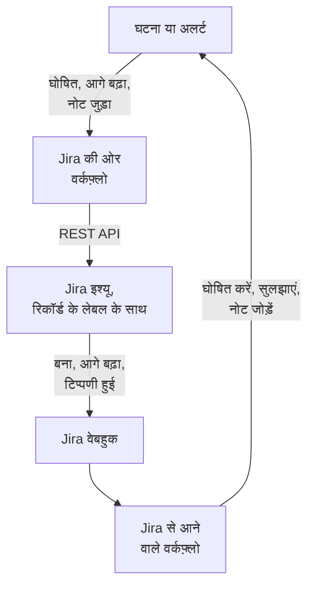

# Jira

[Jira](https://www.atlassian.com/software/jira) इश्यू को अपनी OneUptime घटनाओं और अलर्ट के साथ दोनों ओर से तालमेल में रखें। तैयार वर्कफ़्लो टेम्पलेट हर घटना या अलर्ट के लिए एक इश्यू खोलते हैं, रिकॉर्ड के आगे बढ़ने पर उसे आगे बढ़ाते हैं, और नोट को टिप्पणियों के रूप में उसमें कॉपी करते हैं। दूसरे टेम्पलेट नए इश्यू से घटनाएं घोषित करते हैं और स्टेटस बदलाव, टिप्पणियां और संपादन वापस लाते हैं। कोई प्लगइन नहीं है: वर्कफ़्लो Jira के REST API को कॉल करते हैं, और Jira उनके वेबहुक URL को कॉल करता है।

:::cards
- [टेम्पलेट से शुरू करें](#टेम्पलेट-से-शुरू-करें): 17 टेम्पलेट, वे क्या पूछते हैं, और उन्हें कैसे सेट करें।
- [टेम्पलेट कैसे काम करते हैं](#टेम्पलेट-कैसे-काम-करते-हैं): इश्यू और रिकॉर्ड बिना लूप के कैसे जुड़े रहते हैं।
- [खुद बनाएं](#खुद-बनाएं): जब कोई टेम्पलेट फ़िट न हो, तब हर दिशा हाथ से।
- [समस्या निवारण](#समस्या-निवारण): Jira के जवाबों का क्या मतलब है।
:::

> [!NOTE]
> Atlassian, Jira Cloud में चीज़ों के नाम बदल रहा है: UI के बड़े हिस्से में **प्रोजेक्ट** अब **स्पेस** है, और **इश्यू** अब **वर्क आइटम** है। साइटें दोनों शब्द इस्तेमाल करती हैं, इसलिए जहां शब्द मायने रखते हैं, वहां आपको यहां दोनों मिलेंगे।

## यह कैसे काम करता है



हर टेम्पलेट एक छोटा वर्कफ़्लो है, इसलिए आप सिर्फ़ वे दिशाएं लेते हैं जो आपको चाहिए, घटनाओं, अलर्ट या दोनों के लिए। OneUptime → Jira टेम्पलेट OneUptime के किसी इवेंट से शुरू होते हैं और Jira के REST API को कॉल करते हैं। Jira → OneUptime टेम्पलेट Jira वेबहुक से शुरू होते हैं। सभी इश्यू पर लगे दो लेबल से एक-दूसरे के रिकॉर्ड ढूंढते हैं।

इस पेज पर सब कुछ **Jira Cloud** के लिए लिखा गया है। सेल्फ़-मैनेज्ड Jira पर क्या बदलता है, यह [Jira Data Center](#jira-data-center) में है।

## शुरू करने से पहले

- एक Jira Cloud साइट, जैसे `https://your-domain.atlassian.net`, और इश्यू दर्ज करने के लिए एक प्रोजेक्ट।
- इंटिग्रेशन के लिए एक Jira यूज़र, और उसके लिए एक API टोकन। यूज़र को प्रोजेक्ट में **Browse Projects**, **Create Issues**, **Edit Issues**, **Add Comments** और **Transition Issues** दें।
- एक Jira एडमिनिस्ट्रेटर, जो Jira → OneUptime टेम्पलेट के लिए ज़रूरी वेबहुक रजिस्टर करे।
- OneUptime में वर्कफ़्लो बनाने का अधिकार। OneUptime Cloud पर वर्कफ़्लो के लिए **Growth** प्लान या उससे ऊपर चाहिए।

## टेम्पलेट से शुरू करें

**एक वर्कफ़्लो बनाएं** डायलॉग की कैटेगरी सूची में **Jira** के नीचे 17 Jira टेम्पलेट हैं: पहले घटनाओं के लिए नौ, फिर अलर्ट के लिए आठ, हर सेट अपने शीर्षक के नीचे। वे एक ही नियम साझा करते हैं, Jira इश्यू पर लेबल, इसलिए उनका कोई भी मेल एक साथ काम करता है।

### घटना टेम्पलेट

| टेम्पलेट | क्या करता है | क्या पूछता है |
| --- | --- | --- |
| **OneUptime → Jira** | | |
| Create a Jira issue when an incident is declared | हर नई घटना के लिए एक इश्यू दर्ज करता है और उस पर घटना के ID का लेबल लगाता है। Jira से घोषित घटनाएं, और निजी घटनाएं, छोड़ दी जाती हैं। | API URL, API टोकन, प्रोजेक्ट कुंजी, इश्यू प्रकार, OneUptime URL |
| Move the Jira issue when the incident is acknowledged or resolved | जुड़े हुए इश्यू को आगे बढ़ाता है: घटना स्वीकार होने पर In Progress स्टेटस पर, और सुलझने पर Done स्टेटस पर। उसे कभी पीछे नहीं ले जाता। | API URL, API टोकन |
| Copy incident private notes to the Jira issue | हर नए निजी नोट को जुड़े हुए इश्यू पर टिप्पणी के रूप में पोस्ट करता है — Jira Service Management में यह आंतरिक टिप्पणी होती है। | API URL, API टोकन |
| Copy incident public notes to the Jira issue | हर नए सार्वजनिक नोट को जुड़े हुए इश्यू पर टिप्पणी के रूप में पोस्ट करता है। | API URL, API टोकन |
| Comment on the Jira issue when the incident is edited | जब घटना का शीर्षक, गंभीरता, विवरण, मूल कारण या सुधार नोट बदलते हैं, तो घटना की मौजूदा स्थिति पोस्ट करता है — Jira Service Management में यह आंतरिक टिप्पणी होती है। | API URL, API टोकन |
| **Jira → OneUptime** | | |
| Declare an incident when a Jira issue is created | हर नए इश्यू के लिए एक घटना घोषित करता है, जो आपके स्टेटस पेज से दूर रहती है, इश्यू की प्राथमिकता से चुनी गई गंभीरता के साथ, फिर दोनों को जोड़ने के लिए इश्यू पर लेबल लगाता है। | साइट URL, API URL, API टोकन, और **Issue created** के लिए एक Jira वेबहुक |
| Acknowledge or resolve the incident when its Jira issue moves | जुड़ा हुआ इश्यू In Progress स्टेटस पर जाने पर घटना को स्वीकार करता है, और Done स्टेटस पर जाने पर उसे सुलझाता है। | **Issue updated** के लिए एक Jira वेबहुक |
| Add Jira comments to the incident as private notes | जुड़े हुए इश्यू की हर टिप्पणी को घटना पर निजी नोट के रूप में कॉपी करता है। | साइट URL, API URL, API टोकन, और **Comment created** के लिए एक Jira वेबहुक |
| Add Jira issue changes to the incident as private notes | जुड़े हुए इश्यू के हर संपादन — प्राथमिकता, असाइनी, सारांश वगैरह — को घटना पर निजी नोट के रूप में दर्ज करता है। स्टेटस बदलाव ऊपर वाले टेम्पलेट पर छोड़े जाते हैं। | साइट URL, और **Issue updated** के लिए एक Jira वेबहुक |

### अलर्ट टेम्पलेट

अलर्ट टेम्पलेट अलर्ट के लिए वही काम करते हैं। इनमें एक कम है, क्योंकि अलर्ट में सार्वजनिक नोट नहीं होते। बाकी अंतर [अलर्ट के लिए क्या अलग है](#अलर्ट-के-लिए-क्या-अलग-है) में हैं।

| टेम्पलेट | क्या करता है | क्या पूछता है |
| --- | --- | --- |
| **OneUptime → Jira** | | |
| Create a Jira issue when an alert is created | हर नए अलर्ट के लिए एक इश्यू दर्ज करता है, मॉनिटर से उठने वाले हर अलर्ट समेत, और उस पर अलर्ट के ID का लेबल लगाता है। Jira से बने अलर्ट, और निजी अलर्ट, छोड़ दिए जाते हैं। | API URL, API टोकन, प्रोजेक्ट कुंजी, इश्यू प्रकार, OneUptime URL |
| Move the Jira issue when the alert is acknowledged or resolved | जुड़े हुए इश्यू को आगे बढ़ाता है: अलर्ट स्वीकार होने पर In Progress स्टेटस पर, और सुलझने पर Done स्टेटस पर। उसे कभी पीछे नहीं ले जाता। | API URL, API टोकन |
| Copy alert private notes to the Jira issue | हर नए निजी नोट को जुड़े हुए इश्यू पर टिप्पणी के रूप में पोस्ट करता है — Jira Service Management में यह आंतरिक टिप्पणी होती है। | API URL, API टोकन |
| Comment on the Jira issue when the alert is edited | जब अलर्ट का शीर्षक, गंभीरता, विवरण, मूल कारण या सुधार नोट बदलते हैं, तो अलर्ट की मौजूदा स्थिति पोस्ट करता है — Jira Service Management में यह आंतरिक टिप्पणी होती है। | API URL, API टोकन |
| **Jira → OneUptime** | | |
| Create an alert when a Jira issue is created | हर नए इश्यू के लिए एक अलर्ट बनाता है, इश्यू की प्राथमिकता से चुनी गई गंभीरता के साथ, फिर दोनों को जोड़ने के लिए इश्यू पर लेबल लगाता है। | साइट URL, API URL, API टोकन, और **Issue created** के लिए एक Jira वेबहुक |
| Acknowledge or resolve the alert when its Jira issue moves | जुड़ा हुआ इश्यू In Progress स्टेटस पर जाने पर अलर्ट को स्वीकार करता है, और Done स्टेटस पर जाने पर उसे सुलझाता है। | **Issue updated** के लिए एक Jira वेबहुक |
| Add Jira comments to the alert as private notes | जुड़े हुए इश्यू की हर टिप्पणी को अलर्ट पर निजी नोट के रूप में कॉपी करता है। | साइट URL, API URL, API टोकन, और **Comment created** के लिए एक Jira वेबहुक |
| Add Jira issue changes to the alert as private notes | जुड़े हुए इश्यू के हर संपादन — प्राथमिकता, असाइनी, सारांश वगैरह — को अलर्ट पर निजी नोट के रूप में दर्ज करता है। स्टेटस बदलाव ऊपर वाले टेम्पलेट पर छोड़े जाते हैं। | साइट URL, और **Issue updated** के लिए एक Jira वेबहुक |

कोई भी OneUptime → Jira टेम्पलेट [**निजी घटना**](/docs/incidents/declaring-incidents#चरण-1-घटना-विवरण) चिह्नित घटना, या **निजी अलर्ट** चिह्नित अलर्ट, Jira को नहीं भेजता: न रिकॉर्ड, न उसकी स्थिति, न उसके नोट, न उसके संपादन, जब तक आप इसे चालू न करें। [सीमाएं](#सीमाएं) देखें।

### अलर्ट के लिए क्या अलग है

हर अलर्ट टेम्पलेट अपने घटना वाले जोड़ीदार की तरह, कदम-दर-कदम बना है। जहां अलर्ट घटनाओं से अलग हैं, वहां टेम्पलेट भी अलग हैं:

- **सार्वजनिक नोट नहीं।** अलर्ट में सिर्फ़ निजी नोट होते हैं, इसलिए अलर्ट टेम्पलेट की पोस्ट की गई हर टिप्पणी Jira Service Management में आंतरिक टिप्पणी होती है।
- **स्टेटस पेज नहीं।** अलर्ट कभी स्टेटस पेज तक नहीं पहुंचता, इसलिए **Create an alert when a Jira issue is created** गंभीरता, शीर्षक, विवरण और `customFields.jiraIssueKey` लिखता है, और कुछ नहीं।
- **दो गंभीरताएं, इसलिए Medium, Low बन जाता है।** नए प्रोजेक्ट में अलर्ट की दो गंभीरताएं होती हैं, High और Low, जबकि घटनाओं की तीन होती हैं। बनाने वाला टेम्पलेट Jira की प्राथमिकताओं को प्रोजेक्ट में मौजूद गंभीरताओं में बांटता है। डिफ़ॉल्ट दो पर, Highest, High, Critical और Blocker, High बनते हैं, और बाकी हर प्राथमिकता Low बनती है, Medium और Major समेत। Medium को High पर भेजने के लिए `prepare-alert-1` स्क्रिप्ट में `PRIORITY_RANK` में `medium: 1` को `medium: 0` में बदलें।
- **अलर्ट के लिंक और लेबल।** इश्यू `/dashboard/<project id>/alerts/<alert id>` से लिंक होता है, और उस पर `oneuptime-alert-<alert id>` लेबल लगता है।
- **नंबर बताते हैं कि वे किसके नंबर हैं।** डिफ़ॉल्ट `#` प्रीफ़िक्स के साथ, अलर्ट और घटना दोनों `#12` हो सकते हैं, इसलिए टेम्पलेट `Alert #12` या `Incident #12` लिखते हैं। अपने प्रीफ़िक्स वाला नंबर, जैसे `ALT-12`, जैसा है वैसा लिखा जाता है।
- **निजी अलर्ट।** **निजी अलर्ट** चिह्नित अलर्ट, चाहे हाथ से या किसी अलर्ट प्राइवेसी नियम से, Jira से बाहर रहता है, जब तक आप `SYNC_PRIVATE_ALERTS` को `true` पर सेट न करें।

**मॉनिटर अपने-आप अलर्ट उठाते हैं, और बहुत सारे उठा सकते हैं।** **Create a Jira issue when an alert is created** हर एक के लिए इश्यू दर्ज करता है। जब तक हर अलर्ट टिकट के लायक न हो, Jira चरण से पहले एक शर्त लगाएं। सिर्फ़ High अलर्ट के लिए इश्यू दर्ज करने के लिए:

1. वर्कफ़्लो का **बिल्डर** खोलें और एक **If / Else** ब्लॉक जोड़ें।
2. **Value to check** को `{{local.components.alert-on-create-1.returnValues.model.alertSeverity.name}}` पर, **Comparison** को **is equal to** पर, और **Compare with** को `High` पर सेट करें।
3. `alert-on-create-1` से `prepare-issue-1` तक की लाइन को उसका सिरा बिंदु से हटाकर खींचते हुए हटाएं ([साफ़-सफ़ाई](/docs/workflows/authoring#साफ़-सफ़ाई) देखें)। ट्रिगर के **Success** को **If / Else** ब्लॉक से, और उसके **Yes** को `prepare-issue-1` से जोड़ें।

जो अलर्ट **No** साइड पर जाता है, उसका रन वहीं खत्म होता है, और उसके लिए कोई इश्यू दर्ज नहीं होता।

### टेम्पलेट क्या पूछते हैं

बनाने वाले विज़ार्ड का **कॉन्फ़िगर करें** चरण अधिकतम पांच मान पूछता है। ऊपर की तालिकाएं दिखाती हैं कि किस टेम्पलेट को कौन से चाहिए।

- **Jira Site URL** — वह पता जिस पर आप Jira खोलते हैं, जैसे `https://your-domain.atlassian.net`। Jira Data Center पर इसका बेस URL, जैसे `https://jira.example.com:8443` या `https://example.com/jira`। Jira को OneUptime में लाने वाले टेम्पलेट अपने लिखे विवरण या नोट में इश्यू का लिंक देते हैं, और वह लिंक हमेशा इसी साइट पर जाता है, इवेंट चाहे कुछ भी कहे। इसलिए यह फ़ील्ड सिर्फ़ साइट का पता लेता है: एक स्कीम, एक होस्ट, अगर हो तो एक पोर्ट और, Data Center पर, वह पाथ जिसके नीचे Jira चलता है। यह साइट के किसी पेज का पता, कोई क्वेरी या कोई यूज़र नाम अस्वीकार करता है, और बताता है कि उसकी जगह क्या टाइप करें। आखिर में स्लैश चलेगा। अगर बाद में वेरिएबल खाली कर दिया जाए, तो इश्यू का नाम बिना लिंक के दिया जाता है।
- **Jira API URL** — जहां वर्कफ़्लो अपने Jira अनुरोध भेजता है: आपकी साइट, जैसे `https://your-domain.atlassian.net`, आखिर में स्लैश के बिना। स्कोप वाले API टोकन के साथ, जिसमें हर सर्विस अकाउंट टोकन शामिल है, इसकी जगह `https://api.atlassian.com/ex/jira/<cloudId>` इस्तेमाल करें। आपका `cloudId` `https://your-domain.atlassian.net/_edge/tenant_info` के JSON में है। क्लासिक टोकन के साथ यह **Jira Site URL** वाला ही पता है, इसलिए जो टेम्पलेट दोनों पूछते हैं, उनमें विज़ार्ड इसे **Jira Site URL** से भरता है, जब तक आप इसमें खुद टाइप न करें।
- **Jira API Token (base64 of email:token)** — अकेला टोकन नहीं, बल्कि खाते का ईमेल और टोकन एक साथ एनकोड किए हुए, जैसे Jira Cloud Basic ऑथ लेता है। [API टोकन बनाएं](#api-टोकन-बनाएं) में तरीका है। टोकन समाप्त होते हैं, डिफ़ॉल्ट रूप से बनने के एक साल बाद, इसलिए तारीख कहीं लिख लें।
- **Jira Project Key** — वह प्रोजेक्ट (स्पेस) जिसमें नए इश्यू दर्ज होते हैं: `OPS-123` में `OPS`।
- **Jira Issue Type** — बनाए जाने वाले इश्यू का प्रकार, ठीक वैसे लिखा हुआ जैसा उस प्रोजेक्ट में है, जैसे `Task`, `Bug` या `Incident`।
- **OneUptime URL** — वह पता जिस पर आप OneUptime खोलते हैं: `https://oneuptime.com`, या आपका अपना होस्ट। इश्यू का विवरण इसी से घटना या अलर्ट से वापस लिंक होता है।

### API टोकन बनाएं

:::steps
1. किसी व्यक्ति के बजाय एक समर्पित Jira यूज़र के लिए टोकन बनाएं, यानी एक सामान्य Atlassian खाता जिसे सिर्फ़ इंटिग्रेशन इस्तेमाल करता है: इश्यू और टिप्पणियां टोकन के मालिक के नाम दर्ज होती हैं। उस यूज़र के रूप में साइन इन करें और [id.atlassian.com/manage-profile/security/api-tokens](https://id.atlassian.com/manage-profile/security/api-tokens) पर टोकन बनाएं। क्लासिक टोकन (**Create API token**) आपके साइट URL के साथ काम करता है। स्कोप वाला टोकन (**Create API token with scopes**) सिर्फ़ ऊपर के `api.atlassian.com` पते के साथ काम करता है। क्लासिक स्कोप `read:jira-work` और `write:jira-work` टेम्पलेट की हर कॉल को कवर करते हैं।
2. उस खाते का ईमेल और टोकन एनकोड करें:

   ```bash
   printf '%s' 'jira-bot@example.com:your_api_token' | base64 | tr -d '\n'
   ```

   `echo` नहीं, `printf` इस्तेमाल करें: `echo` एक नई लाइन जोड़ता है, जो बाकी के साथ एनकोड हो जाती है, और Jira फिर क्रेडेंशियल स्वीकार नहीं करता। आपके साइट URL पर यह शायद ही कभी `401` के रूप में दिखता है ([सीमाएं](#सीमाएं) देखें)। `tr` आउटपुट को एक लाइन में रखता है: Linux पर GNU `base64` हर 76 अक्षरों पर लाइन तोड़ता है, और आज का टोकन इतना लंबा है कि टूट जाए।

3. आउटपुट को **Jira API Token (base64 of email:token)** में पेस्ट करें।
:::

एक Atlassian **सर्विस अकाउंट** भी काम करता है। संगठन का एडमिन इसे, और इसका टोकन, [admin.atlassian.com](https://admin.atlassian.com) में **Directory → Service accounts** के नीचे बनाता है। वह टोकन हमेशा स्कोप वाला होता है, इसलिए **Jira API URL** को `https://api.atlassian.com/ex/jira/<cloudId>` पता होना चाहिए (**Jira Site URL** आपकी साइट ही रहता है), और आप जो ईमेल एनकोड करते हैं वह सर्विस अकाउंट का अपना है। सर्विस अकाउंट को ऊपर बताई गई प्रोजेक्ट अनुमतियां दें, जैसे किसी भी यूज़र को देते हैं।

### वर्कफ़्लो बनाएं

:::steps
1. **वर्कफ़्लो → वर्कफ़्लो बनाएं** खोलें। **या किसी टेम्पलेट से शुरू करें** के नीचे कैटेगरी सूची से **Jira** चुनें, या **टेम्पलेट खोजें…** में `Jira` टाइप करें, और अपने चाहे टेम्पलेट पर क्लिक करें। यह खुलकर दिखाता है कि यह क्या करता है और कौन सी सेटिंग पूछेगा। **यह टेम्पलेट इस्तेमाल करें** पर क्लिक करें।
2. **नाम** टेम्पलेट से भरा जाता है। चाहें तो इसे बदलें।
3. **कॉन्फ़िगर करें** ऊपर के मान पूछता है। वे वर्कफ़्लो के अपने वेरिएबल के रूप में, उसके मेन्यू में **वर्कफ़्लो वेरिएबल** के नीचे सहेजे जाते हैं। API टोकन सीक्रेट के रूप में सहेजा जाता है: यह **लॉग → रन** से छिपाया जाता है, और सिर्फ़ Jira कॉल के `Authorization` हेडर में जाता है।
4. **वर्कफ़्लो बनाएं** पर क्लिक करें। हर वर्कफ़्लो बंद अवस्था में बनता है: उसके **बिल्डर** के ऊपर **सक्षम** चालू करें।
:::

**Create a Jira issue when an incident is declared** से शुरू करें, या अलर्ट के लिए **Create a Jira issue when an alert is created** से: उसी तरह का हर दूसरा OneUptime → Jira टेम्पलेट इसी के लगाए लेबल से इश्यू ढूंढता है। इसे चालू करें, एक टेस्ट घटना घोषित करें या एक टेस्ट अलर्ट बनाएं, और वर्कफ़्लो का **लॉग → रन** खोलें। रन के आखिरी चरण में `✅ Created Jira issue` लिखा होना चाहिए और नया इश्यू दिखना चाहिए।

हर वर्कफ़्लो इन मानों की अपनी कॉपी रखता है। टोकन बदलते समय, हर उस Jira वर्कफ़्लो में जिसने इसे पूछा था, **वर्कफ़्लो वेरिएबल** के नीचे `jiraBasicAuthToken` अपडेट करें। अगर Jira किसी दूसरे पते पर जाता है, तो `jiraSiteUrl` और `jiraBaseUrl` को भी इसी तरह अपडेट करें।

### वेबहुक टेम्पलेट जोड़ें

Jira → OneUptime टेम्पलेट, घटनाओं के लिए चार और अलर्ट के लिए चार, एक [Webhook ट्रिगर](/docs/workflows/triggers#webhook) से शुरू होते हैं, इसलिए Jira को बताना होगा कि वह अपने इवेंट कहां भेजे। इसे इस क्रम में करें:

1. वर्कफ़्लो बनाएं और **पहले उसे चालू करें**। बंद वर्कफ़्लो Jira को `400` से जवाब देता है, और Jira `4xx` से अस्वीकार हुई डिलीवरी दोबारा नहीं भेजता। चालू करने से पहले भेजे गए इवेंट खो जाते हैं, कतार में नहीं रखे जाते।
2. वर्कफ़्लो का **बिल्डर** खोलें, **Webhook** ट्रिगर ब्लॉक (`webhook-1`) पर क्लिक करें, और उसकी सेटिंग के ऊपर **URL कॉपी करें** पर क्लिक करें। URL कुछ ऐसा दिखता है:

   ```text
   https://<your OneUptime host>/workflow/trigger/<webhook secret key>
   ```

3. Jira में **Settings → System → WebHooks** (**Advanced** के नीचे) पर जाएं और **Create a WebHook** पर क्लिक करें। URL पेस्ट करें, **Issue related events** के नीचे नीचे दी गई तालिका का इवेंट टिक करें, और एक JQL फ़िल्टर डालें ताकि सिर्फ़ आपके प्रोजेक्ट के इश्यू इसे चलाएं। **Exclude body** पर टिक न करें: वर्कफ़्लो सब कुछ बॉडी से पढ़ता है।

| टेम्पलेट | Jira इवेंट | JQL फ़िल्टर |
| --- | --- | --- |
| **घटनाएं** | | |
| Declare an incident when a Jira issue is created | **Issue created** | `project = OPS AND (labels is EMPTY OR labels != oneuptime)` |
| Acknowledge or resolve the incident when its Jira issue moves | **Issue updated** | `project = OPS` |
| Add Jira comments to the incident as private notes | **Comment created** | `project = OPS` |
| Add Jira issue changes to the incident as private notes | **Issue updated** | `project = OPS` |
| **अलर्ट** | | |
| Create an alert when a Jira issue is created | **Issue created** | `project = OPS AND (labels is EMPTY OR labels != oneuptime)` |
| Acknowledge or resolve the alert when its Jira issue moves | **Issue updated** | `project = OPS` |
| Add Jira comments to the alert as private notes | **Comment created** | `project = OPS` |
| Add Jira issue changes to the alert as private notes | **Issue updated** | `project = OPS` |

`OPS` को अपनी प्रोजेक्ट कुंजी से बदलें। रिकॉर्ड बनाने वाले दो टेम्पलेट पर लगा फ़िल्टर OneUptime के खोले इश्यू को उन तक पहुंचने ही नहीं देता: वे उन्हें वैसे भी छोड़ देते, पर जो इवेंट कभी पहुंचता नहीं, उस पर कोई रन खर्च नहीं होता। अकेला `labels != oneuptime` हर बिना लेबल वाले इश्यू को भी हटा देता, इसीलिए `labels is EMPTY` वहां है। बाकी टेम्पलेट सिर्फ़ जुड़े हुए इश्यू पर काम करते हैं, इसलिए उनके लिए `project = OPS AND labels = oneuptime` ज़्यादा सख्त फ़िल्टर है।

हर वर्कफ़्लो का अपना URL होता है, इसलिए हर एक को अपना Jira वेबहुक चाहिए। **Issue updated** पर दो टेम्पलेट का मतलब है दो वेबहुक, और अलर्ट वाले संस्करण भी इस्तेमाल करने पर चार।

**रिकॉर्ड बनाने वाले दोनों टेम्पलेट इस्तेमाल कर रहे हैं?** **Declare an incident when a Jira issue is created** और **Create an alert when a Jira issue is created** दोनों **Issue created** सुनते हैं। दोनों कुछ भी बनाने से पहले Jira से इश्यू के लेबल जांचते हैं, पर दोनों डिलीवरी एक साथ पहुंचती हैं, इसलिए नए इश्यू को घटना और अलर्ट दोनों मिल सकते हैं। दोनों को अलग-अलग इश्यू के लिए रजिस्टर करें, प्रोजेक्ट या इश्यू प्रकार के हिसाब से:

```text
project = OPS AND issuetype = Incident AND (labels is EMPTY OR labels != oneuptime)
project = OPS AND issuetype = Alert AND (labels is EMPTY OR labels != oneuptime)
```

ऐसे इश्यू प्रकार इस्तेमाल करें जो आपके प्रोजेक्ट में मौजूद हैं, ठीक वैसे लिखे जैसे Jira लिखता है।

इस पर भरोसा करने से पहले:

- **Jira सिर्फ़ HTTPS पर, अपने अनुमत पोर्ट पर कॉल करता है।** OneUptime Cloud के लिए यह ठीक है। सेल्फ़-होस्टेड इंस्टॉलेशन को इंटरनेट से HTTPS पर, Jira की सूची के किसी पोर्ट पर पहुंच योग्य होना चाहिए।
- **जिसके पास URL है, वह वर्कफ़्लो ट्रिगर कर सकता है।** Jira के वेबहुक में ऐसा कुछ नहीं होता जिसे वर्कफ़्लो जांच सके, इसलिए URL ही एकमात्र सीक्रेट है। जिसके पास यह है, वह घटनाएं घोषित कर सकता है या अलर्ट बना सकता है — रिकॉर्ड बनाने वाले टेम्पलेट Jira से पूछते हैं कि बताया गया इश्यू मौजूद है और अभी जुड़ा नहीं है, पर शीर्षक, विवरण और प्राथमिकता अनुरोध से लेते हैं — और उन घटनाओं और अलर्ट को आगे बढ़ा सकता है या उन पर नोट जोड़ सकता है जिनका ID या Jira इश्यू कुंजी उसे पता हो। ऐसा अनुरोध जो भी कहे, वह टेक्स्ट के रूप में लिखा जाता है ([सीमाएं](#सीमाएं) देखें), और इश्यू का लिंक आपके **Jira Site URL** की बताई साइट पर ही जाता है, अनुरोध चाहे कुछ भी कहे। URL को सिर्फ़ Jira में रखें। अगर यह लीक हो जाए, तो वर्कफ़्लो के **बिल्डर** में **Webhook** ट्रिगर पर क्लिक करें, **URL रीसेट करें** पर क्लिक करें, और नया URL Jira वेबहुक में पेस्ट करें। पुराना URL तुरंत काम करना बंद कर देता है।
- **हर इवेंट एक रन है।** OneUptime Cloud पर हर डिलीवरी आपके प्लान के वर्कफ़्लो रन में गिनी जाती है, जिनमें वे भी शामिल हैं जिन्हें कोई टेम्पलेट छोड़ देता है। JQL फ़िल्टर यह संख्या कम रखता है। [प्लान सीमाएं](/docs/workflows/configuration#प्लान-की-सीमाएँ) देखें।

### जांचें कि यह काम करता है

हर टेम्पलेट एक **Log** चरण पर खत्म होता है जो बताता है कि क्या हुआ, इसलिए **लॉग → रन** में रन का आखिरी चरण देखने की जगह है:

- `✅` — इसने अपना काम किया, और इश्यू, घटना या अलर्ट बताता है।
- `ℹ️` — इसने जानबूझकर इवेंट छोड़ा, और बताता है क्यों: इश्यू इस तरह के रिकॉर्ड से जुड़ा नहीं है, नोट Jira से आया था, रिकॉर्ड निजी है, या नई स्थिति के लिए कोई Jira स्टेटस मैप नहीं है।
- `❌` — कोई कॉल विफल हुई। Jira कॉल के लिए लाइन में Jira का जवाब शामिल होता है।
- `⚠️` — Jira इश्यू से रिकॉर्ड बनाने वाले टेम्पलेट ने उसे बना दिया, पर Jira ने लिंक लेबल नहीं लिए, इसलिए दूसरे टेम्पलेट अभी उसे नहीं ढूंढ सकते। लेबल हाथ से जोड़ें।

छोड़ा गया रन भी **चलाया गया** पर खत्म होता है। छोड़ना सामान्य है: ज़्यादातर Jira इवेंट ऐसे नहीं होते जिन पर कोई खास टेम्पलेट काम करे। [वर्कफ़्लो रन](/docs/workflows/runs-and-logs) देखें।

## टेम्पलेट कैसे काम करते हैं

### दोनों तरफ़ कैसे जुड़ी रहती हैं

लिंक Jira रखता है। किसी घटना या अलर्ट से जुड़े इश्यू पर दो लेबल होते हैं:

- `oneuptime`, जो इश्यू को जुड़ा हुआ चिह्नित करता है।
- घटना के लिए `oneuptime-incident-<incident id>`, या अलर्ट के लिए `oneuptime-alert-<alert id>`, जो रिकॉर्ड बताता है। ID डैशबोर्ड में रिकॉर्ड के पते का आखिरी हिस्सा है: `/dashboard/<project id>/incidents/<incident id>`।

इश्यू बनाने वाले दो टेम्पलेट इश्यू दर्ज करते समय दोनों लेबल जोड़ते हैं, और Jira इश्यू से रिकॉर्ड बनाने वाले दो टेम्पलेट रिकॉर्ड बनते ही दोनों जोड़ते हैं। बाकी हर टेम्पलेट इन्हीं से दूसरी तरफ़ पहुंचता है: OneUptime → Jira वाले Jira में रिकॉर्ड का लेबल खोजते हैं, और Jira → OneUptime वाले इश्यू के लेबल से रिकॉर्ड का ID पढ़ते हैं। इसलिए इनका नाम न बदलें और इन्हें न हटाएं। हाथ से खोले इश्यू को जोड़ने के लिए दोनों लेबल खुद जोड़ें, पर सिर्फ़ तब जब रिकॉर्ड का अभी कोई इश्यू न हो।

**इश्यू किसी घटना से या किसी अलर्ट से जुड़ा होता है, दोनों से कभी नहीं।** रिकॉर्ड बनाने वाले टेम्पलेट हर उस इश्यू को छोड़ देते हैं जिस पर `oneuptime` हो, या `oneuptime-incident-` या `oneuptime-alert-` से शुरू होने वाला लेबल हो, और एक तरह के टेम्पलेट दूसरी तरह से जुड़े इश्यू को अनदेखा करते हैं। हाथ से इश्यू जोड़ते समय उसे एक ही रिकॉर्ड लेबल दें, हर तरह का एक-एक नहीं।

**रिकॉर्ड का एक ही इश्यू होता है।** इश्यू पर पोस्ट करने या उसे आगे बढ़ाने वाले टेम्पलेट तभी काम करते हैं जब ठीक एक इश्यू पर रिकॉर्ड का लेबल हो। Jira में इश्यू क्लोन करने से उसके लेबल भी कॉपी होते हैं, इसलिए जुड़े हुए इश्यू का क्लोन उसी रिकॉर्ड पर दावा करता है। उसके बाद ये टेम्पलेट रुक जाते हैं, और हर रन एक ऐसे छोड़ने पर खत्म होता है जो दोनों इश्यू बताता है:

```text
More than one Jira issue is labelled oneuptime-incident-<id> (OPS-17, OPS-30). A cloned issue copies the label: remove it from every issue except the one filed for the incident.
```

दूसरी दिशा में ऐसी कोई जांच नहीं है: क्लोन पर स्टेटस बदलाव, टिप्पणियां और संपादन रिकॉर्ड तक ऐसे पहुंचते हैं जैसे वे मूल इश्यू पर किए गए हों। इसलिए जुड़े हुए इश्यू को क्लोन करते समय क्लोन से दोनों लेबल हटा दें।

Jira से बनी घटनाएं और अलर्ट इश्यू कुंजी को `customFields.jiraIssueKey` में भी रखते हैं, जो उनके बनते समय लिखी जाती है। इसी से इश्यू बनाने वाले टेम्पलेट जानते हैं कि रिकॉर्ड का पहले से एक इश्यू है।

### टेम्पलेट लूप से कैसे बचते हैं

एक दिशा में हर लिखाई दूसरी दिशा में एक इवेंट है: Jira में पोस्ट की गई टिप्पणी **Comment created** वेबहुक के रूप में वापस आती है, और OneUptime में जोड़ा गया नोट नोट ट्रिगर चलाता है। तीन चीज़ें इस गूंज को रोकती हैं:

- **टेक्स्ट में मार्कर।** टेम्पलेट Jira में जो भी टिप्पणी पोस्ट करते हैं, वह `Synced from OneUptime` से शुरू होती है। Jira से लिखा हर नोट, और Jira से की गई हर स्थिति बदलाव का मूल कारण, `Synced from Jira` से शुरू होता है। हर दिशा दूसरी तरफ़ के मार्कर वाला टेक्स्ट छोड़ देती है, उस टिप्पणी में भी जो किसी ने मार्कर को उद्धृत करते हुए लिखी हो।
- **नए इश्यू पर लेबल।** OneUptime के खोले इश्यू पर `oneuptime` लेबल होता है, और रिकॉर्ड बनाने वाले टेम्पलेट उन्हें छोड़ देते हैं। वे कुछ भी बनाने से पहले इवेंट पर भरोसा करने के बजाय Jira से इश्यू के लेबल पूछते हैं। Jira से बने रिकॉर्ड में `customFields.jiraIssueKey` होता है, और इश्यू बनाने वाले टेम्पलेट उन्हें छोड़ देते हैं।
- **स्थितियां दोनों तरफ़ सिर्फ़ आगे बढ़ती हैं।** स्टेटस टेम्पलेट रिकॉर्ड की स्थिति टाइमलाइन पर एक नई पंक्ति लिखते हैं, जैसे **सुलझाएं** बटन करता है, और हमेशा किसी बाद की स्थिति पर। ट्रांज़िशन टेम्पलेट भी कभी इश्यू को पीछे नहीं ले जाते। इसलिए जब एक तरफ़ सुलझाती है, तो दूसरी तरफ़ खुद को पहले से पूरा पाती है और कुछ नहीं बदलती।

टेम्पलेट संपादित करते समय मार्कर बनाए रखें। वे हर स्क्रिप्ट के ऊपर हेल्पर ब्लॉक में `FROM_ONEUPTIME` और `FROM_JIRA` कॉन्स्टेंट हैं। अपने मार्कर के बिना लिखी टिप्पणी या नोट सीधे वापस कॉपी हो जाता है।

### ट्रांज़िशन टेम्पलेट स्टेटस कैसे चुनता है

Jira में "Done पर ले जाओ" जैसी कोई कॉल नहीं है। इश्यू एक ट्रांज़िशन से आगे बढ़ता है, और उसके पास कौन से ट्रांज़िशन हैं, यह उसके वर्कफ़्लो और उसके स्टेटस पर निर्भर करता है। इसलिए **Move the Jira issue when the incident is acknowledged or resolved**, और उसका अलर्ट वाला जोड़ीदार, इश्यू के लिए खुले ट्रांज़िशन पढ़ते हैं और जिस स्टेटस तक वह ले जाता है, उसके हिसाब से एक चुनते हैं:

- **सिर्फ़ आगे।** Jira स्टेटस को तीन कैटेगरी में बांटता है, To Do, In Progress और Done, और टेम्पलेट कभी ऐसा ट्रांज़िशन नहीं चुनता जो इश्यू की कैटेगरी से पहले वाली कैटेगरी में ले जाए, `STATE_TO_JIRA_STATUS` में बताए गए स्टेटस के लिए भी नहीं। जिस घटना का इश्यू पहले से Done है, उसे स्वीकार करने पर नतीजा `Jira issue OPS-17 is already Done, so it was not moved back to an In Progress status.` होता है।
- **आम नाम पहले।** सुलझे हुए रिकॉर्ड के लिए Done, Resolved, Closed, Complete, Completed या Fixed नाम का स्टेटस जीतता है। स्वीकार किए गए रिकॉर्ड के लिए In Progress या Work in Progress जीतता है। सही कैटेगरी में किसी दूसरे नाम का स्टेटस तब इस्तेमाल होता है जब वही अकेला फ़िट हो।
- **काम छोड़ देने वाला अनुमान कभी नहीं।** जिस स्टेटस का नाम Canceled, Declined, Rejected, Won't Do, Duplicate, Obsolete, Waiting, Pending, Escalated, On Hold या Blocked जैसा लगे, उसे कभी नहीं चुना जाता, जब तक `STATE_TO_JIRA_STATUS` उसका नाम न ले। इसलिए Jira Service Management का जो अनुरोध Resolved या Canceled पर जा सकता है, वह Resolved पर जाता है।
- **एक ही स्टेटस के दो रास्ते।** जब दो ट्रांज़िशन एक ही स्टेटस तक ले जाते हैं, तो यह बिना स्क्रीन वाला चुनता है।

जब इसके बाद भी यह पक्का न हो, तो यह कुछ नहीं हिलाता और बताता है क्यों: दो स्टेटस बराबर फ़िट होते हैं, या कोई भी ट्रांज़िशन ऐसा नहीं है जिसे यह खुद चुन सके।

```text
Jira issue OPS-17 could move to Released or Deployed for a Done status. Name the one to use in STATE_TO_JIRA_STATUS.
Jira issue OPS-17 has no transition from In Review to a Done status that can be chosen without naming it in STATE_TO_JIRA_STATUS.
```

तब `plan-transition-1` स्क्रिप्ट के ऊपर `STATE_TO_JIRA_STATUS` में, अपनी OneUptime स्थिति के नामों से, स्टेटस बताएं। वहां सूचीबद्ध स्थिति इश्यू को नाम से उस स्टेटस पर ले जाती है, उसकी कैटेगरी चाहे जो हो, जब तक वह पीछे न जाए:

```javascript
const STATE_TO_JIRA_STATUS = {
  Resolved: "Resolved",
  Acknowledged: "In Progress",
};
```

### टेम्पलेट क्या करता है, इसे बदलना

वर्कफ़्लो का **बिल्डर** खोलें और जिस ब्लॉक को बदलना है उस पर क्लिक करें। आप जिन सेटिंग को सबसे ज़्यादा बदलना चाहेंगे, वे स्क्रिप्ट के ऊपर के पास कॉन्स्टेंट हैं, किसी **Run Custom JavaScript** ब्लॉक के **JavaScript Code** में, साझा हेल्पर ब्लॉक के ठीक नीचे। किसी टेम्पलेट के घटना और अलर्ट संस्करण वही कॉन्स्टेंट उन्हीं ब्लॉक में रखते हैं:

| कॉन्स्टेंट | टेम्पलेट, और ब्लॉक | क्या नियंत्रित करता है |
| --- | --- | --- |
| `STATE_TO_JIRA_STATUS` | Move the Jira issue when the incident (or alert) is acknowledged or resolved — `plan-transition-1` | OneUptime स्थिति के नाम को Jira स्टेटस के नाम से मैप करता है, जैसे `{ Resolved: 'Resolved', Acknowledged: 'In Progress' }`। जो स्थितियां सूची में नहीं हैं, वे अर्थ के हिसाब से चलती हैं: स्वीकार करने पर इश्यू In Progress स्टेटस पर जाता है, सुलझने पर Done पर, और कोई दूसरी स्थिति छोड़ दी जाती है। जब रन लॉग कहे, तब यहां स्टेटस बताएं — [ट्रांज़िशन टेम्पलेट स्टेटस कैसे चुनता है](#ट्रांज़िशन-टेम्पलेट-स्टेटस-कैसे-चुनता-है) देखें। |
| `PREFERRED_STATUS`, `NEVER_GUESS` | Move the Jira issue when the incident (or alert) is acknowledged or resolved — `plan-transition-1` | वे स्टेटस नाम जिन्हें टेम्पलेट अर्थ के हिसाब से चलते समय पसंद करता है, और वे जिन्हें वह कभी नहीं चुनता जब तक `STATE_TO_JIRA_STATUS` उनका नाम न ले। दोनों रेगुलर एक्सप्रेशन हैं जो केस को अनदेखा करते हुए स्टेटस नाम से मिलाए जाते हैं। |
| `SYNC_PRIVATE_INCIDENTS` | हर घटना वाला OneUptime → Jira टेम्पलेट — `prepare-issue-1`, `plan-transition-1` या `build-comment-1` | `false` **निजी घटना** चिह्नित घटनाओं को Jira से बाहर रखता है: उसके लिए कोई इश्यू दर्ज नहीं होता, उसका इश्यू आगे नहीं बढ़ता, और न उसके नोट, न उसके संपादन पोस्ट होते हैं। फिर भी भेजने के लिए इसे `true` पर सेट करें। हर टेम्पलेट की अपनी कॉपी है, इसलिए इसे हर उस टेम्पलेट में सेट करें जिसे उन्हें भेजना चाहिए। |
| `SYNC_PRIVATE_ALERTS` | हर अलर्ट वाला OneUptime → Jira टेम्पलेट — `prepare-issue-1`, `plan-transition-1` या `build-comment-1` | **निजी अलर्ट** चिह्नित अलर्ट के लिए वही: `false` उन्हें उन्हीं तरीकों से Jira से बाहर रखता है, और `true` उन्हें फिर भी भेजता है। इसे हर उस अलर्ट टेम्पलेट में सेट करें जिसे उन्हें भेजना चाहिए। |
| `JIRA_STATUS_TO_STATE` | Acknowledge or resolve the incident (or alert) when its Jira issue moves — `decide-state-1` | Jira स्टेटस के नाम को OneUptime स्थिति के नाम से मैप करता है, जैसे `{ 'In Review': 'Monitoring' }`। जो स्टेटस सूची में नहीं हैं, वे Jira की स्टेटस कैटेगरी के हिसाब से चलते हैं: In Progress घटना या अलर्ट को स्वीकार करता है, Done उसे सुलझाता है, और To Do किसी से मैप नहीं होता। |
| `PRIORITY_RANK` | Declare an incident when a Jira issue is created — `prepare-incident-1`; Create an alert when a Jira issue is created — `prepare-alert-1` | छोटे अक्षरों में लिखी Jira प्राथमिकता को `0` (आपकी सबसे गंभीर गंभीरता), `1` या `2` (आपकी सबसे कम गंभीर) से मैप करता है, और बीच वाली गंभीरताएं इस दायरे में बांटी जाती हैं। जो प्राथमिकताएं सूची में नहीं हैं, वे बीच में आती हैं। नए प्रोजेक्ट की दो अलर्ट गंभीरताओं के साथ `0` High है और `1` और `2` दोनों Low हैं, इसलिए Medium, Low बन जाता है, जब तक आप इसे `medium: 0` न कर दें। |
| `EVENTS` | Add Jira comments to the incident (or alert) as private notes — `read-comment-1` | वे टिप्पणी इवेंट जो नोट बनते हैं। संपादन भी कॉपी करने के लिए `'comment_updated'` जोड़ें — हर संपादन एक नया नोट बनता है — और Jira वेबहुक पर **Comment updated** भी टिक करें। |
| `IGNORED_FIELDS` | Add Jira issue changes to the incident (or alert) as private notes — `read-changes-1` | छोटे अक्षरों में वे Jira फ़ील्ड जिनके बदलाव नोट के लायक नहीं हैं। बदलाव तब छोड़ा जाता है जब उसका फ़ील्ड ID या उसका नाम सूची में हो, इसी तरह `'rank'` Rank को पकड़ता है, जो `customfield_10019` जैसे ID के रूप में आने वाला कस्टम फ़ील्ड है। Status सूची में है क्योंकि उसे स्टेटस टेम्पलेट संभालता है। |

कुंजी के रूप में इस्तेमाल होने वाले स्थिति और स्टेटस नाम ठीक वैसे ही लिखे जाने चाहिए जैसे उनके नाम हैं, बड़े अक्षरों समेत। कोड में `{{` न डालें: स्क्रिप्ट चलने से पहले किसी भी दूसरी सेटिंग की तरह भरी जाती है, इसलिए लगातार दो खुलने वाले कोष्ठक रेफ़रेंस के रूप में पढ़े जाएंगे।

नए इश्यू पर और फ़ील्ड भेजने के लिए, इश्यू बनाने वाले टेम्पलेट के `create-issue-1` ब्लॉक की **Request Body** संपादित करें। इसमें इश्यू का प्रोजेक्ट, इश्यू प्रकार, सारांश, लेबल और विवरण होते हैं, और आप `fields` के अंदर प्राथमिकता, कंपोनेंट, असाइनी या कस्टम फ़ील्ड जोड़ सकते हैं, उन रूपों में जो [और फ़ील्ड भरें](#और-फ़ील्ड-भरें) बताता है। दोनों लेबल बनाए रखें। सारांश और विवरण के शब्द `prepare-issue-1` स्क्रिप्ट में हैं। विवरण रिकॉर्ड की गंभीरता, स्थिति और विवरण देता है, फिर उसका मूल कारण और सुधार नोट, अगर हों: मॉनिटर घटना या अलर्ट उठाते समय इन्हें भरता है, और ये अक्सर उसे समझाते हैं।

निजी नोट और संपादन टिप्पणियां उनके `post-comment-1` ब्लॉक की **Request Body** में `properties` प्रविष्टि, `sd.public.comment`, से आंतरिक चिह्नित होती हैं। इसे सिर्फ़ Jira Service Management पढ़ता है। इसे तभी हटाएं जब ग्राहकों को वे टिप्पणियां दिखनी चाहिए।

### सीमाएं

- **सिर्फ़ Jira Cloud।** टेम्पलेट Basic ऑथ के साथ Jira Cloud REST API v3 को कॉल करते हैं। Data Center में v3 नहीं है और वह पर्सनल एक्सेस टोकन को `Bearer` के रूप में लेता है, इसलिए हर API ब्लॉक को [Jira Data Center](#jira-data-center) वाले बदलाव चाहिए: `/rest/api/2/...` पाथ, Atlassian Document Format बॉडी की जगह सादी स्ट्रिंग, और हेडर। `find-issue-1` ब्लॉक सबसे ज़्यादा बदलते हैं: Data Center में `/search/jql` नहीं है, इसलिए उन्हें इसके बजाय `/rest/api/2/search` पर `POST` करना होगा।
- **Jira से घोषित घटनाएं शांत रहती हैं।** वे आपके स्टेटस पेज से छिपी हुई बनती हैं, स्टेटस पेज सब्सक्राइबर को सूचित किए बिना, क्योंकि इश्यू का टेक्स्ट ग्राहकों के लिए नहीं लिखा गया था। किसी को दिखाने के लिए, घटना के **सेटिंग्स** पेज पर **स्थिति पृष्ठ पर दृश्यमान** चालू करें ([घटना को स्टेटस पेज से दूर रखना](/docs/incidents/states-and-severities#घटना-को-स्थिति-पृष्ठ-से-दूर-रखना) देखें), या टेम्पलेट के `create-incident-1` ब्लॉक में `isVisibleOnStatusPage` और `shouldStatusPageSubscribersBeNotifiedOnIncidentCreated` बदलें।
- **निजी घटनाएं और अलर्ट OneUptime में रहते हैं।** OneUptime → Jira टेम्पलेट उन्हें छोड़ देते हैं, और हर छोड़ना **लॉग → रन** में दर्ज होता है। फिर भी भेजने के लिए `SYNC_PRIVATE_INCIDENTS` या `SYNC_PRIVATE_ALERTS` को `true` पर सेट करें। बाद में किसी रिकॉर्ड को निजी बनाने से उसके बाद से सिंक रुक जाता है, पर Jira में जो पहले से है वह वापस नहीं लिया जाता। Jira → OneUptime टेम्पलेट यह जांच नहीं करते, इसलिए जुड़े हुए इश्यू पर टिप्पणियां, संपादन और स्टेटस बदलाव निजी रिकॉर्ड तक फिर भी पहुंचते हैं।
- **कुछ भी पीछे नहीं जाता।** Jira इश्यू को दोबारा खोलने से OneUptime में कुछ नहीं बदलता, और To Do कैटेगरी का स्टेटस किसी स्थिति से मैप नहीं होता। [क्रम एक असली बाधा है](/docs/incidents/states-and-severities#क्रम-एक-असली-बाधा-है-दिखावे-की-पसंद-नहीं) देखें। ट्रांज़िशन टेम्पलेट भी कभी इश्यू को पहले वाली स्टेटस कैटेगरी में नहीं ले जाते।
- **हर अलर्ट को इश्यू मिलता है।** निजी अलर्ट को छोड़कर, अलर्ट का इश्यू बनाने वाला टेम्पलेट हर अलर्ट के लिए इश्यू दर्ज करता है, मॉनिटर से उठने वाले हर एक समेत। शर्त कैसे जोड़ें, यह [अलर्ट के लिए क्या अलग है](#अलर्ट-के-लिए-क्या-अलग-है) दिखाता है।
- **शुरू के कुछ सेकंड में इश्यू छूट सकता है।** इश्यू बदलने के कुछ पल बाद Jira की खोज उसे पकड़ती है, इसलिए रिकॉर्ड बनने के बाद पहले कुछ सेकंड में हुआ नोट, स्थिति बदलाव या संपादन नया इश्यू नहीं पा सकता और `No Jira issue is labelled …` वाले छोड़ने पर खत्म हो सकता है। वह रन दोबारा नहीं चलता। Jira से रिकॉर्ड बनने के ठीक बाद भी, उसके लेबल जुड़ने तक, यही होता है।
- **Jira में निजी और सार्वजनिक का मतलब अलग है।** Jira Service Management प्रोजेक्ट में, निजी नोट और संपादन टिप्पणियां, जिनमें मूल कारण और सुधार होता है, आंतरिक टिप्पणियां बनती हैं, जबकि घटना के सार्वजनिक नोट ऐसी टिप्पणियां बनते हैं जो ग्राहक देख सकता है। किसी दूसरे तरह के प्रोजेक्ट में ये सभी सामान्य टिप्पणियां हैं जिन्हें इश्यू देख सकने वाला कोई भी पढ़ सकता है।
- **संपादन टिप्पणियां बदलावों के नहीं, सहेजने के पीछे चलती हैं।** घटना और अलर्ट के विवरण फ़ॉर्म हर बार सहेजने पर शीर्षक और गंभीरता भेजते हैं, इसलिए सिर्फ़ लेबल, या उसकी Private सेटिंग, बदलकर सहेजने पर भी पिछली वाली जैसे मानों के साथ एक टिप्पणी पोस्ट होती है। ट्रिगर वर्कफ़्लो को रिकॉर्ड वैसा देता है जैसा वह अब है, यह नहीं कि क्या बदला।
- **फ़ॉर्मेटिंग पार नहीं जाती।** नोट Jira में सादे टेक्स्ट के रूप में पोस्ट होते हैं, इसलिए Markdown अपने कच्चे अक्षरों के रूप में पहुंचता है। Jira का रिच टेक्स्ट OneUptime में उसी विकी मार्कअप के रूप में पहुंचता है जो Jira के वेबहुक भेजते हैं, जैसे `*bold*`, और ठीक वैसा ही पढ़ा जाता है जैसा लिखा गया था: किसी इश्यू, टिप्पणी, स्टेटस या नाम में टाइप की गई इमेज, लिंक, HTML, डायग्राम या `<!channel>` जैसा चैट मेंशन अपने अक्षरों के रूप में दिखता है और कुछ नहीं करता, क्योंकि उसे शुरू करने वाले अक्षर के बाद एक अदृश्य word joiner लगता है। टेक्स्ट की कॉपी में भी word joiner रहता है। इश्यू का लिंक वर्कफ़्लो के **Jira Site URL** की बताई साइट पर जाता है। वर्कफ़्लो वही स्क्रिप्ट रखता है जिनसे वह बना था, इसलिए किसी टेम्पलेट के पुराने संस्करण से बना वर्कफ़्लो टेक्स्ट उसी तरह लिखता है जैसे वह संस्करण लिखता था: यह पाने के लिए उसे उसके टेम्पलेट से दोबारा बनाएं।
- **Jira Site URL से पहले बने वर्कफ़्लो इश्यू को उस साइट पर लिंक करते हैं जो इवेंट बताता है।** वर्कफ़्लो वही स्क्रिप्ट और सेटिंग रखता है जिनसे वह बना था, इसलिए इश्यू से बनाने, टिप्पणी या इश्यू बदलाव वाला जो वर्कफ़्लो उसके टेम्पलेट के **Jira Site URL** पूछने से पहले बना था, वह अब भी इश्यू लिंक की साइट इवेंट में इश्यू के पते से लेता है। अपनी साइट पर लिंक करने के लिए, वर्कफ़्लो को उसके टेम्पलेट से दोबारा बनाएं, जो **Jira Site URL** पूछता है। नया वर्कफ़्लो चालू करें, पुराने की जगह उसका वेबहुक URL Jira वेबहुक में पेस्ट करें (हर वर्कफ़्लो का अपना URL होता है), फिर पुराना वर्कफ़्लो मिटा दें।
- **खराब या समाप्त टोकन शायद ही ऐसा बताता है।** आपके साइट URL पर Jira जिस कॉल को ऑथेंटिकेट नहीं कर पाता, उसका जवाब ऐसे देता है जैसे किसी अनाम विज़िटर को, `401` से नहीं। इसलिए गलत या समाप्त टोकन बनाने वाले टेम्पलेट के `The target project doesn't exist or you don't have permission to create issues in it` (एक `400`), `Issue does not exist or you do not have permission to see it` (एक `404`), या छोड़ने वाले संदेश `No Jira issue is labelled oneuptime-incident-<id>, or the Jira credentials cannot see it.` के रूप में दिखता है। सादा `401` ज़्यादातर `api.atlassian.com` पता देता है। मान को टेस्ट करने के लिए उसे `/rest/api/3/myself` पर भेजें: मान काम करता हो तो यह खाते के नाम और ईमेल से जवाब देता है, और न करे तो `401` से।

  ```bash
  curl -H 'Authorization: Basic <the encoded value>' https://your-domain.atlassian.net/rest/api/3/myself
  ```

- **एक ही इवेंट दो बार आ सकता है।** Jira सर्वर त्रुटि या टाइमआउट से विफल हुई डिलीवरी दोबारा भेजता है। अगर OneUptime ने रन पहले ही शुरू कर दिया था, तो टिप्पणी और इश्यू बदलाव वाले टेम्पलेट दूसरा नोट जोड़ते हैं। रिकॉर्ड बनाने वाले टेम्पलेट दूसरा रिकॉर्ड नहीं बनाते: वे पहले Jira से इश्यू के लेबल पूछते हैं, और जब तक दोबारा भेजी गई डिलीवरी पहुंचती है, पहला रन इश्यू पर लेबल लगा चुका होता है। जब पहले रन ने रिकॉर्ड बनाया पर Jira ने लेबल अस्वीकार कर दिए, तब यह मदद नहीं कर सकता: रन `⚠️` लाइन पर खत्म होता है, और आपको लेबल हाथ से जोड़ने चाहिए।

## खुद बनाएं

टेम्पलेट आम मामलों को कवर करते हैं। कोई दिशा खुद बनाने, या उसे उसके कॉन्स्टेंट से आगे बदलने के लिए, यह सेक्शन घटनाओं के लिए दोनों दिशाएं हाथ से बनाता है। [अलर्ट के लिए भी यही करें](#अलर्ट-के-लिए-भी-यही-करें) इसे अलर्ट पर लागू करता है।

### Jira क्रेडेंशियल सहेजें

Jira Cloud खाते के ईमेल और एक API टोकन से बना Basic ऑथ लेता है, एक साथ एनकोड किया हुआ, जैसा [टेम्पलेट क्या पूछते हैं](#टेम्पलेट-क्या-पूछते-हैं) में है।

1. **वर्कफ़्लो → ग्लोबल वेरिएबल** पर जाएं और **वर्कफ़्लो वेरिएबल बनाएँ** पर क्लिक करें। इसका नाम `JIRA_AUTH` रखें, एनकोड किया गया मान **सामग्री** में पेस्ट करें, **रहस्य** चालू करें, और इसे बनाएं।
2. एक दूसरा वेरिएबल, `JIRA_URL`, बनाएं जिसमें आखिर में स्लैश के बिना `https://your-domain.atlassian.net` हो, और **रहस्य** बंद रहने दें।

इसके बाद कोई भी ब्लॉक अपने `Authorization` हेडर के रूप में `Basic {{global.variables.JIRA_AUTH}}` भेज सकता है, और टोकन कभी वर्कफ़्लो या उसके रन में नहीं दिखता। स्कोप वाले टोकन के साथ `JIRA_URL` इसकी जगह `https://api.atlassian.com/ex/jira/<cloudId>` है, और नीचे का हर पाथ बिना बदले उसके बाद लगता है।

टोकन डिफ़ॉल्ट रूप से एक साल बाद समाप्त होते हैं और रिफ़्रेश नहीं होते। किसी टोकन को हाथ से बदलने से बचने के लिए, Atlassian के सेंट्रलाइज़्ड यूज़र मैनेजमेंट वाला संगठन किसी सर्विस अकाउंट को [OAuth 2.0 क्रेडेंशियल](https://support.atlassian.com/user-management/docs/create-oauth-2-0-credential-for-service-accounts/) दे सकता है: एक क्लाइंट ID और सीक्रेट, जिन्हें वर्कफ़्लो कम समय के टोकन से बदलता है, ठीक वैसे जैसे [Microsoft Dynamics 365](/docs/integrations/microsoft-dynamics-365) पेज करता है।

### हर घटना के लिए Jira इश्यू खोलें

:::steps
1. शुरू से `Incidents to Jira` नाम का वर्कफ़्लो बनाएं। डैश वाले ब्लॉक पर क्लिक करें और **On Create Incident** ट्रिगर जोड़ें। उसके **Fields to pass on** में पहले से **शीर्षक** है: **फ़ील्ड जोड़ें** पर क्लिक करें और **विवरण** और **घटना संख्या** चुनें। ID हमेशा आगे भेजा जाता है। उसका **Identifier** `incident-on-create-1` ही रहने दें।
2. **घटक जोड़ें** पर क्लिक करें, एक **API Post (JSON)** ब्लॉक जोड़ें, और ट्रिगर के **Success** बिंदु को उससे जोड़ें। उसका **Identifier** `create-issue` पर, उसका **URL** `{{global.variables.JIRA_URL}}/rest/api/3/issue` पर, और **और फ़ील्ड** के नीचे उसके **Request Headers** को `{"Authorization": "Basic {{global.variables.JIRA_AUTH}}", "Accept": "application/json"}` पर सेट करें।
3. उसकी **Request Body** को इश्यू पर सेट करें, और `OPS` और `Bug` को अपनी प्रोजेक्ट कुंजी और उस प्रोजेक्ट के किसी इश्यू प्रकार से बदलें:

   ```json
   {
     "fields": {
       "project": { "key": "OPS" },
       "issuetype": { "name": "Bug" },
       "summary": "OneUptime #{{local.components.incident-on-create-1.returnValues.model.incidentNumber}}: {{local.components.incident-on-create-1.returnValues.model.title}}",
       "labels": ["oneuptime"],
       "description": {
         "type": "doc",
         "version": 1,
         "content": [
           {
             "type": "paragraph",
             "content": [
               {
                 "type": "text",
                 "text": "{{local.components.incident-on-create-1.returnValues.model.description}}"
               }
             ]
           }
         ]
       }
     }
   }
   ```

4. **सक्षम** चालू करें, एक टेस्ट घटना घोषित करें, और **लॉग → रन** खोलें। `create-issue` चरण एक `201` और नए इश्यू के `id`, `key` और `self` वाली बॉडी दिखाता है।
:::

विवरण भारी दिखता है क्योंकि Jira Cloud का v3 API रिच टेक्स्ट को **Atlassian Document Format** के रूप में लेता है, जो स्ट्रिंग नहीं बल्कि एक दस्तावेज़ ट्री है। ऊपर की बॉडी में सबसे छोटा मान्य दस्तावेज़ है: एक टेक्स्ट नोड वाला एक पैराग्राफ़। `environment` और कई लाइन वाले टेक्स्ट कस्टम फ़ील्ड के लिए भी यही है। बाद वाला ब्लॉक नई कुंजी को `{{local.components.create-issue.returnValues.response-body.key}}` के रूप में पढ़ता है।

### और फ़ील्ड भरें

`fields` के अंदर आप जोड़ सकते हैं:

- **प्राथमिकता**: `"priority": { "id": "20000" }`, आपकी साइट के किसी प्राथमिकता ID के साथ।
- **असाइनी**: `"assignee": { "id": "<accountId>" }`। Jira Cloud लोगों को Atlassian अकाउंट ID से पहचानता है।
- **लेबल**: `"labels": ["oneuptime", "sev1"]`, बिना स्पेस वाली स्ट्रिंग की सूची।
- **कंपोनेंट**: `"components": [{ "id": "10000" }]`।
- **कस्टम फ़ील्ड**: `"customfield_10034": "..."`, फ़ील्ड के अपने ID से। सिंगल-सिलेक्ट `{"value": "red"}` लेता है, कई लाइन वाला टेक्स्ट फ़ील्ड विवरण जैसा दस्तावेज़।

अनुमान लगाने के बजाय Jira से पूछें कि प्रोजेक्ट को क्या चाहिए। पहली कॉल किसी प्रोजेक्ट के इश्यू प्रकारों की सूची देती है, और दूसरी उनमें से एक के फ़ील्ड, कौन से ज़रूरी हैं, और उनके `customfield_NNNNN` ID:

```bash
curl -u 'you@example.com:your_api_token' \
  'https://your-domain.atlassian.net/rest/api/3/issue/createmeta/OPS/issuetypes'

curl -u 'you@example.com:your_api_token' \
  'https://your-domain.atlassian.net/rest/api/3/issue/createmeta/OPS/issuetypes/10001'
```

### घटना का ID Jira तक ले जाएं

दो-तरफ़ा सिंक के हर आधे हिस्से में एक सिस्टम को दूसरे का ID रखना होता है। घटना का ID इश्यू पर रखें: तब Jira उसे हर इवेंट के साथ वापस भेजता है, और आने वाला वर्कफ़्लो उसे अनुरोध से पढ़ता है। उसे एक लेबल में रखें, वही जो [टेम्पलेट](#दोनों-तरफ़-कैसे-जुड़ी-रहती-हैं) इस्तेमाल करते हैं, ताकि आपके वर्कफ़्लो और टेम्पलेट एक-दूसरे के इश्यू ढूंढ सकें:

```json
"labels": ["oneuptime", "oneuptime-incident-{{local.components.incident-on-create-1.returnValues.model._id}}"]
```

इसकी जगह कोई Jira एडमिन एक छोटा टेक्स्ट कस्टम फ़ील्ड जोड़ सकता है, जैसे OneUptime Incident ID नाम का, और आप उसे `"customfield_10050": "{{local.components.incident-on-create-1.returnValues.model._id}}"` के रूप में सेट करते हैं। लेबल की तुलना में इसे वापस पढ़ना आसान है।

Jira में सभी को वापस आने का रास्ता देने के लिए, `create-issue` के बाद एक **API Post (JSON)** ब्लॉक जोड़ें जो `{{global.variables.JIRA_URL}}/rest/api/3/issue/{{local.components.create-issue.returnValues.response-body.key}}/remotelink` पर एक रिमोट लिंक पोस्ट करे:

```json
{
  "globalId": "system=https://oneuptime.com&id={{local.components.incident-on-create-1.returnValues.model._id}}",
  "object": {
    "url": "https://oneuptime.com/dashboard/{{local.components.incident-on-create-1.returnValues.model.projectId.value}}/incidents/{{local.components.incident-on-create-1.returnValues.model._id}}",
    "title": "OneUptime incident #{{local.components.incident-on-create-1.returnValues.model.incidentNumber}}"
  }
}
```

इसके लिए ट्रिगर के **Fields to pass on** में **फ़ील्ड जोड़ें** पर क्लिक करें और **प्रोजेक्ट ID** चुनें, और `.value` बनाए रखें: किसी दूसरे रिकॉर्ड का ID रखने वाला कॉलम `{"_type": "ObjectID", "value": "..."}` के रूप में आता है। `globalId` कॉल को दोहराने के लिए सुरक्षित बनाता है: Jira दूसरा लिंक जोड़ने के बजाय उस लिंक को अपडेट करता है जिस पर यह होता है।

### घटना आगे बढ़ने पर टिप्पणी और ट्रांज़िशन करें

इसे दूसरे वर्कफ़्लो के रूप में बनाएं, ताकि यहां की विफलता इश्यू खुलने से कभी न रोके।

:::steps
1. **On Update Incident** ट्रिगर के साथ `Incident updates to Jira` नाम का वर्कफ़्लो बनाएं। **Fields to watch** में **फ़ील्ड जोड़ें** पर क्लिक करें और **Current Incident State** चुनें। **Fields to pass on** में **फ़ील्ड जोड़ें** पर क्लिक करें, **Current Incident State** खोलें और **नाम** चुनें।
2. एक **If / Else** ब्लॉक जोड़ें: **Value to check** `{{local.components.incident-on-update-1.returnValues.model.currentIncidentState.name}}`, **Comparison** **is equal to**, **Compare with** `Resolved`, या आपकी सुलझी हुई स्थिति का नाम।
3. उसकी **Yes** साइड के बाद, एक **API Post (JSON)** ब्लॉक से इश्यू ढूंढें, जिसका **Identifier** `find-issue` हो, और जो `{{global.variables.JIRA_URL}}/rest/api/3/search/jql` पर पोस्ट करे:

   ```json
   {
     "jql": "project = OPS AND labels = \"oneuptime-incident-{{local.components.incident-on-update-1.returnValues.model._id}}\"",
     "fields": ["key"],
     "maxResults": 1
   }
   ```

4. इश्यू का ID `{{local.components.find-issue.returnValues.response-body.issues[0].id}}` के रूप में पढ़ें, और नीचे की कॉल में इसका इस्तेमाल करें।
:::

JQL को URL में डालने के बजाय पोस्ट करें: URL ठीक वैसा ही भेजा जाता है जैसा लिखा है, आपके लिए एनकोड नहीं होता, और JQL स्पेस, कोटेशन और `=` चिह्नों से भरा होता है। क्वेरी सीमित होनी चाहिए, इसीलिए `project =` क्लॉज़ वहां है। Cloud पर एंडपॉइंट `/rest/api/3/search/jql` है; पुराना `/rest/api/3/search` हट चुका है।

- **टिप्पणी**: `{{global.variables.JIRA_URL}}/rest/api/3/issue/<id>/comment` पर एक **API Post (JSON)** ब्लॉक, जिसके `body` के रूप में एक दस्तावेज़ हो: `{"body": {"type": "doc", "version": 1, "content": [{"type": "paragraph", "content": [{"type": "text", "text": "Resolved in OneUptime."}]}]}}`।
- **ट्रांज़िशन**: `{{global.variables.JIRA_URL}}/rest/api/3/issue/<id>/transitions` पर एक **API Get (JSON)** ब्लॉक इश्यू के स्टेटस से खुले ट्रांज़िशन की सूची देता है, हर एक के साथ एक `id`, एक `name` और वह स्टेटस जिस तक वह ले जाता है, `to`। उसी URL पर `{"transition": {"id": "31"}}` वाला एक **API Post (JSON)** ब्लॉक एक ट्रांज़िशन करता है, और `204` से जवाब देता है।

ट्रांज़िशन ID इश्यू के Jira वर्कफ़्लो का होता है, इसलिए उस वर्कफ़्लो को संपादित करने वाला Jira एडमिन किसी हार्ड-कोडेड ID को तोड़ सकता है। टेम्पलेट की तरह रन के समय सूची पढ़ने से इससे बचा जा सकता है।

### Jira से बदलाव पाएं

पहले पाने वाला वर्कफ़्लो बनाएं:

1. **Webhook** ट्रिगर के साथ `Jira to OneUptime` नाम का वर्कफ़्लो बनाएं।
2. वर्कफ़्लो का **बिल्डर** खोलें, **Webhook** ट्रिगर पर क्लिक करें, और उसकी सेटिंग के ऊपर **URL कॉपी करें** पर क्लिक करें। URL कुछ ऐसा दिखता है:

   ```text
   https://oneuptime.com/workflow/trigger/<webhook secret key>
   ```

   सेल्फ़-होस्टेड इंस्टॉलेशन अपना होस्ट इस्तेमाल करता है। URL को पासवर्ड की तरह रखें: जिसके पास यह है, वह वर्कफ़्लो शुरू कर सकता है। अगर यह लीक हो जाए, तो उसी जगह **URL रीसेट करें** पर क्लिक करें, और पुराना URL तुरंत काम करना बंद कर देता है।

3. ट्रिगर से एक **Update One Incident** ब्लॉक जोड़ें। उसकी **Query** को `{"_id": "{{local.components.webhook-1.returnValues.request-body.oneuptimeIncidentId}}"}` पर, और उसके **Data (JSON Object)** को बदलाव पर सेट करें, जैसे एक नया `currentIncidentStateId`। `{"name": "Resolved"}` क्वेरी वाला एक **Find One Incident State** ब्लॉक आपको वह ID `{{local.components.incident-state-find-one-1.returnValues.model._id}}` के रूप में देता है।

इसे चालू करें, फिर Jira से इसे कॉल करवाएं, किसी ऑटोमेशन नियम से या किसी वेबहुक से:

:::tabs
@tab Automation rule
1. Jira में प्रोजेक्ट का ऑटोमेशन खोलें: **Space settings → Automation**, या पुरानी साइटों पर **Project settings → Automation**। कई प्रोजेक्ट के लिए **Settings → System → Global automation** इस्तेमाल करें।
2. **Work item transitioned** ट्रिगर (पुरानी साइटों पर **Issue transitioned**) के साथ एक नियम बनाएं, जो स्टेटस के **Done** पर जाने पर चले। **Work item updated** ट्रिगर स्टेटस बदलाव शामिल नहीं करता।
3. **Send web request** एक्शन जोड़ें: **Web request URL** में वर्कफ़्लो का URL, **HTTP method** में `POST`, एक `Content-Type: application/json` हेडर, और एक **Custom data** बॉडी:

   ```json
   {
     "oneuptimeIncidentId": "{{issue.customfield_10050}}",
     "issueKey": "{{issue.key}}",
     "status": "{{issue.status.name}}"
   }
   ```

   कस्टम फ़ील्ड की जगह लेबल के साथ `"labels": "{{issue.labels}}"` भेजें, और **Run Custom JavaScript** ब्लॉक से ID निकालें।

4. नियम चालू करें और एक टेस्ट इश्यू को Done पर ले जाएं। Jira में नियम का ऑडिट लॉग, और OneUptime में **लॉग → रन** जांचें।

यह पक्का करने के लिए कि अनुरोध आपके नियम से आया है, एक दूसरा हेडर, `X-OneUptime-Secret`, अपने बनाए मान के साथ जोड़ें, और उस पर एक्शन का **Hide** विकल्प इस्तेमाल करें। वर्कफ़्लो में अपडेट से पहले एक **If / Else** ब्लॉक रखें: **Value to check** `{{local.components.webhook-1.returnValues.request-headers.x-oneuptime-secret}}`, **Comparison** **is equal to**, और **Compare with** वही मान, जो एक सीक्रेट ग्लोबल वेरिएबल में रखा हो।

Send web request सिर्फ़ पोर्ट 80, 8080, 443, 6017, 8443, 8444, 7990, 8090, 8085, 8060, 8900 और 9900 को कॉल करता है। Jira Cloud नियम के रन को एक मासिक कोटे में गिनता है जो आपके प्लान पर निर्भर करता है, इसलिए किसी व्यस्त प्रोजेक्ट के हर ट्रांज़िशन पर चलने वाला नियम जल्दी जुड़ जाता है।
@tab Jira webhook
1. Jira एडमिन के रूप में **Settings → System → WebHooks** (**Advanced** के नीचे) पर जाएं और **Create a WebHook** पर क्लिक करें।
2. वर्कफ़्लो का URL पेस्ट करें, **Issue updated** टिक करें, और एक JQL फ़िल्टर डालें, जैसे `project = OPS AND labels = oneuptime`।
3. वर्कफ़्लो में Jira का अपना पेलोड पढ़ें: `issue` में इश्यू है, और `changelog.items` में हर बदला हुआ फ़ील्ड, पहले और बाद। स्टेटस बदलाव के लिए वह आइटम लें जिसका `field` `status` है। इसे पढ़ने का सबसे आसान तरीका **Run Custom JavaScript** ब्लॉक है।

वेबहुक में एक सीक्रेट हो सकता है, और तब Jira बॉडी को `X-Hub-Signature` हेडर में साइन करता है। वर्कफ़्लो इसे जांच नहीं सकता, क्योंकि Webhook ट्रिगर पहले से JSON के रूप में पढ़ी गई बॉडी देता है। Jira विफल डिलीवरी को अधिकतम पांच बार दोबारा भेजता है, इसलिए वर्कफ़्लो को एक ही इवेंट दो बार संभालना आना चाहिए।
:::

किसी भी तरह, वर्कफ़्लो का URL एक क्रेडेंशियल है: इसे Jira में रखें, और लीक होने पर रीसेट करें।

### अलर्ट के लिए भी यही करें

[टेम्पलेट से शुरू करें](#टेम्पलेट-से-शुरू-करें) में अलर्ट टेम्पलेट से शुरू करें। अलर्ट वर्कफ़्लो हाथ से बनाने के लिए, ऊपर के चरणों को हर ब्लॉक और फ़ील्ड के अलर्ट संस्करण के साथ अपनाएं:

| घटना | अलर्ट |
| --- | --- |
| **On Create Incident** (`incident-on-create-1`) | **On Create Alert** (`alert-on-create-1`) |
| **On Update Incident** (`incident-on-update-1`) | **On Update Alert** (`alert-on-update-1`) |
| **On Create Incident Internal Note** | **On Create Alert Internal Note** |
| **On Create Incident Public Note** | कोई नहीं: अलर्ट में सार्वजनिक नोट नहीं होते |
| `incidentNumber`, `currentIncidentState`, `incidentSeverity` | `alertNumber`, `currentAlertState`, `alertSeverity` |
| **Find One Incident State** | **Find One Alert State** |
| **Update One Incident** | **Update One Alert** |
| लेबल `oneuptime-incident-<incident id>` | लेबल `oneuptime-alert-<alert id>` |
| `/dashboard/<project id>/incidents/<incident id>` | `/dashboard/<project id>/alerts/<alert id>` |

किसी वर्कफ़्लो में ठीक एक ट्रिगर होता है, इसलिए घटनाओं और अलर्ट को एक-एक वर्कफ़्लो चाहिए। दोनों के लिए वही Jira काम करने के लिए, उसे **Manual** ट्रिगर वाले एक वर्कफ़्लो में एक बार बनाएं, और दोनों से उसे **Execute Workflow** ब्लॉक से शुरू करें।

## Jira Data Center

सेल्फ़-मैनेज्ड Jira कुछ बदलावों के साथ इसी तरह काम करता है। Jira Server का सपोर्ट फ़रवरी 2024 में खत्म हो गया, इसलिए सेल्फ़-मैनेज्ड के लिए Data Center ही लक्ष्य है।

| Cloud | Data Center |
| --- | --- |
| `/rest/api/3/...` | `/rest/api/2/...` — Data Center में v3 नहीं है |
| JQL से खोजने के लिए `POST /rest/api/3/search/jql` | `POST /rest/api/2/search` — Data Center में `/search/jql` नहीं है। बॉडी में `jql`, `fields` और `maxResults` रहते हैं; `expand` को सूची के रूप में भेजें, `["transitions"]` |
| Atlassian Document Format दस्तावेज़ के रूप में `description` | विकी मार्कअप में सादी स्ट्रिंग के रूप में `description` |
| `Authorization: Basic base64(email:api_token)` | `Authorization: Bearer <personal access token>` |
| id.atlassian.com से API टोकन | आपके अपने Jira खाते पर **Profile → Personal access tokens → Create token** |
| ऑटोमेशन एक्शन **Send web request** | ऑटोमेशन एक्शन **Send outgoing web request** |

इसलिए इश्यू बनाने वाला ब्लॉक सादे विवरण के साथ `/rest/api/2/issue` पर एक `POST` बन जाता है:

```json
{
  "fields": {
    "project": { "key": "OPS" },
    "issuetype": { "name": "Bug" },
    "summary": "OneUptime #123: Checkout is down",
    "description": "Plain text goes straight in here."
  }
}
```

योजना बनाने लायक दूसरे अंतर:

- **Jira Site URL आपका बेस URL है**, जैसा **Administration → System → General configuration** उसे दिखाता है, उसके पोर्ट और उस पाथ के साथ जिसके नीचे Jira चलता है: `https://jira.example.com:8443` या `https://example.com/jira`। टेम्पलेट इश्यू को `<base URL>/browse/<key>` पर लिंक करते हैं। फ़ील्ड एक हिस्से वाला पाथ लेता है, जैसे `/jira`, और लंबा पाथ अस्वीकार करता है, जो Jira के बेस URL के बजाय उसके किसी पेज का पता होता है।
- **पर्सनल एक्सेस टोकन** Jira Core और Jira Software 8.14 और Jira Service Management 4.15 से मौजूद हैं। वे समाप्त होते हैं, डिफ़ॉल्ट रूप से 365 दिन बाद। पासवर्ड के साथ Basic ऑथ अब भी काम करता है, पर कुछ विफल लॉगिन के बाद एक CAPTCHA आ जाता है जो खाते को REST API से तब तक बाहर रखता है जब तक कोई ब्राउज़र में उसे हटा न दे। टोकन को प्राथमिकता दें।
- **ऑटोमेशन बिल्ट-इन है**, Jira Data Center 10.0 से। उससे पहले यह अलग से इंस्टॉल होने वाला Automation for Jira ऐप था।
- **वेबहुक डिलीवरी एसिंक्रोनस है**, Data Center 10.0 से, इसलिए इवेंट क्रम से हटकर आ सकते हैं। पाने वाले वर्कफ़्लो को इसके लिए तैयार रखें।

## समस्या निवारण

पहले **लॉग → रन** में विफल चरण खोलें। Jira एक JSON बॉडी से जवाब देता है जो बताती है कि उसने क्या अस्वीकार किया, और API ब्लॉक उसे `response-body` में रखता है।

:::details 401 Unauthorized
`email:api_token` को `echo` नहीं, `printf` से दोबारा एनकोड करें, और टोकन अपडेट करें: आखिर की नई लाइन आम कारण है। फिर जांचें कि टोकन का खाता प्रोजेक्ट में इश्यू बना सकता है। Data Center पर जांचें कि आप `Basic` नहीं, `Bearer` भेजते हैं। Cloud साइट URL पर खराब क्रेडेंशियल ज़्यादातर अगली प्रविष्टि जैसे दिखते हैं।
:::

:::details Jira कहता है कि मौजूद प्रोजेक्ट या इश्यू मौजूद नहीं है, या खोज में कुछ नहीं मिलता
Cloud साइट URL पर यह आम तौर पर डेटा नहीं, क्रेडेंशियल की वजह से होता है: Jira जिस कॉल को ऑथेंटिकेट नहीं कर पाता, उसका जवाब ऐसे देता है जैसे किसी अनाम विज़िटर को। एनकोड किया गया मान `/rest/api/3/myself` पर भेजें, जैसा [सीमाएं](#सीमाएं) दिखाता है। अगर यह `401` से जवाब दे, तो दोबारा एनकोड करें या टोकन बदलें। अगर यह सही खाते से जवाब दे, तो उस खाते के पास प्रोजेक्ट में कोई अनुमति नहीं है: इश्यू देखने के लिए **Browse Projects**, इश्यू दर्ज करने के लिए **Create Issues**।
:::

:::details किसी फ़ील्ड का नाम लेता हुआ 400 Bad Request
इश्यू प्रकार प्रोजेक्ट में मौजूद नहीं है, या प्रोजेक्ट में कोई ज़रूरी फ़ील्ड है जिसे आप नहीं भेज रहे। [और फ़ील्ड भरें](#और-फ़ील्ड-भरें) वाली `createmeta` कॉल उस प्रोजेक्ट और इश्यू प्रकार पर चलाएं, और तुलना करें। `description` के बारे में `400` का मतलब है कि Cloud के v3 API को Atlassian Document Format दस्तावेज़ की जगह स्ट्रिंग मिली।
:::

:::details 404 Not Found
बेस URL और API संस्करण जांचें: Cloud पर `/rest/api/3/...`, Data Center पर `/rest/api/2/...`।
:::

:::details 429 Too Many Requests
Jira आपकी कॉल की रफ़्तार सीमित कर रहा है। जवाब में सेकंड में `Retry-After` होता है। किसी एक इश्यू पर लिखने की सीमा कड़ी है, इसलिए जल्दी-जल्दी टिप्पणी और ट्रांज़िशन करने वाला वर्कफ़्लो इसे छू सकता है। कॉल के बीच एक **Sleep** ब्लॉक रखें, या थोक काम को किसी शेड्यूल्ड वर्कफ़्लो में ले जाएं।
:::

:::details ट्रांज़िशन कॉल 400 से जवाब देती है
वह ट्रांज़िशन ID इश्यू के मौजूदा स्टेटस से खुला नहीं है। उस इश्यू के लिए `/transitions` लाएं, और जवाब में से कोई ID इस्तेमाल करें।
:::

:::details Jira दिखाता है कि नियम या वेबहुक चला, पर OneUptime तक कुछ नहीं पहुंचता
पहले पोर्ट जांचें: Jira सिर्फ़ अपने अनुमत पोर्ट को कॉल करता है। फिर `curl` से खुद वर्कफ़्लो के URL पर एक अनुरोध भेजें, और उसे **लॉग → रन** में खोजें। अगर आपका पहुंचता है और Jira का नहीं, तो समस्या Jira की तरफ़ है। अगर रन मौजूद है पर अस्वीकार हुआ, तो जांचें कि वर्कफ़्लो चालू है।
:::

:::details वर्कफ़्लो चलता है, पर घटना नहीं बदलती
**Update One Incident** ब्लॉक `Items Updated: 0` बताता है जब उसकी क्वेरी किसी से मेल नहीं खाती, और यह सफलता है, त्रुटि नहीं। जांचें कि अनुरोध में ID सचमुच OneUptime घटना का है, और आप `_id` पर क्वेरी करते हैं।
:::

:::details Jira इश्यू में रेफ़रेंस जैसा लिखा था वैसा दिखता है
जो रेफ़रेंस हल नहीं होता, वह खाली करने के बजाय कोष्ठकों समेत जैसा लिखा है वैसा ही भेजा जाता है। रन के **चरण** टैब पर वह सेटिंग जिसमें यह था **Did not resolve** से चिह्नित होती है: आम तौर पर ब्लॉक आइडेंटिफ़ायर की टाइपो या नाम बदला हुआ वेरिएबल।
:::

## अगले कदम

:::cards
- [Microsoft Dynamics 365](/docs/integrations/microsoft-dynamics-365): Dynamics 365 केस के लिए वही दो-तरफ़ा सिंक।
- [वर्कफ़्लो वेरिएबल](/docs/workflows/variables): सीक्रेट, और एक ब्लॉक के मान अगले ब्लॉक में पढ़ना।
- [वर्कफ़्लो कॉन्फ़िगरेशन और सुरक्षा](/docs/workflows/configuration): वेबहुक सुरक्षा, आउटबाउंड नेटवर्क एक्सेस और प्लान सीमाएं।
- [इंटिग्रेशन अवलोकन](/docs/integrations/index): वे दूसरे टूल जिन्हें आप जोड़ सकते हैं।
:::
