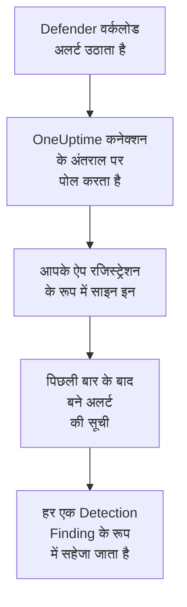

# Microsoft Defender XDR

हर [Microsoft Defender XDR](https://learn.microsoft.com/en-us/defender-xdr/) वर्कलोड के अलर्ट, एंडपॉइंट, आइडेंटिटी, ईमेल और क्लाउड ऐप से, OneUptime के सुरक्षा इवेंट में इम्पोर्ट करें। वहां आप उन्हें अपने लॉग, ट्रेस और मेट्रिक्स के साथ खोजते हैं, हर दूसरे स्रोत के साथ उनका सहसंबंध देखते हैं, और ज़रूरी अलर्ट के लिए ऑन-कॉल को पेज करते हैं। OneUptime उन्हें आपके बनाए ऐप रजिस्ट्रेशन से Microsoft Graph सुरक्षा API के ज़रिए पढ़ता है: किसी एजेंट, प्लेबुक या Sentinel वर्कस्पेस की ज़रूरत नहीं।

:::cards
- [कनेक्शन सेट करें](#कनेक्शन-सेट-करें): एक ऐप रजिस्ट्रेशन, एक अनुमति, और कनेक्शन का फ़ॉर्म।
- [क्या इम्पोर्ट होता है](#क्या-इम्पोर्ट-होता-है): हर Defender अलर्ट सुरक्षा इवेंट कैसे बनता है।
- [पोलिंग कैसे काम करती है](#पोलिंग-कैसे-काम-करती-है): हर पोल कौन सी विंडो पढ़ता है, और व्यस्त टेनेंट उस पर क्या असर डालता है।
- [समस्या निवारण](#समस्या-निवारण): हर त्रुटि का मतलब क्या है, और क्या बदलना है।
:::

## यह कैसे काम करता है



हर मिनट OneUptime हर उस सक्षम कनेक्शन से पोल करता है जिसका पोल अंतराल बीत चुका है। एक पोल Microsoft Entra ID में आपके ऐप रजिस्ट्रेशन के रूप में साइन इन करता है, Microsoft Graph से पिछले पोल के बाद बने अलर्ट मांगता है ([List alerts_v2](https://learn.microsoft.com/en-us/graph/api/security-list-alerts_v2)), और हर एक को [OCSF](https://schema.ocsf.io/) Detection Finding इवेंट (क्लास `2004`) के रूप में सहेजता है। इसके बाद पहचान नियम, मॉनिटर और डैशबोर्ड उसे किसी भी दूसरे स्रोत के सुरक्षा इवेंट की तरह ही बरतते हैं।

## शुरू करने से पहले

- OneUptime में Project Owner, Project Admin या Security Admin रोल। Security Member और Security Viewer कनेक्शन और उनका रन इतिहास देख सकते हैं, पर उन्हें बदल नहीं सकते।
- Microsoft Defender XDR लाइसेंस वाला एक Microsoft Entra टेनेंट: Microsoft Defender पोर्टल पर ऑनबोर्ड किया गया कोई भी Defender वर्कलोड, जैसे Defender for Endpoint, for Identity, for Office 365 या for Cloud Apps।
- ऐप्लिकेशन रजिस्टर कर सकने वाला कोई Entra रोल, जैसे Application Administrator, और एडमिन सहमति देने के लिए एक Global Administrator या Privileged Role Administrator।
- OneUptime ऐप और वर्कर से `login.microsoftonline.com` और `graph.microsoft.com` तक आउटबाउंड HTTPS, या Azure Government के लिए `login.microsoftonline.us` और `graph.microsoft.us` तक।

## कनेक्शन सेट करें

कनेक्शन [OAuth 2.0 क्लाइंट क्रेडेंशियल फ़्लो](https://learn.microsoft.com/en-us/entra/identity-platform/v2-oauth2-client-creds-grant-flow) से साइन इन करता है: हमेशा एक ऐप्लिकेशन के रूप में, किसी व्यक्ति के रूप में कभी नहीं, एक ऐप्लिकेशन अनुमति के साथ।

:::steps
### एक ऐप्लिकेशन रजिस्टर करें

1. [Azure portal](https://portal.azure.com) में साइन इन करें और **Microsoft Entra ID** खोलें।
2. **App registrations → New registration** पर जाएं। इसका नाम `OneUptime Security Events` रखें, **Supported account types** को **Accounts in this organizational directory only** पर रहने दें, रीडायरेक्ट URI खाली छोड़ें, और **Register** चुनें।
3. ऐप के **Overview** पेज से **एप्लिकेशन (क्लाइंट) ID** और **डायरेक्टरी (टेनेंट) ID** कॉपी करें।

### इसे अलर्ट पढ़ने दें

1. **API permissions → Add a permission → Microsoft Graph → Application permissions** पर जाएं, `SecurityAlert.Read.All` चुनें, और **Add permissions** चुनें। यह सबसे कम अधिकार वाली अनुमति है जिसे [List alerts_v2](https://learn.microsoft.com/en-us/graph/api/security-list-alerts_v2#permissions) कॉल किसी ऐप्लिकेशन के लिए स्वीकार करता है: `SecurityAlert.ReadWrite.All` न जोड़ें।
2. अपने टेनेंट के लिए **Grant admin consent for** चुनें, और पुष्टि करें। अनुमति की स्थिति **Granted** होनी चाहिए: सहमति के बिना हर रीड `403` से अस्वीकार होता है।

### एक क्लाइंट सीक्रेट बनाएं

**Certificates & secrets → Client secrets → New client secret** पर जाएं, चुनें कि यह कब एक्सपायर हो, और **Add** चुनें। पेज छोड़ने से पहले सीक्रेट का **Value** कॉपी करें, उसकी **Secret ID** नहीं: यह फिर कभी नहीं दिखता।

नोट कर लें कि सीक्रेट कब एक्सपायर होता है। उस दिन पोलिंग `Microsoft Defender XDR token request failed (HTTP 401)` के साथ रुक जाती है, जब तक आप इसे **क्रेडेंशियल अपडेट करें** से बदल नहीं देते।

### OneUptime में कनेक्शन जोड़ें

**उत्पाद → Security Events → कनेक्शन** (`/dashboard/{projectId}/security-events/connections`) खोलें, **कनेक्शन जोड़ें** पर क्लिक करें, **EDR / XDR** के नीचे **Microsoft Defender XDR** चुनें, और **अगला** पर क्लिक करें। नीचे की तालिका की सेटिंग्स भरें, **अगला** पर क्लिक करें, और सीक्रेट का मान **क्लाइंट सीक्रेट** में पेस्ट करें।

### सहेजने से पहले इसे टेस्ट करें

**सहेजने से पहले टेस्ट करें** के नीचे **इन सेटिंग्स का परीक्षण करें** पर क्लिक करें। टेस्ट फ़ॉर्म के मानों से साइन इन करके अलर्ट पढ़ता है, और कुछ सहेजता नहीं, इसलिए गलत सीक्रेट या छूटी हुई सहमति कनेक्शन बनने से पहले ही सामने आ जाती है। फिर **अगला** पर क्लिक करें, कनेक्शन को एक **नाम** दें, और उसे बनाएं।
:::

| सेटिंग | कहां मिलेगी |
| --- | --- |
| **डायरेक्टरी (टेनेंट) ID** | ऐप का **Overview** पेज। टेनेंट का GUID, या `contoso.onmicrosoft.com` जैसा कोई सत्यापित डोमेन। |
| **एप्लिकेशन (क्लाइंट) ID** | ऐप का **Overview** पेज। उस ऐप का GUID जिसके पास `SecurityAlert.Read.All` है। |
| **क्लाउड** | **Azure सार्वजनिक क्लाउड**, जो Microsoft 365 GCC को भी सर्व करता है, या GCC High के लिए **Azure Government (अमेरिका)** (`login.microsoftonline.us` और `graph.microsoft.us`)। Microsoft 365 DoD और चीन का 21Vianet क्लाउड समर्थित नहीं हैं। |
| **क्लाइंट सीक्रेट** | सीक्रेट का **Value**। यह एन्क्रिप्ट किया जाता है, API इसे कभी नहीं लौटाता और यह फिर कभी नहीं दिखता। इसे कनेक्शन पर **क्रेडेंशियल अपडेट करें** से बदलें। |

**पोलिंग** चरण में एक वैकल्पिक **विवरण**, **पोल अंतराल (मिनट)**, जो `1` से `1440` तक की पूर्ण संख्या है और `5` से शुरू होती है, और **सक्षम** भी है, जो शुरू में चालू रहता है।

## क्या इम्पोर्ट होता है

हर Defender XDR [अलर्ट](https://learn.microsoft.com/en-us/graph/api/resources/security-alert) एक Detection Finding इवेंट (OCSF क्लास `2004`) बनता है, वेंडर `Microsoft` और उत्पाद `Microsoft Defender XDR` के साथ, जो `Microsoft Defender XDR` टेलीमेट्री सेवा से जुड़ा होता है:

| OCSF कॉलम | अलर्ट फ़ील्ड |
| --- | --- |
| `eventUid` | `id`, Graph अलर्ट ID, जिससे डुप्लिकेट भी हटाए जाते हैं |
| `time` | `firstActivityDateTime`, या न होने पर `createdDateTime` |
| `message`, `ruleName` | `title` |
| `ruleId` | `detectorId`, या न होने पर `alertPolicyId` |
| `severityName` | `severity`: `informational`, `low`, `medium` या `high`, और `unknown` Unknown ही रहता है |
| `statusName` | `status`: `new` बनता है New, `inProgress` In Progress, `resolved` Resolved |
| `mitreTechniques` | `mitreTechniques` |
| `mitreTactics` | `categories` या `category`, जब वह ATT&CK टैक्टिक हो: `CredentialAccess` बनता है `TA0006`। बाकी कैटेगरी `attributes` में रहती हैं। |
| `principalHost`, `principalUser`, `principalIp`, `principalProcess` | `source`, `attacker` या `compromised` रोल वाला `evidence`, वरना हर प्रकार का पहला |
| `targetHost`, `targetUser`, `targetIp`, `targetResource` | किसी टारगेट रोल वाला `evidence`, जैसे `destination` या `attacked`। URL, मेलबॉक्स और क्लाउड रिसोर्स `targetResource` भरते हैं। |
| `observables` | `evidence` में हर होस्ट नाम, IP, यूज़र, फ़ाइल नाम, SHA-1 और SHA-256, URL, डोमेन, मेलबॉक्स और रिसोर्स ID |
| `attributes` | पूरा अलर्ट, `evidence.0.hostName`, `serviceSource` और `incidentId` जैसी डॉट वाली कुंजियों में फैलाया हुआ |

हर `serviceSource` के अलर्ट इम्पोर्ट होते हैं, Sentinel के Defender पोर्टल से जुड़ जाने पर Microsoft Sentinel के भी। घटनाएं (incidents) इम्पोर्ट नहीं होतीं, पर हर अलर्ट अपनी `incidentId` और `incidentWebUrl` `attributes` में रखता है।

## पोलिंग कैसे काम करती है

हर पोल अपनी विंडो में बने अलर्ट की सूची लेता है, एक पेज में 100, और Graph के `@odata.nextLink` का पीछा तब तक करता है जब तक पूरी विंडो पढ़ न ले:

```text
GET https://graph.microsoft.com/v1.0/security/alerts_v2?$filter=createdDateTime ge {start} and createdDateTime lt {end}&$top=100
```

- **बनने का समय ही कर्सर है।** Defender अक्सर कोई अलर्ट उसके `firstActivityDateTime` के घंटों बाद बनाता है, और गतिविधि के समय पर चलने वाला कर्सर ऐसा हर अलर्ट छोड़ देता।
- **पहला पोल 24 घंटे पीछे देखता है**, इसलिए नया कनेक्शन तुरंत अपने हाल के अलर्ट दिखाता है।
- **हर बाद वाला पोल सहेजे गए कर्सर से 1 मिनट पहले शुरू होता है**, इसलिए दो विंडो की सीमा पर बना अलर्ट दो बार पढ़ा जाता है और एक बार इम्पोर्ट होता है।
- **एक पोल कर्सर से आगे ज़्यादा से ज़्यादा 24 घंटे पढ़ता है।** जिस कनेक्शन का कर्सर वर्कर बंद रहने या टेनेंट के थ्रॉटल होने के दौरान पीछे रह गया, वह 24 घंटे की लगातार विंडो में बराबर आता है।
- **डुप्लिकेट अलर्ट के `id` से हटाए जाते हैं**, प्रोजेक्ट के `Microsoft` / `Microsoft Defender XDR` से आए इवेंट के बीच, इसलिए ओवरलैप, दोबारा कोशिश की गई विंडो और कोई इम्पोर्ट कभी एक अलर्ट को दो बार नहीं सहेजते।
- **विफल रन कुछ नहीं बदलता।** किसी नेटवर्क त्रुटि, या Graph की त्रुटि स्थिति के बाद, कर्सर और विंडो लंबाई जैसे थे वैसे ही रहते हैं, और अगला पोल वही विंडो फिर से पढ़ता है। एकमात्र अपवाद वह अनुरोध है जिसका समय खत्म हो गया: कर्सर वहीं रहता है, पर अगली विंडो आधी लंबी होती है, क्योंकि समय पर जवाब के लिए बहुत भारी विंडो हर कोशिश में टाइम आउट होगी।

### जब किसी विंडो में एक पोल की क्षमता से ज़्यादा हो

एक पोल ज़्यादा से ज़्यादा 100 अलर्ट वाले 20 पेज पढ़ता है: 2,000 अलर्ट। जब यह सीमा उसे विंडो के अंत से पहले रोक देती है, तो रन **आंशिक** होता है, इस चेतावनी के साथ:

```text
Stopped after 20 alerts requests (the per-run request limit) before reading the whole window. Microsoft Graph lists alerts newest first and documents no way to sort them oldest first, so this run cannot name a point to resume from.
```

[List alerts_v2](https://learn.microsoft.com/en-us/graph/api/security-list-alerts_v2) `$filter`, `$top`, `$skip` और `$count` का दस्तावेज़ देता है, पर `$orderby` का नहीं, और यह सबसे नए अलर्ट पहले लौटाता है। रुके हुए रन ने जो 2,000 अलर्ट पढ़े, वे उसकी विंडो के सबसे नए हैं, इसलिए कर्सर को उनसे आगे ले जाने पर वे पुराने अलर्ट छूट जाते जिन तक रन पहुंचा ही नहीं। इसके बजाय OneUptime विंडो छोटी करता है:

1. **छोटा करें।** अगला पोल उसी शुरुआती बिंदु से आधी लंबाई की विंडो पढ़ता है, और तब तक आधा करता रहता है जब तक कोई विंडो पूरी न पढ़ी जाए, कम से कम एक मिनट तक। रन की चेतावनी यही बताती है: `This window holds more records than one poll can read; the next poll reads a {n} minute window from the same starting point.` लंबी विंडो से पहले ही इम्पोर्ट हो चुके अलर्ट डुप्लिकेट मानकर छोड़ दिए जाते हैं।
2. **वापस बढ़ाएं।** किसी विंडो के पूरा पढ़े जाने के बाद कर्सर उसके अंत पर जाता है, और अगली विंडो फिर दोगुनी होती है, ज़्यादा से ज़्यादा 24 घंटे तक।
3. **एक मिनट से आगे बढ़ें।** अगर एक मिनट में भी 2,000 से ज़्यादा अलर्ट हों, तो पोलिंग उससे आगे बढ़ जाती है, ताकि नए अलर्ट आते रहें। रन **आंशिक** ही रहता है, और **पिछली त्रुटि** में लिखा होता है `More records were created in the one minute from {cursor} to {end} than one poll can read. Polling moved past this minute so newer records keep arriving; use Import this time range in Diagnostics on this minute to recover what one run can read.` एक रन जितना पढ़ सकता है उतना वापस पाने के लिए उस मिनट को **Import this time range** से इम्पोर्ट करें।

जो रन किसी और कारण से **आंशिक** है, जैसे कोई अलर्ट जिसे सुरक्षा इवेंट में पढ़ा नहीं जा सका, उसे भी उसी तरह, उसी शुरुआती बिंदु से दोबारा आज़माया जाता है। **पोल अंतराल (मिनट)** बदलने से इनमें से कुछ नहीं बदलता: यह तय करता है कि पोल कितनी बार शुरू हो, न कि उसकी विंडो कहां से शुरू हो।

### मांग पर रन, प्रीव्यू और इम्पोर्ट

किसी कनेक्शन पर **निदान** पर क्लिक करें, ताकि उसके हाल के रन देख सकें और उसके साथ हाथ से काम कर सकें। जो भी कनेक्शन बदल सकता है वह इन्हें शुरू कर सकता है; जो भी इसे देख सकता है वह इतिहास पढ़ सकता है।

- **अभी चलाएँ** तुरंत सामान्य कर्सर के साथ एक पोल शुरू करता है, तब भी जब कनेक्शन **सक्षम** न हो।
- **Preview alerts** 7 दिन तक की समय सीमा पढ़ता है और कुछ इम्पोर्ट नहीं करता।
- **Import this time range** आपकी पुष्टि के बाद 7 दिन तक की सीमा इम्पोर्ट करता है, कर्सर हिलाए बिना। पहले से इम्पोर्ट किए गए अलर्ट छोड़ दिए जाते हैं।
- किसी रन पर **Copy diagnostics** सपोर्ट के लिए उसकी रिपोर्ट कॉपी करता है। इसमें क्रेडेंशियल कभी शामिल नहीं होते।

## कनेक्शन का परीक्षण करें

कनेक्शन की पंक्ति पर **कनेक्शन का परीक्षण करें**, और फ़ॉर्म में **इन सेटिंग्स का परीक्षण करें**, बैकग्राउंड वर्कर में नहीं बल्कि API प्रोसेस में चलते हैं, इसलिए जब वर्कर ही समस्या हों तब भी टेस्ट जवाब देता है। यह ये जांचें क्रम से चलाता है:

| जांच | यह क्या जांचती है |
| --- | --- |
| **कॉन्फ़िगरेशन** | चारों सेटिंग्स मौजूद हैं और सही रूप में हैं। इसके विफल होने पर किसी से संपर्क नहीं किया जाता। |
| **Authenticate with Microsoft Entra** | Microsoft Entra ID आपके चुने क्लाउड में Microsoft Graph के लिए टोकन जारी करता है। यह गलत या एक्सपायर सीक्रेट, गलत टेनेंट या क्लाइंट ID, या गलत क्लाउड पर विफल होती है। |
| **Read alerts from Microsoft Graph** | पिछले 24 घंटों में बना एक अलर्ट पढ़ा जा सकता है (`$top=1`)। यहां `403` का मतलब है `SecurityAlert.Read.All` अनुमति नहीं है, एडमिन सहमति नहीं है, या टेनेंट में Defender XDR नहीं है। |
| **Alerts available to import** | पिछले 24 घंटों और पिछले 7 दिनों में कितने अलर्ट बने, हर एक के लिए 100 का एक पेज, इसलिए `100+` का मतलब है और ज़्यादा। 7 दिनों में एक भी न होना विफलता नहीं, चेतावनी है। |
| **Background workers**, **Poll scheduler**, **Security event storage** | OneUptime का अपना हिस्सा: कोई प्रोसेस Worker कतार के जॉब लेता है, पोल जॉब हर मिनट चलता है, और सुरक्षा इवेंट का स्टोर जवाब देता है। |
| **Scheduled polling** | सहेजे गए कनेक्शन के लिए: पोलिंग चालू है, कोई रन वर्कर के इंतज़ार में अटका नहीं है, और पोल समय पर चलते हैं। |

टेस्ट के हर अनुरोध की समय सीमा 20 सेकंड है। टेस्ट कभी कुछ इम्पोर्ट नहीं करता और न कर्सर हिलाता है, और हर विफल जांच बताती है कि क्या बदलना है।

## समस्या निवारण

कनेक्शन का **पिछली त्रुटि** पूरा त्रुटि संदेश रखता है, क्रेडेंशियल छिपाकर, एक ऐसे प्रीफ़िक्स के पीछे जो विफल हुए चरण का नाम बताता है। जब किसी कनेक्शन में त्रुटि हो, तो उसे पढ़ने के लिए उसके **क्रियाएँ** कॉलम में **त्रुटि देखें** चुनें, और कॉपी करने के लिए डायलॉग में **त्रुटि कॉपी करें**। पहले प्रीफ़िक्स पढ़ें।

:::details Last Error `Microsoft Defender XDR token request` से शुरू होता है
- `Microsoft Defender XDR token request failed (HTTP ...)`: Microsoft Entra ID ने टोकन जारी करने से मना कर दिया, इसलिए Graph से कभी संपर्क नहीं हुआ। संदेश Entra के `error` कोड पर आधारित एक संकेत के साथ खत्म होता है:
  - `invalid_client` (`AADSTS7000215`): सीक्रेट गलत है, एक्सपायर हो गया है, या किसी दूसरे ऐप का है। **Certificates & secrets** के नीचे नया बनाएं, और उसे **क्रेडेंशियल अपडेट करें** से सहेजें।
  - `unauthorized_client` (`AADSTS700016`): **एप्लिकेशन (क्लाइंट) ID** उस **डायरेक्टरी (टेनेंट) ID** में नहीं है, या **क्लाउड** गलत है।
  - `AADSTS90002`: ऐसा कोई टेनेंट नहीं है।
  - `invalid_scope`: आपके चुने क्लाउड में Graph स्कोप मौजूद नहीं है। **क्लाउड** जांचें।
- `Microsoft Defender XDR token request returned ...`: Microsoft Entra ID ने कुछ अनुपयोगी लौटाया, ऐसी बॉडी जो JSON नहीं है या जिसमें `access_token` नहीं है। आमतौर पर यह बीच में मौजूद कोई प्रॉक्सी या गेटवे होता है, क्रेडेंशियल नहीं।
- `Microsoft Defender XDR token request did not complete: ...`: टोकन एंडपॉइंट तक पहुंचा नहीं जा सका, या उसने समय पर जवाब नहीं दिया। OneUptime ऐप और वर्कर से `login.microsoftonline.com`, या `login.microsoftonline.us` तक आउटबाउंड HTTPS जांचें।
:::

:::details Last Error `Microsoft Defender XDR alerts request` से शुरू होता है
- `Microsoft Defender XDR alerts request failed (HTTP ...)`: Graph ने अलर्ट की सूची देने से मना कर दिया। संदेश Graph का त्रुटि कोड और एक संकेत बताता है:
  - `403` (`Authorization_RequestDenied`): `SecurityAlert.Read.All` या उसकी एडमिन सहमति नहीं है, या टेनेंट के पास Defender XDR लाइसेंस नहीं है। सहमति लागू होने में कुछ मिनट लगते हैं।
  - टोकन जारी होने के बाद `401` (`InvalidAuthenticationToken`): आमतौर पर **क्लाउड** टेनेंट से मेल नहीं खाता।
  - `429` (`TooManyRequests`): Graph ऐप को थ्रॉटल कर रहा है, और अगला पोल वही विंडो फिर से पढ़ता है। संदेश Graph का `Retry-After` नहीं बता सकता, क्योंकि OneUptime का HTTP क्लाइंट त्रुटि पर कोई रिस्पॉन्स हेडर नहीं रखता। अगर यह बार-बार हो, तो **पोल अंतराल (मिनट)** बढ़ाएं।
  - `5xx`: Graph की तरफ़ की समस्या। अगला पोल फिर से कोशिश करता है।
  - `400`: Graph ने क्वेरी नहीं चलाई, जिसे OneUptime बनाता है, आपकी सेटिंग्स नहीं। संदेश OneUptime सपोर्ट के लिए कॉपी करें।
- `Microsoft Defender XDR alerts request returned ...`: Graph ने `200` लौटाया, पर ऐसा कुछ जिसे कनेक्टर इस्तेमाल नहीं कर सका: ऐसी बॉडी जो JSON नहीं है, कोई `value` सूची नहीं, या ऐसा `@odata.nextLink` जो आपके क्लाउड के Graph होस्ट पर `https://` लिंक नहीं है। ऐसा लिंक अस्वीकार किया जाता है, इसलिए टोकन कहीं और कभी नहीं भेजा जाता। इसे खाली विंडो मानने के बजाय रिपोर्ट किया जाता है, ताकि कर्सर कभी उन अलर्ट से आगे न बढ़े जिन्हें किसी ने नहीं पढ़ा।
- `Microsoft Defender XDR alerts request did not complete: ...`: Graph तक पहुंचा नहीं जा सका, या उसने समय पर जवाब नहीं दिया: पोल के लिए 60 सेकंड, टेस्ट के लिए 20। `graph.microsoft.com`, या `graph.microsoft.us` तक आउटबाउंड HTTPS जांचें।
:::

:::details टेस्ट पास होता है, पर Last Polled Never है
पोल जॉब कभी नहीं चला। **Background workers** और **Poll scheduler** जांचें पढ़ें। सेल्फ़-होस्टेड इंस्टॉलेशन में आम कारण ऐप पर `DISABLE_QUEUE_WORKERS=true` है, जबकि जॉब लेने के लिए कोई अलग वर्कर डिप्लॉयमेंट नहीं है: इसे `false` पर सेट करें, या वर्कर डिप्लॉयमेंट चलाएं (Helm: `worker.enabled: true`, जो डिफ़ॉल्ट रूप से `false` है)।
:::

:::details पोल सफल होते हैं, पर आपको पता कोई अलर्ट गायब है
Defender पोर्टल में अलर्ट का `createdDateTime` **निदान** में रन की विंडो से मिलाएं: विंडो बनने के समय पर होती हैं, गतिविधि के समय पर नहीं।

- कनेक्शन बनने से पहले बना अलर्ट पहली 24 घंटे की वापसी-नज़र से पुराना है। उसे **Import this time range** से इम्पोर्ट करें।
- कोई **आंशिक** रन 2,000-अलर्ट की सीमा से रुका। अगला पोल उसी शुरुआत से छोटी विंडो पढ़ता है, इसलिए अलर्ट तब इम्पोर्ट होता है जब उसे रखने वाली कोई विंडो पूरी पढ़ ली जाती है।
- अगर **पिछली त्रुटि** किसी ऐसे मिनट का नाम लेता है जिससे पोलिंग आगे बढ़ गई, तो उस मिनट को **Import this time range** से इम्पोर्ट करें।
:::

:::details एक ही अलर्ट दो बार दिखता है
1 मिनट का ओवरलैप ऐसा नहीं करता: दूसरी रीड डुप्लिकेट गिनी जाती है और सहेजी नहीं जाती। एक ही `eventUid` वाले दो इवेंट अलग-अलग उत्पादों के तहत इम्पोर्ट हुए, जैसे वही अलर्ट Microsoft Sentinel कनेक्शन से भी आ रहा हो। डुप्लिकेट वेंडर और उत्पाद के हिसाब से हटाए जाते हैं।
:::

## आपको क्या मिलता है

- **खोज।** सुरक्षा इवेंट एक्सप्लोरर में, उस होस्ट के लॉग और मेट्रिक्स के साथ, Defender अलर्ट को गंभीरता, स्थिति, MITRE तकनीक, होस्ट, यूज़र, IP या किसी भी observable से फ़िल्टर करें।
- **सहसंबंध।** हर अलर्ट का सबूत, यानी उसके डिवाइस, यूज़र, IP, फ़ाइलें और URL, observable के रूप में इंडेक्स होता है, इसलिए एक खोज हर स्रोत में किसी होस्ट का ज़िक्र करने वाली हर चीज़ ढूंढ लेती है।
- **पहचान नियम।** Sigma नियम जो शेड्यूल पर आपके सुरक्षा इवेंट पर चलते हैं, और ऑन-कॉल को पेज करने वाले अलर्ट खोलते हैं।
- **मॉनिटर।** सुरक्षा इवेंट मॉनिटर मेल खाने वाले इवेंट गिनते हैं, और थ्रेशोल्ड पार होने पर घटनाएं या अलर्ट खोलते हैं।

सुरक्षा इवेंट का बिल आपकी बाकी टेलीमेट्री की तरह, इंजेस्ट किए गए हर GB के हिसाब से बनता है। [मूल्य निर्धारण](https://oneuptime.com/pricing) देखें।

## अगले कदम

:::cards
- [सुरक्षा इवेंट](/docs/telemetry/security-events): जो इम्पोर्ट करते हैं उसे खोजें, उसका सहसंबंध देखें और उस पर अलर्ट करें।
- [Microsoft Sentinel](/docs/integrations/microsoft-sentinel): किसी Sentinel वर्कस्पेस की घटनाएं भी इम्पोर्ट करें।
- [रोल](/docs/permissions/reference#भूमिकाएँ): Security रोल क्या देख और बदल सकते हैं।
- [इंटिग्रेशन अवलोकन](/docs/integrations/index): वे दूसरे टूल जिन्हें आप जोड़ सकते हैं।
:::
