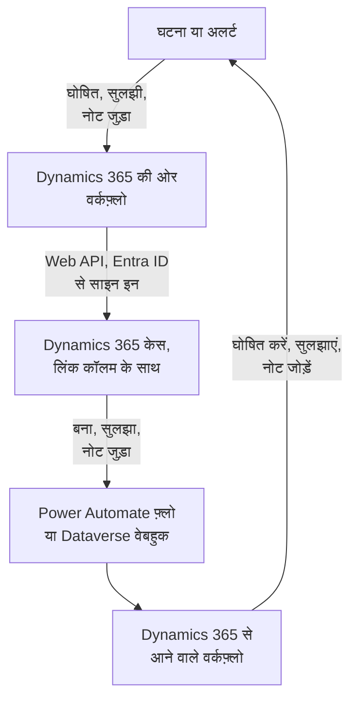

# Microsoft Dynamics 365

[Microsoft Dynamics 365](https://www.microsoft.com/dynamics-365) केस को अपनी OneUptime घटनाओं और अलर्ट के साथ दोनों ओर से तालमेल में रखें। तैयार वर्कफ़्लो टेम्पलेट हर घटना या अलर्ट के लिए एक केस खोलते हैं, रिकॉर्ड सुलझने पर उसे बंद करते हैं और उसमें नोट कॉपी करते हैं। दूसरे टेम्पलेट नए केस से घटनाएं घोषित करते हैं और समाधान और नोट वापस लाते हैं। कोई प्लगइन नहीं है: वर्कफ़्लो Dataverse Web API को कॉल करते हैं, और Dynamics 365 उनके वेबहुक URL को कॉल करता है।

:::cards
- [Dynamics 365 तैयार करें](#dynamics-365-तैयार-करें): एक ऐप रजिस्ट्रेशन, एक एप्लिकेशन यूज़र और एक लिंक कॉलम।
- [टेम्पलेट से शुरू करें](#टेम्पलेट-से-शुरू-करें): 13 टेम्पलेट, वे क्या पूछते हैं, और उन्हें कैसे सेट करें।
- [टेम्पलेट कैसे काम करते हैं](#टेम्पलेट-कैसे-काम-करते-हैं): केस और रिकॉर्ड बिना लूप के कैसे जुड़े रहते हैं।
- [खुद बनाएं](#खुद-बनाएं): जब कोई टेम्पलेट फ़िट न हो, तब हर दिशा हाथ से।
:::

## यह कैसे काम करता है



हर टेम्पलेट एक छोटा वर्कफ़्लो है, इसलिए आप सिर्फ़ वे दिशाएं लेते हैं जो आपको चाहिए, घटनाओं, अलर्ट या दोनों के लिए। OneUptime → Dynamics 365 टेम्पलेट Microsoft Entra ID के ज़रिए एक एप्लिकेशन के रूप में साइन इन करके Dataverse Web API को कॉल करते हैं। Dynamics 365 → OneUptime टेम्पलेट तब शुरू होते हैं जब कोई Power Automate फ़्लो या Dataverse वेबहुक उन्हें कॉल करता है। Case टेबल में आपका जोड़ा गया एक टेक्स्ट कॉलम हर केस को उसके रिकॉर्ड से जोड़ता है।

## शुरू करने से पहले

- **Case** टेबल वाला एक Dynamics 365 एनवायरनमेंट। केस Dynamics 365 Customer Service से आते हैं: इसके बिना Dataverse एनवायरनमेंट में लिखने के लिए कोई `incident` टेबल नहीं होती।
- **Microsoft Entra ID** में एप्लिकेशन रजिस्टर करने का अधिकार, और एनवायरनमेंट में एप्लिकेशन यूज़र बनाने का अधिकार। ये अक्सर दो अलग एडमिनिस्ट्रेटर होते हैं।
- OneUptime में वर्कफ़्लो बनाने का अधिकार। OneUptime Cloud पर वर्कफ़्लो के लिए **Growth** प्लान या उससे ऊपर चाहिए।

> [!NOTE]
> यह पेज Dynamics फ़ॉर्म के लेबल नहीं, बल्कि Dataverse के नाम इस्तेमाल करता है। केस `incident` टेबल है, URL में उसका कलेक्शन `incidents` है, उसकी कुंजी `incidentid` है और उसका शीर्षक कॉलम `title` है। आपको दिखने वाला केस नंबर `ticketnumber` है।

## Dynamics 365 तैयार करें

टेम्पलेट और आपके बनाए वर्कफ़्लो, दोनों को इनकी ज़रूरत है। OneUptime OAuth 2.0 क्लाइंट क्रेडेंशियल फ़्लो से, किसी व्यक्ति के रूप में नहीं, बल्कि एक एप्लिकेशन के रूप में साइन इन करता है।

:::steps
### Microsoft Entra ID में एक एप्लिकेशन रजिस्टर करें

1. अपने Dynamics एनवायरनमेंट के टेनेंट के एडमिनिस्ट्रेटर के रूप में [Azure portal](https://portal.azure.com) में साइन इन करें, और **Microsoft Entra ID** खोलें।
2. **App registrations → New registration** पर जाएं। इसका नाम `OneUptime Integration` रखें, **Supported account types** को **Accounts in this organizational directory only** पर रहने दें, और **Register** चुनें।
3. ऐप के **Overview** पेज से **Application (client) ID** और **Directory (tenant) ID** कॉपी करें।
4. **Certificates & secrets → Client secrets → New client secret** पर जाएं, और पेज छोड़ने से पहले सीक्रेट की ID नहीं, उसका **Value** कॉपी करें: यह दोबारा कभी नहीं दिखता। क्लाइंट सीक्रेट अधिकतम 24 महीने चलता है, इसलिए नोट कर लें कि यह कब समाप्त होगा।

कोई API अनुमति न जोड़ें और एडमिन सहमति न दें: साइन इन किए यूज़र के बिना इनका कोई असर नहीं होता। एप्लिकेशन क्या कर सकता है, यह Dynamics 365 उसके एप्लिकेशन यूज़र के ज़रिए तय करता है।

### एप्लिकेशन यूज़र बनाएं

1. [Power Platform एडमिन सेंटर](https://admin.powerplatform.microsoft.com/) में **Manage → Environments** चुनें, फिर अपना एनवायरनमेंट।
2. **Settings → Users + permissions → Application users** चुनें, फिर **+ New app user** और **+ Add an app**। रजिस्ट्रेशन चुनें और **Add** चुनें।
3. एक **Business unit** चुनें, फिर **Security roles** के पास वाले संपादन आइकन से इसे एक कस्टम सुरक्षा भूमिका दें। Organization स्तर पर भूमिका को चाहिए:
   - **Case**: Create, Read, Write, Append और Append To।
   - **Note**: Create, Read और Append, नोट टेम्पलेट के लिए।
   - **Activity**: Create, Read और Append, क्योंकि केस बंद करने पर एक Case Resolution दर्ज होता है, जो एक एक्टिविटी है।
   - **Account**, और अगर केस किसी संपर्क के नाम दर्ज होते हैं तो **Contact**: Read और Append To।
4. **Save** चुनें, फिर **Create**।

एप्लिकेशन यूज़र के पास सिर्फ़ कस्टम भूमिका हो सकती है: किसी मौजूदा भूमिका की कॉपी बनाएं और उसे छांट दें। इस यूज़र के बिना Microsoft Entra ID फिर भी टोकन जारी करता है, पर Dynamics 365 की हर कॉल `403` और `0x80072560` के साथ विफल होती है, "The user isn't a member of the organization."

### Case टेबल में एक लिंक कॉलम जोड़ें

Dataverse में Jira के लेबल जैसी कोई चीज़ नहीं है, इसलिए केस और OneUptime रिकॉर्ड आपके जोड़े एक कॉलम के ज़रिए एक-दूसरे को ढूंढते हैं।

1. [make.powerapps.com](https://make.powerapps.com) में अपना एनवायरनमेंट चुनें, **Tables → Case → Columns** खोलें, और **New column** चुनें।
2. इसका नाम `OneUptime Link` रखें, **Data type** को **Single line of text** रहने दें, और सहेजें। डिफ़ॉल्ट अधिकतम लंबाई 100 काफ़ी है: टेम्पलेट अधिकतम 55 अक्षर लिखते हैं।
3. नया कॉलम खोलें और उसका **Logical name** कॉपी करें, जैसे `new_oneuptimelink`। प्रीफ़िक्स आपके सॉल्यूशन के पब्लिशर से आता है, इसलिए आपका अलग हो सकता है, जैसे `cr4f2_oneuptimelink`।

अगर एजेंटों को लिंक दिखना चाहिए, तो कॉलम को Case फ़ॉर्म में जोड़ें।
:::

## टेम्पलेट से शुरू करें

**एक वर्कफ़्लो बनाएं** डायलॉग की कैटेगरी सूची में **Dynamics 365** के नीचे 13 Dynamics 365 टेम्पलेट हैं: पहले घटनाओं के लिए सात, फिर अलर्ट के लिए छह, हर सेट अपने शीर्षक के नीचे। वे लिंक कॉलम साझा करते हैं, इसलिए उनका कोई भी मेल एक साथ काम करता है।

### घटना टेम्पलेट

| टेम्पलेट | क्या करता है | क्या पूछता है |
| --- | --- | --- |
| **OneUptime → Dynamics 365** | | |
| Create a Dynamics 365 case when an incident is declared | हर नई घटना के लिए एक केस खोलता है, उसकी गंभीरता से चुनी गई प्राथमिकता और लिंक कॉलम में घटना के ID के साथ। Dynamics 365 से घोषित घटनाएं, और निजी घटनाएं, छोड़ दी जाती हैं। | Dynamics 365 की पांच सेटिंग, नए केस का ग्राहक, और OneUptime URL |
| Resolve the Dynamics 365 case when the incident is resolved | घटना सुलझने पर जुड़े हुए केस को **Problem Solved** के रूप में बंद करता है, और हाथ से सुलझाने की तरह एक Case Resolution दर्ज करता है। केस को कभी दोबारा नहीं खोलता। | Dynamics 365 की पांच सेटिंग |
| Copy incident private notes to the Dynamics 365 case | हर नए निजी नोट को जुड़े हुए केस में नोट के रूप में जोड़ता है। | Dynamics 365 की पांच सेटिंग |
| Copy incident public notes to the Dynamics 365 case | हर नए सार्वजनिक नोट को जुड़े हुए केस में नोट के रूप में जोड़ता है, ताकि एजेंट ग्राहकों को बता सकें कि स्टेटस पेज क्या कहता है। | Dynamics 365 की पांच सेटिंग |
| **Dynamics 365 → OneUptime** | | |
| Declare an incident when a Dynamics 365 case is created | हर नए केस के लिए एक घटना घोषित करता है, जो आपके स्टेटस पेज से दूर रहती है, केस की प्राथमिकता से चुनी गई गंभीरता के साथ, फिर घटना का ID केस के लिंक कॉलम में लिखता है। | Dynamics 365 की पांच सेटिंग, और नए केस के लिए एक फ़्लो या वेबहुक |
| Resolve the incident when its Dynamics 365 case is resolved | जुड़ा हुआ केस सुलझने पर घटना को सुलझाता है। | Dynamics 365 की पांच सेटिंग, और केस स्टेटस बदलाव के लिए एक फ़्लो या वेबहुक |
| Add Dynamics 365 case notes to the incident as private notes | एजेंट जुड़े हुए केस में जो भी नोट जोड़ता है, उसे घटना पर निजी नोट के रूप में कॉपी करता है। | Dynamics 365 की पांच सेटिंग, और नए नोट के लिए एक फ़्लो या वेबहुक |

### अलर्ट टेम्पलेट

अलर्ट टेम्पलेट अलर्ट के लिए वही काम करते हैं। इनमें एक कम है, क्योंकि अलर्ट में सार्वजनिक नोट नहीं होते, और **Create an alert when a Dynamics 365 case is created** कोई स्टेटस पेज सेटिंग नहीं लिखता, क्योंकि अलर्ट कभी स्टेटस पेज तक नहीं पहुंचता।

| टेम्पलेट | क्या करता है | क्या पूछता है |
| --- | --- | --- |
| **OneUptime → Dynamics 365** | | |
| Create a Dynamics 365 case when an alert is created | हर नए अलर्ट के लिए एक केस खोलता है, मॉनिटर से उठने वाले हर अलर्ट समेत। Dynamics 365 से बने अलर्ट, और निजी अलर्ट, छोड़ दिए जाते हैं। | Dynamics 365 की पांच सेटिंग, नए केस का ग्राहक, और OneUptime URL |
| Resolve the Dynamics 365 case when the alert is resolved | अलर्ट सुलझने पर जुड़े हुए केस को **Problem Solved** के रूप में बंद करता है। | Dynamics 365 की पांच सेटिंग |
| Copy alert private notes to the Dynamics 365 case | हर नए निजी नोट को जुड़े हुए केस में नोट के रूप में जोड़ता है। | Dynamics 365 की पांच सेटिंग |
| **Dynamics 365 → OneUptime** | | |
| Create an alert when a Dynamics 365 case is created | हर नए केस के लिए एक अलर्ट बनाता है, केस की प्राथमिकता से चुनी गई गंभीरता के साथ, फिर अलर्ट का ID केस के लिंक कॉलम में लिखता है। | Dynamics 365 की पांच सेटिंग, और नए केस के लिए एक फ़्लो या वेबहुक |
| Resolve the alert when its Dynamics 365 case is resolved | जुड़ा हुआ केस सुलझने पर अलर्ट को सुलझाता है। | Dynamics 365 की पांच सेटिंग, और केस स्टेटस बदलाव के लिए एक फ़्लो या वेबहुक |
| Add Dynamics 365 case notes to the alert as private notes | एजेंट जुड़े हुए केस में जो भी नोट जोड़ता है, उसे अलर्ट पर निजी नोट के रूप में कॉपी करता है। | Dynamics 365 की पांच सेटिंग, और नए नोट के लिए एक फ़्लो या वेबहुक |

कोई भी OneUptime → Dynamics 365 टेम्पलेट **निजी घटना** चिह्नित घटना, या **निजी अलर्ट** चिह्नित अलर्ट, Dynamics 365 को नहीं भेजता: न रिकॉर्ड, न उसकी स्थिति, न उसके नोट, जब तक आप इसे चालू न करें। [टेम्पलेट क्या करता है, इसे बदलना](#टेम्पलेट-क्या-करता-है-इसे-बदलना) देखें।

**मॉनिटर अपने-आप अलर्ट उठाते हैं, और बहुत सारे उठा सकते हैं।** **Create a Dynamics 365 case when an alert is created** हर एक के लिए केस खोलता है। जब तक हर अलर्ट केस के लायक न हो, ट्रिगर और बाकी वर्कफ़्लो के बीच एक **If / Else** ब्लॉक रखें, जैसे `{{local.components.alert-on-create-1.returnValues.model.alertSeverity.name}}` पर, और सिर्फ़ उसकी **Yes** साइड को आगे जोड़ें।

### टेम्पलेट क्या पूछते हैं

बनाने वाले विज़ार्ड का **कॉन्फ़िगर करें** चरण अधिकतम सात मान पूछता है: हर टेम्पलेट पहले पांच पूछता है, यानी Dynamics 365 की सेटिंग, और केस बनाने वाले दो टेम्पलेट आखिरी दो भी। यह कुछ भी बनाने से पहले Dynamics 365 की हर सेटिंग का रूप जांचता है, और बताता है कि उसकी जगह क्या टाइप करें, क्योंकि गलत रूप वाला मान किसी रन तक कहीं भी त्रुटि नहीं बनता।

- **Dynamics 365 Environment URL** — आपके एनवायरनमेंट का पता, जैसे `https://yourorg.crm.dynamics.com`, जो [Power Platform एडमिन सेंटर](https://admin.powerplatform.microsoft.com/) में **Environments** के नीचे, आपके एनवायरनमेंट में, **Environment URL** पर मिलता है। सिर्फ़ पता: `/api/data/v9.2` पर खत्म होने वाला Web API एंडपॉइंट नहीं, और आखिर में कोई स्लैश नहीं।
- **Directory (Tenant) ID** — ऐप रजिस्ट्रेशन के **Overview** पेज से।
- **Application (Client) ID** — उसी पेज से।
- **Client Secret Value** — **Certificates & secrets** से क्लाइंट सीक्रेट का **Value**। इसका **Secret ID** नहीं, जो एक GUID है: विज़ार्ड यहां GUID अस्वीकार करता है।
- **Case Link Column** — लिंक कॉलम का लॉजिकल नाम, जैसे `new_oneuptimelink`।
- **Customer for New Cases** — सिर्फ़ केस बनाने वाले दो टेम्पलेट इसे पूछते हैं। हर केस को एक ग्राहक चाहिए, और OneUptime घटना का कोई ग्राहक नहीं होता, इसलिए सभी नए केस एक ही के नाम दर्ज होते हैं: किसी अकाउंट का ID पेस्ट करें, या संपर्क के लिए `contacts(<id>)`। Dynamics 365 में रिकॉर्ड खोलें: पते में `id=` के बाद का हिस्सा उसका ID है।
- **OneUptime URL** — सिर्फ़ केस बनाने वाले दो टेम्पलेट इसे पूछते हैं: वह पता जिस पर आप OneUptime खोलते हैं, जैसे `https://oneuptime.com`। केस का विवरण इसी से घटना या अलर्ट से वापस लिंक होता है।

**टेम्पलेट कैसे साइन इन करते हैं।** विज़ार्ड टेनेंट, क्लाइंट ID और सीक्रेट को एक [OAuth 2.0 वेरिएबल](/docs/workflows/variables#oauth-20-वेरिएबल-ऐसे-टोकन-जो-खुद-रिफ्रेश-होते-हैं), `dynamicsAccessToken`, में सहेजता है, जो वर्कफ़्लो के **वर्कफ़्लो वेरिएबल** के नीचे होता है: Client Credentials, टोकन URL `https://login.microsoftonline.com/<tenant>/oauth2/v2.0/token`, स्कोप `<environment URL>/.default`, और क्लाइंट सीक्रेट, जो अनुरोध बॉडी में भेजा जाता है और एन्क्रिप्ट करके सहेजा जाता है। Dynamics 365 की हर कॉल `Authorization: Bearer {{local.variables.dynamicsAccessToken}}` भेजती है। OneUptime टोकन तब लाता है जब किसी चरण को पहली बार उसकी ज़रूरत होती है, समाप्त होने से पहले नया लाता है, और रन लॉग और चरण ट्रेस में उसे `[REDACTED]` से बदल देता है।

कुछ भी चलाने से पहले साइन-इन जांचने के लिए, **वर्कफ़्लो वेरिएबल** खोलें, `dynamicsAccessToken` पर **देखें** पर क्लिक करें, और **अभी रिफ्रेश करें** पर क्लिक करें। **Access Token Fetched** का मतलब है कि ऐप रजिस्ट्रेशन सही है। वरना Microsoft Entra ID की त्रुटि बताती है कि क्या गलत है, जैसे `AADSTS7000215: Invalid client secret provided`।

हर वर्कफ़्लो अपनी कॉपी रखता है। क्लाइंट सीक्रेट बदलते समय, हर Dynamics 365 वर्कफ़्लो में `dynamicsAccessToken` खोलें और **क्रेडेंशियल अपडेट करें** इस्तेमाल करें।

### वर्कफ़्लो बनाएं

:::steps
1. **वर्कफ़्लो → वर्कफ़्लो बनाएं** खोलें। **या किसी टेम्पलेट से शुरू करें** के नीचे कैटेगरी सूची से **Dynamics 365** चुनें, या **टेम्पलेट खोजें…** में `Dynamics` टाइप करें, और अपने चाहे टेम्पलेट पर क्लिक करें। यह खुलकर दिखाता है कि यह क्या करता है और कौन सी सेटिंग पूछेगा। **यह टेम्पलेट इस्तेमाल करें** पर क्लिक करें।
2. **नाम** टेम्पलेट से भरा जाता है। चाहें तो इसे बदलें।
3. **कॉन्फ़िगर करें** ऊपर के मान पूछता है।
4. **वर्कफ़्लो बनाएं** पर क्लिक करें। हर वर्कफ़्लो बंद अवस्था में बनता है: उसके **बिल्डर** के ऊपर **सक्षम** चालू करें।
:::

**Create a Dynamics 365 case when an incident is declared** से शुरू करें, या अलर्ट के लिए **Create a Dynamics 365 case when an alert is created** से: उसी तरह का हर दूसरा OneUptime → Dynamics 365 टेम्पलेट इसी के लिखे लिंक से केस ढूंढता है। इसे चालू करें, एक टेस्ट घटना घोषित करें या एक टेस्ट अलर्ट बनाएं, और वर्कफ़्लो का **लॉग → रन** खोलें। रन के आखिरी चरण में `✅ Opened Dynamics 365 case CAS-01001-X1Y2Z3 for INC-42, linked as oneuptime-incident-<id>.` लिखा होना चाहिए।

### Dynamics 365 → OneUptime टेम्पलेट जोड़ें

Dynamics 365 → OneUptime टेम्पलेट, घटनाओं के लिए तीन और अलर्ट के लिए तीन, एक [Webhook ट्रिगर](/docs/workflows/triggers#webhook) से शुरू होते हैं, इसलिए Dynamics 365 को बताना होगा कि वह अपने इवेंट कहां भेजे। इसे इस क्रम में करें:

1. वर्कफ़्लो बनाएं और **पहले उसे चालू करें**। बंद वर्कफ़्लो डिलीवरी अस्वीकार करता है, और वे कतार में नहीं रखी जातीं।
2. वर्कफ़्लो का **बिल्डर** खोलें, **Webhook** ट्रिगर ब्लॉक (`webhook-1`) पर क्लिक करें, और उसकी सेटिंग के ऊपर **URL कॉपी करें** पर क्लिक करें। URL कुछ ऐसा दिखता है:

   ```text
   https://<your OneUptime host>/workflow/trigger/<webhook secret key>
   ```

3. Dynamics 365 से इस पर पोस्ट करवाएं, किसी Power Automate फ़्लो से या किसी Dataverse वेबहुक से।

हर टेम्पलेट को बस यह बताना होता है कि कौन सी पंक्ति बदली। कुछ भी करने से पहले वह उस पंक्ति को Dynamics 365 से दोबारा पढ़ता है, इसलिए वह केस का शीर्षक, स्टेटस या लिंक कभी अनुरोध से नहीं लेता, और उसे फ़र्क नहीं पड़ता कि दोनों में से कौन भेजता है।

:::tabs
@tab Power Automate flow
[Power Automate](https://make.powerautomate.com) में **Microsoft Dataverse** ट्रिगर **When a row is added, modified or deleted** के साथ एक **Automated cloud flow** बनाएं, नीचे की तरह सेट करें, और **Scope** को **Organization** पर सेट करें। बिल्ट-इन **HTTP** एक्शन जोड़ें: **Method** `POST`, **URI** में वर्कफ़्लो का URL, एक `Content-Type: application/json` हेडर, और नीचे की बॉडी, जिसमें पंक्ति का ID ट्रिगर के डायनामिक कंटेंट से चुना गया हो।

| टेम्पलेट | Change type | Table name | Select columns | Body |
| --- | --- | --- | --- | --- |
| केस बनने पर घटना घोषित करें / अलर्ट बनाएं | Added | Cases | | `{"incidentid": "<Case>"}` |
| केस सुलझने पर घटना / अलर्ट सुलझाएं | Modified | Cases | `statecode,statuscode` | `{"incidentid": "<Case>"}` |
| केस के नोट घटना / अलर्ट पर निजी नोट के रूप में जोड़ें | Added | Notes | | `{"annotationid": "<Note>"}` |

सिर्फ़ कुछ केस भेजने के लिए ट्रिगर का **Filter rows** इस्तेमाल करें, जैसे High प्राथमिकता वाले केस के लिए `prioritycode eq 1`। आप ट्रिगर का पूरा आउटपुट भी पोस्ट कर सकते हैं: टेम्पलेट उसी तरह उसमें से पंक्ति का ID और उसका `SdkMessage` पढ़ते हैं।
@tab Dataverse webhook
URL को [Plug-in Registration Tool](https://learn.microsoft.com/en-us/power-apps/developer/data-platform/register-web-hook) से रजिस्टर करें: **Register New WebHook**, **HttpHeader** ऑथेंटिकेशन और अपने एक हेडर के साथ; URL खुद ही सीक्रेट है। फिर नीचे के हर इवेंट के लिए उस पर एक स्टेप रजिस्टर करें, **Event Pipeline Stage of Execution** को **PostOperation** पर और **Execution Mode** को **Asynchronous** पर रखकर।

| टेम्पलेट | Message | Primary Entity | Filtering Attributes |
| --- | --- | --- | --- |
| केस बनने पर घटना घोषित करें / अलर्ट बनाएं | `Create` | `incident` | |
| केस सुलझने पर घटना / अलर्ट सुलझाएं | `Close`, और दूसरों के स्टेटस बदलाव के लिए `Update` | `incident` | `statecode, statuscode` (Update) |
| केस के नोट घटना / अलर्ट पर निजी नोट के रूप में जोड़ें | `Create` | `annotation` | |

केस सुलझाने से **Update** नहीं, बल्कि **Close** संदेश उठता है, इसीलिए उस टेम्पलेट को दोनों चाहिए। वेबहुक प्लग-इन एक्ज़ीक्यूशन कॉन्टेक्स्ट पोस्ट करता है, जो पंक्ति को `PrimaryEntityId` में बताता है, या **Close** के लिए उसके `IncidentResolution` में, और टेम्पलेट उसे वहीं से पढ़ते हैं। Dataverse वेबहुक सिर्फ़ पोर्ट 80 और 443 को कॉल करता है, और उसका अपना कोई पंक्ति फ़िल्टर नहीं है: हर नया केस बनाने वाले टेम्पलेट तक पहुंचता है, जब तक आप उसे `ONLY_PRIORITIES` से सीमित न करें।
:::

दोनों में से किसी पर भरोसा करने से पहले:

- **जिसके पास URL है, वह वर्कफ़्लो ट्रिगर कर सकता है।** क्योंकि टेम्पलेट हर पंक्ति Dynamics 365 से दोबारा पढ़ते हैं, अनुरोध उनसे सिर्फ़ किसी असली केस या नोट को ही देखने को कह सकता है। फिर भी वह बनाने वाले टेम्पलेट से किसी ऐसे केस पर काम करवा सकता है जो अभी जुड़ा नहीं है। URL को सिर्फ़ फ़्लो या वेबहुक में रखें। अगर यह लीक हो जाए, तो वर्कफ़्लो के **बिल्डर** में **Webhook** ट्रिगर पर क्लिक करें, **URL रीसेट करें** पर क्लिक करें, और नया URL फ़्लो या वेबहुक में पेस्ट करें। पुराना URL तुरंत काम करना बंद कर देता है।
- **हर इवेंट एक रन है**, उनमें वे भी शामिल हैं जिन्हें कोई टेम्पलेट छोड़ देता है। OneUptime Cloud पर हर एक आपके प्लान के वर्कफ़्लो रन में गिना जाता है, और फ़्लो में फ़िल्टर करने से संख्या कम रहती है। [प्लान सीमाएं](/docs/workflows/configuration#प्लान-की-सीमाएँ) देखें।
- **केस से बनाने वाले दोनों टेम्पलेट इस्तेमाल कर रहे हैं?** **Declare an incident when a Dynamics 365 case is created** और **Create an alert when a Dynamics 365 case is created** दोनों उन्हें भेजे गए हर केस पर काम करते हैं। दोनों पहले लिंक कॉलम जांचते हैं, पर एक नए केस की दो डिलीवरी एक साथ पहुंचती हैं, इसलिए केस को घटना और अलर्ट दोनों मिल सकते हैं। दोनों को अलग-अलग केस भेजें, जैसे केस प्रकार के हिसाब से।

### जांचें कि यह काम करता है

हर टेम्पलेट एक **Log** चरण पर खत्म होता है जो बताता है कि क्या हुआ, इसलिए **लॉग → रन** में रन का आखिरी चरण देखने की जगह है:

- `✅` — इसने अपना काम किया, और केस, घटना या अलर्ट बताता है।
- `ℹ️` — इसने जानबूझकर इवेंट छोड़ा, और बताता है क्यों: केस इस तरह के रिकॉर्ड से जुड़ा नहीं है, नोट दूसरी तरफ़ से आया था, रिकॉर्ड निजी है, या नई स्थिति के लिए कोई केस स्टेटस मैप नहीं है।
- `❌` — कोई कॉल विफल हुई। Dynamics 365 कॉल के लिए लाइन में Dynamics 365 का जवाब शामिल होता है।
- `⚠️` — केस से रिकॉर्ड बनाने वाले टेम्पलेट ने उसे बना दिया, पर Dynamics 365 ने लिंक नहीं लिया, इसलिए दूसरे टेम्पलेट अभी उसे नहीं ढूंढ सकते। केस के कॉलम में लिंक हाथ से टाइप करें।

अगर कोई रन पहले Dynamics 365 चरण पर `Could not get an OAuth 2.0 access token for {{local.variables.dynamicsAccessToken}}` के साथ रुकता है, तो साइन-इन सेटिंग गलत हैं, और संदेश Microsoft Entra ID का जवाब उद्धृत करता है। [टेम्पलेट क्या पूछते हैं](#टेम्पलेट-क्या-पूछते-हैं) देखें।

## टेम्पलेट कैसे काम करते हैं

### दोनों तरफ़ कैसे जुड़ी रहती हैं

लिंक केस रखता है। किसी घटना से जुड़े केस के लिंक कॉलम में `oneuptime-incident-<incident id>` होता है, और किसी अलर्ट से जुड़े केस में `oneuptime-alert-<alert id>`। ID डैशबोर्ड में रिकॉर्ड के पते का आखिरी हिस्सा है।

केस बनाने वाले टेम्पलेट केस खोलते समय इसे लिखते हैं, और केस से बनाने वाले टेम्पलेट रिकॉर्ड बनते ही इसे लिखते हैं। बाकी हर टेम्पलेट इसी से दूसरी तरफ़ पहुंचता है: OneUptime → Dynamics 365 वाले लिंक से केस ढूंढते हैं, और Dynamics 365 → OneUptime वाले केस से रिकॉर्ड का ID पढ़ते हैं। हाथ से खोले केस को जोड़ने के लिए उसके लिंक कॉलम में मान खुद टाइप करें, पर सिर्फ़ तब जब रिकॉर्ड का अभी कोई केस न हो।

**केस किसी घटना से या किसी अलर्ट से जुड़ा होता है, दोनों से कभी नहीं।** एक ही कॉलम दोनों तरह के लिए काम करता है। घटना टेम्पलेट अलर्ट से जुड़े केस को अनदेखा करते हैं, और इसका उल्टा भी, और केस से बनाने वाले टेम्पलेट ऐसे किसी भी केस को नहीं छूते जिसके लिंक कॉलम में कुछ भी हो।

**रिकॉर्ड का एक ही केस होता है।** केस में लिखने वाले टेम्पलेट तभी काम करते हैं जब ठीक एक केस में रिकॉर्ड का लिंक हो। अगर लिंक किसी दूसरे केस में कॉपी हो जाए, तो वे रुक जाते हैं, और हर रन एक ऐसे छोड़ने पर खत्म होता है जो दोनों बताता है:

```text
More than one Dynamics 365 case holds the link oneuptime-incident-<id> (CAS-01001-X1Y2Z3, CAS-01002-K4L5M6). Clear it on every case except the one opened for the incident.
```

केस से बनी घटनाएं और अलर्ट केस का ID और नंबर भी `customFields.dynamicsCaseId` और `customFields.dynamicsCaseNumber` में रखते हैं, जो उनके बनते समय लिखे जाते हैं। इसी से केस बनाने वाले टेम्पलेट जानते हैं कि रिकॉर्ड का पहले से एक केस है।

### टेम्पलेट लूप से कैसे बचते हैं

एक दिशा में हर लिखाई दूसरी दिशा में एक इवेंट है: केस में जोड़ा गया नोट एक नए नोट के रूप में वापस आता है, और OneUptime में जोड़ा गया निजी नोट नोट ट्रिगर चलाता है। चार चीज़ें इस गूंज को रोकती हैं:

- **टेक्स्ट में मार्कर।** टेम्पलेट केस में जो भी नोट जोड़ते हैं, उसका शीर्षक `Synced from OneUptime: …` होता है, और उनके दर्ज किए हर Case Resolution का विषय भी। Dynamics 365 से लिखा हर नोट, और वहां से की गई हर स्थिति बदलाव का मूल कारण, `Synced from Dynamics 365` से शुरू होता है। हर दिशा दूसरी तरफ़ के मार्कर वाला टेक्स्ट छोड़ देती है, उस नोट में भी जो किसी ने मार्कर को उद्धृत करते हुए लिखा हो।
- **पहले सेव से लिंक।** OneUptime का खोला केस अपने बनने के पल से ही अपना लिंक रखता है, इसलिए जब उसका **Create** वापस आता है, तो केस से बनाने वाला टेम्पलेट उसे जुड़ा हुआ पाता है और कुछ नहीं करता।
- **`customFields.dynamicsCaseId`.** केस से बने रिकॉर्ड में यह होता है, और केस बनाने वाले टेम्पलेट ऐसे रिकॉर्ड को छोड़ देते हैं।
- **स्थितियां दोनों तरफ़ सिर्फ़ आगे बढ़ती हैं।** रिकॉर्ड सुलझाने से केस बंद होता है, और फिर केस का **Close** रिकॉर्ड को पहले से सुलझा हुआ पाता है। जब केस पहले सुलझता है, तो रिकॉर्ड सुलझता है, और उसका अपडेट केस को पहले से बंद पाता है। जो केस पहले से सुलझा हुआ या रद्द है, उसे कभी दोबारा नहीं खोला जाता।

टेम्पलेट संपादित करते समय मार्कर बनाए रखें। वे हर स्क्रिप्ट के ऊपर हेल्पर ब्लॉक में `FROM_ONEUPTIME` और `FROM_DYNAMICS` कॉन्स्टेंट हैं।

### टेम्पलेट क्या करता है, इसे बदलना

वर्कफ़्लो का **बिल्डर** खोलें और जिस ब्लॉक को बदलना है उस पर क्लिक करें। आप जिन सेटिंग को सबसे ज़्यादा बदलना चाहेंगे, वे स्क्रिप्ट के ऊपर के पास कॉन्स्टेंट हैं, किसी **Run Custom JavaScript** ब्लॉक के **JavaScript Code** में, साझा हेल्पर ब्लॉक के ठीक नीचे। घटना और अलर्ट संस्करण वही कॉन्स्टेंट उन्हीं ब्लॉक में रखते हैं।

| कॉन्स्टेंट | टेम्पलेट, और ब्लॉक | क्या नियंत्रित करता है |
| --- | --- | --- |
| `SYNC_PRIVATE_INCIDENTS`, `SYNC_PRIVATE_ALERTS` | हर OneUptime → Dynamics 365 टेम्पलेट — `prepare-case-1`, `plan-case-1`, `build-note-1` | `false` निजी रिकॉर्ड को Dynamics 365 से बाहर रखता है: उसके लिए कोई केस नहीं खुलता, उसका केस नहीं बदलता, और उसके नोट नहीं जुड़ते। इसे हर उस टेम्पलेट में `true` पर सेट करें जिसे उन्हें भेजना चाहिए। |
| `SEVERITY_TO_PRIORITY`, `DEFAULT_PRIORITY` | Create a Dynamics 365 case — `prepare-case-1` | प्रोजेक्ट की गंभीरताएं उनके क्रम के हिसाब से केस प्राथमिकताओं में बांटी जाती हैं: सबसे गंभीर High केस (`1`) खोलती है, सबसे कम गंभीर Low (`3`), और बीच वाली Normal (`2`)। प्राथमिकता खुद चुनने के लिए किसी गंभीरता को नाम से, छोटे अक्षरों में, सूचीबद्ध करें, जैसे `{ 'major incident': 1 }`। `DEFAULT_PRIORITY` (`2`) उस गंभीरता के लिए है जो प्रोजेक्ट की सूची में नहीं है, या ऐसे प्रोजेक्ट के लिए जिसमें सिर्फ़ एक गंभीरता हो। |
| `CASE_ORIGIN`, `CASE_TYPE` | Create a Dynamics 365 case — `prepare-case-1` | नए केस का `caseorigincode` (`3`, Web) और `casetypecode` (`2`, Problem)। कोई दूसरा कॉलम सेट करने के लिए उसे उसी स्क्रिप्ट में `CASE` में, उसके लॉजिकल नाम से, जोड़ें। |
| `MAX_TITLE_LENGTH`, `MAX_DESCRIPTION_LENGTH` | Create a Dynamics 365 case — `prepare-case-1` | Case टेबल की अपनी सीमाएं, 200 और 2000 अक्षर। कितना भी कटे, विवरण में OneUptime का वापसी लिंक बना रहता है। अगर आपकी Case टेबल ज़्यादा की अनुमति देती है, तो इन्हें बढ़ाएं। |
| `RESOLVED_CASE_STATUS` | Resolve the Dynamics 365 case — `plan-case-1` | वह स्टेटस जिससे सुलझा हुआ रिकॉर्ड अपना केस बंद करता है: `5` Problem Solved है, `1000` Information Provided। |
| `STATE_TO_CASE_STATUS` | Resolve the Dynamics 365 case — `plan-case-1` | रिकॉर्ड के किसी दूसरी स्थिति पर पहुंचने पर, स्थिति के नाम से, केस को आगे बढ़ाता है: `{ Acknowledged: 4 }` घटना स्वीकार होने पर उसे Researching पर ले जाता है। Dynamics 365 के सक्रिय स्टेटस हैं `1` In Progress, `2` On Hold, `3` Waiting for Details और `4` Researching। यहां सूचीबद्ध सुलझी हुई स्थिति केस को उसी स्टेटस से बंद करती है जिसका वह नाम लेती है। |
| `PRIORITY_RANK` | Create from a Dynamics 365 case — `prepare-incident-1`, `prepare-alert-1` | केस प्राथमिकता (`1` High, `2` Normal, `3` Low) को `0` (आपकी सबसे गंभीर गंभीरता), `1` या `2` (आपकी सबसे कम गंभीर) से मैप करता है। जो प्राथमिकताएं सूची में नहीं हैं, वे बीच में आती हैं। नए प्रोजेक्ट की दो अलर्ट गंभीरताओं के साथ Normal, Low बन जाता है, जब तक आप `2: 1` को `2: 0` में न बदलें। |
| `ONLY_PRIORITIES` | Create from a Dynamics 365 case — `prepare-incident-1`, `prepare-alert-1` | खाली होने पर फ़्लो या वेबहुक का भेजा हर केस लेता है। `[1]` सिर्फ़ High प्राथमिकता वाले केस के लिए रिकॉर्ड बनाता है। |
| `CASE_STATUS_TO_STATE`, `CASE_STATE_TO_STATE_FLAG` | Resolve when the Dynamics 365 case is resolved — `decide-state-1` | नाम से किसी केस स्टेटस को OneUptime स्थिति से, जैसे `{ Researching: 'Acknowledged' }`। वरना केस की स्थिति तय करती है: Resolved रिकॉर्ड को सुलझाता है। केस रद्द होने पर भी उसे सुलझाने के लिए `2: 'isResolvedState'` जोड़ें। |
| `MESSAGES` | हर Dynamics 365 → OneUptime टेम्पलेट — `read-event-1` | वे इवेंट जिन पर टेम्पलेट काम करता है। संपादित नोट भी कॉपी करने के लिए नोट टेम्पलेट की सूची में `'Update'` जोड़ें: हर संपादन एक नया नोट बनता है। |
| `MAX_NOTE_LENGTH` | नोट टेम्पलेट — `build-note-1`, `read-note-1` | हर एक का लिखा सबसे लंबा नोट: Dynamics 365 में 100,000 अक्षर, जो नोट की अपनी सीमा है, और OneUptime में 30,000। |

कुंजी के रूप में इस्तेमाल होने वाले स्थिति और स्टेटस नाम ठीक वैसे ही लिखे जाने चाहिए जैसे उनके नाम हैं, बड़े अक्षरों समेत। कोड में `{{` न डालें: स्क्रिप्ट चलने से पहले किसी भी दूसरी सेटिंग की तरह भरी जाती है, इसलिए लगातार दो खुलने वाले कोष्ठक रेफ़रेंस के रूप में पढ़े जाएंगे।

### सीमाएं

- **Microsoft का कमर्शियल क्लाउड।** टोकन URL `login.microsoftonline.com` है। US Government (GCC High, DoD) या China क्लाउड के लिए `dynamicsAccessToken` खोलें, **सेटिंग्स संपादित करें** इस्तेमाल करें, और टोकन URL को अपने क्लाउड के साइन-इन होस्ट में बदलें, जैसे `login.microsoftonline.us`।
- **Dynamics 365 केस सुलझाने से मना कर सकता है।** आपकी Customer Service सेटिंग किसी केस को तब तक सुलझने से रोक सकती हैं जब तक उसकी एक्टिविटी या चाइल्ड केस खुले हों, और कोई बिज़नेस नियम या प्लग-इन भी मना कर सकता है। रन Dynamics 365 के कारण के साथ `❌ Dynamics 365 did not resolve the case` पर खत्म होता है, और केस जैसा था वैसा रहता है।
- **रिकॉर्ड और केस कभी पीछे नहीं जाते।** केस दोबारा खोलने से OneUptime में कुछ नहीं बदलता, और सुलझा हुआ रिकॉर्ड कभी दोबारा नहीं खुलता। जो केस पहले से सुलझा हुआ या रद्द है, उसे दोबारा बंद करने के लिए कभी दोबारा नहीं खोला जाता।
- **नोट और विवरण सादा टेक्स्ट हैं।** Dynamics 365 के रिच-टेक्स्ट एडिटर में लिखा नोट OneUptime में उसी टेक्स्ट के रूप में पहुंचता है जो वह दिखाता है, और एडिटर में लिखा या किसी ईमेल से लिया केस विवरण भी: पैराग्राफ़ और लाइन ब्रेक रहते हैं, जबकि फ़ॉर्मेटिंग, इमेज और ईमेल की अपनी स्टाइल हट जाती हैं। OneUptime नोट Dynamics 365 में अपने कच्चे अक्षरों के रूप में पहुंचता है, Markdown समेत। Dynamics 365 से आया टेक्स्ट — केस का शीर्षक और विवरण, नोट, स्टेटस, प्राथमिकताओं, ग्राहकों और लोगों के नाम — ठीक वैसा ही पढ़ा जाता है जैसा लिखा गया था: उसमें टाइप की गई इमेज, लिंक, HTML, डायग्राम या `<!channel>` जैसा चैट मेंशन अपने अक्षरों के रूप में दिखता है और कुछ नहीं करता, क्योंकि उसे शुरू करने वाले अक्षर के बाद एक अदृश्य word joiner लगता है। टेक्स्ट की कॉपी में भी word joiner रहता है। वर्कफ़्लो वही स्क्रिप्ट रखता है जिनसे वह बना था, इसलिए किसी टेम्पलेट के पुराने संस्करण से बना वर्कफ़्लो टेक्स्ट उसी तरह लिखता है जैसे वह संस्करण लिखता था: यह पाने के लिए उसे उसके टेम्पलेट से दोबारा बनाएं। अटैचमेंट Dynamics 365 में रहते हैं; OneUptime का नोट फ़ाइल का नाम बताता है।
- **संपादित नोट कॉपी नहीं होते**, सिर्फ़ नए होते हैं, जब तक आप `'Update'` को `MESSAGES` में न जोड़ें।
- **निजी घटनाएं और अलर्ट OneUptime में रहते हैं**, पर Dynamics 365 → OneUptime टेम्पलेट यह जांच नहीं करते: जुड़े हुए केस पर नोट और स्टेटस बदलाव निजी रिकॉर्ड तक फिर भी पहुंचते हैं।
- **हर केस को रिकॉर्ड मिलता है।** जब तक आप फ़्लो को फ़िल्टर न करें या `ONLY_PRIORITIES` सेट न करें, केस से बनाने वाले टेम्पलेट उन्हें भेजे गए हर नए केस के लिए एक घटना या अलर्ट बनाते हैं। किसी व्यस्त कस्टमर सर्विस एनवायरनमेंट में यह बहुत होता है।
- **एक ही इवेंट दो बार आ सकता है।** जब OneUptime `502`, `503` या `504` से जवाब देता है, तो Dataverse वेबहुक एक बार दोबारा भेजता है। पहले रन के केस जोड़ने के बाद पहुंचने वाला दोबारा भेजा गया **Create** छोड़ दिया जाता है। पहला रन चलते समय पहुंचने वाला दूसरा रिकॉर्ड बना सकता है।

## खुद बनाएं

टेम्पलेट आम मामलों को कवर करते हैं। कोई दिशा खुद बनाने के लिए, यह सेक्शन [Dynamics 365 तैयार करें](#dynamics-365-तैयार-करें) के बाद, घटनाओं के लिए दोनों दिशाएं हाथ से बनाता है। [अलर्ट के लिए भी यही करें](#अलर्ट-के-लिए-भी-यही-करें) इसे अलर्ट पर लागू करता है।

### OAuth 2.0 वेरिएबल से साइन इन करें

हर वर्कफ़्लो के लिए टोकन एक बार, एक [OAuth 2.0 वेरिएबल](/docs/workflows/variables#oauth-20-वेरिएबल-ऐसे-टोकन-जो-खुद-रिफ्रेश-होते-हैं) के रूप में बनाएं:

1. **वर्कफ़्लो → ग्लोबल वेरिएबल** पर जाएं, **वर्कफ़्लो वेरिएबल बनाएँ** के पास **अधिक** मेन्यू (**⋯**) खोलें, और **Create OAuth 2.0 Variable** चुनें। इसका नाम `DYNAMICS_TOKEN` रखें।
2. **प्रदाता** पर **Microsoft Entra ID** चुनें, **टोकन URL** में `{tenant-id}` को अपने Directory (tenant) ID से बदलें, और **Client Credentials** चुनें।
3. **क्रेडेंशियल** पर **क्लाइंट ID** और **क्लाइंट सीक्रेट** डालें। **उन्नत** पर स्कोप को `https://yourorg.crm.dynamics.com/.default` पर सेट करें, फिर वेरिएबल बनाएं।

इसके बाद कोई भी ब्लॉक अपने `Authorization` हेडर में `Bearer {{global.variables.DYNAMICS_TOKEN}}` भेजता है। OneUptime टोकन लाता है, समाप्त होने से पहले नया लाता है, और उसे रन लॉग से बाहर रखता है।

स्कोप आपका एनवायरनमेंट URL और उसके बाद `/.default` होना चाहिए। गलत एनवायरनमेंट URL `AADSTS70011: The provided value for the input parameter 'scope' is not valid` का आम कारण है।

### हर घटना के लिए एक केस खोलें

:::steps
1. शुरू से `Incidents to Dynamics 365` नाम का वर्कफ़्लो बनाएं। डैश वाले ब्लॉक पर क्लिक करें और **On Create Incident** ट्रिगर जोड़ें। उसके **Fields to pass on** में पहले से **शीर्षक** है: **फ़ील्ड जोड़ें** पर क्लिक करें और **विवरण** और **घटना संख्या** चुनें। ID हमेशा आगे भेजा जाता है।
2. **घटक जोड़ें** पर क्लिक करें, एक **API Post (JSON)** ब्लॉक जोड़ें, और ट्रिगर के **Success** बिंदु को उससे जोड़ें। उसका **Identifier** `create-case` पर, और उसका **URL** `https://yourorg.crm.dynamics.com/api/data/v9.2/incidents?$select=incidentid,ticketnumber` पर सेट करें।
3. **और फ़ील्ड** के नीचे उसके **Request Headers** इस पर सेट करें:

   ```json
   {
     "Authorization": "Bearer {{global.variables.DYNAMICS_TOKEN}}",
     "OData-MaxVersion": "4.0",
     "OData-Version": "4.0",
     "Accept": "application/json",
     "If-None-Match": "null",
     "Prefer": "return=representation"
   }
   ```

4. उसकी **Request Body** को केस पर सेट करें, उस अकाउंट के GUID के साथ जिसके आपके केस हैं:

   ```json
   {
     "title": "OneUptime #{{local.components.incident-on-create-1.returnValues.model.incidentNumber}}: {{local.components.incident-on-create-1.returnValues.model.title}}",
     "description": "{{local.components.incident-on-create-1.returnValues.model.description}}",
     "caseorigincode": 3,
     "prioritycode": 1,
     "new_oneuptimelink": "oneuptime-incident-{{local.components.incident-on-create-1.returnValues.model._id}}",
     "customerid_account@odata.bind": "/accounts(00000000-0000-0000-0000-000000000000)"
   }
   ```

5. **सक्षम** चालू करें, एक टेस्ट घटना घोषित करें, और **लॉग → रन** खोलें। `create-case` चरण एक `201` और नए `incidentid` और `ticketnumber` वाली बॉडी दिखाता है।
:::

हर केस को एक ग्राहक चाहिए, इसलिए `customerid` ज़रूरी है। यह किसी अकाउंट या संपर्क की ओर इशारा कर सकता है, इसलिए आप `customerid_account@odata.bind` या `customerid_contact@odata.bind` लिखते हैं, ठीक इसी वर्तनी में। `Prefer: return=representation` जवाब को केस समेत `201` बनाता है, ताकि अगला ब्लॉक `{{local.components.create-case.returnValues.response-body.incidentid}}` पढ़ सके। इसके बिना Dynamics 365 बिना बॉडी के `204` से जवाब देता है।

`new_oneuptimelink` [Dynamics 365 तैयार करें](#dynamics-365-तैयार-करें) वाला लिंक कॉलम है, जिसमें वही मान होता है जो टेम्पलेट लिखते हैं, ताकि आपके वर्कफ़्लो और टेम्पलेट एक-दूसरे के केस ढूंढ सकें। अपने कॉलम का लॉजिकल नाम इस्तेमाल करें।

### प्राथमिकता और स्टेटस मैप करें

Dynamics 365 `severitycode` को सिर्फ़ एक विकल्प के साथ देता है, इसलिए इसकी जगह `prioritycode` सेट करें, और हर गंभीरता के लिए एक प्राथमिकता देने को **If / Else** ब्लॉक से घटना की गंभीरता पर शाखा बनाएं। ये कॉलम नंबर के रूप में भेजें:

| कॉलम | मान |
| --- | --- |
| `prioritycode` | `1` High, `2` Normal, `3` Low |
| `caseorigincode` | `1` Phone, `2` Email, `3` Web, `2483` Facebook, `3986` Twitter, `700610000` IoT |
| `casetypecode` | `1` Question, `2` Problem, `3` Request |
| `statecode` | `0` Active, `1` Resolved, `2` Cancelled |
| `statuscode` | `1` In Progress, `2` On Hold, `3` Waiting for Details, `4` Researching, `5` Problem Solved, `6` Cancelled, `1000` Information Provided, `2000` Merged |

`statuscode` को कस्टमाइज़ किया जा सकता है, इसलिए आपके एनवायरनमेंट में उसके अपने मान हो सकते हैं।

### घटना सुलझने पर केस सुलझाएं

इसे दूसरे वर्कफ़्लो के रूप में बनाएं, ताकि यहां की विफलता केस खुलने से कभी न रोके।

:::steps
1. **On Update Incident** ट्रिगर के साथ `Close Dynamics 365 cases` नाम का वर्कफ़्लो बनाएं। **Fields to watch** में **फ़ील्ड जोड़ें** पर क्लिक करें और **Current Incident State** चुनें। **Fields to pass on** में **फ़ील्ड जोड़ें** पर क्लिक करें, **Current Incident State** खोलें और **Is Resolved State** चुनें।
2. एक **If / Else** ब्लॉक जोड़ें: **Value to check** `{{local.components.incident-on-update-1.returnValues.model.currentIncidentState.isResolvedState}}`, **Comparison** **is true**।
3. उसकी **Yes** साइड के बाद एक **API Get (JSON)** ब्लॉक जोड़ें, **Identifier** `find-case`, `Prefer` के बिना वही हेडर, और यह **URL**:

   ```text
   https://yourorg.crm.dynamics.com/api/data/v9.2/incidents?$select=incidentid&$filter=new_oneuptimelink%20eq%20'oneuptime-incident-{{local.components.incident-on-update-1.returnValues.model._id}}'
   ```

4. उसके बाद `https://yourorg.crm.dynamics.com/api/data/v9.2/CloseIncident` पर एक **API Post (JSON)** ब्लॉक जोड़ें, उन्हीं हेडर और इस बॉडी के साथ:

   ```json
   {
     "IncidentResolution": {
       "@odata.type": "Microsoft.Dynamics.CRM.incidentresolution",
       "subject": "Resolved in OneUptime",
       "incidentid@odata.bind": "/incidents({{local.components.find-case.returnValues.response-body.value[0].incidentid}})"
     },
     "Status": 5
   }
   ```
:::

URL ठीक वैसा ही भेजा जाता है जैसा लिखा है, इसलिए `$filter` में स्पेस `%20` के रूप में लिखे जाते हैं। क्वेरी एक `value` सूची से जवाब देती है, और `value[0]` उसका पहला केस है। `Status` Resolved स्थिति का एक `statuscode` है: `5` Problem Solved है।

सुलझाने के लिए `statecode` के `PATCH` के बजाय `CloseIncident` इस्तेमाल करें: यह वह Case Resolution दर्ज करता है जो सुलझे हुए केस से अपेक्षित है, और जहां किसी एडमिनिस्ट्रेटर ने स्टेटस ट्रांज़िशन कॉन्फ़िगर किए हैं वहां `PATCH` अस्वीकार होता है। किसी और चीज़ के लिए, जैसे प्राथमिकता या शीर्षक, `https://yourorg.crm.dynamics.com/api/data/v9.2/incidents(<the case id>)` पर एक **API Patch (JSON)** ब्लॉक भेजें, एक `If-Match: *` हेडर के साथ, जो उसे नया केस बनाने से रोकता है, और सिर्फ़ वे कॉलम जिन्हें आप बदलते हैं।

### Dynamics 365 से बदलाव पाएं

पहले पाने वाला वर्कफ़्लो बनाएं:

1. **Webhook** ट्रिगर के साथ `Dynamics 365 to OneUptime` नाम का वर्कफ़्लो बनाएं।
2. वर्कफ़्लो का **बिल्डर** खोलें, **Webhook** ट्रिगर पर क्लिक करें, और उसकी सेटिंग के ऊपर **URL कॉपी करें** पर क्लिक करें। URL कुछ ऐसा दिखता है:

   ```text
   https://oneuptime.com/workflow/trigger/<webhook secret key>
   ```

   सेल्फ़-होस्टेड इंस्टॉलेशन पर URL में आपका अपना होस्ट होता है। URL को पासवर्ड की तरह रखें: जिसके पास यह है, वह वर्कफ़्लो शुरू कर सकता है। अगर यह लीक हो जाए, तो उसी जगह **URL रीसेट करें** पर क्लिक करें, और पुराना URL तुरंत काम करना बंद कर देता है।

3. एक **If / Else** ब्लॉक जोड़ें जो किसी भी चीज़ से पहले एक साझा सीक्रेट जांचे: **Value to check** `{{local.components.webhook-1.returnValues.request-headers.x-oneuptime-secret}}`, **Comparison** **is equal to**, **Compare with** आपका बनाया एक मान, जो एक सीक्रेट ग्लोबल वेरिएबल में रखा हो।
4. उसकी **Yes** साइड के बाद एक **Update One Incident** ब्लॉक जोड़ें। उसकी **Query** को `{"_id": "{{local.components.webhook-1.returnValues.request-body.oneuptimeIncidentId}}"}` पर, और उसके **Data (JSON Object)** को बदलाव पर सेट करें, जैसे एक नया `currentIncidentStateId`। `{"name": "Resolved"}` क्वेरी वाला एक **Find One Incident State** ब्लॉक आपको वह ID `{{local.components.incident-state-find-one-1.returnValues.model._id}}` के रूप में देता है।

इसे चालू करें, फिर Dynamics 365 से इसे कॉल करवाएं:

:::tabs
@tab Power Automate flow
1. [Power Automate](https://make.powerautomate.com) में **Microsoft Dataverse** ट्रिगर **When a row is added, modified or deleted** के साथ एक **Automated cloud flow** बनाएं: **Change type** `Modified`, **Table name** `Cases`, **Scope** `Organization`, और **Select columns** `statecode,statuscode`, ताकि यह सिर्फ़ स्टेटस बदलाव पर चले।
2. ट्रिगर से पंक्ति के ID के साथ `Cases` पर **Get a row by ID** जोड़ें: अपडेट में सिर्फ़ वे कॉलम होते हैं जो बदले।
3. बिल्ट-इन **HTTP** एक्शन जोड़ें: **Method** `POST`, **URI** में वर्कफ़्लो का URL, हेडर `Content-Type: application/json` और `X-OneUptime-Secret: <your secret>`, और पंक्ति से बनी एक बॉडी: `oneuptimeIncidentId` लिंक कॉलम है `oneuptime-incident-` के बिना, जैसे `replace(<link column>, 'oneuptime-incident-', '')`, `ticketnumber` और `statecode` के साथ।
4. फ़्लो सहेजें और उसे चालू करें।

Microsoft Dataverse कनेक्टर प्रीमियम है: फ़्लो के मालिक को लाइसेंस चाहिए, और लाइसेंस खत्म होने पर फ़्लो रुक जाता है। डिलीवरी में आम तौर पर कुछ सेकंड लगते हैं।
@tab Dataverse webhook
1. वर्कफ़्लो का URL [Plug-in Registration Tool](https://learn.microsoft.com/en-us/power-apps/developer/data-platform/register-web-hook) से रजिस्टर करें: **Register New WebHook**, **HttpHeader** ऑथेंटिकेशन और हेडर `X-OneUptime-Secret` के साथ।
2. `incident` पर **Update** संदेश के लिए एक स्टेप रजिस्टर करें, **Filtering Attributes** को आपके ज़रूरी कॉलम तक सीमित रखते हुए, **PostOperation** और **Asynchronous** के साथ।
3. वर्कफ़्लो में पेलोड पढ़ें: यह प्लग-इन एक्ज़ीक्यूशन कॉन्टेक्स्ट है, जिसमें `InputParameters` `{key, value}` जोड़ियों की एक सूची है और बदली हुई पंक्ति `Target` के नीचे है। इसे पढ़ने का सबसे आसान तरीका **Run Custom JavaScript** ब्लॉक है।

Dataverse सिर्फ़ पोर्ट 80 और 443 को कॉल करता है, जवाब के लिए 60 सेकंड रुकता है, और सिर्फ़ `502`, `503` और `504` पर एक बार दोबारा भेजता है। अपडेट में सिर्फ़ वे कॉलम होते हैं जो बदले, इसलिए बाकी के लिए एक post image रजिस्टर करें।
:::

### अलर्ट के लिए भी यही करें

अलर्ट इसी तरह काम करते हैं। रिकॉर्ड का प्रकार बदलें, और बाकी कुछ नहीं बदलता:

| घटना | अलर्ट |
| --- | --- |
| **On Create Incident** (`incident-on-create-1`) | **On Create Alert** (`alert-on-create-1`) |
| **On Update Incident** (`incident-on-update-1`) | **On Update Alert** (`alert-on-update-1`) |
| `incidentNumber`, `currentIncidentState`, `incidentSeverity` | `alertNumber`, `currentAlertState`, `alertSeverity` |
| **Find One Incident State** | **Find One Alert State** |
| **Update One Incident** | **Update One Alert** |

किसी वर्कफ़्लो में ठीक एक ट्रिगर होता है, इसलिए घटनाओं और अलर्ट को एक-एक वर्कफ़्लो चाहिए। दोनों के लिए वही Dynamics 365 काम करने के लिए, उसे **Manual** ट्रिगर वाले एक वर्कफ़्लो में एक बार बनाएं, और दोनों से उसे **Execute Workflow** ब्लॉक से शुरू करें।

## समस्या निवारण

पहले **लॉग → रन** में विफल चरण खोलें। दोनों Microsoft एंडपॉइंट एक JSON बॉडी से जवाब देते हैं जो समस्या समझाती है, और API ब्लॉक उसे `response-body` में रखता है।

:::details AADSTS70011 के साथ 400, स्कोप मान्य नहीं है
स्कोप आपका एनवायरनमेंट URL और उसके बाद `/.default` नहीं है। Power Platform एडमिन सेंटर से URL कॉपी करें, और आखिर का कोई भी स्लैश और कोई भी `/api/data/...` पाथ हटा दें।
:::

:::details Dynamics 365 से 401 Unauthorized
`Authorization` हेडर गायब है या गलत रूप में है। इसमें `Bearer`, एक स्पेस, फिर टोकन होना चाहिए।
:::

:::details 0x80072560 के साथ 403 Forbidden
"The user isn't a member of the organization": एप्लिकेशन यूज़र नहीं है, या किसी दूसरे ऐप रजिस्ट्रेशन का है। टोकन ठीक है। यूज़र को [Dynamics 365 तैयार करें](#dynamics-365-तैयार-करें) की तरह बनाएं।
:::

:::details अनुमति त्रुटि के साथ 403 Forbidden
एप्लिकेशन यूज़र मौजूद है, पर उसकी सुरक्षा भूमिका में वह अनुमति नहीं है जो कॉल को चाहिए, जैसे **Case** पर Create, Read या Write।
:::

:::details ग्राहक के बारे में 400 Bad Request
`customerid` ज़रूरी है। `customerid_account@odata.bind` या `customerid_contact@odata.bind` भेजें, ठीक इसी वर्तनी में, `/accounts(<guid>)` जैसे पते के साथ।
:::

:::details CloseIncident पर 404 Not Found
`CloseIncident` Dynamics 365 Customer Service के साथ आता है, अकेले Dataverse के साथ नहीं। अपने एनवायरनमेंट के `$metadata` में इसे खोजें।
:::

:::details DuplicateRecord के साथ 412 Precondition Failed
कोई डुप्लिकेट डिटेक्शन नियम मेल खा गया। नियम को सीमित करें, या वह फ़ील्ड भेजना बंद करें जिस पर वह मेल खाता है।
:::

:::details 429 Too Many Requests
Dataverse की सर्विस प्रोटेक्शन सीमाएं किन्हीं भी पांच मिनट में प्रति यूज़र लगभग 6,000 अनुरोध, और 20 मिनट का एक्ज़ीक्यूशन समय, अनुमत करती हैं। जवाब में सेकंड में `Retry-After` होता है। अचानक बहुत सारी कॉल करने वाले वर्कफ़्लो में एक **Sleep** ब्लॉक रखें, या काम को किसी शेड्यूल्ड वर्कफ़्लो में ले जाएं।
:::

:::details OneUptime में कुछ नहीं पहुंचता
`curl` से खुद वेबहुक URL पर एक अनुरोध भेजें, और उसे **लॉग → रन** में खोजें। अगर आपका पहुंचता है और Dynamics 365 का नहीं, तो पीछे की ओर देखें: फ़्लो का अपना रन इतिहास, या Dataverse वेबहुक के विफल System Jobs।
:::

:::details वर्कफ़्लो चलता है, पर घटना नहीं बदलती
**Update One Incident** ब्लॉक `Items Updated: 0` बताता है जब उसकी क्वेरी किसी से मेल नहीं खाती, और यह सफलता है, त्रुटि नहीं। जांचें कि अनुरोध में ID सचमुच OneUptime घटना का है, और आप `_id` पर क्वेरी करते हैं।
:::

## अगले कदम

:::cards
- [Jira](/docs/integrations/jira): Jira इश्यू के लिए वही दो-तरफ़ा सिंक।
- [वर्कफ़्लो वेरिएबल](/docs/workflows/variables#oauth-20-वेरिएबल-ऐसे-टोकन-जो-खुद-रिफ्रेश-होते-हैं): OAuth 2.0 वेरिएबल, और वे टोकन जिन्हें वे ताज़ा रखते हैं।
- [वर्कफ़्लो कॉन्फ़िगरेशन और सुरक्षा](/docs/workflows/configuration): वेबहुक सुरक्षा, आउटबाउंड नेटवर्क एक्सेस और प्लान सीमाएं।
- [IP पते](/docs/configuration/ip-addresses): OneUptime के आउटबाउंड पते, अगर Dynamics 365 किसी अनुमति सूची के पीछे है।
:::
