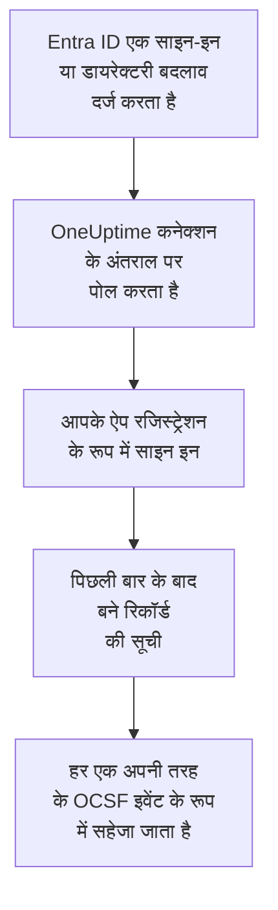

# Microsoft Entra ID

[Microsoft Entra ID](https://learn.microsoft.com/en-us/entra/identity/) के साइन-इन और डायरेक्टरी बदलाव OneUptime के सुरक्षा इवेंट में इम्पोर्ट करें, और चाहें तो [Microsoft 365 ऑडिट लॉग](https://learn.microsoft.com/en-us/purview/audit-log-activities) से Exchange, SharePoint, OneDrive और Teams की गतिविधि भी। वहां आप उन्हें अपने लॉग, ट्रेस और मेट्रिक्स के साथ खोजते हैं, हर दूसरे स्रोत के साथ उनका सहसंबंध देखते हैं, और ज़रूरी चीज़ों के लिए ऑन-कॉल को पेज करते हैं। OneUptime उन्हें आपके बनाए ऐप रजिस्ट्रेशन से पढ़ता है, और आपके टेनेंट में कुछ नहीं बदलता।

:::cards
- [कनेक्शन सेट करें](#कनेक्शन-सेट-करें): एक ऐप रजिस्ट्रेशन, उसकी अनुमतियां, और कनेक्शन का फ़ॉर्म।
- [क्या इम्पोर्ट होता है](#क्या-इम्पोर्ट-होता-है): कौन से रिकॉर्ड, और हर एक सुरक्षा इवेंट कैसे बनता है।
- [पोलिंग कैसे काम करती है](#पोलिंग-कैसे-काम-करती-है): हर पोल कौन सी विंडो पढ़ता है, और वह पिछली विंडो से 30 मिनट क्यों ओवरलैप करती है।
- [समस्या निवारण](#समस्या-निवारण): हर त्रुटि का मतलब क्या है, और क्या बदलना है।
:::

## यह कैसे काम करता है

हर मिनट OneUptime हर उस सक्षम कनेक्शन से पोल करता है जिसका पोल अंतराल बीत चुका है। एक पोल Microsoft Entra ID में आपके ऐप रजिस्ट्रेशन के रूप में साइन इन करता है और इस क्रम में पढ़ता है: पिछले पोल के बाद दर्ज डायरेक्टरी बदलाव ([List directoryAudits](https://learn.microsoft.com/en-us/graph/api/directoryaudit-list)) और साइन-इन ([List signIns](https://learn.microsoft.com/en-us/graph/api/signin-list)), फिर, जब **Microsoft 365 ऑडिट लॉग** विकल्प चालू हो, ऑडिट लॉग की नई सामग्री ([Office 365 Management Activity API](https://learn.microsoft.com/en-us/office/office-365-management-api/office-365-management-activity-api-reference))। हर रिकॉर्ड एक [OCSF](https://schema.ocsf.io/) इवेंट के रूप में सहेजा जाता है: साइन-इन एक Authentication इवेंट के रूप में, सौंपा गया रोल एक User Access Management इवेंट के रूप में, फ़िशिंग का निर्णय एक Detection Finding के रूप में।

## शुरू करने से पहले

- OneUptime में Project Owner, Project Admin या Security Admin रोल। Security Member और Security Viewer कनेक्शन और उनका रन इतिहास देख सकते हैं, पर उन्हें बदल नहीं सकते।
- साइन-इन के लिए, Microsoft Entra ID P1 या P2, जो Microsoft 365 E3, E5 और Business Premium में शामिल हैं: Microsoft Graph साइन-इन सिर्फ़ ऐसे टेनेंट को देता है। डायरेक्टरी बदलाव किसी भी टेनेंट में पढ़े जाते हैं।
- ऐप्लिकेशन रजिस्टर कर सकने वाला कोई Entra रोल, जैसे Application Administrator, और एडमिन सहमति देने के लिए एक Global Administrator या Privileged Role Administrator।
- Microsoft 365 ऑडिट लॉग के लिए, टेनेंट में ऑडिटिंग चालू होनी चाहिए, जो डिफ़ॉल्ट रूप से होती है: [Microsoft Purview पोर्टल](https://purview.microsoft.com) में **Audit** को **Start recording user and admin activity** नहीं दिखाना चाहिए।
- OneUptime ऐप और वर्कर से `login.microsoftonline.com`, `graph.microsoft.com` और `manage.office.com` तक, या Azure Government के लिए `login.microsoftonline.us`, `graph.microsoft.us` और `manage.office365.us` तक आउटबाउंड HTTPS।

## कनेक्शन सेट करें

कनेक्शन [OAuth 2.0 क्लाइंट क्रेडेंशियल फ़्लो](https://learn.microsoft.com/en-us/entra/identity-platform/v2-oauth2-client-creds-grant-flow) से साइन इन करता है: हमेशा एक ऐप्लिकेशन के रूप में, किसी व्यक्ति के रूप में कभी नहीं, सिर्फ़ पढ़ने वाली अनुमतियों के साथ।

:::steps
### एक ऐप्लिकेशन रजिस्टर करें

1. [Microsoft Entra एडमिन सेंटर](https://entra.microsoft.com) में साइन इन करें और **App registrations** खोलें।
2. **New registration** चुनें। इसका नाम `OneUptime Security Events` रखें, **Supported account types** को **Accounts in this organizational directory only** पर रहने दें, रीडायरेक्ट URI खाली छोड़ें, और **Register** चुनें।
3. ऐप के **Overview** पेज से **एप्लिकेशन (क्लाइंट) ID** और **डायरेक्टरी (टेनेंट) ID** कॉपी करें।

### इसे लॉग पढ़ने दें

1. **API permissions → Add a permission → Microsoft Graph → Application permissions** पर जाएं, `AuditLog.Read.All` चुनें, और **Add permissions** चुनें। Microsoft बताता है कि उसकी साइन-इन सूची `Directory.Read.All` भी मांग सकती है: सहमति देने के बाद भी अगर साइन-इन `403` से अस्वीकार हों, तो इसे जोड़ें।
2. Microsoft 365 ऑडिट लॉग के लिए दूसरी अनुमति जोड़ें: **Add a permission → Office 365 Management APIs → Application permissions**, फिर `ActivityFeed.Read`।
3. प्लेबुक को उपयोगकर्ताओं को अक्षम, सक्षम और साइन आउट करने देने के लिए (देखें [रोकथाम](/docs/telemetry/security-cases#रोकथाम)), इसी तरह `User.Read.All`, `User.EnableDisableAccount.All` और `User.RevokeSessions.All` जोड़ें। Microsoft किसी व्यवस्थापक का खाता सिर्फ़ ऐसे ऐप को बदलने देता है जिसके पास Privileged Authentication Administrator भूमिका भी हो।
4. अपने टेनेंट के लिए **Grant admin consent for** चुनें, और पुष्टि करें। हर अनुमति की स्थिति **Granted** होनी चाहिए: सहमति के बिना हर रीड `403` से अस्वीकार होता है।

### एक क्लाइंट सीक्रेट बनाएं

**Certificates & secrets → Client secrets → New client secret** पर जाएं, चुनें कि यह कब एक्सपायर हो, और **Add** चुनें। पेज छोड़ने से पहले सीक्रेट का **Value** कॉपी करें, उसकी **Secret ID** नहीं: यह फिर कभी नहीं दिखता। जिस दिन यह एक्सपायर होता है, उस दिन पोलिंग `Microsoft Entra ID token request failed (HTTP 401)` के साथ रुक जाती है, जब तक आप इसे **क्रेडेंशियल अपडेट करें** से बदल नहीं देते।

### OneUptime में कनेक्शन जोड़ें

**उत्पाद → Security Events → कनेक्शन** (`/dashboard/{projectId}/security-events/connections`) खोलें, **कनेक्शन जोड़ें** पर क्लिक करें, **पहचान** के नीचे **Microsoft Entra ID** चुनें, और **अगला** पर क्लिक करें। नीचे की तालिका की सेटिंग्स भरें, **अगला** पर क्लिक करें, और सीक्रेट का मान **क्लाइंट सीक्रेट** में पेस्ट करें। **पोलिंग** चरण में उसे भी पढ़ने के लिए **Microsoft 365 ऑडिट लॉग** चालू करें।

### सहेजने से पहले इसे टेस्ट करें

**सहेजने से पहले टेस्ट करें** के नीचे **इन सेटिंग्स का परीक्षण करें** पर क्लिक करें। टेस्ट फ़ॉर्म के मानों से साइन इन करके हर लॉग पढ़ता है, और कुछ सहेजता नहीं, इसलिए गलत सीक्रेट या छूटी हुई सहमति कनेक्शन बनने से पहले ही सामने आ जाती है। फिर **अगला** पर क्लिक करें, कनेक्शन को एक **नाम** दें, और उसे बनाएं।
:::

| सेटिंग | कहां मिलेगी |
| --- | --- |
| **डायरेक्टरी (टेनेंट) ID** | ऐप का **Overview** पेज। टेनेंट का GUID, या `contoso.onmicrosoft.com` जैसा कोई सत्यापित डोमेन। **Microsoft 365 ऑडिट लॉग** चालू होने पर GUID: Management API किसी टेनेंट को सिर्फ़ उसी से पहचानता है। |
| **एप्लिकेशन (क्लाइंट) ID** | ऐप का **Overview** पेज। उस ऐप का GUID जिसके पास `AuditLog.Read.All` है। |
| **क्लाउड** | **Azure सार्वजनिक क्लाउड**, या GCC High के लिए **Azure Government (अमेरिका)** (`login.microsoftonline.us`, `graph.microsoft.us` और `manage.office365.us`)। |
| **Microsoft 365 ऑडिट लॉग** | वैकल्पिक, डिफ़ॉल्ट रूप से बंद। चालू होने पर हर पोल Microsoft 365 ऑडिट लॉग भी पढ़ता है। ऐप को `ActivityFeed.Read` चाहिए। |
| **क्लाइंट सीक्रेट** | सीक्रेट का **Value**। यह एन्क्रिप्ट किया जाता है, API इसे कभी नहीं लौटाता और यह फिर कभी नहीं दिखता। इसे कनेक्शन पर **क्रेडेंशियल अपडेट करें** से बदलें। |

**पोलिंग** चरण में एक वैकल्पिक **विवरण**, **पोल अंतराल (मिनट)**, जो `1` से `1440` तक की पूर्ण संख्या है और `5` से शुरू होती है, और **सक्षम** भी है, जो शुरू में चालू रहता है।

## क्या इम्पोर्ट होता है

हर इवेंट का वेंडर `Microsoft` और उत्पाद `Microsoft Entra ID` होता है। उसका `entra.log` एट्रिब्यूट बताता है कि कोई साइन-इन या बदलाव किस लॉग से आया, और Microsoft 365 रिकॉर्ड का `microsoft365.contentType` उसका कंटेंट टाइप।

| रिकॉर्ड | OCSF क्लास | गंभीरता |
| --- | --- | --- |
| सफल साइन-इन | Authentication (`3002`), स्टेटस `Success` | Informational |
| दूसरे चरण के इंतज़ार में साइन-इन, जैसे MFA (`50074`, `50076`) या पासवर्ड बदलने का संकेत | Authentication (`3002`), स्टेटस `Interrupted` | Informational: एक चरण, विफलता नहीं |
| विफल साइन-इन, Entra के कारण और त्रुटि कोड के साथ | Authentication (`3002`), स्टेटस `Failure` | Low |
| ऐसा साइन-इन जिसे Identity Protection ने मध्यम या उच्च जोखिम माना | Authentication (`3002`) | Medium या High |
| बदला गया उपयोगकर्ता, ग्रुप या रोल, उसकी श्रेणी के अनुसार | Account Change (`3001`), Group Management (`3006`), User Access Management (`3005`), या बाकी के लिए Entity Management (`3004`) | विशेषाधिकार वाले रोल, जैसे Global Administrator, के लिए Medium; विफल बदलाव के लिए Low |

**Microsoft 365 ऑडिट लॉग** चालू होने पर उससे वे रिकॉर्ड इम्पोर्ट होते हैं जिन पर सुरक्षा टीम कार्रवाई करती है, और बाकी, जैसे खोली गई फ़ाइल या पढ़ा गया मेल, सिर्फ़ गिने जाते हैं:

| Microsoft 365 रिकॉर्ड | OCSF क्लास | गंभीरता |
| --- | --- | --- |
| कोई Exchange cmdlet, जैसे `New-InboxRule` या `Set-Mailbox`, Outlook में बना इनबॉक्स नियम, या किसी और के नाम से भेजा गया मेल | API Activity (`6003`) | मेल फ़ॉरवर्ड करने पर Medium, `microsoft365.forwardsMail` को `true` पर सेट करके |
| दी गई मेलबॉक्स अनुमति, जैसे `Add-MailboxPermission` | User Access Management (`3005`) | Low |
| SharePoint या OneDrive में शेयर की गई फ़ाइल | File Hosting Activity (`6006`) | किसी मेहमान या ऐसे लिंक के साथ जिसे कोई भी खोल सके, Low, `microsoft365.sharedOutside` को `true` पर सेट करके |
| जोड़ा या हटाया गया साइट कलेक्शन एडमिनिस्ट्रेटर | User Access Management (`3005`) | Low |
| Microsoft Defender for Office 365 का पकड़ा मैलवेयर या फ़िशिंग मेल | Detection Finding (`2004`) | मैलवेयर के लिए High, फ़िशिंग के लिए Medium |
| Microsoft 365 का उठाया अलर्ट | Detection Finding (`2004`) | अलर्ट की अपनी |
| किसी टीम में जोड़ा गया ऐप, बॉट या कनेक्टर | Application Lifecycle (`6002`) | Low |

Exchange का अपना रखरखाव, जो उसके सिस्टम खाते से चलता है, तब तक छोड़ दिया जाता है जब तक वह मेल फ़ॉरवर्ड न करे। हर इवेंट पूरा रिकॉर्ड रखता है, `status.errorCode` या `Parameters.ForwardTo` जैसी बिंदु वाली कुंजियों में फ़्लैट करके, ताकि कोई नियम किसी भी फ़ील्ड को उसी नाम से पढ़े जो Microsoft उसे देता है। Entra ID के लिए नियम लाइब्रेरी के नियम उन्हें वैसे ही पढ़ते हैं जैसे वे यहां इम्पोर्ट होते हैं।

यही साइन-इन और डायरेक्टरी बदलाव लॉग के रूप में भी OneUptime तक पहुंच सकते हैं, जिन्हें Azure की डायग्नोस्टिक सेटिंग एक्सपोर्ट करती है और [आपके लॉग](/docs/telemetry/security-events#अपने-लॉग-में-सुरक्षा-इवेंट-खोजें) पढ़ता है। दोनों तरीकों से हर रिकॉर्ड को एक ही इवेंट ID मिलती है, लेकिन दोनों तरीकों से पढ़ा गया रिकॉर्ड दो बार सहेजा जाता है: Entra ID को एक ही तरीके से पढ़ें।

## पोलिंग कैसे काम करती है

- **रिकॉर्ड इस आधार पर पढ़े जाते हैं कि Entra ID ने उन्हें कब दर्ज किया**, बदलाव के लिए `activityDateTime` और साइन-इन के लिए `createdDateTime`।
- **पहला पोल 24 घंटे पीछे देखता है**, इसलिए नया कनेक्शन तुरंत अपने हाल के रिकॉर्ड दिखाता है।
- **हर बाद वाला पोल सहेजे गए कर्सर से 30 मिनट पहले शुरू होता है।** Microsoft बताता है कि दोनों लॉग कुछ मिनट देर से आते हैं, इसलिए ओवरलैप देर से आया रिकॉर्ड अगले पोल में पढ़ लेता है, और डुप्लिकेट प्रोजेक्ट के भीतर रिकॉर्ड ID से हटा दिए जाते हैं।
- **एक पोल कर्सर से आगे ज़्यादा से ज़्यादा 24 घंटे पढ़ता है।** जिस कनेक्शन का कर्सर पीछे रह गया, वह 24 घंटे की लगातार विंडो में बराबर आता है।
- **Microsoft Entra ID P1 या P2 के बिना टेनेंट** अपने डायरेक्टरी बदलाव इम्पोर्ट करता है, और हर रन की **Read sign-ins** जांच चेतावनी देती है कि साइन-इन नहीं पढ़े गए।
- **विफल रन कुछ नहीं बदलता।** किसी नेटवर्क त्रुटि, या Graph की त्रुटि स्थिति के बाद, कर्सर और विंडो लंबाई जैसे थे वैसे ही रहते हैं, और अगला पोल वही विंडो फिर से पढ़ता है। एकमात्र अपवाद वह अनुरोध है जिसका समय खत्म हो गया: कर्सर वहीं रहता है, पर अगली विंडो आधी लंबी होती है, क्योंकि समय पर जवाब के लिए बहुत भारी विंडो हर कोशिश में टाइम आउट होगी।

Microsoft 365 ऑडिट लॉग इस आधार पर पढ़ा जाता है कि Microsoft ने हर कंटेंट ब्लॉब कब उपलब्ध कराया, एक बार में एक दिन, और उन 7 दिनों से पीछे नहीं जितने Microsoft उसे रखता है। पहला पोल ऐप को `Audit.Exchange`, `Audit.SharePoint` और `Audit.General` की सदस्यता दिलाता है, और Microsoft नई सदस्यता के पहले रिकॉर्ड 12 घंटे के भीतर उपलब्ध कराता है। ऑडिट लॉग Entra ID के लॉग को कभी नहीं रोकता: छूटी हुई अनुमति एक चेतावनी है और विंडो आगे बढ़ जाती है, जबकि Microsoft की तरफ़ की विफलता, जैसे `HTTP 503`, रन को **आंशिक** बना देती है ताकि विंडो फिर से पढ़ी जाए।

### जब किसी विंडो में एक पोल की क्षमता से ज़्यादा हो

हर लॉग का अपना बजट है: 500 डायरेक्टरी बदलावों के 10 पेज, 500 साइन-इन के 20 पेज, और Microsoft 365 ऑडिट लॉग के लिए 120 अनुरोध और 10,000 रिकॉर्ड। एक पोल 4 मिनट बाद रुक जाता है। जब कोई बजट किसी लॉग को उसकी विंडो के अंत से पहले रोक देता है, तो रन **आंशिक** होता है, और उसकी चेतावनी लॉग और बजट का नाम बताती है। Microsoft Graph सबसे नए रिकॉर्ड पहले देता है, इसलिए OneUptime कर्सर को उन रिकॉर्ड से आगे ले जाने के बजाय जिन तक वह कभी पहुंचा ही नहीं, विंडो छोटी कर देता है:

1. **छोटा करें।** अगला पोल उसी शुरुआती बिंदु से आधी लंबाई की विंडो पढ़ता है, और तब तक आधा करता रहता है जब तक कोई विंडो पूरी न पढ़ी जाए, कम से कम एक मिनट तक। रन की चेतावनी यही बताती है: `This window holds more records than one poll can read; the next poll reads a {n} minute window from the same starting point.` लंबी विंडो से पहले ही इम्पोर्ट हो चुके रिकॉर्ड डुप्लिकेट मानकर छोड़ दिए जाते हैं।
2. **वापस बढ़ाएं।** किसी विंडो के पूरा पढ़े जाने के बाद कर्सर उसके अंत पर जाता है, और अगली विंडो फिर दोगुनी होती है, ज़्यादा से ज़्यादा 24 घंटे तक।
3. **एक मिनट से आगे बढ़ें।** अगर एक मिनट में भी उससे ज़्यादा हो जितना एक पोल पढ़ सकता है, तो पोलिंग उससे आगे बढ़ जाती है, ताकि नए रिकॉर्ड आते रहें। रन **आंशिक** ही रहता है, और **पिछली त्रुटि** में लिखा होता है `More records were created in the one minute from {cursor} to {end} than one poll can read. Polling moved past this minute so newer records keep arriving; use Import this time range in Diagnostics on this minute to recover what one run can read.` एक रन जितना पढ़ सकता है उतना वापस पाने के लिए उस मिनट को **Import this time range** से इम्पोर्ट करें।

**पोल अंतराल (मिनट)** बदलने से इसमें कुछ नहीं बदलता: यह तय करता है कि पोल कितनी बार शुरू होता है, न कि उसकी विंडो कहां से शुरू होती है।

### मांग पर रन, प्रीव्यू और इम्पोर्ट

किसी कनेक्शन पर **निदान** पर क्लिक करें, ताकि उसके हाल के रन देख सकें और उसके साथ हाथ से काम कर सकें। जो भी कनेक्शन बदल सकता है वह इन्हें शुरू कर सकता है; जो भी इसे देख सकता है वह इतिहास पढ़ सकता है।

- **अभी चलाएँ** तुरंत सामान्य कर्सर के साथ एक पोल शुरू करता है, तब भी जब कनेक्शन **सक्षम** न हो।
- **Preview records** 7 दिन तक की समय सीमा पढ़ता है और कुछ इम्पोर्ट नहीं करता।
- **Import this time range** आपकी पुष्टि के बाद 7 दिन तक की सीमा इम्पोर्ट करता है, कर्सर हिलाए बिना। पहले से इम्पोर्ट किए गए रिकॉर्ड छोड़ दिए जाते हैं। Microsoft Entra ID, P1 या P2 के साथ 30 दिन और उनके बिना 7 दिन के साइन-इन और डायरेक्टरी बदलाव रखता है।
- किसी रन पर **Copy diagnostics** सपोर्ट के लिए उसकी रिपोर्ट कॉपी करता है। इसमें क्रेडेंशियल कभी शामिल नहीं होते।

## कनेक्शन का परीक्षण करें

कनेक्शन की पंक्ति पर **कनेक्शन का परीक्षण करें**, और फ़ॉर्म में **इन सेटिंग्स का परीक्षण करें**, बैकग्राउंड वर्कर में नहीं बल्कि API प्रोसेस में चलते हैं, इसलिए जब वर्कर ही समस्या हों तब भी टेस्ट जवाब देता है। यह ये जांचें क्रम से चलाता है:

| जांच | यह क्या जांचती है |
| --- | --- |
| **कॉन्फ़िगरेशन** | हर सेटिंग मौजूद है और सही रूप में है। इसके विफल होने पर किसी से संपर्क नहीं किया जाता। |
| **Authenticate with Microsoft Entra** | Entra ID आपके चुने क्लाउड में ऐप को Microsoft Graph का टोकन जारी करता है। |
| **Read sign-ins** | पिछले 24 घंटों के साइन-इन पढ़े जा सकते हैं। P1 या P2 के बिना टेनेंट में यह विफलता नहीं, चेतावनी है। |
| **Read directory changes** | पिछले 24 घंटों के डायरेक्टरी बदलाव पढ़े जा सकते हैं। |
| **Read the Microsoft 365 audit log** | सिर्फ़ विकल्प चालू होने पर: Management API जवाब देता है, और ऐप किन कंटेंट टाइप की सदस्यता में है। |
| **Records available to import** | पिछले 24 घंटों में कितने साइन-इन और डायरेक्टरी बदलाव हैं, हर एक के ज़्यादा से ज़्यादा 500, इसलिए `500+` का मतलब है ज़्यादा। एक भी न होना चेतावनी है। |
| **Background workers**, **Poll scheduler**, **Security event storage** | OneUptime का अपना हिस्सा: कोई प्रोसेस Worker कतार के जॉब लेता है, पोल जॉब हर मिनट चलता है, और सुरक्षा इवेंट का स्टोर जवाब देता है। |
| **Scheduled polling** | सहेजे गए कनेक्शन के लिए: पोलिंग चालू है, कोई रन वर्कर के इंतज़ार में अटका नहीं है, और पोल समय पर चलते हैं। |

टेस्ट के हर अनुरोध की समय सीमा 20 सेकंड है। टेस्ट कभी कुछ इम्पोर्ट नहीं करता और न कर्सर हिलाता है, और हर विफल जांच बताती है कि क्या बदलना है।

## समस्या निवारण

कनेक्शन का **पिछली त्रुटि** पूरा त्रुटि संदेश रखता है, क्रेडेंशियल छिपाकर। जब किसी कनेक्शन में त्रुटि हो, तो उसे पढ़ने के लिए उसके **क्रियाएँ** कॉलम में **त्रुटि देखें** चुनें, और उसे कॉपी करने के लिए डायलॉग में **त्रुटि कॉपी करें** चुनें। हर संदेश `Microsoft Entra ID` से शुरू होता है, फिर विफल अनुरोध का नाम बताता है, और Microsoft का त्रुटि कोड होने पर उसे उद्धृत करता है।

:::details पिछली त्रुटि `token request failed` कहती है
- `HTTP 401` के साथ `invalid_client`: क्लाइंट सीक्रेट गलत है या एक्सपायर हो गया है। नया बनाएं, और उसे **क्रेडेंशियल अपडेट करें** से सहेजें।
- एप्लिकेशन (क्लाइंट) ID या टेनेंट का नाम लेने वाला `HTTP 400`: ऐप के **Overview** पेज पर दोनों जांचें, और यह भी कि **क्लाउड** टेनेंट का ही है।
:::

:::details पिछली त्रुटि `sign-ins request failed (HTTP 403)` या `audit logs request failed (HTTP 403)` कहती है
- त्रुटि कोड `Authorization_RequestDenied`: ऐप के पास `AuditLog.Read.All` नहीं है, या सहमति नहीं दी गई। एडमिन सहमति दें, कुछ मिनट रुकें, और फिर से टेस्ट करें। साइन-इन के लिए `Directory.Read.All` भी दें।
- त्रुटि कोड `Authentication_RequestFromNonPremiumTenantOrB2CTenant`: टेनेंट के पास Microsoft Entra ID P1 या P2 नहीं है। डायरेक्टरी बदलाव फिर भी इम्पोर्ट होते हैं।
:::

:::details Microsoft 365 ऑडिट लॉग नहीं पढ़ा जाता
- `AF10001` के साथ `subscriptions request failed (HTTP 401)` या `(HTTP 403)`: ऐप के पास Office 365 Management APIs की `ActivityFeed.Read` नहीं है, या सहमति नहीं दी गई।
- `AF20010` से `AF20013` तक: Management API **डायरेक्टरी (टेनेंट) ID** को नहीं पहचानता। टेनेंट का GUID इस्तेमाल करें।
- `AF20023` के साथ `subscription start failed`: किसी एडमिनिस्ट्रेटर ने सदस्यता बंद कर दी है। जिस कंटेंट टाइप की सदस्यता नहीं ली जा सकती, उसका नाम रन की चेतावनियों में आता है, और बाकी फिर भी पढ़े जाते हैं।
- पहले पोल के बाद घंटों तक कोई रिकॉर्ड नहीं: Microsoft नई सदस्यता की पहली सामग्री 12 घंटे के भीतर उपलब्ध कराता है।
:::

:::details पिछली त्रुटि `did not complete` कहती है
अनुरोध को कोई जवाब नहीं मिला: टाइमआउट, ऐसा नाम जो रिज़ॉल्व नहीं होता, या अस्वीकार किया गया पता। जांचें कि OneUptime ऐप और वर्कर, आपके इस्तेमाल किए किसी भी प्रॉक्सी के ज़रिए, [शुरू करने से पहले](#शुरू-करने-से-पहले) में दिए होस्ट तक पहुंच सकते हैं।
:::

:::details टेस्ट पास होता है, पर Last Polled Never है
पोल जॉब कभी नहीं चला। **Background workers** और **Poll scheduler** जांचें पढ़ें। सेल्फ़-होस्टेड इंस्टॉलेशन में आम कारण ऐप पर `DISABLE_QUEUE_WORKERS=true` है, जबकि जॉब लेने के लिए कोई अलग वर्कर डिप्लॉयमेंट नहीं है: इसे `false` पर सेट करें, या वर्कर डिप्लॉयमेंट चलाएं (Helm: `worker.enabled: true`, जो डिफ़ॉल्ट रूप से `false` है)।
:::

## अगले कदम

:::cards
- [सुरक्षा इवेंट](/docs/telemetry/security-events): जो इम्पोर्ट करते हैं उसे खोजें, उसका सहसंबंध देखें और उस पर अलर्ट करें।
- [Okta सिस्टम लॉग](/docs/integrations/okta): किसी दूसरे आइडेंटिटी प्रोवाइडर के साइन-इन इम्पोर्ट करें।
- [Google Workspace](/docs/integrations/google-workspace): Google के साइन-इन और एडमिन बदलाव इम्पोर्ट करें।
- [इंटिग्रेशन अवलोकन](/docs/integrations/index): वे दूसरे टूल जिन्हें आप जोड़ सकते हैं।
:::
