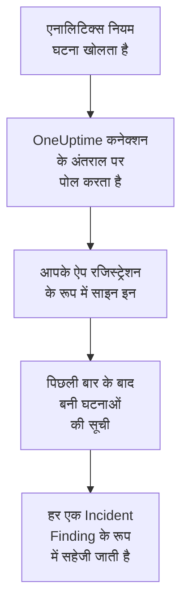

# Microsoft Sentinel

आपके [Microsoft Sentinel](https://learn.microsoft.com/en-us/azure/sentinel/overview) एनालिटिक्स नियम जो घटनाएं (incidents) खोलते हैं, उन्हें OneUptime के सुरक्षा इवेंट में इम्पोर्ट करें। वहां आप उन्हें अपने लॉग, ट्रेस और मेट्रिक्स के साथ खोजते हैं, हर दूसरे स्रोत के साथ उनका सहसंबंध देखते हैं, और ज़रूरी घटनाओं के लिए ऑन-कॉल को पेज करते हैं। OneUptime उन्हें आपके बनाए ऐप रजिस्ट्रेशन से पढ़ता है, और Azure में कुछ नहीं बदलता।

:::cards
- [कनेक्शन सेट करें](#कनेक्शन-सेट-करें): एक ऐप रजिस्ट्रेशन, एक रोल, और कनेक्शन का फ़ॉर्म।
- [क्या इम्पोर्ट होता है](#क्या-इम्पोर्ट-होता-है): हर Sentinel घटना सुरक्षा इवेंट कैसे बनती है।
- [पोलिंग कैसे काम करती है](#पोलिंग-कैसे-काम-करती-है): हर पोल कौन सी विंडो पढ़ता है, और व्यस्त वर्कस्पेस उस पर क्या असर डालता है।
- [समस्या निवारण](#समस्या-निवारण): हर त्रुटि का मतलब क्या है, और क्या बदलना है।
:::

## यह कैसे काम करता है



हर मिनट OneUptime हर उस सक्षम कनेक्शन से पोल करता है जिसका पोल अंतराल बीत चुका है। एक पोल Microsoft Entra ID में आपके ऐप रजिस्ट्रेशन के रूप में साइन इन करता है, Azure Resource Manager से पिछले पोल के बाद बनी घटनाएं मांगता है, और हर एक को [OCSF](https://schema.ocsf.io/) Incident Finding इवेंट (क्लास `2005`) के रूप में सहेजता है। इसके बाद पहचान नियम, मॉनिटर और डैशबोर्ड उसे किसी भी दूसरे स्रोत के सुरक्षा इवेंट की तरह ही बरतते हैं।

## शुरू करने से पहले

- OneUptime में Project Owner, Project Admin या Security Admin रोल। Security Member और Security Viewer कनेक्शन और उनका रन इतिहास देख सकते हैं, पर उन्हें बदल नहीं सकते।
- Microsoft Sentinel सक्षम किया हुआ एक Log Analytics वर्कस्पेस, Azure पब्लिक क्लाउड में या Azure Government (US) में।
- Microsoft Entra ID में ऐप रजिस्ट्रेशन और क्लाइंट सीक्रेट बनाने का अधिकार।
- वर्कस्पेस वाले रिसोर्स ग्रुप पर रोल असाइन करने का अधिकार, जैसे Owner या User Access Administrator।

## कनेक्शन सेट करें

कनेक्शन OAuth 2.0 क्लाइंट क्रेडेंशियल फ़्लो से साइन इन करता है: हमेशा एक ऐप्लिकेशन के रूप में, किसी व्यक्ति के रूप में कभी नहीं। इसकी पहुंच एक Azure रोल से आती है, इसलिए ऐप रजिस्ट्रेशन को किसी API अनुमति की ज़रूरत नहीं होती।

:::steps
### एक ऐप्लिकेशन रजिस्टर करें

1. [Azure portal](https://portal.azure.com) में साइन इन करें और **Microsoft Entra ID** खोलें।
2. **App registrations → New registration** पर जाएं। इसका नाम `OneUptime Sentinel connector` रखें, **Supported account types** को **Accounts in this organizational directory only** पर रहने दें, रीडायरेक्ट URI खाली छोड़ें, और **Register** चुनें।
3. ऐप के **Overview** पेज से **एप्लिकेशन (क्लाइंट) ID** और **डायरेक्टरी (टेनेंट) ID** कॉपी करें।
4. **Certificates & secrets → Client secrets → New client secret** पर जाएं, चुनें कि यह कब एक्सपायर हो, और **Add** चुनें। पेज छोड़ने से पहले सीक्रेट का **Value** कॉपी करें, उसकी **Secret ID** नहीं: यह फिर कभी नहीं दिखता।

### इसे घटनाएं पढ़ने दें

1. Azure portal में वह रिसोर्स ग्रुप खोलें जिसमें आपका Log Analytics वर्कस्पेस है।
2. **Access control (IAM) → Add → Add role assignment** चुनें।
3. **Role** टैब पर **Microsoft Sentinel Reader** चुनें।
4. **Members** टैब पर **User, group, or service principal** चुनें, **Select members** पर क्लिक करें, और नाम से अपना ऐप रजिस्ट्रेशन चुनें।
5. **Review + assign** चुनें।

यह रोल ऐप को घटनाएं पढ़ने देता है (`Microsoft.SecurityInsights/incidents/read`) और कुछ भी लिखने नहीं देता। Microsoft इसे वर्कस्पेस के बजाय रिसोर्स ग्रुप पर असाइन करने की सलाह देता है, ताकि यह उस `SecurityInsights` सॉल्यूशन को भी कवर करे जिससे घटनाएं मिलती हैं। नया असाइनमेंट लागू होने में कुछ मिनट लग सकते हैं।

### वर्कस्पेस का विवरण पाएं

Azure portal में Log Analytics वर्कस्पेस खोलें। उसका **Overview** पेज **सदस्यता ID**, **Resource group** और वर्कस्पेस का नाम दिखाता है। वर्कस्पेस की रिसोर्स ID में भी यही तीनों होते हैं:

```text
/subscriptions/{Subscription ID}/resourceGroups/{Resource group}/providers/Microsoft.OperationalInsights/workspaces/{Workspace name}
```

### OneUptime में कनेक्शन जोड़ें

**उत्पाद → Security Events → कनेक्शन** (`/dashboard/{projectId}/security-events/connections`) खोलें, **कनेक्शन जोड़ें** पर क्लिक करें, **Microsoft Sentinel** चुनें, और **अगला** पर क्लिक करें। नीचे की तालिका की सेटिंग्स भरें, **अगला** पर क्लिक करें, और सीक्रेट का मान **क्लाइंट सीक्रेट** में पेस्ट करें।

### सहेजने से पहले इसे टेस्ट करें

**सहेजने से पहले टेस्ट करें** के नीचे **इन सेटिंग्स का परीक्षण करें** पर क्लिक करें। टेस्ट फ़ॉर्म के मानों से साइन इन करके घटनाएं पढ़ता है, और कुछ सहेजता नहीं, इसलिए गलत सीक्रेट या छूटा हुआ रोल कनेक्शन बनने से पहले ही सामने आ जाता है। फिर **अगला** पर क्लिक करें, कनेक्शन को एक **नाम** दें, और उसे बनाएं।
:::

| सेटिंग | कहां मिलेगी |
| --- | --- |
| **डायरेक्टरी (टेनेंट) ID** | ऐप का **Overview** पेज। टेनेंट का GUID, या `contoso.onmicrosoft.com` जैसा कोई सत्यापित डोमेन। |
| **एप्लिकेशन (क्लाइंट) ID** | ऐप का **Overview** पेज। एक GUID। |
| **सदस्यता ID** | वर्कस्पेस का **Overview** पेज। एक GUID। |
| **Resource group** | वर्कस्पेस का **Overview** पेज। 1 से 90 अक्षर, अंक, अंडरस्कोर, हाइफ़न, पीरियड या कोष्ठक, जो पीरियड पर खत्म न हो। |
| **Workspace name** | वर्कस्पेस का **Overview** पेज। 3 से 90 अक्षर, अंक या हाइफ़न, जो किसी अक्षर या अंक से शुरू और खत्म हो। |
| **क्लाउड** | **Azure सार्वजनिक क्लाउड** (`login.microsoftonline.com`, `management.azure.com`) या **Azure Government (अमेरिका)** (`login.microsoftonline.us`, `management.usgovcloudapi.net`)। |
| **क्लाइंट सीक्रेट** | सीक्रेट का **Value**। यह एन्क्रिप्ट किया जाता है, API इसे कभी नहीं लौटाता और यह फिर कभी नहीं दिखता। इसे कनेक्शन पर **क्रेडेंशियल अपडेट करें** से बदलें। |

**पोलिंग** चरण में एक वैकल्पिक **विवरण**, **पोल अंतराल (मिनट)**, जो `1` से `1440` तक की पूर्ण संख्या है और `5` से शुरू होती है, और **सक्षम** भी है, जो शुरू में चालू रहता है।

## क्या इम्पोर्ट होता है

हर Sentinel घटना एक Incident Finding इवेंट (OCSF क्लास `2005`, गतिविधि `Create`) बनती है, जो `Microsoft Sentinel` टेलीमेट्री सेवा से जुड़ी होती है:

| OCSF कॉलम | Sentinel घटना फ़ील्ड |
| --- | --- |
| `time` | `properties.createdTimeUtc`, जब Sentinel ने घटना बनाई |
| `eventUid` | `name`, घटना का GUID, जिससे डुप्लिकेट भी हटाए जाते हैं |
| `message`, `ruleName` | `properties.title` |
| `ruleId` | पहली `properties.relatedAnalyticRuleIds` एंट्री के आखिर में नियम का GUID |
| `severityName` | `properties.severity`: `High`, `Medium`, `Low` या `Informational` |
| `statusName` | `properties.status`: `New`, `Active` या `Closed` |
| `mitreTactics` | `properties.additionalData.tactics`, ATT&CK ID के रूप में: `Persistence` बन जाता है `TA0003` |
| `principalUser` | `properties.owner.userPrincipalName`, या `properties.owner.email` |
| `targetResource` | `properties.incidentUrl`, Azure portal में घटना का लिंक |
| `observables` | मालिक का UPN, ईमेल और ऑब्जेक्ट ID, और हर लेबल का नाम |
| `attributes` | पूरी घटना, `properties.classification` और `properties.firstActivityTimeUtc` जैसी डॉट वाली कुंजियों में फैलाई हुई |

पोल की विंडो में बनी बंद घटनाएं भी इम्पोर्ट होती हैं। सिर्फ़ खुली घटनाएं देखने के लिए सुरक्षा इवेंट एक्सप्लोरर में `statusName` पर फ़िल्टर करें।

## पोलिंग कैसे काम करती है

हर पोल अपनी विंडो में बनी घटनाओं की सूची लेता है, सबसे पुरानी पहले, एक पेज में 50, और API के `nextLink` का पीछा तब तक करता है जब तक पूरी विंडो पढ़ न ले:

```text
GET https://management.azure.com/subscriptions/{sub}/resourceGroups/{rg}/providers/Microsoft.OperationalInsights/workspaces/{ws}/providers/Microsoft.SecurityInsights/incidents
    ?api-version=2024-03-01
    &$filter=(properties/createdTimeUtc ge {windowStart}) and (properties/createdTimeUtc lt {windowEnd})
    &$orderby=properties/createdTimeUtc asc
    &$top=50
```

- **बनने का समय ही कर्सर है।** हर घंटे चलने वाला शेड्यूल्ड एनालिटिक्स नियम अपनी घटना उस गतिविधि के बहुत बाद खोलता है जिससे वह मेल खाया, और घटना का `firstActivityTimeUtc` घंटों या दिनों पुराना हो सकता है। गतिविधि के समय पर चलने वाला कर्सर ऐसी हर घटना छोड़ देता। गतिविधि के समय `attributes` में रहते हैं, और Diagnostics के नमूने दोनों दिखाते हैं।
- **पहला पोल 24 घंटे पीछे देखता है**, इसलिए नया कनेक्शन तुरंत अपनी हाल की घटनाएं दिखाता है।
- **हर बाद वाला पोल सहेजे गए कर्सर से 1 मिनट पहले शुरू होता है**, इसलिए दो विंडो की सीमा पर बनी घटना कभी नहीं छूटती।
- **एक पोल कर्सर से आगे ज़्यादा से ज़्यादा 24 घंटे पढ़ता है।** जिस कनेक्शन का कर्सर पीछे रह गया, वह 24 घंटे की लगातार विंडो में बराबर आता है, और उसका **स्वास्थ्य** **Catching up** दिखाता है।
- **डुप्लिकेट घटना के GUID से हटाए जाते हैं** (`name`), प्रोजेक्ट के भीतर, इसलिए ओवरलैप, दोबारा कोशिश की गई विंडो और कोई इम्पोर्ट कभी एक घटना को दो बार नहीं सहेजते।

### जब किसी विंडो में एक पोल की क्षमता से ज़्यादा हो

एक पोल ज़्यादा से ज़्यादा 50 घटनाओं वाले 20 पेज पढ़ता है: 1,000 घटनाएं। जब यह सीमा उसे विंडो के अंत से पहले रोक देती है, तो रन **आंशिक** होता है, ऐसी चेतावनी के साथ:

```text
Stopped after 20 incidents requests (the per-run request limit) before reading the whole window. Incidents are read oldest first; every incident created before 2026-09-14T08:12:44.000Z was read.
```

घटनाएं सबसे पुरानी पहले पढ़ी जाती हैं, इसलिए OneUptime कर्सर को पढ़ी गई आखिरी घटना के बनने के समय पर ले जाता है, और अगला पोल वहीं से उसी विंडो लंबाई के साथ शुरू होता है। व्यस्त वर्कस्पेस वही घटनाएं दोबारा पढ़ने के बजाय हर पोल में लगभग 1,000 घटनाएं बराबर करता है। उसी पल बनी घटनाएं दो बार पढ़ी जाती हैं, और डुप्लिकेट जांच दूसरी कॉपी हटा देती है।

जब कोई रन सहेजे गए कर्सर से आगे बढ़ ही नहीं पाता, तो OneUptime इसके बजाय विंडो छोटी करता है:

1. **छोटा करें।** अगला पोल उसी शुरुआती बिंदु से आधी लंबाई की विंडो पढ़ता है, और तब तक आधा करता रहता है जब तक कोई विंडो पूरी न पढ़ी जाए, कम से कम एक मिनट तक। रन की चेतावनी यही बताती है: `This window holds more records than one poll can read; the next poll reads a {n} minute window from the same starting point.`
2. **वापस बढ़ाएं।** किसी विंडो के पूरा पढ़े जाने के बाद अगली विंडो फिर दोगुनी होती है, ज़्यादा से ज़्यादा 24 घंटे तक।
3. **एक मिनट से आगे बढ़ें।** अगर एक मिनट में भी एक पोल की क्षमता से ज़्यादा हो, तो पोलिंग उससे आगे बढ़ जाती है, ताकि नई घटनाएं आती रहें। रन **आंशिक** ही रहता है, और **पिछली त्रुटि** में लिखा होता है `More records were created in the one minute from {cursor} to {end} than one poll can read. Polling moved past this minute so newer records keep arriving; use Import this time range in Diagnostics on this minute to recover what one run can read.` एक रन जितना पढ़ सकता है उतना वापस पाने के लिए उस मिनट को **Import this time range** से इम्पोर्ट करें।

जो रन Microsoft Entra ID या Azure Resource Manager की किसी त्रुटि से पूरी तरह विफल होता है, वह कर्सर और विंडो लंबाई नहीं बदलता, और अगला पोल वही विंडो फिर से पढ़ता है। एकमात्र अपवाद वह अनुरोध है जिसका समय खत्म हो गया: कर्सर वहीं रहता है, पर अगली विंडो आधी लंबी होती है, क्योंकि समय पर जवाब के लिए बहुत भारी विंडो हर कोशिश में टाइम आउट होगी। **पोल अंतराल (मिनट)** बदलने से इनमें से कुछ नहीं बदलता: यह तय करता है कि पोल कितनी बार शुरू हो, न कि उसकी विंडो कहां से शुरू हो।

### मांग पर रन, प्रीव्यू और इम्पोर्ट

किसी कनेक्शन पर **निदान** पर क्लिक करें, ताकि उसके हाल के रन देख सकें और उसके साथ हाथ से काम कर सकें। जो भी कनेक्शन बदल सकता है वह इन्हें शुरू कर सकता है; जो भी इसे देख सकता है वह इतिहास पढ़ सकता है।

- **अभी चलाएँ** तुरंत सामान्य कर्सर के साथ एक पोल शुरू करता है, तब भी जब कनेक्शन **सक्षम** न हो।
- **Preview incidents** 7 दिन तक की समय सीमा पढ़ता है और कुछ इम्पोर्ट नहीं करता।
- **Import this time range** आपकी पुष्टि के बाद 7 दिन तक की सीमा इम्पोर्ट करता है, कर्सर हिलाए बिना। पहले से इम्पोर्ट की गई घटनाएं छोड़ दी जाती हैं।
- किसी रन पर **Copy diagnostics** सपोर्ट के लिए उसकी रिपोर्ट कॉपी करता है। इसमें क्रेडेंशियल कभी शामिल नहीं होते।

## कनेक्शन का परीक्षण करें

कनेक्शन की पंक्ति पर **कनेक्शन का परीक्षण करें**, और फ़ॉर्म में **इन सेटिंग्स का परीक्षण करें**, बैकग्राउंड वर्कर में नहीं बल्कि API प्रोसेस में चलते हैं, इसलिए जब वर्कर ही समस्या हों तब भी टेस्ट जवाब देता है। यह ये जांचें क्रम से चलाता है:

| जांच | यह क्या जांचती है |
| --- | --- |
| **कॉन्फ़िगरेशन** | हर सेटिंग मौजूद है और सही रूप में है। इसके विफल होने पर किसी से संपर्क नहीं किया जाता। |
| **Authenticate with Microsoft Entra** | Microsoft Entra ID आपके ऐप रजिस्ट्रेशन को Azure Resource Manager के लिए टोकन जारी करता है। |
| **Read incidents** | पिछले 24 घंटों में बनी एक घटना पढ़ी जा सकती है (`$top=1`)। इससे रोल और वर्कस्पेस का विवरण साबित होता है। |
| **Incidents available to import** | पिछले 24 घंटों और पिछले 7 दिनों में कितनी घटनाएं बनीं, हर एक के लिए 50 का एक पेज, इसलिए `50+` का मतलब है और ज़्यादा। 7 दिनों में एक भी न होना विफलता नहीं, चेतावनी है। |
| **Background workers**, **Poll scheduler**, **Security event storage** | OneUptime का अपना हिस्सा: कोई प्रोसेस Worker कतार के जॉब लेता है, पोल जॉब हर मिनट चलता है, और सुरक्षा इवेंट का स्टोर जवाब देता है। |
| **Scheduled polling** | सहेजे गए कनेक्शन के लिए: पोलिंग चालू है, कोई रन वर्कर के इंतज़ार में अटका नहीं है, और पोल समय पर चलते हैं। |

टेस्ट के हर अनुरोध की समय सीमा 20 सेकंड है। टेस्ट कभी कुछ इम्पोर्ट नहीं करता और न कर्सर हिलाता है, और हर विफल जांच बताती है कि क्या बदलना है।

## Microsoft Sentinel को सुरक्षा इवेंट भेजें

OneUptime जो पाता है उसे Azure Monitor के Logs Ingestion API के ज़रिए Microsoft Sentinel को भी भेज सकता है, उस वर्कस्पेस की एक कस्टम टेबल में जिस पर Sentinel चलता है। फिर आपके एनालिटिक्स नियम, हंटिंग क्वेरी और वर्कबुक आपकी दूसरी टेबल के साथ `OneUptimeSecurityEvents_CL` से क्वेरी करते हैं।

:::steps
### टेबल और उसका डेटा संग्रह नियम बनाएँ

Azure पोर्टल में वर्कस्पेस का **Tables → Create → New custom log (DCR-based)** खोलें। टेबल का नाम `OneUptimeSecurityEvents` रखें, एक नया डेटा संग्रह नियम बनाएँ, और अगर फ़ॉर्म माँगे तो एक डेटा संग्रह एंडपॉइंट भी। नीचे के नमूने को नमूना फ़ाइल के रूप में अपलोड करें, ट्रांसफ़ॉर्मेशन को जैसा है वैसा रखें, और टेबल बनाएँ।

### किसी ऐप्लिकेशन को इसमें भेजने दें

[एक ऐप्लिकेशन रजिस्टर करें](#एक-ऐप्लिकेशन-रजिस्टर-करें) की तरह एक ऐप्लिकेशन रजिस्टर करें और उसे एक क्लाइंट सीक्रेट दें। फिर डेटा संग्रह नियम खोलें, **Access control (IAM) → Add → Add role assignment**, **Monitoring Metrics Publisher** चुनें, और ऐप्लिकेशन चुनें।

### गंतव्य जोड़ें

**उत्पाद → Security Events → कनेक्शन** खोलें। **अपने SIEM में भेजें** के नीचे **गंतव्य जोड़ें** पर क्लिक करें, **SIEM** में Microsoft Sentinel चुनें और **अगला** पर क्लिक करें। **डायरेक्टरी (टेनेंट) ID**, **एप्लिकेशन (क्लाइंट) ID** और **क्लाइंट सीक्रेट** भरें, डेटा संग्रह एंडपॉइंट (या नियम) के **Overview** से **लॉग इनजेशन एंडपॉइंट**, और नियम के **JSON View** से **डेटा संग्रह नियम की अपरिवर्तनीय ID** भरें। **स्ट्रीम** वैकल्पिक है: खाली छोड़ने पर यह `Custom-OneUptimeSecurityEvents_CL` होती है।

### टेस्ट इवेंट भेजें और भेजना शुरू करें

**टेस्ट इवेंट भेजें** पर क्लिक करें: कुछ ही मिनटों में टेबल में एक पंक्ति पहुँचती है। फिर **क्या भेजना है** में **सिर्फ़ डिटेक्शन** रहने दें या **सभी सुरक्षा इवेंट** चुनें, और **भेजना शुरू करें** पर क्लिक करें।
:::

नमूना फ़ाइल, टेबल के हर कॉलम वाली एक पंक्ति:

```json title="oneuptime-security-events-sample.json"
[
  {
    "TimeGenerated": "2026-10-21T10:00:00.000Z",
    "EventId": "0193c0de-cccc-4aaa-8bbb-000000000001",
    "EventUid": "okta-1",
    "ClassName": "Authentication",
    "CategoryName": "Identity & Access Management",
    "ActivityName": "Logon",
    "Severity": "Medium",
    "SeverityId": 3,
    "Status": "Failure",
    "Message": "Failed sign-in for alice",
    "VendorName": "Okta",
    "ProductName": "Okta System Log",
    "RuleId": "",
    "RuleName": "",
    "MitreTactics": [],
    "MitreTechniques": [],
    "PrincipalUser": "alice@example.com",
    "PrincipalHost": "laptop-7",
    "PrincipalIp": "203.0.113.7",
    "TargetUser": "",
    "TargetHost": "app.example.com",
    "TargetIp": "198.51.100.20",
    "TargetPort": 443,
    "TargetResource": "",
    "ProcessName": "",
    "ProcessCommandLine": "",
    "ParentProcessName": "",
    "Observables": [
      "alice@example.com",
      "203.0.113.7"
    ],
    "Attributes": {
      "okta.outcome.reason": "INVALID_CREDENTIALS"
    }
  }
]
```

- Logs Ingestion API हर कॉल में 1 MB तक लेता है, इसलिए पंक्तियाँ 500 तक के बैच में जाती हैं। जिस बैच को Azure अस्वीकार करता है, उसे तब तक बाँटा जाता है जब तक वह पंक्ति न मिल जाए जिसे वह नहीं लेता, और उसे छोड़ दिया जाता है, और थ्रॉटलिंग (`429`) को फिर आज़माया जाता है।
- `403` का मतलब है कि ऐप्लिकेशन के पास नियम पर **Monitoring Metrics Publisher** नहीं है, और `404` का मतलब है कि अपरिवर्तनीय ID या स्ट्रीम गलत है।
- OneUptime ने Microsoft Sentinel से जो घटनाएं (incidents) इम्पोर्ट की हैं, वे कभी वापस Microsoft Sentinel को नहीं भेजी जातीं।

## समस्या निवारण

कनेक्शन का **पिछली त्रुटि** पूरा त्रुटि संदेश रखता है, क्रेडेंशियल छिपाकर, एक ऐसे प्रीफ़िक्स के पीछे जो विफल हुए चरण का नाम बताता है। जब किसी कनेक्शन में त्रुटि हो, तो उसे पढ़ने के लिए उसके **क्रियाएँ** कॉलम में **त्रुटि देखें** चुनें, और कॉपी करने के लिए डायलॉग में **त्रुटि कॉपी करें**। पहले प्रीफ़िक्स पढ़ें।

:::details Last Error `Microsoft Sentinel token request` से शुरू होता है
- `Microsoft Sentinel token request failed (HTTP ...)`: Microsoft Entra ID ने टोकन जारी करने से मना कर दिया, इसलिए Azure से कभी संपर्क नहीं हुआ। संदेश में Entra का कोड होता है:
  - `AADSTS7000215` या `invalid_client`: **क्लाइंट सीक्रेट** गलत है या एक्सपायर हो गया है, या यह सीक्रेट के मान के बजाय उसकी ID है। नया सीक्रेट बनाएं, और उसे **क्रेडेंशियल अपडेट करें** से सहेजें।
  - `AADSTS700016` या `unauthorized_client`: **एप्लिकेशन (क्लाइंट) ID** दी गई **डायरेक्टरी (टेनेंट) ID** में नहीं है। दोनों को ऐप के **Overview** पेज से मिलाएं।
  - `AADSTS90002` या `HTTP 404`: ऐसा कोई टेनेंट नहीं है। **डायरेक्टरी (टेनेंट) ID** गलत है, या यह दूसरे क्लाउड में है: **क्लाउड** जांचें।
  - `HTTP 429` या `HTTP 5xx`: Microsoft Entra ID थ्रॉटल कर रहा है या उपलब्ध नहीं है। अगला पोल फिर से कोशिश करता है।
- `Microsoft Sentinel token request returned ...`: Microsoft Entra ID ने कुछ अनुपयोगी लौटाया, जैसे ऐसी बॉडी जो JSON नहीं है या जिसमें `access_token` नहीं है। आमतौर पर यह बीच में मौजूद कोई प्रॉक्सी या गेटवे होता है।
- बिना स्टेटस के `Microsoft Sentinel token request failed:`, या `Microsoft Sentinel token request timed out after ... seconds with no response`: अनुरोध को कोई जवाब नहीं मिला। OneUptime ऐप और वर्कर से `login.microsoftonline.com` तक DNS, TLS और आउटबाउंड HTTPS जांचें।
:::

:::details Last Error `Microsoft Sentinel incidents list` से शुरू होता है
- `Microsoft Sentinel incidents list failed (HTTP ...)`: Azure Resource Manager ने अनुरोध अस्वीकार कर दिया।
  - `HTTP 401`: इसने टोकन स्वीकार नहीं किया। लगभग हमेशा **क्लाउड** टेनेंट से मेल नहीं खाता, या ऐप रजिस्ट्रेशन मिटा दिया गया। दो पेज के बीच एक्सपायर होने वाला टोकन अपने आप नया होकर एक बार फिर कोशिश करता है।
  - `HTTP 403` या `AuthorizationFailed`: ऐप के पास अभी रिसोर्स ग्रुप पर **Microsoft Sentinel Reader** नहीं है। इसे असाइन करें, और कुछ मिनट इंतज़ार करें।
  - `HTTP 404`: उस **सदस्यता ID**, **Resource group** और **Workspace name** वाला कोई वर्कस्पेस नहीं है, या उस पर Microsoft Sentinel सक्षम नहीं है। उन्हें वर्कस्पेस के **Overview** पेज से कॉपी करें।
  - `HTTP 429` या `HTTP 5xx`: Azure Resource Manager थ्रॉटल कर रहा है या उपलब्ध नहीं है। अगला पोल फिर से कोशिश करता है।
  - `HTTP 400`: Azure Resource Manager ने क्वेरी अस्वीकार की, जिसे OneUptime बनाता है, आपकी सेटिंग्स नहीं। संदेश OneUptime सपोर्ट को भेजें।
- `Microsoft Sentinel incidents list returned ...`: Azure ने `200` लौटाया, पर घटनाओं का कोई पढ़ने योग्य पेज नहीं, या किसी दूसरे होस्ट का `nextLink`, जिसे कनेक्टर अस्वीकार करता है ताकि टोकन कभी Azure Resource Manager से बाहर न जाए। इसे खाली विंडो मानने के बजाय रिपोर्ट किया जाता है, ताकि कर्सर कभी उन घटनाओं से आगे न बढ़े जिन्हें किसी ने नहीं पढ़ा।
- बिना स्टेटस के `Microsoft Sentinel incidents list failed:`, या `Microsoft Sentinel incidents list timed out after ... seconds with no response`: अनुरोध को कोई जवाब नहीं मिला। OneUptime वर्कर से `management.azure.com`, या `management.usgovcloudapi.net` तक आउटबाउंड HTTPS जांचें।
:::

:::details Last Polled Never है और Last Error खाली है
इस कनेक्शन का कोई पोल पूरा नहीं हुआ है। **कनेक्शन का परीक्षण करें** चलाएं: उसकी **Background workers** और **Poll scheduler** जांचें कारण बताती हैं। सेल्फ़-होस्टेड इंस्टॉलेशन में आम कारण ऐप पर `DISABLE_QUEUE_WORKERS=true` है, जबकि जॉब लेने के लिए कोई अलग वर्कर डिप्लॉयमेंट नहीं है: इसे `false` पर सेट करें, या वर्कर डिप्लॉयमेंट चलाएं (Helm: `worker.enabled: true`)।
:::

:::details कोई रन Partial है
- `Stopped after 20 incidents requests (the per-run request limit) before reading the whole window`: विंडो में एक रन द्वारा पढ़ी जाने वाली 1,000 घटनाओं से ज़्यादा थीं। कुछ नहीं खोता: अगला पोल पढ़ी गई आखिरी घटना के बाद से शुरू होता है। जो कनेक्शन पोल दर पोल **आंशिक** रहता है, वह बैकलॉग बराबर कर रहा है, और उसके **अंतिम पोल** और **अंतिम इंपोर्ट किया गया इवेंट** आगे बढ़ते रहते हैं।
- `Microsoft Sentinel returned incidents out of creation-time order, so this run cannot name a point to resume from.`: API ने सबसे-पुरानी-पहले क्रम को अनदेखा किया, इसलिए रन कर्सर को अपनी आखिरी घटना तक नहीं ले जा सकता, और अगला पोल इसके बजाय छोटी विंडो पढ़ता है। अगर यह बार-बार हो, तो रन की रिपोर्ट OneUptime सपोर्ट को भेजें।
- `More records were created in the one minute from ... than one poll can read`: पोलिंग उस मिनट से आगे बढ़ गई। उसे **निदान** में **Import this time range** से इम्पोर्ट करें। एक इम्पोर्ट उतना ही पढ़ता है जितना एक पोल।
:::

:::details टेस्ट पास होता है, पर कुछ इम्पोर्ट नहीं होता
टेस्ट की रिपोर्ट में **Incidents available to import** पढ़ें। पिछले 7 दिनों में `0` का मतलब है कि वर्कस्पेस के एनालिटिक्स नियमों ने कोई घटना नहीं खोली, जो कनेक्शन की गलती नहीं है। Microsoft Sentinel में जांचें कि नियम सक्षम हैं और घटनाएं बनाने के लिए सेट हैं।
:::

## Azure Government

**क्लाउड** को **Azure Government (अमेरिका)** पर सेट करें। इसके बाद कनेक्शन `login.microsoftonline.us` पर `https://management.usgovcloudapi.net/.default` स्कोप के साथ साइन इन करता है, और `management.usgovcloudapi.net` से घटनाएं पढ़ता है। बाकी सब कुछ, रोल असाइनमेंट समेत, वैसा ही है।

## आपको क्या मिलता है

- **खोज।** सुरक्षा इवेंट एक्सप्लोरर में, हर दूसरे स्रोत के साथ, घटनाओं को गंभीरता, स्थिति, मालिक, लेबल या टैक्टिक से फ़िल्टर करें।
- **सहसंबंध।** हर घटना का मालिक और उसके लेबल observable के रूप में इंडेक्स होते हैं, इसलिए एक खोज उनका ज़िक्र करने वाली हर चीज़ ढूंढ लेती है।
- **पहचान नियम।** Sigma नियम जो शेड्यूल पर आपके सुरक्षा इवेंट पर चलते हैं, और ऑन-कॉल को पेज करने वाले अलर्ट खोलते हैं।
- **मॉनिटर।** सुरक्षा इवेंट मॉनिटर मेल खाने वाले इवेंट गिनते हैं, जैसे नई High घटनाएं, और थ्रेशोल्ड पार होने पर घटनाएं या अलर्ट खोलते हैं।

सुरक्षा इवेंट का बिल आपकी बाकी टेलीमेट्री की तरह, इंजेस्ट किए गए हर GB के हिसाब से बनता है। [मूल्य निर्धारण](https://oneuptime.com/pricing) देखें।

## अगले कदम

:::cards
- [सुरक्षा इवेंट](/docs/telemetry/security-events): जो इम्पोर्ट करते हैं उसे खोजें, उसका सहसंबंध देखें और उस पर अलर्ट करें।
- [Microsoft Defender XDR](/docs/integrations/microsoft-defender-xdr): हर Defender वर्कलोड के अलर्ट भी इम्पोर्ट करें।
- [रोल](/docs/permissions/reference#भूमिकाएँ): Security रोल क्या देख और बदल सकते हैं।
- [इंटिग्रेशन अवलोकन](/docs/integrations/index): वे दूसरे टूल जिन्हें आप जोड़ सकते हैं।
:::
