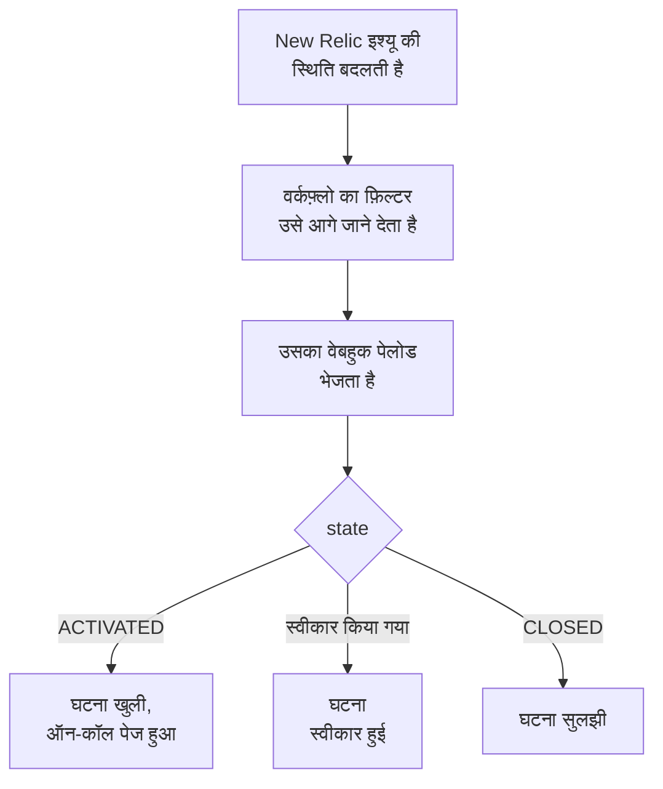

# New Relic

[New Relic](https://newrelic.com) इश्यू OneUptime को भेजें, ताकि हर इश्यू एक घटना या एक अलर्ट बने जो आपकी ऑन-कॉल टीम को पेज करे, जब कोई इश्यू स्वीकार करे तो स्वीकार हो, और इश्यू बंद होने पर सुलझ जाए। New Relic अपने इश्यू [वेबहुक डेस्टिनेशन](https://docs.newrelic.com/docs/alerts/get-notified/notification-integrations/) से भेजता है, इसलिए किसी भी तरफ़ कुछ इंस्टॉल नहीं करना पड़ता।

:::cards
- [टेम्पलेट से शुरू करें](#टेम्पलेट-से-शुरू-करें): पेज करने वाले चुनें, URL कॉपी करें, और देखें कि हर इश्यू क्या करता है।
- [New Relic कॉन्फ़िगर करें](#new-relic-कॉन्फ़िगर-करें): एक वेबहुक डेस्टिनेशन, और उसे सूचित करने वाला वर्कफ़्लो।
- [टेस्ट करें](#इसे-टेस्ट-करें): खुद एक इश्यू भेजें, फिर New Relic से एक।
- [समस्या निवारण](#समस्या-निवारण): जब इश्यू नहीं पहुंचते, या घटनाएं खुली रहती हैं।
:::

## यह कैसे काम करता है



New Relic का वर्कफ़्लो अपने फ़िल्टर से चुनता है कि कौन से इश्यू भेजे जाएं, और जब कोई इश्यू सक्रिय, स्वीकार या बंद होता है, तो New Relic के भरे JSON पेलोड के साथ एक वेबहुक डेस्टिनेशन को सूचित करता है। इश्यू की ID से ही OneUptime को वह घटना मिलती है जो उसने खोली थी।

## शुरू करने से पहले

- एक New Relic खाता जिसमें आप डेस्टिनेशन और वर्कफ़्लो बना सकें।
- OneUptime में, वर्कफ़्लो बनाने का अधिकार। OneUptime Cloud पर, वर्कफ़्लो के लिए **Growth** प्लान या उससे ऊपर चाहिए।

## टेम्पलेट से शुरू करें

पहले OneUptime सेट करें: वही आपको वह URL देता है जिस पर New Relic भेजता है। **एक वर्कफ़्लो बनाएं** डायलॉग में दो New Relic टेम्पलेट हैं, उसकी कैटेगरी सूची में **New Relic** के नीचे: घटना के लिए **Declare an incident for each New Relic issue**, और अलर्ट के लिए **Create an alert for each New Relic issue**। दोनों एक जैसा करते हैं, हर एक अपनी तरह के रिकॉर्ड के साथ।

:::steps
1. **वर्कफ़्लो** पर जाएं और **वर्कफ़्लो बनाएं** पर क्लिक करें। **या किसी टेम्पलेट से शुरू करें** के नीचे कैटेगरी सूची में **New Relic** चुनें, **Declare an incident for each New Relic issue** पर क्लिक करें, या **Create an alert for each New Relic issue** पर, और **यह टेम्पलेट इस्तेमाल करें** पर क्लिक करें।
2. **Who to page for new New Relic issues** के अंतर्गत पेज की जाने वाली ऑन-कॉल नीतियाँ चुनें, या किसी को पेज न करने के लिए कोई नहीं, और **वर्कफ़्लो बनाएं** पर क्लिक करें। वर्कफ़्लो **बिल्डर** में बंद हालत में खुलता है।
3. **Webhook** ट्रिगर पर क्लिक करें, फिर **URL कॉपी करें** पर, और URL को New Relic के लिए रख लें।
4. **बिल्डर** के ऊपर **सक्षम** चालू करें। बंद वर्कफ़्लो New Relic को `400` से जवाब देता है।
:::

फिर [New Relic कॉन्फ़िगर करें](#new-relic-कॉन्फ़िगर-करें) ताकि वह अपने इश्यू उस URL पर भेजे। वर्कफ़्लो का `read-event-1` चरण उसी सेटअप के साथ खुलता है, जब आप **बिल्डर** में उस पर लौटें।

### वर्कफ़्लो क्या करता है

**Webhook** ट्रिगर के बाद, `read-event-1` **Check With JavaScript** चरण New Relic के भेजे `state` को पढ़ता है, और **Incident From Another Tool**, या अलर्ट टेम्पलेट में **Alert From Another Tool**, इश्यू की ID के ज़रिए वही करता है जो उसका मतलब है। घटना ID को अपनी कस्टम फ़ील्ड `newRelicIssueId` में रखती है।

| New Relic क्या भेजता है | वर्कफ़्लो क्या करता है |
| --- | --- |
| `state` है `ACTIVATED` या `CREATED` | `New Relic: <issue>` शीर्षक वाली एक घटना घोषित करता है, उस गंभीरता पर जिससे इश्यू की प्राथमिकता मैप होती है, आपके स्टेटस पेजों से बाहर रखी गई। उसका विवरण New Relic में इश्यू का लिंक देता है, और प्राथमिकता, एंटिटी, पॉलिसी और कंडीशन दिखाता है। यह आपकी चुनी ऑन-कॉल नीतियों को पेज करता है। वही इश्यू दोबारा, जैसे New Relic का उसे CRITICAL तक बढ़ाना, दूसरी घटना नहीं खोलता, और किसी को दोबारा पेज नहीं करता। |
| `state` है `ACTIVATED` और `isAcknowledged` है `true` | इश्यू की घटना स्वीकार करता है, जिससे ऑन-कॉल उसे एस्केलेट करना बंद कर देता है। वजह उसकी टाइमलाइन पर होती है। |
| `state` है `CLOSED` | इश्यू की घटना सुलझाता है, जब तक वह पहले से सुलझी न हो। वजह उसकी टाइमलाइन पर होती है। |

जिस इश्यू की कोई घटना नहीं, उसका स्वीकार या बंद होना कुछ नहीं बदलता। बाकी सब कुछ, जैसे किसी दूसरे टूल का अनुरोध, जैसा है वैसा छोड़ दिया जाता है: `read-event-1` **No** लेता है, और रन के **चरण** बताते हैं क्यों। New Relic को कुछ वापस नहीं जाता: वह सिग्नल ठीक होने पर अपने इश्यू खुद बंद करता है, और उसी से घटना सुलझती है।

### प्राथमिकताएं और पेज करना

हर नया इश्यू आपकी चुनी ऑन-कॉल नीतियों को पेज करता है, उसकी प्राथमिकता चाहे जो हो: New Relic किसी इश्यू को HIGH से CRITICAL तक उसी इश्यू पर, वहीं बढ़ा देता है, इसलिए CRITICAL का इंतज़ार करने पर HIGH पर खुले और फिर बिगड़े इश्यू के लिए कभी पेज नहीं होता। कम इश्यू के लिए पेज करने हेतु, New Relic में वर्कफ़्लो का फ़िल्टर सीमित करें: जो उसमें से गुज़रता है वही OneUptime तक पहुंचता है। नए प्रोजेक्ट में, प्राथमिकताएं इन घटना और अलर्ट गंभीरताओं पर मैप होती हैं:

| New Relic प्राथमिकता | घटना | अलर्ट | ऑन-कॉल |
| --- | --- | --- | --- |
| CRITICAL | Critical Incident | High | पेज किया गया |
| HIGH | Major Incident | Low | पेज किया गया |
| MEDIUM | Minor Incident | Low | पेज किया गया |
| LOW | Minor Incident | Low | पेज किया गया |

अपनी गंभीरताओं के साथ, CRITICAL आपकी सबसे गंभीर पर जाता है, HIGH बीच वाली पर, और MEDIUM और LOW आपकी सबसे कम गंभीर पर। जब New Relic अपना इश्यू बढ़ाता है, तो घटना उसी गंभीरता पर रहती है जिस पर वह खुली थी।

किसी प्राथमिकता को नाम से अपनी किसी गंभीरता पर मैप करने के लिए, `SEVERITY_BY_NAME` को `read-event-1` चरण में संपादित करें, जैसे `{ HIGH: 'Critical Incident' }`।

## New Relic कॉन्फ़िगर करें

:::steps
### वेबहुक डेस्टिनेशन जोड़ें

New Relic में, **Alerts → Destinations** पर जाएं और एक **Webhook** डेस्टिनेशन जोड़ें। **Webhook name** को `OneUptime` और **Endpoint URL** को OneUptime से कॉपी किए URL पर सेट करें, और सहेजें। **Use authorization** बंद रहने दें: URL ही एकमात्र क्रेडेंशियल है।

### वर्कफ़्लो जोड़ें

**Alerts → Workflows** पर जाएं और **Add a workflow** पर क्लिक करें। इसका नाम `OneUptime` रखें। इसका फ़िल्टर तय करता है कि कौन से इश्यू OneUptime तक पहुंचें, जैसे सिर्फ़ CRITICAL वाले, या किसी एक टीम के।

### डेस्टिनेशन को सूचित करें

आपके बनाए **Webhook** डेस्टिनेशन को वर्कफ़्लो में जोड़ें। New Relic जो पेलोड भरता है उसे रखें, और `state` के बाद `isAcknowledged` की एक पंक्ति जोड़ें, ताकि घटना अपने इश्यू के साथ स्वीकार हो:

```json
{
  "id": {{ json issueId }},
  "issueUrl": {{ json issuePageUrl }},
  "title": {{ json annotations.title.[0] }},
  "priority": {{ json priority }},
  "impactedEntities": {{ json entitiesData.names }},
  "totalIncidents": {{ json totalIncidents }},
  "state": {{ json state }},
  "isAcknowledged": {{ json isAcknowledged }},
  "trigger": {{ json triggerEvent }},
  "isCorrelated": {{ json isCorrelated }},
  "createdAt": {{ createdAt }},
  "updatedAt": {{ updatedAt }},
  "sources": {{ json accumulations.source }},
  "alertPolicyNames": {{ json accumulations.policyName }},
  "alertConditionNames": {{ json accumulations.conditionName }},
  "workflowName": {{ json workflowName }}
}
```

जोड़ने वाली पंक्ति `"isAcknowledged": {{ json isAcknowledged }},` है। फिर **Update message** पर क्लिक करें।

### सक्रिय, स्वीकार और बंद होने पर सूचित करें

डेस्टिनेशन पर तीन बिंदुओं पर क्लिक करें और **Notify when** चुनें। **Activated**, **Acknowledged** और **Closed** को चालू रहने दें।

### वर्कफ़्लो सक्रिय करें

**Activate workflow** पर क्लिक करें।
:::

OneUptime का वर्कफ़्लो पेलोड के ये फ़ील्ड पढ़ता है, और बाकी को छोड़ देता है:

| फ़ील्ड | New Relic इसमें क्या रखता है |
| --- | --- |
| `id` | इश्यू की ID। |
| `issueUrl` | New Relic में इश्यू का लिंक। |
| `title` | इश्यू का शीर्षक। |
| `priority` | इश्यू कितना ज़रूरी है: `CRITICAL`, `HIGH`, `MEDIUM` या `LOW`। |
| `state` | इश्यू किस स्थिति में है: `CREATED`, `ACTIVATED` या `CLOSED`। |
| `isAcknowledged` | `true` जब कोई New Relic में इश्यू स्वीकार कर ले। |
| `impactedEntities` | उन एंटिटी के नाम जिनके बारे में इश्यू है। |
| `alertPolicyNames` | इश्यू के पीछे की पॉलिसी के नाम। |
| `alertConditionNames` | इश्यू के पीछे की कंडीशन के नाम। |

## इसे टेस्ट करें

जो URL आपने कॉपी किया उस पर एक इश्यू भेजें, जैसे New Relic भेजता:

```bash
curl -X POST "<url>" \
  -H "Content-Type: application/json" \
  -d '{
    "id": "7d4a2e1c-3b5f-4c8e-9a1d-2f6b8c0e4a71",
    "issueUrl": "https://radar-api.service.newrelic.com/accounts/1234567/issues/7d4a2e1c-3b5f-4c8e-9a1d-2f6b8c0e4a71?notifier=WEBHOOK",
    "title": "High CPU on checkout-service",
    "priority": "CRITICAL",
    "impactedEntities": ["checkout-service"],
    "state": "ACTIVATED",
    "isAcknowledged": false,
    "alertPolicyNames": ["Production"],
    "alertConditionNames": ["CPU above 90%"]
  }'
```

एक घटना खुलती है, जिसका शीर्षक `New Relic: High CPU on checkout-service` है, और आपकी चुनी ऑन-कॉल नीतियों को पेज किया जाता है। वही अनुरोध `isAcknowledged` को `true` पर सेट करके भेजें, और घटना स्वीकार हो जाती है। उसे `state` को `CLOSED` पर सेट करके भेजें, और घटना सुलझ जाती है।

फिर New Relic से टेस्ट करें: वर्कफ़्लो का वेबहुक संदेश खोलें, और **Send test notification** पर क्लिक करें। यह देखने के लिए कि वह पहुंचा, OneUptime वर्कफ़्लो का **लॉग → रन** खोलें।

## समस्या निवारण

:::details OneUptime में कुछ नहीं पहुंचता
- जांचें कि New Relic में वर्कफ़्लो सक्रिय है, और उसका फ़िल्टर इश्यू को आगे जाने देता है।
- जांचें कि डेस्टिनेशन का **Endpoint URL** **Webhook** ट्रिगर का URL है।
- बंद वर्कफ़्लो `400` से जवाब देता है। उसके **बिल्डर** के ऊपर **सक्षम** चालू करें।
:::

:::details वर्कफ़्लो चलता है, पर कुछ नहीं खोलता
**लॉग → रन** में रन खोलें। उसके **चरण** में `read-event-1` की प्रविष्टि बताती है कि उसने **No** क्यों लिया।

- `New Relic named no issue ID`: पेलोड में पंक्ति `"id": {{ json issueId }},` रखें।
- `is in no state`: पेलोड में पंक्ति `"state": {{ json state }},` रखें।
:::

:::details घटनाएं स्वीकार नहीं होतीं
- पेलोड में पंक्ति `"isAcknowledged": {{ json isAcknowledged }},` चाहिए। इसके बिना, घटना खुलती है और अपने इश्यू के साथ सुलझती है, पर कभी स्वीकार नहीं होती।
- New Relic के वर्कफ़्लो में **Notify when** के तहत **Acknowledged** चालू होना चाहिए।
:::

:::details घटनाएं खुलती हैं पर कभी सुलझती नहीं
- New Relic के वर्कफ़्लो में **Notify when** के तहत **Closed** चालू होना चाहिए।
- बंद होने का रन **लॉग → रन** में खोलें: उसका आखिरी चरण बताता है क्यों। बंद होने का `id` इश्यू वाला ही होना चाहिए, इसलिए पेलोड में `"id": {{ json issueId }},` को जैसा है वैसा ही रहने दें।
:::

:::details बहुत ज़्यादा इश्यू के लिए ऑन-कॉल को पेज किया जाता है
OneUptime तक पहुंचने वाला हर नया इश्यू पेज करता है। New Relic में वर्कफ़्लो का फ़िल्टर सीमित करें, ताकि सिर्फ़ वही इश्यू उस तक पहुंचें जिन्हें पेज करना चाहिए। [प्राथमिकताएं और पेज करना](#प्राथमिकताएं-और-पेज-करना) देखें।
:::

:::details ऑन-कॉल को पेज नहीं किया जाता
- जिस इश्यू की घटना पहले से है, उसकी सूचना किसी को दोबारा पेज नहीं करती, इसलिए CRITICAL तक बढ़ने पर कोई पेज नहीं होता।
- **एक वर्कफ़्लो बनाएं** डायलॉग में किसी को न चुनने पर, वर्कफ़्लो में पेज करने वाला कोई चरण नहीं होता।
:::

## सुरक्षा

- **URL को पासवर्ड की तरह रखें।** जिसके पास भी यह है, वह घटनाएं खोल सकता है। अगर यह लीक हो जाए, तो वर्कफ़्लो के **Webhook** ट्रिगर में **URL रीसेट करें** पर क्लिक करें। फिर New Relic में डेस्टिनेशन का **Endpoint URL** अपडेट करें।
- **लिंक New Relic पर जाते हैं।** टेम्पलेट किसी इश्यू का लिंक सिर्फ़ New Relic साइट पर देता है, अनुरोध चाहे जो कहे, और New Relic ने जो भेजा उसे टेक्स्ट के रूप में लिखता है।
- **सेल्फ़-होस्टेड?** New Relic इंटरनेट से वेबहुक भेजता है, इसलिए आपका OneUptime इंटरनेट से HTTPS पर पहुंचने योग्य होना चाहिए।

## अगले कदम

:::cards
- [वर्कफ़्लो टेम्पलेट](/docs/workflows/authoring): किसी टेम्पलेट से वर्कफ़्लो बनाएं, और उसे बिल्डर में बदलें।
- [Datadog](/docs/integrations/datadog): यही टेम्पलेट, Datadog मॉनिटर के लिए।
- [एस्केलेशन नियम](/docs/on-call/escalation-rules): तय करें कि ऑन-कॉल नीति किसे और कब पेज करे।
- [इंटिग्रेशन अवलोकन](/docs/integrations/index): वे दूसरे टूल जिन्हें आप जोड़ सकते हैं।
:::
