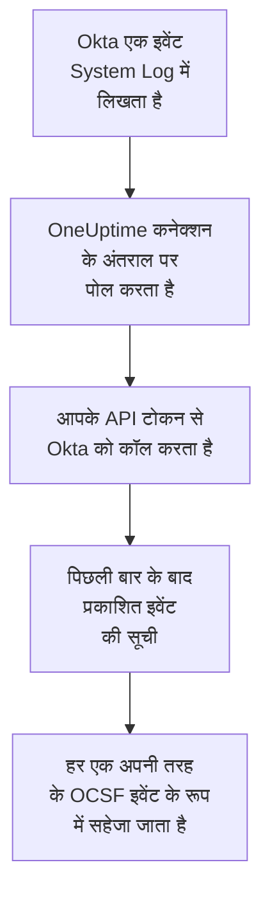

# Okta सिस्टम लॉग

[Okta System Log](https://developer.okta.com/docs/reference/system-log-query/) को OneUptime के सुरक्षा इवेंट में इम्पोर्ट करें: साइन-इन, MFA चुनौतियां, खाते और ग्रुप के बदलाव, और Okta के अपने खतरे के डिटेक्शन। वहां आप उन्हें अपने लॉग, ट्रेस और मेट्रिक्स के साथ खोजते हैं, हर दूसरे स्रोत के साथ उनका सहसंबंध देखते हैं, और जो मायने रखते हैं उनके लिए ऑन-कॉल को पेज करते हैं। OneUptime उन्हें आपके बनाए API टोकन से पढ़ता है, और Okta में कुछ नहीं बदलता।

:::cards
- [कनेक्शन सेट करें](#कनेक्शन-सेट-करें): एक API टोकन, और कनेक्शन का फ़ॉर्म।
- [क्या इम्पोर्ट होता है](#क्या-इम्पोर्ट-होता-है): कौन से इवेंट, और हर एक सुरक्षा इवेंट कैसे बनता है।
- [पोलिंग कैसे काम करती है](#पोलिंग-कैसे-काम-करती-है): हर पोल कौन सी विंडो पढ़ता है, और वह पिछली विंडो से 15 मिनट क्यों ओवरलैप करती है।
- [समस्या निवारण](#समस्या-निवारण): हर त्रुटि का मतलब क्या है, और क्या बदलना है।
:::

## यह कैसे काम करता है



हर मिनट OneUptime हर उस सक्षम कनेक्शन से पोल करता है जिसका पोल अंतराल बीत चुका है। एक पोल Okta से पिछले पोल के बाद प्रकाशित System Log इवेंट मांगता है, और हर एक को [OCSF](https://schema.ocsf.io/) इवेंट के रूप में सहेजता है: साइन-इन को Authentication इवेंट के रूप में, खाते में बदलाव को Account Change के रूप में, और Okta डिटेक्शन को Detection Finding के रूप में। इसके बाद पहचान नियम, मॉनिटर और डैशबोर्ड इसे किसी भी दूसरे स्रोत के सुरक्षा इवेंट की तरह मानते हैं। यह हर Okta सेल, `okta.com`, `oktapreview.com` और `okta-emea.com`, के साथ काम करता है, और कस्टम डोमेन वाले संगठन के साथ भी।

## शुरू करने से पहले

- OneUptime में Project Owner, Project Admin या Security Admin रोल। Security Member और Security Viewer कनेक्शन और उनका रन इतिहास देख सकते हैं, पर उन्हें बदल नहीं सकते।
- टोकन बनाने के लिए एक Okta एडमिनिस्ट्रेटर जो System Log देख सके। टोकन वह सब कर सकता है जो उसका एडमिनिस्ट्रेटर कर सकता है, इसलिए Read-only Administrator इस्तेमाल करें: वह System Log पढ़ता है और कुछ नहीं बदलता। रीड-ओनली एडमिनिस्ट्रेटर यूज़र, ग्रुप, ऐप और सेटिंग्स भी देखता है, इसलिए टोकन को पासवर्ड जितना सुरक्षित रखें।
- बेहतर होगा कि उस एडमिनिस्ट्रेटर के लिए एक सर्विस खाता हो। Okta टोकन को तब निष्क्रिय कर देता है जब उसका एडमिनिस्ट्रेटर निष्क्रिय होता है, और जब वह 30 दिन तक इस्तेमाल न हो। पोलिंग इसे हर कुछ मिनट में इस्तेमाल करती है, इसलिए कनेक्शन सक्षम रहने तक यह इस्तेमाल में बना रहता है।
- अगर आपका संगठन सिर्फ़ किसी नेटवर्क ज़ोन से API कॉल स्वीकार करता है, तो एक ऐसा ज़ोन जिसमें वे पते हों जहां से OneUptime कॉल करता है: OneUptime Cloud पर उसके आउटबाउंड पते, और सेल्फ-होस्टेड इंस्टॉलेशन पर आपके ऐप और वर्कर होस्ट का सार्वजनिक पता।

## कनेक्शन सेट करें

:::steps
### API टोकन बनाएं

1. रीड-ओनली एडमिनिस्ट्रेटर के रूप में Okta **Admin Console** में साइन इन करें।
2. **Security → API** खोलें, फिर **Tokens** टैब, और **Create token** चुनें।
3. इसे एक नाम दें, जैसे `OneUptime security events`। जब तक आपके संगठन को किसी ज़ोन की ज़रूरत न हो, इसकी कॉल कहां से आ सकती हैं इसके नीचे **Any IP** रहने दें।
4. **Create token** चुनें, और **Token Value** कॉपी करें। Okta इसे सिर्फ़ एक बार दिखाता है।

हर टोकन संगठन की API रेट लिमिट का एक हिस्सा इस्तेमाल कर सकता है, जिसे **Tokens** टैब पर उसकी पंक्ति दिखाती है। एक पोल ज़्यादा से ज़्यादा 20 अनुरोध करता है, इसलिए डिफ़ॉल्ट हिस्सा काफ़ी है, जब तक दूसरे टूल वही टोकन इस्तेमाल न करें।

### OneUptime में कनेक्शन जोड़ें

**उत्पाद → Security Events → कनेक्शन** (`/dashboard/{projectId}/security-events/connections`) खोलें, **कनेक्शन जोड़ें** पर क्लिक करें, **Okta System Log** चुनें, और **अगला** पर क्लिक करें। नीचे दी गई तालिका की सेटिंग्स भरें, **अगला** पर क्लिक करें, और टोकन को **API token** में पेस्ट करें।

### सहेजने से पहले इसे टेस्ट करें

**सहेजने से पहले टेस्ट करें** के नीचे **इन सेटिंग्स का परीक्षण करें** पर क्लिक करें। टेस्ट फ़ॉर्म के मानों से साइन इन करता है और इवेंट पढ़ता है, और कुछ नहीं सहेजता, इसलिए गलत URL या खराब फ़िल्टर कनेक्शन बनने से पहले ही सामने आ जाता है। फिर **अगला** पर क्लिक करें, कनेक्शन को एक **नाम** दें, और उसे बनाएं।
:::

| सेटिंग | क्या डालें |
| --- | --- |
| **Okta organization URL** | वह पता जहां आपके यूज़र साइन इन करते हैं, जैसे `https://acme.okta.com`, `https://acme.oktapreview.com` या `https://login.example.com`। इसमें `https` होना चाहिए, कोई पाथ नहीं। Admin Console का `-admin` पता नहीं, जो API नहीं देता। |
| **Event filter** | वैकल्पिक। एक [System Log फ़िल्टर](https://developer.okta.com/docs/reference/core-okta-api/#filter) जो इम्पोर्ट करने वाले इवेंट चुनता है, जैसे `eventType sw "user.session" or eventType sw "security"`। खाली होने पर नीचे वाली फ़ैमिली इम्पोर्ट होती हैं। ज़्यादा से ज़्यादा 2,000 अक्षर, एक ही पंक्ति में, और `published` पर नहीं: समय सीमा OneUptime खुद सेट करता है। |
| **API token** | टोकन का मान, अकेले: `SSWS` स्कीम OneUptime खुद जोड़ता है। यह एन्क्रिप्ट किया जाता है, API इसे कभी नहीं लौटाता, और यह फिर कभी नहीं दिखता। इसे कनेक्शन पर **क्रेडेंशियल अपडेट करें** से बदलें। |

**पोलिंग** चरण में एक वैकल्पिक **विवरण**, **पोल अंतराल (मिनट)**, जो `1` से `1440` तक की पूर्ण संख्या है और `5` से शुरू होती है, और **सक्षम** भी है, जो शुरू में चालू रहता है।

## क्या इम्पोर्ट होता है

**Event filter** के बिना, OneUptime `eventType` प्रीफ़िक्स के हिसाब से वे इवेंट फ़ैमिली इम्पोर्ट करता है जिन पर सुरक्षा टीम नज़र रखती है। आपका अपना फ़िल्टर इस सूची में जुड़ने के बजाय इसे बदल देता है:

| प्रीफ़िक्स | इवेंट |
| --- | --- |
| `user.session` | साइन-इन और साइन-आउट, Admin Console एक्सेस, प्रतिरूपण |
| `user.authentication` | ऑथेंटिकेशन के नतीजे, सिंगल साइन-ऑन समेत |
| `user.mfa` | फ़ैक्टर का नामांकन, चुनौतियां और रीसेट |
| `user.account` | पासवर्ड बदलाव और रीसेट, लॉकआउट, प्रोफ़ाइल और अधिकार बदलाव |
| `user.lifecycle` | बनाए, सक्रिय किए, निलंबित किए, निष्क्रिय किए और हटाए गए यूज़र |
| `security.` | ThreatInsight, संदिग्ध गतिविधि की रिपोर्ट और Okta के दूसरे डिटेक्शन |
| `policy.` | साइन-ऑन पॉलिसी का मूल्यांकन, और पॉलिसी बदलाव |
| `system.api_token` | बनाए और रद्द किए गए API टोकन |
| `application.user_membership` | ऐप असाइनमेंट |
| `group.user_membership` | ग्रुप सदस्यता में बदलाव |

हर इवेंट एक OCSF इवेंट बनता है, जिसका वेंडर `Okta` और प्रोडक्ट `Okta System Log` होता है, और क्लास वह जो उसका `eventType` मांगता है:

| `eventType` | OCSF क्लास | गतिविधि |
| --- | --- | --- |
| `user.session.start` | Authentication (`3002`) | `Logon` |
| `user.session.end` | Authentication (`3002`) | `Logoff` |
| `user.authentication.*` | Authentication (`3002`) | `Logon` |
| `user.mfa.*` | Authentication (`3002`) | `Authentication Ticket` |
| दूसरे `user.session.*` इवेंट | Authentication (`3002`) | `Other` |
| `user.account.*`, `user.lifecycle.*` | Account Change (`3001`) | इवेंट प्रकार का आखिरी हिस्सा, जैसे `Update Password` |
| `group.*` | Group Management (`3006`) | इवेंट प्रकार का आखिरी हिस्सा, जैसे `Add` |
| `security.*`, और ऐसा `policy.evaluate_sign_on` जिसने एक्सेस से इनकार किया | Detection Finding (`2004`) | `Create`, नियम के नाम के रूप में इवेंट प्रकार के साथ |
| बाकी सब कुछ | `0`, इवेंट प्रकार के नाम पर | इवेंट प्रकार का आखिरी हिस्सा |

जो इवेंट इनमें से किसी क्लास में नहीं आता, वह भी हर फ़ील्ड रखता है, और उनमें से किसी से भी खोजा जा सकता है। हर इवेंट ये कॉलम भरता है:

| Okta फ़ील्ड | OneUptime कॉलम |
| --- | --- |
| `uuid` | इवेंट UID, जिससे डुप्लिकेट भी हटाए जाते हैं |
| `published`, जब इवेंट हुआ | इवेंट का समय |
| `displayMessage`, नहीं तो इवेंट प्रकार और `outcome.reason` | संदेश |
| `severity`: `DEBUG` और `INFO` Informational हैं, `WARN` Medium, `ERROR` High | गंभीरता |
| `outcome.result`, जैसे `SUCCESS`, `FAILURE`, `ALLOW` या `DENY` | स्थिति |
| `actor.alternateId`, नहीं तो `actor.displayName`; `client.ipAddress` | प्रिंसिपल यूज़र और IP |
| `target` में `User` का `alternateId` | टारगेट यूज़र |
| `target` में `AppInstance` का `alternateId` | टारगेट रिसोर्स |
| एक्टर, हर टारगेट और क्लाइंट का IP | Observable |
| पूरा इवेंट, डॉट वाली कुंजियों में फैलाया हुआ, जैसे `client.userAgent.browser` और `debugContext.debugData.requestUri` | `attributes` |

`INFO` पर विफल या अस्वीकार किया गया साइन-इन Low तक बढ़ाया जाता है, ताकि वह सफल साइन-इन से अलग दिखे। System Log में MITRE ATT&CK संदर्भ नहीं होते, इसलिए वे कॉलम खाली रहते हैं।

## पोलिंग कैसे काम करती है

हर पोल अपनी विंडो में प्रकाशित इवेंट की सूची बनाता है, सबसे पुराने पहले, एक पेज में 1,000, और Okta जो `next` लिंक भेजता है उसका आखिरी पेज तक पीछा करता है:

```text
GET {Okta organization URL}/api/v1/logs?since={window start}&until={window end}&sortOrder=ASCENDING&limit=1000&filter={Event filter}
```

- **प्रकाशन का समय ही कर्सर है।** System Log इवेंट खुद गतिविधि है, इसलिए `published` वह समय भी है जब वह हुई और वह भी जो पोलिंग पढ़ती है।
- **पहला पोल 24 घंटे पीछे देखता है**, इसलिए नया कनेक्शन तुरंत अपने हाल के इवेंट दिखाता है।
- **हर बाद वाला पोल सहेजे गए कर्सर से 15 मिनट पहले शुरू होता है।** Okta चेतावनी देता है कि अंत समय वाला अनुरोध देर से आए इवेंट छोड़ सकता है, जिसे वह दुर्लभ बताता है। ओवरलैप उन्हें अगले पोल में पढ़ लेता है। जो इवेंट 15 मिनट से ज़्यादा देर से आता है, वह कर्सर के पीछे छूट सकता है: उसे वापस पाने के लिए उसकी समय सीमा इम्पोर्ट करें।
- **एक पोल कर्सर से आगे ज़्यादा से ज़्यादा 24 घंटे पढ़ता है।** जिस कनेक्शन का कर्सर पीछे रह गया, वह 24 घंटे की लगातार विंडो में बराबर आता है, और उसका **स्वास्थ्य** **Catching up** दिखाता है।
- **डुप्लिकेट `uuid` से हटाए जाते हैं**, प्रोजेक्ट के भीतर, इसलिए ओवरलैप, दोबारा कोशिश की गई विंडो और इम्पोर्ट कभी किसी इवेंट को दो बार नहीं सहेजते।

जो `next` लिंक आपके **Okta organization URL** के अलावा कहीं और इशारा करता है, उसका कभी पीछा नहीं किया जाता, क्योंकि टोकन हर अनुरोध के साथ जाता है।

### जब किसी विंडो में एक पोल की क्षमता से ज़्यादा हो

एक पोल ज़्यादा से ज़्यादा 20 अनुरोधों में ज़्यादा से ज़्यादा 10,000 इवेंट पढ़ता है। जब किसी विंडो में इससे ज़्यादा हों, तो रन **आंशिक** होता है, इस तरह की चेतावनी के साथ:

```text
Stopped after collecting 10000 events; the window holds more. The last event read was published at 2026-09-14T08:12:44.000Z.
```

इवेंट सबसे पुराने पहले पढ़े जाते हैं, इसलिए OneUptime कर्सर को पढ़े गए आखिरी इवेंट के प्रकाशन समय पर ले जाता है, और अगला पोल 15 मिनट के ओवरलैप के बिना, उसी विंडो लंबाई के साथ वहीं से शुरू होता है। व्यस्त संगठन वही इवेंट दोबारा पढ़ने के बजाय हर पोल में 10,000 इवेंट पकड़ता है। जब कर्सर उस बिंदु से 15 मिनट आगे निकल जाता है, तो ओवरलैप लौट आता है।

जब कोई रन सहेजे गए कर्सर से आगे बिल्कुल नहीं बढ़ पाता, उदाहरण के लिए क्योंकि सिर्फ़ 15 मिनट के ओवरलैप में ही 10,000 से ज़्यादा इवेंट हैं, तो OneUptime इसके बजाय विंडो छोटी करता है:

1. **छोटा करें।** अगला पोल उसी शुरुआती बिंदु से आधी लंबाई की विंडो पढ़ता है, और तब तक आधा करता रहता है जब तक कोई विंडो पूरी न पढ़ी जाए, कम से कम एक मिनट तक। रन की चेतावनी यही बताती है: `This window holds more records than one poll can read; the next poll reads a {n} minute window from the same starting point.`
2. **वापस बढ़ाएं।** किसी विंडो के पूरा पढ़े जाने के बाद अगली विंडो फिर दोगुनी होती है, ज़्यादा से ज़्यादा 24 घंटे तक।
3. **एक मिनट से आगे बढ़ें।** अगर एक मिनट में भी एक पोल की क्षमता से ज़्यादा हो, तो पोलिंग उससे आगे बढ़ जाती है, ताकि नए इवेंट आते रहें, और बाद के पोल का ओवरलैप अब उस मिनट तक वापस नहीं पहुंचता। रन **आंशिक** ही रहता है, और **पिछली त्रुटि** में `More records were created in the one minute from {cursor} to {end} than one poll can read. Polling moved past this minute so newer records keep arriving; use Import this time range in Diagnostics on this minute to recover what one run can read.` लिखा होता है। एक रन जितना पढ़ सकता है उतना वापस पाने के लिए उस मिनट को **Import this time range** से इम्पोर्ट करें, या **Event filter** सीमित करें।

जो रन Okta की किसी त्रुटि से पूरी तरह विफल होता है, वह कर्सर और विंडो लंबाई नहीं बदलता, और अगला पोल वही विंडो फिर से पढ़ता है। एकमात्र अपवाद वह अनुरोध है जिसका समय खत्म हो गया: कर्सर वहीं रहता है, लेकिन अगली विंडो आधी लंबी होती है, क्योंकि जो विंडो समय पर जवाब पाने के लिए बहुत भारी हो, वह हर कोशिश में टाइम आउट होगी। **पोल अंतराल (मिनट)** बदलने से इसमें कुछ नहीं बदलता: यह तय करता है कि पोल कितनी बार शुरू होता है, न कि उसकी विंडो कहां से शुरू होती है।

### मांग पर रन, प्रीव्यू और इम्पोर्ट

किसी कनेक्शन पर **निदान** पर क्लिक करें, ताकि उसके हाल के रन देख सकें और उसके साथ हाथ से काम कर सकें। जो भी कनेक्शन बदल सकता है वह इन्हें शुरू कर सकता है; जो भी इसे देख सकता है वह इतिहास पढ़ सकता है।

- **अभी चलाएँ** तुरंत सामान्य कर्सर के साथ एक पोल शुरू करता है, तब भी जब कनेक्शन **सक्षम** न हो।
- **Preview log events** 7 दिन तक की समय सीमा पढ़ता है और कुछ इम्पोर्ट नहीं करता।
- **Import this time range** आपकी पुष्टि के बाद 7 दिन तक की सीमा इम्पोर्ट करता है, कर्सर हिलाए बिना। पहले से इम्पोर्ट किए गए इवेंट छोड़ दिए जाते हैं। Okta 90 दिन का System Log रखता है।
- किसी रन पर **Copy diagnostics** सपोर्ट के लिए उसकी रिपोर्ट कॉपी करता है। इसमें क्रेडेंशियल कभी शामिल नहीं होते।

## कनेक्शन का परीक्षण करें

कनेक्शन की पंक्ति पर **कनेक्शन का परीक्षण करें**, और फ़ॉर्म में **इन सेटिंग्स का परीक्षण करें**, बैकग्राउंड वर्कर में नहीं बल्कि API प्रोसेस में चलते हैं, इसलिए जब वर्कर ही समस्या हों तब भी टेस्ट जवाब देता है। यह ये जांचें क्रम से चलाता है:

| जांच | यह क्या जांचती है |
| --- | --- |
| **कॉन्फ़िगरेशन** | हर सेटिंग मौजूद है और सही रूप में है। इसके विफल होने पर किसी से संपर्क नहीं किया जाता। |
| **Authenticate with Okta** | Okta System Log के लिए टोकन स्वीकार करता है, एक इवेंट पढ़कर और बिना फ़िल्टर के। |
| **Read System Log events** | पोलिंग जो फ़िल्टर इस्तेमाल करती है, आपका या डिफ़ॉल्ट, उसके ज़रिए पिछले 24 घंटों का एक इवेंट पढ़ा जा सकता है, इसलिए खराब **Event filter** पहले पोल के बजाय यहीं विफल होता है। |
| **Events available to import** | पिछले 24 घंटों और पिछले 7 दिनों में कितने इवेंट प्रकाशित हुए, हर एक के लिए 1,000 का एक पेज, इसलिए `1000+` का मतलब है ज़्यादा। 7 दिनों में एक भी नहीं होना चेतावनी है, विफलता नहीं। |
| **Background workers**, **Poll scheduler**, **Security event storage** | OneUptime का अपना हिस्सा: कोई प्रोसेस Worker कतार के जॉब लेता है, पोल जॉब हर मिनट चलता है, और सुरक्षा इवेंट का स्टोर जवाब देता है। |
| **Scheduled polling** | सहेजे गए कनेक्शन के लिए: पोलिंग चालू है, कोई रन वर्कर के इंतज़ार में अटका नहीं है, और पोल समय पर चलते हैं। |

टेस्ट के हर अनुरोध की समय सीमा 20 सेकंड है। टेस्ट कभी कुछ इम्पोर्ट नहीं करता और न कर्सर हिलाता है, और हर विफल जांच बताती है कि क्या बदलना है।

## समस्या निवारण

कनेक्शन का **पिछली त्रुटि** पूरा त्रुटि संदेश रखता है, क्रेडेंशियल छिपाकर, एक ऐसे प्रीफ़िक्स के पीछे जो विफल चरण का नाम बताता है। जब किसी कनेक्शन में त्रुटि हो, तो उसे पढ़ने के लिए उसके **क्रियाएँ** कॉलम में **त्रुटि देखें** चुनें, और उसे कॉपी करने के लिए डायलॉग में **त्रुटि कॉपी करें** चुनें। हर संदेश `Okta System Log events request` से शुरू होता है, और स्टेटस के बाद Okta का अपना त्रुटि कोड उद्धृत करता है; उसके बाद जो आता है वह पढ़ें।

:::details Last Error `failed (HTTP 400)` कहता है
Okta ने अनुरोध के पैरामीटर अस्वीकार किए, `E0000053`। जब टोकन काम कर रहा था, तो यह लगभग हमेशा **Event filter** होता है: उसके ऑपरेटर, `eq`, `ne`, `co`, `sw`, `ew`, `pr`, `gt`, `ge`, `lt` और `le`, उसके `and` और `or`, और उसके मानों के चारों ओर डबल कोट्स जांचें, या डिफ़ॉल्ट फ़ैमिली इस्तेमाल करने के लिए उसे खाली करें। इम्पोर्ट में इसका मतलब यह भी हो सकता है कि सीमा 180 दिन से ज़्यादा पहले शुरू होती है।
:::

:::details Last Error `failed (HTTP 401)` या `failed (HTTP 403)` कहता है
- `HTTP 401`: Okta ने टोकन स्वीकार नहीं किया, `E0000011`। यह रद्द कर दिया गया, 30 दिन इस्तेमाल नहीं हुआ, या अपने एडमिनिस्ट्रेटर के साथ निष्क्रिय कर दिया गया; या इसे `SSWS` या किसी फ़ालतू अक्षर के साथ पेस्ट किया गया। रीड-ओनली एडमिनिस्ट्रेटर के रूप में नया टोकन बनाएं, और उसे **क्रेडेंशियल अपडेट करें** से सहेजें।
- `HTTP 403`: टोकन साइन इन करता है, पर उसका एडमिनिस्ट्रेटर System Log नहीं पढ़ सकता, `E0000006`। इसे Read-only Administrator या Super Administrator के रूप में बनाएं, और जांचें कि उसका नेटवर्क ज़ोन उन पतों को अनुमति देता है जहां से OneUptime कॉल करता है।
:::

:::details Last Error किसी दूसरे स्टेटस के साथ `failed (HTTP ...)` कहता है
- `HTTP 404`: URL Okta का API नहीं देता। संगठन का अपना पता इस्तेमाल करें, जैसे `https://acme.okta.com`, बिना पाथ के और `-admin` वाला नहीं।
- `HTTP 3xx`: Okta ने अनुरोध को रीडायरेक्ट किया, और रीडायरेक्ट अस्वीकार किए जाते हैं, क्योंकि टोकन हर अनुरोध के साथ जाता है। संगठन का अपना पता इस्तेमाल करें।
- `HTTP 429`: Okta टोकन को सीमित कर रहा है, `E0000047`। अगला पोल फिर कोशिश करता है। अगर यह होता रहे, तो **Tokens** टैब पर टोकन का रेट लिमिट हिस्सा बढ़ाएं, OneUptime को उसका अपना टोकन दें, या कम बार पोल करें।
- `HTTP 5xx`: Okta विफल हुआ, या क्वेरी Okta की 30 सेकंड की सीमा से आगे चली गई, `E0000009`। अगला पोल फिर कोशिश करता है; अगर यह होता रहे, तो [status.okta.com](https://status.okta.com) देखें।
:::

:::details Last Error `returned` या `did not complete` कहता है
- `returned a non-JSON body.` या `returned an unrecognized response shape`: Okta के API के बजाय किसी और चीज़ ने जवाब दिया, जैसे साइन-इन पेज या कोई प्रॉक्सी, या Okta ने त्रुटि के साथ जवाब दिया। इसे खाली विंडो मानने के बजाय रिपोर्ट किया जाता है, ताकि कर्सर कभी उन इवेंट से आगे न जाए जिन्हें किसी ने नहीं पढ़ा।
- `returned a next link outside the Okta organization URL`: एक `next` लिंक कहीं और इशारा कर रहा था, और उसका पीछा नहीं किया गया। Okta खुद कभी ऐसा नहीं करता: हेडर दोबारा लिखने वाला प्रॉक्सी ढूंढें।
- `did not complete`: अनुरोध को कोई जवाब नहीं मिला: टाइम आउट, ऐसा नाम जो रिज़ॉल्व नहीं होता, ऐसा सर्टिफ़िकेट जिस पर OneUptime भरोसा नहीं करता, या अस्वीकार किया गया पता। जांचें कि OneUptime ऐप और वर्कर आपके इस्तेमाल किए जाने वाले किसी भी प्रॉक्सी के ज़रिए, HTTPS पर आपके संगठन तक पहुंच सकते हैं।
:::

:::details Last Polled Never है और Last Error खाली है
इस कनेक्शन का कोई पोल पूरा नहीं हुआ है। **कनेक्शन का परीक्षण करें** चलाएं: उसकी **Background workers** और **Poll scheduler** जांचें कारण बताती हैं। सेल्फ़-होस्टेड इंस्टॉलेशन में आम कारण ऐप पर `DISABLE_QUEUE_WORKERS=true` है, जबकि जॉब लेने के लिए कोई अलग वर्कर डिप्लॉयमेंट नहीं है: इसे `false` पर सेट करें, या वर्कर डिप्लॉयमेंट चलाएं (Helm: `worker.enabled: true`)।
:::

:::details कोई रन Partial है
- `Stopped after collecting 10000 events`: विंडो में एक रन द्वारा पढ़े जाने वाले 10,000 इवेंट से ज़्यादा थे। कुछ नहीं खोता: अगला पोल पढ़े गए आखिरी इवेंट के बाद से शुरू होता है। जो कनेक्शन पोल दर पोल **आंशिक** बना रहता है, वह बैकलॉग पकड़ रहा है, और उसके **अंतिम पोल** और **अंतिम इंपोर्ट किया गया इवेंट** आगे बढ़ते रहते हैं। अगर वह कभी नहीं पकड़ पाता, तो संगठन एक पोल अंतराल में समा सकने से ज़्यादा मेल खाने वाले इवेंट प्रकाशित करता है: **Event filter** सीमित करें, या **पोल अंतराल (मिनट)** छोटा करें।
- `More records were created in the one minute from ... than one poll can read`: पोलिंग उस मिनट से आगे बढ़ गई। उसे **निदान** में **Import this time range** से इम्पोर्ट करें। एक इम्पोर्ट उतना ही पढ़ता है जितना एक पोल।
:::

:::details टेस्ट पास होता है, पर कुछ इम्पोर्ट नहीं होता
टेस्ट की रिपोर्ट में **Events available to import** पढ़ें। डिफ़ॉल्ट फ़िल्टर के साथ, यूज़र वाला कोई भी संगठन लगातार साइन-इन प्रकाशित करता है, इसलिए पिछले 7 दिनों में `0` का मतलब है कि URL एक सैंडबॉक्स या इस्तेमाल न होने वाला संगठन है। आपके अपने **Event filter** के साथ, इसका मतलब है कि फ़िल्टर से कुछ मेल नहीं खाया: इसकी तुलना Admin Console के System Log के इवेंट प्रकारों से करें।
:::

## आपको क्या मिलता है

- **खोज।** सुरक्षा इवेंट एक्सप्लोरर में, हर दूसरे स्रोत के साथ, साइन-इन, MFA नतीजे, खाते के बदलाव और Okta डिटेक्शन को गंभीरता, स्थिति, यूज़र, IP या किसी भी observable से फ़िल्टर करें।
- **सहसंबंध।** हर इवेंट के यूज़र, ऐप और IP observable के रूप में इंडेक्स होते हैं, इसलिए एक सर्च वह सब ढूंढ लेती है जो किसी एक यूज़र ने किया, उसके ऐप के अपने लॉग के साथ।
- **पहचान नियम।** Sigma नियम जो शेड्यूल पर आपके सुरक्षा इवेंट पर चलते हैं, जैसे हर IP पर विफल साइन-इन या हर यूज़र पर MFA इनकार, और ऑन-कॉल को पेज करने वाले अलर्ट खोलते हैं।
- **मॉनिटर।** सुरक्षा इवेंट मॉनिटर मेल खाने वाले इवेंट गिनते हैं और थ्रेशोल्ड पार होने पर घटनाएं या अलर्ट खोलते हैं।

सुरक्षा इवेंट का बिल आपकी बाकी टेलीमेट्री की तरह, इंजेस्ट किए गए हर GB के हिसाब से बनता है। [मूल्य निर्धारण](https://oneuptime.com/pricing) देखें।

## अगले कदम

:::cards
- [सुरक्षा इवेंट](/docs/telemetry/security-events): जो इम्पोर्ट करते हैं उसे खोजें, उसका सहसंबंध देखें और उस पर अलर्ट करें।
- [AWS Security Hub](/docs/integrations/aws-security-hub): अपने क्लाउड की फ़ाइंडिंग भी इम्पोर्ट करें।
- [रोल](/docs/permissions/reference#भूमिकाएँ): Security रोल क्या देख और बदल सकते हैं।
- [इंटिग्रेशन अवलोकन](/docs/integrations/index): वे दूसरे टूल जिन्हें आप जोड़ सकते हैं।
:::
