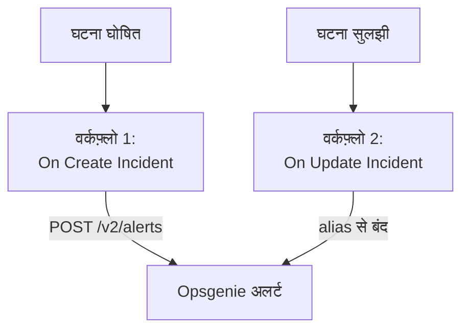

# Opsgenie

OneUptime घटनाएं [Opsgenie](https://www.atlassian.com/software/opsgenie) को भेजें। OneUptime घटना घोषित होने पर एक वर्कफ़्लो Opsgenie अलर्ट बनाता है, और OneUptime घटना सुलझने पर दूसरा वर्कफ़्लो उसे बंद करता है। इसे तब तक इस्तेमाल करें जब तक Opsgenie आपकी टीम को पेज करता है और OneUptime आपके सिस्टम पर नज़र रखता है।

:::cards
- [API कुंजी सहेजें](#api-कुंजी-सहेजें): Opsgenie की कुंजी को अपने वर्कफ़्लो से बाहर रखें।
- [Opsgenie अलर्ट बनाएं](#हर-घटना-के-लिए-opsgenie-अलर्ट-बनाएं): एक वर्कफ़्लो, दो ब्लॉक।
- [उन्हें बंद करें](#opsgenie-अलर्ट-बंद-करें): दूसरा वर्कफ़्लो जो घटना की स्थिति के साथ चलता है।
- [समस्या निवारण](#समस्या-निवारण): जब Opsgenie कोई अनुरोध अस्वीकार करता है।
:::

> [!IMPORTANT]
> Atlassian ने जून 2025 में Opsgenie बेचना बंद कर दिया और अप्रैल 2027 में इसका सपोर्ट खत्म कर रहा है। OneUptime भी ऑन-कॉल नीतियों, शेड्यूल और एस्केलेशन नियमों से लोगों को पेज करता है। अपनी टीम को यहां लाने के लिए [Opsgenie से आना](/docs/moving-to-oneuptime/opsgenie) देखें: इंपोर्ट आपके यूज़र, टीमें, शेड्यूल और एस्केलेशन ले आता है।

## यह कैसे काम करता है



दोनों वर्कफ़्लो [Opsgenie Alert API](https://docs.opsgenie.com/docs/alert-api) को कॉल करते हैं। पहला वर्कफ़्लो अलर्ट को OneUptime घटना के ID से बना एक `alias` देता है, और दूसरा उसी alias से अलर्ट बंद करता है।

## शुरू करने से पहले

- एक Opsgenie **API** इंटिग्रेशन, और उसकी **API Key**। इसे Opsgenie में **Settings → Integrations** के नीचे जोड़ें, या किसी टीम को अलर्ट भेजने के लिए उस टीम के **Integrations** के नीचे।
- आपका Opsgenie रीजन। यूरोप के खाते, जो `app.eu.opsgenie.com` पर साइन इन करते हैं, `api.eu.opsgenie.com` इस्तेमाल करते हैं। बाकी सभी `api.opsgenie.com` इस्तेमाल करते हैं।
- OneUptime में वर्कफ़्लो और ग्लोबल वेरिएबल बनाने का अधिकार। OneUptime Cloud पर वर्कफ़्लो के लिए **Growth** प्लान या उससे ऊपर चाहिए।

## API कुंजी सहेजें

:::steps
1. **वर्कफ़्लो → ग्लोबल वेरिएबल** पर जाएं और **वर्कफ़्लो वेरिएबल बनाएँ** पर क्लिक करें।
2. इसका नाम `OPSGENIE_KEY` रखें और **अगला** पर क्लिक करें।
3. API कुंजी को **सामग्री** में पेस्ट करें, **रहस्य** चालू करें, और **वर्कफ़्लो वेरिएबल बनाएँ** पर क्लिक करें।
:::

सीक्रेट वेरिएबल रन लॉग में `[REDACTED]` से बदल दिया जाता है, इसलिए कुंजी किसी रन में कभी नहीं दिखती।

## हर घटना के लिए Opsgenie अलर्ट बनाएं

:::steps
### वर्कफ़्लो बनाएं

**वर्कफ़्लो** पर जाएं, **वर्कफ़्लो बनाएं** पर क्लिक करें, फिर **शुरू से बनाएं** पर। इसका नाम `Incidents to Opsgenie` रखें और **वर्कफ़्लो बनाएं** पर क्लिक करें।

### ट्रिगर जोड़ें

डैश वाले **चुनें कि यह वर्कफ़्लो किससे शुरू हो** ब्लॉक पर क्लिक करें और **On Create Incident** चुनें। ट्रिगर पर क्लिक करें: उसके **Fields to pass on** में पहले से **शीर्षक** है, इसलिए **फ़ील्ड जोड़ें** पर क्लिक करें और **विवरण** चुनें।

### अलर्ट बनाएं

**घटक जोड़ें** पर क्लिक करें, एक **API Post (JSON)** ब्लॉक जोड़ें, और ट्रिगर के **Success** बिंदु को उससे जोड़ें। उसका **URL** `https://api.opsgenie.com/v2/alerts` पर सेट करें, या यूरोप में `https://api.eu.opsgenie.com/v2/alerts` पर। **और फ़ील्ड** के नीचे उसके **Request Headers** इस पर सेट करें:

```json
{ "Authorization": "GenieKey {{global.variables.OPSGENIE_KEY}}" }
```

और उसकी **Request Body** इस पर:

```json
{
  "message": "{{local.components.incident-on-create-1.returnValues.model.title}}",
  "alias": "oneuptime-{{local.components.incident-on-create-1.returnValues.model._id}}",
  "description": "{{local.components.incident-on-create-1.returnValues.model.description}}",
  "priority": "P1",
  "source": "OneUptime"
}
```

### टेस्ट करें, फिर चालू करें

**वर्कफ़्लो चलाएं** पर क्लिक करें, **घटना** के नीचे कोई टेस्ट घटना चुनें, और चलाएं। **API Post (JSON)** चरण `202` जवाब दिखाता है, और थोड़ी देर बाद अलर्ट Opsgenie में दिखता है। फिर **बिल्डर** के ऊपर **सक्षम** चालू करें।
:::

Opsgenie की स्कीम है: शब्द `GenieKey`, एक स्पेस, फिर कुंजी। Opsgenie `message` को 130 अक्षरों तक सीमित रखता है, और उसकी प्राथमिकताएं `P1` से `P5` तक होती हैं। हर घटना की अपनी प्राथमिकता भेजने के लिए [प्राथमिकताएं मैप करें](#प्राथमिकताएं-मैप-करें) देखें।

## Opsgenie अलर्ट बंद करें

एक वर्कफ़्लो में एक ही ट्रिगर होता है, इसलिए बंद करने के लिए दूसरा वर्कफ़्लो चाहिए, जो घटना की स्थिति बदलने पर शुरू हो।

:::steps
### On Update Incident ट्रिगर जोड़ें

`Close Opsgenie alerts` नाम का एक वर्कफ़्लो बनाएं, और उसके ट्रिगर के रूप में **On Update Incident** चुनें। **Fields to watch** में **फ़ील्ड जोड़ें** पर क्लिक करें और **Current Incident State** चुनें, ताकि यह सिर्फ़ स्थिति बदलने पर चले। **Fields to pass on** में यह मांगें कि नई स्थिति सुलझी हुई है या नहीं: **फ़ील्ड जोड़ें** पर क्लिक करें, **Current Incident State** खोलें और **Is Resolved State** चुनें। या **JSON के रूप में संपादित करें** पर क्लिक करें और JSON को इससे बदल दें:

```json
{ "_id": true, "currentIncidentState": { "isResolvedState": true } }
```

### जांचें कि घटना सुलझ गई है

ट्रिगर के बाद एक **If / Else** ब्लॉक जोड़ें। **Value to check** को `{{local.components.incident-on-update-1.returnValues.model.currentIncidentState.isResolvedState}}` पर और **Comparison** को **is true** पर सेट करें।

### अलर्ट बंद करें

**Yes** साइड के बाद एक **API Post (JSON)** ब्लॉक जोड़ें, उन्हीं **Request Headers** और इस **URL** के साथ:

```text
https://api.opsgenie.com/v2/alerts/oneuptime-{{local.components.incident-on-update-1.returnValues.model._id}}/close?identifierType=alias
```

उसकी **Request Body** को `{ "source": "OneUptime", "note": "Resolved in OneUptime" }` पर सेट करें।

### इसे चालू करें

**सक्षम** चालू करें, फिर OneUptime में एक टेस्ट घटना सुलझाएं। Opsgenie अपना अलर्ट बंद कर देता है।
:::

`identifierType=alias` Opsgenie को बताता है कि पता अलर्ट को उसके अपने ID से नहीं, बल्कि उसके alias से बताता है।

## प्राथमिकताएं मैप करें

हर घटना की गंभीरता को Opsgenie प्राथमिकता के रूप में भेजने के लिए, ट्रिगर और **API Post (JSON)** ब्लॉक के बीच एक **Run Custom JavaScript** ब्लॉक जोड़ें।

1. ट्रिगर के **Fields to pass on** में **फ़ील्ड जोड़ें** पर क्लिक करें, **घटना गंभीरता** खोलें और **नाम** चुनें।
2. ब्लॉक के **Arguments** को `{ "severity": "{{local.components.incident-on-create-1.returnValues.model.incidentSeverity.name}}" }` पर, और उसके **JavaScript Code** को इस पर सेट करें:

   ```javascript
   // Your incident severities, by name, to Opsgenie's priorities.
   const PRIORITY = {
     "Critical Incident": "P1",
     "Major Incident": "P2",
     "Minor Incident": "P3",
   };

   return { priority: PRIORITY[args.severity] || "P3" };
   ```

3. अनुरोध बॉडी में `"priority"` को `"{{local.components.javascript-1.returnValues.returnValue.priority}}"` पर सेट करें।

ऊपर के नाम वे तीन गंभीरताएं हैं जिनसे नया प्रोजेक्ट शुरू होता है। अगर आपने उनके नाम बदले हैं तो अपने नाम इस्तेमाल करें।

## समस्या निवारण

:::details Opsgenie 401 या 403 से जवाब देता है
कुंजी गलत है, या वह दूसरे रीजन की है। जांचें कि हेडर `GenieKey`, एक स्पेस और कुंजी है, कि कुंजी किसी **API** इंटिग्रेशन की है, और कि होस्ट आपके रीजन से मेल खाता है: `api.opsgenie.com` या `api.eu.opsgenie.com`।
:::

:::details बंद करने पर 404 मिलता है
उस alias वाला कोई अलर्ट नहीं है। दोनों वर्कफ़्लो को alias एक ही तरह से बनाना चाहिए, `oneuptime-` के बाद घटना का `_id`, और URL `?identifierType=alias` पर खत्म होना चाहिए।
:::

:::details चरण 202 दिखाता है, फिर भी अलर्ट कभी नहीं दिखता
Opsgenie अनुरोध प्रोसेस करने से पहले ही `202` से जवाब देता है, इसलिए बाद में अस्वीकार हुआ अनुरोध भी `202` दिखाता है। Opsgenie के लॉग में अनुरोध ढूंढें और देखें कि वह क्यों अस्वीकार हुआ, जैसे बंद किया गया इंटिग्रेशन।
:::

:::details वर्कफ़्लो कभी नहीं चलता
जांचें कि यह चालू है: उसके **बिल्डर** के ऊपर **सक्षम**। फिर **लॉग → रन** खोलें: जो रन **If / Else** ब्लॉक की **No** साइड पर गया, वह ऐसा अपडेट था जो सुलझाना नहीं था।
:::

## अगले कदम

:::cards
- [Opsgenie से आना](/docs/moving-to-oneuptime/opsgenie): Opsgenie बंद होने से पहले अपनी टीम, शेड्यूल और एस्केलेशन यहां ले आएं।
- [एस्केलेशन नियम](/docs/on-call/escalation-rules): OneUptime से ही लोगों को पेज करें।
- [PagerDuty](/docs/integrations/pagerduty): PagerDuty के लिए वही दो वर्कफ़्लो।
- [इंटिग्रेशन अवलोकन](/docs/integrations/index): हर इंटिग्रेशन के पीछे के पैटर्न।
:::
