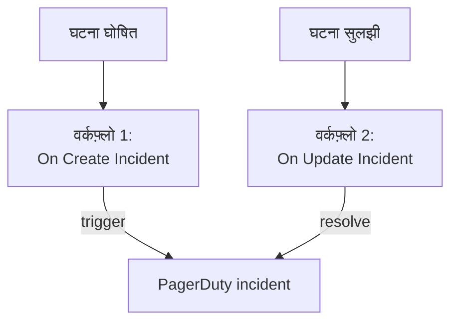

# PagerDuty

OneUptime घटनाएं [PagerDuty](https://www.pagerduty.com) को भेजें। OneUptime घटना घोषित होने पर एक वर्कफ़्लो PagerDuty incident ट्रिगर करता है, और OneUptime घटना सुलझने पर दूसरा वर्कफ़्लो उसे सुलझाता है। इसे तब इस्तेमाल करें जब PagerDuty आपकी टीम को पेज करता है और OneUptime आपके सिस्टम पर नज़र रखता है।

:::cards
- [रूटिंग कुंजी सहेजें](#रूटिंग-कुंजी-सहेजें): PagerDuty की कुंजी को अपने वर्कफ़्लो से बाहर रखें।
- [PagerDuty incident ट्रिगर करें](#हर-घटना-के-लिए-pagerduty-incident-ट्रिगर-करें): एक वर्कफ़्लो, दो ब्लॉक।
- [उन्हें सुलझाएं](#pagerduty-incident-सुलझाएं): दूसरा वर्कफ़्लो जो घटना की स्थिति के साथ चलता है।
- [समस्या निवारण](#समस्या-निवारण): जब PagerDuty किसी इवेंट को अस्वीकार करता है।
:::

> [!TIP]
> OneUptime भी ऑन-कॉल नीतियों, शेड्यूल और एस्केलेशन नियमों से लोगों को पेज करता है। अपनी टीम को PagerDuty से हटाने के लिए [PagerDuty से आना](/docs/moving-to-oneuptime/pagerduty) देखें: इंपोर्ट आपके यूज़र, शेड्यूल और एस्केलेशन नीतियां ले आता है।

## यह कैसे काम करता है



दोनों वर्कफ़्लो PagerDuty के [Events API v2](https://developer.pagerduty.com/docs/events-api-v2/overview/) को एक ही `dedup_key` के साथ कॉल करते हैं, जो OneUptime घटना के ID से बनती है। इसी कुंजी से PagerDuty जानता है कि resolve इवेंट वही incident बंद करता है जिसे trigger इवेंट ने खोला था।

## शुरू करने से पहले

- Events API v2 इंटिग्रेशन वाली एक PagerDuty सर्विस। PagerDuty में सर्विस खोलें, फिर **Integrations**, **Add an integration** पर क्लिक करें और **Events API V2** चुनें। उसकी **Integration Key** कॉपी करें: Events API इसे routing key कहता है।
- OneUptime में वर्कफ़्लो और ग्लोबल वेरिएबल बनाने का अधिकार। OneUptime Cloud पर वर्कफ़्लो के लिए **Growth** प्लान या उससे ऊपर चाहिए।

## रूटिंग कुंजी सहेजें

:::steps
1. **वर्कफ़्लो → ग्लोबल वेरिएबल** पर जाएं और **वर्कफ़्लो वेरिएबल बनाएँ** पर क्लिक करें।
2. इसका नाम `PAGERDUTY_ROUTING_KEY` रखें और **अगला** पर क्लिक करें।
3. इंटिग्रेशन कुंजी को **सामग्री** में पेस्ट करें, **रहस्य** चालू करें, और **वर्कफ़्लो वेरिएबल बनाएँ** पर क्लिक करें।
:::

सीक्रेट वेरिएबल रन लॉग में `[REDACTED]` से बदल दिया जाता है, इसलिए कुंजी किसी रन में कभी नहीं दिखती।

## हर घटना के लिए PagerDuty incident ट्रिगर करें

:::steps
### वर्कफ़्लो बनाएं

**वर्कफ़्लो** पर जाएं, **वर्कफ़्लो बनाएं** पर क्लिक करें, फिर **शुरू से बनाएं** पर। इसका नाम `Incidents to PagerDuty` रखें और **वर्कफ़्लो बनाएं** पर क्लिक करें।

### ट्रिगर जोड़ें

डैश वाले **चुनें कि यह वर्कफ़्लो किससे शुरू हो** ब्लॉक पर क्लिक करें और **On Create Incident** चुनें। ट्रिगर पर क्लिक करें: उसके **Fields to pass on** में पहले से **शीर्षक** है, इसलिए **फ़ील्ड जोड़ें** पर क्लिक करें और **विवरण** चुनें।

### trigger इवेंट भेजें

**घटक जोड़ें** पर क्लिक करें, एक **API Post (JSON)** ब्लॉक जोड़ें, और ट्रिगर के **Success** बिंदु को उससे जोड़ें। उसका **URL** `https://events.pagerduty.com/v2/enqueue` पर, और उसकी **Request Body** इस पर सेट करें:

```json
{
  "routing_key": "{{global.variables.PAGERDUTY_ROUTING_KEY}}",
  "event_action": "trigger",
  "dedup_key": "oneuptime-{{local.components.incident-on-create-1.returnValues.model._id}}",
  "payload": {
    "summary": "{{local.components.incident-on-create-1.returnValues.model.title}}",
    "source": "OneUptime",
    "severity": "critical",
    "custom_details": {
      "description": "{{local.components.incident-on-create-1.returnValues.model.description}}"
    }
  }
}
```

### टेस्ट करें, फिर चालू करें

**वर्कफ़्लो चलाएं** पर क्लिक करें, **घटना** के नीचे कोई टेस्ट घटना चुनें, और चलाएं। **API Post (JSON)** चरण `"status": "success"` के साथ `202` जवाब दिखाता है, और PagerDuty एक incident खोलता है। फिर **बिल्डर** के ऊपर **सक्षम** चालू करें।
:::

ब्लॉक JSON भेजता है, इसलिए उसे `Content-Type` हेडर की ज़रूरत नहीं। PagerDuty का `severity` इनमें से एक होता है: `critical`, `error`, `warning` और `info`। हर घटना की अपनी गंभीरता भेजने के लिए [गंभीरताएं मैप करें](#गंभीरताएं-मैप-करें) देखें।

## PagerDuty incident सुलझाएं

एक वर्कफ़्लो में एक ही ट्रिगर होता है, इसलिए सुलझाने के लिए दूसरा वर्कफ़्लो चाहिए, जो घटना की स्थिति बदलने पर शुरू हो।

:::steps
### On Update Incident ट्रिगर जोड़ें

`Resolve PagerDuty incidents` नाम का एक वर्कफ़्लो बनाएं, और उसके ट्रिगर के रूप में **On Update Incident** चुनें। **Fields to watch** में **फ़ील्ड जोड़ें** पर क्लिक करें और **Current Incident State** चुनें, ताकि यह सिर्फ़ स्थिति बदलने पर चले। **Fields to pass on** में यह मांगें कि नई स्थिति सुलझी हुई है या नहीं: **फ़ील्ड जोड़ें** पर क्लिक करें, **Current Incident State** खोलें और **Is Resolved State** चुनें। या **JSON के रूप में संपादित करें** पर क्लिक करें और JSON को इससे बदल दें:

```json
{ "_id": true, "currentIncidentState": { "isResolvedState": true } }
```

### जांचें कि घटना सुलझ गई है

ट्रिगर के बाद एक **If / Else** ब्लॉक जोड़ें। **Value to check** को `{{local.components.incident-on-update-1.returnValues.model.currentIncidentState.isResolvedState}}` पर और **Comparison** को **is true** पर सेट करें।

### resolve इवेंट भेजें

**Yes** साइड के बाद एक **API Post (JSON)** ब्लॉक जोड़ें, उसी **URL** और इस **Request Body** के साथ:

```json
{
  "routing_key": "{{global.variables.PAGERDUTY_ROUTING_KEY}}",
  "event_action": "resolve",
  "dedup_key": "oneuptime-{{local.components.incident-on-update-1.returnValues.model._id}}"
}
```

### इसे चालू करें

**सक्षम** चालू करें, फिर OneUptime में एक टेस्ट घटना सुलझाएं। PagerDuty अपना incident सुलझा देता है।
:::

किसी स्थिति के नाम के बजाय `isResolvedState` जांचना तब भी काम करता रहता है जब आप अपनी स्थितियों का नाम बदलते हैं। [घटना स्थितियाँ और गंभीरता](/docs/incidents/states-and-severities) देखें।

## गंभीरताएं मैप करें

हर घटना की गंभीरता भेजने के लिए, ट्रिगर और **API Post (JSON)** ब्लॉक के बीच एक **Run Custom JavaScript** ब्लॉक जोड़ें, और उसका जवाब बॉडी में पढ़ें।

1. ट्रिगर के **Fields to pass on** में **फ़ील्ड जोड़ें** पर क्लिक करें, **घटना गंभीरता** खोलें और **नाम** चुनें।
2. ब्लॉक के **Arguments** को `{ "severity": "{{local.components.incident-on-create-1.returnValues.model.incidentSeverity.name}}" }` पर, और उसके **JavaScript Code** को इस पर सेट करें:

   ```javascript
   // Your incident severities, by name, to PagerDuty's.
   const SEVERITY = {
     "Critical Incident": "critical",
     "Major Incident": "error",
     "Minor Incident": "warning",
   };

   return { severity: SEVERITY[args.severity] || "info" };
   ```

3. अनुरोध बॉडी में `"severity"` को `"{{local.components.javascript-1.returnValues.returnValue.severity}}"` पर सेट करें।

ऊपर के नाम वे तीन गंभीरताएं हैं जिनसे नया प्रोजेक्ट शुरू होता है। अगर आपने उनके नाम बदले हैं तो अपने नाम इस्तेमाल करें।

## समस्या निवारण

:::details PagerDuty 400 से जवाब देता है
जवाब की बॉडी बताती है कि PagerDuty ने क्या अस्वीकार किया, और रन का **API Post (JSON)** चरण उसे दिखाता है। आम तौर पर रूटिंग कुंजी Events API v2 इंटिग्रेशन कुंजी नहीं होती: इसे सर्विस के **Integrations** से दोबारा कॉपी करें। बिना `summary`, `source` या `severity` वाला इवेंट भी अस्वीकार होता है।
:::

:::details resolve इवेंट कुछ बंद नहीं करता
दोनों इवेंट में बिल्कुल एक जैसी `dedup_key` होनी चाहिए। जांचें कि दोनों बॉडी उसे `oneuptime-` के बाद घटना का `_id` जोड़कर बनाती हैं, और सुलझाने वाला वर्कफ़्लो चालू है।
:::

:::details वर्कफ़्लो कभी नहीं चलता
जांचें कि यह चालू है: उसके **बिल्डर** के ऊपर **सक्षम**। फिर **लॉग → रन** खोलें: जो रन **If / Else** ब्लॉक की **No** साइड पर गया, वह ऐसा अपडेट था जो सुलझाना नहीं था।
:::

:::details PagerDuty मान की जगह रेफ़रेंस दिखाता है
जो रेफ़रेंस हल नहीं होता, वह कोष्ठकों समेत जैसा लिखा है वैसा ही भेजा जाता है। ब्लॉक का आइडेंटिफ़ायर, फ़ील्ड का नाम, और वेरिएबल का नाम जांचें, जो केस-सेंसिटिव है। रन के **चरण** टैब पर ऐसे रेफ़रेंस वाली सेटिंग **Did not resolve** से चिह्नित होती है।
:::

## अगले कदम

:::cards
- [PagerDuty से आना](/docs/moving-to-oneuptime/pagerduty): अपनी टीम, शेड्यूल और एस्केलेशन नीतियां यहां ले आएं।
- [एस्केलेशन नियम](/docs/on-call/escalation-rules): OneUptime से ही लोगों को पेज करें।
- [Opsgenie](/docs/integrations/opsgenie): Opsgenie के लिए वही दो वर्कफ़्लो।
- [इंटिग्रेशन अवलोकन](/docs/integrations/index): हर इंटिग्रेशन के पीछे के पैटर्न।
:::
