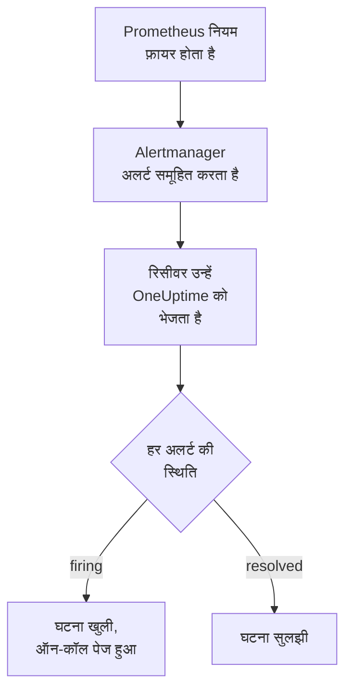

# Prometheus Alertmanager

[Prometheus Alertmanager](https://prometheus.io/docs/alerting/latest/alertmanager/) के अलर्ट OneUptime को भेजें, ताकि फ़ायर होने वाला हर अलर्ट एक घटना बने जो आपकी ऑन-कॉल टीम को पेज करे, और अलर्ट के ठीक होने पर सुलझ जाए। Alertmanager अपनी सूचनाएं एक वेबहुक रिसीवर को भेजता है, इसलिए किसी भी तरफ़ कुछ इंस्टॉल नहीं करना पड़ता।

:::cards
- [चुनें कि OneUptime अलर्ट कैसे पाए](#चुनें-कि-oneuptime-अलर्ट-कैसे-पाए): एक Incoming Request मॉनिटर, या आपका अपना वर्कफ़्लो।
- [मॉनिटर से अलर्ट पाएं](#मॉनिटर-से-अलर्ट-पाएं): हर अलर्ट पर एक घटना, रिकवरी पर सुलझी हुई।
- [Alertmanager कॉन्फ़िगर करें](#alertmanager-कॉन्फ़िगर-करें): एक वेबहुक रिसीवर, और उसे इस्तेमाल करने वाला रूट।
- [समस्या निवारण](#समस्या-निवारण): जब अलर्ट नहीं पहुंचते, या घटनाएं खुली रहती हैं।
:::

## यह कैसे काम करता है



Prometheus आपके अलर्टिंग नियमों का मूल्यांकन करता है और फ़ायर होने वाले अलर्ट Alertmanager को भेजता है। Alertmanager उन्हें आपके रूट के `group_by` के लेबल के हिसाब से समूहित करता है, और हर समूह को एक JSON सूचना के रूप में वेबहुक रिसीवर को भेजता है। सूचना की `alerts` सूची में समूह का हर अलर्ट होता है, हर एक की अपनी `status` (`firing` या `resolved`), उसके लेबल और एनोटेशन, और उसे पहचानने वाला एक `fingerprint`।

## शुरू करने से पहले

- एक Alertmanager जिसकी `alertmanager.yml` आप संपादित कर सकते हैं, और जो HTTPS पर आपके OneUptime तक पहुंच सकता है।
- OneUptime में मॉनिटर बनाने का अधिकार, या वर्कफ़्लो का रास्ता चुनने पर वर्कफ़्लो बनाने का।

## चुनें कि OneUptime अलर्ट कैसे पाए

पहले OneUptime सेट करें: यह आपको वह URL देता है जिस पर Alertmanager भेजता है।

| तरीका | कब इस्तेमाल करें |
| --- | --- |
| एक Incoming Request मॉनिटर (सुझाया गया) | आप चाहते हैं कि हर अलर्ट एक घटना बने जो ऑन-कॉल को पेज करे, और अलर्ट ठीक होने पर सुलझ जाए। कुछ भी बनाना नहीं पड़ता। |
| Webhook ट्रिगर वाला वर्कफ़्लो | आपको अपना लॉजिक चाहिए: अलर्ट फ़िल्टर करना, उनका रूप बदलना, या पहले दूसरे सिस्टम को कॉल करना। वर्कफ़्लो हर अलर्ट पर नहीं, बल्कि हर सूचना पर एक घटना खोलता है, और रिकवरी पर उसे नहीं सुलझाता। |

दोनों को एक ही रिसीवर से एक जैसा JSON मिलता है, इसलिए आप एक से शुरू करके बाद में `alertmanager.yml` में एक URL बदलकर दूसरे पर जा सकते हैं।

## मॉनिटर से अलर्ट पाएं

एक [Incoming Request मॉनिटर](/docs/monitor/incoming-request-monitor) आपको एक URL देता है, और उसके मानदंड तय करते हैं कि हर सूचना क्या करे।

:::steps
### मॉनिटर बनाएं

**मॉनिटर** पर जाएं और **मॉनिटर बनाएं** पर क्लिक करें। **मॉनिटर प्रकार** में **Incoming Request** चुनें, इसका नाम `Alertmanager` रखें, और **अगला** पर क्लिक करें।

### फ़ायर होने वाले हर अलर्ट के लिए घटना घोषित करें

**मानदंड** चरण में पहला मानदंड खोलें, वह जो मॉनिटर को ऑफ़लाइन चिह्नित करता है। उसका फ़िल्टर **अनुरोध बॉडी**, **शामिल है**, `"status":"firing"` पर सेट करें। फ़िल्टर मेल खाने पर यह मानदंड पहले से ही घटना घोषित करता है। घटना भरें:

- **घटना शीर्षक**: `{{requestBody.commonLabels.alertname}} on {{requestBody.commonLabels.instance}}`।
- **गंभीरता**: वह घटना गंभीरता जो इन अलर्ट की होनी चाहिए।
- **ऑन-कॉल** के नीचे **ऑन-कॉल नीतियां**: पेज की जाने वाली नीतियां।
- **और फ़ील्ड** के नीचे **घटना स्वतः सुलझाएं**: इसे चालू रहने दें, जैसा यह शुरू में होता है। इसके बिना रिकवरी को अनदेखा किया जाता है और घटनाएं खुली रहती हैं।

### हर अलर्ट पर एक घटना खोलें

उसी मानदंड में **सेटिंग्स** खोलें और **Group incidents and alerts by a payload field** चालू करें। इसे नीचे की तरह भरें, ताकि हर अलर्ट की अपनी घटना हो, और उसकी रिकवरी उसे सुलझाए:

| फ़ील्ड | मान |
| --- | --- |
| **Open a separate incident for each…** | `requestBody.alerts[*].fingerprint` |
| **Field that signals recovery** | `requestBody.alerts[*].status` |
| **Value that means recovered** | `resolved` |

### मॉनिटर को वापस ऑनलाइन लाएं

दूसरा मानदंड खोलें, वह जो मॉनिटर को ऑनलाइन चिह्नित करता है, और उसका फ़िल्टर **अनुरोध बॉडी**, **शामिल है**, `"status":"resolved"` पर सेट करें।

### URL कॉपी करें

**मॉनिटर बनाएं** पर क्लिक करें। मॉनिटर का **अवलोकन** पेज उसका **Heartbeat URL** दिखाता है। उसे Alertmanager के लिए कॉपी करें:

```text
https://oneuptime.com/heartbeat/<secret key>
```

सेल्फ़-होस्टेड इंस्टॉलेशन में `oneuptime.com` की जगह उसका अपना होस्ट होता है।
:::

`[*]` सूचना का हर अलर्ट पढ़ता है, इसलिए तीन अलर्ट वाली सूचना तीन घटनाएं खोल सकती है, ज़्यादा से ज़्यादा **Max incidents per request** जितनी (जब तक आप इसे न बदलें, `100`)। हर अलर्ट की अपनी `status` तय करती है कि उसकी घटना के साथ क्या हो: जब सूचना का एक अलर्ट सुलझ जाता है और दो अभी भी फ़ायर हो रहे होते हैं, तो सिर्फ़ सुलझे हुए अलर्ट की घटना बंद होती है। हर सेटिंग क्या करती है, यह जानने के लिए [किसी दूसरे सिस्टम से अलर्ट प्राप्त करना](/docs/monitor/incoming-request-monitor#किसी-दूसरे-सिस्टम-से-अलर्ट-प्राप्त-करना) देखें।

> [!WARNING]
> ऐसे मान से समूहित करें जो एक सूचना के भीतर हर अलर्ट के लिए अलग हो। Alertmanager का `fingerprint` अलर्ट के पूरे लेबल सेट का हैश है, इसलिए वह हमेशा अलग होता है। आपके रूट के `group_by` का कोई लेबल कभी अलग नहीं होता: वही तो अलर्ट को एक सूचना में रखता है। नीचे दिए रूट के साथ `requestBody.alerts[*].labels.alertname` से समूहित करने पर सूचना के सारे अलर्ट एक घटना में मिल जाते हैं, जो पहले अलर्ट की स्थिति अपनाती है।

## घटनाओं को नाम दें

ऊपर वाला शीर्षक वे लेबल पढ़ता है जो सूचना के सभी अलर्ट में साझा हैं: `commonLabels` में वे लेबल होते हैं, और `commonAnnotations` में साझा एनोटेशन। नीचे दिए रूट के साथ, जो `alertname` और `instance` से समूहित करता है, दोनों मौजूद रहते हैं। **विवरण** के नीचे घटना को ऐसा **घटना विवरण** दें:

```text
{{requestBody.commonAnnotations.summary}}

{{requestBody.commonAnnotations.description}}
Severity: {{requestBody.commonLabels.severity}}
Alertmanager: {{requestBody.externalURL}}
```

- ग्रुपिंग कुंजी भी एक वेरिएबल है, जिसका नाम उसके पाथ के आखिरी हिस्से पर रखा जाता है: `{{fingerprint}}`। यह एक हैश है, इसलिए रिस्पॉन्डर को इससे कुछ पता नहीं चलता।
- `{{requestBody.alerts[0].annotations.summary}}` सूचना का पहला अलर्ट पढ़ता है, जो हमेशा वह अलर्ट नहीं होता जिसके लिए घटना खोली गई थी।
- जो फ़ील्ड सूचना में नहीं है, उसका रेफ़रेंस खाली करने के बजाय कोष्ठकों समेत जैसा लिखा है वैसा ही छोड़ दिया जाता है।

इस्तेमाल किए जा सकने वाले हर वेरिएबल के लिए [घटना और अलर्ट टेम्पलेट](/docs/monitor/incident-alert-templating) देखें।

## Alertmanager कॉन्फ़िगर करें

:::steps
### एक वेबहुक रिसीवर जोड़ें

`alertmanager.yml` में एक रिसीवर जोड़ें जो कॉपी किए गए URL पर भेजे, और उसे रूट का रिसीवर बनाएं:

```yaml title="alertmanager.yml"
route:
  receiver: oneuptime
  group_by: ["alertname", "instance"]

receivers:
  - name: oneuptime
    webhook_configs:
      - url: "https://oneuptime.com/heartbeat/<secret key>"
        send_resolved: true
```

`send_resolved: true` Alertmanager का डिफ़ॉल्ट है, जिसे इसलिए लिखा गया है कि यह चालू रहे: इसके बिना OneUptime को कभी पता नहीं चलता कि अलर्ट ठीक हो गया। Alertmanager `Content-Type: application/json` भेजता है, जिसकी ज़रूरत मॉनिटर को सूचना के फ़ील्ड पढ़ने के लिए होती है।

### Alertmanager रीलोड करें

कॉन्फ़िगरेशन रीलोड करें, या Alertmanager रीस्टार्ट करें:

```bash
curl -X POST http://localhost:9093/-/reload
```
:::

यह रूट Alertmanager के डिफ़ॉल्ट समय रखता है। नया समूह भेजने से पहले यह `30s` (`group_wait`) इंतज़ार करता है, नए अलर्ट वाले समूह को दोबारा भेजने से पहले `5m` (`group_interval`), और न बदली हुई सूचना दोहराने से पहले `4h` (`repeat_interval`)।

## इसे टेस्ट करें

OneUptime को फ़ायर हो रहे दो अलर्ट वाली एक सूचना भेजें, जैसे Alertmanager भेजता:

```bash
curl -X POST "https://oneuptime.com/heartbeat/<secret key>" \
  -H "Content-Type: application/json" \
  -d '{
    "version": "4",
    "status": "firing",
    "receiver": "oneuptime",
    "groupLabels": { "alertname": "DiskFull", "instance": "web-1" },
    "commonLabels": { "alertname": "DiskFull", "instance": "web-1", "severity": "critical" },
    "commonAnnotations": { "summary": "Disk almost full on web-1" },
    "externalURL": "http://alertmanager:9093",
    "alerts": [
      {
        "status": "firing",
        "labels": { "alertname": "DiskFull", "instance": "web-1", "severity": "critical", "device": "/dev/sda1" },
        "fingerprint": "a1b2c3d4e5f60001"
      },
      {
        "status": "firing",
        "labels": { "alertname": "DiskFull", "instance": "web-1", "severity": "critical", "device": "/dev/sdb1" },
        "fingerprint": "a1b2c3d4e5f60002"
      }
    ]
  }'
```

दो घटनाएं खुलती हैं, हर `fingerprint` पर एक, और दोनों का शीर्षक `DiskFull on web-1` होता है। हर `status` को `resolved` करके वही अनुरोध भेजें, और दोनों सुलझ जाती हैं।

Alertmanager से पूरा रास्ता टेस्ट करने के लिए `amtool` से एक अलर्ट फ़ायर करें। Alertmanager इसे `group_wait` के बाद भेजता है, और कुछ मिनट बाद अलर्ट की अवधि खत्म होने पर उसकी रिकवरी भेजता है:

```bash
amtool alert add test_alert severity=warning \
  --annotation=summary="Test from Alertmanager" \
  --alertmanager.url=http://localhost:9093
```

## वर्कफ़्लो से अलर्ट पाएं

जब आपको Alertmanager और घटना के बीच अपने चरण चाहिए, तब [वर्कफ़्लो](/docs/workflows/index) इस्तेमाल करें।

:::steps
### वर्कफ़्लो बनाएं

**वर्कफ़्लो** पर जाएं, **वर्कफ़्लो बनाएं** पर क्लिक करें, फिर **शुरू से बनाएं** पर। इसका नाम `Alertmanager alerts` रखें और **वर्कफ़्लो बनाएं** पर क्लिक करें।

### Webhook ट्रिगर जोड़ें

डैश वाले **चुनें कि यह वर्कफ़्लो किससे शुरू हो** ब्लॉक पर क्लिक करें और **Webhook** चुनें। ट्रिगर पर क्लिक करें, फिर **URL कॉपी करें** पर, और वह URL `alertmanager.yml` के रिसीवर में इस्तेमाल करें।

### जांचें कि सूचना फ़ायर हो रही है

**घटक जोड़ें** पर क्लिक करें, एक **If / Else** ब्लॉक जोड़ें, और ट्रिगर के **Out** बिंदु को उससे जोड़ें। **Value to check** को `{{local.components.webhook-1.returnValues.request-body.status}}` पर, **Comparison** को **is equal to** पर, और **Compare with** को `firing` पर सेट करें।

### घटना घोषित करें

एक **Create One Incident** ब्लॉक जोड़ें, और **If / Else** ब्लॉक की **Yes** साइड को उससे जोड़ें। **Incident Template** में ऐसा टेम्पलेट चुनें जो गंभीरता और पेज की जाने वाली ऑन-कॉल नीतियां सेट करता हो ([घटना टेम्पलेट](/docs/incidents/settings#घटना-टेम्पलेट) देखें)। **JSON Object** में वह सेट करें जो Alertmanager से आता है:

```json
{
  "title": "{{local.components.webhook-1.returnValues.request-body.commonLabels.alertname}}",
  "description": "{{local.components.webhook-1.returnValues.request-body.commonAnnotations.summary}}\nAlertmanager: {{local.components.webhook-1.returnValues.request-body.externalURL}}"
}
```

बिना टेम्पलेट के, **JSON Object** में `incidentSeverityId` भी चाहिए, जो प्रोजेक्ट की किसी घटना गंभीरता का ID है।

### वर्कफ़्लो चालू करें

**बिल्डर** के ऊपर **सक्षम** चालू करें। बंद वर्कफ़्लो Alertmanager को `400` से जवाब देता है।
:::

एक रन एक सूचना संभालता है, इसलिए सूचना में चाहे जितने अलर्ट हों, वह एक ही घटना घोषित करता है। `resolved` वाली सूचना **If / Else** ब्लॉक की **No** साइड पर जाती है, जहां कुछ नहीं जुड़ा है, इसलिए रन वहीं खत्म हो जाता है। हर अलर्ट पर एक घटना, जो रिकवरी पर सुलझे, के लिए मॉनिटर इस्तेमाल करें।

## Alertmanager पर खुद नज़र रखें

कोई भी तरीका यह नहीं पकड़ता कि Prometheus या Alertmanager ने काम करना बंद कर दिया है: कोई अलर्ट न आना बिल्कुल वैसा ही दिखता है जैसे सब ठीक हो। इसलिए हमेशा फ़ायर होने वाला एक अलर्ट दूसरे मॉनिटर पर भेजें, जो उस अलर्ट के आना बंद होने पर घटना घोषित करे। [kube-prometheus-stack](https://github.com/prometheus-community/helm-charts/tree/main/charts/kube-prometheus-stack) में ऐसा एक अलर्ट आता है, जिसका नाम `Watchdog` है। सादे Prometheus पर `Watchdog` नाम का एक अलर्टिंग नियम जोड़ें जिसका एक्सप्रेशन हमेशा सच हो, जैसे `vector(1)`।

:::steps
### वॉचडॉग मॉनिटर बनाएं

`Alertmanager watchdog` नाम का दूसरा Incoming Request मॉनिटर बनाएं। उसके पहले मानदंड का फ़िल्टर, वह जो मॉनिटर को ऑफ़लाइन चिह्नित करता है, **Incoming Request**, **Not Recieved In Minutes**, `10` पर सेट करें, और दूसरे मानदंड का फ़िल्टर **Incoming Request**, **Recieved In Minutes**, `10` पर। डैशबोर्ड दोनों की वर्तनी ऐसी ही दिखाता है। नए मॉनिटर का **Heartbeat URL** कॉपी करें।

### वॉचडॉग अलर्ट उस पर भेजें

वॉचडॉग मॉनिटर के URL के लिए एक रिसीवर जोड़ें, और एक रूट जो `Watchdog` को हर पांच मिनट में उस पर भेजे। चाइल्ड रूट अपने पैरेंट के रिसीवर से पहले मिलाया जाता है, इसलिए `Watchdog` वॉचडॉग मॉनिटर पर जाता है और बाकी हर अलर्ट पहले मॉनिटर पर ही जाता रहता है:

```yaml title="alertmanager.yml"
route:
  receiver: oneuptime
  group_by: ["alertname", "instance"]
  routes:
    - receiver: oneuptime-watchdog
      matchers:
        - alertname = "Watchdog"
      group_wait: 0s
      group_interval: 5m
      repeat_interval: 5m

receivers:
  - name: oneuptime
    webhook_configs:
      - url: "https://oneuptime.com/heartbeat/<secret key>"
        send_resolved: true
  - name: oneuptime-watchdog
    webhook_configs:
      - url: "https://oneuptime.com/heartbeat/<watchdog secret key>"
```
:::

जब वॉचडॉग अलर्ट दस मिनट तक नहीं आता, तो वॉचडॉग मॉनिटर ऑफ़लाइन हो जाता है और घटना घोषित करता है। अगली वॉचडॉग सूचना मॉनिटर को वापस ऑनलाइन लाती है और घटना सुलझा देती है।

## समस्या निवारण

:::details OneUptime में कुछ नहीं पहुंचता
- Alertmanager के लॉग में रिसीवर तक पहुंचाने की त्रुटियां जांचें।
- मॉनिटर कुछ भी जांचने से पहले तुरंत `200` से जवाब देता है, गलत सीक्रेट कुंजी होने पर भी। सूचनाएं पहुंच रही हैं या नहीं, यह मॉनिटर की टाइमलाइन में देखें।
- बंद वर्कफ़्लो `400` से जवाब देता है। उसके **बिल्डर** के ऊपर **सक्षम** चालू करें।
:::

:::details घटनाएं खुलती हैं पर कभी सुलझती नहीं
- जांचें कि कोई रिसीवर `send_resolved: false` सेट न करता हो: तब Alertmanager कभी रिकवरी नहीं भेजता।
- मानदंड की घटना में **और फ़ील्ड** के नीचे **घटना स्वतः सुलझाएं** होना चाहिए।
- **Field that signals recovery** ठीक `requestBody.alerts[*].status` होना चाहिए, और **Value that means recovered** ठीक `resolved`। तुलना केस-सेंसिटिव है।
- किसी सूचना में **Max incidents per request** से आगे के अलर्ट पढ़े ही नहीं जाते, इसलिए उनकी रिकवरी भी छूट जाती है।
- किसी बर्स्ट में छूटी रिकवरी (नीचे देखें) अपनी घटना को हमेशा के लिए खुला छोड़ देती है: Alertmanager फ़ायर हो रहे अलर्ट दोहराता है, पर रिकवरी कभी नहीं। ऐसी घटना हाथ से सुलझाएं।
:::

:::details कोई घटना खुलती ही नहीं
ग्रुपिंग पाथ `requestBody.` से शुरू होने चाहिए, और पाथ में सिर्फ़ पहला `[*]` सूची पढ़ता है। जो पाथ इनमें से कोई भी नियम तोड़ता है, वह बिना किसी त्रुटि के किसी चीज़ से मेल नहीं खाता।
:::

:::details अलर्ट से भरी सूचना के लिए एक ही घटना
आपने ऐसे लेबल से समूहित किया जो सूचना के हर अलर्ट के लिए एक जैसा है, अक्सर आपके रूट के `group_by` का कोई लेबल। इसके बजाय `requestBody.alerts[*].fingerprint` से समूहित करें।
:::

:::details घटना में मान की जगह रेफ़रेंस दिखता है
जो फ़ील्ड सूचना में नहीं है, उसका रेफ़रेंस कोष्ठकों समेत जैसा लिखा है वैसा ही छोड़ दिया जाता है। अलग-अलग नियम अलग-अलग एनोटेशन सेट करते हैं, इसलिए वे फ़ील्ड इस्तेमाल करें जो आपके नियम सेट करते हैं: `commonAnnotations` में, या हर अलर्ट के `annotations` में।
:::

:::details बहुत ज़्यादा घटनाएं
अपने रूट को कम लेबल से समूहित करें, या `group_interval` बढ़ाएं, ताकि Alertmanager संबंधित अलर्ट एक साथ भेजे। **Max incidents per request** घटाने से एक सूचना की घटनाएं सीमित होती हैं, पर सीमा से आगे के अलर्ट पढ़े नहीं जाते, इसलिए उनकी रिकवरी भी छूट जाती है।
:::

:::details बर्स्ट में कुछ सूचनाएं छूट जाती हैं
जब कोई नया अनुरोध मॉनिटर तक पिछले अनुरोध के मूल्यांकन से पहले पहुंच जाता है, तो OneUptime सिर्फ़ नए अनुरोध का मूल्यांकन करता है, ताकि कोई एक भेजने वाला मॉनिटर पर हावी न हो सके। बर्स्ट की आखिरी सूचना का मूल्यांकन हमेशा होता है, पर दूसरे अलर्ट के बारे में पहले की सूचना छूट सकती है, क्योंकि Alertmanager हर समूह को एक ही URL पर भेजता है। सूचनाओं के बीच फ़ासला बढ़ाने के लिए `group_wait` और `group_interval` बढ़ाएं। सेल्फ़-होस्टेड इंस्टॉलेशन में हर अनुरोध का मूल्यांकन करने के लिए OneUptime ऐप के एनवायरनमेंट में `INCOMING_REQUEST_INGEST_COALESCE_ENABLED=false` सेट करें।
:::

## सुरक्षा

- **URL को पासवर्ड की तरह रखें।** जिसके पास भी यह है, वह घटनाएं खोल सकता है। अगर यह लीक हो जाए, तो इसे रीसेट करें: मॉनिटर के **सेटिंग्स** पेज पर **इनकमिंग अनुरोध सीक्रेट कुंजी रीसेट करें**, या वर्कफ़्लो के **Webhook** ट्रिगर में **URL रीसेट करें**। फिर `alertmanager.yml` में रिसीवर का `url` अपडेट करें।
- **सेल्फ़-होस्टेड?** Alertmanager को अपने फ़ायरवॉल से होकर HTTPS पर अपने OneUptime तक पहुंचने दें।

## अगले कदम

:::cards
- [आने वाले अनुरोध मॉनिटर](/docs/monitor/incoming-request-monitor): आपके अलर्ट पाने वाले मॉनिटर की हर सेटिंग।
- [Grafana](/docs/integrations/grafana): Grafana अलर्टिंग के लिए यही सेटअप।
- [एस्केलेशन नियम](/docs/on-call/escalation-rules): तय करें कि ऑन-कॉल नीति किसे और कब पेज करे।
- [इंटिग्रेशन अवलोकन](/docs/integrations/index): वे दूसरे टूल जिन्हें आप जोड़ सकते हैं।
:::
