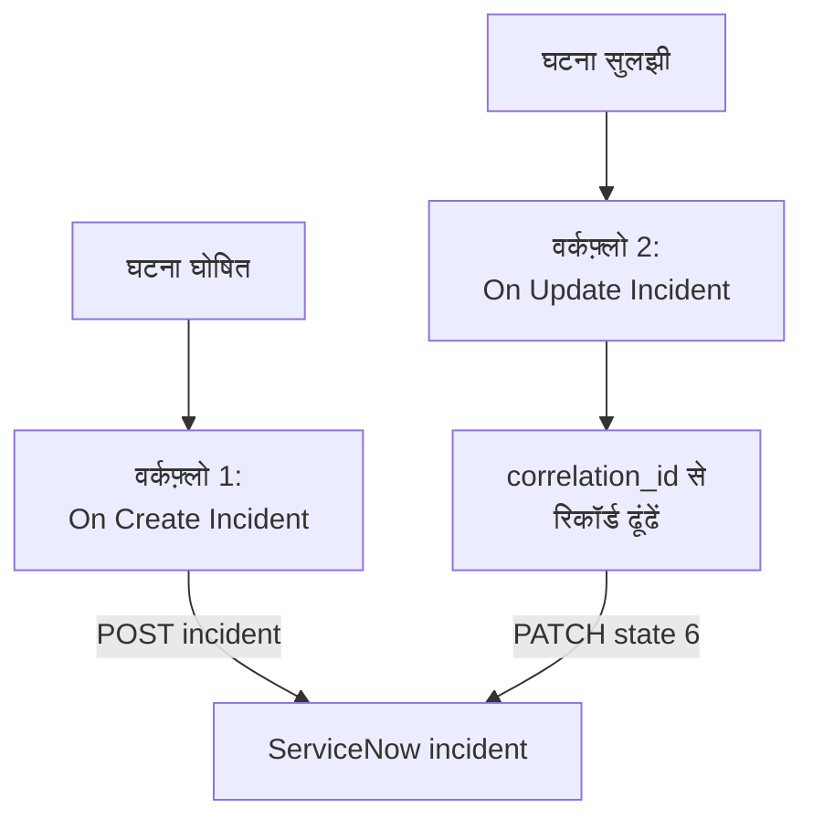

# ServiceNow

हर OneUptime घटना के लिए एक [ServiceNow](https://www.servicenow.com) incident खोलें, और OneUptime घटना सुलझने पर उसे सुलझाएं, ताकि आपका सर्विस डेस्क वही देखे जो आपकी मॉनिटरिंग देखती है। दो वर्कफ़्लो ServiceNow के [Table API](https://developer.servicenow.com/dev.do#!/reference/api/latest/rest/c_TableAPI) को कॉल करते हैं।

:::cards
- [क्रेडेंशियल सहेजें](#क्रेडेंशियल-सहेजें): ServiceNow पासवर्ड को अपने वर्कफ़्लो से बाहर रखें।
- [ServiceNow incident खोलें](#हर-घटना-के-लिए-servicenow-incident-खोलें): एक वर्कफ़्लो, दो ब्लॉक।
- [उन्हें सुलझाएं](#servicenow-incident-सुलझाएं): रिकॉर्ड ढूंढें, फिर उसे बंद करें।
- [समस्या निवारण](#समस्या-निवारण): जब ServiceNow कोई अनुरोध अस्वीकार करता है।
:::

## यह कैसे काम करता है



पहला वर्कफ़्लो OneUptime घटना का ID रिकॉर्ड के `correlation_id` में लिखता है। दूसरा उसी से रिकॉर्ड ढूंढता है, फिर रिकॉर्ड को सुलझाता है।

## शुरू करने से पहले

- एक ServiceNow इंस्टेंस, जैसे `https://your-instance.service-now.com`।
- इंटिग्रेशन के लिए एक ServiceNow यूज़र जो `incident` टेबल में रिकॉर्ड बना और अपडेट कर सके, आम तौर पर `itil` भूमिका के साथ। अनुरोध उसके नाम और पासवर्ड से साइन होते हैं।
- OneUptime में वर्कफ़्लो और ग्लोबल वेरिएबल बनाने का अधिकार। OneUptime Cloud पर वर्कफ़्लो के लिए **Growth** प्लान या उससे ऊपर चाहिए।

## क्रेडेंशियल सहेजें

Table API Basic ऑथ लेता है: यूज़र का नाम और पासवर्ड, एक साथ एनकोड किए हुए।

:::steps
1. macOS या Linux पर इन्हें एक बार एनकोड करें:

   ```bash
   printf '%s' 'integration.user:password' | base64 | tr -d '\n'
   ```

   `echo` नहीं, `printf` इस्तेमाल करें: `echo` एक नई लाइन जोड़ता है, जो बाकी के साथ एनकोड हो जाती है और क्रेडेंशियल बिगाड़ देती है।

2. OneUptime में **वर्कफ़्लो → ग्लोबल वेरिएबल** पर जाएं और **वर्कफ़्लो वेरिएबल बनाएँ** पर क्लिक करें। इसका नाम `SERVICENOW_AUTH` रखें और **अगला** पर क्लिक करें।
3. एनकोड किया गया मान **सामग्री** में पेस्ट करें, **रहस्य** चालू करें, और **वर्कफ़्लो वेरिएबल बनाएँ** पर क्लिक करें।
:::

## हर घटना के लिए ServiceNow incident खोलें

:::steps
### वर्कफ़्लो बनाएं

**वर्कफ़्लो** पर जाएं, **वर्कफ़्लो बनाएं** पर क्लिक करें, फिर **शुरू से बनाएं** पर। इसका नाम `Incidents to ServiceNow` रखें और **वर्कफ़्लो बनाएं** पर क्लिक करें।

### ट्रिगर जोड़ें

डैश वाले **चुनें कि यह वर्कफ़्लो किससे शुरू हो** ब्लॉक पर क्लिक करें और **On Create Incident** चुनें। ट्रिगर पर क्लिक करें: उसके **Fields to pass on** में पहले से **शीर्षक** है, इसलिए **फ़ील्ड जोड़ें** पर क्लिक करें और **विवरण** चुनें।

### रिकॉर्ड बनाएं

**घटक जोड़ें** पर क्लिक करें, एक **API Post (JSON)** ब्लॉक जोड़ें, और ट्रिगर के **Success** बिंदु को उससे जोड़ें। उसका **URL** `https://your-instance.service-now.com/api/now/table/incident` पर सेट करें। **और फ़ील्ड** के नीचे उसके **Request Headers** इस पर सेट करें:

```json
{
  "Authorization": "Basic {{global.variables.SERVICENOW_AUTH}}",
  "Accept": "application/json"
}
```

और उसकी **Request Body** इस पर:

```json
{
  "short_description": "OneUptime: {{local.components.incident-on-create-1.returnValues.model.title}}",
  "description": "{{local.components.incident-on-create-1.returnValues.model.description}}",
  "urgency": "1",
  "impact": "1",
  "correlation_id": "oneuptime-{{local.components.incident-on-create-1.returnValues.model._id}}"
}
```

### टेस्ट करें, फिर चालू करें

**वर्कफ़्लो चलाएं** पर क्लिक करें, **घटना** के नीचे कोई टेस्ट घटना चुनें, और चलाएं। **API Post (JSON)** चरण एक `201` जवाब दिखाता है जिसमें नया रिकॉर्ड होता है, उसके `sys_id` और उसके `number` के साथ, जैसे `INC0012345`। फिर **बिल्डर** के ऊपर **सक्षम** चालू करें।
:::

`urgency` और `impact` ऊंचे के लिए `1`, मध्यम के लिए `2` और निचले के लिए `3` लेते हैं, और ServiceNow इन दोनों से प्राथमिकता निकालता है। `incident` टेबल का कोई भी दूसरा कॉलम उसके कॉलम नाम से बॉडी में जा सकता है।

## ServiceNow incident सुलझाएं

एक वर्कफ़्लो में एक ही ट्रिगर होता है, इसलिए सुलझाने के लिए दूसरा वर्कफ़्लो चाहिए, जो घटना की स्थिति बदलने पर शुरू हो।

:::steps
### On Update Incident ट्रिगर जोड़ें

`Resolve ServiceNow incidents` नाम का एक वर्कफ़्लो बनाएं, और उसके ट्रिगर के रूप में **On Update Incident** चुनें। **Fields to watch** में **फ़ील्ड जोड़ें** पर क्लिक करें और **Current Incident State** चुनें, ताकि यह सिर्फ़ स्थिति बदलने पर चले। **Fields to pass on** में यह मांगें कि नई स्थिति सुलझी हुई है या नहीं: **फ़ील्ड जोड़ें** पर क्लिक करें, **Current Incident State** खोलें और **Is Resolved State** चुनें। या **JSON के रूप में संपादित करें** पर क्लिक करें और JSON को इससे बदल दें:

```json
{ "_id": true, "currentIncidentState": { "isResolvedState": true } }
```

### जांचें कि घटना सुलझ गई है

ट्रिगर के बाद एक **If / Else** ब्लॉक जोड़ें। **Value to check** को `{{local.components.incident-on-update-1.returnValues.model.currentIncidentState.isResolvedState}}` पर और **Comparison** को **is true** पर सेट करें।

### रिकॉर्ड ढूंढें

**Yes** साइड के बाद एक **API Get (JSON)** ब्लॉक जोड़ें, उन्हीं **Request Headers** और इस **URL** के साथ:

```text
https://your-instance.service-now.com/api/now/table/incident?sysparm_query=correlation_id=oneuptime-{{local.components.incident-on-update-1.returnValues.model._id}}&sysparm_fields=sys_id&sysparm_limit=1
```

### रिकॉर्ड सुलझाएं

ढूंढने वाले ब्लॉक के **Success** के बाद एक **API Patch (JSON)** ब्लॉक जोड़ें, उन्हीं **Request Headers** और इस **URL** के साथ:

```text
https://your-instance.service-now.com/api/now/table/incident/{{local.components.api-get-1.returnValues.response-body.result[0].sys_id}}
```

उसकी **Request Body** इस पर सेट करें:

```json
{
  "state": "6",
  "close_code": "Solution provided",
  "close_notes": "Resolved in OneUptime"
}
```

### इसे चालू करें

**सक्षम** चालू करें, फिर OneUptime में एक टेस्ट घटना सुलझाएं। उसका ServiceNow incident Resolved पर चला जाता है।
:::

ServiceNow की डिफ़ॉल्ट incident स्थितियों में `state` `6` का मतलब Resolved है। `close_code` आपके इंस्टेंस के रिज़ॉल्यूशन कोड में से एक होना चाहिए। कई इंस्टेंस रिज़ॉल्यूशन कोड और नोट के बिना incident नहीं सुलझाते, इसलिए दोनों भेजें।

## समस्या निवारण

:::details ServiceNow 401 से जवाब देता है
क्रेडेंशियल गलत हैं। `username:password` को `echo` नहीं, `printf` से दोबारा एनकोड करें, और `SERVICENOW_AUTH` की सामग्री बदल दें।
:::

:::details ServiceNow 403 से जवाब देता है
यूज़र `incident` टेबल में नहीं लिख सकता। उसे `itil` भूमिका दें, या वैसे ही अधिकारों वाली कोई भूमिका, और जांचें कि कोई एक्सेस कंट्रोल नियम उसके लिए Table API को नहीं रोकता।
:::

:::details ServiceNow 400 से जवाब देता है, या सुलझाने से कुछ नहीं बदलता
कोई कॉलम नाम या मान आपके इंस्टेंस से मेल नहीं खाता: बदली हुई `state` सूची, या ऐसा `close_code` जो आपके इंस्टेंस में नहीं है। ServiceNow में **System Definition → Tables** के नीचे `incident` टेबल से, और रिकॉर्ड के अपने फ़ॉर्म से तुलना करें।
:::

:::details सुलझाने पर 404 मिलता है
ढूंढने वाले चरण को कोई रिकॉर्ड नहीं मिला, इसलिए URL में रेफ़रेंस जैसा लिखा था वैसा ही रह गया। जांचें कि पहले वर्कफ़्लो ने `correlation_id` लिखा, और दोनों वर्कफ़्लो उसे एक ही तरह से बनाते हैं: `oneuptime-` के बाद घटना का `_id`।
:::

## अगले कदम

:::cards
- [Jira](/docs/integrations/jira): तैयार टेम्पलेट से तालमेल में रहने वाला दो-तरफ़ा इंटिग्रेशन।
- [वर्कफ़्लो घटक](/docs/workflows/components#api): API ब्लॉक की हर सेटिंग।
- [वर्कफ़्लो रन](/docs/workflows/runs-and-logs): देखें कि हर अनुरोध ने क्या भेजा और क्या वापस पाया।
- [इंटिग्रेशन अवलोकन](/docs/integrations/index): हर इंटिग्रेशन के पीछे के पैटर्न।
:::
