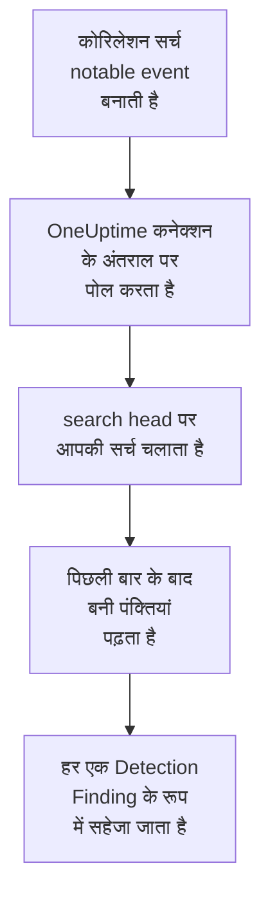

# Splunk Enterprise Security

[Splunk Enterprise Security](https://www.splunk.com/en_us/products/enterprise-security.html) की कोरिलेशन सर्च जो notable event बनाती हैं, उन्हें OneUptime के सुरक्षा इवेंट में इम्पोर्ट करें। वहां आप उन्हें अपने लॉग, ट्रेस और मेट्रिक्स के साथ खोजते हैं, हर दूसरे स्रोत के साथ उनका सहसंबंध देखते हैं, और जो मायने रखते हैं उनके लिए ऑन-कॉल को पेज करते हैं। OneUptime उन्हें आपके search head पर, आपके बनाए Splunk यूज़र के रूप में, एक सर्च चलाकर पढ़ता है, और Splunk में कुछ नहीं बदलता। क्योंकि यह बस एक सर्च है, यह सिर्फ़ notable event ही नहीं, बल्कि कोई भी इंडेक्स या किसी भी सेव की गई सर्च का आउटपुट इम्पोर्ट करता है।

:::cards
- [कनेक्शन सेट करें](#कनेक्शन-सेट-करें): एक टोकन, एक रोल, और कनेक्शन का फ़ॉर्म।
- [क्या इम्पोर्ट होता है](#क्या-इम्पोर्ट-होता-है): सर्च की हर पंक्ति सुरक्षा इवेंट कैसे बनती है।
- [पोलिंग कैसे काम करती है](#पोलिंग-कैसे-काम-करती-है): हर पोल कौन सी विंडो पढ़ता है, और व्यस्त search head उसके साथ क्या करता है।
- [समस्या निवारण](#समस्या-निवारण): हर त्रुटि का मतलब क्या है, और क्या बदलना है।
:::

## यह कैसे काम करता है



हर मिनट OneUptime हर उस सक्षम कनेक्शन से पोल करता है जिसका पोल अंतराल बीत चुका है। एक पोल search head के REST API के ज़रिए, पिछले पोल के बाद बनी पंक्तियों पर आपकी सर्च चलाता है, और हर पंक्ति को एक [OCSF](https://schema.ocsf.io/) Detection Finding इवेंट (क्लास `2004`) के रूप में सहेजता है। इसके बाद पहचान नियम, मॉनिटर और डैशबोर्ड इसे किसी भी दूसरे स्रोत के सुरक्षा इवेंट की तरह मानते हैं।

## शुरू करने से पहले

- OneUptime में Project Owner, Project Admin या Security Admin रोल। Security Member और Security Viewer कनेक्शन और उनका रन इतिहास देख सकते हैं, पर उन्हें बदल नहीं सकते।
- Splunk Enterprise 9.0.1 या बाद का वर्शन चलाने वाला search head, या Splunk Cloud Platform। OneUptime मैनेजमेंट पोर्ट पर, आमतौर पर `8089`, उसके REST API से बात करता है। पोर्ट `8000` पर Splunk Web REST API नहीं देता।
- OneUptime के लिए एक Splunk यूज़र, जिसके रोल में `search` क्षमता हो और जो वह इंडेक्स पढ़ सके जिसे सर्च पढ़ती है: notable event के लिए `notable`। Enterprise Security के `ess_analyst` और `ess_user` रोल दोनों देते हैं। कनेक्शन सिर्फ़ पढ़ता है, इसलिए रोल को और कुछ नहीं चाहिए।
- एक search head जिस तक OneUptime HTTPS पर पहुंच सके। OneUptime Cloud इंटरनेट से कनेक्ट करता है, इसलिए search head को एक सार्वजनिक पते की ज़रूरत है: निजी पते अस्वीकार किए जाते हैं। सेल्फ-होस्टेड OneUptime अपने ऐप और वर्कर कंटेनर से कनेक्ट करता है, और आपके निजी नेटवर्क पर search head तक पहुंच सकता है, जब तक `DATA_SOURCE_BLOCK_PRIVATE_ADDRESSES` `true` न हो।

## कनेक्शन सेट करें

कनेक्शन Splunk ऑथेंटिकेशन टोकन से, या यूज़रनेम और पासवर्ड से ऑथेंटिकेट करता है।

:::steps
### ऑथेंटिकेशन टोकन बनाएं

1. Splunk Web में **Settings → Tokens** खोलें। अगर Splunk कहे कि टोकन ऑथेंटिकेशन बंद है, तो पहले **Enable Token Authentication** चुनें।
2. **New Token** चुनें। **User** में OneUptime के लिए बनाया गया Splunk यूज़र डालें, और **Audience** में बताएं कि टोकन किस लिए है, जैसे `OneUptime security events`।
3. एक **Expiration** चुनें, या कोई नहीं। एक्सपायर होने वाला टोकन कनेक्शन को तब तक रोक देता है जब तक आप उसे बदल न दें।
4. **Create** चुनें और टोकन कॉपी करें। Splunk इसे सिर्फ़ एक बार दिखाता है।

इसके बजाय पासवर्ड से ऑथेंटिकेट करने के लिए यह चरण छोड़ दें, और यूज़र का नाम और पासवर्ड हाथ में रखें।

### OneUptime में कनेक्शन जोड़ें

**उत्पाद → Security Events → कनेक्शन** (`/dashboard/{projectId}/security-events/connections`) खोलें, **कनेक्शन जोड़ें** पर क्लिक करें, **Splunk Enterprise Security** चुनें, और **अगला** पर क्लिक करें। नीचे दी गई तालिका की सेटिंग्स भरें, **अगला** पर क्लिक करें, और टोकन को **Authentication token** में, या पासवर्ड को **पासवर्ड** में पेस्ट करें।

### सहेजने से पहले इसे टेस्ट करें

**सहेजने से पहले टेस्ट करें** के नीचे **इन सेटिंग्स का परीक्षण करें** पर क्लिक करें। टेस्ट फ़ॉर्म के मानों से ऑथेंटिकेट करता है और आपकी सर्च चलाता है, और कुछ नहीं सहेजता, इसलिए गलत पोर्ट या कोई छूटा हुआ रोल कनेक्शन बनने से पहले ही सामने आ जाता है। फिर **अगला** पर क्लिक करें, कनेक्शन को एक **नाम** दें, और उसे बनाएं।
:::

| सेटिंग | क्या डालें |
| --- | --- |
| **Splunk management URL** | search head का REST API, जैसे `https://splunk.example.com:8089`। इसमें `https` होना चाहिए, कोई क्वेरी स्ट्रिंग नहीं। पाथ बना रहता है, ताकि किसी पाथ के नीचे API देने वाला रिवर्स प्रॉक्सी काम करे। |
| **खोजें** | वह सर्च जो चुनती है कि क्या इम्पोर्ट करना है, जब तक आप इसे न बदलें तब तक `index=notable`। इसे सीमित करें, जैसे `index=notable urgency IN (high, critical)` से। समय सीमा OneUptime खुद जोड़ता है, इसलिए सर्च `earliest` या `latest` सेट नहीं कर सकती, और पाइप से शुरू नहीं हो सकती। शुरुआत का `search` हटा दिया जाता है। |
| **उपयोगकर्ता नाम** | Splunk यूज़र का नाम, सिर्फ़ तब जब वह पासवर्ड से ऑथेंटिकेट करता हो। |
| **Authentication token** | पहले चरण का टोकन। जब टोकन सहेजा गया हो, तो वही इस्तेमाल होता है, यूज़रनेम और पासवर्ड नहीं। |
| **पासवर्ड** | Splunk यूज़र का पासवर्ड, सिर्फ़ तब जब कोई टोकन इस्तेमाल न हो। |

**Authentication token** और **पासवर्ड** एन्क्रिप्ट किए जाते हैं, API उन्हें कभी नहीं लौटाता, और वे फिर कभी नहीं दिखते। किसी एक को बदलने के लिए कनेक्शन पर **क्रेडेंशियल अपडेट करें** इस्तेमाल करें। एक ऑथेंटिकेशन से दूसरे पर जाने के लिए, वहां नया डालें और **Remove the stored Authentication token** या **Remove the stored Password** चालू करें।

**पोलिंग** चरण में एक वैकल्पिक **विवरण**, **पोल अंतराल (मिनट)**, जो `1` से `1440` तक की पूर्ण संख्या है और `5` से शुरू होती है, और **सक्षम** भी है, जो शुरू में चालू रहता है।

## क्या इम्पोर्ट होता है

सर्च से लौटी हर पंक्ति एक Detection Finding इवेंट (OCSF क्लास `2004`) बनती है, जिसका वेंडर `Splunk` और प्रोडक्ट `Splunk Enterprise Security` होता है। एक notable event के लिए:

| Splunk फ़ील्ड | OneUptime कॉलम |
| --- | --- |
| `event_id`, नहीं तो `_bkt` और `_cd`, नहीं तो पंक्ति का हैश | इवेंट UID, जिससे डुप्लिकेट भी हटाए जाते हैं |
| `_time`, जब कोरिलेशन सर्च ने notable event बनाया | इवेंट का समय |
| `rule_name`, नहीं तो `search_name`, नहीं तो `source` | नियम का नाम |
| `search_name`, नहीं तो `source`, नहीं तो `rule_name` | नियम ID |
| `rule_title`, नहीं तो `rule_description`, नहीं तो नियम का नाम | संदेश |
| `urgency`, नहीं तो `severity` | गंभीरता |
| `status_label`, नहीं तो `status_description`, नहीं तो `status` में रखी समीक्षा स्थिति का नाम | स्थिति |
| `annotations.mitre_attack`, और `mitre_technique_id` और `mitre_tactic` जैसे फ़ील्ड | MITRE ATT&CK टैक्टिक और तकनीकें |
| `user` या `src_user`; `src`, `src_ip` या `src_host`; `process`, `process_name` या `parent_process` | प्रिंसिपल यूज़र, IP, होस्ट और प्रोसेस |
| `process_name` या `process_exec`, `process_path` और `process`; `parent_process_name` या `parent_process_exec`, `parent_process_path` और `parent_process` | प्रोसेस का नाम, पाथ और कमांड लाइन; पैरेंट प्रोसेस का नाम, पाथ और कमांड लाइन |
| `dest_user`; `dest`, `dest_ip` या `dest_host`; `dest_port` | टारगेट यूज़र, IP, होस्ट और पोर्ट |
| `file_path`, `url` या `risk_object` | टारगेट रिसोर्स |
| हर यूज़र, होस्ट और IP, साथ में `dvc`, `host`, `file_hash`, `file_name`, `url`, `domain`, `query` और `risk_object` | Observable |
| पंक्ति का हर फ़ील्ड, जैसे `security_domain`, `owner`, `orig_sid` और `_raw` | `attributes`, फ़ील्ड के अपने नाम से |

किसी दूसरे इंडेक्स की पंक्ति भी इसी तरह इम्पोर्ट होती है। जो कॉलम उसके फ़ील्ड नहीं भरते वे खाली रहते हैं, और हर फ़ील्ड `attributes` में खोजने लायक बना रहता है।

## पोलिंग कैसे काम करती है

हर पोल अपनी विंडो पर, सबसे पुराने पहले, एक एक्सपोर्ट सर्च चलाता है:

```text
POST {Splunk management URL}/services/search/v2/jobs/export
    search=search index=notable | fields * | sort 0 _time | head 10001
    earliest_time={window start}
    latest_time={window end}
    output_mode=json
```

- **बनने का समय ही कर्सर है।** विंडो `_time` पर होती है, जो notable event के लिए वह समय है जब कोरिलेशन सर्च ने उसे बनाया, न कि वह जब उसकी पाई गई गतिविधि हुई। हर घंटे चलने वाली सर्च अपने notable event पर अपने रन का समय लगाती है, इसलिए कोई भी कर्सर के पीछे नहीं छूटता।
- **पहला पोल 24 घंटे पीछे देखता है**, इसलिए नया कनेक्शन तुरंत अपने हाल के notable event दिखाता है।
- **हर बाद वाला पोल सहेजे गए कर्सर से 1 मिनट पहले शुरू होता है**, इसलिए दो विंडो की सीमा पर बनी पंक्ति कभी नहीं छूटती।
- **एक पोल कर्सर से आगे ज़्यादा से ज़्यादा 24 घंटे पढ़ता है।** जिस कनेक्शन का कर्सर पीछे रह गया, वह 24 घंटे की लगातार विंडो में बराबर आता है, और उसका **स्वास्थ्य** **Catching up** दिखाता है।
- **डुप्लिकेट `event_id` से, या Splunk के अपने `_bkt` और `_cd` से हटाए जाते हैं**, प्रोजेक्ट के भीतर, इसलिए ओवरलैप, दोबारा कोशिश की गई विंडो और इम्पोर्ट कभी किसी पंक्ति को दो बार नहीं सहेजते।

9.0.1 से पुराना search head `search/v2/jobs/export` के अनुरोध पर `404` लौटाता है। तब OneUptime इसे डेप्रिकेटेड `search/jobs/export` पर भेजता है, और रन एक चेतावनी में यह बताता है। search head को अपग्रेड करें: मौजूदा वर्शन उस एंडपॉइंट को बंद कर देते हैं।

### जब किसी विंडो में एक पोल की क्षमता से ज़्यादा हो

एक पोल ज़्यादा से ज़्यादा 10,000 पंक्तियां पढ़ता है। जब किसी विंडो में इससे ज़्यादा हों, तो रन **आंशिक** होता है, इस तरह की चेतावनी के साथ:

```text
Stopped after collecting 10000 records; the window holds more. Records are read oldest first, and the last one read was created at 2026-09-14T08:12:44.000Z, where the next poll can resume.
```

सर्च विंडो को `_time` के हिसाब से, सबसे पुराने पहले, क्रम में रखती है, इसलिए OneUptime कर्सर को पढ़ी गई आखिरी पंक्ति के बनने के समय पर ले जाता है, और अगला पोल उसी विंडो लंबाई के साथ वहीं से शुरू होता है। व्यस्त search head वही पंक्तियां दोबारा पढ़ने के बजाय हर पोल में 10,000 पंक्तियां पकड़ता है। उसी पल में बनी पंक्तियां दो बार पढ़ी जाती हैं, और डुप्लिकेट जांच दूसरी कॉपी हटा देती है। Splunk कोई भी पंक्ति लौटाने से पहले पूरी विंडो को क्रम में लगाता है, इसलिए **खोजें** में ऐसी सर्च जो ज़रूरत से कहीं ज़्यादा ढूंढती है, हर पोल को धीमा कर देती है। इसे सटीक रखें।

जब कोई रन सहेजे गए कर्सर से आगे बढ़ ही नहीं पाता, तो OneUptime इसके बजाय विंडो छोटी करता है:

1. **छोटा करें।** अगला पोल उसी शुरुआती बिंदु से आधी लंबाई की विंडो पढ़ता है, और तब तक आधा करता रहता है जब तक कोई विंडो पूरी न पढ़ी जाए, कम से कम एक मिनट तक। रन की चेतावनी यही बताती है: `This window holds more records than one poll can read; the next poll reads a {n} minute window from the same starting point.`
2. **वापस बढ़ाएं।** किसी विंडो के पूरा पढ़े जाने के बाद अगली विंडो फिर दोगुनी होती है, ज़्यादा से ज़्यादा 24 घंटे तक।
3. **एक मिनट से आगे बढ़ें।** अगर एक मिनट में भी एक पोल की क्षमता से ज़्यादा हो, तो पोलिंग उससे आगे बढ़ जाती है, ताकि नए notable event आते रहें। रन **आंशिक** ही रहता है, और **पिछली त्रुटि** में `More records were created in the one minute from {cursor} to {end} than one poll can read. Polling moved past this minute so newer records keep arriving; use Import this time range in Diagnostics on this minute to recover what one run can read.` लिखा होता है। एक रन जितना पढ़ सकता है उतना वापस पाने के लिए उस मिनट को **Import this time range** से इम्पोर्ट करें।

जो रन Splunk की किसी त्रुटि से पूरी तरह विफल होता है, वह कर्सर और विंडो लंबाई नहीं बदलता, और अगला पोल वही विंडो फिर से पढ़ता है। एकमात्र अपवाद वह अनुरोध है जिसका समय खत्म हो गया: कर्सर वहीं रहता है, लेकिन अगली विंडो आधी लंबी होती है, क्योंकि जो विंडो समय पर जवाब पाने के लिए बहुत भारी हो, वह हर कोशिश में टाइम आउट होगी। **पोल अंतराल (मिनट)** बदलने से इसमें कुछ नहीं बदलता: यह तय करता है कि पोल कितनी बार शुरू होता है, न कि उसकी विंडो कहां से शुरू होती है।

### मांग पर रन, प्रीव्यू और इम्पोर्ट

किसी कनेक्शन पर **निदान** पर क्लिक करें, ताकि उसके हाल के रन देख सकें और उसके साथ हाथ से काम कर सकें। जो भी कनेक्शन बदल सकता है वह इन्हें शुरू कर सकता है; जो भी इसे देख सकता है वह इतिहास पढ़ सकता है।

- **अभी चलाएँ** तुरंत सामान्य कर्सर के साथ एक पोल शुरू करता है, तब भी जब कनेक्शन **सक्षम** न हो।
- **Preview notable events** 7 दिन तक की समय सीमा पढ़ता है और कुछ इम्पोर्ट नहीं करता।
- **Import this time range** आपकी पुष्टि के बाद 7 दिन तक की सीमा इम्पोर्ट करता है, कर्सर हिलाए बिना। पहले से इम्पोर्ट की गई पंक्तियां छोड़ दी जाती हैं।
- किसी रन पर **Copy diagnostics** सपोर्ट के लिए उसकी रिपोर्ट कॉपी करता है। इसमें क्रेडेंशियल कभी शामिल नहीं होते।

## कनेक्शन का परीक्षण करें

कनेक्शन की पंक्ति पर **कनेक्शन का परीक्षण करें**, और फ़ॉर्म में **इन सेटिंग्स का परीक्षण करें**, बैकग्राउंड वर्कर में नहीं बल्कि API प्रोसेस में चलते हैं, इसलिए जब वर्कर ही समस्या हों तब भी टेस्ट जवाब देता है। यह ये जांचें क्रम से चलाता है:

| जांच | यह क्या जांचती है |
| --- | --- |
| **कॉन्फ़िगरेशन** | हर सेटिंग मौजूद है और सही रूप में है। इसके विफल होने पर किसी से संपर्क नहीं किया जाता। |
| **Authenticate with Splunk** | Splunk टोकन, या यूज़रनेम और पासवर्ड स्वीकार करता है, और यूज़र और उसके रोल बताता है, ताकि आप उनकी तुलना उस रोल से कर सकें जो आप देना चाहते थे। |
| **Run the search on Splunk** | **खोजें** की सर्च पिछले 24 घंटों पर, सिर्फ़ एक पंक्ति के लिए, चलती है, और बताती है कि किस एक्सपोर्ट एंडपॉइंट ने जवाब दिया। |
| **Notable events available to import** | **खोजें** की सर्च पिछले 24 घंटों और पिछले 7 दिनों में कितनी पंक्तियां ढूंढती है। 7 दिनों में एक भी नहीं होना चेतावनी है, विफलता नहीं। |
| **Background workers**, **Poll scheduler**, **Security event storage** | OneUptime का अपना हिस्सा: कोई प्रोसेस Worker कतार के जॉब लेता है, पोल जॉब हर मिनट चलता है, और सुरक्षा इवेंट का स्टोर जवाब देता है। |
| **Scheduled polling** | सहेजे गए कनेक्शन के लिए: पोलिंग चालू है, कोई रन वर्कर के इंतज़ार में अटका नहीं है, और पोल समय पर चलते हैं। |

टेस्ट के हर अनुरोध की समय सीमा 20 सेकंड है। टेस्ट कभी कुछ इम्पोर्ट नहीं करता और न कर्सर हिलाता है, और हर विफल जांच बताती है कि क्या बदलना है।

## Splunk को सुरक्षा इवेंट भेजें

OneUptime जो पाता है उसे Splunk के HTTP Event Collector (HEC) के ज़रिए Splunk को भी भेज सकता है, ताकि आपकी खोजें और डैशबोर्ड आपके अपने डिटेक्शन के साथ OneUptime के डिटेक्शन भी देखें। हर सुरक्षा इवेंट sourcetype `oneuptime:security` वाला एक HEC इवेंट होता है, और उसके फ़ील्ड के नाम वही होते हैं जो Splunk का Common Information Model रखता है: `src`, `src_ip`, `src_user`, `dest`, `dest_ip`, `dest_port`, `user`, `signature` और `severity`।

:::steps
### HEC टोकन बनाएँ

Splunk Web में **Settings → Data inputs → HTTP Event Collector** खोलें और **New Token** पर क्लिक करें। उसे नाम दें, वे इंडेक्स चुनें जिनमें वह लिख सकता है और उसका डिफ़ॉल्ट इंडेक्स, और टोकन का मान कॉपी करें। Splunk Cloud पर HEC `https://http-inputs-<stack>.splunkcloud.com` पर सुनता है; Splunk Enterprise पर, **Global Settings** में टोकन चालू होने के बाद पोर्ट `8088` पर।

### गंतव्य जोड़ें

**उत्पाद → Security Events → कनेक्शन** खोलें। **अपने SIEM में भेजें** के नीचे **गंतव्य जोड़ें** पर क्लिक करें, **SIEM** में Splunk चुनें और **अगला** पर क्लिक करें। **HEC URL** भरें और टोकन को **HEC टोकन** में चिपकाएँ। **इंडेक्स** और **स्रोत प्रकार** वैकल्पिक हैं: खाली छोड़ने पर इवेंट टोकन के डिफ़ॉल्ट इंडेक्स में sourcetype `oneuptime:security` के साथ जाते हैं।

### टेस्ट इवेंट भेजें और भेजना शुरू करें

**टेस्ट इवेंट भेजें** पर क्लिक करें: फ़ॉर्म की सेटिंग के साथ एक सूचनात्मक इवेंट Splunk को जाता है, और कुछ भी सहेजा नहीं जाता। उसे `sourcetype="oneuptime:security"` से खोजें। फिर **क्या भेजना है** में **सिर्फ़ डिटेक्शन** रहने दें या **सभी सुरक्षा इवेंट** चुनें, और **भेजना शुरू करें** पर क्लिक करें।
:::

- **HEC URL** को `https` इस्तेमाल करना होगा, ऐसे सर्टिफ़िकेट के साथ जिस पर OneUptime भरोसा करता है: सर्टिफ़िकेट जाँच कभी नहीं छोड़ी जाती।
- इवेंट 500 तक के बैच में जाते हैं। जिस इवेंट को Splunk अस्वीकार करता है, उसे छोड़ दिया जाता है और **त्रुटि देखें** में बताया जाता है, व्यस्त कलेक्टर (`503`) को फिर आज़माया जाता है, और अस्वीकार किया गया टोकन या इंडेक्स तब तक भेजना रोक देता है जब तक आप उसे ठीक न करें।
- OneUptime ने Splunk से जो notable event इम्पोर्ट किए हैं, वे कभी वापस Splunk को नहीं भेजे जाते।

## समस्या निवारण

कनेक्शन का **पिछली त्रुटि** पूरा त्रुटि संदेश रखता है, क्रेडेंशियल छिपाकर, एक ऐसे प्रीफ़िक्स के पीछे जो विफल हुए चरण का नाम बताता है। जब किसी कनेक्शन में त्रुटि हो, तो उसे पढ़ने के लिए उसके **क्रियाएँ** कॉलम में **त्रुटि देखें** चुनें, और कॉपी करने के लिए डायलॉग में **त्रुटि कॉपी करें**। पहले प्रीफ़िक्स पढ़ें।

:::details Last Error `Splunk Enterprise Security authentication request` से शुरू होता है
- `Splunk Enterprise Security authentication request failed (HTTP ...)`: Splunk ने यह बताने से इनकार किया कि कॉल करने वाला कौन है।
  - `HTTP 401`: Splunk ने क्रेडेंशियल स्वीकार नहीं किए। टोकन गलत है, एक्सपायर हो गया है या हटा दिया गया है, search head पर टोकन ऑथेंटिकेशन बंद है, या यूज़रनेम या पासवर्ड गलत है। नया टोकन बनाएं, और उसे **क्रेडेंशियल अपडेट करें** से सहेजें।
  - `HTTP 404`: **Splunk management URL** REST API नहीं है। यह पोर्ट `8000` पर Splunk Web की ओर इशारा करता है, या इसमें ऐसा पाथ है जो search head नहीं देता।
- `Splunk Enterprise Security authentication request returned ...`: search head के REST API के बजाय किसी और चीज़ ने जवाब दिया, जैसे पोर्ट `8000` पर Splunk Web का HTML या किसी प्रॉक्सी का पेज। URL को मैनेजमेंट पोर्ट की ओर करें।
:::

:::details Last Error `Splunk Enterprise Security search export` या `Splunk Enterprise Security count search` से शुरू होता है
- `Splunk Enterprise Security search export failed (HTTP ...)`: Splunk ने सर्च चलाने से इनकार किया।
  - `HTTP 400`: Splunk सर्च को पार्स नहीं कर पाता। उसकी त्रुटि पढ़ने के लिए **खोजें** की सर्च Splunk Web में चलाएं।
  - `HTTP 403`: यूज़र के रोल में `search` क्षमता नहीं है, या वह इंडेक्स नहीं पढ़ सकता। `notable`, या अपना इंडेक्स, उन इंडेक्स में जोड़ें जिन्हें रोल सर्च कर सकता है।
  - `HTTP 404`: उस URL पर दोनों में से कोई भी एक्सपोर्ट एंडपॉइंट मौजूद नहीं है, इसलिए यह किसी search head का मैनेजमेंट पोर्ट नहीं है।
  - `HTTP 429` या `HTTP 5xx`: Splunk यूज़र को सीमित कर रहा है, ओवरलोड है, या सर्च अपनी किसी सीमा तक पहुंच गई। अगला पोल फिर कोशिश करता है।
- `Splunk Enterprise Security search export was rejected by Splunk on an HTTP 200`: Splunk ने जवाब दिया, पर सर्च को एक त्रुटि के साथ रोक दिया। संदेश उसे उद्धृत करता है।
- `Splunk Enterprise Security search export returned a body that is not newline-delimited JSON.`: REST API के बजाय किसी और चीज़ ने जवाब दिया, जैसे Splunk Web या किसी प्रॉक्सी का साइन-इन पेज। इसे खाली विंडो मानने के बजाय रिपोर्ट किया जाता है, ताकि कर्सर कभी उन पंक्तियों से आगे न जाए जिन्हें किसी ने नहीं पढ़ा।
- `Splunk Enterprise Security count search ...`: वही विफलताएं, **Notable events available to import** की गिनती से, जिसे सिर्फ़ टेस्ट चलाता है।
:::

:::details Last Error `did not complete` पर खत्म होता है
`Splunk Enterprise Security search export did not complete`, और दूसरे चरणों के लिए भी ऐसा ही, का मतलब है कि अनुरोध को कोई जवाब नहीं मिला: टाइम आउट, ऐसा नाम जो रिज़ॉल्व नहीं होता, ऐसा सर्टिफ़िकेट जिस पर OneUptime भरोसा नहीं करता, या अस्वीकार किया गया निजी पता। जांचें कि OneUptime ऐप और वर्कर मैनेजमेंट पोर्ट से HTTPS कनेक्शन खोल सकते हैं। जो search head दूसरे अनुरोधों का जवाब देता है पर सर्च पर टाइम आउट होता है, वह बहुत ज़्यादा क्रम में लगा रहा है: अगला पोल आधी लंबी विंडो पढ़ता है, और **खोजें** में ज़्यादा सीमित सर्च इसे हमेशा के लिए ठीक कर देती है।
:::

:::details Last Polled Never है और Last Error खाली है
इस कनेक्शन का कोई पोल पूरा नहीं हुआ है। **कनेक्शन का परीक्षण करें** चलाएं: उसकी **Background workers** और **Poll scheduler** जांचें कारण बताती हैं। सेल्फ़-होस्टेड इंस्टॉलेशन में आम कारण ऐप पर `DISABLE_QUEUE_WORKERS=true` है, जबकि जॉब लेने के लिए कोई अलग वर्कर डिप्लॉयमेंट नहीं है: इसे `false` पर सेट करें, या वर्कर डिप्लॉयमेंट चलाएं (Helm: `worker.enabled: true`)।
:::

:::details कोई रन Partial है
- `Stopped after collecting 10000 records; the window holds more`: विंडो में एक रन द्वारा पढ़ी जाने वाली 10,000 पंक्तियों से ज़्यादा थीं। कुछ नहीं खोता: अगला पोल पढ़ी गई आखिरी पंक्ति के बाद से शुरू होता है। जो कनेक्शन पोल दर पोल **आंशिक** बना रहता है, वह बैकलॉग पकड़ रहा है, और उसके **अंतिम पोल** और **अंतिम इंपोर्ट किया गया इवेंट** आगे बढ़ते रहते हैं। अगर वह कभी नहीं पकड़ पाता, तो **खोजें** की सर्च हर पोल अंतराल में 10,000 से ज़्यादा पंक्तियां ढूंढती है: इसे सीमित करें, या **पोल अंतराल (मिनट)** छोटा करें।
- `More records were created in the one minute from ... than one poll can read`: पोलिंग उस मिनट से आगे बढ़ गई। उसे **निदान** में **Import this time range** से इम्पोर्ट करें। एक इम्पोर्ट उतना ही पढ़ता है जितना एक पोल।
:::

:::details टेस्ट पास होता है, पर कुछ इम्पोर्ट नहीं होता
टेस्ट की रिपोर्ट में **Notable events available to import** पढ़ें। पिछले 7 दिनों में `0` का मतलब है कि **खोजें** की सर्च को Splunk में कुछ नहीं मिला: Incident Review में जांचें कि कोरिलेशन सर्च सक्षम हैं और notable event बना रही हैं, और कि **खोजें** की सर्च इरादे से ज़्यादा संकरी नहीं है।
:::

## आपको क्या मिलता है

- **खोज।** सुरक्षा इवेंट एक्सप्लोरर में, हर दूसरे स्रोत के साथ, notable event को अर्जेंसी, स्थिति, नियम, यूज़र, होस्ट या किसी भी observable से फ़िल्टर करें।
- **सहसंबंध।** हर पंक्ति के यूज़र, होस्ट, IP और डोमेन observable के रूप में इंडेक्स होते हैं, इसलिए एक सर्च उन सबको ढूंढ लेती है जो उनका ज़िक्र करते हैं।
- **पहचान नियम।** Sigma नियम जो शेड्यूल पर आपके सुरक्षा इवेंट पर चलते हैं, और ऑन-कॉल को पेज करने वाले अलर्ट खोलते हैं।
- **मॉनिटर।** सुरक्षा इवेंट मॉनिटर मेल खाने वाले इवेंट गिनते हैं, जैसे नए गंभीर notable event, और थ्रेशोल्ड पार होने पर घटनाएं या अलर्ट खोलते हैं।

सुरक्षा इवेंट का बिल आपकी बाकी टेलीमेट्री की तरह, इंजेस्ट किए गए हर GB के हिसाब से बनता है। [मूल्य निर्धारण](https://oneuptime.com/pricing) देखें।

## अगले कदम

:::cards
- [सुरक्षा इवेंट](/docs/telemetry/security-events): जो इम्पोर्ट करते हैं उसे खोजें, उसका सहसंबंध देखें और उस पर अलर्ट करें।
- [Elastic Security](/docs/integrations/elastic-security): किसी Elastic स्टैक के डिटेक्शन अलर्ट भी इम्पोर्ट करें।
- [रोल](/docs/permissions/reference#भूमिकाएँ): Security रोल क्या देख और बदल सकते हैं।
- [इंटिग्रेशन अवलोकन](/docs/integrations/index): वे दूसरे टूल जिन्हें आप जोड़ सकते हैं।
:::
