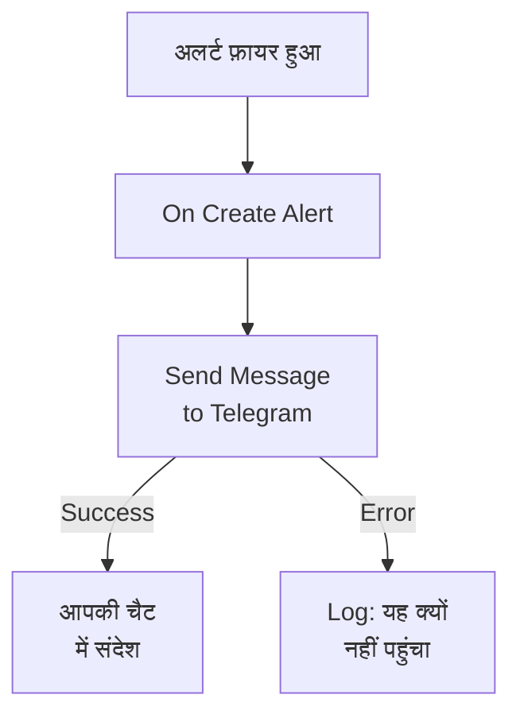

# Telegram

जब कोई अलर्ट फ़ायर होता है या कोई घटना खुलती है, तो किसी [Telegram](https://telegram.org) चैट, ग्रुप या चैनल में एक संदेश भेजें। OneUptime का **Send Message to Telegram** वर्कफ़्लो चरण इसे आपके बनाए बॉट के रूप में भेजता है, और एक तैयार टेम्पलेट अलर्ट के लिए वर्कफ़्लो बना देता है। यह इंटीग्रेशन **आउटबाउंड** है: बॉट संदेश भेजता है, और चैट में कही गई बातें नहीं पढ़ता।

:::cards
- [यह कैसे काम करता है](#यह-कैसे-काम-करता-है): अलर्ट फ़ायर होने पर वर्कफ़्लो क्या करता है।
- [सेटअप](#इंटीग्रेशन-सेट-अप-करें): एक बॉट, उसकी चैट, फिर वर्कफ़्लो: टेम्पलेट से या शुरू से।
- [सुझाव](#सुझाव): सादा टेक्स्ट, लंबे संदेश, और घटनाएं।
- [समस्या निवारण](#समस्या-निवारण): Telegram की त्रुटियों का मतलब, और क्या बदलना है।
:::

## यह कैसे काम करता है



चरण **Message Text** को Telegram के Bot API के ज़रिए, आपके बॉट के रूप में, चैट में भेजता है। जब Telegram संदेश ले लेता है तो यह अपने **Success** आउटपुट पर जाता है, और जब Telegram उसे अस्वीकार करता है तो Telegram के कारण के साथ अपने **Error** आउटपुट पर। टेम्पलेट **Error** से एक **Log** चरण जोड़ता है, ताकि जो रन भेज नहीं सका वह कारण बताए।

## शुरू करने से पहले

- बॉट बनाने और उसे चैट में जोड़ने के लिए एक Telegram खाता।
- OneUptime में वर्कफ़्लो और वेरिएबल बनाने का अधिकार। OneUptime Cloud पर वर्कफ़्लो के लिए **Growth** प्लान या उससे ऊपर चाहिए।

## इंटीग्रेशन सेट अप करें

:::steps
### बॉट बनाएं

Telegram में [@BotFather](https://t.me/BotFather) को `/newbot` भेजें और उसके सवालों के जवाब दें। वह आपको बॉट का टोकन देता है, जैसे `123456789:ABCdefGhIJKlmnoPQRstuVWxyz`। जिसके पास भी टोकन है वह आपके बॉट के रूप में संदेश भेज सकता है, इसलिए इसे पासवर्ड जितना सुरक्षित रखें।

### चैट का ID ढूंढें

1. बॉट को ग्रुप में जोड़ें, या उसे चैनल का एडमिनिस्ट्रेटर बनाएं। किसी व्यक्ति को संदेश भेजने के लिए, वह पहले बॉट के साथ चैट शुरू करता है।
2. ग्रुप में बॉट का ज़िक्र करने वाला एक संदेश भेजें, जैसे `/start@your_bot`, ताकि बॉट उसे देखे।
3. ब्राउज़र में `https://api.telegram.org/bot<token>/getUpdates` खोलें, `<token>` की जगह बॉट के टोकन के साथ।
4. जवाब में `"chat":{"id":` ढूंढें। उसके बाद वाली संख्या चैट का ID है। ग्रुप का ID `-` से शुरू होता है, और बड़े ग्रुप का `-100` से।

सार्वजनिक चैनल को ID के बजाय उसके `@username` से बताया जा सकता है।

### वर्कफ़्लो बनाएं

टेम्पलेट से शुरू करें, जो अलर्ट के लिए पूरा वर्कफ़्लो बना देता है, या शुरू से बनाएं।

:::tabs
@tab Template से
1. **वर्कफ़्लो** खोलें और **वर्कफ़्लो बनाएं** पर क्लिक करें।
2. **टेम्पलेट खोजें…** में `Telegram` लिखें, **Tell Telegram when an alert fires** पर क्लिक करें, फिर **यह टेम्पलेट इस्तेमाल करें** पर क्लिक करें।
3. नाम, **Notify Telegram on new alert**, रहने दें या बदलें, और **अगला** पर क्लिक करें।
4. टोकन को **Telegram Bot Token** में और ID को **Telegram Chat ID** में पेस्ट करें, और **वर्कफ़्लो बनाएं** पर क्लिक करें।

वर्कफ़्लो **बिल्डर** में तीन चरणों के साथ खुलता है: **On Create Alert**; **Send Message to Telegram**, जो अलर्ट का नंबर, शीर्षक, गंभीरता और स्थिति भेजता है; और उसके **Error** आउटपुट पर एक **Log** चरण। टोकन वर्कफ़्लो के सीक्रेट वेरिएबल `telegramBotToken` के रूप में सहेजा जाता है, और ID `telegramChatId` के रूप में।
@tab शुरू से
1. टोकन को सीक्रेट ग्लोबल वेरिएबल के रूप में सहेजें: **वर्कफ़्लो → ग्लोबल वेरिएबल** पर जाएं, **वर्कफ़्लो वेरिएबल बनाएँ** पर क्लिक करें, इसका नाम `TELEGRAM_BOT_TOKEN` रखें, और **अगला** पर क्लिक करें। टोकन को **सामग्री** में पेस्ट करें, **रहस्य** चालू करें, और **वर्कफ़्लो वेरिएबल बनाएँ** पर क्लिक करें।
2. **वर्कफ़्लो** पर जाएं, **वर्कफ़्लो बनाएं** पर क्लिक करें, **शुरू से बनाएं** चुनें, वर्कफ़्लो को नाम दें, और **वर्कफ़्लो बनाएं** पर क्लिक करें।
3. **बिल्डर** में **चुनें कि यह वर्कफ़्लो किससे शुरू हो** पर क्लिक करें और **लोकप्रिय** के नीचे **On Create Alert** चुनें। ट्रिगर पर क्लिक करें: उसके **Fields to pass on** में पहले से **शीर्षक** है, इसलिए **फ़ील्ड जोड़ें** पर क्लिक करें और वे बाकी फ़ील्ड चुनें जो आपका संदेश दिखाता है, जैसे **Alert Number With Prefix**।
4. **घटक जोड़ें** पर क्लिक करें, `telegram` खोजें, और **Send Message to Telegram** पर क्लिक करें। ट्रिगर के **Success** आउटपुट को इससे जोड़ें।
5. नए चरण पर क्लिक करें। **Telegram Bot Token** में **{ }** पर क्लिक करें और **Global variables** के नीचे `TELEGRAM_BOT_TOKEN` चुनें। **Chat ID** में चैट का ID डालें, **Message Text** में संदेश लिखें, और **{ }** से अलर्ट के फ़ील्ड डालें।
:::

शुरू से बना संदेश अलर्ट के फ़ील्ड ऐसे रेफ़रेंस से पढ़ता है:

```text
🚨 Alert {{local.components.alert-on-create-1.returnValues.model.alertNumberWithPrefix}} fired
Title: {{local.components.alert-on-create-1.returnValues.model.title}}
```

### चालू करें और जाँचें

**बिल्डर** के ऊपर **सक्षम** चालू करें। अब से हर नया अलर्ट चैट में भेजा जाता है।

नया अलर्ट उठाए बिना इसे जांचने के लिए, **वर्कफ़्लो चलाएं** पर क्लिक करें और **अलर्ट** के नीचे कोई मौजूदा अलर्ट चुनें: सबसे हाल के अलर्ट सूची में दिखते हैं, और उसका नंबर या शीर्षक का हिस्सा टाइप करने पर कोई दूसरा मिल जाता है। **वर्कफ़्लो मैन्युअल रूप से चलाएं** पर क्लिक करें और **चलाएं** से पुष्टि करें। **वर्कफ़्लो रन** पैनल रन के साथ चलता है, और संदेश चैट में दिखता है। अगर चरण इसके बजाय **Error** पर जाता है, तो **Log** चरण की लाइन कारण बताती है: [समस्या निवारण](#समस्या-निवारण) देखें।
:::

## सुझाव

- **सादा टेक्स्ट।** चरण टेक्स्ट जैसा लिखा है वैसा ही भेजता है, Telegram की फ़ॉर्मैटिंग के बिना, इसलिए `*` और `_` जैसे हैं वैसे ही दिखते हैं।
- **4,096 अक्षरों की सीमा का ध्यान रखें।** Telegram 4,096 अक्षरों तक के संदेश लेता है। इससे लंबा संदेश अस्वीकार होने के बजाय काट दिया जाता है, और "… (truncated — see OneUptime for the full text)" पर खत्म होता है।
- **घटनाएं भी।** वही वर्कफ़्लो **On Create Incident** पर बनाएं, या स्थिति बदलावों के लिए **On Update Incident** पर। सिर्फ़ कुछ अलर्ट भेजने के लिए, चरण से पहले एक **If / Else** ब्लॉक रखें।
- **टोकन का आकार जांचा जाता है।** जो टोकन `123456789:ABCdef…` जैसा नहीं दिखता, वह कुछ भी भेजे जाने से पहले रन रोक देता है, और टोकन कभी लॉग में नहीं लिखा जाता।

## समस्या निवारण

जब चरण **Error** पर जाता है, तो रन कारण बताता है: टेम्पलेट का **Log** चरण `❌ Telegram could not deliver the alert notification:`, Telegram का कारण, और यह याद दिलाने वाली बात लिखता है कि बॉट को चैट में होना चाहिए।

:::details Telegram "Bad Request: chat not found" से जवाब देता है
**Chat ID** गलत है, या बॉट चैट नहीं देख सकता: बॉट को ग्रुप में जोड़ें, उसे चैनल का एडमिनिस्ट्रेटर बनाएं, या व्यक्ति से बॉट के साथ चैट शुरू करने को कहें। ग्रुप का ID `-` से शुरू होता है।
:::

:::details Telegram "Forbidden: bot was blocked by the user" या "bot is not a member" से जवाब देता है
व्यक्ति ने बॉट को ब्लॉक कर दिया, या बॉट को ग्रुप या चैनल से हटा दिया गया। उसे वापस जोड़ें, या किसी दूसरी चैट में भेजें।
:::

:::details Telegram "Unauthorized" से जवाब देता है
Telegram ने टोकन स्वीकार नहीं किया: उसे @BotFather में रद्द कर दिया गया, या गलत कॉपी किया गया। @BotFather से बॉट का मौजूदा टोकन कॉपी करें, और वेरिएबल का मान बदलें।
:::

:::details Telegram "Too Many Requests: retry after" से जवाब देता है
Telegram सीमित करता है कि एक बॉट कितनी तेज़ी से भेजता है, खासकर किसी ग्रुप में। अलर्ट की बौछार इस सीमा तक पहुंच सकती है: कम संदेश भेजें, उदाहरण के लिए सिर्फ़ कुछ गंभीरताओं के लिए।
:::

## अगले कदम

:::cards
- [वर्कफ़्लो घटक](/docs/workflows/components#telegram): चरण की हर सेटिंग, और उसके आउटपुट का मतलब।
- [Discord](/docs/integrations/discord): यही विचार, Discord चैनल में।
- [वर्कफ़्लो रन](/docs/workflows/runs-and-logs): पढ़ें कि वर्कफ़्लो के हर रन ने क्या किया।
- [इंटिग्रेशन अवलोकन](/docs/integrations/index): आउटबाउंड पैटर्न, और दूसरे टूल जिन्हें आप जोड़ सकते हैं।
:::
