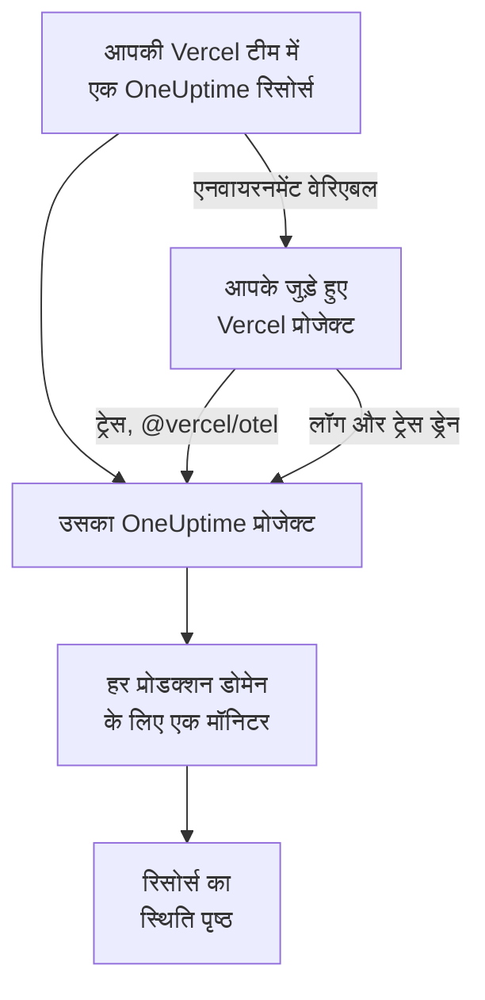

# Vercel

[Vercel Marketplace](https://vercel.com/marketplace) से OneUptime को अपनी Vercel टीम में जोड़ें। आप अपने Vercel खाते से साइन इन करते हैं और अपने Vercel बिल पर भुगतान करते हैं, और आपके Vercel प्रोजेक्ट को OneUptime में ट्रेस, लॉग, अपटाइम मॉनिटरिंग और एक स्थिति पृष्ठ मिलता है, बिना कुछ भी हाथ से सेट अप किए।

:::cards
- [OneUptime को अपनी Vercel टीम में जोड़ें](#oneuptime-को-अपनी-vercel-टीम-में-जोड़ें): Vercel डैशबोर्ड में एक रिसोर्स, एक प्लान और आपके प्रोजेक्ट।
- [@vercel/otel से ट्रेस भेजें](#vercelotel-से-ट्रेस-भेजें): एनवायरनमेंट वेरिएबल पहले से मौजूद हैं।
- [ड्रेन से लॉग और ट्रेस भेजें](#ड्रेन-से-लॉग-और-ट्रेस-भेजें): Vercel के अपने लॉग और स्पैन, Pro और Enterprise पर।
- [प्लान और बिलिंग](#प्लान-और-बिलिंग): OneUptime के प्लान, आपके Vercel चालान पर।
:::

## यह कैसे काम करता है

Vercel में आप जो भी OneUptime रिसोर्स जोड़ते हैं, वह अपने आप में एक अलग OneUptime प्रोजेक्ट होता है। आप जिस भी Vercel प्रोजेक्ट को रिसोर्स से कनेक्ट करते हैं, Vercel उसे रिसोर्स के एनवायरनमेंट वेरिएबल देता है, जो प्रोजेक्ट के ट्रेस OneUptime को भेजते हैं। ड्रेन Vercel के लॉग और स्पैन भेजते हैं, और हर जुड़े हुए प्रोजेक्ट के प्रोडक्शन डोमेन को रिसोर्स के स्थिति पृष्ठ पर एक अपटाइम मॉनिटर मिलता है।



यह इंटीग्रेशन OneUptime Cloud (`oneuptime.com`) के लिए है। सेल्फ-होस्टेड OneUptime को Vercel Marketplace से नहीं जोड़ा जा सकता: देखें [सेल्फ-होस्टेड OneUptime](#सेल्फ-होस्टेड-oneuptime)।

## शुरू करने से पहले

- **एक Vercel टीम**, किसी भी प्लान पर। लॉग और ट्रेस ड्रेन के लिए Vercel का Pro या Enterprise प्लान चाहिए; `@vercel/otel` से भेजे गए ट्रेस हर प्लान पर काम करते हैं।
- **एक सत्यापित ईमेल पता**, आपके Vercel खाते पर। OneUptime इसी से आपको साइन इन करता है, और अगर आपका OneUptime खाता नहीं है, तो इसी से आपका खाता बनाता है।
- **Vercel में एक भुगतान विधि**, हर प्लान के लिए: मॉनिटर और टेलीमेट्री का बिल उपयोग के हिसाब से बनता है, Free प्लान पर भी। देखें [प्लान और बिलिंग](#प्लान-और-बिलिंग)।

## OneUptime को अपनी Vercel टीम में जोड़ें

:::steps
### Vercel Marketplace पर OneUptime खोलें

Vercel डैशबोर्ड में **Integrations** खोलें, फिर **Browse Marketplace**, और **Observability** के नीचे OneUptime ढूँढें। **इंस्टॉल** पर क्लिक करें, और OneUptime की शर्तें स्वीकार करें।

### प्लान चुनें

**मुफ़्त**, **Growth** या **Scale** चुनें। ये प्लान OneUptime के अपने हैं, और इनकी कीमतें वही हैं जो [oneuptime.com/pricing](https://oneuptime.com/pricing) पर दी गई हैं।

### रिसोर्स का नाम रखें और उसकी सेटिंग्स चुनें

रिसोर्स का नाम उस चीज़ पर रखें जिस पर वह नज़र रखता है, जैसे `storefront`: उसके OneUptime प्रोजेक्ट और उसके स्थिति पृष्ठ का नाम इसी पर रखा जाता है। दो सेटिंग्स शुरुआत में चालू रहती हैं:

- **Monitor production domains**: आपके कनेक्ट किए गए हर Vercel प्रोजेक्ट के प्रोडक्शन डोमेन के लिए एक वेबसाइट मॉनिटर।
- **Create a status page**: रिसोर्स के लिए एक सार्वजनिक स्थिति पृष्ठ, जो उन मॉनिटरों को दिखाता है।

### अपने प्रोजेक्ट कनेक्ट करें

वे Vercel प्रोजेक्ट चुनें जो इस रिसोर्स को डेटा भेजते हैं, और वे एनवायरनमेंट जिन्हें इसके एनवायरनमेंट वेरिएबल मिलते हैं। कनेक्शन को कोई कस्टम प्रीफ़िक्स न दें: `@vercel/otel` वेरिएबल को उनके अपने नामों से पढ़ता है।
:::

रिसोर्स कुछ ही सेकंड में तैयार हो जाता है। उसका प्रोजेक्ट देखने के लिए **Open in OneUptime** पर क्लिक करें।

## हर रिसोर्स आपको क्या देता है

| क्या | यह कहाँ मिलता है |
| --- | --- |
| रिसोर्स के नाम वाला एक OneUptime प्रोजेक्ट | आप इसके मालिक हैं। आपकी टीम के साथी इसे Vercel से खोलने पर इसमें शामिल हो जाते हैं। |
| `Vercel` नाम की एक इंजेशन कुंजी | **प्रोजेक्ट सेटिंग्स → टेलीमेट्री और APM → इंजेशन कुंजियाँ** |
| हर जुड़े हुए Vercel प्रोजेक्ट में एनवायरनमेंट वेरिएबल | Vercel में प्रोजेक्ट की **Settings → Environment Variables** |
| हर जुड़े हुए प्रोजेक्ट के लिए एक वेबसाइट मॉनिटर | **मॉनिटर**, Vercel प्रोजेक्ट के नाम से |
| एक सार्वजनिक स्थिति पृष्ठ | **स्थिति पृष्ठ**, रिसोर्स के नाम से |

एनवायरनमेंट वेरिएबल हर जुड़े हुए प्रोजेक्ट में एक जैसे होते हैं:

| वेरिएबल | मान |
| --- | --- |
| `OTEL_EXPORTER_OTLP_ENDPOINT` | `https://oneuptime.com/otlp` |
| `OTEL_EXPORTER_OTLP_HEADERS` | `x-oneuptime-token=` और रिसोर्स की इंजेशन कुंजी |
| `OTEL_EXPORTER_OTLP_PROTOCOL` | `http/protobuf` |
| `ONEUPTIME_TELEMETRY_INGESTION_KEY` | सिर्फ़ इंजेशन कुंजी, जिसे ड्रेन भेजते हैं |

किसी डिप्लॉयमेंट को वेरिएबल तब मिलते हैं जब वह बिल्ड होता है: प्रोजेक्ट कनेक्ट करने के बाद फिर से डिप्लॉय करें।

## @vercel/otel से ट्रेस भेजें

`@vercel/otel` Next.js और Vercel पर चलने वाले दूसरे फ़्रेमवर्क के लिए Vercel का OpenTelemetry पैकेज है। यह `OTEL_EXPORTER_OTLP_*` वेरिएबल पढ़ता है, इसलिए रिसोर्स से जुड़े प्रोजेक्ट को सिर्फ़ यह पैकेज चाहिए।

:::steps
### पैकेज इंस्टॉल करें

```bash
npm install @vercel/otel @opentelemetry/api @opentelemetry/api-logs
```

### इसे रजिस्टर करें

प्रोजेक्ट के रूट में `instrumentation.ts` बनाएँ, या अगर प्रोजेक्ट में `src` है तो उसमें, और सेवा का नाम रखें:

```ts title="instrumentation.ts"
import { registerOTel } from "@vercel/otel";

export function register(): void {
  registerOTel({ serviceName: "storefront" });
}
```

### डिप्लॉय करें

प्रोजेक्ट को डिप्लॉय करें। उसके ट्रेस **ट्रेस** में, सेवा के नाम के नीचे दिखते हैं।
:::

Vercel के Pro और Enterprise प्लान पर एक ट्रेस ड्रेन भी जोड़ें: तब Vercel हर अनुरोध के लिए आपके एप्लिकेशन के स्पैन के साथ अपने ख़ुद के स्पैन भी OneUptime को भेजता है, और `@vercel/otel` उन्हें भेजने का काम ड्रेन पर छोड़ देता है, इसलिए कुछ भी दो बार नहीं पहुँचता।

## ड्रेन से लॉग और ट्रेस भेजें

ड्रेन वह सब OneUptime को भेजता है जो Vercel आपके प्रोजेक्ट के बारे में दर्ज करता है: लॉग ड्रेन उनके बिल्ड, फ़ंक्शन, एज और अनुरोध लॉग, और ट्रेस ड्रेन उनके स्पैन। ड्रेन के लिए Vercel का Pro या Enterprise प्लान चाहिए, और वे जो डेटा भेजते हैं, उसका बिल Vercel आपके Vercel बिल पर बनाता है।

:::steps
### ड्रेन जोड़ें

Vercel में **Team Settings → Drains** खोलें और **Add Drain** पर क्लिक करें। **Logs** या **Traces** चुनें, और फिर **Native Integrations** के नीचे OneUptime चुनें।

### प्रोजेक्ट चुनें

प्रोजेक्ट चुनें, और लॉग के लिए स्रोत और एनवायरनमेंट भी। ड्रेन रिसोर्स की इंजेशन कुंजी से भेजता है: कुछ भी टाइप नहीं करना पड़ता।
:::

हर Vercel प्रोजेक्ट OneUptime में एक सेवा है, जिसका नाम प्रोजेक्ट के नाम पर होता है। लॉग अपना समय, लेवल और संदेश रखता है, और अपने अनुरोध की जानकारी OpenTelemetry के नामों के तहत:

| Vercel फ़ील्ड | OneUptime में |
| --- | --- |
| `projectName` | सेवा, `service.name` |
| `timestamp`, `level`, `message` | लॉग का समय, गंभीरता और बॉडी |
| `deploymentId`, `environment` | `vercel.deployment.id`, `deployment.environment.name` |
| `proxy.method`, `proxy.path`, `proxy.statusCode` | `http.request.method`, `url.path`, `vercel.proxy.status_code` |
| `traceId`, `spanId` | लॉग का ट्रेस, **ट्रेस** में उसी ट्रेस से जुड़ा हुआ |
| बाकी हर फ़ील्ड | `vercel.` के तहत एक एट्रिब्यूट, जैसे `vercel.source` |

## अपटाइम मॉनिटर और स्थिति पृष्ठ

जब आप कोई Vercel प्रोजेक्ट कनेक्ट करते हैं, तो OneUptime उसके प्रोडक्शन डोमेन के लिए एक वेबसाइट मॉनिटर बनाता है, जिसकी जाँच OneUptime के प्रोब से होती है, और उसे रिसोर्स के स्थिति पृष्ठ में जोड़ देता है। अपने पहले प्रोडक्शन डिप्लॉयमेंट से पहले कनेक्ट किए गए प्रोजेक्ट का अभी कोई डोमेन नहीं होता: उसका मॉनिटर उसी डिप्लॉयमेंट पर बनता है। प्रोजेक्ट को डिस्कनेक्ट करने से उसका मॉनिटर हट जाता है।

हर मॉनिटर एक सक्रिय मॉनिटर है, जिसका बिल किसी भी दूसरे मॉनिटर की तरह बनता है, और यह आपके ख़ुद बनाए मॉनिटर की तरह ही काम करता है: देखें [वेबसाइट मॉनिटर](/docs/monitor/website-monitor)। कोई भी मॉनिटर न बनवाने के लिए, Vercel में रिसोर्स की सेटिंग्स में **Monitor production domains** बंद करें। इसे फिर से चालू करने पर वे मॉनिटर बन जाते हैं जो अभी तक नहीं बने हैं।

## Vercel से OneUptime खोलें

रिसोर्स पर **Open in OneUptime** पर क्लिक करें, या Vercel में उसके किसी भी लिंक पर, और आप अपने Vercel खाते के ईमेल पते से OneUptime में साइन इन हो जाते हैं। पहली बार आप रिसोर्स के प्रोजेक्ट में शामिल होते हैं: अगर आप Vercel टीम के मालिक या सदस्य हैं तो एडमिन के रूप में, और अगर आपके पास उसकी कोई केवल-पढ़ने वाली भूमिका है तो सदस्य के रूप में।

अगर उस ईमेल पते वाला OneUptime खाता पहले से है, तो आप उसी में साइन इन होते हैं। जिस खाते पर टू-फ़ैक्टर ऑथेंटिकेशन चालू है, या जो किसी OneUptime एडमिन का है, वह इसके बजाय अपने पासवर्ड से साइन इन करता है। प्रोजेक्ट में आप फिर भी शामिल होते हैं।

## प्लान और बिलिंग

| | यह कैसे काम करता है |
| --- | --- |
| प्लान | **मुफ़्त**, **Growth** और **Scale**, oneuptime.com पर दी गई कीमतों पर: प्रति उपयोगकर्ता प्लान की कीमत, $1 प्रति मॉनिटर प्रति माह पर सक्रिय मॉनिटर, और प्रति GB टेलीमेट्री। |
| भुगतान कहाँ होता है | आपके Vercel चालान पर, महीने में एक बार, हर रिसोर्स के लिए। Vercel रिसोर्स पर महीने का अब तक का उपयोग दिखाता है, जो हर घंटे अपडेट होता है। |
| ट्रायल | जब तक प्लान का ट्रायल चलता है, कोई शुल्क नहीं: न उसके उपयोगकर्ताओं का, न उसके मॉनिटरों का, न उसकी टेलीमेट्री का। |
| प्लान बदलना | Vercel में, रिसोर्स पर, या OneUptime में **प्रोजेक्ट सेटिंग्स → बिलिंग और चालान → बिलिंग** के तहत। किसी एक जगह किया गया बदलाव दोनों जगह लागू होता है। |
| बकाया चालान | Vercel 15 दिन तक भुगतान की दोबारा कोशिश करता है। उसके बाद, चालान का भुगतान होने तक प्रोजेक्ट उपलब्ध नहीं रहता: उसका डेटा रखा जाता है, और कुछ भी हटाया नहीं जाता। |

चालान पर हर रिसोर्स के उपयोगकर्ताओं, सक्रिय मॉनिटरों, टेलीमेट्री और किसी भी शेष रिचार्ज के लिए एक-एक पंक्ति होती है, $0.01 की उपयोग इकाइयों में।

## OneUptime हटाएँ

| आप | क्या होता है |
| --- | --- |
| Vercel में कोई रिसोर्स हटाते हैं | तब तक के उपयोग का बिल बनने के बाद उसका प्रोजेक्ट हटा दिया जाता है। जुड़े हुए Vercel प्रोजेक्ट से उसके एनवायरनमेंट वेरिएबल उनके अगले डिप्लॉयमेंट पर हट जाते हैं। |
| टीम से OneUptime अनइंस्टॉल करते हैं | हर रिसोर्स का प्रोजेक्ट हटा दिया जाता है, और आख़िरी चालान भेजा जाता है। |
| OneUptime में प्रोजेक्ट हटाते हैं | Vercel में भी रिसोर्स हट जाता है। |

> [!CAUTION]
> प्रोजेक्ट हटाने से उसके मॉनिटर, स्थिति पृष्ठ, घटनाएं और टेलीमेट्री हमेशा के लिए हट जाते हैं। जो कुछ भी आप रखना चाहते हैं, उसे पहले एक्सपोर्ट कर लें।

## सेल्फ-होस्टेड OneUptime

सेल्फ-होस्टेड OneUptime को Vercel Marketplace से नहीं जोड़ा जा सकता, क्योंकि वह सिर्फ़ OneUptime Cloud प्रोविज़न करता है। फिर भी आपके Vercel प्रोजेक्ट उसे डेटा भेज सकते हैं:

- **ट्रेस**: Vercel प्रोजेक्ट की **Settings → Environment Variables** में [हर रिसोर्स आपको क्या देता है](#हर-रिसोर्स-आपको-क्या-देता-है) वाले वेरिएबल सेट करें, एंडपॉइंट के रूप में `https://YOUR-ONEUPTIME-HOST/otlp` और अपने प्रोजेक्ट की एक इंजेशन कुंजी के साथ।
- **लॉग**: **Team Settings → Drains** में `https://YOUR-ONEUPTIME-HOST/telemetry/vercel/v1/logs` के लिए JSON या NDJSON में एक कस्टम लॉग ड्रेन जोड़ें। अपनी इंजेशन कुंजी के साथ `x-oneuptime-token` हेडर जोड़ें, और ड्रेन का साइनिंग सीक्रेट उसी कुंजी पर सेट करें: OneUptime सिर्फ़ वही डिलीवरी स्वीकार करता है जिन पर Vercel ने उस कुंजी से हस्ताक्षर किए हों।

यही कस्टम ड्रेन OneUptime Cloud पर भी काम करता है, होस्ट के रूप में `oneuptime.com` के साथ।

## समस्या निवारण

:::details कोई ट्रेस नहीं आ रहे
- प्रोजेक्ट को फिर से डिप्लॉय करें: प्रोजेक्ट कनेक्ट होने से पहले बिल्ड हुए डिप्लॉयमेंट में `OTEL_EXPORTER_OTLP_*` वेरिएबल नहीं होते।
- प्रोजेक्ट की **Settings → Environment Variables** में वेरिएबल के नाम जाँचें। कस्टम प्रीफ़िक्स के साथ बना कनेक्शन उनके नाम बदल देता है, और फिर `@vercel/otel` उन्हें नहीं पढ़ता: प्रोजेक्ट को बिना प्रीफ़िक्स के फिर से कनेक्ट करें।
- जाँचें कि `instrumentation.ts` `registerOTel` को कॉल करता है, और Next.js 14 और उससे पुराने संस्करणों पर, कि `next.config.js` में `experimental.instrumentationHook` चालू है।
:::

:::details Vercel ड्रेन पर त्रुटि दिखाता है
Vercel ड्रेन की डिलीवरी पर OneUptime का जवाब दिखाता है:

- संदेश में `x-vercel-signature` के साथ `403`: Vercel ने डिलीवरी पर उस कुंजी से हस्ताक्षर नहीं किए जो वह भेजता है। कस्टम ड्रेन के लिए उसका `x-oneuptime-token` हेडर जाँचें, और उसका साइनिंग सीक्रेट उसी कुंजी पर सेट करें।
- `401`: ड्रेन जो कुंजी भेजता है, उस कुंजी वाला कोई प्रोजेक्ट OneUptime नहीं जानता: कुंजी हटा दी गई है, या दोनों जगह गलत टाइप हुई है। **प्रोजेक्ट सेटिंग्स → टेलीमेट्री और APM → इंजेशन कुंजियाँ** से कोई कुंजी इस्तेमाल करें।
- `422`: कुंजी बंद कर दी गई है। उसी पेज पर उसे फिर से चालू करें, या कोई दूसरी कुंजी इस्तेमाल करें।
:::

:::details किसी जुड़े हुए प्रोजेक्ट का कोई मॉनिटर नहीं है
- Vercel में रिसोर्स की सेटिंग्स में **Monitor production domains** बंद है।
- प्रोजेक्ट का अभी कोई प्रोडक्शन डोमेन नहीं है: उसका मॉनिटर उसके पहले प्रोडक्शन डिप्लॉयमेंट पर बनता है।
- प्रोजेक्ट के प्लान में उतने सक्रिय मॉनिटर हो चुके हैं जितनों की वह अनुमति देता है: प्लान अपग्रेड करें, फिर **Monitor production domains** को बंद करके फिर से चालू करें।
:::

:::details Vercel अपना ईमेल पता सत्यापित करने को कहता है
OneUptime को ऐसा ईमेल पता चाहिए जिसे Vercel ने सत्यापित किया हो, और उस पते वाले मौजूदा OneUptime खाते का अपना पता भी सत्यापित होना चाहिए। पता सत्यापित करें, फिर रिसोर्स जोड़ें या OneUptime को फिर से खोलें।
:::

## अगले कदम

:::cards
- [ट्रेस एक्सप्लोरर](/docs/telemetry/traces-explorer): कोई धीमा अनुरोध और उसके स्पैन ढूँढें।
- [लॉग एक्सप्लोरर](/docs/telemetry/logs-explorer): अपने Vercel लॉग खोजें।
- [स्थिति पृष्ठ](/docs/status-pages/index): रिसोर्स के स्थिति पृष्ठ की ब्रांडिंग करें, और सब्सक्राइबर जोड़ें।
- [इंजेशन कुंजियाँ](/docs/telemetry/ingestion-keys): रिसोर्स की कुंजी बदलें या बंद करें।
:::
