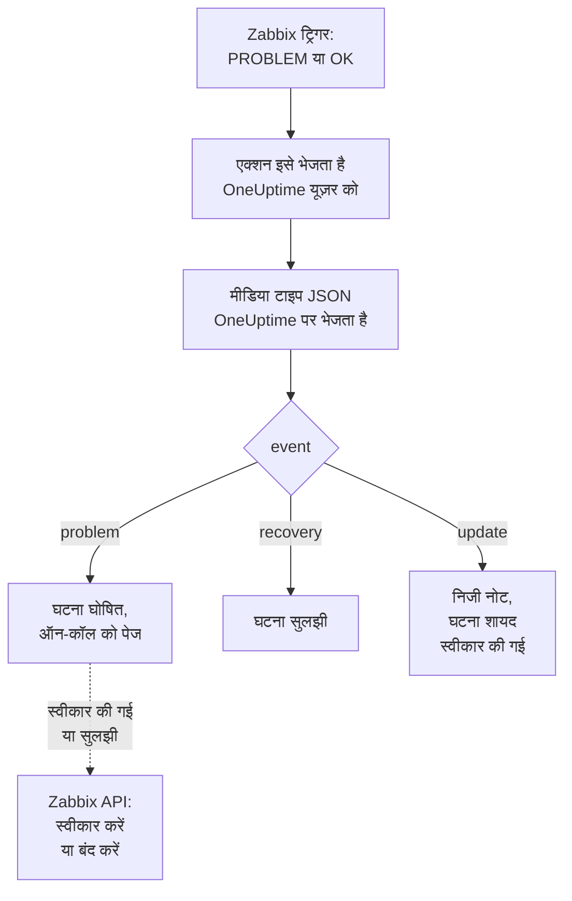

# Zabbix

[Zabbix](https://www.zabbix.com) की समस्याएं OneUptime को भेजें, ताकि हर समस्या एक घटना बने जो आपकी ऑन-कॉल टीम को पेज करे, और Zabbix के ठीक होने पर सुलझ जाए। तैयार वर्कफ़्लो टेम्पलेट दोनों तरफ़ को एक साथ रखते हैं: लोग Zabbix में जो करते हैं वह घटना पर दर्ज होता है, और घटना को स्वीकार करने या सुलझाने से Zabbix में समस्या स्वीकार या बंद हो जाती है। Zabbix हर समस्या को वेबहुक मीडिया टाइप के ज़रिए भेजता है, इसलिए किसी भी तरफ़ कुछ इंस्टॉल नहीं करना पड़ता।

:::cards
- [चुनें कि OneUptime समस्याएं कैसे पाए](#चुनें-कि-oneuptime-समस्याएं-कैसे-पाए): वर्कफ़्लो टेम्पलेट, या एक Incoming Request मॉनिटर।
- [टेम्पलेट से शुरू करें](#टेम्पलेट-से-शुरू-करें): छह टेम्पलेट, वे क्या करते हैं और क्या मांगते हैं।
- [Zabbix कॉन्फ़िगर करें](#zabbix-कॉन्फ़िगर-करें): एक मीडिया टाइप, एक यूज़र और एक एक्शन।
- [समस्या निवारण](#समस्या-निवारण): जब समस्याएं नहीं पहुंचतीं, या घटनाएं खुली रह जाती हैं।
:::

## यह कैसे काम करता है



Zabbix किसी समस्या को एक यूज़र को, उस यूज़र के मीडिया के ज़रिए भेजता है। यहां मीडिया **OneUptime** नाम का एक वेबहुक मीडिया टाइप है: उसकी स्क्रिप्ट हर समस्या के लिए, उसके ठीक होने के लिए, और Zabbix में उस पर किसी के हर अपडेट के लिए OneUptime को एक छोटा JSON दस्तावेज़ भेजती है, जिसमें समस्या का इवेंट ID, नाम, होस्ट और गंभीरता होती है। इवेंट ID से ही OneUptime उस घटना को ढूंढता है जो किसी समस्या ने खोली।

## शुरू करने से पहले

- एक Zabbix सर्वर जिसका एडमिनिस्ट्रेशन आप करते हैं। यह गाइड Zabbix 6.0 LTS और 7.0 LTS के लिए लिखी गई है। वेबहुक मीडिया टाइप Zabbix 5.0 से इसी तरह काम करते हैं। Zabbix के API को कॉल करने वाले टेम्पलेट के लिए Zabbix 6.4 या उसके बाद का वर्शन चाहिए, या [Zabbix 6.0 पर एक बदलाव](#zabbix-60-पर)।
- एक Zabbix सर्वर जो HTTPS पर आपके OneUptime तक पहुंच सके, और Zabbix को कॉल करने वाले टेम्पलेट के लिए, एक OneUptime जो Zabbix तक पहुंच सके।
- OneUptime में वर्कफ़्लो बनाने का अधिकार, या अगर आप वह रास्ता चुनते हैं तो मॉनिटर बनाने का। OneUptime Cloud पर वर्कफ़्लो के लिए **Growth** प्लान या उससे ऊपर का प्लान चाहिए।

## चुनें कि OneUptime समस्याएं कैसे पाए

पहले OneUptime सेट करें: वही आपको वह URL देता है जिस पर Zabbix भेजता है।

| तरीका | कब इस्तेमाल करें |
| --- | --- |
| वर्कफ़्लो टेम्पलेट (सुझाए गए) | आप हर समस्या को उसकी Zabbix गंभीरता पर एक घटना या अलर्ट के रूप में चाहते हैं, High और Disaster के लिए ऑन-कॉल को पेज के साथ, रिकवरी पर सुलझा हुआ, Zabbix में लोग जो करते हैं वह उस पर दर्ज, और OneUptime से Zabbix स्वीकार या बंद। |
| Incoming Request मॉनिटर | आप किसी भी प्लान पर, बिना वर्कफ़्लो के घटनाएं चाहते हैं, और एक मॉनिटर जिसका स्टेटस Zabbix के साथ चले। Zabbix को कुछ वापस नहीं जाता। |

दोनों को एक ही मीडिया टाइप से एक जैसा JSON मिलता है, इसलिए आप एक से शुरू करके बाद में Zabbix में एक URL बदलकर दूसरे पर जा सकते हैं।

## टेम्पलेट से शुरू करें

**एक वर्कफ़्लो बनाएं** डायलॉग में छह Zabbix टेम्पलेट हैं, उसकी कैटेगरी सूची में **Zabbix** के नीचे: तीन घटनाओं के लिए, फिर वही तीन अलर्ट के लिए।

| टेम्पलेट | यह क्या करता है | यह क्या मांगता है |
| --- | --- | --- |
| **घटनाएं** | | |
| Declare an incident for each Zabbix problem | वह वर्कफ़्लो जिसे Zabbix हर इवेंट भेजता है। यह हर समस्या के लिए एक घटना घोषित करता है, High और Disaster के लिए ऑन-कॉल को पेज करता है, Zabbix में किए गए अपडेट दर्ज करता है, और रिकवरी पर घटना सुलझाता है। | Zabbix URL |
| Acknowledge or close the Zabbix problem with the incident | जब घटना स्वीकार की जाती है, तो उसकी समस्या स्वीकार करता है। जब वह सुलझती है, तो समस्या बंद करता है, या जहां Zabbix उसे हाथ से बंद नहीं करने देता वहां उसे स्वीकार करता है। | Zabbix URL, Zabbix API Token |
| Copy incident private notes to the Zabbix problem | घटना के हर निजी नोट को उसकी समस्या में एक संदेश के रूप में जोड़ता है। | Zabbix URL, Zabbix API Token |
| **अलर्ट** | | |
| Create an alert for each Zabbix problem | घटनाओं जैसा ही, हर समस्या के लिए एक अलर्ट के साथ। | Zabbix URL |
| Acknowledge or close the Zabbix problem with the alert | घटनाओं जैसा ही, अलर्ट की स्थिति के आधार पर। | Zabbix URL, Zabbix API Token |
| Copy alert private notes to the Zabbix problem | अलर्ट के हर निजी नोट को उसकी समस्या में एक संदेश के रूप में जोड़ता है। | Zabbix URL, Zabbix API Token |

**Declare an incident for each Zabbix problem** से शुरू करें, या अलर्ट के लिए **Create an alert for each Zabbix problem** से: यह जो घटना या अलर्ट खोलता है वह समस्या का इवेंट ID अपनी कस्टम फ़ील्ड `zabbixEventId` में रखता है, और बाकी दो टेम्पलेट उसी से समस्या ढूंढते हैं।

### टेम्पलेट क्या मांगते हैं

- **Zabbix URL**: वह पता जिस पर आप Zabbix खोलते हैं, जैसे `https://zabbix.example.com`, या `https://example.com/zabbix` जब Zabbix किसी पाथ के नीचे चलता है। किसी समस्या के लिंक वहीं जाते हैं, और Zabbix को कॉल करने वाले टेम्पलेट अपने अनुरोध उसके `api_jsonrpc.php` पर भेजते हैं। यह फ़ील्ड Zabbix के अंदर के किसी पेज का पता नहीं मानती।
- **Zabbix API Token**: उस Zabbix यूज़र का API टोकन जिसके रूप में वर्कफ़्लो काम करता है। [API टोकन बनाएं](#api-टोकन-बनाएं) बताता है कैसे। इसे एक सीक्रेट वैरिएबल के रूप में सहेजा जाता है, और यह सिर्फ़ Zabbix को भेजा जाता है: `Authorization` हेडर में, या Zabbix 6.0 पर अनुरोध की बॉडी में।

### टेम्पलेट से समस्याएं पाएं

:::steps
1. **वर्कफ़्लो** पर जाएं और **वर्कफ़्लो बनाएं** पर क्लिक करें। **या किसी टेम्पलेट से शुरू करें** के नीचे कैटेगरी सूची में **Zabbix** चुनें, **Declare an incident for each Zabbix problem** पर क्लिक करें, और **यह टेम्पलेट इस्तेमाल करें** पर क्लिक करें।
2. **Zabbix URL** भरें। **Who to page for High and Disaster problems** के अंतर्गत पेज की जाने वाली ऑन-कॉल नीतियाँ चुनें, या किसी को पेज न करने के लिए कोई नहीं, और **वर्कफ़्लो बनाएं** पर क्लिक करें। वर्कफ़्लो **बिल्डर** में बंद हालत में खुलता है।
3. **Webhook** ट्रिगर पर क्लिक करें, फिर **URL कॉपी करें** पर, और URL को Zabbix के लिए रख लें।
4. **बिल्डर** के ऊपर **सक्षम** चालू करें। बंद वर्कफ़्लो Zabbix को `400` से जवाब देता है।
:::

फिर [Zabbix कॉन्फ़िगर करें](#zabbix-कॉन्फ़िगर-करें) ताकि वह अपनी समस्याएं उस URL पर भेजे।

### वर्कफ़्लो क्या करता है

**Webhook** ट्रिगर के बाद, `read-event-1` **Check With JavaScript** चरण मीडिया टाइप के भेजे `event` को पढ़ता है, और **Incident From Another Tool**, या अलर्ट टेम्पलेट में **Alert From Another Tool**, समस्या की इवेंट ID के ज़रिए वही करता है जो उसका मतलब है:

| इवेंट | वर्कफ़्लो क्या करता है |
| --- | --- |
| `problem` | `Zabbix: <problem> on <host>` शीर्षक वाली एक घटना घोषित करता है, उस गंभीरता पर जिससे Zabbix की गंभीरता मैप होती है, आपके स्टेटस पेजों से बाहर रखी गई। उसका विवरण Zabbix में समस्या का लिंक देता है, और होस्ट, गंभीरता, यह कब शुरू हुई, उसका ऑपरेशनल डेटा और उसके टैग दिखाता है। High या Disaster समस्या के लिए, यह आपकी चुनी हुई ऑन-कॉल नीति को पेज करता है। Zabbix जो समस्या उसी इवेंट ID के साथ दोबारा भेजता है, वह दूसरी घटना नहीं खोलती। |
| `recovery` | समस्या की घटना सुलझाता है, जब तक वह पहले से सुलझी न हो। वजह उसकी टाइमलाइन पर होती है। |
| `update` | Zabbix में जो किया गया उसे घटना में निजी नोट के रूप में जोड़ता है: किसने किया, क्या किया, और क्या लिखा। जब अपडेट ने समस्या स्वीकार की, तो यह घटना भी स्वीकार करता है, जिससे ऑन-कॉल उसे एस्केलेट करना बंद कर देता है। |

बाकी सब कुछ, जैसे किसी दूसरे टूल का अनुरोध, जैसा है वैसा छोड़ दिया जाता है: `read-event-1` **No** लेता है, और रन के **चरण** बताते हैं क्यों। जो चरण विफल होता है वह रन को विफल कर देता है, और **चरण** में उसकी प्रविष्टि बताती है क्यों।

### गंभीरताएं

नए प्रोजेक्ट में, टेम्पलेट Zabbix की छह गंभीरताओं को इन घटना और अलर्ट गंभीरताओं पर मैप करता है:

| Zabbix गंभीरता | घटना | अलर्ट | ऑन-कॉल |
| --- | --- | --- | --- |
| Disaster | Critical Incident | High | पेज किया गया |
| High | Critical Incident | High | पेज किया गया |
| Average | Major Incident | Low | पेज नहीं किया गया |
| Warning | Major Incident | Low | पेज नहीं किया गया |
| Information | Minor Incident | Low | पेज नहीं किया गया |
| Not classified | Minor Incident | Low | पेज नहीं किया गया |

अपनी गंभीरताओं के साथ, Disaster और High आपकी सबसे गंभीर पर जाती हैं, Average और Warning बीच वाली पर, और Information और Not classified आपकी सबसे कम गंभीर पर। Zabbix अपनी गंभीरताओं को 0 (Not classified) से 5 (Disaster) तक नंबर देता है, और टेम्पलेट नंबर पढ़ता है, इसलिए Zabbix में किसी गंभीरता का नाम बदलने से कुछ नहीं बदलता।

- किसी गंभीरता को नाम से अपनी किसी गंभीरता पर मैप करने के लिए, `SEVERITY_BY_NAME` को `read-event-1` चरण में संपादित करें, जैसे Warning के लिए `{ 2: 'Minor Incident' }`।
- Average समस्याओं के लिए भी पेज करने हेतु, `if-page-1` **If / Else** चरण का **Compare with** `3` पर सेट करें।

### स्वीकृतियां और नोट Zabbix को वापस भेजें

:::steps
1. [API टोकन बनाएं](#api-टोकन-बनाएं)।
2. **Acknowledge or close the Zabbix problem with the incident** से एक वर्कफ़्लो बनाएं। **Zabbix URL** और **Zabbix API Token** भरें, **वर्कफ़्लो बनाएं** पर क्लिक करें, और **सक्षम** चालू करें।
3. अगर आप नोट भी Zabbix में चाहते हैं, तो **Copy incident private notes to the Zabbix problem** के साथ भी यही करें।
:::

स्थिति वाला टेम्पलेट पहले Zabbix से समस्या के बारे में पूछता है, इसलिए जिस समस्या को Zabbix पहले ही स्वीकार कर चुका है या सुलझा चुका है, उसे जैसा है वैसा छोड़ दिया जाता है। किसी समस्या को बंद करने के लिए, Zabbix में उसके ट्रिगर पर **Allow manual close** होना चाहिए। उसके बिना, समस्या बंद होने के बजाय स्वीकार की जाती है, एक संदेश के साथ कि घटना सुलझ गई, और Zabbix उसके ठीक होने पर उसे बंद करता है। जिन घटनाओं को किसी Zabbix समस्या ने नहीं खोला, और **निजी घटना** के रूप में चिह्नित घटनाएं, कभी Zabbix को नहीं भेजी जातीं।

### API टोकन बनाएं

:::steps
1. उस `OneUptime` यूज़र का इस्तेमाल करें जो [समस्याएं पाता है](#समस्याएं-पाने-वाला-यूज़र-बनाएं)। Zabbix किसी यूज़र को उसके अपने अपडेट नहीं भेजता, इसलिए इस यूज़र के टोकन के साथ, OneUptime की स्वीकृतियां और संदेश कभी अपडेट के रूप में OneUptime पर वापस नहीं आते।
2. **Users → User roles** में यूज़र की भूमिका जांचें। उसमें **Access to API** चालू होना चाहिए, और **Acknowledge problems**, **Add problem comments** और **Close problems** की अनुमति होनी चाहिए। **User role** इनकी अनुमति देती है, जब तक किसी ने उसे बदला न हो।
3. **Users → User groups** में यूज़र का समूह जांचें। समस्याएं स्वीकार करने और संदेश जोड़ने के लिए होस्ट समूहों पर **Read** अनुमति काफ़ी है। समस्याएं बंद करने के लिए, उसे **Read-write** चाहिए।
4. **Users → API tokens** पर जाएं और **Create API token** पर क्लिक करें। `OneUptime` यूज़र चुनें, **Set expiration date and time** से टिक हटाएं या तारीख़ नोट करें, और **Add** पर क्लिक करें।
5. **Auth token** कॉपी करें: Zabbix इसे सिर्फ़ एक बार दिखाता है। इसे **Zabbix API Token** में पेस्ट करें।
:::

### Zabbix 6.0 पर

Zabbix 6.0 API टोकन को अनुरोध की बॉडी से पढ़ता है, उसके `Authorization` हेडर से नहीं। Zabbix को कॉल करने वाले हर टेम्पलेट के **Update Zabbix Problem** चरण में, **और फ़ील्ड** के अंतर्गत **Zabbix 6.0** चालू करें। Zabbix 7.2 और उसके बाद के वर्शन बॉडी में टोकन को अस्वीकार करते हैं, इसलिए अपग्रेड करने पर इसे फिर से बंद कर दें।

## मॉनिटर से समस्याएं पाएं

एक [Incoming Request मॉनिटर](/docs/monitor/incoming-request-monitor) आपको एक URL देता है, और उसके मानदंड तय करते हैं कि हर अनुरोध क्या करे।

:::steps
### मॉनिटर बनाएं

**मॉनिटर** पर जाएं और **मॉनिटर बनाएं** पर क्लिक करें। **मॉनिटर प्रकार** में **Incoming Request** चुनें, इसका नाम `Zabbix` रखें, और **अगला** पर क्लिक करें।

### हर समस्या के लिए घटना घोषित करें

**मानदंड** चरण में पहला मानदंड खोलें, वह जो मॉनिटर को ऑफ़लाइन चिह्नित करता है। उसका फ़िल्टर **अनुरोध बॉडी**, **शामिल है**, `"status":"1"` पर सेट करें। फ़िल्टर मेल खाने पर यह मानदंड पहले से ही घटना घोषित करता है। घटना भरें:

- **घटना शीर्षक**: `Zabbix: {{requestBody.name}} on {{requestBody.host}}`।
- **गंभीरता**: वह घटना गंभीरता जो Zabbix समस्याओं की होनी चाहिए।
- **ऑन-कॉल** के नीचे **ऑन-कॉल नीतियां**: पेज की जाने वाली नीतियां।
- **और फ़ील्ड** के नीचे **घटना स्वतः सुलझाएं**: इसे चालू रहने दें, जैसा यह शुरू में होता है। इसके बिना रिकवरी को अनदेखा किया जाता है और घटनाएं खुली रहती हैं।

### हर समस्या पर एक घटना खोलें

उसी मानदंड में **सेटिंग्स** खोलें और **Group incidents and alerts by a payload field** चालू करें। इसे नीचे की तरह भरें, ताकि हर समस्या की अपनी घटना हो, और उसकी रिकवरी उसे सुलझाए:

| फ़ील्ड | मान |
| --- | --- |
| **Open a separate incident for each…** | `requestBody.event_id` |
| **Field that signals recovery** | `requestBody.status` |
| **Value that means recovered** | `0` |

### मॉनिटर को वापस ऑनलाइन लाएं

दूसरा मानदंड खोलें, वह जो मॉनिटर को ऑनलाइन चिह्नित करता है, और उसका फ़िल्टर **अनुरोध बॉडी**, **शामिल है**, `"status":"0"` पर सेट करें।

### URL कॉपी करें

**मॉनिटर बनाएं** पर क्लिक करें। मॉनिटर का **अवलोकन** पेज उसका **Heartbeat URL** दिखाता है। उसे Zabbix के लिए कॉपी करें:

```text
https://oneuptime.com/heartbeat/<secret key>
```

सेल्फ़-होस्टेड इंस्टॉलेशन में `oneuptime.com` की जगह उसका अपना होस्ट होता है।
:::

मॉनिटर अनुरोध के JSON को जैसा लिखा है वैसा ही पढ़ता है: `"status":"1"`, बिना स्पेस के। हर सेटिंग क्या करती है, यह जानने के लिए [दूसरे सिस्टम से अलर्ट पाना](/docs/monitor/incoming-request-monitor#किसी-दूसरे-सिस्टम-से-अलर्ट-प्राप्त-करना) देखें। Zabbix में किया गया अपडेट भी `"status":"1"` के साथ भेजा जाता है, जिसे मॉनिटर फिर से समस्या के रूप में पढ़ता है, और दूसरी घटना नहीं खोलता।

## Zabbix कॉन्फ़िगर करें

Zabbix को तीन चीज़ें चाहिए: OneUptime पर भेजने वाला एक मीडिया टाइप, जिसे भेजना है वह यूज़र, और एक एक्शन जो समस्याएं उस यूज़र को भेजे।

:::steps
### OneUptime मीडिया टाइप बनाएं

1. **Alerts → Media types** पर जाएं, या Zabbix 6.0 पर **Administration → Media types** पर, और **Create media type** पर क्लिक करें।
2. **Name** को `OneUptime` और **Type** को **Webhook** पर सेट करें।
3. ये **Parameters** जोड़ें। हर एक किसी Zabbix [मैक्रो](https://www.zabbix.com/documentation/current/en/manual/appendix/macros/supported_by_location) को अनुरोध में डालता है:

   | नाम | मान |
   | --- | --- |
   | `url` | `{ALERT.SENDTO}` |
   | `event_id` | `{EVENT.ID}` |
   | `event_name` | `{EVENT.NAME}` |
   | `event_value` | `{EVENT.VALUE}` |
   | `event_severity` | `{EVENT.SEVERITY}` |
   | `event_nseverity` | `{EVENT.NSEVERITY}` |
   | `host` | `{HOST.NAME}` |
   | `event_date` | `{EVENT.DATE}` |
   | `event_time` | `{EVENT.TIME}` |
   | `event_opdata` | `{EVENT.OPDATA}` |
   | `event_tags` | `{EVENT.TAGSJSON}` |
   | `trigger_id` | `{TRIGGER.ID}` |
   | `event_update_status` | `{EVENT.UPDATE.STATUS}` |
   | `event_update_action` | `{EVENT.UPDATE.ACTION}` |
   | `event_update_message` | `{EVENT.UPDATE.MESSAGE}` |
   | `event_update_user` | `{USER.FULLNAME}` |

4. इसे **Script** में पेस्ट करें:

   ```javascript
   var params = JSON.parse(value);

   // Zabbix leaves a macro it has no value for as it is written, such as
   // {EVENT.UPDATE.MESSAGE} on a problem: it is sent as nothing.
   function given(text) {
     var written = String(text === undefined || text === null ? "" : text);
     return /^\{[A-Z0-9_.]+\}$/.test(written) || written === "*UNKNOWN*"
       ? ""
       : written;
   }

   var isUpdate = given(params.event_update_status) === "1";
   var payload = {
     source: "zabbix",
     // "problem", "recovery" or "update".
     event: isUpdate
       ? "update"
       : params.event_value === "0"
         ? "recovery"
         : "problem",
     event_id: params.event_id,
     name: params.event_name,
     host: params.host,
     severity: params.event_severity,
     // 0 Not classified, 1 Information, 2 Warning, 3 Average, 4 High, 5 Disaster.
     severity_number: params.event_nseverity,
     // "1" for a problem, "0" for its recovery.
     status: params.event_value,
     date: params.event_date,
     time: params.event_time,
     opdata: given(params.event_opdata),
     tags: [],
     trigger_id: params.trigger_id,
   };

   try {
     var tags = JSON.parse(given(params.event_tags) || "[]");
     payload.tags = Array.isArray(tags) ? tags : [];
   } catch (error) {
     payload.tags = [];
   }

   if (isUpdate) {
     payload.update = {
       action: given(params.event_update_action),
       message: given(params.event_update_message),
       user: given(params.event_update_user),
     };
   }

   var request = new HttpRequest();
   request.addHeader("Content-Type: application/json");

   var response = request.post(params.url, JSON.stringify(payload));

   if (request.getStatus() < 200 || request.getStatus() >= 300) {
     throw (
       "OneUptime responded with HTTP " + request.getStatus() + ": " + response
     );
   }

   return "OK";
   ```

5. **Message templates** टैब पर **Problem** के लिए एक टेम्पलेट, **Problem recovery** के लिए एक और **Problem update** के लिए एक टेम्पलेट जोड़ें। उनका टेक्स्ट खाली छोड़ें: अनुरोध स्क्रिप्ट बनाती है। Zabbix किसी मीडिया टाइप का इस्तेमाल सिर्फ़ उन्हीं तरह के इवेंट के लिए करता है जिनका उसके पास टेम्पलेट है।
6. **Add** पर क्लिक करें।

### समस्याएं पाने वाला यूज़र बनाएं

1. **Users → Users** पर जाएं, या Zabbix 6.0 पर **Administration → Users** पर, और **Create user** पर क्लिक करें। इसका नाम `OneUptime` रखें, और इसे एक यूज़र ग्रुप और ऐसी भूमिका दें जो सूचनाएं पा सके, जैसे **User role**।
2. **Media** टैब पर **Add** पर क्लिक करें। **Type** को `OneUptime` पर, और **Send to** को OneUptime से कॉपी किए गए URL पर सेट करें। **When active** और गंभीरताओं को जैसा है वैसा छोड़ दें, या उन गंभीरताओं से टिक हटा दें जो OneUptime को नहीं मिलनी चाहिए।
3. **Add** पर क्लिक करें, फिर यूज़र सहेजने के लिए दोबारा **Add** पर।

### एक्शन से समस्याएं OneUptime को भेजें

1. **Alerts → Actions → Trigger actions** पर जाएं, या Zabbix 6.0 पर **Configuration → Actions** पर, और **Create action** पर क्लिक करें। इसका नाम `Notify OneUptime` रखें।
2. चाहें तो **Conditions** में इसे सीमित करें, जैसे **Trigger severity is greater than or equals Warning**। बिना शर्तों के हर समस्या भेजी जाती है।
3. **Operations** टैब पर एक ऑपरेशन जोड़ें जो `OneUptime` मीडिया टाइप के ज़रिए `OneUptime` यूज़र को भेजे।
4. वही ऑपरेशन **Recovery operations** में भी जोड़ें, ताकि रिकवरी भी भेजी जाए, और **Update operations** में भी, ताकि Zabbix में की गई स्वीकृतियां और टिप्पणियां भेजी जाएं।
5. **Add** पर क्लिक करें, और जांचें कि एक्शन चालू है।
:::

कुछ समस्याएं घटना टेम्पलेट को और बाकी अलर्ट टेम्पलेट को भेजने के लिए, `OneUptime` यूज़र को `OneUptime` टाइप के दो मीडिया दें: हर एक किसी एक वर्कफ़्लो के URL पर भेजता है, उन गंभीरताओं के साथ जो उसे मिलनी चाहिए।

## इसे टेस्ट करें

1. Zabbix में **Alerts → Media types** खोलें और `OneUptime` के पास **Test** पर क्लिक करें। कॉपी किया गया URL भरें, और नमूना मान, जैसे `event_id` `12345`, `event_name` `Test problem`, `host` `web-1`, `event_nseverity` `4` और `event_value` `1`। **Test** पर क्लिक करें: Zabbix स्क्रिप्ट का जवाब `OK`, या उसकी फेंकी गई त्रुटि दिखाता है।
2. OneUptime में वर्कफ़्लो का **लॉग → रन** खोलें और रन जांचें, या मॉनिटर खोलें और जांचें कि घटना खुली।
3. `event_value` `0` और उसी `event_id` के साथ दोबारा टेस्ट करें। घटना सुलझ जाती है।

फिर किसी असली ट्रिगर को चलने दें, जैसे थोड़ी देर के लिए कोई थ्रेशोल्ड कम करके, और समस्या को आते देखें। अपडेट आज़माने के लिए, Zabbix में समस्या को एक संदेश के साथ स्वीकार करें: घटना को एक निजी नोट मिलता है, और वह स्वीकार हो जाती है।

## Zabbix गंभीरताओं को मैप करें

Zabbix अपनी गंभीरता टेक्स्ट के रूप में भेजता है: `Not classified`, `Information`, `Warning`, `Average`, `High` या `Disaster`।

- **टेम्पलेट के साथ**, गंभीरताएं आपके लिए मैप होती हैं: [गंभीरताएं](#गंभीरताएं) देखें।
- **मॉनिटर के साथ**, गंभीरताओं के हर समूह के लिए **मानदंड जोड़ें** पर क्लिक करें, और नए मानदंड को पहले वाले के ऊपर खींचें: मानदंड ऊपर से जांचे जाते हैं, और जो पहले मेल खाता है वही तय करता है। हर एक को दो फ़िल्टर दें, `"status":"1"` और एक गंभीरता जैसे `"severity":"Disaster"`, और **मिलान शर्त** को **सभी** पर रखें। हर एक को एक घटना दें जिसकी अपनी **गंभीरता** और **घटना स्वतः सुलझाएं** हो, और वही ग्रुपिंग सेटिंग।

## समस्या निवारण

:::details OneUptime में कुछ नहीं पहुंचता
- Zabbix में **Reports → Action log** खोलें और जांचें कि एक्शन ने समस्या भेजी या नहीं, और क्या वापस आया।
- Zabbix सर्वर से खुद एक अनुरोध भेजें: `curl -i -X POST <url> -H 'Content-Type: application/json' -d '{"source":"zabbix","event":"problem","event_id":"1","name":"Test","host":"test","severity_number":"4","status":"1"}'`।
- मॉनिटर कुछ भी जांचने से पहले तुरंत `200` से जवाब देता है, गलत सीक्रेट कुंजी होने पर भी। अनुरोध पहुंच रहे हैं या नहीं, यह मॉनिटर की टाइमलाइन में देखें।
- बंद वर्कफ़्लो `400` से जवाब देता है। उसके **बिल्डर** के ऊपर **सक्षम** चालू करें।
:::

:::details Zabbix स्क्रिप्ट त्रुटि बताता है
मीडिया टाइप खोलें और **Test** इस्तेमाल करें: Zabbix स्क्रिप्ट का नतीजा या उसकी फेंकी गई त्रुटि दिखाता है। OneUptime से `2xx` के अलावा कोई भी जवाब स्क्रिप्ट उसके स्टेटस के साथ फेंक देती है, इसलिए पहले URL जांचें।
:::

:::details घटनाएं खुलती हैं पर कभी सुलझती नहीं
- एक्शन में **Recovery operations** होने चाहिए, वरना Zabbix कभी रिकवरी नहीं भेजता।
- टेम्पलेट के साथ, वर्कफ़्लो का **लॉग → रन** और रिकवरी का रन खोलें: उसका आख़िरी चरण बताता है क्यों। किसी ऐसी समस्या की रिकवरी, जिसने कोई घटना नहीं खोली, कुछ नहीं बदलती।
- मॉनिटर के साथ, मानदंड की घटना में **और फ़ील्ड** के नीचे **घटना स्वतः सुलझाएं** होना चाहिए। **Field that signals recovery** ठीक `requestBody.status` होना चाहिए, और **Value that means recovered** ठीक `0`।
:::

:::details Zabbix में समस्या स्वीकार या बंद नहीं होती
**लॉग → रन** में स्थिति वाले टेम्पलेट का रन खोलें: उसका आख़िरी चरण बताता है कि Zabbix ने क्या जवाब दिया।

- `Not authorized`: API टोकन ग़लत है, एक्सपायर हो गया है या बंद है, या Zabbix 6.4 से पुराना है ([Zabbix 6.0 पर](#zabbix-60-पर) देखें)।
- `Cannot close problem: trigger does not allow manual closing`: ट्रिगर पर **Allow manual close** चालू करें। टेम्पलेट ऐसी समस्याओं को बंद करने के बजाय पहले से ही स्वीकार करता है।
- `No permissions to referred object or it does not exist!`: यूज़र समस्या देख सकता है, पर उसे बंद करने के लिए **Read-write** अनुमति चाहिए।
- `Zabbix has no problem with event ID`: यूज़र समस्या का होस्ट नहीं देख सकता। उसके यूज़र समूह को होस्ट समूह पर **Read** अनुमति दें।
:::

:::details घटना में मान की जगह रेफ़रेंस दिखता है
जो फ़ील्ड अनुरोध में नहीं है, उसका रेफ़रेंस खाली करने के बजाय कोष्ठकों समेत जैसा लिखा है वैसा ही छोड़ दिया जाता है। जांचें कि Zabbix `Content-Type: application/json` भेजता है, और आपके इस्तेमाल किए फ़ील्ड नाम (`name`, `host`, `severity`, `status`, `event_id`) स्क्रिप्ट के पेलोड से मेल खाते हैं। वर्कफ़्लो के लिए **लॉग → रन** में रन खोलें और उसकी तुलना ट्रिगर को मिली चीज़ से करें। [सावधानियां](/docs/workflows/variables#फँसाने-वाली-बातें) देखें।
:::

:::details हर समस्या दो बार आती है
एक्शन में शायद दो ऑपरेशन हैं जो एक ही यूज़र को भेजते हैं, जैसे पहला चरण और एक एस्केलेशन चरण। टेम्पलेट हर इवेंट ID पर एक ही घटना खोलता है, चाहे जो भी आए, पर हर डिलीवरी एक रन है। एक्शन के **Operations** जांचें।
:::

## सुरक्षा

- **URL को पासवर्ड की तरह रखें।** जिसके पास भी यह है, वह घटनाएं खोल सकता है। अगर यह लीक हो जाए, तो इसे रीसेट करें: वर्कफ़्लो के **Webhook** ट्रिगर में **URL रीसेट करें**, या मॉनिटर के **सेटिंग्स** पेज पर **इनकमिंग अनुरोध सीक्रेट कुंजी रीसेट करें**। फिर Zabbix यूज़र के मीडिया में **Send to** अपडेट करें।
- **लिंक आपके Zabbix पर जाते हैं।** टेम्पलेट किसी समस्या का लिंक उसी साइट पर देता है जिसका नाम उसका **Zabbix URL** लेता है, अनुरोध चाहे जो कहे, और Zabbix ने जो भेजा उसे टेक्स्ट के रूप में लिखता है।
- **API टोकन को वर्कफ़्लो के काम तक सीमित रखें।** यह एक सीक्रेट वैरिएबल है, रन लॉग में छिपाया जाता है, और सिर्फ़ Zabbix को भेजा जाता है, `Authorization` हेडर में, जब तक **Zabbix 6.0** चालू न हो। उसके यूज़र को ऐसी भूमिका दें जिसमें ऊपर की कार्रवाइयों से ज़्यादा कुछ न हो, और अगर टोकन लीक हो जाए तो उसे **Users → API tokens** में हटा दें।
- **सिर्फ़ वही भेजें जिसे घटना चाहिए।** कम गंभीरता वाली समस्याओं को Zabbix में रखने के लिए एक्शन की शर्तें, या यूज़र के मीडिया की गंभीरताएं इस्तेमाल करें।
- **सेल्फ़-होस्टेड?** अपने Zabbix सर्वर को अपने फ़ायरवॉल से होकर HTTPS पर अपने OneUptime तक पहुंचने दें। किसी निजी नेटवर्क पर Zabbix को कॉल करने के लिए, वर्कफ़्लो को [आउटबाउंड नेटवर्क एक्सेस](/docs/workflows/configuration#बाहर-जाने-वाली-नेटवर्क-पहुँच) चाहिए।

## अगले कदम

:::cards
- [वर्कफ़्लो टेम्पलेट](/docs/workflows/authoring): किसी टेम्पलेट से वर्कफ़्लो बनाएं, और उसे बिल्डर में बदलें।
- [आने वाले अनुरोध मॉनिटर](/docs/monitor/incoming-request-monitor): Zabbix समस्याएं पाने वाले मॉनिटर की हर सेटिंग।
- [एस्केलेशन नियम](/docs/on-call/escalation-rules): तय करें कि ऑन-कॉल नीति किसे और कब पेज करे।
- [इंटिग्रेशन अवलोकन](/docs/integrations/index): वे दूसरे टूल जिन्हें आप जोड़ सकते हैं।
:::
