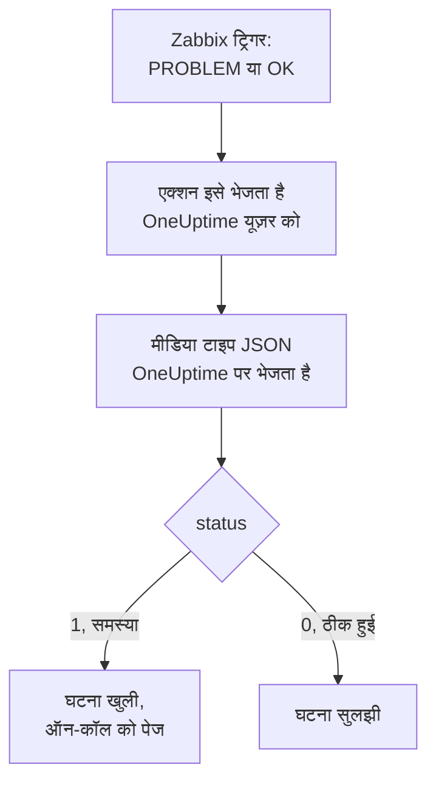

# Zabbix

[Zabbix](https://www.zabbix.com) की समस्याएं OneUptime को भेजें, ताकि हर समस्या एक घटना बने जो आपकी ऑन-कॉल टीम को पेज करे, और Zabbix के ठीक होने पर सुलझ जाए। Zabbix हर समस्या को वेबहुक मीडिया टाइप के ज़रिए भेजता है, इसलिए किसी भी तरफ़ कुछ इंस्टॉल नहीं करना पड़ता।

:::cards
- [चुनें कि OneUptime समस्याएं कैसे पाए](#चुनें-कि-oneuptime-समस्याएं-कैसे-पाए): एक Incoming Request मॉनिटर, या आपका अपना वर्कफ़्लो।
- [मॉनिटर से समस्याएं पाएं](#मॉनिटर-से-समस्याएं-पाएं): हर समस्या पर एक घटना, जो ठीक होने पर सुलझ जाती है।
- [Zabbix कॉन्फ़िगर करें](#zabbix-कॉन्फ़िगर-करें): एक मीडिया टाइप, एक यूज़र और एक एक्शन।
- [समस्या निवारण](#समस्या-निवारण): जब समस्याएं नहीं पहुंचतीं, या घटनाएं खुली रह जाती हैं।
:::

## यह कैसे काम करता है



Zabbix किसी समस्या को एक यूज़र को, उस यूज़र के मीडिया के ज़रिए भेजता है। यहां मीडिया **OneUptime** नाम का एक वेबहुक मीडिया टाइप है: उसकी स्क्रिप्ट OneUptime को एक छोटा JSON दस्तावेज़ भेजती है, जिसमें समस्या का इवेंट ID, नाम, होस्ट, गंभीरता और स्टेटस होता है। समस्या के लिए स्टेटस `1` होता है और उसके ठीक होने पर `0`।

## शुरू करने से पहले

- एक Zabbix सर्वर जिसका एडमिनिस्ट्रेशन आप करते हैं। यह गाइड Zabbix 6.0 LTS और 7.0 LTS के लिए लिखी गई है। वेबहुक मीडिया टाइप Zabbix 5.0 से इसी तरह काम करते हैं।
- एक Zabbix सर्वर जो HTTPS पर आपके OneUptime तक पहुंच सके।
- OneUptime में मॉनिटर बनाने का अधिकार, या अगर आप वह रास्ता चुनते हैं तो वर्कफ़्लो बनाने का।

## चुनें कि OneUptime समस्याएं कैसे पाए

पहले OneUptime सेट करें: वही आपको वह URL देता है जिस पर Zabbix भेजता है।

| तरीका | कब इस्तेमाल करें |
| --- | --- |
| Incoming Request मॉनिटर (सुझाया गया) | आप चाहते हैं कि हर Zabbix समस्या एक घटना बने जो ऑन-कॉल को पेज करे, और Zabbix के ठीक होने पर सुलझ जाए। बनाने को कुछ नहीं है। |
| Webhook ट्रिगर वाला वर्कफ़्लो | आपको अपना लॉजिक चाहिए: समस्याओं को फ़िल्टर करना, उनका रूप बदलना, या पहले दूसरे सिस्टम को कॉल करना। वर्कफ़्लो ठीक होने पर घटना को अपने-आप नहीं सुलझाता। |

दोनों को एक ही मीडिया टाइप से एक जैसा JSON मिलता है, इसलिए आप एक से शुरू करके बाद में Zabbix में एक URL बदलकर दूसरे पर जा सकते हैं।

## मॉनिटर से समस्याएं पाएं

एक [Incoming Request मॉनिटर](/docs/monitor/incoming-request-monitor) आपको एक URL देता है, और उसके मानदंड तय करते हैं कि हर अनुरोध क्या करे।

:::steps
### मॉनिटर बनाएं

**मॉनिटर** पर जाएं और **मॉनिटर बनाएं** पर क्लिक करें। **मॉनिटर प्रकार** में **Incoming Request** चुनें, इसका नाम `Zabbix` रखें, और **अगला** पर क्लिक करें।

### हर समस्या के लिए घटना घोषित करें

**मानदंड** चरण में पहला मानदंड खोलें, वह जो मॉनिटर को ऑफ़लाइन चिह्नित करता है। उसका फ़िल्टर **अनुरोध बॉडी**, **शामिल है**, `"status":"1"` पर सेट करें। फ़िल्टर मेल खाने पर यह मानदंड पहले से ही घटना घोषित करता है। घटना भरें:

- **घटना शीर्षक**: `Zabbix: {{requestBody.name}} on {{requestBody.host}}`।
- **गंभीरता**: वह घटना गंभीरता जो Zabbix समस्याओं की होनी चाहिए।
- **ऑन-कॉल** के नीचे **ऑन-कॉल नीतियां**: पेज की जाने वाली नीतियां।
- **और फ़ील्ड** के नीचे **घटना स्वतः सुलझाएं**: इसे चालू रहने दें, जैसा यह शुरू में होता है। इसके बिना रिकवरी को अनदेखा किया जाता है और घटनाएं खुली रहती हैं।

### हर समस्या पर एक घटना खोलें

उसी मानदंड में **सेटिंग्स** खोलें और **Group incidents and alerts by a payload field** चालू करें। इसे नीचे की तरह भरें, ताकि हर समस्या की अपनी घटना हो, और उसकी रिकवरी उसे सुलझाए:

| फ़ील्ड | मान |
| --- | --- |
| **Open a separate incident for each…** | `requestBody.event_id` |
| **Field that signals recovery** | `requestBody.status` |
| **Value that means recovered** | `0` |

### मॉनिटर को वापस ऑनलाइन लाएं

दूसरा मानदंड खोलें, वह जो मॉनिटर को ऑनलाइन चिह्नित करता है, और उसका फ़िल्टर **अनुरोध बॉडी**, **शामिल है**, `"status":"0"` पर सेट करें।

### URL कॉपी करें

**मॉनिटर बनाएं** पर क्लिक करें। मॉनिटर का **अवलोकन** पेज उसका **Heartbeat URL** दिखाता है। उसे Zabbix के लिए कॉपी करें:

```text
https://oneuptime.com/heartbeat/<secret key>
```

सेल्फ़-होस्टेड इंस्टॉलेशन में `oneuptime.com` की जगह उसका अपना होस्ट होता है।
:::

मॉनिटर अनुरोध के JSON को जैसा लिखा है वैसा ही पढ़ता है: `"status":"1"`, बिना स्पेस के। हर सेटिंग क्या करती है, यह जानने के लिए [दूसरे सिस्टम से अलर्ट पाना](/docs/monitor/incoming-request-monitor#किसी-दूसरे-सिस्टम-से-अलर्ट-प्राप्त-करना) देखें।

## वर्कफ़्लो से समस्याएं पाएं

जब आपको Zabbix और घटना के बीच अपने चरण चाहिए, तब [वर्कफ़्लो](/docs/workflows/index) इस्तेमाल करें।

:::steps
### वर्कफ़्लो बनाएं

**वर्कफ़्लो** पर जाएं, **वर्कफ़्लो बनाएं** पर क्लिक करें, फिर **शुरू से बनाएं** पर। इसका नाम `Zabbix problems` रखें और **वर्कफ़्लो बनाएं** पर क्लिक करें।

### Webhook ट्रिगर जोड़ें

डैश वाले **Choose what starts this workflow** ब्लॉक पर क्लिक करें और **Webhook** चुनें। ट्रिगर पर क्लिक करें, फिर **URL कॉपी करें** पर, और URL को Zabbix के लिए रख लें।

### जांचें कि यह समस्या है

**घटक जोड़ें** पर क्लिक करें, एक **If / Else** ब्लॉक जोड़ें, और ट्रिगर के **Out** बिंदु को उससे जोड़ें। **Value to check** को `{{local.components.webhook-1.returnValues.request-body.status}}` पर, **Comparison** को **is equal to** पर, और **Compare with** को `1` पर सेट करें।

### घटना घोषित करें

एक **Create One Incident** ब्लॉक जोड़ें, और **If / Else** ब्लॉक की **Yes** साइड को उससे जोड़ें। **Incident Template** में ऐसा टेम्पलेट चुनें जो गंभीरता और पेज की जाने वाली ऑन-कॉल नीतियां सेट करता हो ([घटना टेम्पलेट](/docs/incidents/settings#घटना-टेम्पलेट) देखें)। **JSON Object** में वह सेट करें जो Zabbix से आता है:

```json
{
  "title": "Zabbix: {{local.components.webhook-1.returnValues.request-body.name}}",
  "description": "Host: {{local.components.webhook-1.returnValues.request-body.host}}\nSeverity: {{local.components.webhook-1.returnValues.request-body.severity}}\nZabbix event: {{local.components.webhook-1.returnValues.request-body.event_id}}"
}
```

बिना टेम्पलेट के, **JSON Object** में `incidentSeverityId` भी चाहिए, जो प्रोजेक्ट की किसी घटना गंभीरता का ID है।

### इसे चालू करें

**बिल्डर** के ऊपर **सक्षम** चालू करें। बंद वर्कफ़्लो Zabbix को `400` से जवाब देता है।
:::

रिकवरी **If / Else** ब्लॉक की **No** साइड पर जाती है, जहां कुछ नहीं जुड़ा है, इसलिए रन वहीं खत्म हो जाता है। रिकवरी पर घटनाएं सुलझाने के लिए मॉनिटर इस्तेमाल करें।

## Zabbix कॉन्फ़िगर करें

Zabbix को तीन चीज़ें चाहिए: OneUptime पर भेजने वाला एक मीडिया टाइप, जिसे भेजना है वह यूज़र, और एक एक्शन जो समस्याएं उस यूज़र को भेजे।

:::steps
### OneUptime मीडिया टाइप बनाएं

1. **Alerts → Media types** पर जाएं, या Zabbix 6.0 पर **Administration → Media types** पर, और **Create media type** पर क्लिक करें।
2. **Name** को `OneUptime` और **Type** को **Webhook** पर सेट करें।
3. ये **Parameters** जोड़ें। हर एक किसी Zabbix [मैक्रो](https://www.zabbix.com/documentation/current/en/manual/appendix/macros/supported_by_location) को अनुरोध में डालता है:

   | नाम | मान |
   | --- | --- |
   | `url` | `{ALERT.SENDTO}` |
   | `event_id` | `{EVENT.ID}` |
   | `event_name` | `{EVENT.NAME}` |
   | `event_value` | `{EVENT.VALUE}` |
   | `event_severity` | `{EVENT.SEVERITY}` |
   | `host` | `{HOST.NAME}` |
   | `event_date` | `{EVENT.DATE}` |
   | `event_time` | `{EVENT.TIME}` |

4. इसे **Script** में पेस्ट करें:

   ```javascript
   var params = JSON.parse(value);
   var request = new HttpRequest();
   request.addHeader("Content-Type: application/json");

   var payload = {
     source: "zabbix",
     event_id: params.event_id,
     name: params.event_name,
     host: params.host,
     severity: params.event_severity,
     // "1" for a problem, "0" for its recovery.
     status: params.event_value,
     date: params.event_date,
     time: params.event_time,
   };

   var response = request.post(params.url, JSON.stringify(payload));

   if (request.getStatus() < 200 || request.getStatus() >= 300) {
     throw (
       "OneUptime responded with HTTP " + request.getStatus() + ": " + response
     );
   }

   return "OK";
   ```

5. **Message templates** टैब पर **Problem** के लिए एक टेम्पलेट और **Problem recovery** के लिए एक टेम्पलेट जोड़ें। उनका टेक्स्ट खाली छोड़ें: अनुरोध स्क्रिप्ट बनाती है। Zabbix किसी मीडिया टाइप का इस्तेमाल सिर्फ़ उन्हीं तरह के इवेंट के लिए करता है जिनका उसके पास टेम्पलेट है।
6. **Add** पर क्लिक करें।

### समस्याएं पाने वाला यूज़र बनाएं

1. **Users → Users** पर जाएं, या Zabbix 6.0 पर **Administration → Users** पर, और **Create user** पर क्लिक करें। इसका नाम `OneUptime` रखें, और इसे एक यूज़र ग्रुप और ऐसी भूमिका दें जो सूचनाएं पा सके, जैसे **User role**।
2. **Media** टैब पर **Add** पर क्लिक करें। **Type** को `OneUptime` पर, और **Send to** को OneUptime से कॉपी किए गए URL पर सेट करें। **When active** और गंभीरताओं को जैसा है वैसा छोड़ दें, या उन गंभीरताओं से टिक हटा दें जो OneUptime को नहीं मिलनी चाहिए।
3. **Add** पर क्लिक करें, फिर यूज़र सहेजने के लिए दोबारा **Add** पर।

### एक्शन से समस्याएं OneUptime को भेजें

1. **Alerts → Actions → Trigger actions** पर जाएं, या Zabbix 6.0 पर **Configuration → Actions** पर, और **Create action** पर क्लिक करें। इसका नाम `Notify OneUptime` रखें।
2. चाहें तो **Conditions** में इसे सीमित करें, जैसे **Trigger severity is greater than or equals Warning**। बिना शर्तों के हर समस्या भेजी जाती है।
3. **Operations** टैब पर एक ऑपरेशन जोड़ें जो `OneUptime` मीडिया टाइप के ज़रिए `OneUptime` यूज़र को भेजे।
4. वही ऑपरेशन **Recovery operations** में भी जोड़ें, ताकि रिकवरी भी भेजी जाए।
5. **Add** पर क्लिक करें, और जांचें कि एक्शन चालू है।
:::

## इसे टेस्ट करें

1. Zabbix में **Alerts → Media types** खोलें और `OneUptime` के पास **Test** पर क्लिक करें। कॉपी किया गया URL भरें, और नमूना मान, जैसे `event_id` `12345`, `event_name` `Test problem`, `host` `web-1` और `event_value` `1`। **Test** पर क्लिक करें: Zabbix स्क्रिप्ट का जवाब `OK`, या उसकी फेंकी गई त्रुटि दिखाता है।
2. OneUptime में मॉनिटर खोलें और जांचें कि घटना खुली, या वर्कफ़्लो का **लॉग → रन** खोलें और रन जांचें।
3. `event_value` `0` और उसी `event_id` के साथ दोबारा टेस्ट करें। मॉनिटर के साथ घटना सुलझ जाती है।

फिर किसी असली ट्रिगर को चलने दें, जैसे थोड़ी देर के लिए कोई थ्रेशोल्ड कम करके, और समस्या को आते देखें।

## Zabbix गंभीरताओं को मैप करें

Zabbix अपनी गंभीरता टेक्स्ट के रूप में भेजता है: `Not classified`, `Information`, `Warning`, `Average`, `High` या `Disaster`।

- **मॉनिटर के साथ**, गंभीरताओं के हर समूह के लिए **मानदंड जोड़ें** पर क्लिक करें, और नए मानदंड को पहले वाले के ऊपर खींचें: मानदंड ऊपर से जांचे जाते हैं, और जो पहले मेल खाता है वही तय करता है। हर एक को दो फ़िल्टर दें, `"status":"1"` और एक गंभीरता जैसे `"severity":"Disaster"`, और **मिलान शर्त** को **सभी** पर रखें। हर एक को एक घटना दें जिसकी अपनी **गंभीरता** और **घटना स्वतः सुलझाएं** हो, और वही ग्रुपिंग सेटिंग।
- **वर्कफ़्लो के साथ**, `{{local.components.webhook-1.returnValues.request-body.severity}}` पर एक [Switch / Case](/docs/workflows/components#switch-case) ब्लॉक जोड़ें, हर गंभीरता के लिए एक केस के साथ, और हर केस के बाद अपने टेम्पलेट वाला एक **Create One Incident** ब्लॉक।

## समस्या निवारण

:::details OneUptime में कुछ नहीं पहुंचता
- Zabbix में **Reports → Action log** खोलें और जांचें कि एक्शन ने समस्या भेजी या नहीं, और क्या वापस आया।
- Zabbix सर्वर से खुद एक अनुरोध भेजें: `curl -i -X POST <url> -H 'Content-Type: application/json' -d '{"status":"1","event_id":"1","name":"Test","host":"test"}'`।
- मॉनिटर कुछ भी जांचने से पहले तुरंत `200` से जवाब देता है, गलत सीक्रेट कुंजी होने पर भी। अनुरोध पहुंच रहे हैं या नहीं, यह मॉनिटर की टाइमलाइन में देखें।
- बंद वर्कफ़्लो `400` से जवाब देता है। उसके **बिल्डर** के ऊपर **सक्षम** चालू करें।
:::

:::details Zabbix स्क्रिप्ट त्रुटि बताता है
मीडिया टाइप खोलें और **Test** इस्तेमाल करें: Zabbix स्क्रिप्ट का नतीजा या उसकी फेंकी गई त्रुटि दिखाता है। OneUptime से `2xx` के अलावा कोई भी जवाब स्क्रिप्ट उसके स्टेटस के साथ फेंक देती है, इसलिए पहले URL जांचें।
:::

:::details घटनाएं खुलती हैं पर कभी सुलझती नहीं
- एक्शन में **Recovery operations** होने चाहिए, वरना Zabbix कभी रिकवरी नहीं भेजता।
- मानदंड की घटना में **और फ़ील्ड** के नीचे **घटना स्वतः सुलझाएं** होना चाहिए।
- **Field that signals recovery** ठीक `requestBody.status` होना चाहिए, और **Value that means recovered** ठीक `0`।
- वर्कफ़्लो रिकवरी पर घटनाएं नहीं सुलझाता। मॉनिटर इस्तेमाल करें।
:::

:::details घटना में मान की जगह रेफ़रेंस दिखता है
जो फ़ील्ड अनुरोध में नहीं है, उसका रेफ़रेंस खाली करने के बजाय कोष्ठकों समेत जैसा लिखा है वैसा ही छोड़ दिया जाता है। जांचें कि Zabbix `Content-Type: application/json` भेजता है, और आपके इस्तेमाल किए फ़ील्ड नाम (`name`, `host`, `severity`, `status`, `event_id`) स्क्रिप्ट के पेलोड से मेल खाते हैं। वर्कफ़्लो के लिए **लॉग → रन** में रन खोलें और उसकी तुलना ट्रिगर को मिली चीज़ से करें। [सावधानियां](/docs/workflows/variables#फँसाने-वाली-बातें) देखें।
:::

:::details हर समस्या दो बार आती है
एक्शन में शायद दो ऑपरेशन हैं जो एक ही यूज़र को भेजते हैं, जैसे पहला चरण और एक एस्केलेशन चरण। एक्शन के **Operations** जांचें।
:::

## सुरक्षा

- **URL को पासवर्ड की तरह रखें।** जिसके पास भी यह है, वह घटनाएं खोल सकता है। अगर यह लीक हो जाए, तो इसे रीसेट करें: मॉनिटर के **सेटिंग्स** पेज पर **इनकमिंग अनुरोध सीक्रेट कुंजी रीसेट करें**, या वर्कफ़्लो के **Webhook** ट्रिगर में **URL रीसेट करें**। फिर Zabbix यूज़र के मीडिया में **Send to** अपडेट करें।
- **सिर्फ़ वही भेजें जिसे घटना चाहिए।** कम गंभीरता वाली समस्याओं को Zabbix में रखने के लिए एक्शन की शर्तें, या यूज़र के मीडिया की गंभीरताएं इस्तेमाल करें।
- **सेल्फ़-होस्टेड?** अपने Zabbix सर्वर को अपने फ़ायरवॉल से होकर HTTPS पर अपने OneUptime तक पहुंचने दें।

## अगले कदम

:::cards
- [आने वाले अनुरोध मॉनिटर](/docs/monitor/incoming-request-monitor): Zabbix समस्याएं पाने वाले मॉनिटर की हर सेटिंग।
- [एस्केलेशन नियम](/docs/on-call/escalation-rules): तय करें कि ऑन-कॉल नीति किसे और कब पेज करे।
- [वर्कफ़्लो ट्रिगर](/docs/workflows/triggers#webhook): वर्कफ़्लो का वेबहुक URL कैसे काम करता है।
- [इंटिग्रेशन अवलोकन](/docs/integrations/index): वे दूसरे टूल जिन्हें आप जोड़ सकते हैं।
:::
