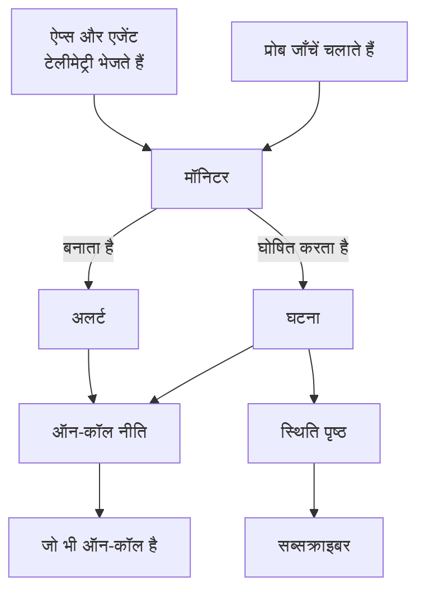

# मुख्य अवधारणाएँ

OneUptime में कई उत्पाद हैं, लेकिन वे कुछ ही विचारों पर टिके हैं: प्रोजेक्ट, मॉनिटर, घटनाएँ और अलर्ट, ऑन-कॉल, स्थिति पृष्ठ और टेलीमेट्री। उनके इर्द-गिर्द वे चीज़ें हैं जिन पर आप नज़र रखते हैं, जो आप इंस्टॉल करते हैं, और वे नियम जो आपकी ओर से काम करते हैं। यह पेज हर विचार को कुछ वाक्यों में समझाता है, दिखाता है कि वे कैसे जुड़ते हैं, और उन पेजों से लिंक करता है जहाँ हर एक का पूरा विवरण है। इसे एक बार पढ़ लें, तो डॉक्स का हर दूसरा पेज आसानी से पढ़ा जाता है। एक-एक शब्द के लिए [शब्दावली](/docs/introduction/glossary) देखें; एक-जैसी दिखने वाली दो चीज़ों में से चुनने के लिए [कौन-सा इस्तेमाल करें?](/docs/introduction/which-one) देखें।

:::cards
- [प्रोजेक्ट और लोग](#प्रोजेक्ट-और-लोग): सब कुछ कहाँ रहता है, और कौन क्या कर सकता है।
- [मॉनिटर और प्रोब](#मॉनिटर-और-प्रोब): OneUptime कैसे पहचानता है कि कुछ गड़बड़ है।
- [घटनाएँ और अलर्ट](#घटनाएँ-और-अलर्ट): वह रिकॉर्ड जिससे आपकी टीम काम करती है।
- [ऑन-कॉल](#ऑन-कॉल): किसे, कैसे पेज किया जाता है, और अगला कौन है।
:::

## हिस्से कैसे जुड़ते हैं

कोई समस्या OneUptime में एक ही दिशा में चलती है। प्रोब और आपकी अपनी टेलीमेट्री मॉनिटर को डेटा देते हैं। मॉनिटर के मानदंड तय करते हैं कि कब कुछ गड़बड़ है और क्या खोलना है: एक घटना, एक अलर्ट, या दोनों। ऑन-कॉल नीतियाँ उनके बारे में लोगों को पेज करती हैं, और स्थिति पृष्ठ आपके ग्राहकों को घटनाओं के बारे में बताते हैं।



## प्रोजेक्ट और लोग

एक **प्रोजेक्ट** में सब कुछ होता है: मॉनिटर, घटनाएँ, ऑन-कॉल नीतियाँ, स्थिति पृष्ठ, टेलीमेट्री और सेटिंग्स। ज़्यादातर कंपनियों को एक ही चाहिए, और कुछ हर एनवायरनमेंट या बिज़नेस यूनिट के लिए एक रखती हैं। एक प्रोजेक्ट में आप जो बनाते हैं, वह दूसरे में नहीं दिखता।

आपका **खाता** आपके प्रोजेक्ट से अलग है। एक ईमेल और पासवर्ड वाला एक खाता कितने भी प्रोजेक्ट से जुड़ा हो सकता है; ऊपर बाईं ओर के प्रोजेक्ट पिकर से उनके बीच स्विच करें। [आपका खाता](/docs/introduction/your-account) देखें।

लोग **टीमों** के ज़रिए प्रोजेक्ट में होते हैं, और टीम की अनुमतियाँ तय करती हैं कि उसके सदस्य क्या कर सकते हैं। हर नया प्रोजेक्ट तीन टीमों से शुरू होता है: Owners, जिसमें आप हैं, Admin और Members। OneUptime Cloud पर हर प्रोजेक्ट का अपना प्लान होता है।

:::cards
- [उपयोगकर्ता, टीमें और अनुमतियाँ](/docs/permissions/index): लोगों को आमंत्रित करें और तय करें कि वे क्या कर सकते हैं।
:::

## मॉनिटर और प्रोब

एक **मॉनिटर** आपकी चलाई एक चीज़ को जाँचता है और तय करता है कि वह काम कर रही है या नहीं। ज़्यादातर मॉनिटर **प्रोब** से जाँचे जाते हैं: ऐसी मशीनें जो शेड्यूल पर जाँच चलाती हैं, जैसे कोई पेज माँगना, API कॉल करना, किसी होस्ट को ping करना या डेटाबेस से क्वेरी करना। OneUptime Cloud कई क्षेत्रों में प्रोब चलाता है, स्व-होस्टेड इंस्टॉलेशन अपने प्रोब चलाता है, और आप अपने नेटवर्क के अंदर कस्टम प्रोब जोड़ सकते हैं। दूसरे मॉनिटर इसके बजाय वह पढ़ते हैं जो आप भेजते हैं: आपके ऐप्स की टेलीमेट्री, या वह डेटा जो आपके सर्वर, Kubernetes क्लस्टर और दूसरे इंफ्रास्ट्रक्चर पर लगा एजेंट रिपोर्ट करता है।

मॉनिटर के **मानदंड** तय करते हैं कि हर नतीजे का क्या मतलब है। उन्हें क्रम से जाँचा जाता है, और जो पहला मेल खाता है वह मॉनिटर की स्थिति बदल सकता है, एक घटना घोषित कर सकता है, एक अलर्ट बना सकता है, या तीनों कर सकता है। हर नए प्रोजेक्ट में तीन मॉनिटर स्थितियाँ होती हैं: **कार्यरत**, **प्रदर्शन में गिरावट** और **ऑफ़लाइन**।

:::cards
- [मॉनिटर बनाना](/docs/monitor/create-monitor): एक प्रकार चुनें, बताएँ कि क्या और कितनी बार जाँचना है।
- [कस्टम प्रोब](/docs/probe/custom-probe): वह जाँचें जिस तक सिर्फ़ आपका अपना नेटवर्क पहुँच सकता है।
:::

## आप किस पर नज़र रखते हैं

एक मॉनिटर एक चीज़ को जाँचता है। आपके मॉनिटरों के इर्द-गिर्द, OneUptime आपकी चलाई चीज़ों का रिकॉर्ड रखता है, और ये रिकॉर्ड आपको मेन्यू में मिलते हैं:

- एक **मॉनिटर समूह** कई मॉनिटरों को एक स्थिति में समेटता है, ताकि स्थिति पृष्ठ कई हिस्सों से बनी किसी चीज़ को, जैसे Checkout, एक पंक्ति के रूप में दिखा सके।
- एक **सेवा** कोई ऐप्लिकेशन या माइक्रोसर्विस है जिसे आप चलाते हैं। OneUptime इसे तब जोड़ता है जब इसकी टेलीमेट्री पहली बार आती है, और इसके लॉग, ट्रेस, मेट्रिक्स, अपवाद और घटनाएँ एक पेज पर ले आता है।
- **होस्ट**, **Kubernetes** क्लस्टर और बाकी **बुनियादी ढांचा** वे मशीनें और प्लेटफ़ॉर्म हैं जिन्हें आप चलाते हैं, और जिन्हें आपके इंस्टॉल किए एजेंट भरते हैं।
- **इन्वेंटरी** इन सबकी एक सूची है: सेवाएँ, होस्ट, क्लस्टर, डिवाइस, क्लाउड संसाधन, और वे चीज़ें जो कोई टेलीमेट्री नहीं भेजतीं।

ये सब वहाँ मिलते हैं जहाँ कोई समस्या दिखती है। किसी सेवा के मॉनिटर एक मॉनिटर समूह में समेटे जा सकते हैं, एक SLO उन्हें मापता है, और जब उनमें से कोई विफल होता है तो वह एक घटना घोषित करता है। घटना उस सेवा को उन संसाधनों में गिनाती है जिन पर उसका असर है, और स्थिति पृष्ठ समूह और घटना दोनों को दिखाता है।

```mermaid title="एक सेवा, उस पर नज़र रखने वाले मॉनिटर, और वह कहाँ दिखती है"
flowchart TB
    service["सेवा: Checkout"] -->|"द्वारा निगरानी"| monitors["उसके मॉनिटर"]
    monitors --> group["मॉनिटर समूह"]
    monitors --> slo["SLO"]
    monitors -->|"घोषित करते हैं"| incident["घटना"]
    group --> statuspage["स्थिति पृष्ठ"]
    incident --> statuspage
```

:::cards
- [मॉनिटर समूह](/docs/monitor/monitor-groups): कई मॉनिटरों को एक स्थिति में समेटें।
- [सेवाएं](/docs/telemetry/services): आपका चलाया हर ऐप्लिकेशन, हर एक अपने पेज पर।
- [इन्वेंटरी अवलोकन](/docs/inventory/overview): OneUptime आपके पूरे परिवेश के बारे में जो कुछ जानता है।
:::

## विश्वसनीयता लक्ष्य

एक **SLO** (सर्विस लेवल ऑब्जेक्टिव) आपकी निगरानी वाली चीज़ के लिए एक विश्वसनीयता लक्ष्य है, जैसे 30 दिनों में 99.9% समय चालू रहना। OneUptime इसे हर 5 मिनट पर इसके मॉनिटरों से मापता है। लक्ष्य जितने डाउनटाइम की अनुमति देता है, वह उसका एरर बजट है: काफ़ी बचा हो तो आप जोखिम ले सकते हैं, और थोड़ा बचा हो तो आप धीमे चलते हैं और स्थिरता में निवेश करते हैं।

:::cards
- [SLO अवलोकन](/docs/slo/introduction): एक लक्ष्य तय करें, और देखें कि बजट कितना बचा है।
:::

## घटनाएँ और अलर्ट

दोनों एक समस्या दर्ज करते हैं, और दोनों ऑन-कॉल व्यक्ति को पेज कर सकते हैं। फ़र्क इसमें है कि समस्या किसे प्रभावित करती है।

| | घटना | अलर्ट |
| --- | --- | --- |
| **यह क्या है** | वह समस्या जो आपके उपयोगकर्ताओं को प्रभावित करती है, जैसे आउटेज या धीमापन | वह समस्या जिसे उपयोगकर्ताओं के प्रभावित होने से पहले आपकी टीम को देखना चाहिए |
| **स्थिति पृष्ठों पर** | दिख सकती है, और सब्सक्राइबर को बताती है | कभी नहीं |
| **शुरुआती स्थितियाँ** | **पहचाना गया**, **स्वीकार किया गया**, **सुलझाया गया** | **पहचाना गया**, **स्वीकार किया गया**, **सुलझाया गया** |
| **शुरुआती गंभीरताएँ** | Critical Incident, Major Incident, Minor Incident | **उच्च**, **निम्न** |

स्वीकार करना बताता है कि कोई इस पर काम कर रहा है, और ऑन-कॉल नीतियों को अगले स्तर को पेज करने से रोकता है। सुलझाना उसे बंद कर देता है। आप अपनी स्थितियाँ और गंभीरताएँ जोड़ सकते हैं, और अलर्ट को उस घटना से लिंक कर सकते हैं जिसका वे हिस्सा निकले।

एक **एपिसोड** संबंधित घटनाओं, या संबंधित अलर्ट को समूहित करता है, ताकि आपकी टीम उन पर एक साथ काम करे। ग्रुपिंग नियम तय करते हैं कि कौन किसके साथ है।

:::cards
- [घटनाओं का अवलोकन](/docs/incidents/index): घटनाएँ कैसे घोषित की जाती हैं, उन पर कैसे काम होता है और वे कैसे सुलझती हैं।
- [अलर्ट का अवलोकन](/docs/alerts/index): अलर्ट कहाँ से आते हैं, और एपिसोड उन्हें कैसे समूहित करते हैं।
- [लिंक किए गए अलर्ट](/docs/incidents/linked-alerts): किसी आउटेज से उठे अलर्ट को उसकी घटना से जोड़ें।
:::

## ऑन-कॉल

एक **ऑन-कॉल नीति** तय करती है कि किसी घटना या अलर्ट के बारे में किसे पेज किया जाए, और कोई जवाब न दे तो अगला कौन है। इसके **एस्केलेशन नियम** इसके स्तर हैं: हर स्तर अपने लोगों को पेज करता है, फिर अगले स्तर को पेज करने से पहले किसी के स्वीकार करने का इंतज़ार करता है। एक स्तर लोगों, टीमों, या एक **ऑन-कॉल अनुसूची** को पेज कर सकता है, जो एक रोटेशन है जिसे हर पल पता होता है कि कौन ऑन-कॉल है।

हर व्यक्ति तक कैसे पहुँचा जाए, यह उन पर निर्भर है। **उपयोगकर्ता सेटिंग्स** में हर कोई वे तरीके रखता है जिनसे OneUptime उन तक पहुँच सकता है, जैसे ईमेल, SMS, फ़ोन कॉल, पुश सूचनाएँ, Slack या Microsoft Teams, और यह कि पेज किए जाने पर इनमें से कौन-से इस्तेमाल हों।

:::cards
- [ऑन-कॉल का अवलोकन](/docs/on-call/index): पेज किसी तक कैसे पहुँचता है, और हर हिस्सा कहाँ है।
- [एस्केलेशन नियम](/docs/on-call/escalation-rules): किसी के जवाब देने तक लोगों को स्तर-दर-स्तर पेज करें।
- [ऑन-कॉल अनुसूची](/docs/on-call/schedules): रोटेशन, लेयर और हैंड-ऑफ़।
- [OneUptime आप तक कैसे पहुँचता है](/docs/notifications/index): वे विधियां, नियम और सेटिंग्स जो तय करती हैं कि हर व्यक्ति तक कैसे पहुँचा जाए।
:::

## स्थिति पृष्ठ और रखरखाव

एक **स्थिति पृष्ठ** आपके ग्राहकों को दिखाता है कि आपकी सेवाएँ काम कर रही हैं या नहीं। आप चुनते हैं कि यह कौन-से मॉनिटर दिखाए, ऐसे नामों से जो आपके ग्राहक समझें। जब उनमें से किसी मॉनिटर पर कोई घटना सक्रिय होती है, तो पेज उसे दिखाता है, और उसके **सब्सक्राइबर** को ईमेल, SMS, Slack, Microsoft Teams या वेबहुक से बताया जाता है। स्थिति पृष्ठ सार्वजनिक हो सकता है, या सिर्फ़ उन लोगों के लिए निजी जिन्हें आप अंदर आने देते हैं।

**अनुसूचित रखरखाव** योजनाबद्ध काम की पहले से घोषणा करता है। एक इवेंट **निर्धारित**, **जारी**, **समाप्त** और **पूर्ण** से होकर गुज़रता है, और जिन स्थिति पृष्ठों पर आप उसे दिखाते हैं वे आगंतुकों और सब्सक्राइबर को उसके बारे में बताते हैं।

:::cards
- [स्थिति पृष्ठ अवलोकन](/docs/status-pages/index): एक स्थिति पृष्ठ बनाएँ और तय करें कि वह क्या दिखाए।
- [सब्सक्राइबर और घोषणाएँ](/docs/status-pages/subscribers): किसे बताया जाता है, और कब।
- [अनुसूचित रखरखाव का अवलोकन](/docs/scheduled-maintenance/index): एक इवेंट कैसे चलता है, और वह क्या रोकता है।
:::

## टेलीमेट्री

**टेलीमेट्री** वह है जो आपके सिस्टम OneUptime को भेजते हैं: लॉग, मेट्रिक्स, ट्रेस, एक्सेप्शन और प्रोफ़ाइल। ऐप्स इसे OpenTelemetry से भेजते हैं, और OneUptime के एजेंट इसे होस्ट, Kubernetes क्लस्टर, Docker होस्ट और दूसरे इंफ्रास्ट्रक्चर से भेजते हैं। हर भेजने वाला एक **इंजेशन कुंजी** इस्तेमाल करता है, जो **प्रोजेक्ट सेटिंग्स → टेलीमेट्री और APM → इंजेशन कुंजियाँ** में बनाई जाती है। आप टेलीमेट्री खोजते हैं, उसे डैशबोर्ड पर चार्ट करते हैं, और टेलीमेट्री मॉनिटर से उस पर नज़र रखते हैं, जो किसी भी दूसरे मॉनिटर की तरह घटनाएँ और अलर्ट उठाते हैं। मेन्यू में, **लॉग**, **मेट्रिक्स**, **ट्रेस**, **प्रोफ़ाइल** और **अपवाद** में से हर एक एक तरह का डेटा खोलता है; **AI / LLM** आपके AI की बातचीत पर नज़र रखता है, **डेटा अवलोकनीयता** आपके डेटाबेस की टेबल पर नज़र रखता है, और **टोपोलॉजी** दिखाता है कि यह सब कैसे जुड़ता है।

:::cards
- [OpenTelemetry](/docs/telemetry/open-telemetry): अपने ऐप्स से लॉग, मेट्रिक्स और ट्रेस भेजें।
- [लॉग मॉनिटर](/docs/monitor/logs-monitor): जब आपके लॉग में कोई पैटर्न दिखे, तो सूचना पाएँ।
:::

## सुरक्षा

**सुरक्षा इवेंट** आपके लॉग, आपके सुरक्षा टूल और आपकी भेजी किसी भी दूसरी चीज़ से आए सुरक्षा इवेंट रखता है। इसके डिटेक्शन नियम जो पाते हैं उसे सुरक्षा केस में बदल देते हैं, जिन पर आपकी टीम एक कतार में काम करती है और प्लेबुक जिन पर प्रतिक्रिया देती हैं। **डेटा सुरक्षा** आपके बकेट, डेटाबेस और टेलीमेट्री में संवेदनशील डेटा खोजता है, और बताता है कि उसे रखने के तरीके में क्या ग़लत है।

:::cards
- [सुरक्षा के साथ शुरुआत](/docs/telemetry/security-getting-started): अपने पास पहले से मौजूद डेटा में ख़तरे खोजें।
- [डेटा सुरक्षा अवलोकन](/docs/data-security/index): अपना संवेदनशील डेटा खोजें, और उसे रखने का तरीका ठीक करें।
:::

## आप क्या इंस्टॉल करते हैं, और कुंजियाँ

OneUptime के ज़्यादातर हिस्सों के लिए कुछ भी इंस्टॉल करने की ज़रूरत नहीं होती। आप कुछ तभी इंस्टॉल करते हैं जब उस तक पहुँचना हो जिसे OneUptime बाहर से नहीं देख सकता, और हर हिस्सा एक कुंजी के साथ OneUptime से बाहर की ओर कनेक्ट करता है:

- एक कस्टम प्रोब आपके नेटवर्क के अंदर मॉनिटरों की जाँचें चलाता है, अपने प्रोब ID और कुंजी के साथ।
- **OpenTelemetry Collector**, Kubernetes एजेंट और Docker एजेंट एक **इंजेशन कुंजी** के साथ टेलीमेट्री भेजते हैं। Server / VM मॉनिटर के पीछे का इन्फ्रास्ट्रक्चर एजेंट उस मॉनिटर की सीक्रेट कुंजी के साथ भेजता है।
- एक **Runner** आपके इन्फ्रास्ट्रक्चर के अंदर रनबुक के कदम चलाता है, अपने Runner ID और कुंजी के साथ।

इंजेशन कुंजी सिर्फ़ टेलीमेट्री अंदर भेजती है। **API कुंजी** दूसरी तरह की है: यह किसी स्क्रिप्ट, CLI, Terraform या AI असिस्टेंट को आपका प्रोजेक्ट पढ़ने और बदलने देती है, उन अनुमतियों के साथ जो आप उसे देते हैं। इनमें से कोई भी दूसरी की जगह काम नहीं करती।

:::cards
- [कौन-सा इस्तेमाल करें?](/docs/introduction/which-one#प्रोब-एजेंट-कलेक्टर-या-runner): क्या इंस्टॉल करें, और हर एक को कौन-सी कुंजी चाहिए।
- [इंजेशन कुंजियाँ](/docs/telemetry/ingestion-keys): टेलीमेट्री भेजने वाली कुंजियाँ बनाएँ, उनका दायरा तय करें और उन्हें बदलें।
:::

## ऑटोमेशन और AI

- **वर्कफ़्लो** कुछ होने पर क्रियाएँ चलाते हैं, जैसे किसी घटना के घोषित होने पर Slack पर पोस्ट करना।
- **रनबुक** किसी प्रतिक्रिया प्रक्रिया को ऐसे कदमों में बदलते हैं जिन्हें आपकी टीम हाथ से या अपने-आप चला सके।
- **OneUptime AI** नई घटनाओं और अलर्ट की जाँच करता है और जो मिला उसे उनकी टाइमलाइन पर पोस्ट करता है, और **AI से पूछें** आपके प्रोजेक्ट के बारे में सवालों के जवाब देता है। नया प्रोजेक्ट AI चालू के साथ शुरू होता है; **प्रोजेक्ट सेटिंग्स → एआई → AI सुविधाएं** में **AI सक्षम करें** स्विच इसे पूरी तरह बंद कर देता है।

:::cards
- [वर्कफ़्लो अवलोकन](/docs/workflows/index): ट्रिगर और कंपोनेंट से क्रियाएँ स्वचालित करें।
- [AI SRE](/docs/ai/ai-sre): OneUptime AI घटनाओं और अलर्ट की जाँच कैसे करता है।
:::

## लेबल और मालिक

**लेबल** वे टैग हैं जो आप मॉनिटर, घटनाओं, स्थिति पृष्ठों और ज़्यादातर दूसरे संसाधनों पर लगाते हैं, ताकि उन्हें फ़िल्टर और समूहित कर सकें। किसी टीम की अनुमतियाँ कुछ लेबल वाले संसाधनों तक सीमित की जा सकती हैं। **मालिक** वे लोग और टीमें हैं जो किसी एक संसाधन के लिए ज़िम्मेदार हैं: उसके साथ कुछ होने पर उन्हें बताया जाता है। लेबल नियम और मालिक नियम नए संसाधनों में अपने-आप लेबल और मालिक जोड़ते हैं।

:::cards
- [लेबल और स्वामी नियम](/docs/configuration/label-and-owner-rules): नए संसाधनों पर अपने-आप लेबल लगाएँ और उन्हें मालिक दें।
:::

## नियमों के प्रकार

OneUptime में कई चीज़ों को नियम कहा जाता है। हर एक कुछ नया आने पर आपके लिए एक फ़ैसला करता है, और वे कुछ परिवारों में बँटे हैं। उनमें से ज़्यादातर **घटनाएं** और **अलर्ट** की साइड मेन्यू में **नियम** के अंतर्गत हैं।

| यह क्या तय करता है | नियम |
| --- | --- |
| किसे पेज किया जाए | **ऑन-कॉल नियम** चुनते हैं कि नई घटना या अलर्ट कौन-सी ऑन-कॉल नीतियाँ चलाए, और नीति के **एस्केलेशन नियम** स्तर-दर-स्तर पेज करते हैं |
| इसका स्वामी कौन है, और इस पर कौन-से लेबल लगते हैं | **स्वामी नियम**, **लेबल नियम** और **गोपनीयता नियम** |
| क्या एक साथ आता है | **समूहीकरण नियम** एपिसोड खोलते हैं और उनमें जोड़ते हैं |
| इस पर क्या चलता है | **Runbook नियम** रनबुक शुरू करते हैं, और **AI नियम** तय करते हैं कि OneUptime AI किसकी जाँच करे और क्या ठीक करे |
| कब फ़ॉलो-अप करें | **SLA नियम** प्रतिक्रिया और समाधान के समय पर नज़र रखते हैं, और **रिमाइंडर नियम** खुले रहने तक स्वामियों को याद दिलाते हैं |

मॉनिटर के अपने नियम उसके मानदंड हैं। **उपयोगकर्ता सेटिंग्स** के अंतर्गत ऑन-कॉल नियम फिर कुछ और हैं: वे हर व्यक्ति के अपने होते हैं, और तय करते हैं कि पेज उस व्यक्ति तक कैसे पहुँचे।

:::cards
- [घटना सेटिंग्स और स्वचालन](/docs/incidents/settings#घटना-बनने-पर-चलने-वाले-नियम): किसी घटना के बनने पर चलने वाले नियम, क्रम से।
- [मुझसे कैसे संपर्क करें](/docs/notifications/on-call-rules): पेज आप तक कैसे पहुँचता है।
:::

## अगले कदम

:::cards
- [त्वरित शुरुआत](/docs/introduction/quickstart): इन विचारों को पंद्रह मिनट में अमल में लाएँ।
- [शब्दावली](/docs/introduction/glossary): OneUptime में इस्तेमाल होने वाला हर शब्द, एक-दो वाक्यों में।
- [कौन-सा इस्तेमाल करें?](/docs/introduction/which-one): घटना या अलर्ट, वर्कफ़्लो या रनबुक, और दूसरी मिलती-जुलती चीज़ें।
- [घटनाओं का अवलोकन](/docs/incidents/index): मॉनिटर के घटना घोषित करने के बाद क्या होता है।
:::
