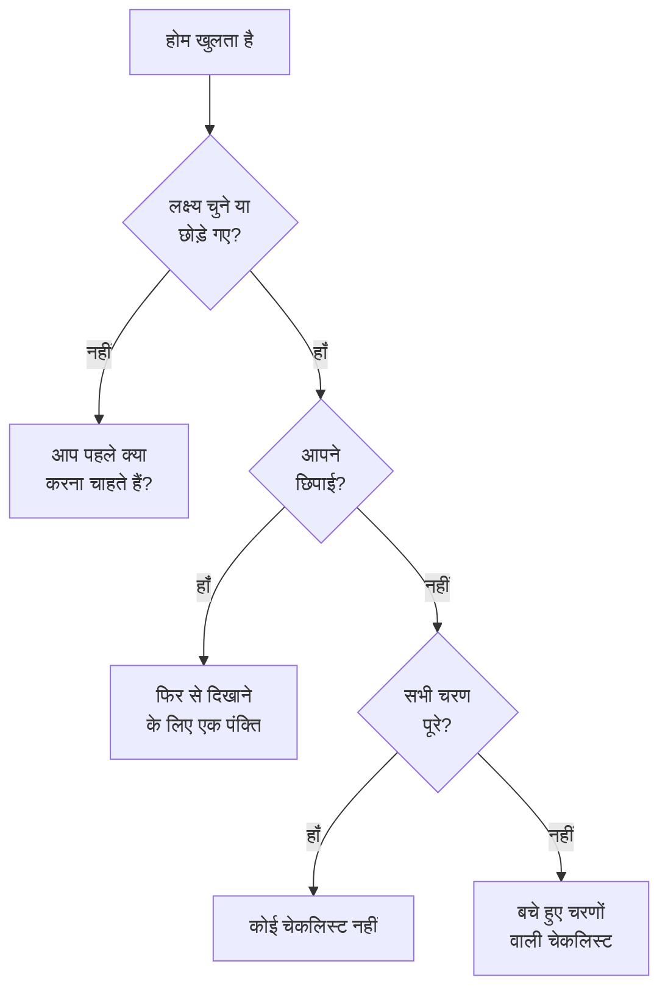

# मुख्य पृष्ठ और शॉर्टकट

मुख्य पृष्ठ वह पहला पेज है जो आप किसी प्रोजेक्ट में देखते हैं। यह एक नज़र में बताता है कि क्या अभी किसी चीज़ को आपकी ज़रूरत है, और नए प्रोजेक्ट को उसके पहले सेटअप से गुज़ारता है। यह पेज बताता है कि मुख्य पृष्ठ क्या दिखाता है, डैशबोर्ड में कोई भी उत्पाद, पेज या क्रिया कैसे खोजें, और वे कीबोर्ड शॉर्टकट जो मेनू में बार-बार जाने से बचाते हैं।

:::cards
- [मुख्य पृष्ठ क्या दिखाता है](#मुख्य-पृष्ठ-क्या-दिखाता-है): क्या कुछ गड़बड़ है, किस चीज़ को आपकी ज़रूरत है, प्रोजेक्ट में क्या-क्या है, और हर उत्पाद।
- [रास्ता खोजना](#रास्ता-खोजना): उत्पाद मेनू और हर पेज के ऊपर के बार।
- [खोजना](#कोई-पेज-सेटिंग-या-क्रिया-खोजना): नाम टाइप करके कोई भी पेज, सेटिंग या क्रिया खोजें।
- [कीबोर्ड शॉर्टकट](#कीबोर्ड-शॉर्टकट): दो कुंजियों से मुख्य पृष्ठ, मॉनिटर या घटनाओं पर जाएँ।
:::

## मुख्य पृष्ठ क्या दिखाता है

ऊपर के बार में **मुख्य पृष्ठ** खोलें, या कहीं से भी `g` फिर `h` दबाएँ। मुख्य पृष्ठ आपके प्रोजेक्ट का अवलोकन है, एक ही पेज जिसमें कोई साइड मेनू नहीं है। ऊपर से नीचे तक, यह दिखाता है:

1. एक खोज बॉक्स, जिसके बगल में **घटना घोषित करें** और **बनाएँ** हैं।
2. एक पंक्ति जो बताती है कि क्या कुछ गड़बड़ है, और उसके नीचे पाँच संख्याएँ जो गिनती हैं कि किस पर ध्यान देना है।
3. **OneUptime में आपका स्वागत है 👋**, नए प्रोजेक्ट के लिए एक चेकलिस्ट, जब तक वह पूरी न हो जाए।
4. **ध्यान देने की ज़रूरत**, हर वह समस्या जो अभी खुली है, नाम के साथ।
5. **आपका प्रोजेक्ट**, प्रोजेक्ट किन चीज़ों से बना है, और कोई रखरखाव अनुसूचित होने पर **आगामी रखरखाव**।
6. **OneUptime एक्सप्लोर करें**, हर उत्पाद, एक बार में एक श्रेणी।

### खोजना और बनाना

खोज बॉक्स खोज खोलता है, ठीक `Mod` + `K` की तरह: किसी भी पेज, मॉनिटर, घटना, अलर्ट, स्थिति पृष्ठ या ऑन-कॉल नीति का नाम टाइप करें। [खोजना](#कोई-पेज-सेटिंग-या-क्रिया-खोजना) देखें। **घटना घोषित करें** वह फ़ॉर्म खोलता है जिससे कोई घटना घोषित की जाती है। **बनाएँ** में **मॉनिटर बनाएं**, **रखरखाव शेड्यूल करें** और **घोषणा बनाएँ** मिलते हैं। इनमें से हर एक सिर्फ़ उन्हीं लोगों को दिखता है जिन्हें उसका उपयोग करने की अनुमति है।

### हेडलाइन

सबसे ऊपर की पंक्ति उस सबसे ज़रूरी चीज़ का नाम बताती है जो खुली है, उससे मेल खाते रंग में:

| कब | मुख्य पृष्ठ क्या कहता है |
| --- | --- |
| कोई घटना खुली है | कितनी घटनाएँ सक्रिय हैं, लाल रंग में |
| कोई घटना खुली नहीं है, लेकिन खुले अलर्ट, ऐसे मॉनिटर जो कार्यरत नहीं हैं या जोखिम में SLO हैं | कितनी समस्याओं पर ध्यान देने की ज़रूरत है, एम्बर रंग में |
| कुछ भी गड़बड़ नहीं है और रखरखाव जारी है | कितने रखरखाव इवेंट चल रहे हैं |
| मॉनिटर चल रहे हैं और कुछ भी खुला नहीं है | **सभी सिस्टम कार्यरत हैं** |
| प्रोजेक्ट में अभी कोई मॉनिटर नहीं है | **अभी किसी चीज़ की निगरानी नहीं हो रही है** |

इसके बगल में, मुख्य पृष्ठ बताता है कि उसने प्रोजेक्ट को आख़िरी बार कब पढ़ा था, और **रिफ्रेश** उसे फिर से पढ़ता है। जब आप एक मिनट या उससे ज़्यादा समय बाद मुख्य पृष्ठ वाले टैब पर लौटते हैं, तो वह अपने-आप रिफ्रेश हो जाता है।

जब तक अभी किसी चीज़ की निगरानी नहीं हो रही है, यह पंक्ति **अपना पहला मॉनिटर बनाएँ** पर खत्म होती है, जो गाइडेड सेटअप **जानना कि मेरी वेबसाइट या API कब डाउन है** खोलता है। इसे केवल वही लोग देखते हैं जिन्हें मॉनिटर बनाने की अनुमति है।

### पाँच संख्याएँ

हर संख्या कुछ गिनती है, बताती है कि क्या उस पर आपका ध्यान चाहिए, और उसके पीछे की सूची उसी प्रोडक्ट में खोलती है जिसकी वह सूची है।

| संख्या | क्या गिनती है | जब गिनती शून्य हो | क्या खोलता है |
| --- | --- | --- | --- |
| **सक्रिय घटनाएं** | वे घटनाएँ जो सुलझी नहीं हैं | **सब ठीक है** | **घटनाएं → सक्रिय घटनाएं** |
| **सक्रिय अलर्ट** | वे अलर्ट जो सुलझे नहीं हैं | **सब ठीक है** | **अलर्ट → सक्रिय अलर्ट** |
| **गैर-संचालन मॉनिटर** | वे मॉनिटर जिनकी स्थिति कार्यरत वाली नहीं है। आर्काइव किए गए मॉनिटर, और जिन मॉनिटर की निगरानी बंद है, वे नहीं गिने जाते। | **सभी कार्यरत** | **मॉनिटर → गैर-संचालन** |
| **चल रहा रखरखाव** | जारी रखरखाव इवेंट | **कोई जारी नहीं** | **अनुसूचित रखरखाव → चल रहे रखरखाव इवेंट** |
| **जोखिम में SLO** | चालू SLO जो जोखिम में हैं या अपना एरर बजट खर्च कर चुके हैं | **बजट स्वस्थ हैं** | **SLOs** |

शून्य से ज़्यादा गिनती पर **ध्यान देने की ज़रूरत** दिखता है, और रखरखाव और SLO के लिए **जारी है** और **बजट खर्च हो रहा है**। जब तक कोई SLO जोखिम में है, **जोखिम में SLO** से **SLOs** सूची खुलती है, जिसमें सिर्फ़ वही SLO दिखते हैं। जिस प्रोजेक्ट में अभी कोई मॉनिटर नहीं है, उसे **अभी कोई मॉनिटर नहीं** दिखता है, और जिसमें कोई SLO नहीं है उसे **अभी कोई SLO नहीं**: खाली प्रोजेक्ट, स्वस्थ प्रोजेक्ट जैसा नहीं होता। तब ये दोनों **मॉनिटर** और **SLOs** सूचियाँ खोलती हैं, जहाँ आप पहला बनाते हैं।

### स्वागत चेकलिस्ट

जब कोई प्रोजेक्ट स्वामी या प्रोजेक्ट एडमिन किसी नए प्रोजेक्ट का होम पहली बार खोलता है, तो कार्ड पूछता है **आप सबसे पहले क्या करना चाहते हैं?** एक या अधिक लक्ष्य चुनें, जैसे **जानना कि मेरी वेबसाइट या API कब डाउन है** या **बस देख रहा हूँ**, और **जारी रखें** पर क्लिक करें: तब चेकलिस्ट में वे चरण आते हैं जिनकी इन लक्ष्यों को ज़रूरत है। **छोड़ें** से वे चार चरण मिलते हैं जो हर प्रोजेक्ट को मिलते हैं। बाद में फिर से जवाब देने के लिए, चेकलिस्ट में **बदलें** पर क्लिक करें। जो प्रोजेक्ट पहले से मॉनिटर, टेलीमेट्री या ऑन-कॉल इस्तेमाल कर रहा है, उससे नहीं पूछा जाता।

हर चरण तब अपने आप टिक होता है जब चीज़ काम करने लगे, न कि जब कोई रिकॉर्ड बन जाए, और प्रोजेक्ट सेट अप करने वाले सभी लोग हर डिवाइस पर एक ही सूची देखते हैं:

| कदम | कब पूरा होता है | क्या खोलता है |
| --- | --- | --- |
| **अपने मौजूदा टूल से आयात करें** | किसी दूसरे टूल से आयात पूरा होता है। | **किसी दूसरे टूल से आयात करें** |
| **अपना पहला मॉनिटर बनाएँ** | उसकी पहली जाँच आती है। | गाइडेड सेटअप **जानना कि मेरी वेबसाइट या API कब डाउन है**, या मॉनिटर न बना सकने वाले व्यक्ति के लिए **मॉनिटर** सूची। |
| **कोई सर्वर या क्लस्टर जोड़ें** | उसके पहले मेट्रिक्स आते हैं। | **होस्ट** |
| **अपने पहले लॉग, मेट्रिक्स या ट्रेस भेजें** | प्रोजेक्ट के पहले लॉग, मेट्रिक्स, ट्रेस, एक्सेप्शन या प्रोफ़ाइल आते हैं। | गाइडेड सेटअप **लॉग, मेट्रिक्स और ट्रेस भेजें, फिर अलर्ट पाएँ** |
| **एक ऑन-कॉल नीति सेट करें** | कोई टेस्ट सूचना स्वीकार होती है, कोई सूचना किसी तक पहुँचती है, या कोई ऑन-कॉल नियम ऐसी नीति चलाता है जो किसी तक पहुँच सकती है। | गाइडेड सेटअप **कुछ बिगड़ने पर सही व्यक्ति को बुलाना** |
| **एक स्थिति पृष्ठ प्रकाशित करें** | कोई स्थिति पृष्ठ एक मॉनिटर दिखाता है। | गाइडेड सेटअप **एक स्थिति पृष्ठ प्रकाशित करें**, या स्थिति पृष्ठ न बना सकने वाले व्यक्ति के लिए **स्थिति पृष्ठ** सूची। |
| **अपनी टीम को आमंत्रित करें** | कोई आपका निमंत्रण स्वीकार करता है। | **उपयोगकर्ता** |

सबसे पहले करने वाले चरण पर **अगला चरण** लिखा होता है। OneUptime Cloud के Free प्लान में, जिसमें एक व्यक्ति होता है, **अपनी टीम को आमंत्रित करें** बताता है कि इसके लिए Growth प्लान चाहिए, और **बिलिंग** खोलता है। ऐसे सेल्फ़-होस्टेड सर्वर पर जो अभी ईमेल नहीं भेज सकता, सर्वर के एडमिन सबसे पहले **यह सर्वर अभी ईमेल नहीं भेज सकता** देखते हैं; यह एडमिन डैशबोर्ड खोलता है।

गाइडेड सेटअप पूरा काम एक ही पेज पर, एक-एक चरण करके, करता है और अंत में बताता है कि उसने क्या सेट किया और आगे क्या करना है। बाद में उसे फिर से खोलने के लिए, उसका नाम खोजें।

कदमों के नीचे, **OneUptime कैसे काम करता है** चार मुख्य उत्पादों को उस क्रम में दिखाता है जिसमें कोई समस्या उनसे होकर गुज़रती है: **मॉनिटर**, **घटनाएं और अलर्ट**, **ऑन-कॉल** और **स्थिति पृष्ठ**। किसी एक पर क्लिक करके उसे खोलें। उनके नीचे बताया गया है कि इस चक्र को क्या चलाता है, टेलीमेट्री और बुनियादी ढांचा, और [मुख्य अवधारणाएँ](/docs/introduction/core-concepts) और [शब्दावली](/docs/introduction/glossary) के लिंक हैं।

हर चरण पूरा होते ही चेकलिस्ट सभी के लिए हट जाती है। इसे पहले छिपाने के लिए **छिपाएं** पर क्लिक करें: यह सिर्फ़ आपके लिए, हर डिवाइस पर छिपती है, और **दिखाएँ** और **OneUptime कैसे काम करता है** वाली एक पंक्ति रह जाती है। जिन्हें सदस्य के रूप में प्रोजेक्ट में आमंत्रित किया गया है, वे चेकलिस्ट नहीं देखते। **OneUptime कैसे काम करता है** हर प्रोजेक्ट में एक क्लिक की दूरी पर रहता है: इसे **सहायता** से खोलें, या **OneUptime एक्सप्लोर करें** के पास वाले बटन से।

### ध्यान देने की ज़रूरत

**ध्यान देने की ज़रूरत** उन चीज़ों को नाम से दिखाता है जिन्हें संख्याएँ गिनती हैं: खुली घटनाएँ, खुले अलर्ट, वे मॉनिटर जो कार्यरत नहीं हैं, जोखिम में SLO और जारी रखरखाव, सबसे ज़रूरी पहले। हर पंक्ति अपनी गंभीरता या स्थिति दिखाती है, बताती है कि कोई घटना या अलर्ट कब शुरू हुआ और रखरखाव कब खत्म होगा, और उसका रिकॉर्ड खोलती है। हर प्रकार की ज़्यादा से ज़्यादा पाँच चीज़ें दिखती हैं, और बाकी के लिए **सभी दिखाएं** है, जो वही सूची खोलता है जो उसकी संख्या खोलती है। जब कुछ भी खुला नहीं होता, तो यह **आपको किसी चीज़ पर ध्यान देने की ज़रूरत नहीं है** दिखाता है।

### सेटअप स्वास्थ्य

जब प्रोजेक्ट के सेटअप में कोई चीज़ लोगों तक सूचना पहुँचने से रोकती, तो **ध्यान देने की ज़रूरत** के आखिर में **सेटअप** दिखता है: कितनी चीज़ों पर एक नज़र डालनी चाहिए। यह **सेटअप स्वास्थ्य** खोलता है, जो गलत सेट की गई चीज़ों को, सबसे गंभीर पहले, **पेज नहीं पहुँचेंगे**, **ठीक करने लायक** और **सुझाव** के नीचे दिखाता है: ऐसा मॉनिटर जो किसी को पेज नहीं करता, ऐसी ऑन-कॉल नीति जिसे कुछ भी नहीं चलाता, ऐसा व्यक्ति जिसे पेज नहीं किया जा सकता, बंद SMS, ऐसी अनुसूची जिसमें कोई ऑन-कॉल नहीं है, ऐसा स्थिति पृष्ठ जो कोई मॉनिटर नहीं दिखाता। हर निष्कर्ष एक वाक्य में बताता है कि क्या गलत है, साथ में वह बटन होता है जो उसका सुधार खोलता है, और किसी मॉनिटर के निष्कर्ष वही रुकावटें हैं जिन्हें उसका **जब यह बंद हो** कार्ड बताता है। जिस निष्कर्ष को आपकी टीम जानबूझकर वैसा ही छोड़ती है, उसे कारण के साथ सबके लिए छिपाया जा सकता है, और **खारिज** से वापस लाया जा सकता है। खोज इस पेज को **सेटअप स्वास्थ्य** के नाम से ढूँढती है, और AI से पूछें इसी के आधार पर "क्या मेरा सेटअप ठीक है?" का जवाब देता है।

### आपका प्रोजेक्ट

**आपका प्रोजेक्ट** प्रोजेक्ट के **मॉनिटर**, **स्थिति पृष्ठ**, **ऑन-कॉल नीतियां**, **SLOs**, **सेवाएं**, **डैशबोर्ड** और **वर्कफ़्लो** गिनता है, आर्काइव किए गए को छोड़कर। हर पंक्ति अपनी सूची खोलती है। जिस प्रकार की एक भी चीज़ प्रोजेक्ट में नहीं है, उसके लिए संख्या की जगह **सेट अप करें** दिखता है।

**आगामी रखरखाव** अगली तीन अनुसूचित रखरखाव विंडो दिखाता है, सबसे नज़दीकी पहले। जब कुछ भी अनुसूचित नहीं होता, तो यह नहीं दिखता।

### OneUptime एक्सप्लोर करें

**OneUptime एक्सप्लोर करें** में **उत्पाद** मेनू के उत्पाद एक बार में एक श्रेणी के हिसाब से दिखते हैं, मूल बातों से शुरू होकर। हर उत्पाद बताता है कि वह किस काम का है, और उस पर क्लिक करने से वह खुल जाता है। आपका प्रोजेक्ट जिन उत्पादों को छिपाता है, वे इसमें नहीं दिखते।

## रास्ता खोजना

OneUptime में सब कुछ ऊपर के बार में **उत्पाद** के नीचे है। मेनू अपने समूहों को एक ही सूची की पंक्तियों के रूप में दिखाता है, और हमेशा उनमें से पहले, मूल बातें, को खुला रखकर खुलता है: मॉनिटर, घटनाएं, अलर्ट, ऑन-कॉल, स्थिति पृष्ठ, अनुसूचित रखरखाव और SLOs। हर दूसरा समूह (अवलोकनीयता, सुरक्षा, AI, कोड, संसाधन, बुनियादी ढांचा, क्लाउड, डैशबोर्ड और ऑटोमेशन और सेटिंग्स) उसी सूची की एक पंक्ति में मुड़ा रहता है। हर पंक्ति समूह के उत्पादों के नाम बताती है और बताती है कि कितने हैं। किसी पंक्ति को खोलने या मोड़ने के लिए उस पर क्लिक करें, या तीर कुंजियों से उस पर जाएँ और **Enter** दबाएँ।

- **खोज सब कुछ ढूँढती है।** मेनू के खोज बॉक्स में टाइप करें और किसी भी उत्पाद को उसके नाम से, उसके काम से, या `k8s` या `RUM` जैसे जाने-पहचाने शब्द से खोजें। खोज मुड़े हुए समूहों के अंदर भी देखती है।
- **आप जहाँ हैं, वहीं से शुरू करते हैं।** आप जिस पेज पर हैं उसका समूह अपने-आप खुल जाता है, और हाल में खोले गए उत्पाद सबसे ऊपर दिखते हैं।
- **आपकी पसंद बनी रहती है।** मेनू आपके ब्राउज़र पर याद रखता है कि आपने दूसरे समूहों में से कौन-से खोले या मोड़े। मूल बातें हर बार मेनू खोलने पर फिर से खुली होती हैं, भले ही आपने उन्हें मोड़ दिया हो।
- **फ़ोन पर**, मेनू बटन उत्पादों को उसी तरह दिखाता है: मूल बातें सबसे ऊपर खुली, और हर दूसरा समूह एक पंक्ति के रूप में जो टैप करने पर खुलती है।
- **वे उत्पाद जिन्हें प्रोजेक्ट इस्तेमाल नहीं करता।** प्रोजेक्ट का मालिक या एडमिन उन्हें **प्रोजेक्ट सेटिंग्स → बेसिक → उत्पाद** में छिपा सकता है। छिपा हुआ उत्पाद मेनू की आखिरी पंक्ति **और उत्पाद** में चला जाता है: खोज उसे अब भी ढूँढती है, उसके पेज काम करते रहते हैं और उसका डेटा आता रहता है। जब उनमें से किसी में डेटा आना शुरू होता है, तो मुख्य पृष्ठ यह उन लोगों को बताता है जो उसे फिर से दिखा सकते हैं।
- **पिन करना।** किसी उत्पाद को **मुख्य पृष्ठ** और **उत्पाद** के पास ऊपरी बार में रखें: मेनू में उसके कार्ड पर पिन दबाएँ, या उसके पेज के शीर्षक के पास **पिन करें** दबाएँ। आप पाँच पिन कर सकते हैं, और वे हर ब्राउज़र में आपके साथ रहते हैं। फ़ोन पर, आपके पिन किए गए उत्पाद मेनू में सबसे पहले आते हैं।
- **क्या उपयोग में है।** मूल बातों और सेटिंग्स को छोड़कर हर समूह में, आपका प्रोजेक्ट जिन उत्पादों का उपयोग करता है वे पहले आते हैं, और जिसे आपने अभी सेट अप नहीं किया है उस पर **सेट अप नहीं है** लिखा होता है। OneUptime Cloud पर, जो उत्पाद आपके प्लान में शामिल नहीं है वह उस प्लान का नाम बताता है जिसमें वह शामिल है।

### ऊपर के बार

हर पेज के ऊपर दो बार होते हैं।

| कहाँ | वहाँ क्या है |
| --- | --- |
| ऊपर बाएँ | प्रोजेक्ट पिकर: अपने किसी दूसरे प्रोजेक्ट पर स्विच करें, या नया प्रोजेक्ट बनाएँ। |
| ऊपर दाएँ | **खोजें** और **AI से पूछें**, सूचना घंटी जिसमें वह है जिसे अभी आपकी ज़रूरत है (सक्रिय घटनाएँ और अलर्ट, वे ऑन-कॉल नीतियाँ जिनमें आप ड्यूटी पर हैं, लंबित आमंत्रण), **सहायता**, और आपकी तस्वीर, जो आपके [खाते](/docs/introduction/your-account) का मेनू खोलती है। |
| उनके नीचे | बाईं ओर **मुख्य पृष्ठ** और **उत्पाद**, दाईं ओर **उपयोगकर्ता सेटिंग्स**: इस प्रोजेक्ट में OneUptime आप तक कैसे पहुँचता है। |

**सहायता** सीखने में मदद करने वाली चीज़ों से शुरू होती है: **त्वरित शुरुआत**, **OneUptime कैसे काम करता है**, **शब्दावली** और ये डॉक्स (**दस्तावेज़ीकरण**)। उनके नीचे **कीबोर्ड शॉर्टकट** सूची और ईमेल व Slack पर सहायता है। टैबलेट या संकरी विंडो में जगह बचाने के लिए **AI से पूछें** हटा दिया जाता है: यह **खोजें** की कार्रवाइयों में मिलता है। फ़ोन पर **खोजें** और **सहायता** मेनू बटन की सूची में चले जाते हैं, सबसे ऊपर और सबसे नीचे; घंटी और आपकी तस्वीर बनी रहती हैं।

जिस शब्द के नीचे बिंदीदार रेखा हो, जैसे नए मॉनिटर के फ़ॉर्म पर **प्रोब**, उस पर पॉइंटर ले जाने, Tab से पहुँचने या टैप करने पर वह अपना अर्थ बताता है। उसका **और पढ़ें** उस शब्द को [शब्दावली](/docs/introduction/glossary) में खोलता है।

### पेज और सूचियाँ

हर पेज के शीर्षक के ऊपर, *प्रोजेक्ट › Docker › सेटिंग्स › स्वामी नियम* जैसा एक रास्ता बताता है कि पेज कहाँ है। आख़िरी से पहले का हर क़दम अपना पेज खोलता है।

- **सूचियाँ अपने आप ताज़ा रहती हैं।** जब कहीं भी कोई घटना या अलर्ट बनाया, स्वीकार या हल किया जाता है, तो घटनाओं, अलर्ट और एपिसोड की सूचियाँ उसे कुछ ही सेकंड में दिखा देती हैं, बिना रीफ़्रेश किए। जब आप किसी सूची पर कोई काम बीच में कर रहे हों, जैसे पंक्तियाँ चुनी हुई हों या कोई डायलॉग खुला हो, तो सूची इंतज़ार करती है और आपका काम पूरा होने पर अपडेट हो जाती है।
- **फ़ोन पर, फ़िल्टर चिप्स सिमट जाते हैं** **फ़िल्टर** के पीछे, ताकि सूची ऊपर से शुरू हो। आपके सेट किए गए चिप्स **सभी साफ़ करें** के साथ दिखते रहते हैं। सभी चिप्स देखने के लिए **फ़िल्टर** दबाएँ, और उन्हें फिर से समेटने के लिए दोबारा दबाएँ।
- किसी सूची के **⋯** मेनू में **कॉलम** से आप चुनते हैं कि सूची कौन-से कॉलम और किस क्रम में दिखाए, और यह चुनाव इसी ब्राउज़र में आपके लिए सहेजा रहता है। प्रोजेक्ट स्वामी या प्रोजेक्ट एडमिन वहाँ **इस प्रोजेक्ट में सभी को ये कॉलम दिखाएँ** भी चुन सकते हैं: जिसने उस सूची के लिए अपने कॉलम नहीं चुने हैं, उसे यही कॉलम दिखते हैं, और **प्रोजेक्ट डिफ़ॉल्ट पर रीसेट करें** आपके अपने कॉलम फिर से इन्हीं पर ले आता है।
- उसी मेनू का विकल्प **संक्षिप्त पंक्तियाँ** हर सूची की पंक्तियों को कम ऊँचा कर देता है, ताकि लंबी सूची में लगभग पाँचवाँ हिस्सा ज़्यादा पंक्तियाँ दिखें। यह चुनाव इसी ब्राउज़र में सहेजा रहता है।
- **फ़ोन पर, या ऐसे कार्ड में जो अपनी पंक्तियों के लिए बहुत संकरा हो, सूची कार्डों के रूप में दिखती है, हर पंक्ति का एक कार्ड।** उनके ऊपर की पट्टी बताती है कि वे किस क्रम में हैं, जैसे **नाम के अनुसार क्रमबद्ध**: इसे दबाकर वह कॉलम चुनें जिससे क्रम तय हो, और **आरोही** या **अवरोही**।
- **किसी घटना के पेज उसकी संख्या से शुरू होते हैं।** उसका शीर्षक, रास्ते में उसका क़दम और ब्राउज़र टैब `INC-42 Checkout is down` दिखाते हैं, और उसका नाम लेने वाले डायलॉग भी, ताकि एक ही शीर्षक वाली घटनाएँ अलग पहचानी जा सकें। अलर्ट, रखरखाव इवेंट और एपिसोड भी ऐसा ही करते हैं।

## कोई पेज, सेटिंग या क्रिया खोजना

**Cmd+K** (Mac) या **Ctrl+K** (Windows और Linux) दबाएँ, या ऊपर के बार में खोज आइकन पर क्लिक करें, और टाइप करना शुरू करें। खोज ये ढूँढती है:

- **मेनू का हर पेज**, उस नाम से जो मेनू उसे देता है: API कुंजियाँ, खतरा क्षेत्र, ऑन-कॉल अनुसूची, घटना गंभीरता, आपकी अपनी सूचना विधियां। हर नतीजा बताता है कि वह कहाँ है, जैसे *प्रोजेक्ट सेटिंग्स › उन्नत*, ताकि एक ही नाम वाले पेज (घटनाओं, अलर्ट और मॉनिटर में कस्टम फ़ील्ड) आसानी से अलग पहचाने जा सकें।
- **किसी पेज की सेटिंग्स**, उस नाम से जो उनका कार्ड या स्विच दिखाता है: *लॉगिन के लिए SSO अनिवार्य करें* से SSO मिलता है, और *कस्टम SMTP कॉन्फ़िग्स* से सूचना चैनल। नाम अंग्रेज़ी में या अपनी भाषा में टाइप करें।
- **क्रियाएँ**, आप क्या करना चाहते हैं उससे: घटना घोषित करें, मॉनिटर बनाएं, या Delete Project, जो खतरा क्षेत्र खोलता है। कुछ बदलने वाली क्रिया सिर्फ़ उन्हीं को दिखाई जाती है जिन्हें उसकी अनुमति है।
- **आपके मॉनिटर, घटनाएँ, अलर्ट, स्थिति पृष्ठ और ऑन-कॉल नीतियाँ**, नाम से, और घटनाएँ और अलर्ट संख्या से भी, जैसे `INC-42`। हर घटना और अलर्ट का नतीजा उसकी संख्या से शुरू होता है, ताकि एक ही शीर्षक वाले दो अलग पहचाने जा सकें।
- **डॉक्स**: बाकी सभी नतीजों के नीचे *दस्तावेज़ीकरण* समूह में, वे पेज और सेक्शन जिनके शब्द आपके टाइप किए से मेल खाते हैं, आपकी भाषा में, टाइपो होने पर भी। हर एक नए टैब में खुलता है, ताकि आप जहाँ थे वहीं रहें।

खोज आपके टाइप किए को उसी तरह पढ़ती है जैसा आपका मतलब होता है:

- बड़े-छोटे अक्षर, एक्सेंट, स्पेस और हाइफ़न से कोई फ़र्क नहीं पड़ता: *on-call*, *on call* और *oncall* एक ही पेज ढूँढते हैं, और शब्द किसी भी क्रम में आ सकते हैं।
- यह कई पेजों के लिए दूसरे शब्द भी जानती है, अंग्रेज़ी में: ऑन-कॉल नीतियों के लिए *pager* या *escalation*, ऑन-कॉल अनुसूची के लिए *rota*, टू-फ़ैक्टर ऑथेंटिकेशन के लिए *2fa*, खतरा क्षेत्र के लिए *delete project*।
- खोज को सीमित करने के लिए उत्पाद का नाम जोड़ें: *incident custom fields* घटनाओं का कस्टम फ़ील्ड पेज ढूँढता है।
- *incidnet* जैसी छोटी टाइपिंग गलती पर भी, जब टाइप किए जैसा कुछ मेल न खाए, खोज वही ढूँढ लेती है जो आपका मतलब था।

खोज बॉक्स खाली होने पर, खोज हाल में खोले गए पेज, क्रियाएँ और उत्पाद दिखाती है।

## कीबोर्ड शॉर्टकट

हर शॉर्टकट देखने के लिए डैशबोर्ड में कहीं भी `?` दबाएँ, या **सहायता** खोलें और **कीबोर्ड शॉर्टकट** चुनें। Mac पर `Mod` Command कुंजी है; Windows और Linux पर यह Ctrl है।

| कुंजियाँ | यह क्या करती हैं |
| --- | --- |
| `Mod` + `K` | कमांड पैलेट खोलें: कोई भी पेज, सेटिंग या क्रिया खोजें। |
| `Mod` + `I` | आप जो देख रहे हैं, उसके बारे में AI से पूछें। |
| `/` | इस पेज की सूची में खोजें। |
| `?` | कीबोर्ड शॉर्टकट दिखाएँ। |
| `Esc` | कोई डायलॉग या पैनल बंद करें। |

### किसी उत्पाद पर जाएँ

सीधे किसी उत्पाद पर जाने के लिए `g` दबाएँ, फिर एक अक्षर। अक्षर `g` के 1.5 सेकंड के अंदर दबाएँ।

| कुंजियाँ | कहाँ ले जाती हैं |
| --- | --- |
| `g` फिर `h` | मुख्य पृष्ठ |
| `g` फिर `m` | मॉनिटर |
| `g` फिर `i` | घटनाएं |
| `g` फिर `a` | अलर्ट |
| `g` फिर `o` | ऑन-कॉल |
| `g` फिर `s` | स्थिति पृष्ठ |
| `g` फिर `e` | अनुसूचित रखरखाव |
| `g` फिर `d` | डैशबोर्ड |
| `g` फिर `l` | लॉग्स |
| `g` फिर `t` | ट्रेस |

शॉर्टकट आपके रास्ते में नहीं आते। किसी फ़ील्ड में टाइप करते समय `?`, `/` और `g` कुछ नहीं करते, और डायलॉग खुला होने पर कुछ भी पेज से दूर नहीं ले जाता, इसलिए गलती से दबी कुंजी आधा भरा फ़ॉर्म नहीं गँवा सकती। हर दूसरा उत्पाद `Mod` + `K` से एक खोज की दूरी पर है।

## अगले कदम

:::cards
- [त्वरित शुरुआत](/docs/introduction/quickstart): स्वागत चेकलिस्ट को कदम-दर-कदम पूरा करें।
- [आपका खाता](/docs/introduction/your-account): आपकी प्रोफ़ाइल, साइन-इन सुरक्षा, भाषा और थीम।
- [AI से पूछें](/docs/ai/ask-ai): Ask AI आपके लिए किन सवालों के जवाब दे सकता है और क्या कर सकता है।
- [मुख्य अवधारणाएँ](/docs/introduction/core-concepts): मॉनिटर, घटनाएँ, अलर्ट और ऑन-कॉल क्या हैं।
:::
