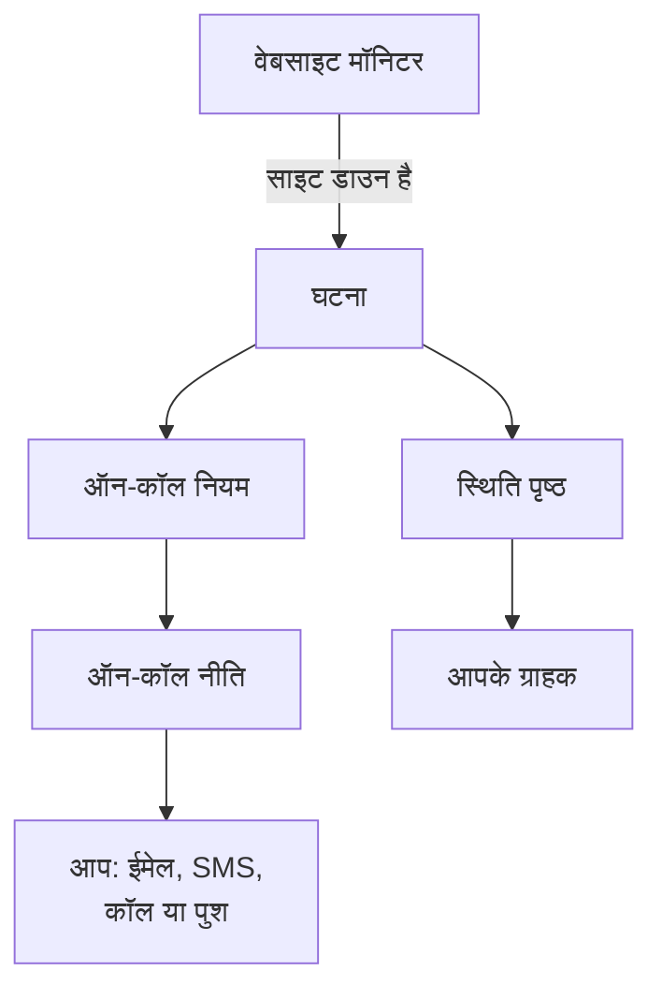

# त्वरित शुरुआत

यह गाइड आपको लगभग पंद्रह मिनट में एक नए खाते से एक काम करते सेटअप तक ले जाती है: एक मॉनिटर जो हर पाँच मिनट में आपकी वेबसाइट जाँचता है, एक ऑन-कॉल नीति जो साइट डाउन होने पर आपको पेज करती है, और एक स्थिति पृष्ठ जो आपके ग्राहकों को बताता है। यह आपके प्रोजेक्ट के मुख्य पृष्ठ पर मौजूद **OneUptime में आपका स्वागत है 👋** चेकलिस्ट और उसके कदमों से खुलने वाले गाइडेड सेटअप के क्रम में चलती है।

किसी दूसरे टूल से आ रहे हैं? पहले उसे [आयात करें](/docs/introduction/getting-started#किसी-दूसरे-टूल-से-आ-रहे-हैं): आपके मॉनिटर, ऑन-कॉल शेड्यूल और स्थिति पृष्ठ आपके साथ आते हैं।

## शुरू करने से पहले

- **एक खाता।** OneUptime Cloud पर, [oneuptime.com](https://oneuptime.com/accounts/register) पर साइन अप करें और उसके भेजे ईमेल का लिंक खोलें। अपने इंस्टॉलेशन पर, उसे अपने ब्राउज़र में खोलें और साइन अप करें: पहला खाता मास्टर एडमिन बन जाता है। इंस्टॉल करने के लिए [Docker Compose](/docs/installation/docker-compose) देखें।
- **निगरानी के लिए एक वेबसाइट।** कोई भी पता जो HTTP या HTTPS पर जवाब देता हो, जैसे आपकी कंपनी का होम पेज।

## एक प्रोजेक्ट बनाएँ

OneUptime में सब कुछ एक प्रोजेक्ट में रहता है: आपके मॉनिटर, घटनाएँ, ऑन-कॉल नीतियाँ, स्थिति पृष्ठ और उन पर काम करने वाले लोग।

:::steps
### नया प्रोजेक्ट शुरू करें

पहली बार साइन इन करने पर OneUptime **कोई प्रोजेक्ट नहीं** दिखाता है। **नया प्रोजेक्ट बनाएँ** पर क्लिक करें। अगर किसी ने आपको पहले ही किसी प्रोजेक्ट में आमंत्रित किया है, तो इसके बजाय उसी पेज पर आमंत्रण स्वीकार करें।

### उसे नाम दें

**प्रोजेक्ट नाम** दर्ज करें, जैसे आपकी कंपनी का नाम। OneUptime Cloud पर उसके नीचे एक प्लान भी चुनें: Free पहले से चुना होता है, और पेड प्लान एक मुफ़्त ट्रायल से शुरू होते हैं।

### उसे बनाएँ

**प्रोजेक्ट बनाएं** पर क्लिक करें। आपके प्रोजेक्ट का मुख्य पृष्ठ खुलता है, जिसमें सबसे ऊपर **OneUptime में आपका स्वागत है 👋** चेकलिस्ट होती है। यह पहले पूछता है **आप सबसे पहले क्या करना चाहते हैं?**: **जानना कि मेरी वेबसाइट या API कब डाउन है**, **कुछ बिगड़ने पर सही व्यक्ति को बुलाना** और **स्थिति पृष्ठ से अपने ग्राहकों को बताना** चुनें, और **जारी रखें** पर क्लिक करें।
:::

## अपनी वेबसाइट की निगरानी करें

:::steps
### वेबसाइट सेटअप खोलें

चेकलिस्ट में **अपना पहला मॉनिटर बनाएँ** पर क्लिक करें। इससे गाइडेड सेटअप **जानना कि मेरी वेबसाइट या API कब डाउन है** खुलता है, जो एक ही पेज पर आपकी साइट जाँचता है, चुनता है कि किसे बताया जाए और एक टेस्ट भेजता है। जिसे मॉनिटर बनाने की अनुमति नहीं है, उसे इसकी जगह **मॉनिटर** सूची मिलती है।

### पता दर्ज करें

**हमें क्या जाँचना चाहिए?** के नीचे, **वेबसाइट या API का पता** में अपनी साइट का पूरा पता दर्ज करें, जैसे `https://example.com`, और **जाँच शुरू करें** पर क्लिक करें। प्रोब इसे तुरंत जाँचते हैं, फिर हर 5 मिनट में: जब साइट जवाब नहीं देती, या एरर के साथ जवाब देती है, तो मॉनिटर **ऑफ़लाइन** हो जाता है और एक घटना घोषित करता है। **जारी रखें** पर क्लिक करें।

### चुनें कि किसे बताया जाए

**किसे बताया जाए?** के नीचे, आप पहले से **किसे पेज किया जाता है** में हैं। **सहेजें और आगे बढ़ें** पर क्लिक करें: इससे `Default on-call policy` बनती है, जो प्रोजेक्ट की हर नई घटना और अलर्ट पर आपको पेज करती है, शुरुआत में ईमेल से। प्रोजेक्ट में पहले से मौजूद टीम सदस्यों को भी पेज करने के लिए, पहले **टीम सदस्य जोड़ें** पर क्लिक करें।

### खुद को एक टेस्ट भेजें

**टेस्ट भेजें** के नीचे, **मुझे परीक्षण पेज भेजें** पर क्लिक करें, एक **गंभीरता** चुनें और **परीक्षण पेज भेजें** पर क्लिक करें। ईमेल में दिया लिंक खोलें, जिसमें TEST लिखा होता है, और वहीं पेज को स्वीकार करें। फिर डायलॉग में **हो गया** पर, और **जारी रखें** पर क्लिक करें: सेटअप इस सारांश पर खत्म होता है कि उसने क्या सेट किया।
:::

हर विकल्प खुद सेट करने के लिए, या वेबसाइट के अलावा कुछ और जाँचने के लिए, **उत्पाद** मेनू से **मॉनिटर** खोलें और **मॉनिटर बनाएं** पर क्लिक करें। [मॉनिटर बनाना](/docs/monitor/create-monitor) फ़ॉर्म और हर मॉनिटर प्रकार के बारे में बताता है।

API की भी जाँच करने, और पहली जाँच कभी वापस न आए तो क्या करें यह जानने के लिए, [जानें कि आपकी वेबसाइट या API कब डाउन होती है](/docs/guides/website-down) का पालन करें।

## साइट डाउन होने पर पेज पाएँ

वेबसाइट सेटअप पहले ही `Default on-call policy` बना चुका है, जो हर नई घटना और अलर्ट पर आपको ईमेल से पेज करती है, इसलिए चेकलिस्ट **एक ऑन-कॉल नीति सेट करें** को पूरा दिखाती है। फिर भी उसका गाइडेड सेटअप आपका फ़ोन, आपके साथ पेज होने वाले लोग और कोई जवाब न दे तो क्या हो, यह जोड़ता है।

:::steps
### ऑन-कॉल सेटअप खोलें

`Ctrl+K` (Mac पर `Cmd+K`) दबाएँ, `get paged` टाइप करें और **कुछ बिगड़ने पर सही व्यक्ति को बुलाना** चुनें। जब तक चेकलिस्ट ने **एक ऑन-कॉल नीति सेट करें** को पूरा नहीं दिखाया है, वह कदम भी यही गाइडेड सेटअप खोलता है।

### चुनें कि आप तक कैसे पहुँचा जाए

**हम आप तक कैसे पहुँचें?** के नीचे आपका साइन-इन ईमेल पहले से दिखता है। पुश सूचनाओं के लिए, App Store या Google Play से OneUptime On-Call ऐप इंस्टॉल करें, साइन इन करें और **फिर से जाँचें** पर क्लिक करें। SMS और कॉल भी पाने के लिए, **SMS और फ़ोन कॉल चालू करें** पर क्लिक करें, **आपका फ़ोन नंबर** में अपना नंबर दर्ज करें और **मुझे SMS से कोड भेजें** पर क्लिक करें: OneUptime Cloud पर SMS और कॉल का भुगतान प्रोजेक्ट के बैलेंस से होता है, इसलिए यह कदम पहले बैलेंस जोड़ने को कहता है। **जारी रखें** पर क्लिक करें।

### चुनें कि और किसे पेज किया जाए

**और कौन ऑन-कॉल है?** के नीचे, **ऑन-कॉल नीति** में `Default on-call policy` रहने दें। अपने साथ टीम सदस्यों को पेज करने के लिए, उन्हें **पहले एस्केलेशन नियम में जोड़ें** के नीचे जोड़ें। **सहेजें और आगे बढ़ें** पर क्लिक करें।

### तय करें कि कोई जवाब न दे तो क्या हो

**अगर कोई जवाब न दे तो?** के नीचे, जब तक प्रोजेक्ट में केवल आप हैं, **उन्हीं लोगों को फिर से पेज करें** चुनें। टीम सदस्यों के आ जाने पर, **किसी और को पेज करें** उस व्यक्ति को पेज करता है जिसे आप **इसके बाद पेज किए जाते हैं** में चुनते हैं। **सहेजें और आगे बढ़ें** पर क्लिक करें।

### एक परीक्षण पेज भेजें

**परीक्षण पेज भेजें** के नीचे, **इस नीति का परीक्षण करें** पर क्लिक करें, एक **गंभीरता** चुनें और **परीक्षण पेज भेजें** पर क्लिक करें। ईमेल, SMS या कॉल से पेज को स्वीकार करें, फिर डायलॉग में **हो गया** पर, और **जारी रखें** पर क्लिक करें। सेटअप **पेजिंग सेट हो गई है** पर खत्म होता है।
:::

> [!NOTE]
> नए प्रोजेक्ट में SMS और फ़ोन कॉल बंद रहते हैं। प्रोजेक्ट का मालिक, Billing Admin या Manage Billing अनुमति वाला कोई व्यक्ति उन्हें **प्रोजेक्ट सेटिंग्स → सूचनाएं → सूचना चैनल** में **सूचना चैनल** कार्ड में चालू करता है।

नीति को दो ऑन-कॉल नियम चलाते हैं: एक हर नई घटना के लिए और एक हर नए अलर्ट के लिए। पहला देखने के लिए, **उत्पाद** मेनू से **घटनाएं** खोलें, साइड मेनू में **नियम** को फैलाएँ और **ऑन-कॉल नियम** चुनें: यह **सभी घटनाएं** से मेल खाता है। नीति को केवल कुछ घटनाओं पर पेज करने के लिए, जैसे गंभीर घटनाएँ, वहाँ नियम बदलें, या अपना नियम जोड़ने के लिए **Incident On-Call Rule बनाएँ** पर क्लिक करें।

इसके बजाय नीति को एक-एक फ़ील्ड भरकर बनाने के लिए, **उत्पाद** मेनू से **ऑन-कॉल** खोलें और **ऑन-कॉल नीति बनाएँ** पर क्लिक करें। और स्तरों, रोटेशन और हर स्तर कितनी देर इंतज़ार करता है, इसके लिए [एस्केलेशन नियम](/docs/on-call/escalation-rules) और [ऑन-कॉल अनुसूची](/docs/on-call/schedules) देखें।

सेटअप की हर स्क्रीन के लिए, और पेज न पहुँचे तो क्या करें, [फ़ोन, SMS या पुश से पेज पाएँ](/docs/guides/paging) का पालन करें।

## एक स्थिति पृष्ठ प्रकाशित करें

:::steps
### स्थिति पृष्ठ सेटअप खोलें

चेकलिस्ट में **एक स्थिति पृष्ठ प्रकाशित करें** पर क्लिक करें। इससे गाइडेड सेटअप **एक स्थिति पृष्ठ प्रकाशित करें** खुलता है, जो पृष्ठ को नाम देता है, उस पर आपका मॉनिटर रखता है और दिखाता है कि आपके ग्राहक क्या देखते हैं। जिसे स्थिति पृष्ठ बनाने की अनुमति नहीं है, उसे इसकी जगह **स्थिति पृष्ठ** सूची मिलती है। वेबसाइट सेटअप का सारांश भी यही सेटअप **इसे स्थिति पृष्ठ पर दिखाएँ** के रूप में खोलता है।

### इसे नाम दें और अपना मॉनिटर चुनें

**इसे नाम दें और चुनें कि यह क्या दिखाए** के नीचे, सुझाया गया **स्थिति पृष्ठ का नाम** रहने दें, या अपना नाम लिखें। **यह क्या दिखाता है** के नीचे अपना वेबसाइट मॉनिटर चुनें, और **स्थिति पृष्ठ बनाएँ** पर क्लिक करें। इसी पल से पृष्ठ अपने लिंक पर सार्वजनिक है: जिसके पास भी उसका पता है, वह उसे खोल सकता है।

### पेज खोलें

**आपके ग्राहकों को यह दिखता है** के नीचे, **सार्वजनिक लिंक** के नीचे दिया पता खोलें: आपकी वेबसाइट कार्यरत दिखती है। सेटअप में वापस आकर **ठीक लग रहा है** पर क्लिक करें। सेटअप इस सारांश पर खत्म होता है कि आगे क्या करें।
:::

इसके बजाय पृष्ठ हाथ से बनाने के लिए, **उत्पाद** मेनू से **स्थिति पृष्ठ** खोलें और **स्थिति पृष्ठ बनाएं** पर क्लिक करें, फिर उसके **अवलोकन** पर **मॉनिटर जोड़ें** से अपना मॉनिटर जोड़ें। पृष्ठ को अपना लोगो और रंग देने के लिए [स्थिति पृष्ठ ब्रांडिंग और डोमेन](/docs/status-pages/branding-and-domains) देखें।

स्थिति पृष्ठ को HTTPS के साथ अपने डोमेन पर लाने के लिए, [एक स्थिति पृष्ठ प्रकाशित करें](/docs/guides/status-page) का पालन करें।

## अपनी टीम को आमंत्रित करें

चेकलिस्ट में **अपनी टीम को आमंत्रित करें** पर क्लिक करें, या **उत्पाद** मेनू में **सेटिंग्स** के नीचे से **उपयोगकर्ता** खोलें। **उपयोगकर्ता को आमंत्रित करें** पर क्लिक करें, उनका **ईमेल** दर्ज करें, और एक **टीम** चुनें: शुरुआत में मेंबर्स टीम चुनी होती है। **आमंत्रित करें** पर क्लिक करें। OneUptime उन्हें आमंत्रण ईमेल करता है, और टीम तय करती है कि वे क्या कर सकते हैं। [उपयोगकर्ता, टीमें और अनुमतियाँ](/docs/permissions/index) देखें।

## इसे आज़माएँ

पूरी शृंखला को काम करते देखने के लिए एक परीक्षण घटना घोषित करें।

:::steps
### एक परीक्षण घटना घोषित करें

**घटनाएं** खोलें और **घटना घोषित करें** पर क्लिक करें। **शीर्षक** दर्ज करें, जैसे `Test incident`, एक **घटना गंभीरता** चुनें और **अगला** पर क्लिक करें। **मॉनिटर** में अपना वेबसाइट मॉनिटर चुनें, ताकि घटना आपके स्थिति पृष्ठ पर दिखे। सारांश तक पहुँचने तक **अगला** पर क्लिक करते रहें, फिर **घटना घोषित करें** पर क्लिक करें।

### इसे होते देखें

एक-दो मिनट में आपकी ऑन-कॉल नीति आपको पेज करती है, और घटना आपके स्थिति पृष्ठ पर दिखती है।

### इसे सुलझाएँ

घटना के पेज पर **सुलझाएं** पर क्लिक करें। पेज करना रुक जाता है, और घटना आपके स्थिति पृष्ठ से हट जाती है।
:::

> [!WARNING]
> जब तक आप परीक्षण घटना नहीं सुलझाते, आपका स्थिति पृष्ठ खोलने वाला हर व्यक्ति उसे देखता है। पेज का पता साझा करने से पहले परीक्षण करें।

## समस्या निवारण

:::details मुझे पेज नहीं किया गया
घटना खोलें और उसके साइड मेनू में **ऑन-कॉल निष्पादन** चुनें: यह दिखाता है कि आपकी नीति चली या नहीं, और उसने किसे पेज किया। अगर नहीं चली, तो जाँचें कि आपका ऑन-कॉल नियम सक्षम है और उस नीति का नाम लेता है। अगर चली, तो जाँचें कि **उपयोगकर्ता सेटिंग्स → सूचना विधियां** में आपकी विधियाँ सत्यापित हैं।
:::

:::details घटना मेरे स्थिति पृष्ठ पर नहीं है
स्थिति पृष्ठ किसी घटना को तब दिखाता है जब घटना का कोई मॉनिटर उस पेज पर हो। जाँचें कि घटना के प्रभावित संसाधनों में आपका मॉनिटर है, और वह मॉनिटर स्थिति पृष्ठ पर है।
:::

:::details मॉनिटर ऑफ़लाइन बताता है, पर मेरी साइट चल रही है
मॉनिटर खोलें और देखें कि प्रोब को क्या मिला। [वेबसाइट मॉनिटर](/docs/monitor/website-monitor) का समस्या निवारण खंड देखें।
:::

## अगले कदम

:::cards
- [मुख्य अवधारणाएँ](/docs/introduction/core-concepts): आपने अभी जो सेट किया, उसके पीछे के विचार।
- [शब्दावली](/docs/introduction/glossary): रास्ते में मिला हर शब्द, एक-दो वाक्यों में।
- [ऑन-कॉल अनुसूची](/docs/on-call/schedules): ऑन-कॉल रहने की ज़िम्मेदारी अपनी टीम के साथ बाँटें।
- [स्थिति पृष्ठ ब्रांडिंग और डोमेन](/docs/status-pages/branding-and-domains): स्थिति पृष्ठ को अपना बनाएँ।
- [OpenTelemetry](/docs/telemetry/open-telemetry): अपने ऐप्स से लॉग, मेट्रिक्स और ट्रेस भेजें।
:::
