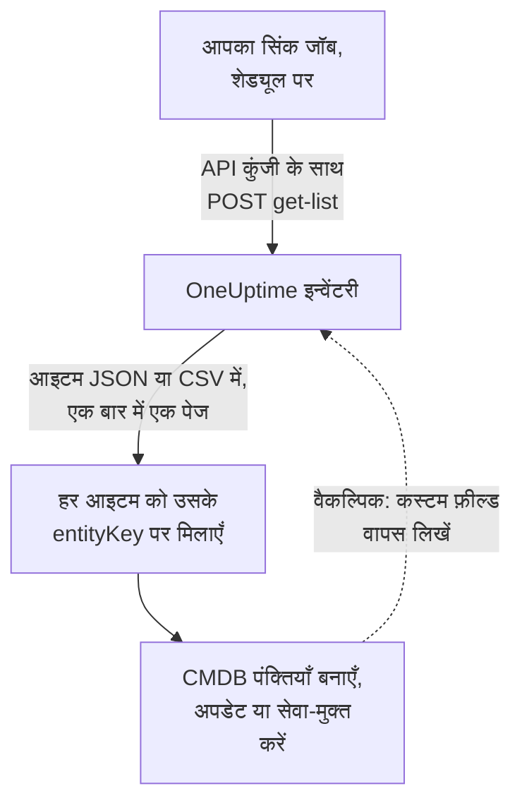

# CMDB में निर्यात करना

अगर आप पहले से कोई CMDB या एसेट रजिस्टर चलाते हैं, तो OneUptime उसकी जगह लेने की कोशिश नहीं कर रहा। उसके पास जो है और CMDB में आम तौर पर नहीं होता, वह है असल में जो चल रहा है उसकी एक तस्वीर, जो बिना किसी के रखरखाव के अद्यतन रहती है: टेलीमेट्री से खोजी हुई, और उन पोलर से जो पहले से आपके नेटवर्क और क्लाउड खातों पर नज़र रखते हैं। यह पेज उस तस्वीर को आपके अपने रिकॉर्ड सिस्टम में खींचने की विधि है।

:::cards
- [सिंक कैसे काम करता है](#सिंक-कैसे-काम-करता-है): एक शेड्यूल्ड जॉब जो सूची पढ़ता है और एक स्थिर कुंजी पर मिलान करता है।
- [कैटलॉग खींचें](#कैटलॉग-खींचें): अनुरोध, पेज दर पेज, JSON या CSV के रूप में।
- [एसेट विवरण](#एसेट-विवरण): होस्ट और नेटवर्क डिवाइस के लिए वही तथ्य और कुंजियाँ।
- [वापस लिखें](#वापस-लिखें): अपने एसेट टैग OneUptime में भेजें, और वह जोड़ें जो वह नहीं देख सकता।
:::

## सिंक कैसे काम करता है

सिंक एक जॉब है जिसे आप शेड्यूल पर चलाते हैं। वह API कुंजी के साथ REST API से इन्वेंटरी सूची पढ़ता है, हर आइटम को उसकी पहचान कुंजी से आपके CMDB की किसी पंक्ति से मिलाता है, और मेल बैठाने के लिए पंक्तियाँ बनाता, अपडेट करता या सेवा-मुक्त करता है। वह आइटम के कस्टम फ़ील्ड में मान वापस भी लिख सकता है।



## आप क्या खींच सकते हैं

तीन REST संसाधन, हर एक [OneUptime API](/docs/api-reference/api-reference) के मानक एंडपॉइंट के साथ:

| संसाधन | एंडपॉइंट | इसमें क्या है |
| --- | --- | --- |
| इन्वेंटरी आइटम | `/api/inventory-item` | परिवेश की हर चीज़ के लिए एक पंक्ति |
| कस्टम फ़ील्ड की परिभाषाएँ | `/api/inventory-item-custom-field` | आपके प्रोजेक्ट की अपनी फ़ील्ड शब्दावली |
| संबंध | `/api/inventory-item-relationship` | आइटम के बीच दिशा वाले लिंक |

किसी इन्वेंटरी आइटम के उपयोगी कॉलम:

| कॉलम | अर्थ |
| --- | --- |
| `_id` | OneUptime की ID: इसे अपने बाहरी संदर्भ के रूप में इस्तेमाल करें |
| `entityType` | `host`, `k8s.pod`, `network.device`, `appliance`, … |
| `entityKey` | एक स्थिर पहचान हैश। यह नाम बदलने के बाद भी बना रहता है, इसलिए मिलान के लिए यही बेहतर कुंजी है |
| `displayName` | वह नाम जो लोग पढ़ते हैं |
| `source` | `discovered`, `inventory` या `manual` |
| `description` | मुक्त टेक्स्ट |
| `identifyingAttributes` | वे एट्रिब्यूट जो आइटम को वह बनाते हैं जो वह है, और जो कभी नहीं बदलते |
| `descriptiveAttributes` | उस पर देखी गई बाकी हर चीज़: नीचे [एसेट विवरण](#एसेट-विवरण), [होस्ट एसेट एट्रिब्यूट](#होस्ट-एसेट-एट्रिब्यूट) और [नेटवर्क डिवाइस एसेट एट्रिब्यूट](#नेटवर्क-डिवाइस-एसेट-एट्रिब्यूट) देखें |
| `customFields` | आपके अपने फ़ील्ड, फ़ील्ड के नाम से |
| `resourceType` / `resourceId` | ज़्यादा विस्तृत OneUptime रिकॉर्ड का संकेत, जब वह मौजूद हो |
| `firstSeenAt` / `lastSeenAt` | उसे पहली और आख़िरी बार कब देखा गया |
| `isArchived` | क्या उसे लाइव सूची से बाहर किया गया है |

## शुरू करने से पहले

सिंक को ऐसी API कुंजी चाहिए जो इन्वेंटरी पढ़ सके। OneUptime Cloud पर, API कुंजियों के लिए **Growth** या उससे ऊपर का प्लान चाहिए।

:::steps
### एक API कुंजी बनाएँ

**प्रोजेक्ट सेटिंग्स → उन्नत → API कुंजियाँ** खोलें और **API कुंजी बनाएँ** पर क्लिक करें। उसे एक **नाम** दें, और **एक्सेस** के नीचे प्रोजेक्ट में सब कुछ पढ़ने के लिए **दर्शक** चुनें, या उसे केवल वह देने के लिए **अनुमतियाँ बाद में चुनें** जो सिंक को चाहिए।

### उसे केवल वही दें जो उसे चाहिए

केवल पढ़ने वाले निर्यात के लिए एक अनुमति चाहिए, **Read Telemetry Service**: इन्वेंटरी की अपनी अनुमतियाँ नहीं हैं, वह टेलीमेट्री की अनुमतियाँ साझा करती है। कुंजी के पेज पर, **अनुमति जोड़ें** पर क्लिक करें और उसे चुनें। मान वापस लिखने के लिए, **Edit Telemetry Service** भी जोड़ें।

### कुंजी कॉपी करें

कुंजी के पेज से **API कुंजी** कॉपी करें, और उसे अपने जॉब के लिए उपलब्ध कराएँ:

```bash
export ONEUPTIME_API_KEY="your-api-key"
```
:::

कुंजी हर अनुरोध के `ApiKey` हेडर में भेजी जाती है, और वह अपने ही प्रोजेक्ट की इन्वेंटरी पढ़ती है, इसलिए अनुरोध में किसी प्रोजेक्ट का नाम नहीं होता।

## कैटलॉग खींचें

अपने चाहे कॉलम के साथ सूची एंडपॉइंट पर `POST` करें। `select` ज़रूरी है: API केवल वही लौटाता है जो आप माँगते हैं।

```bash
curl -X POST 'https://oneuptime.com/api/inventory-item/get-list' \
  -H "ApiKey: $ONEUPTIME_API_KEY" \
  -H 'Content-Type: application/json' \
  -d '{
    "query": { "isArchived": false },
    "select": {
      "_id": true,
      "entityType": true,
      "entityKey": true,
      "displayName": true,
      "source": true,
      "customFields": true,
      "descriptiveAttributes": true,
      "lastSeenAt": true
    },
    "sort": { "displayName": "ASC" },
    "limit": 100,
    "skip": 0
  }'
```

सेल्फ़-होस्टेड इंस्टॉल पर, `https://oneuptime.com` की जगह अपना OneUptime पता इस्तेमाल करें। जवाब `{ "data": [...], "count": ... }` होता है, जहाँ `count` बताता है कि कुल कितने आइटम मेल खाते हैं। सब मिलने तक `skip` को अपने `limit` जितना बढ़ाकर पेज बदलें; `limit` 10,000 तक जा सकता है। तारीखें और `_id` के अलावा ID लिपटी हुई आती हैं, जैसे `{ "_type": "DateTime", "value": "..." }` और `{ "_type": "ObjectID", "value": "..." }`: उन्हें `value` से पढ़ें।

### केवल नेटवर्क डिवाइस

सूची को `entityType` से छोटा करें:

```bash
curl -X POST 'https://oneuptime.com/api/inventory-item/get-list' \
  -H "ApiKey: $ONEUPTIME_API_KEY" \
  -H 'Content-Type: application/json' \
  -d '{
    "query": { "entityType": "network.device", "isArchived": false },
    "select": { "_id": true, "entityKey": true, "displayName": true, "customFields": true },
    "limit": 100,
    "skip": 0
  }'
```

हर नेटवर्क डिवाइस का `descriptiveAttributes` उसका होस्टनाम, IP पता, क्रम संख्या, MAC पता, निर्माता, मॉडल, फ़र्मवेयर, ऑपरेटिंग सिस्टम, भूमिका, साइट और स्थान रखता है: नीचे [नेटवर्क डिवाइस एसेट एट्रिब्यूट](#नेटवर्क-डिवाइस-एसेट-एट्रिब्यूट) देखें। पोलर जो कुछ और जानता है, जैसे इंटरफ़ेस और पड़ोसी, वह खुद Network Device रिकॉर्ड पर होता है: `resourceId` से `/api/network-device/:id/get-item` पर जाएँ, या सीधे `/api/network-device/get-list` खींचें।

### CSV के रूप में

कोई भी सूची एंडपॉइंट `?output-type=csv` के साथ JSON के बजाय CSV में जवाब देता है:

```bash
curl -X POST 'https://oneuptime.com/api/inventory-item/get-list?output-type=csv' \
  -H "ApiKey: $ONEUPTIME_API_KEY" \
  -H 'Content-Type: application/json' \
  -d '{ "query": {}, "select": { "displayName": true, "entityType": true, "customFields": true }, "limit": 500, "skip": 0 }' \
  -o inventory.csv
```

डैशबोर्ड में **All Items** सूची भी इसी तरह निर्यात होती है, उन कस्टम फ़ील्ड कॉलम के साथ जो आपने चालू किए हैं। हर [एसेट विवरण](#एसेट-विवरण) वहाँ भी एक कॉलम है: **होस्टनाम**, **आईपी पता**, **क्रम संख्या**, **मॉडल** और बाकी छिपे हुए शुरू होते हैं, इसलिए उन्हें कॉलम पिकर से चालू करें, और निर्यात में हर तथ्य का एक कॉलम आता है, पंक्ति चाहे होस्ट हो या नेटवर्क डिवाइस।

## एसेट विवरण

होस्ट और नेटवर्क डिवाइस एक ही तथ्यों से बताए जाते हैं, जो एक ही कुंजियों के नीचे रखे जाते हैं। CMDB का एक कॉलम क्रम संख्या रखता है, पंक्ति चाहे सर्वर हो या स्विच, और डैशबोर्ड में किसी आइटम का **एसेट विवरण** कार्ड दोनों के लिए हर तथ्य एक ही क्रम में दिखाता है। जिस तथ्य की किसी ने जानकारी नहीं दी, वह छोड़े जाने के बजाय **अज्ञात** दिखता है, ताकि कमी दिखाई दे।

| तथ्य | कुंजी | होस्ट पर | नेटवर्क डिवाइस पर |
| --- | --- | --- | --- |
| होस्टनाम | `host.name` | होस्ट का नाम। यह होस्ट की पहचान है, इसलिए यह `identifyingAttributes` में है | डिवाइस का अपना नाम: उसका SNMP `sysName`, नहीं तो खोज में मिला NetBIOS या DNS नाम। कभी उसका IP पता नहीं |
| आईपी पता | `host.ip` | हर पता जो कलेक्टर बताता है | वह पता जिसे OneUptime पोल करता है, जब वह IP पता हो, नहीं तो वह पता जिसमें उसके प्रोब ने उस DNS नाम को बदला |
| MAC पता | `host.mac` | पता लगाया गया | डिवाइस पर टाइप किया गया, या जाँचे गए राउटर की ARP तालिका से सीखा गया |
| क्रम संख्या | `host.serial_number` | जोड़ा गया | ENTITY-MIB |
| निर्माता | `device.manufacturer` | जोड़ा गया | ENTITY-MIB, नहीं तो जो `sysDescr` या `sysObjectID` बताता है |
| मॉडल | `device.model.name` | जोड़ा गया | ENTITY-MIB, नहीं तो जो `sysDescr` बताता है |
| फ़र्मवेयर संस्करण | `device.firmware.version` | जोड़ा गया | ENTITY-MIB, नहीं तो जो `sysDescr` बताता है |
| ऑपरेटिंग सिस्टम | `os.name` | `os.description` (या `os.type`) | जो `sysDescr` बताता है: Cisco IOS, Junos OS, Arista EOS, Linux |
| OS संस्करण | `os.version` | पता लगाया गया | ENTITY-MIB, नहीं तो जो `sysDescr` बताता है |
| Device Type | `device.type` | जोड़ा गया। नहीं तो कार्ड उसे उसके OS और नाम से वर्गीकृत करता है (सर्वर, फ़ायरवॉल, ...) | उसकी भूमिका: जो आपने दी, नहीं तो वह जिसके रूप में टोपोलॉजी मैप उसे बनाता है |
| स्थान | `device.location` | जोड़ा गया। नहीं तो कार्ड उसका क्लाउड ज़ोन दिखाता है | `sysLocation`। कार्ड पहले उसकी साइट दिखाता है |

नीचे [होस्ट तालिका](#होस्ट-एसेट-एट्रिब्यूट) और [नेटवर्क डिवाइस तालिका](#नेटवर्क-डिवाइस-एसेट-एट्रिब्यूट) विस्तार से बताती हैं कि हर मान कहाँ से आता है।

## होस्ट एसेट एट्रिब्यूट

किसी होस्ट का `descriptiveAttributes` वे एसेट तथ्य रखता है जो CMDB की पंक्ति को आम तौर पर चाहिए, उनके OpenTelemetry एट्रिब्यूट नाम से:

| फ़ील्ड | कुंजी | डिफ़ॉल्ट रूप से इकट्ठा होता है? |
| --- | --- | --- |
| IP पते | `host.ip` | हाँ: मशीन के कई पते हों तो कॉमा से अलग |
| MAC पते | `host.mac` | हाँ: कॉमा से अलग, हर चालू इंटरफ़ेस का एक, `AC-DE-48-23-45-67` के रूप में |
| आर्किटेक्चर | `host.arch` | हाँ |
| मशीन ID | `host.id` | हाँ: Windows पर मशीन GUID, Linux पर `/etc/machine-id` |
| ऑपरेटिंग सिस्टम | `os.type`, `os.description`, `os.version` | हाँ |
| क्लाउड में स्थान | `cloud.provider`, `cloud.region`, `cloud.availability_zone` | केवल क्लाउड डिटेक्टर के साथ |
| क्रम संख्या | `host.serial_number` | एक कॉन्फ़िगरेशन चरण चाहिए |
| निर्माता | `device.manufacturer` | एक कॉन्फ़िगरेशन चरण चाहिए |
| मॉडल | `device.model.name` | एक कॉन्फ़िगरेशन चरण चाहिए |
| फ़र्मवेयर (BIOS या UEFI) संस्करण | `device.firmware.version` | एक कॉन्फ़िगरेशन चरण चाहिए |
| ऑपरेटिंग सिस्टम का नाम | `os.name` | केवल उन SDK से जो इसे बताते हैं: नहीं तो `os.description` OS का नाम बताता है |
| डिवाइस प्रकार | `device.type` | वैकल्पिक: इसे भी उसी तरह जोड़ें (`Hypervisor`, `Workstation`) |
| स्थान | `device.location` | वैकल्पिक: इसे भी उसी तरह जोड़ें (`Frankfurt DC, Rack B4`) |

"हाँ" वाली हर चीज़ कलेक्टर के `resourcedetection` प्रोसेसर से आती है, और वह OneUptime के आपके लिए बनाए कॉन्फ़िगरेशन में पहले से है।

`cloud.*` कुंजियों के लिए उस प्रोसेसर में एक क्लाउड डिटेक्टर चाहिए: `detectors: [system, env, ec2]`, या दूसरों के लिए `gcp` या `azure`। साथ आने वाला कॉन्फ़िगरेशन केवल `[system, env]` चलाता है, इसलिए वे तीनों तब तक खाली रहती हैं जब तक आप एक न जोड़ें।

क्रम संख्या, निर्माता, मॉडल और फ़र्मवेयर का कोई रिसोर्स डिटेक्टर नहीं है: वे मशीन के फ़र्मवेयर में रहते हैं, जो Windows पर WMI और Linux पर DMI से पढ़े जाते हैं, इसलिए उन्हें मशीन तैयार करते समय एक बार रिसोर्स पर जोड़ा जाता है। पंक्ति पर चाहा गया डिवाइस प्रकार या स्थान भी उसी तरह जोड़ा जाता है। [इन्वेंटरी एट्रिब्यूट](/docs/telemetry/host-otel-collector#इन्वेंटरी-एट्रिब्यूट-ip-mac-सीरियल-नंबर-निर्माता-मॉडल-फ़र्मवेयर) में हर ऑपरेटिंग सिस्टम के लिए सटीक स्निपेट है। `host.manufacturer`, `host.model.name`, `host.firmware.version` और `host.bios.version` दूसरी वर्तनी के रूप में स्वीकार किए जाते हैं और `device.*` कुंजियों के नीचे रखे जाते हैं (और `device.serial_number` को `host.serial_number` के नीचे), इसलिए सिंक हर तथ्य के लिए हमेशा एक ही कुंजी पढ़ता है।

अगर आपका CMDB पहले से किसी हार्डवेयर पहचानकर्ता पर कुंजी रखता है, तो मिलान की कुंजी के रूप में `host.id` पर नज़र डालना उचित है: `entityKey` के उलट, यह मशीन की अपनी ID है, इसलिए यह उससे मेल खाती है जो कोई एंडपॉइंट मैनेजमेंट टूल उसी मशीन के लिए बताता है।

एट्रिब्यूट जोड़े जाते हैं, कभी खाली नहीं किए जाते: जिसकी जानकारी मिलनी बंद हो जाए वह पंक्ति पर बना रहता है, इसलिए आपके सिंक का पहले से पढ़ा हुआ कोई मान चुपचाप गायब नहीं होता।

## नेटवर्क डिवाइस एसेट एट्रिब्यूट

नेटवर्क डिवाइस (`entityType: network.device`) अपने Network Device रिकॉर्ड से मिरर किया जाता है, और उसका `descriptiveAttributes` उन्हीं तथ्यों के लिए वही कुंजियाँ इस्तेमाल करता है जो होस्ट करता है, ताकि CMDB का एक कॉलम क्रम संख्या रखे, पंक्ति चाहे सर्वर हो या स्विच:

| फ़ील्ड | कुंजी | कहाँ से आता है |
| --- | --- | --- |
| होस्टनाम | `host.name` | डिवाइस का अपना नाम: उसका SNMP `sysName`, नहीं तो खोज में मिला NetBIOS या रिवर्स-DNS नाम। जब केवल उसका IP पता उसे नाम देता है तो छोड़ दिया जाता है |
| IP पता | `host.ip` | वह पता जिसे OneUptime पोल करता है, जब वह IP पता हो। DNS नाम पर पोल किए जाने वाले डिवाइस के लिए, वह पता जिसमें उसके प्रोब ने पिछली बार उस नाम को बदला |
| DNS नाम | `net.device.dns_name` | खोज के समय मिला रिवर्स-DNS नाम, या वह DNS नाम जिसे OneUptime पोल करता है |
| MAC पता | `host.mac` | डिवाइस पर टाइप किया गया, या जाँचे गए राउटर की ARP तालिका से सीखा गया |
| निर्माता | `device.manufacturer` | ENTITY-MIB `entPhysicalMfgName`, नहीं तो वह निर्माता जो `sysDescr` बताता है, नहीं तो `sysObjectID` का वेंडर |
| मॉडल | `device.model.name` | ENTITY-MIB `entPhysicalModelName`, नहीं तो वह मॉडल जो `sysDescr` बताता है |
| क्रम संख्या | `host.serial_number` | ENTITY-MIB `entPhysicalSerialNum` |
| फ़र्मवेयर संस्करण | `device.firmware.version` | ENTITY-MIB `entPhysicalFirmwareRev`, नहीं तो वह फ़र्मवेयर जो Ubiquiti, HPE और Aruba डिवाइस पर `sysDescr` बताता है |
| ऑपरेटिंग सिस्टम | `os.name` | वह ऑपरेटिंग सिस्टम जो `sysDescr` बताता है |
| सॉफ़्टवेयर या OS संस्करण | `os.version` | ENTITY-MIB `entPhysicalSoftwareRev`, नहीं तो वह रिलीज़ जो `sysDescr` बताता है |
| सिस्टम विवरण | `os.description` | `sysDescr` |
| डिवाइस प्रकार | `device.type` | वह भूमिका जो आपने डिवाइस को दी, नहीं तो वह भूमिका जिसके रूप में टोपोलॉजी मैप उसे वर्गीकृत करता है, आपके प्रोजेक्ट के दिए नाम से |
| स्थान | `device.location` | `sysLocation`, जब तक वह किसी एजेंट का डिफ़ॉल्ट न हो, जैसे Net-SNMP का "Sitting on the Dock of the Bay" |
| साइट | `oneuptime.site.name` | वह Network Site जिसे डिवाइस सौंपा गया है |
| पोल किया गया पता | `net.device.hostname` | वह पता जिसे OneUptime पोल करता है: कोई IP पता या DNS नाम। `host.name` और `host.ip` के आने से पहले लिखे गए सिंक के लिए रखा गया है |

ENTITY-MIB वाली पंक्तियाँ डिवाइस के पहले SNMP वॉक के बाद भरती हैं। जिस डिवाइस का वॉक नहीं होता, क्योंकि वह केवल पिंग से मॉनिटर होता है या अभी पोल नहीं हुआ, वह फिर भी अपना नाम, निर्माता, ऑपरेटिंग सिस्टम और स्थान उसके पते के पिछले डिस्कवरी स्कैन ने SNMP से जो पढ़ा उससे पाता है, और अपना MAC पता किसी जाँचे गए राउटर की ARP तालिका से। जो डिवाइस ENTITY-MIB लागू नहीं करता, उसके पास बताने को कोई क्रम संख्या या फ़र्मवेयर नहीं होता। फिर भी कई प्लेटफ़ॉर्म पर उसका `sysDescr` मॉडल और ऑपरेटिंग सिस्टम बताता है: एक Cisco Meraki MX `Meraki MX85` बताता है, जिससे निर्माता और मॉडल भर जाते हैं। जिस प्लेटफ़ॉर्म के `sysDescr` का कोई जाना-पहचाना रूप नहीं है, वह अनुमान के बजाय कुछ नहीं जोड़ता।

डिवाइस पर सहेजा गया मान, टाइप किया गया या API से सेट किया गया, डिस्कवरी जो पढ़ती है उससे कभी नहीं बदला जाता। डिवाइस के अपने वॉक ने जो मान पढ़ा और किसी स्कैन ने जो मान पढ़ा, उनमें से नया वाला इस्तेमाल होता है। किसी स्कैन का पढ़ा हुआ तभी इस्तेमाल होता है जब स्कैन को उस पते पर वही मशीन मिली हो: जब उसका पढ़ा सिस्टम नाम, `sysObjectID` या NetBIOS नाम डिवाइस वाले से मेल नहीं खाता, तो उसने वहाँ जो पढ़ा उसमें से कुछ भी इस्तेमाल नहीं होता। आइटम का **एसेट विवरण** कार्ड बताता है कि हर मान कहाँ से और कब आया।

होस्टनाम कभी IP पता नहीं होता। जिस डिवाइस को केवल उसका पता नाम देता है, उसके पास `host.ip` होता है और कोई `host.name` नहीं। जैसे ही उसका SNMP वॉक कोई सिस्टम नाम बताता है, अगली बार में `host.name` आ जाता है।

ये मान हर पंद्रह मिनट में Network Device रिकॉर्ड से कॉपी किए जाते हैं, और वे पिछले मानों में जोड़े जाने के बजाय उन्हें **बदल देते हैं**, इसलिए डिवाइस पर साफ़ किया गया मान (मान लीजिए, हटाया गया MAC पता) इन्वेंटरी आइटम से भी चला जाता है।

कोई *उपलब्ध अपग्रेड* संस्करण नहीं है: SNMP में इसके लिए कोई मानक ऑब्जेक्ट नहीं है, इसलिए OneUptime वह संस्करण दर्ज करता है जो डिवाइस चला रहा है।

## आइटम को CMDB पंक्तियों से मिलाएँ

`displayName` पर नहीं, `entityKey` पर मिलान करें। यह आइटम के पहचान वाले एट्रिब्यूट का हैश है, इसलिए यह नाम बदलने और नए टैग के बाद भी बना रहता है: नया लेबल पाने वाला होस्ट वही कुंजी रखता है जबकि उसका दिखने वाला नाम बदल जाता है। `_id` भी उतनी ही स्थिर है, और अगर आप हमेशा केवल एक प्रोजेक्ट से बात करते हैं तो यह सबसे सरल फ़ॉरेन की है।

`customFields` में तारीखें ISO-8601 UTC स्ट्रिंग होती हैं, और CSV निर्यात उन्हें डैशबोर्ड के दिखाए ज़्यादा सहज रूप के बजाय इसी रूप में लिखता है, ताकि वे पार्सिंग की किसी हैरानी के बिना इम्पोर्ट हों।

## ताज़ा रखें

कोई चेंज फ़ीड नहीं है। अपनी सुविधा के अंतराल पर सूची एंडपॉइंट को पोल करें, और `entityKey` पर तुलना करें। `lastSeenAt` बताता है कि किसी आइटम को आख़िरी बार कब देखा गया, जो आम तौर पर यह पहचानने का सबसे सस्ता तरीका है कि आपके पिछले रन के बाद क्या चुप हो गया है।

जो आइटम दो रन के बीच गायब हो जाता है, वह या तो पुराना होकर हट गया (कोई खोजा गया आइटम जो अपनी अवधि से ज़्यादा चुप रहा) या उसका मालिक रिकॉर्ड हटा दिया गया। कस्टम फ़ील्ड मान रखने वाला मिरर किया गया आइटम अपना रिकॉर्ड जाने पर हटाने के बजाय संग्रहित किया जाता है, इसलिए उससे जुड़ा एसेट डेटा खोए बिना यह देखने के लिए कि क्या सेवा-मुक्त हुआ है, `"isArchived": true` के साथ क्वेरी करें।

## वापस लिखें

वही एंडपॉइंट लिखना भी स्वीकार करते हैं, इसलिए सिंक `customFields` में मान भेज सकता है: उदाहरण के लिए, आपके CMDB का पहले से रखा एसेट टैग, मेल खाने वाले OneUptime आइटम पर लगाया हुआ। इसके लिए कुंजी को **Edit Telemetry Service** चाहिए।

आप उन चीज़ों के लिए भी आइटम जोड़ सकते हैं जिन्हें OneUptime नहीं देख सकता, `POST /api/inventory-item` के साथ, `external.service`, `external.database` या `appliance` के `entityType` और एक `displayName` के साथ। पहचान कुंजी OneUptime आपके लिए निकालता है, और ऐसे आइटम कभी समाप्त नहीं होते। इसके लिए कुंजी को **Create Telemetry Service** चाहिए।

## समस्या निवारण

:::details हर अनुरोध 402 Payment Required के साथ अस्वीकार होता है
OneUptime Cloud पर, API कुंजियाँ तभी तक काम करती हैं जब तक प्रोजेक्ट **Growth** या उससे ऊपर के प्लान पर है। कुछ भी हटाया नहीं जाता: प्रोजेक्ट के प्लान पर लौटते ही कुंजी जैसी है वैसी फिर से काम करने लगती है। [अपने प्लान से नीचे API कुंजियाँ और SCIM](/docs/api-reference/api-reference#अपने-प्लान-से-नीचे-api-कुंजियाँ-और-scim) देखें।
:::

:::details हर अनुरोध 422 You do not have permissions लौटाता है
कुंजी के पास इन्वेंटरी पढ़ने वाली कोई अनुमति नहीं है। **अनुमतियाँ बाद में चुनें** के साथ बनी कुंजी तब तक कुछ नहीं कर सकती जब तक उसे कोई अनुमति न मिले: उसके पेज पर **Read Telemetry Service** जोड़ें, जैसा [शुरू करने से पहले](#शुरू-करने-से-पहले) में है।
:::

:::details सूची मेरे ज़रूरी कॉलम के बिना लौटती है
सूची केवल वही कॉलम लौटाती है जिन्हें `select` बताता है, और `_id`। जो भी कॉलम आप पढ़ते हैं उसे `select` में जोड़ें, `descriptiveAttributes` और `customFields` भी।
:::

:::details जिस आइटम की मुझे उम्मीद थी वह नहीं है
जब आप `"isArchived": false` भेजते हैं तो संग्रहित आइटम छोड़ दिए जाते हैं। खोजा गया आइटम अपनी अवधि से ज़्यादा चुप रहने पर हटा दिया जाता है, और मिरर किया गया आइटम अपने रिकॉर्ड के साथ चला जाता है। संग्रहित आइटम देखने के लिए `"isArchived": true` माँगें।
:::

## अगले कदम

:::cards
- [इन्वेंटरी अवलोकन](/docs/inventory/overview): आइटम कहाँ से आते हैं, और हर एक कब तक रहता है।
- [इन्वेंटरी कस्टम फ़ील्ड](/docs/inventory/custom-fields): वे फ़ील्ड परिभाषित करें जिन्हें आपका सिंक पढ़ता और लिखता है।
- [OneUptime API संदर्भ](/docs/api-reference/api-reference): अनुरोध, स्टेटस कोड और वे नियम जिनका हर लेखन पालन करता है।
:::
