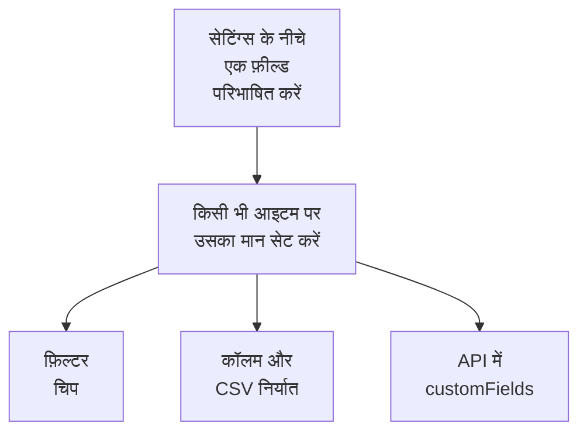

# इन्वेंटरी कस्टम फ़ील्ड

OneUptime पता लगाता है कि आपके परिवेश में क्या है। कस्टम फ़ील्ड वह दर्ज करते हैं जो कितनी भी निगरानी से पता नहीं चल सकता: स्टिकर पर छपी क्रम संख्या, वारंटी ख़त्म होने की तारीख, किसी चीज़ की मालिक टीम, वह सेवा में है या स्पेयर पार्ट्स की दराज़ में। फ़ील्ड को प्रोजेक्ट के लिए एक बार परिभाषित करें, फिर हर आइटम पर उन्हें भरें।

:::cards
- [कस्टम फ़ील्ड कैसे काम करते हैं](#कस्टम-फ़ील्ड-कैसे-काम-करते-हैं): एक ही शब्दावली, हर आइटम पर, स्रोत चाहे जो हो।
- [फ़ील्ड परिभाषित करना](#फ़ील्ड-परिभाषित-करना): एक फ़ील्ड बनाएँ, उसका प्रकार चुनें, ड्रॉपडाउन के विकल्प लिखें।
- [सूची फ़िल्टर करें](#सूची-फ़िल्टर-करें): अगली तिमाही में क्या ख़त्म हो रहा है, दो क्लिक में ढूँढें।
- [टिप्पणियाँ और सीमाएँ](#टिप्पणियाँ-और-सीमाएँ): नाम बदलना, दोहराव, तारीखें और हटाए गए फ़ील्ड।
:::

## कस्टम फ़ील्ड कैसे काम करते हैं

एक फ़ील्ड प्रोजेक्ट के लिए एक बार परिभाषित किया जाता है, और हर आइटम उसके लिए एक मान रख सकता है: वे जिन्हें OneUptime ने खोजा, वे जिन्हें वह मिरर करता है और वे जिन्हें आपने हाथ से जोड़ा। एक फ़ील्ड सूची के ऊपर एक फ़िल्टर चिप, एक वैकल्पिक कॉलम, और CSV निर्यात का एक कॉलम बन जाता है। API वही मान पढ़ता और लिखता है, हर आइटम के `customFields` के नीचे।

> [!NOTE]
> OneUptime Cloud पर, कस्टम फ़ील्ड **Growth** और उससे ऊपर के प्लान का हिस्सा हैं। उससे नीचे, फ़ील्ड न परिभाषित किए जा सकते हैं, न सूचीबद्ध, न बदले जा सकते हैं: API `402 Payment Required` लौटाता है, और सूची कोई कस्टम फ़ील्ड चिप या कॉलम नहीं दिखाती।

## फ़ील्ड परिभाषित करना

:::steps
### कस्टम फ़ील्ड पेज खोलें

**उत्पाद → संसाधन → इन्वेंटरी** पर जाएँ, साइड मेन्यू में **सेटिंग्स** खोलें, फिर **कस्टम फ़ील्ड**।

### एक फ़ील्ड बनाएँ

**Inventory Item Custom Field बनाएँ** पर क्लिक करें। उसे एक **फ़ील्ड नाम**, वैकल्पिक **फ़ील्ड विवरण**, और नीचे दी गई तालिका से एक **फ़ील्ड प्रकार** दें।

### ड्रॉपडाउन के विकल्प लिखें

ड्रॉपडाउन प्रकार के लिए, उसके विकल्प **ड्रॉपडाउन विकल्प** के नीचे जोड़ें। हर विकल्प एक रंग रख सकता है, जिसका इस्तेमाल तालिका के सेल और फ़िल्टर चिप में एक ही तरह से होता है: कोई नामित रंग चुनें, **कोई रंग नहीं**, या सटीक रंग कोड के लिए **कस्टम रंग**। किसी विकल्प की सूची में जगह बदलने के लिए उसे उसके हैंडल से खींचें।
:::

| प्रकार | इसका इस्तेमाल करें |
| --- | --- |
| **टेक्स्ट** | क्रम संख्या, एसेट टैग, रैक में स्थिति, खरीद आदेश संख्या |
| **संख्या** | लागत, रैक यूनिट, पोर्ट की संख्या |
| **बूलियन** | सपोर्ट के अंतर्गत, PCI दायरे में |
| **ड्रॉपडाउन (एकल चयन)** | लाइफ़साइकिल स्थिति, परिवेश, महत्व: एक तय सूची से एक उत्तर |
| **ड्रॉपडाउन (बहु-चयन)** | अनुपालन दायरे, टैग: एक तय सूची से कई उत्तर |
| **तारीख** | खरीद की तारीख, वारंटी समाप्ति, जीवन-अंत की तारीख |
| **तारीख और समय** | आख़िरी ऑडिट का समय, सेवा-मुक्त होने का समय |
| **लंबा टेक्स्ट** | पहुँच के निर्देश, नोट्स: सादे टेक्स्ट की कई पंक्तियाँ |
| **रिच टेक्स्ट (Markdown)** | फ़ॉर्मेटिंग और लिंक वाले नोट्स, Markdown एडिटर में लिखे हुए |
| **फ़ाइल** | वारंटी प्रमाणपत्र, हस्ताक्षरित ख़रीद आदेश, रैक के लेबल की फ़ोटो: एक फ़ाइल |
| **कई फ़ाइलें** | मैनुअल, इनवॉइस और फ़ोटो: अधिकतम 10 फ़ाइलें |

## एसेट शब्दावली का एक उदाहरण

एक आम हार्डवेयर एसेट रजिस्टर सीधे इन फ़ील्ड पर बैठ जाता है:

| फ़ील्ड का नाम | प्रकार | उदाहरण |
| --- | --- | --- |
| `Serial Number` | टेक्स्ट | `FDO24160ABC` |
| `Asset Tag` | टेक्स्ट | `IT-004821` |
| `Purchase Date` | तारीख | 2024-03-11 |
| `Warranty Expiry` | तारीख | 2027-03-10 |
| `Lifecycle Status` | ड्रॉपडाउन | सेवा में, स्पेयर, मरम्मत में, सेवा-मुक्त |
| `Assigned Site` | ड्रॉपडाउन | लंदन DC, फ़्रैंकफ़र्ट DC, ऑफ़िस HQ |
| `Owner Team` | ड्रॉपडाउन | नेटवर्क, प्लेटफ़ॉर्म, सुरक्षा |
| `Cost Centre` | टेक्स्ट | `CC-4410` |

मान किसी आइटम के **कस्टम फ़ील्ड** पेज पर सेट करें। कोई भी आइटम उन्हें ले सकता है, स्रोत चाहे जो हो, इसलिए OneUptime के खोजे हुए स्विच और उसके मिरर किए नेटवर्क डिवाइस वही एसेट शब्दावली रखते हैं जो आपके हाथ से जोड़े अप्लायंस।

## सूची फ़िल्टर करें

हर कस्टम फ़ील्ड **All Items** सूची के ऊपर एक फ़िल्टर चिप बन जाता है, और चिप वे तुलनाएँ देता है जो उसके प्रकार के लिए सही हैं:

| फ़ील्ड का प्रकार | तुलनाएँ |
| --- | --- |
| **टेक्स्ट**, **लंबा टेक्स्ट**, **रिच टेक्स्ट (Markdown)** | है, नहीं है, शामिल है, शामिल नहीं है, इससे शुरू होता है, इससे समाप्त होता है, खाली है, खाली नहीं है |
| **संख्या** | है, नहीं है, इससे बड़ा है, इससे बड़ा या बराबर है, इससे छोटा है, इससे छोटा या बराबर है, खाली है, खाली नहीं है |
| **बूलियन**, **ड्रॉपडाउन (एकल चयन)**, **ड्रॉपडाउन (बहु-चयन)** | है, नहीं है, खाली है, खाली नहीं है |
| **तारीख**, **तारीख और समय** | है, के पहले है, के बाद है, के बीच है, खाली है, खाली नहीं है |
| **फ़ाइल**, **कई फ़ाइलें** | है |

**फ़ाइल** या **कई फ़ाइलें** फ़ील्ड का चिप सिर्फ़ एक बात पूछता है: फ़ील्ड में **फ़ाइलें हैं** या **कोई फ़ाइल नहीं**।

चिप AND से जुड़ते हैं, इसलिए "वारंटी समाप्ति 2026-10-01 से पहले है AND लाइफ़साइकिल स्थिति सेवा में है" सूची का एक दृश्य है। यही वह सवाल है जिसका जवाब देने के लिए एसेट रजिस्टर होता है, और तारीख को टेक्स्ट फ़ील्ड में रखने के बजाय तारीख के प्रकारों का इस्तेमाल करने की वजह भी: टेक्स्ट फ़ील्ड `2026-10-01` को खुशी से रख लेता है, लेकिन फिर यह नहीं बता सकता कि अगली तिमाही में क्या ख़त्म हो रहा है।

कस्टम फ़ील्ड कॉलम छिपे हुए शुरू होते हैं: उन्हें कॉलम पिकर से चालू करें। उन्हें सॉर्ट नहीं किया जा सकता, क्योंकि मान एक ही JSON कॉलम में साथ रहते हैं जिसके हिसाब से सूची क्रम नहीं लगा सकती।

## टिप्पणियाँ और सीमाएँ

- मान हर आइटम पर फ़ील्ड के नाम के नीचे रखे जाते हैं। किसी फ़ील्ड का नाम बदलने से पुराने नाम के नीचे पहले से रखे मान नहीं हटते। घटना कस्टम फ़ील्ड इसका अपवाद हैं: उनका नाम बदलने पर उनके मान भी चले जाते हैं (देखें [किसी फ़ील्ड का नाम बदलना](/docs/incidents/settings#फ़ील्ड-का-नाम-बदलना))।
- आइटम में मान होने के बाद भी ड्रॉपडाउन के विकल्प जोड़े, बदले, खींचकर नए क्रम में लगाए और हटाए जा सकते हैं। किसी विकल्प का नाम बदलने पर वह उसे रखने वाले हर आइटम पर बदल जाता है; हटाया गया विकल्प उसे रखने वाले आइटम पर बना रहता है, "अब विकल्प नहीं" के रूप में दिखता है, जब तक आप उनके लिए कोई दूसरा न चुनें (देखें [ड्रॉपडाउन के विकल्प बदलना](/docs/incidents/settings#ड्रॉपडाउन-के-विकल्प-बदलना))।
- कोई भी चीज़ किसी मान को अनोखा नहीं बनाती। दो आइटम की क्रम संख्या एक हो सकती है, और कुछ भी आपको नहीं रोकता।
- तारीखें ISO-8601 UTC टाइमस्टैम्प के रूप में रखी जाती हैं और आपके अपने टाइम ज़ोन में दिखाई जाती हैं।
- किसी फ़ील्ड को हटाने से वह सूची और फ़िल्टर बार से हट जाता है। पहले से लिखे मान आइटम पर बने रहते हैं।
- **फ़ाइल** या **कई फ़ाइलें** फ़ील्ड हर एक 10 MB तक की फ़ाइलें लेता है, उन प्रकारों की जो [फ़ाइल फ़ील्ड](/docs/incidents/settings#फ़ाइल-फ़ील्ड) में बताए गए हैं, और जो इसी प्रोजेक्ट में अपलोड हुई हों। उन्हें सिर्फ़ वही डाउनलोड कर सकता है जो आइटम देख सकता है, और कोई फ़ाइल तभी हटा दी जाती है जब उसे कुछ भी नहीं रखता।

## अगले कदम

:::cards
- [इन्वेंटरी अवलोकन](/docs/inventory/overview): आइटम कहाँ से आते हैं, और हर पेज क्या दिखाता है।
- [CMDB में निर्यात करना](/docs/inventory/cmdb-sync): आइटम और उनके कस्टम फ़ील्ड किसी दूसरे सिस्टम में खींचें।
- [घटना कस्टम फ़ील्ड](/docs/incidents/settings#कस्टम-फ़ील्ड): घटनाओं पर वही फ़ील्ड प्रकार, कुछ अतिरिक्त के साथ।
:::
