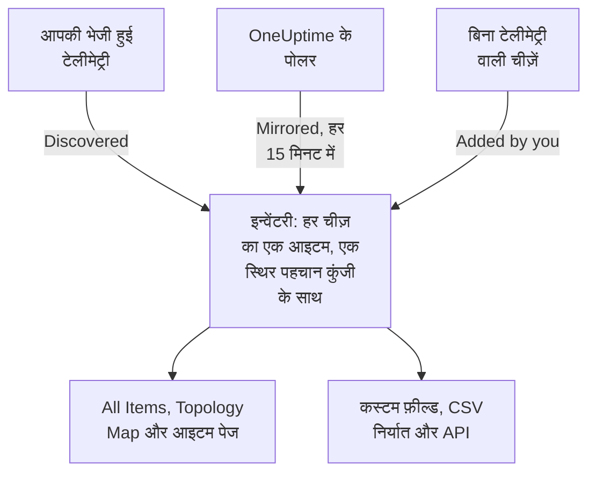

# इन्वेंटरी अवलोकन

इन्वेंटरी उन सभी चीज़ों की एक सूची है जिनके बारे में OneUptime आपके परिवेश में जानता है: सेवाएँ, होस्ट, Kubernetes ऑब्जेक्ट, वर्चुअल मशीनें, नेटवर्क डिवाइस, क्लाउड संसाधन, IoT डिवाइस, सर्वरलेस फ़ंक्शन, और वे चीज़ें जो कोई टेलीमेट्री नहीं भेजतीं। इसका ज़्यादातर हिस्सा उसी से अपने आप भर जाता है जिस पर OneUptime पहले से नज़र रखता है। आप वह जोड़ते हैं जो नज़र रखने से पता नहीं चलता: कोई चीज़ किस काम की है, उसका मालिक कौन है, उसकी वारंटी कब ख़त्म होती है। [शब्दावली](/docs/introduction/glossary#आप-किस-पर-नज़र-रखते-हैं) बताती है कि इसमें हर तरह का रिकॉर्ड क्या है।

:::cards
- [आइटम इन्वेंटरी में कैसे आते हैं](#आइटम-इन्वेंटरी-में-कैसे-आते-हैं): खोजे गए, मिरर किए गए, या आपके जोड़े हुए।
- [रास्ता ढूँढें](#रास्ता-ढूँढें): इन्वेंटरी के पेज, और हर आइटम के अपने पेज।
- [Esper से डिवाइस आयात करें](#esper-से-डिवाइस-आयात-करें): आपके Esper टेनेंट में नामांकित हर Android और Apple डिवाइस, हमेशा अद्यतन।
- [Microsoft Intune से डिवाइस आयात करें](#microsoft-intune-से-डिवाइस-आयात-करें): Intune द्वारा प्रबंधित हर Windows PC, Mac, iPhone, iPad और Android डिवाइस, हमेशा अद्यतन।
- [Workspace ONE UEM से डिवाइस आयात करें](#workspace-one-uem-से-डिवाइस-आयात-करें): Workspace ONE द्वारा प्रबंधित हर फ़ोन, टैबलेट और कंप्यूटर, हमेशा अद्यतन।
- [SOTI MobiControl से डिवाइस आयात करें](#soti-mobicontrol-से-डिवाइस-आयात-करें): MobiControl द्वारा प्रबंधित हर रग्ड डिवाइस, फ़ोन, टैबलेट और कंप्यूटर, हमेशा अद्यतन।
- [हाथ से कुछ जोड़ें](#हाथ-से-कुछ-जोड़ें): कोई थर्ड-पार्टी API, कोई बाहरी डेटाबेस या कोई अप्लायंस।
- [हटाने के बजाय संग्रहीत करें](#हटाने-के-बजाय-संग्रहीत-करें): सूची को साफ़ रखने का वह तरीका जो टिकता है।
:::

## आइटम इन्वेंटरी में कैसे आते हैं

OneUptime निगरानी के लिए पहले से ही आपके परिवेश पर नज़र रखता है, इसलिए कैटलॉग उसी से बनता है जो वह देखता है, न कि उससे जो किसी ने टाइप करना याद रखा। हर आइटम का एक स्रोत होता है, और स्रोत तय करता है कि आइटम पर किसका अधिकार है: आप उसे संपादित कर सकते हैं या नहीं, और वह अपने आप हट सकता है या नहीं।

| स्रोत | API में | कहाँ से आता है | कब तक रहता है |
| --- | --- | --- | --- |
| **खोजा गया** | `discovered` | OpenTelemetry रिसोर्स एट्रिब्यूट, जो टेलीमेट्री आते ही पढ़े जाते हैं: कोई सेवा, होस्ट, Kubernetes ऑब्जेक्ट या वर्चुअल मशीन जो टेलीमेट्री भेजती है। | हर बैच के साथ फिर से दर्ज होता है। अपने प्रकार की अवधि से ज़्यादा समय तक चुप रहने पर हटा दिया जाता है (नीचे देखें)। |
| **मिरर किया गया** | `inventory` | एक रिकॉर्ड जिसे OneUptime का कोई पोलर रखता है: नेटवर्क डिवाइस, क्लाउड संसाधन, IoT डिवाइस, सर्वरलेस फ़ंक्शन, RUM ऐप्लिकेशन, Docker होस्ट, Podman होस्ट और वे डिवाइस जिन्हें कोई डिवाइस मैनेजर कनेक्शन आयात करता है। हर 15 मिनट में कॉपी किया जाता है। कोई प्रबंधित डिवाइस, हर बार जब उसका कनेक्शन पढ़ा जाता है। | जब तक उसका रिकॉर्ड है। रिकॉर्ड हटाएँ, और आइटम भी उसके साथ चला जाता है। |
| **आपके द्वारा जोड़ा गया** | `manual` | आपका जोड़ा हुआ, किसी ऐसी चीज़ के लिए जिसे OneUptime नहीं देख सकता: कोई थर्ड-पार्टी API, वेंडर द्वारा प्रबंधित डेटाबेस, रैक में रखा कोई अप्लायंस। | जब तक आप उसे हटा न दें। कोई चीज़ उसे समाप्त नहीं करती। |

खोजे गए या मिरर किए गए आइटम का नाम या प्रकार नहीं बदला जा सकता: उसका स्रोत अगली बार में बदलाव को फिर से लिख देगा। आइटम का **सेटिंग्स** पेज बताता है कि स्थायी बदलाव कहाँ करना है। आप किसी भी आइटम में, स्रोत चाहे जो हो, हमेशा कस्टम फ़ील्ड के मान जोड़ सकते हैं: [इन्वेंटरी कस्टम फ़ील्ड](/docs/inventory/custom-fields) देखें।

### चुप आइटम कब तक रहता है

खोजे गए आइटम की एक धड़कन होती है। हर बार जब उसकी टेलीमेट्री आती है, उसका आख़िरी बार देखे जाने का समय आगे बढ़ता है, और सूची का **स्थिति** कॉलम बताता है कि वह कितना हाल का है। किसी प्रबंधित डिवाइस के साथ भी ऐसा ही होता है: हर बार जब वह अपने डिवाइस मैनेजर के साथ चेक-इन करता है। दूसरे मिरर किए गए आइटम और आपके जोड़े हुए आइटम की कोई धड़कन नहीं होती, इसलिए उनकी स्थिति चिंता जगाने के बजाय खाली रहती है।

| स्थिति | इसका अर्थ |
| --- | --- |
| **लाइव** | पिछले 30 मिनट में देखा गया। |
| **हालिया** | पिछले एक दिन के भीतर देखा गया। |
| **पुराना** | एक दिन से ज़्यादा समय से नहीं देखा गया। **शांत हो गया** पेज इन्हें दिखाता है। |

हर तीन घंटे में, OneUptime उन खोजे गए आइटम को हटा देता है जो अपने प्रकार की अवधि से ज़्यादा समय तक चुप रहे हैं, संग्रहीत आइटम भी, और उनके कस्टम फ़ील्ड के मान भी उनके साथ चले जाते हैं। मिरर किए गए आइटम और आपके जोड़े हुए आइटम इस तरह कभी नहीं हटाए जाते।

| आइटम का प्रकार | टेलीमेट्री के बिना इतने समय बाद हटाया जाता है |
| --- | --- |
| पॉड, डिप्लॉयमेंट, Proxmox गेस्ट, OpenStack इंस्टेंस और VMware वर्चुअल मशीनें | 1 दिन |
| Kubernetes नोड और नेमस्पेस, Proxmox नोड, OpenStack हाइपरवाइज़र, VMware होस्ट, क्लस्टर और डेटास्टोर, और वे डेटाबेस और रिमोट सेवाएँ जिन्हें आपके ट्रेस कॉल करते हैं | 7 दिन |
| सेवाएँ, होस्ट, Kubernetes, Proxmox और Ceph क्लस्टर, OpenStack क्लाउड, स्टोरेज ऐरे, vCenters और Docker Swarm क्लस्टर | 30 दिन |

OneUptime का खोजा हुआ कोई संबंध 30 दिन तक दोबारा न दिखने पर हटा दिया जाता है।

## रास्ता ढूँढें

**उत्पाद → संसाधन → इन्वेंटरी** खोलें। उसके साइड मेन्यू में ये पेज हैं। **स्रोत के अनुसार**, **सेटिंग्स**, **सहायता** और **उन्नत** मुड़े हुए शुरू होते हैं: किसी सेक्शन को खोलने के लिए उसके शीर्षक पर क्लिक करें।

| पेज | वहाँ आपको क्या मिलता है |
| --- | --- |
| **अवलोकन** | आपके पास कितने आइटम हैं, वे क्या हैं, कितने चुप हो गए हैं, और सबसे हाल में क्या जोड़ा गया। |
| **सभी आइटम** | हर आइटम। नाम, विवरण या पहचान कुंजी से खोजें, सूची को प्रकार, स्रोत, स्थिति या कस्टम फ़ील्ड से छोटा करें, और हाथ से आइटम जोड़ें। |
| **प्रबंधित डिवाइस** | आपके डिवाइस मैनेजर कनेक्शन - Esper, Microsoft Intune, Workspace ONE UEM और SOTI MobiControl - और उनके आयात किए हर डिवाइस, उसकी स्थिति, समूह, मॉडल और ऑपरेटिंग सिस्टम के साथ। |
| **टोपोलॉजी मैप** | आइटम कैसे जुड़े हैं: सेवाएँ, वे क्या कॉल करती हैं, और वे होस्ट, पॉड और डिवाइस जिन पर वे चलती हैं। |
| **शांत हो गया** | वे आइटम जिनकी एक दिन से ज़्यादा समय से कोई ख़बर नहीं: खोजे गए आइटम जिन्होंने टेलीमेट्री नहीं भेजी, और वे डिवाइस जिन्होंने अपने डिवाइस मैनेजर के साथ चेक-इन करना बंद कर दिया। |
| **स्रोत के अनुसार** | किसी एक स्रोत के आइटम: **खोजा गया**, **मिरर किया गया** या **आपके द्वारा जोड़ा गया**। |
| **सेटिंग्स → कस्टम फ़ील्ड** | वे फ़ील्ड जिन्हें आपका प्रोजेक्ट हर आइटम पर रखता है। |
| **सहायता → दस्तावेज़ीकरण** | इन्वेंटरी की एक छोटी गाइड, उन आइटम प्रकारों के साथ जिन्हें वह पहचानता है। |
| **उन्नत → संग्रहीत** | वे आइटम जिन्हें आपने संग्रहीत किया। उन्हें यहीं संग्रह से निकालें। |

कोई आइटम खोलें, और उसके अपने साइड मेन्यू में उसका **अवलोकन** (उसका प्रकार, स्रोत और स्थिति, और उस पर देखा गया हर एट्रिब्यूट), उसके **कनेक्शन** और उसके **कस्टम फ़ील्ड**; उसके **लॉग**, **ट्रेस**, **मेट्रिक्स**, **प्रोफ़ाइल** और **अपवाद**; और उसकी **घटनाएं**, **अलर्ट** और **अनुसूचित रखरखाव** होते हैं। **उन्नत** के नीचे उसकी **सेटिंग्स**, उसके **ऑडिट लॉग** और **आइटम हटाएं** हैं। टेलीमेट्री पेज वह दिखाते हैं जो आइटम ने खुद भेजा। घटनाएँ, अलर्ट और रखरखाव इवेंट उस सेवा, होस्ट या Kubernetes क्लस्टर के होते हैं जिसका आइटम प्रतिनिधित्व करता है; किसी और आइटम पर, वे पेज बताते हैं कि इसके बजाय किस संसाधन को देखना है।

### एसेट विवरण

किसी होस्ट या नेटवर्क डिवाइस में एक **एसेट विवरण** कार्ड होता है जो दोनों को एक ही तरह से बताता है: होस्टनाम, IP पता, MAC पता, क्रम संख्या, निर्माता, मॉडल, फ़र्मवेयर संस्करण, ऑपरेटिंग सिस्टम, OS संस्करण, डिवाइस प्रकार और स्थान। किसी Android डिवाइस के कार्ड में उसका सुरक्षा पैच स्तर भी होता है, जो Android एजेंट या उसके डिवाइस मैनेजर से आता है। यह भी बताता है कि पैच **अप टू डेट नहीं** है या नहीं, जैसा **सुरक्षा पैच स्तर** कॉलम बताता है, और वह कितने दिन पुराना है। जिस तथ्य की किसी ने जानकारी नहीं दी, वह **अज्ञात** दिखता है, और कार्ड बताता है कि ऐसा क्यों है और अज्ञात तथ्य कैसे भरे जाते हैं: ऐसा डिवाइस जो उन्हें SNMP पर नहीं बताता, ऐसा डिवाइस जो अभी पढ़ा नहीं गया, या ऐसा Meraki डिवाइस जिसके डैशबोर्ड में वे मौजूद हैं।

- होस्ट के तथ्य उसकी टेलीमेट्री के रिसोर्स एट्रिब्यूट से आते हैं: उसके IP और MAC पते, आर्किटेक्चर और ऑपरेटिंग सिस्टम शुरू से ही, और उसकी क्रम संख्या, निर्माता, मॉडल और फ़र्मवेयर तब, जब आप उन्हें जोड़ देते हैं।
- नेटवर्क डिवाइस के तथ्य उसके SNMP पोल, उसकी भूमिका और उसकी साइट से आते हैं। जो उसके पोल ने नहीं पढ़ा, वह डिस्कवरी से आता है: उसके पते का पिछला स्कैन, किसी राउटर की ARP तालिका, या उसके प्रोब का DNS लुकअप। ENTITY-MIB के बिना कोई डिवाइस, जैसे Meraki MX, फिर भी अपने सिस्टम विवरण से अपना निर्माता, मॉडल और ऑपरेटिंग सिस्टम पा लेता है, और अपने पोर्ट से अपना MAC पता। उसका IP पता कभी उसके होस्टनाम के रूप में नहीं दिखाया जाता।
- जब कोई [Meraki कनेक्शन](/docs/monitor/network-traffic#netflow-के-बिना-cisco-meraki) उसका संगठन पढ़ता है, तो Meraki डिवाइस वह भी Meraki डैशबोर्ड से लेता है जो उसका पोल खाली छोड़ता है, जिसमें उसकी क्रम संख्या, मॉडल और फ़र्मवेयर शामिल हैं।

**सभी आइटम** उन Android डिवाइसों को ढूँढता है जिन पर कार्रवाई करनी है। इसका **सुरक्षा पैच स्तर** फ़िल्टर उन डिवाइसों की सूची देता है जो **अप टू डेट नहीं** के अंतर्गत आते हैं, यानी जिनका सुरक्षा पैच स्तर 90 दिनों से ज़्यादा पुराना है, और यही नियम [होस्ट मॉनिटर](/docs/monitor/host-monitor) का Security Patch Out of Date अलर्ट पढ़ता है। इसका **एजेंट अनुमतियाँ** फ़िल्टर उन डिवाइसों की सूची देता है जिन पर [Android एजेंट](/docs/telemetry/android-agent) के पास अभी भी READ_LOGS, READ_DROPBOX_DATA या इस्तेमाल का ऐक्सेस नहीं है। हर फ़िल्टर का इसी नाम का एक कॉलम है, जो आपके चालू करने तक छिपा रहता है, और CSV निर्यात में वह भी शामिल होता है। इनके बगल में **डिवाइस मैनेजर ID** कॉलम में वह ID होती है जिससे किसी डिवाइस का डिवाइस मैनेजर उसे पहचानता है, जैसे वह Esper ID जो `espercli secureadb connect --device` लेता है।

कार्ड बताता है कि हर तथ्य कहाँ से और कब आया। ज़्यादातर तथ्यों का साझा स्रोत, जैसे होस्ट का कलेक्टर, नेटवर्क डिवाइस का अपना SNMP पोल या उसे पढ़ने वाला डिस्कवरी स्कैन, एक ही बार, तथ्यों के नीचे, बताया जाता है। कोई भी दूसरा स्रोत, जैसे किसी राउटर की ARP तालिका या डिवाइस पर सहेजा गया कोई मान, अपने तथ्य के नीचे बताया जाता है। नेटवर्क डिवाइस पर सहेजा गया मान डिस्कवरी जो पढ़ती है उससे कभी नहीं बदला जाता, और जब दोनों अलग हों, तो कार्ड दोनों दिखाता है।

किसी नेटवर्क डिवाइस के कार्ड में उन लोगों के लिए एक **रिफ्रेश** बटन होता है जो नेटवर्क डिवाइस संपादित कर सकते हैं। यह डिवाइस को अभी फिर से पढ़ता है: उसका प्रोब एक मिनट के भीतर उसे पोल करता है, और उसका Meraki कनेक्शन संगठन को फिर से पढ़ता है। कार्ड बताता है कि नई रीडिंग कब आ गई, या कि प्रोब डिवाइस तक नहीं पहुँच सका, और रीडिंग आते ही आइटम डिवाइस से कॉपी हो जाता है।

यही तथ्य **सभी आइटम** सूची के कॉलम हैं, जो आपके चालू करने तक छिपे रहते हैं, और वे उसके CSV निर्यात में जाते हैं। [CMDB में निर्यात करना](/docs/inventory/cmdb-sync#एसेट-विवरण) उनकी कुंजियाँ बताता है।

### कनेक्शन

किसी आइटम का **कनेक्शन** पेज दोनों दिशाओं में उसके पड़ोसियों को दिखाता है, जो **कॉल**, **इससे कॉल हुआ**, **यहाँ चलता है** और **संबंधित** में बँटे होते हैं। हर समूह अपना कुल दिखाता है (100,000 से ज़्यादा कनेक्शन वाला समूह "100,000+" दिखाता है), और **और दिखाएँ** बाकी को पेज दर पेज दिखाता है, ताकि कोई व्यस्त क्लस्टर, नेमस्पेस या नोड पहले कुछ के बजाय हर कनेक्शन दिखाए। यह पेज किसी समय सीमा तक सीमित नहीं है: इसमें API के ज़रिए हाथ से जोड़े गए संबंध, और संग्रहीत किए जा चुके पड़ोसी भी शामिल हैं। जो पड़ोसी अब इन्वेंटरी में नहीं है, वह अपनी कुंजी से दिखाया जाता है।

## Esper से डिवाइस आयात करें

कोई Esper टेनेंट कनेक्ट करें, और उसमें नामांकित हर डिवाइस इन्वेंटरी में आ जाता है: उसके Android डिवाइस, उन डिवाइसों समेत जिनका ऐप कभी शुरू नहीं हुआ, और उसके iPhone, iPad और Apple TV। हर डिवाइस एक होस्ट है, उन जानकारियों के साथ जो सिर्फ़ Esper के पास हैं: उसका समूह, उसका ऑपरेटिंग सिस्टम और बिल्ड, उसकी क्रम संख्या और IMEI, उसकी बैटरी और स्टोरेज, और Android डिवाइस का सुरक्षा पैच स्तर और इंस्टॉल किए गए ऐप। Esper अपने आप कुछ नहीं भेजता, इसलिए OneUptime उसे शेड्यूल पर पढ़ता है: डिवाइस हर 15 मिनट में, और हर Android डिवाइस के ऐप हर 6 घंटे में।

:::steps
### Esper में API कुंजी बनाएँ

Esper कंसोल में, API Key Management के अंतर्गत एक कुंजी बनाएँ। OneUptime केवल पढ़ता है, इसलिए ऐसे उपयोगकर्ता की कुंजी काफ़ी है जिसकी Esper भूमिका डिवाइस, समूह और ऐप पढ़ सकती है। कुंजी बदल दिए जाने पर, या उसके उपयोगकर्ता के हटाए जाने पर, वह काम करना बंद कर देती है।

### टेनेंट कनेक्ट करें

**उत्पाद → संसाधन → इन्वेंटरी** पर जाएँ, फिर **प्रबंधित डिवाइस** पर, **डिवाइस मैनेजर कनेक्ट करें** पर क्लिक करें, और **Esper** चुनें। **टेनेंट** दर्ज करें, यानी आपके Esper कंसोल के पते में `.esper.cloud` से पहले वाला नाम (`acme.esper.cloud` के लिए `acme`), और फिर **API कुंजी**। **और फ़ील्ड** में कनेक्शन का नाम है, और यह कि उसे कितनी बार पढ़ा जाता है।

### पहली रीडिंग जाँचें

**कनेक्ट करें** कुछ भी सहेजने से पहले कुंजी की जाँच करता है: वह बताता है कि एक रीडिंग कितने डिवाइस आयात करेगी, या क्या गड़बड़ है और उसे कैसे ठीक करें। पहली रीडिंग एक मिनट के भीतर शुरू होती है, और कनेक्शन की पंक्ति बताती है कि वह कैसी रही।
:::

| Esper क्या रिपोर्ट करता है | यह कहाँ दिखता है |
| --- | --- |
| मॉडल, निर्माता, क्रम संख्या, ऑपरेटिंग सिस्टम और उसका संस्करण, बिल्ड, और IP व MAC पते | डिवाइस का **एसेट विवरण** कार्ड, और **सभी आइटम** के कॉलम |
| स्थिति, अंतिम चेक-इन, समूह, सुरक्षा पैच स्तर, IMEI, बैटरी, स्टोरेज और Esper एजेंट | डिवाइस का **Esper** कार्ड, और **प्रबंधित डिवाइस** की **डिवाइस** सूची |
| ऐप और उनके संस्करण | डिवाइस की **इंस्टॉल किए गए ऐप** सूची |
| उसकी Esper डिवाइस ID | **सभी आइटम** का **डिवाइस मैनेजर ID** कॉलम |

### एक डिवाइस, दो नहीं

किसी डिवाइस से टेलीमेट्री भेजने वाला ऐप या Android Agent जब डिवाइस को उसी तरह नाम देता है जैसे Esper देता है, तो वह Esper के आयात किए डिवाइस से जुड़कर एक ही आइटम बन जाता है। Esper हर डिवाइस पर जो मैनेज्ड कॉन्फ़िगरेशन भरता है, उससे ये रिसोर्स एट्रिब्यूट सेट करें:

| रिसोर्स एट्रिब्यूट | मैनेज्ड कॉन्फ़िगरेशन मान | यह क्या है |
| --- | --- | --- |
| `host.name` | `${esper.deviceName}` | Esper में डिवाइस का नाम, जैसे `ESP-ID-AAAAW`। ज़रूरी। |
| `host.serial_number` | `${esper.serialNumber}` | डिवाइस की क्रम संख्या। वैकल्पिक। |

OneUptime किसी डिवाइस का आइटम पहले Esper में उसके नाम से ढूँढता है, फिर उसकी क्रम संख्या से, और कोई मेल न मिलने पर ही नया आइटम बनाता है। Android Agent दोनों को अपनी `device_name` और `device_serial` सेटिंग से सेट करता है, और [Android सेटअप](/docs/rum/android-setup#esper-से-बेड़ा-आयात-करें) किसी ऐप का मैनेज्ड कॉन्फ़िगरेशन दिखाता है।

### जब कोई डिवाइस शांत हो जाए, या Esper छोड़ दे

जिस Android डिवाइस ने 30 मिनट से चेक-इन नहीं किया है, वह **ऑफ़लाइन** है, और बताता है कि उसने पिछली बार कितनी देर पहले चेक-इन किया था; iPhone, iPad या Apple TV तब चेक-इन करता है जब Apple की पुश सेवा उसे जगाती है, अक्सर घंटों के अंतर पर, इसलिए वह एक दिन बाद **ऑफ़लाइन** होता है। उसके आइटम की **स्थिति** उसके अंतिम चेक-इन के हिसाब से चलती है, या उसकी टेलीमेट्री के हिसाब से जब वह ज़्यादा नई हो, इसलिए एक दिन से चुप डिवाइस **शांत हो गया** पेज पर होता है।

Esper से हटाया गया डिवाइस **हटाया गया** चिह्नित होता है, और उसका आइटम संग्रहीत हो जाता है: वह सूची से हट जाता है, और **उन्नत → संग्रहीत** के नीचे इंतज़ार करता है। जो डिवाइस Esper में लौट आता है, वह सूची में भी लौट आता है। उसके जाने के 30 दिन बाद डिवाइस हटा दिया जाता है, और उसका आइटम भी, जब तक टेलीमेट्री ने या आपने उसमें कुछ जोड़ा न हो।

### जब कोई डिवाइस चेक-इन करना बंद करे, तो अलर्ट पाएं

**प्रबंधित डिवाइस** में कनेक्शन की पंक्ति पर **अलर्ट सेट करें** पर क्लिक करें, और **Esper Android Device Stopped Checking In** और **Esper Apple Device Stopped Checking In** बनाएँ। पहला हर उस Android डिवाइस के लिए उसके नाम से एक अलर्ट खोलता है जिसने एक घंटे से ज़्यादा समय से Esper में चेक-इन नहीं किया है, और दूसरा हर उस Apple डिवाइस के लिए जिसने एक दिन से ज़्यादा समय से नहीं किया, और डिवाइस के फिर से चेक-इन करते ही उसे सुलझा देता है।

कनेक्शन को हर बार पढ़ने पर मेट्रिक `oneuptime.managed_device.check_in.age` के रूप में दर्ज होता है कि हर डिवाइस ने कितने मिनट पहले आख़िरी बार चेक-इन किया था, और मॉनिटर हर 5 मिनट में हर डिवाइस का नवीनतम मान जाँचता है। जो डिवाइस Android Agent भी चलाता है, उसे **Host Stopped Reporting** पर छोड़ दिया जाता है, ताकि वह कभी दो बार अलर्ट न करे, और Esper से हटाए गए डिवाइस का अलर्ट सुलझ जाता है। जो पढ़ना विफल हो जाए, वह डिवाइसों के बारे में कुछ दर्ज नहीं करता, इसलिए जब तक पढ़ना फिर से सफल न हो, उनका कोई अलर्ट न खुलता है न सुलझता है। रात में बंद रहने वाले फ़्लीट के लिए मॉनिटर की सीमा बढ़ाएँ।

**Esper Security Patch Out of Date** भी बनाएँ, तो हर वह Android डिवाइस जिसका सुरक्षा पैच स्तर, Esper के अनुसार, 90 दिन से पुराना है, अपना अलग अलर्ट खोलता है, जो डिवाइस अपडेट होते ही सुलझ जाता है। कनेक्शन को हर बार पढ़ने पर मेट्रिक `oneuptime.managed_device.security_patch.age` के रूप में दर्ज होता है कि हर Android डिवाइस का पैच स्तर कितने दिन पुराना है। जो डिवाइस Android Agent चलाता है, उसे उसके होस्ट के **Security Patch Out of Date** पर छोड़ दिया जाता है, ताकि वह कभी दो बार अलर्ट न करे।

**Esper Low Battery** और **Esper Storage Nearly Full** भी बनाएँ: हर वह डिवाइस जिसकी बैटरी, Esper की पिछली रीडिंग के अनुसार, 20% से कम है, अपना अलग अलर्ट खोलता है, और इसी तरह हर वह डिवाइस जिसका स्टोरेज 90% से ज़्यादा भरा है, और हर अलर्ट डिवाइस के चार्ज होते ही या उसमें फिर से जगह होते ही सुलझ जाता है। कनेक्शन को हर बार पढ़ने पर दोनों मेट्रिक `oneuptime.managed_device.battery.level` और `oneuptime.managed_device.storage.used` के रूप में दर्ज होते हैं। जो डिवाइस Android Agent चलाता है, उसे उसके होस्ट के **Low Battery** और **Storage Nearly Full** पर छोड़ दिया जाता है, जो उन्हीं स्तरों पर अलर्ट करते हैं, ताकि वह कभी दो बार अलर्ट न करे।

किसी डिवाइस के अलर्ट उसके आइटम पर भी दिखते हैं: उसका **Esper** कार्ड उसके बारे में खुली घटनाओं और अलर्ट को सूचीबद्ध करता है, हर एक के साथ उसके पेज का लिंक होता है, और जिस डिवाइस को Android Agent रिपोर्ट नहीं करता, उसके **अलर्ट** और **घटनाएं** पेज वे सभी सूचीबद्ध करते हैं जो उसके कनेक्शन के मॉनिटरों ने उसके बारे में उठाए।

### जब कनेक्शन पढ़ा जाना बंद हो जाए, तो अलर्ट पाएं

**Esper Connection Stopped Reading** बनाएँ, और जब उतने समय तक कनेक्शन का कोई भी पढ़ना सफल नहीं होता जितना उसकी पंक्ति उसकी **स्थिति** को **पुराना** दिखाने से पहले इंतज़ार करती है, तो कनेक्शन अपना अलग अलर्ट खोलता है: उसके तीन पढ़ने के अंतराल और दस मिनट और, पर कभी आधे घंटे से कम नहीं, यानी डिफ़ॉल्ट 15 पर 55 मिनट। इसका पहला डीबग चरण कनेक्शन की हाल की रीडिंग सूचीबद्ध करता है, हर एक उस त्रुटि के साथ जिससे उसका पढ़ना विफल हुआ, और पहला सफल पढ़ना इसे सुलझा देता है। हर पढ़ना, और हर वह पढ़ना जिसका समय कनेक्शन के लिए आ जाता है, मेट्रिक `oneuptime.managed_device.connection.read.age` के रूप में दर्ज करता है कि पिछले सफल पढ़ने को कितने मिनट हुए। मॉनिटर उतना इंतज़ार करता है जितना उसे बनाते समय कनेक्शन का पढ़ने का अंतराल कहता है। कनेक्शन बंद करने पर उसका खुला अलर्ट सुलझ जाता है, क्योंकि बंद कनेक्शन का कुछ भी बकाया नहीं होता, और उसके डिवाइस के अलर्ट तब तक वैसे ही रहते हैं जब तक वह फिर से न पढ़े। कनेक्शन मिटाने पर वे सब सुलझ जाते हैं जो केवल उसे पढ़ने वाले मॉनिटर ने खोले थे, और उनकी निगरानी बंद हो जाती है।

## Microsoft Intune से डिवाइस आयात करें

कोई Microsoft Intune टेनेंट कनेक्ट करें, और Intune जिस भी डिवाइस का प्रबंधन करता है, वह इन्वेंटरी में आ जाता है: उसके Windows PC, Mac, iPhone, iPad, Android डिवाइस और Linux मशीनें। हर डिवाइस एक होस्ट है, उन जानकारियों के साथ जो Intune के पास हैं: उसकी श्रेणी, उसका ऑपरेटिंग सिस्टम और उसका संस्करण, उसकी क्रम संख्या और IMEI, उसका अनुपालन, स्वामित्व और नामांकन, उसका स्टोरेज, और वे ऐप जो Intune ने उस पर खोजे। Intune अपने आप कुछ नहीं भेजता, इसलिए OneUptime उसे शेड्यूल पर पढ़ता है: डिवाइस हर 15 मिनट में, और हर डिवाइस के ऐप हर 6 घंटे में।

:::steps
### Microsoft Entra में ऐप पंजीकृत करें

Microsoft Entra एडमिन सेंटर में `App registrations` खोलें और `New registration` पर क्लिक करें। उसे एक नाम दें, `Accounts in this organizational directory only` रहने दें, और उसे पंजीकृत करें। उसके `Overview` पर वे दोनों ID हैं जो OneUptime माँगता है: `Application (client) ID` और `Directory (tenant) ID`।

### उसे Intune के डिवाइस पढ़ने दें

`API permissions` में `Add a permission`, फिर `Microsoft Graph`, फिर `Application permissions` पर क्लिक करें, और `DeviceManagementManagedDevices.Read.All` जोड़ें। फिर `Grant admin consent` पर क्लिक करें, जो सिर्फ़ टेनेंट का एडमिनिस्ट्रेटर कर सकता है। OneUptime को बस यही एक अनुमति चाहिए: यह डिवाइसों और उन पर Intune द्वारा खोजे गए ऐप की सूची देती है, और कुछ भी बदल नहीं सकती।

### क्लाइंट सीक्रेट बनाएँ

`Certificates & secrets` में `New client secret` पर क्लिक करें, और उसका `Value` कॉपी करें, उसका `Secret ID` नहीं: Microsoft मान सिर्फ़ एक बार दिखाता है। सीक्रेट की अवधि खत्म होते ही वह काम करना बंद कर देता है, इसलिए उससे पहले नया बनाएँ और कनेक्शन संपादित करते समय उसे दर्ज करें।

### Intune टेनेंट कनेक्ट करें

**उत्पाद → संसाधन → इन्वेंटरी** पर जाएँ, फिर **प्रबंधित डिवाइस** पर, **डिवाइस मैनेजर कनेक्ट करें** पर क्लिक करें, और **Microsoft Intune** चुनें। **टेनेंट ID**, **ऐप्लिकेशन (क्लाइंट) ID** और **क्लाइंट सीक्रेट** दर्ज करें। अगर टेनेंट अमेरिकी सरकारी क्लाउड में है, तो उसे **और फ़ील्ड** में **क्लाउड** के रूप में चुनें। **कनेक्ट करें** कुछ भी सहेजने से पहले ऐप पंजीकरण की जाँच करता है: यह बताता है कि एक रीडिंग कितने डिवाइस आयात करेगी, या क्या गलत है और उसे कैसे ठीक करें।
:::

कोई डिवाइस लगभग हर आठ घंटे में Intune में चेक-इन करता है, और उसका अंतिम चेक-इन वह समय है जब उसने पिछली बार ऐसा किया: जिस डिवाइस ने एक दिन से ऐसा नहीं किया है, वह **ऑफ़लाइन** है। उसके ऐप वे हैं जो Intune ने उस पर खोजे, जिन्हें Microsoft Graph सिर्फ़ अपने बीटा संस्करण में सूचीबद्ध करता है: निजी डिवाइस के लिए, वे ऐप जिनका प्रबंधन Intune करता है। Intune के समूह Microsoft Entra समूह हैं, जिन्हें यह अनुमति नहीं पढ़ती, इसलिए किसी डिवाइस का समूह उसकी डिवाइस श्रेणी है। किसी डिवाइस के उपयोगकर्ता के बारे में कुछ नहीं पढ़ा जाता।

Intune किसी डिवाइस को वही नाम देता है जो उसके मालिक ने दिया, इसलिए दो डिवाइसों का एक ही नाम हो सकता है: हर वह iPhone जिसका नाम किसी ने नहीं बदला, `iPhone` कहलाता है। जो नाम किसी कनेक्शन के दो डिवाइसों का साझा है, वह इन्वेंटरी में दोनों में से किसी का नहीं होता: हर एक को उसकी क्रम संख्या से नाम दिया जाता है, और किसी दूसरे डिवाइस के पास वह नाम न रहते ही उसे अपना नाम वापस मिल जाता है।

जब कोई डिवाइस चेक-इन करना बंद कर दे तब अलर्ट पाने के लिए, कनेक्शन की पंक्ति पर **अलर्ट सेट करें** पर क्लिक करें और **Intune Device Stopped Checking In** बनाएँ। यह हर उस डिवाइस के लिए उसके नाम से एक अलर्ट खोलता है जिसने एक दिन से ज़्यादा समय से Intune में चेक-इन नहीं किया है। सप्ताहांत में बंद रखा लैपटॉप भी ऐसा ही दिखता है, इसलिए अगर आपके डिवाइसों के लिए एक दिन बहुत कम है, तो मॉनिटर की सीमा बढ़ाएँ। **Intune Security Patch Out of Date**, Esper के टेम्पलेट की तरह, हर उस Android डिवाइस पर अलर्ट करता है जिसका सुरक्षा पैच स्तर 90 दिन से पुराना है। **Intune Low Battery**, **Intune Storage Nearly Full** और **Intune Connection Stopped Reading**, Esper के टेम्पलेट की तरह अलर्ट करते हैं। Intune केवल iPhone या iPad की बैटरी जानता है, वह भी उसके पिछले चेक-इन के समय की, इसलिए **Intune Low Battery** उन्हीं पर अलर्ट करता है।

## Workspace ONE UEM से डिवाइस आयात करें

कोई Workspace ONE UEM सर्वर कनेक्ट करें, और वह जिस भी डिवाइस का प्रबंधन करता है, वह इन्वेंटरी में आ जाता है: उसके iPhone, iPad, Mac, Windows PC, Android डिवाइस और Linux मशीनें। हर डिवाइस एक होस्ट है, उन जानकारियों के साथ जो Workspace ONE के पास हैं: उसका संगठन समूह, उसका ऑपरेटिंग सिस्टम और उसका संस्करण, उसका मॉडल, क्रम संख्या और IMEI, उसका अनुपालन, नामांकन और स्वामित्व, उसकी बैटरी, स्टोरेज और मेमोरी, और उसके ऐप। Workspace ONE अपने आप कुछ नहीं भेजता, इसलिए OneUptime उसे शेड्यूल पर पढ़ता है: डिवाइस हर 15 मिनट में, और हर डिवाइस के ऐप हर 6 घंटे में।

:::steps
### सिर्फ़ पढ़ने वाली भूमिका बनाएँ

Workspace ONE UEM कंसोल में `Accounts`, फिर `Administrators`, फिर `Roles` पर जाएँ, और `Add Role` पर क्लिक करें। `API`, फिर `REST` के अंतर्गत `Devices` के लिए और `Apps` के लिए `Read` चुनें, और कुछ नहीं। OneUptime को बस यही भूमिका चाहिए: यह डिवाइसों और उनके ऐप की सूची देती है, और कुछ भी बदल नहीं सकती।

### OAuth क्लाइंट बनाएँ

`Groups & Settings`, फिर `Configurations`, फिर `OAuth Client Management` पर जाएँ, और `Add` पर क्लिक करें। वह संगठन समूह चुनें जिसके डिवाइस OneUptime पढ़ता है, और क्लाइंट को अपनी बनाई भूमिका दें। उसका `Client ID` और उसका `Client Secret` कॉपी करें: Workspace ONE सीक्रेट सिर्फ़ एक बार दिखाता है।

### सर्वर कनेक्ट करें

**उत्पाद → संसाधन → इन्वेंटरी** पर जाएँ, फिर **प्रबंधित डिवाइस** पर, **डिवाइस मैनेजर कनेक्ट करें** पर क्लिक करें, और **Workspace ONE UEM** चुनें। **REST API URL** दर्ज करें, जो `Groups & Settings`, `All Settings`, `System`, `Advanced`, `API`, `REST API` में दिखता है, जैसे `https://as1234.awmdm.com`। **इससे साइन इन करें** के अंतर्गत **OAuth क्लाइंट** रहने दें, **क्लाइंट ID** और **क्लाइंट सीक्रेट** दर्ज करें, और अपने डेटा सेंटर की टोकन सेवा का **क्षेत्र** चुनें। **कनेक्ट करें** कुछ भी सहेजने से पहले क्लाइंट की जाँच करता है: यह बताता है कि एक रीडिंग कितने डिवाइस आयात करेगी, या क्या गलत है और उसे कैसे ठीक करें।
:::

ऑन-प्रिमाइसेस Workspace ONE सर्वर में कोई टोकन सेवा नहीं होती: **इससे साइन इन करें** के अंतर्गत **एडमिनिस्ट्रेटर खाता** चुनें, और सिर्फ़ पढ़ने वाली भूमिका वाले किसी एडमिनिस्ट्रेटर का **उपयोगकर्ता नाम** और **पासवर्ड** दर्ज करें, और उन्हीं REST API सेटिंग्स से **REST API कुंजी** भी, जहाँ बेसिक ऑथेंटिकेशन की अनुमति होनी चाहिए। OneUptime Cloud सिर्फ़ सार्वजनिक इंटरनेट पर मौजूद सर्वर पढ़ता है, इसलिए निजी नेटवर्क पर मौजूद सर्वर को सेल्फ-होस्टेड OneUptime पढ़ता है।

कोई डिवाइस अपने ही शेड्यूल पर Workspace ONE को रिपोर्ट करता है, iPhone घंटों के अंतर पर, इसलिए जिस डिवाइस ने एक दिन से ऐसा नहीं किया है, वह **ऑफ़लाइन** है। जो डिवाइस अब नामांकित नहीं है, उसे छोड़ दिया जाता है। डिवाइस को उसी नाम से जाना जाता है जो वह रिपोर्ट करता है, उसके फ़्रेंडली नाम से नहीं, जिसे Workspace ONE उसके उपयोगकर्ता के नाम से बनाता है, और किसी डिवाइस के उपयोगकर्ता के बारे में कुछ नहीं पढ़ा जाता। हर अनुरोध टेनेंट के दैनिक API कोटे में गिना जाता है, इसलिए एक रीडिंग ज़्यादा से ज़्यादा 25 डिवाइसों के ऐप पढ़ती है, और अगली रीडिंग उनके बाद वाले डिवाइसों के।

किसी डिवाइस से टेलीमेट्री भेजने वाला ऐप या Android Agent डिवाइस की क्रम संख्या के ज़रिए उससे जुड़कर एक ही आइटम बन जाता है: Android Agent के मैनेज्ड कॉन्फ़िगरेशन में उसकी `device_serial` सेटिंग को `{DeviceSerialNumber}` लुकअप मान पर सेट करें।

जब कोई डिवाइस चेक-इन करना बंद कर दे तब अलर्ट पाने के लिए, कनेक्शन की पंक्ति पर **अलर्ट सेट करें** पर क्लिक करें और **Workspace ONE Device Stopped Checking In** बनाएँ। यह हर उस डिवाइस के लिए उसके नाम से एक अलर्ट खोलता है जिसने एक दिन से ज़्यादा समय से Workspace ONE को रिपोर्ट नहीं किया है। **Workspace ONE Security Patch Out of Date**, Esper के टेम्पलेट की तरह, हर उस Android डिवाइस पर अलर्ट करता है जिसका सुरक्षा पैच स्तर 90 दिन से पुराना है। **Workspace ONE Low Battery**, **Workspace ONE Storage Nearly Full** और **Workspace ONE Connection Stopped Reading**, Esper के टेम्पलेट की तरह अलर्ट करते हैं। जिस डिवाइस को Workspace ONE बिजली पर बताता है, यानी उसके चार्जर या डॉक पर, उसे **Workspace ONE Low Battery** छोड़ देता है, और उसका खुला अलर्ट सुलझ जाता है।

## SOTI MobiControl से डिवाइस आयात करें

कोई SOTI MobiControl सर्वर कनेक्ट करें, चाहे वह SOTI के क्लाउड में हो या ऑन-प्रिमाइसेस, और वह जिस भी डिवाइस का प्रबंधन करता है, वह इन्वेंटरी में आ जाता है: उसके रग्ड Android डिवाइस, फ़ोन, टैबलेट और स्कैनर, उसके iPhone, iPad और Mac, और उसके Windows और Linux कंप्यूटर। हर डिवाइस एक होस्ट है, उन जानकारियों के साथ जो MobiControl के पास हैं: उसका डिवाइस समूह, उसका ऑपरेटिंग सिस्टम और उसका संस्करण, उसका मॉडल, क्रम संख्या और IMEI, उसका अनुपालन, उसका एजेंट, उसकी बैटरी, स्टोरेज और मेमोरी, और उसके इंस्टॉल किए गए ऐप्लिकेशन। MobiControl अपने आप कुछ नहीं भेजता, इसलिए OneUptime उसे शेड्यूल पर पढ़ता है: डिवाइस हर 15 मिनट में, और हर डिवाइस के ऐप हर 6 घंटे में।

:::steps
### सिर्फ़ पढ़ने वाला MobiControl उपयोगकर्ता बनाएँ

MobiControl वेब कंसोल में MobiControl का अपना उपयोगकर्ता जोड़ें, SOTI Identity उपयोगकर्ता नहीं। उसकी सामान्य अनुमतियों में `Web Console Access` और `View Installed Applications` की अनुमति दें और कुछ नहीं, और उसे उन डिवाइस समूहों पर `View Groups` दें जिन्हें OneUptime पढ़ता है। OneUptime को बस यही उपयोगकर्ता चाहिए: यह डिवाइस और उनके ऐप देख सकता है, और कुछ भी बदल नहीं सकता।

### API क्लाइंट बनाएँ

वेब कंसोल में `Global Settings`, फिर `Services`, फिर `API Client` पर जाएँ, और एक क्लाइंट जोड़ें। उसका `Client ID` और उसका `Client Secret` कॉपी करें: MobiControl सीक्रेट सिर्फ़ एक बार दिखाता है। MobiControl 2024.0 से पुराना सर्वर इसे सर्वर पर ही `MCAdmin.exe APIClientAdd -n:OneUptime` से बनाता है।

### MobiControl सर्वर कनेक्ट करें

**उत्पाद → संसाधन → इन्वेंटरी** पर जाएँ, फिर **प्रबंधित डिवाइस** पर, **डिवाइस मैनेजर कनेक्ट करें** पर क्लिक करें, और **SOTI MobiControl** चुनें। **सर्वर** दर्ज करें, यानी `/MobiControl` के बिना आपके वेब कंसोल का पता, जैसे `https://acme.mobicontrolcloud.com`, और API क्लाइंट का **क्लाइंट ID** और **क्लाइंट सीक्रेट**, फिर उपयोगकर्ता का **उपयोगकर्ता नाम** और **पासवर्ड**। **कनेक्ट करें** कुछ भी सहेजने से पहले साइन-इन की जाँच करता है: यह बताता है कि एक रीडिंग कितने डिवाइस आयात करेगी, या क्या गलत है और उसे कैसे ठीक करें।
:::

MobiControl एजेंट अपने सर्वर से लगातार कनेक्शन बनाए रखता है, इसलिए जिस डिवाइस का एजेंट कनेक्टेड है वह ऑनलाइन है, और जिसका एजेंट 30 मिनट से कनेक्ट नहीं हुआ है, वह **ऑफ़लाइन** है। iPhone, iPad या Mac, Apple की पुश सेवा के ज़रिए घंटों के अंतर पर चेक-इन करता है, और एक दिन बाद **ऑफ़लाइन** होता है। जिस डिवाइस को किसी एडमिनिस्ट्रेटर ने अक्षम किया है, वह **अक्षम** है, और जिसका नामांकन हटाया जा रहा है, उसे छोड़ दिया जाता है। OneUptime Cloud सिर्फ़ सार्वजनिक इंटरनेट पर मौजूद सर्वर पढ़ता है, इसलिए निजी नेटवर्क पर मौजूद सर्वर को सेल्फ-होस्टेड OneUptime पढ़ता है। किसी डिवाइस के उपयोगकर्ता के बारे में कुछ नहीं पढ़ा जाता।

किसी डिवाइस से टेलीमेट्री भेजने वाला ऐप या Android Agent डिवाइस की क्रम संख्या के ज़रिए उससे जुड़कर एक ही आइटम बन जाता है: Android Agent के मैनेज्ड कॉन्फ़िगरेशन में उसकी `device_serial` सेटिंग को `%SERIALNUM%` मैक्रो पर सेट करें।

जब कोई डिवाइस चेक-इन करना बंद कर दे तब अलर्ट पाने के लिए, कनेक्शन की पंक्ति पर **अलर्ट सेट करें** पर क्लिक करें और **SOTI Device Stopped Checking In** और **SOTI Apple Device Stopped Checking In** बनाएँ। पहला हर उस Android, Windows या Linux डिवाइस के लिए एक अलर्ट खोलता है जिसका एजेंट एक घंटे से ज़्यादा समय से कनेक्ट नहीं हुआ है, और दूसरा हर उस Apple डिवाइस के लिए जिसने एक दिन से ज़्यादा समय से चेक-इन नहीं किया है, और हर अलर्ट का नाम उसके डिवाइस पर होता है। **SOTI Security Patch Out of Date**, Esper के टेम्पलेट की तरह, हर उस Android डिवाइस पर अलर्ट करता है जिसका सुरक्षा पैच स्तर 90 दिन से पुराना है। **SOTI Low Battery**, **SOTI Storage Nearly Full** और **SOTI Connection Stopped Reading**, Esper के टेम्पलेट की तरह अलर्ट करते हैं। जिस Android डिवाइस को MobiControl चार्ज होता बताता है, उसे **SOTI Low Battery** छोड़ देता है, और उसका खुला अलर्ट सुलझ जाता है।

## हाथ से कुछ जोड़ें

किसी ऐसी चीज़ के लिए आइटम जोड़ें जिसे OneUptime कभी अपने आप नहीं देखेगा, ताकि कोई निर्भरता किसी असली चीज़ पर ख़त्म हो और वह चीज़ आपके कस्टम फ़ील्ड रख सके।

:::steps
### सभी आइटम खोलें

**उत्पाद → संसाधन → इन्वेंटरी** पर जाएँ, फिर **सभी आइटम** पर।

### आइटम जोड़ें

**आइटम जोड़ें** पर क्लिक करें। उसका **प्रकार** चुनें, उसे एक **नाम** दें, और चाहें तो एक **विवरण** भी। नाम और प्रकार मिलकर आइटम की पहचान बनाते हैं, इसलिए एक ही प्रकार के दो आइटम का नाम एक नहीं हो सकता।

### उसके कस्टम फ़ील्ड भरें

नया आइटम खोलें। उसका स्रोत **आपके द्वारा जोड़ा गया** दिखता है, और उसका **कस्टम फ़ील्ड** पेज वे मान लेता है जिन्हें आपका प्रोजेक्ट ट्रैक करता है।
:::

आप हाथ से तीन प्रकार जोड़ सकते हैं:

- `external.service` (**बाहरी सेवा**): कोई थर्ड-पार्टी API या सॉफ़्टवेयर-ऐज़-ए-सर्विस निर्भरता।
- `external.database` (**बाहरी डेटाबेस**): ऐसा डेटाबेस जो कोई सर्वर नहीं है जिसे OneUptime मॉडल कर सके। कोई डेटाबेस सर्वर, सेल्फ़-होस्टेड या मैनेज्ड, PostgreSQL से लेकर Snowflake तक, इसके बजाय **डेटाबेस → डेटाबेस बनाएँ** के नीचे आता है ([डेटाबेस](/docs/telemetry/databases)): वह रिकॉर्ड उन ट्रेस, कंटेनर और इंजन मेट्रिक्स से जुड़ता है जो उसी पते का नाम लेते हैं, जो कोई इन्वेंटरी आइटम कभी नहीं करता, और एक ही सर्वर को दोनों तरह से जोड़ने पर दो असंबद्ध रिकॉर्ड बन जाते हैं।
- `appliance` (**अप्लायंस**): बिना एजेंट वाला हार्डवेयर या सॉफ़्टवेयर।

यह पाबंदी दोहराव रोकती है। जिस प्रकार को OneUptime देख सकता है, जैसे होस्ट, उसका हाथ से बना आइटम आपके टाइप किए नाम पर आधारित कुंजी पाएगा, जबकि उसी मशीन का खोजा गया आइटम उसके बताए एट्रिब्यूट पर आधारित कुंजी पाता है। दोनों कभी नहीं मिलेंगे, इसलिए एक ही होस्ट आपकी सूची में हमेशा के लिए दो बार रहेगा।

## हटाने के बजाय संग्रहीत करें

संग्रहीत करने से आइटम सूची से बाहर हो जाता है, जबकि उसकी पहचान, उसका इतिहास और उसके कस्टम फ़ील्ड के मान बने रहते हैं। इसका मतलब है: मैंने इसे देख लिया है, और मैं इसे अपनी सूची में नहीं चाहता। संग्रहीत आइटम टेलीमेट्री इकट्ठा करता रहता है।

| स्रोत | संग्रहीत करें | हटाएँ |
| --- | --- | --- |
| **खोजा गया** | संग्रहीत रहता है। | अपनी टेलीमेट्री के अगले बैच के साथ लौट आता है। |
| **मिरर किया गया** | संग्रहीत रहता है। | अगली कॉपी के साथ लौट आता है। इसके बजाय मूल रिकॉर्ड हटाएँ। |
| **आपके द्वारा जोड़ा गया** | संग्रहीत रहता है। | हमेशा के लिए चला जाता है। |

आइटम संग्रहीत करने के लिए, उन्हें **सभी आइटम** में चुनें और एक साथ संग्रहीत करें, या कोई आइटम खोलें और उसके **सेटिंग्स** पेज पर **संग्रहीत करें** कार्ड का उपयोग करें। संग्रहीत आइटम **इन्वेंटरी → उन्नत → संग्रहीत** के नीचे होते हैं, जहाँ आप उन्हें चुनकर संग्रह से निकाल सकते हैं।

> [!NOTE]
> जब कोई मिरर किया गया डिवाइस अपने मालिक रिकॉर्ड से हटाया जाता है, तो OneUptime उसका आइटम भी हटा देता है, जब तक उस आइटम में आपके दर्ज किए कस्टम फ़ील्ड मान न हों। वे मान इकलौती कॉपी हैं और उन्हें वापस नहीं लाया जा सकता, इसलिए आइटम हटाने के बजाय संग्रहीत किया जाता है। आप उसे **उन्नत → संग्रहीत** के नीचे पाएँगे, आपकी टाइप की हुई हर चीज़ के साथ।

## संबंध और टोपोलॉजी

OneUptime आइटम को दिशा वाले संबंधों से जोड़ता है, जैसे-जैसे वह उन्हें देखता है। **इन्वेंटरी → टोपोलॉजी मैप** उन्हें बनाता है, और किसी आइटम का **कनेक्शन** पेज उसके अपने संबंध दिखाता है। देखें [टोपोलॉजी](/docs/telemetry/topology)।

| संबंध | उदाहरण के लिए |
| --- | --- |
| `runs-on` | एक पॉड किसी नोड पर चलता है; एक वर्चुअल मशीन अपने होस्ट पर चलती है। |
| `member-of` | एक पॉड, नोड या नेमस्पेस किसी क्लस्टर का सदस्य है। |
| `hosted-on` | एक सेवा किसी होस्ट पर होस्ट होती है। |
| `part-of` | एक पॉड अपने डिप्लॉयमेंट का हिस्सा है। |
| `depends-on` | एक सेवा दूसरी सेवा को कॉल करती है, उन स्पैन से जो उनके बीच से गुज़रते हैं। |

## अगले कदम

:::cards
- [इन्वेंटरी कस्टम फ़ील्ड](/docs/inventory/custom-fields): क्रम संख्या, वारंटी की तारीखें, मालिक और लाइफ़साइकिल स्थिति ट्रैक करें।
- [CMDB में निर्यात करना](/docs/inventory/cmdb-sync): कैटलॉग को अपने रिकॉर्ड सिस्टम में खींचें।
- [डेटाबेस](/docs/telemetry/databases): अपनी सेवाओं के इस्तेमाल किए डेटाबेस सर्वर की निगरानी करें।
:::
