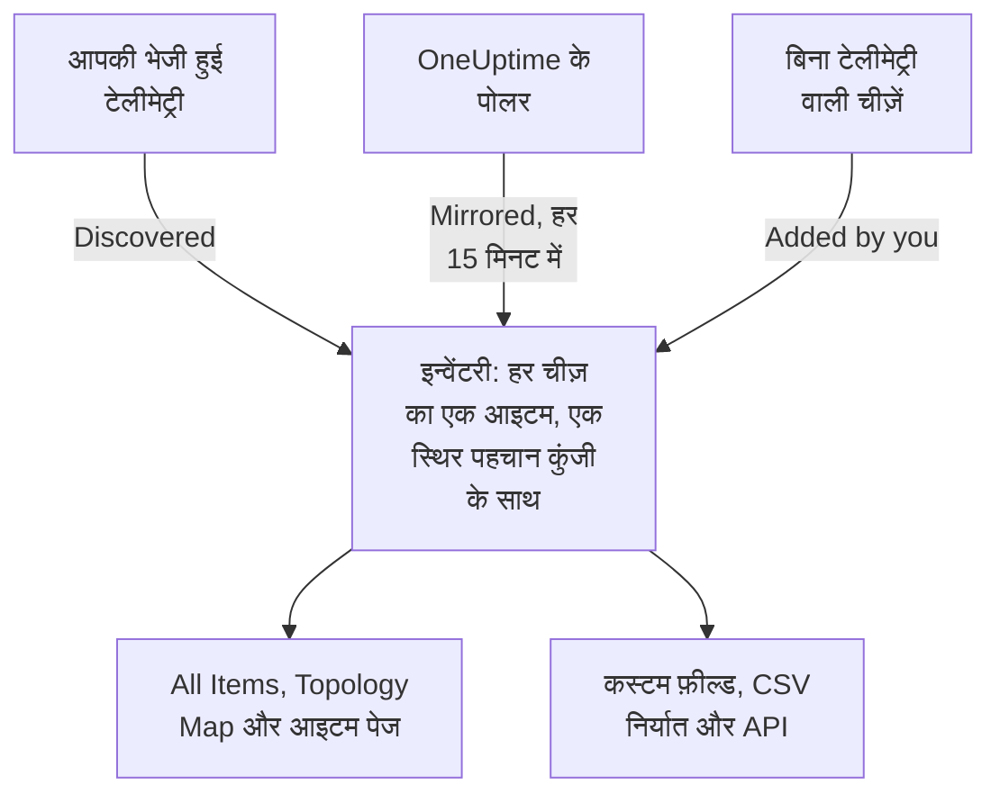

# इन्वेंटरी अवलोकन

इन्वेंटरी उन सभी चीज़ों की एक सूची है जिनके बारे में OneUptime आपके परिवेश में जानता है: सेवाएँ, होस्ट, Kubernetes ऑब्जेक्ट, वर्चुअल मशीनें, नेटवर्क डिवाइस, क्लाउड संसाधन, IoT डिवाइस, सर्वरलेस फ़ंक्शन, और वे चीज़ें जो कोई टेलीमेट्री नहीं भेजतीं। इसका ज़्यादातर हिस्सा उसी से अपने आप भर जाता है जिस पर OneUptime पहले से नज़र रखता है। आप वह जोड़ते हैं जो नज़र रखने से पता नहीं चलता: कोई चीज़ किस काम की है, उसका मालिक कौन है, उसकी वारंटी कब ख़त्म होती है। [शब्दावली](/docs/introduction/glossary#आप-किस-पर-नज़र-रखते-हैं) बताती है कि इसमें हर तरह का रिकॉर्ड क्या है।

:::cards
- [आइटम इन्वेंटरी में कैसे आते हैं](#आइटम-इन्वेंटरी-में-कैसे-आते-हैं): खोजे गए, मिरर किए गए, या आपके जोड़े हुए।
- [रास्ता ढूँढें](#रास्ता-ढूँढें): इन्वेंटरी के पेज, और हर आइटम के अपने पेज।
- [Esper से डिवाइस आयात करें](#esper-से-डिवाइस-आयात-करें): आपके Esper टेनेंट में नामांकित हर Android डिवाइस, हमेशा अद्यतन।
- [हाथ से कुछ जोड़ें](#हाथ-से-कुछ-जोड़ें): कोई थर्ड-पार्टी API, कोई बाहरी डेटाबेस या कोई अप्लायंस।
- [हटाने के बजाय संग्रहीत करें](#हटाने-के-बजाय-संग्रहीत-करें): सूची को साफ़ रखने का वह तरीका जो टिकता है।
:::

## आइटम इन्वेंटरी में कैसे आते हैं

OneUptime निगरानी के लिए पहले से ही आपके परिवेश पर नज़र रखता है, इसलिए कैटलॉग उसी से बनता है जो वह देखता है, न कि उससे जो किसी ने टाइप करना याद रखा। हर आइटम का एक स्रोत होता है, और स्रोत तय करता है कि आइटम पर किसका अधिकार है: आप उसे संपादित कर सकते हैं या नहीं, और वह अपने आप हट सकता है या नहीं।

| स्रोत | API में | कहाँ से आता है | कब तक रहता है |
| --- | --- | --- | --- |
| **खोजा गया** | `discovered` | OpenTelemetry रिसोर्स एट्रिब्यूट, जो टेलीमेट्री आते ही पढ़े जाते हैं: कोई सेवा, होस्ट, Kubernetes ऑब्जेक्ट या वर्चुअल मशीन जो टेलीमेट्री भेजती है। | हर बैच के साथ फिर से दर्ज होता है। अपने प्रकार की अवधि से ज़्यादा समय तक चुप रहने पर हटा दिया जाता है (नीचे देखें)। |
| **मिरर किया गया** | `inventory` | एक रिकॉर्ड जिसे OneUptime का कोई पोलर रखता है: नेटवर्क डिवाइस, क्लाउड संसाधन, IoT डिवाइस, सर्वरलेस फ़ंक्शन, RUM ऐप्लिकेशन, Docker होस्ट, Podman होस्ट और वे Android डिवाइस जिन्हें कोई Esper कनेक्शन आयात करता है। हर 15 मिनट में कॉपी किया जाता है। कोई Esper डिवाइस, हर बार जब उसका कनेक्शन पढ़ा जाता है। | जब तक उसका रिकॉर्ड है। रिकॉर्ड हटाएँ, और आइटम भी उसके साथ चला जाता है। |
| **आपके द्वारा जोड़ा गया** | `manual` | आपका जोड़ा हुआ, किसी ऐसी चीज़ के लिए जिसे OneUptime नहीं देख सकता: कोई थर्ड-पार्टी API, वेंडर द्वारा प्रबंधित डेटाबेस, रैक में रखा कोई अप्लायंस। | जब तक आप उसे हटा न दें। कोई चीज़ उसे समाप्त नहीं करती। |

खोजे गए या मिरर किए गए आइटम का नाम या प्रकार नहीं बदला जा सकता: उसका स्रोत अगली बार में बदलाव को फिर से लिख देगा। आइटम का **सेटिंग्स** पेज बताता है कि स्थायी बदलाव कहाँ करना है। आप किसी भी आइटम में, स्रोत चाहे जो हो, हमेशा कस्टम फ़ील्ड के मान जोड़ सकते हैं: [इन्वेंटरी कस्टम फ़ील्ड](/docs/inventory/custom-fields) देखें।

### चुप आइटम कब तक रहता है

खोजे गए आइटम की एक धड़कन होती है। हर बार जब उसकी टेलीमेट्री आती है, उसका आख़िरी बार देखे जाने का समय आगे बढ़ता है, और सूची का **स्थिति** कॉलम बताता है कि वह कितना हाल का है। Esper से आए Android डिवाइस के साथ भी ऐसा ही होता है: हर बार जब वह Esper के साथ चेक-इन करता है। दूसरे मिरर किए गए आइटम और आपके जोड़े हुए आइटम की कोई धड़कन नहीं होती, इसलिए उनकी स्थिति चिंता जगाने के बजाय खाली रहती है।

| स्थिति | इसका अर्थ |
| --- | --- |
| **लाइव** | पिछले 30 मिनट में देखा गया। |
| **हालिया** | पिछले एक दिन के भीतर देखा गया। |
| **पुराना** | एक दिन से ज़्यादा समय से नहीं देखा गया। **शांत हो गया** पेज इन्हें दिखाता है। |

हर तीन घंटे में, OneUptime उन खोजे गए आइटम को हटा देता है जो अपने प्रकार की अवधि से ज़्यादा समय तक चुप रहे हैं, संग्रहीत आइटम भी, और उनके कस्टम फ़ील्ड के मान भी उनके साथ चले जाते हैं। मिरर किए गए आइटम और आपके जोड़े हुए आइटम इस तरह कभी नहीं हटाए जाते।

| आइटम का प्रकार | टेलीमेट्री के बिना इतने समय बाद हटाया जाता है |
| --- | --- |
| पॉड, डिप्लॉयमेंट, Proxmox गेस्ट और VMware वर्चुअल मशीनें | 1 दिन |
| Kubernetes नोड और नेमस्पेस, Proxmox नोड, VMware होस्ट, क्लस्टर और डेटास्टोर, और वे डेटाबेस और रिमोट सेवाएँ जिन्हें आपके ट्रेस कॉल करते हैं | 7 दिन |
| सेवाएँ, होस्ट, Kubernetes, Proxmox और Ceph क्लस्टर, स्टोरेज ऐरे, vCenters और Docker Swarm क्लस्टर | 30 दिन |

OneUptime का खोजा हुआ कोई संबंध 30 दिन तक दोबारा न दिखने पर हटा दिया जाता है।

## रास्ता ढूँढें

**उत्पाद → संसाधन → इन्वेंटरी** खोलें। उसके साइड मेन्यू में ये पेज हैं। **स्रोत के अनुसार**, **सेटिंग्स**, **सहायता** और **उन्नत** मुड़े हुए शुरू होते हैं: किसी सेक्शन को खोलने के लिए उसके शीर्षक पर क्लिक करें।

| पेज | वहाँ आपको क्या मिलता है |
| --- | --- |
| **अवलोकन** | आपके पास कितने आइटम हैं, वे क्या हैं, कितने चुप हो गए हैं, और सबसे हाल में क्या जोड़ा गया। |
| **सभी आइटम** | हर आइटम। नाम, विवरण या पहचान कुंजी से खोजें, सूची को प्रकार, स्रोत, स्थिति या कस्टम फ़ील्ड से छोटा करें, और हाथ से आइटम जोड़ें। |
| **प्रबंधित डिवाइस** | आपके Esper कनेक्शन, और उनके आयात किए हर Android डिवाइस, उसकी स्थिति, समूह, मॉडल और Android संस्करण के साथ। |
| **टोपोलॉजी मैप** | आइटम कैसे जुड़े हैं: सेवाएँ, वे क्या कॉल करती हैं, और वे होस्ट, पॉड और डिवाइस जिन पर वे चलती हैं। |
| **शांत हो गया** | वे आइटम जिनकी एक दिन से ज़्यादा समय से कोई ख़बर नहीं: खोजे गए आइटम जिन्होंने टेलीमेट्री नहीं भेजी, और वे डिवाइस जिन्होंने Esper के साथ चेक-इन करना बंद कर दिया। |
| **स्रोत के अनुसार** | किसी एक स्रोत के आइटम: **खोजा गया**, **मिरर किया गया** या **आपके द्वारा जोड़ा गया**। |
| **सेटिंग्स → कस्टम फ़ील्ड** | वे फ़ील्ड जिन्हें आपका प्रोजेक्ट हर आइटम पर रखता है। |
| **सहायता → दस्तावेज़ीकरण** | इन्वेंटरी की एक छोटी गाइड, उन आइटम प्रकारों के साथ जिन्हें वह पहचानता है। |
| **उन्नत → संग्रहीत** | वे आइटम जिन्हें आपने संग्रहीत किया। उन्हें यहीं संग्रह से निकालें। |

कोई आइटम खोलें, और उसके अपने साइड मेन्यू में उसका **अवलोकन** (उसका प्रकार, स्रोत और स्थिति, और उस पर देखा गया हर एट्रिब्यूट), उसके **कनेक्शन** और उसके **कस्टम फ़ील्ड**; उसके **लॉग**, **ट्रेस**, **मेट्रिक्स**, **प्रोफ़ाइल** और **अपवाद**; और उसकी **घटनाएं**, **अलर्ट** और **अनुसूचित रखरखाव** होते हैं। **उन्नत** के नीचे उसकी **सेटिंग्स**, उसके **ऑडिट लॉग** और **आइटम हटाएं** हैं। टेलीमेट्री पेज वह दिखाते हैं जो आइटम ने खुद भेजा। घटनाएँ, अलर्ट और रखरखाव इवेंट उस सेवा, होस्ट या Kubernetes क्लस्टर के होते हैं जिसका आइटम प्रतिनिधित्व करता है; किसी और आइटम पर, वे पेज बताते हैं कि इसके बजाय किस संसाधन को देखना है।

### एसेट विवरण

किसी होस्ट या नेटवर्क डिवाइस में एक **एसेट विवरण** कार्ड होता है जो दोनों को एक ही तरह से बताता है: होस्टनाम, IP पता, MAC पता, क्रम संख्या, निर्माता, मॉडल, फ़र्मवेयर संस्करण, ऑपरेटिंग सिस्टम, OS संस्करण, डिवाइस प्रकार और स्थान। किसी Android डिवाइस के कार्ड में उसका सुरक्षा पैच स्तर भी होता है, जो Android एजेंट या Esper से आता है। जिस तथ्य की किसी ने जानकारी नहीं दी, वह **अज्ञात** दिखता है, और कार्ड बताता है कि ऐसा क्यों है और अज्ञात तथ्य कैसे भरे जाते हैं: ऐसा डिवाइस जो उन्हें SNMP पर नहीं बताता, ऐसा डिवाइस जो अभी पढ़ा नहीं गया, या ऐसा Meraki डिवाइस जिसके डैशबोर्ड में वे मौजूद हैं।

- होस्ट के तथ्य उसकी टेलीमेट्री के रिसोर्स एट्रिब्यूट से आते हैं: उसके IP और MAC पते, आर्किटेक्चर और ऑपरेटिंग सिस्टम शुरू से ही, और उसकी क्रम संख्या, निर्माता, मॉडल और फ़र्मवेयर तब, जब आप उन्हें जोड़ देते हैं।
- नेटवर्क डिवाइस के तथ्य उसके SNMP पोल, उसकी भूमिका और उसकी साइट से आते हैं। जो उसके पोल ने नहीं पढ़ा, वह डिस्कवरी से आता है: उसके पते का पिछला स्कैन, किसी राउटर की ARP तालिका, या उसके प्रोब का DNS लुकअप। ENTITY-MIB के बिना कोई डिवाइस, जैसे Meraki MX, फिर भी अपने सिस्टम विवरण से अपना निर्माता, मॉडल और ऑपरेटिंग सिस्टम पा लेता है, और अपने पोर्ट से अपना MAC पता। उसका IP पता कभी उसके होस्टनाम के रूप में नहीं दिखाया जाता।
- जब कोई [Meraki कनेक्शन](/docs/monitor/network-traffic#netflow-के-बिना-cisco-meraki) उसका संगठन पढ़ता है, तो Meraki डिवाइस वह भी Meraki डैशबोर्ड से लेता है जो उसका पोल खाली छोड़ता है, जिसमें उसकी क्रम संख्या, मॉडल और फ़र्मवेयर शामिल हैं।

कार्ड बताता है कि हर तथ्य कहाँ से और कब आया। ज़्यादातर तथ्यों का साझा स्रोत, जैसे होस्ट का कलेक्टर, नेटवर्क डिवाइस का अपना SNMP पोल या उसे पढ़ने वाला डिस्कवरी स्कैन, एक ही बार, तथ्यों के नीचे, बताया जाता है। कोई भी दूसरा स्रोत, जैसे किसी राउटर की ARP तालिका या डिवाइस पर सहेजा गया कोई मान, अपने तथ्य के नीचे बताया जाता है। नेटवर्क डिवाइस पर सहेजा गया मान डिस्कवरी जो पढ़ती है उससे कभी नहीं बदला जाता, और जब दोनों अलग हों, तो कार्ड दोनों दिखाता है।

किसी नेटवर्क डिवाइस के कार्ड में उन लोगों के लिए एक **रिफ्रेश** बटन होता है जो नेटवर्क डिवाइस संपादित कर सकते हैं। यह डिवाइस को अभी फिर से पढ़ता है: उसका प्रोब एक मिनट के भीतर उसे पोल करता है, और उसका Meraki कनेक्शन संगठन को फिर से पढ़ता है। कार्ड बताता है कि नई रीडिंग कब आ गई, या कि प्रोब डिवाइस तक नहीं पहुँच सका, और रीडिंग आते ही आइटम डिवाइस से कॉपी हो जाता है।

यही तथ्य **सभी आइटम** सूची के कॉलम हैं, जो आपके चालू करने तक छिपे रहते हैं, और वे उसके CSV निर्यात में जाते हैं। [CMDB में निर्यात करना](/docs/inventory/cmdb-sync#एसेट-विवरण) उनकी कुंजियाँ बताता है।

### कनेक्शन

किसी आइटम का **कनेक्शन** पेज दोनों दिशाओं में उसके पड़ोसियों को दिखाता है, जो **कॉल**, **इससे कॉल हुआ**, **यहाँ चलता है** और **संबंधित** में बँटे होते हैं। हर समूह अपना कुल दिखाता है (100,000 से ज़्यादा कनेक्शन वाला समूह "100,000+" दिखाता है), और **और दिखाएँ** बाकी को पेज दर पेज दिखाता है, ताकि कोई व्यस्त क्लस्टर, नेमस्पेस या नोड पहले कुछ के बजाय हर कनेक्शन दिखाए। यह पेज किसी समय सीमा तक सीमित नहीं है: इसमें API के ज़रिए हाथ से जोड़े गए संबंध, और संग्रहीत किए जा चुके पड़ोसी भी शामिल हैं। जो पड़ोसी अब इन्वेंटरी में नहीं है, वह अपनी कुंजी से दिखाया जाता है।

## Esper से डिवाइस आयात करें

कोई Esper टेनेंट कनेक्ट करें, और उसमें नामांकित हर Android डिवाइस इन्वेंटरी में आ जाता है, उन डिवाइसों समेत जिनका ऐप कभी शुरू नहीं हुआ। हर डिवाइस एक होस्ट है, उन जानकारियों के साथ जो सिर्फ़ Esper के पास हैं: उसका समूह, उसका Android संस्करण, बिल्ड और सुरक्षा पैच स्तर, उसकी क्रम संख्या और IMEI, उसकी बैटरी और स्टोरेज, और उसके इंस्टॉल किए गए ऐप। Esper अपने आप कुछ नहीं भेजता, इसलिए OneUptime उसे शेड्यूल पर पढ़ता है: डिवाइस हर 15 मिनट में, और हर डिवाइस के ऐप हर 6 घंटे में।

:::steps
### Esper में API कुंजी बनाएँ

Esper कंसोल में, API Key Management के अंतर्गत एक कुंजी बनाएँ। OneUptime केवल पढ़ता है, इसलिए ऐसे उपयोगकर्ता की कुंजी काफ़ी है जिसकी Esper भूमिका डिवाइस, समूह और ऐप पढ़ सकती है। कुंजी बदल दिए जाने पर, या उसके उपयोगकर्ता के हटाए जाने पर, वह काम करना बंद कर देती है।

### टेनेंट कनेक्ट करें

**उत्पाद → संसाधन → इन्वेंटरी** पर जाएँ, फिर **प्रबंधित डिवाइस** पर, और **Esper कनेक्ट करें** पर क्लिक करें। **टेनेंट** दर्ज करें, यानी आपके Esper कंसोल के पते में `.esper.cloud` से पहले वाला नाम (`acme.esper.cloud` के लिए `acme`), और फिर **API कुंजी**। **और फ़ील्ड** में कनेक्शन का नाम है, और यह कि उसे कितनी बार पढ़ा जाता है।

### पहली रीडिंग जाँचें

**कनेक्ट करें** कुछ भी सहेजने से पहले कुंजी की जाँच करता है: वह बताता है कि एक रीडिंग कितने Android डिवाइस आयात करेगी, या क्या गड़बड़ है और उसे कैसे ठीक करें। पहली रीडिंग एक मिनट के भीतर शुरू होती है, और कनेक्शन की पंक्ति बताती है कि वह कैसी रही।
:::

| Esper क्या रिपोर्ट करता है | यह कहाँ दिखता है |
| --- | --- |
| मॉडल, निर्माता, क्रम संख्या, Android संस्करण, बिल्ड, और IP व MAC पते | डिवाइस का **एसेट विवरण** कार्ड, और **सभी आइटम** के कॉलम |
| स्थिति, अंतिम चेक-इन, समूह, सुरक्षा पैच स्तर, IMEI, बैटरी, स्टोरेज और Esper एजेंट | डिवाइस का **Esper** कार्ड, और **प्रबंधित डिवाइस** की **डिवाइस** सूची |
| ऐप और उनके संस्करण | डिवाइस की **इंस्टॉल किए गए ऐप** सूची |

### एक डिवाइस, दो नहीं

किसी डिवाइस से टेलीमेट्री भेजने वाला ऐप या Android Agent जब डिवाइस को उसी तरह नाम देता है जैसे Esper देता है, तो वह Esper के आयात किए डिवाइस से जुड़कर एक ही आइटम बन जाता है। Esper हर डिवाइस पर जो मैनेज्ड कॉन्फ़िगरेशन भरता है, उससे ये रिसोर्स एट्रिब्यूट सेट करें:

| रिसोर्स एट्रिब्यूट | मैनेज्ड कॉन्फ़िगरेशन मान | यह क्या है |
| --- | --- | --- |
| `host.name` | `${esper.deviceName}` | Esper में डिवाइस का नाम, जैसे `ESP-ID-AAAAW`। ज़रूरी। |
| `host.serial_number` | `${esper.serialNumber}` | डिवाइस की क्रम संख्या। वैकल्पिक। |

OneUptime किसी डिवाइस का आइटम पहले Esper में उसके नाम से ढूँढता है, फिर उसकी क्रम संख्या से, और कोई मेल न मिलने पर ही नया आइटम बनाता है। Android Agent दोनों को अपनी `device_name` और `device_serial` सेटिंग से सेट करता है, और [Android सेटअप](/docs/rum/android-setup#esper-से-बेड़ा-आयात-करें) किसी ऐप का मैनेज्ड कॉन्फ़िगरेशन दिखाता है।

### जब कोई डिवाइस शांत हो जाए, या Esper छोड़ दे

जिस डिवाइस ने 30 मिनट से चेक-इन नहीं किया है, वह **ऑफ़लाइन** है, और बताता है कि उसने पिछली बार कितनी देर पहले चेक-इन किया था। उसके आइटम की **स्थिति** उसके अंतिम चेक-इन के हिसाब से चलती है, या उसकी टेलीमेट्री के हिसाब से जब वह ज़्यादा नई हो, इसलिए एक दिन से चुप डिवाइस **शांत हो गया** पेज पर होता है।

Esper से हटाया गया डिवाइस **हटाया गया** चिह्नित होता है, और उसका आइटम संग्रहीत हो जाता है: वह सूची से हट जाता है, और **उन्नत → संग्रहीत** के नीचे इंतज़ार करता है। जो डिवाइस Esper में लौट आता है, वह सूची में भी लौट आता है। उसके जाने के 30 दिन बाद डिवाइस हटा दिया जाता है, और उसका आइटम भी, जब तक टेलीमेट्री ने या आपने उसमें कुछ जोड़ा न हो।

## हाथ से कुछ जोड़ें

किसी ऐसी चीज़ के लिए आइटम जोड़ें जिसे OneUptime कभी अपने आप नहीं देखेगा, ताकि कोई निर्भरता किसी असली चीज़ पर ख़त्म हो और वह चीज़ आपके कस्टम फ़ील्ड रख सके।

:::steps
### सभी आइटम खोलें

**उत्पाद → संसाधन → इन्वेंटरी** पर जाएँ, फिर **सभी आइटम** पर।

### आइटम जोड़ें

**आइटम जोड़ें** पर क्लिक करें। उसका **प्रकार** चुनें, उसे एक **नाम** दें, और चाहें तो एक **विवरण** भी। नाम और प्रकार मिलकर आइटम की पहचान बनाते हैं, इसलिए एक ही प्रकार के दो आइटम का नाम एक नहीं हो सकता।

### उसके कस्टम फ़ील्ड भरें

नया आइटम खोलें। उसका स्रोत **आपके द्वारा जोड़ा गया** दिखता है, और उसका **कस्टम फ़ील्ड** पेज वे मान लेता है जिन्हें आपका प्रोजेक्ट ट्रैक करता है।
:::

आप हाथ से तीन प्रकार जोड़ सकते हैं:

- `external.service` (**बाहरी सेवा**): कोई थर्ड-पार्टी API या सॉफ़्टवेयर-ऐज़-ए-सर्विस निर्भरता।
- `external.database` (**बाहरी डेटाबेस**): ऐसा डेटाबेस जो कोई सर्वर नहीं है जिसे OneUptime मॉडल कर सके। कोई डेटाबेस सर्वर, सेल्फ़-होस्टेड या मैनेज्ड, PostgreSQL से लेकर Snowflake तक, इसके बजाय **डेटाबेस → डेटाबेस बनाएँ** के नीचे आता है ([डेटाबेस](/docs/telemetry/databases)): वह रिकॉर्ड उन ट्रेस, कंटेनर और इंजन मेट्रिक्स से जुड़ता है जो उसी पते का नाम लेते हैं, जो कोई इन्वेंटरी आइटम कभी नहीं करता, और एक ही सर्वर को दोनों तरह से जोड़ने पर दो असंबद्ध रिकॉर्ड बन जाते हैं।
- `appliance` (**अप्लायंस**): बिना एजेंट वाला हार्डवेयर या सॉफ़्टवेयर।

यह पाबंदी दोहराव रोकती है। जिस प्रकार को OneUptime देख सकता है, जैसे होस्ट, उसका हाथ से बना आइटम आपके टाइप किए नाम पर आधारित कुंजी पाएगा, जबकि उसी मशीन का खोजा गया आइटम उसके बताए एट्रिब्यूट पर आधारित कुंजी पाता है। दोनों कभी नहीं मिलेंगे, इसलिए एक ही होस्ट आपकी सूची में हमेशा के लिए दो बार रहेगा।

## हटाने के बजाय संग्रहीत करें

संग्रहीत करने से आइटम सूची से बाहर हो जाता है, जबकि उसकी पहचान, उसका इतिहास और उसके कस्टम फ़ील्ड के मान बने रहते हैं। इसका मतलब है: मैंने इसे देख लिया है, और मैं इसे अपनी सूची में नहीं चाहता। संग्रहीत आइटम टेलीमेट्री इकट्ठा करता रहता है।

| स्रोत | संग्रहीत करें | हटाएँ |
| --- | --- | --- |
| **खोजा गया** | संग्रहीत रहता है। | अपनी टेलीमेट्री के अगले बैच के साथ लौट आता है। |
| **मिरर किया गया** | संग्रहीत रहता है। | अगली कॉपी के साथ लौट आता है। इसके बजाय मूल रिकॉर्ड हटाएँ। |
| **आपके द्वारा जोड़ा गया** | संग्रहीत रहता है। | हमेशा के लिए चला जाता है। |

आइटम संग्रहीत करने के लिए, उन्हें **सभी आइटम** में चुनें और एक साथ संग्रहीत करें, या कोई आइटम खोलें और उसके **सेटिंग्स** पेज पर **संग्रहीत करें** कार्ड का उपयोग करें। संग्रहीत आइटम **इन्वेंटरी → उन्नत → संग्रहीत** के नीचे होते हैं, जहाँ आप उन्हें चुनकर संग्रह से निकाल सकते हैं।

> [!NOTE]
> जब कोई मिरर किया गया डिवाइस अपने मालिक रिकॉर्ड से हटाया जाता है, तो OneUptime उसका आइटम भी हटा देता है, जब तक उस आइटम में आपके दर्ज किए कस्टम फ़ील्ड मान न हों। वे मान इकलौती कॉपी हैं और उन्हें वापस नहीं लाया जा सकता, इसलिए आइटम हटाने के बजाय संग्रहीत किया जाता है। आप उसे **उन्नत → संग्रहीत** के नीचे पाएँगे, आपकी टाइप की हुई हर चीज़ के साथ।

## संबंध और टोपोलॉजी

OneUptime आइटम को दिशा वाले संबंधों से जोड़ता है, जैसे-जैसे वह उन्हें देखता है। **इन्वेंटरी → टोपोलॉजी मैप** उन्हें बनाता है, और किसी आइटम का **कनेक्शन** पेज उसके अपने संबंध दिखाता है। देखें [टोपोलॉजी](/docs/telemetry/topology)।

| संबंध | उदाहरण के लिए |
| --- | --- |
| `runs-on` | एक पॉड किसी नोड पर चलता है; एक वर्चुअल मशीन अपने होस्ट पर चलती है। |
| `member-of` | एक पॉड, नोड या नेमस्पेस किसी क्लस्टर का सदस्य है। |
| `hosted-on` | एक सेवा किसी होस्ट पर होस्ट होती है। |
| `part-of` | एक पॉड अपने डिप्लॉयमेंट का हिस्सा है। |
| `depends-on` | एक सेवा दूसरी सेवा को कॉल करती है, उन स्पैन से जो उनके बीच से गुज़रते हैं। |

## अगले कदम

:::cards
- [इन्वेंटरी कस्टम फ़ील्ड](/docs/inventory/custom-fields): क्रम संख्या, वारंटी की तारीखें, मालिक और लाइफ़साइकिल स्थिति ट्रैक करें।
- [CMDB में निर्यात करना](/docs/inventory/cmdb-sync): कैटलॉग को अपने रिकॉर्ड सिस्टम में खींचें।
- [डेटाबेस](/docs/telemetry/databases): अपनी सेवाओं के इस्तेमाल किए डेटाबेस सर्वर की निगरानी करें।
:::
