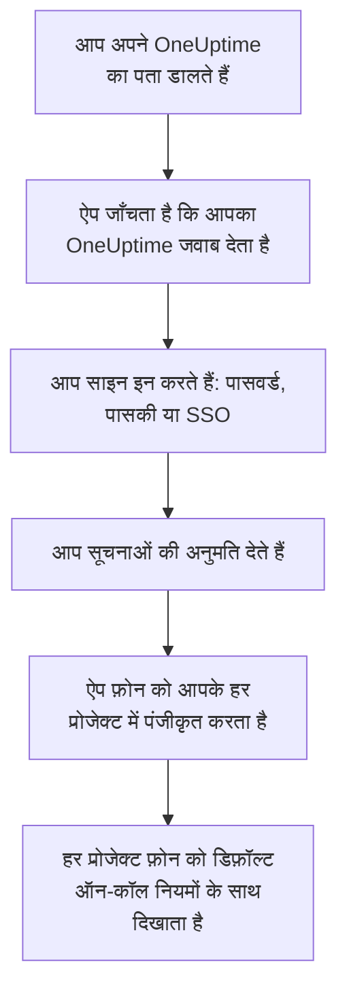
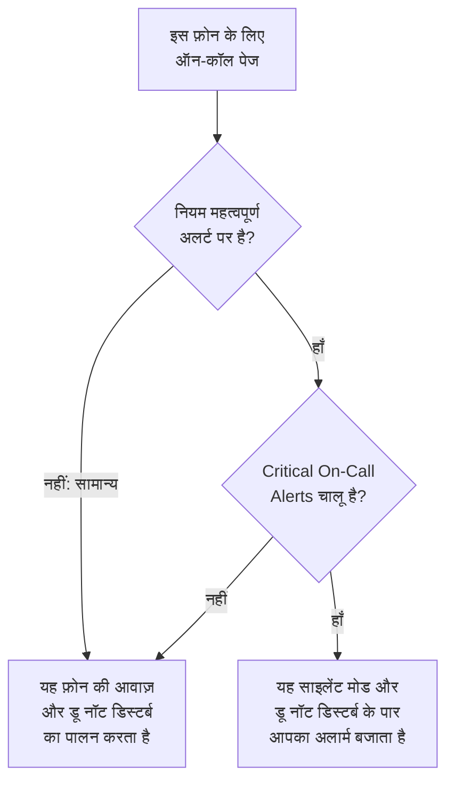

# Android स्थापना

Android फ़ोन या टैबलेट पर **OneUptime On-Call** इंस्टॉल करें, उसे अपने OneUptime से कनेक्ट करें और साइन इन करें। फिर ख़ुद को एक परीक्षण सूचना भेजें, और ज़रूरी ऑन-कॉल पेज को साइलेंट मोड और डू नॉट डिस्टर्ब के पार बजने दें।

:::cards
- [ऐप इंस्टॉल करें](#ऐप-इंस्टॉल-करें): Google Play से, या जिस फ़ोन पर Google Play नहीं है उस पर APK से।
- [साइन इन करें](#साइन-इन-करें): पहले आपके OneUptime का पता, फिर आपका खाता।
- [जाँचें कि पेज फ़ोन तक पहुँचते हैं](#जाँचें-कि-पेज-फ़ोन-तक-पहुँचते-हैं): डैशबोर्ड में फ़ोन ढूँढें और उसे परखें।
- [साइलेंट मोड के पार बजाएँ](#साइलेंट-मोड-के-पार-बजाएँ): गंभीर अलर्ट और अलार्म ध्वनि।
- [समस्या निवारण](#समस्या-निवारण): साइन-इन, सूचना और इंस्टॉल की समस्याएँ।
:::

## शुरू करने से पहले

- Android 7.0 या बाद के संस्करण वाला फ़ोन या टैबलेट।
- किसी OneUptime प्रोजेक्ट में खाता। पेज पाने के लिए आपका ऑन-कॉल होना भी ज़रूरी है: [एस्केलेशन नियम](/docs/on-call/escalation-rules) देखें।
- आपके OneUptime का पता: OneUptime Cloud पर `https://oneuptime.com`, या आपका अपना, जैसे `https://oneuptime.example.com`। ऐप केवल HTTPS पर कनेक्ट होता है।

## ऐप इंस्टॉल करें

:::tabs
@tab Google Play
1. फ़ोन पर [Google Play पर OneUptime On-Call](https://play.google.com/store/apps/details?id=com.oneuptime.oncall) खोलें, या Google Play में OneUptime On-Call खोजें।
2. **इंस्टॉल करें** पर टैप करें, फिर **खोलें** पर।

Google Play ऐप को अप-टू-डेट रखता है।
@tab APK
उस फ़ोन के लिए जिस पर Google Play नहीं है। APK हर OneUptime रिलीज़ के लिए उसी कोड से बनाया जाता है और GitHub पर उस रिलीज़ के साथ जोड़ा जाता है।

1. फ़ोन पर [सबसे नया APK](https://github.com/OneUptime/oneuptime/releases/latest/download/oneuptime-on-call-android-app.apk) खोलें।
2. डाउनलोड की गई फ़ाइल खोलें। अगर Android पूछे, तो अपने ब्राउज़र को अनजान ऐप इंस्टॉल करने दें, फिर **इंस्टॉल करें** पर टैप करें।
3. अपने ऐप्स से OneUptime On-Call खोलें।

APK अपने आप अपडेट नहीं होता: समय-समय पर उसके ऊपर सबसे नया APK इंस्टॉल करें। आपका साइन-इन और सेटिंग्स बनी रहती हैं।
:::

## साइन इन करें

:::steps
### अपने OneUptime का पता डालें
ऐप खोलें। **Connect your workspace** पर, OneUptime Cloud के लिए `https://oneuptime.com` रहने दें, या अपने OneUptime का पता डालें, और **Connect** पर टैप करें। जैसे ही `https://<your-oneuptime>/api/status` जवाब देता है, ऐप आगे बढ़ता है।

### अपने खाते में साइन इन करें
आपका खाता जिस तरह साइन इन करता है, वही तरीका इस्तेमाल करें:

- आपका ईमेल और पासवर्ड, फिर **Sign In**। **Forgot password?** आपको नया पासवर्ड सेट करने का लिंक ईमेल करता है।
- **Sign in with a passkey**, जब आप डैशबोर्ड में एक पासकी जोड़ चुके हों: [एक पासकी जोड़ें](/docs/introduction/your-account#एक-पासकी-जोड़ें) देखें। आपका ब्राउज़र उसकी पुष्टि के लिए खुलता है, फिर आपको वापस ले आता है।
- **Sign in with SSO**, अगर आपका संगठन सिंगल साइन-ऑन इस्तेमाल करता है। अपना प्रदाता चुनें, या अपना कार्य ईमेल डालकर **Continue** पर टैप करें। एक सुरक्षित ब्राउज़र खुलता है, और साइन इन करते ही आप ऐप में वापस आ जाते हैं।

टू-फ़ैक्टर ऑथेंटिकेशन चालू हो, तो अपने ऑथेंटिकेटर ऐप का छह अंकों वाला कोड, या अपना कोई बैकअप कोड डालें। ऐप में सिक्योरिटी की इस्तेमाल नहीं की जा सकती। अगर आपके एडमिनिस्ट्रेटर को टू-फ़ैक्टर ऑथेंटिकेशन चाहिए और आपने उसे अभी तक सेट नहीं किया है, तो ऐप पहले आपके साथ एक ऑथेंटिकेटर ऐप सेट करता है।

### सूचनाओं की अनुमति दें
जब Android पूछे कि क्या OneUptime On-Call सूचनाएँ भेज सकता है, तो **अनुमति दें** पर टैप करें। Android 13 और बाद के संस्करण पूछते हैं; पुराने संस्करण उन्हें तब तक अनुमति देते हैं जब तक आप उन्हें बंद न करें।

फिर ऐप फ़ोन को आपके हर प्रोजेक्ट में पंजीकृत करता है। हर प्रोजेक्ट उसे डिफ़ॉल्ट ऑन-कॉल नियमों के साथ आपके पुश डिवाइस में दिखाता है, इसलिए अब से आपके पेज उस तक पहुँचते हैं।
:::

ऐप एक बार में एक प्रोजेक्ट दिखाता है: बदलने के लिए स्क्रीन के ऊपर प्रोजेक्ट के नाम पर टैप करें। जिस प्रोजेक्ट के लिए सिंगल साइन-ऑन ज़रूरी है, वह **Settings → Manage Projects** के तहत तब तक **SSO Required** दिखाता है जब तक आप वहाँ **Authenticate with SSO** पर टैप न करें।

## जाँचें कि पेज फ़ोन तक पहुँचते हैं

:::steps
### डैशबोर्ड में फ़ोन ढूँढें
डैशबोर्ड में **उपयोगकर्ता सेटिंग्स → सूचना विधियां** और **Push Notifications** टैब खोलें। फ़ोन **Push सूचना डिवाइस** के तहत अपने मॉडल के नाम से दिखता है। हर प्रोजेक्ट की अपनी सूची होती है।

### परीक्षण भेजें
फ़ोन की पंक्ति में **परीक्षण सूचना** पर क्लिक करें। फ़ोन पर एक सूचना आती है; ऐप खोलने के लिए उस पर टैप करें।
:::

कौन-से पेज फ़ोन पर जाते हैं, और कितनी जल्दी, यह आपके ऑन-कॉल नियम तय करते हैं: **उपयोगकर्ता सेटिंग्स → ऑन-कॉल नियम** देखें। नए फ़ोन को वही डिफ़ॉल्ट नियम मिलते हैं जो आपके जोड़े गए किसी भी दूसरे तरीके को मिलते हैं।

## साइलेंट मोड के पार बजाएँ

डिफ़ॉल्ट रूप से ऑन-कॉल पेज फ़ोन की आवाज़ की सेटिंग्स का पालन करता है: म्यूट फ़ोन चुप रहता है, और डू नॉट डिस्टर्ब पेज को रोक लेता है। गंभीर अलर्ट ऑन-कॉल पेज को दोनों के पार बजने देते हैं। जब तक आप इन्हें चालू न करें, ये हर फ़ोन पर बंद रहते हैं।

:::steps
### Critical On-Call Alerts चालू करें
ऐप में **Settings** खोलें और **Notifications** के तहत **Critical On-Call Alerts** चालू करें।

### परेशान न करें का ऐक्सेस दें
Android अपनी **परेशान न करें का ऐक्सेस** सूची खोलता है। OneUptime On-Call के लिए ऐक्सेस चालू करें, फिर ऐप पर वापस जाएँ: ऐप ऐक्सेस जाँचता है और स्विच के नीचे बताता है कि पेज पार बजेंगे या नहीं।

### अलार्म ध्वनि चुनें
स्विच के नीचे **Alarm sound** पर टैप करें। फ़ोन की अपनी ध्वनि के अलावा, इसमें Klaxon, Siren, Digital alarm, Smoke alarm और Rising alarm हैं, जो धीमे शुरू होकर तेज़ होता जाता है। किसी ध्वनि को सुनने के लिए उसके पास चलाएँ बटन दबाएँ। गंभीर पेज फ़ोन के अलार्म वॉल्यूम पर बजता है, इसलिए उसे ऊँचा रखें।
:::

केवल ऑन-कॉल पेज पार बजते हैं, और केवल उन ऑन-कॉल नियमों से जो **महत्वपूर्ण अलर्ट** पर सेट हैं, जो डिफ़ॉल्ट है। **सामान्य** पर सेट नियम स्विच चाहे जो कहे, फ़ोन की सेटिंग्स का पालन करता है, ताकि गंभीर घटना पर आपको जगाया जा सके और छोटी घटना पर चुपचाप पेज किया जा सके। फ़ोन म्यूट करके **परीक्षण सूचना** भेजें और सुनें कि पेज क्या करेगा।

## पेज देर से न पहुँचें

OneUptime ऑन-कॉल पेज उच्च प्राथमिकता पर भेजता है, जिन्हें Android घंटों से निष्क्रिय पड़े फ़ोन तक भी पहुँचाता है। फिर भी, जो फ़ोन ऐप के बैटरी इस्तेमाल को सीमित करता है, वह उन्हें रोक सकता है:

- **सेटिंग → ऐप्लिकेशन → OneUptime On-Call → बैटरी** खोलें और **बिना पाबंदी के** चुनें। कुछ फ़ोन में इसका नाम **ऐप्लिकेशन के लिए बैटरी खर्च** होता है।
- **सेटिंग → ऐप्लिकेशन → OneUptime On-Call → सूचनाएं** के तहत जाँचें कि ऐप की सूचनाएँ चालू हैं।
- OneUptime On-Call को अपने फ़ोन की किसी भी बैटरी सेवर या स्लीपिंग ऐप्स सूची से बाहर रखें।

## ऐप लॉक करें

ऐप में **Settings** के तहत **Biometrics Login** चालू करें, और ऐप हर बार शुरू होने पर आपका फ़िंगरप्रिंट, चेहरा या फ़ोन का स्क्रीन लॉक माँगेगा। यह स्विच तब दिखता है जब फ़ोन पर फ़िंगरप्रिंट या फ़ेस अनलॉक सेट हो। उसी स्क्रीन पर **Appearance** हल्का या गहरा रूप चुनता है, या फ़ोन के अनुसार चलता है।

## अपडेट, साइन आउट या अनइंस्टॉल

- **अपडेट।** Google Play ऐप को अपडेट करता है। APK के लिए, उसके ऊपर सबसे नया APK इंस्टॉल करें। ऐप का संस्करण उसकी **Settings** स्क्रीन के सबसे नीचे होता है।
- **साइन आउट।** **Settings → Log Out** आपको साइन आउट करता है और फ़ोन को हर प्रोजेक्ट के आपके पुश डिवाइस से, उसके ऑन-कॉल नियमों समेत, हटा देता है। फिर से साइन इन करने पर वह डिफ़ॉल्ट नियमों के साथ वापस जुड़ जाता है।
- **अनइंस्टॉल।** ऐप को किसी भी दूसरे ऐप की तरह हटाएँ। अगर आप तब भी साइन इन थे, तो फ़ोन आपकी सूची में तब तक रहता है जब तक उस पर कोई पुश विफल न हो: फिर OneUptime उसे **सूचनाएँ नहीं मिल रहीं** चिह्नित करता है। वह प्रविष्टि **हटाएं** से हटाएँ: ऐप फिर से इंस्टॉल करके साइन इन करने पर फ़ोन डिफ़ॉल्ट नियमों के साथ एक नई प्रविष्टि के रूप में जुड़ता है।

## समस्या निवारण

:::details “Could not connect to the server”
ऐप `https://<your-oneuptime>/api/status` तक नहीं पहुँच सका। `https://` समेत पता जाँचें। अगर आपका OneUptime किसी निजी नेटवर्क पर है, तो पहले फ़ोन को उससे जोड़ें, उदाहरण के लिए अपने VPN से। वह पता फ़ोन के ब्राउज़र में खोलें: फ़ोन OneUptime तक पहुँच पाता है तो वह `{"status":"ok"}` दिखाता है।
:::

:::details कोई सूचना नहीं आती
- Android की सेटिंग्स में जाँचें कि ऐप के लिए सूचनाएँ चालू हैं, और डू नॉट डिस्टर्ब बंद है या गंभीर अलर्ट चालू हैं।
- जाँचें कि फ़ोन **उपयोगकर्ता सेटिंग्स → सूचना विधियां** में **Push Notifications** के तहत दिखता है, और उसे **परीक्षण सूचना** भेजें।
- अगर फ़ोन **सूचनाएँ नहीं मिल रहीं** चिह्नित है, तो साइन इन रहते हुए ऐप खोलें। वह फ़ोन को फिर से पंजीकृत करता है; [जब फ़ोन को फिर से पंजीकृत होना पड़े](/docs/mobile-desktop-apps/faq-troubleshooting#जब-फ़ोन-को-फिर-से-पंजीकृत-होना-पड़े) देखें।
- **उपयोगकर्ता सेटिंग्स → ऑन-कॉल नियम** के तहत अपने ऑन-कॉल नियम जाँचें।
- सेल्फ-होस्टेड OneUptime पर, जाँचें कि आपका सर्वर अपने पुश रिले तक पहुँच पाता है: [पुश सूचनाएँ](/docs/self-hosted/push-notifications#नेटवर्क-पहुँच) देखें।
:::

:::details डू नॉट डिस्टर्ब में गंभीर अलर्ट नहीं बजते
ऐप की **Settings** खोलें: **Critical On-Call Alerts** के नीचे की पंक्ति बताती है कि क्या कमी है। आमतौर पर डू नॉट डिस्टर्ब का ऐक्सेस नहीं दिया गया होता: उसे **सेटिंग → सूचनाएं → परेशान न करें का ऐक्सेस** के तहत दें, फिर ऐप पर वापस जाएँ। अगर आपने कोई अलार्म ध्वनि चुनी है, तो उस ध्वनि के सूचना चैनल को भी डू नॉट डिस्टर्ब ओवरराइड करने की अनुमति होनी चाहिए।
:::

:::details APK इंस्टॉल करते समय “ऐप इंस्टॉल नहीं हुआ”
OneUptime On-Call फ़ोन पर पहले से किसी दूसरे स्रोत से है, जैसे Google Play, और Android एक के ऊपर दूसरा इंस्टॉल नहीं करता। उसे अनइंस्टॉल करें, APK इंस्टॉल करें और फिर से साइन इन करें।
:::

:::details Biometrics Login स्विच नहीं है
यह स्विच तब दिखता है जब Android की सेटिंग्स में फ़िंगरप्रिंट या फ़ेस अनलॉक सेट हो।
:::

## अगले कदम

:::cards
- [अक्सर पूछे जाने वाले प्रश्न और समस्या निवारण](/docs/mobile-desktop-apps/faq-troubleshooting): जब फ़ोन पर पेज आने बंद हो जाएँ तो क्या करें।
- [iOS स्थापना](/docs/mobile-desktop-apps/ios-installation): iPhone या iPad पर वही ऐप।
- [एस्केलेशन नियम](/docs/on-call/escalation-rules): तय करें कि किसे और कब पेज किया जाए।
- [पुश सूचनाएँ](/docs/self-hosted/push-notifications): सेल्फ-होस्टेड OneUptime फ़ोन पर पेज कैसे भेजता है।
:::
