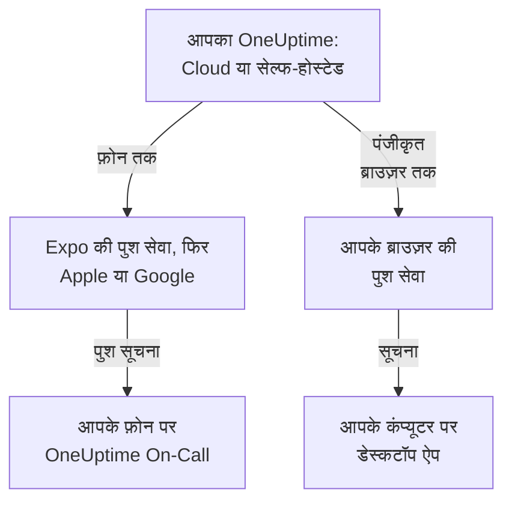

# ऐप्स का अवलोकन

OneUptime का एक ऐप फ़ोन के लिए है और एक कंप्यूटर के लिए। iPhone, iPad और Android के लिए **OneUptime On-Call** आपके ऑन-कॉल होने पर आपको पेज करता है, और आप कहीं भी हों, घटनाओं को स्वीकार करने और सुलझाने देता है। Windows, macOS और Linux पर OneUptime डैशबोर्ड ब्राउज़र से डेस्कटॉप ऐप के रूप में इंस्टॉल होता है और अपनी अलग विंडो में खुलता है। दोनों OneUptime Cloud और सेल्फ-होस्टेड OneUptime के साथ काम करते हैं।

:::cards
- [ऐप चुनें](#ऐप-चुनें): हर ऐप किस काम का है, एक साथ तुलना में।
- [ऐप्स OneUptime तक कैसे पहुँचते हैं](#ऐप्स-oneuptime-तक-कैसे-पहुँचते-हैं): साइन-इन और ऑन-कॉल पेज किस रास्ते से जाते हैं।
- [मोबाइल ऐप पाएँ](#मोबाइल-ऐप-पाएँ): App Store, Google Play या GitHub से।
- [डेस्कटॉप ऐप पाएँ](#डेस्कटॉप-ऐप-पाएँ): Edge, Chrome या Safari से डैशबोर्ड इंस्टॉल करें।
:::

## ऐप चुनें

|  | मोबाइल ऐप | डेस्कटॉप ऐप |
| --- | --- | --- |
| यह क्या है | OneUptime On-Call, iPhone, iPad और Android के लिए नेटिव ऐप | ब्राउज़र से इंस्टॉल किया गया OneUptime डैशबोर्ड |
| कहाँ से पाएँ | App Store, Google Play या GitHub पर APK | आपका अपना OneUptime: कुछ भी डाउनलोड नहीं करना |
| ऑन-कॉल पेज | पुश सूचनाएँ, जो साइलेंट मोड और डू नॉट डिस्टर्ब के पार बज सकती हैं | ब्राउज़र पंजीकृत करने के बाद ब्राउज़र सूचनाएँ |
| आप क्या कर सकते हैं | घटनाएँ, अलर्ट, सुरक्षा केस, मॉनिटर और कौन ऑन-कॉल है; स्वीकार करें, सुलझाएँ, प्लेबुक चरणों का अनुमोदन करें और नोट जोड़ें | वह सब कुछ जो डैशबोर्ड करता है |
| अपडेट | स्टोर से, या नया APK इंस्टॉल करके | हर बार खुलने पर आपके OneUptime से डैशबोर्ड लोड करता है |
| कहाँ चलता है | iOS 16.4 या बाद का, Android 7.0 या बाद का | Windows, macOS और Linux, Edge या Chrome के साथ, या macOS Sonoma 14 या बाद के संस्करण पर Safari |

आप दोनों इस्तेमाल कर सकते हैं: काम के समय डेस्कटॉप ऐप खुला रखें, और रात में फ़ोन को आपको जगाने दें।

## ऐप्स OneUptime तक कैसे पहुँचते हैं

मोबाइल ऐप आपके OneUptime में साइन इन करता है और फ़ोन को उन सभी प्रोजेक्ट में पंजीकृत करता है जिनके आप सदस्य हैं। इसके बाद OneUptime फ़ोन की पुश सूचनाएँ, ऑन-कॉल पेज समेत, Expo की पुश सेवा से भेजता है, जो उन्हें डिलीवरी के लिए Apple या Google को सौंपती है। सेल्फ-होस्टेड OneUptime डिफ़ॉल्ट रूप से उन्हें OneUptime के पुश रिले से भेजता है, इसलिए उसे अपने Apple, Google या Expo खाते की ज़रूरत नहीं होती: [पुश सूचनाएँ](/docs/self-hosted/push-notifications) देखें।

डेस्कटॉप ऐप अपनी अलग विंडो में खुला डैशबोर्ड ही है। जब आप उसके ब्राउज़र को पुश सूचनाओं के लिए पंजीकृत करते हैं, तब वह सूचनाएँ दिखाता है: Windows, macOS और Linux के पेज बताते हैं कि यह कैसे करें।

## शुरू करने से पहले

- किसी OneUptime प्रोजेक्ट में खाता। पेज पाने के लिए आपका ऑन-कॉल होना भी ज़रूरी है: [एस्केलेशन नियम](/docs/on-call/escalation-rules) देखें।
- आपके OneUptime का पता। OneUptime Cloud पर यह `https://oneuptime.com` है; सेल्फ-होस्टेड OneUptime का अपना पता होता है, जैसे `https://oneuptime.example.com`।
- HTTPS पर चलने वाला आपका OneUptime। मोबाइल ऐप सादे HTTP पर कनेक्ट नहीं होता, और ब्राउज़र सूचनाएँ दिखाते हैं, और Edge और Chrome ऐप इंस्टॉल करते हैं, केवल HTTPS साइटों के लिए।

## मोबाइल ऐप पाएँ

:::steps
### OneUptime On-Call इंस्टॉल करें
iPhone या iPad पर इसे [App Store](https://apps.apple.com/us/app/oneuptime-on-call/id6759615391) से, या Android पर [Google Play](https://play.google.com/store/apps/details?id=com.oneuptime.oncall) से पाएँ। जिस Android फ़ोन पर Google Play नहीं है, उस पर इसके बजाय [APK](https://github.com/OneUptime/oneuptime/releases/latest/download/oneuptime-on-call-android-app.apk) इंस्टॉल करें। यही लिंक डैशबोर्ड में **प्रोजेक्ट सेटिंग्स → सूचनाएं → मोबाइल ऐप्स** के तहत भी हैं।

### इसे अपने OneUptime से कनेक्ट करें
ऐप खोलें, OneUptime Cloud के लिए `https://oneuptime.com` रहने दें या अपने OneUptime का पता डालें, और पासवर्ड, पासकी या सिंगल साइन-ऑन से साइन इन करें।

### सूचनाओं की अनुमति दें
जब फ़ोन पूछे, तो उन्हें अनुमति दें। ऐप फ़ोन को आपके हर प्रोजेक्ट में पंजीकृत करता है, और ऑन-कॉल पेज उस पर आने लगते हैं।
:::

हर चरण विस्तार से, और बाद में क्या जाँचें: [Android स्थापना](/docs/mobile-desktop-apps/android-installation) और [iOS स्थापना](/docs/mobile-desktop-apps/ios-installation)।

## डेस्कटॉप ऐप पाएँ

:::steps
### डैशबोर्ड खोलें
Microsoft Edge या Google Chrome में, या Mac पर Safari में, अपने OneUptime में साइन इन करें।

### इसे इंस्टॉल करें
Edge या Chrome में, एड्रेस बार के दाईं ओर इंस्टॉल आइकन पर क्लिक करें। Safari में **फ़ाइल → Dock में जोड़ें** चुनें।

### इसे किसी भी दूसरे ऐप की तरह खोलें
यह Start मेनू, Dock या आपके ऐप लॉन्चर से अपनी अलग विंडो में खुलता है।
:::

हर ब्राउज़र के चरण: [Windows स्थापना](/docs/mobile-desktop-apps/windows-installation), [macOS स्थापना](/docs/mobile-desktop-apps/macos-installation) और [Linux स्थापना](/docs/mobile-desktop-apps/linux-installation)।

## अगले कदम

:::cards
- [Android स्थापना](/docs/mobile-desktop-apps/android-installation): Android पर ऐप इंस्टॉल करें, साइन इन करें और जाँचें कि पेज पहुँचते हैं।
- [iOS स्थापना](/docs/mobile-desktop-apps/ios-installation): iPhone या iPad पर ऐप इंस्टॉल करें और गंभीर अलर्ट चालू करें।
- [Windows स्थापना](/docs/mobile-desktop-apps/windows-installation): Edge या Chrome से डैशबोर्ड इंस्टॉल करें।
- [macOS स्थापना](/docs/mobile-desktop-apps/macos-installation): Safari, Chrome या Edge से डैशबोर्ड को Dock में जोड़ें।
- [Linux स्थापना](/docs/mobile-desktop-apps/linux-installation): Chrome, Chromium या Edge से डैशबोर्ड इंस्टॉल करें।
- [अक्सर पूछे जाने वाले प्रश्न और समस्या निवारण](/docs/mobile-desktop-apps/faq-troubleshooting): जवाब, समाधान, और फ़ोन पर पेज आने बंद हो जाएँ तो क्या करें।
:::
