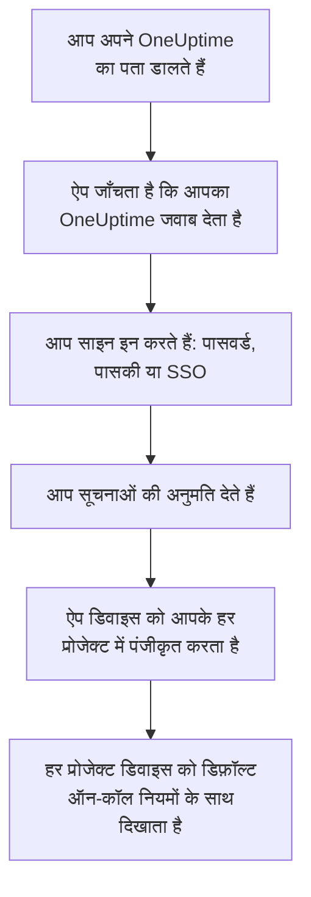
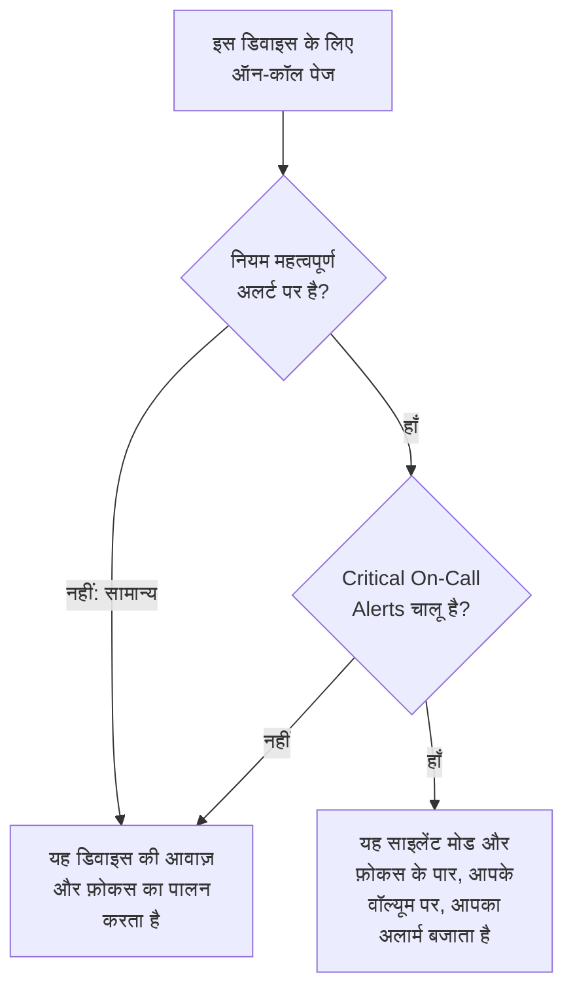

# iOS स्थापना

App Store से iPhone या iPad पर **OneUptime On-Call** इंस्टॉल करें, उसे अपने OneUptime से कनेक्ट करें और साइन इन करें। फिर ख़ुद को एक परीक्षण सूचना भेजें, और ज़रूरी ऑन-कॉल पेज को साइलेंट मोड और फ़ोकस के पार बजने दें।

:::cards
- [ऐप इंस्टॉल करें](#ऐप-इंस्टॉल-करें): App Store से।
- [साइन इन करें](#साइन-इन-करें): पहले आपके OneUptime का पता, फिर आपका खाता।
- [जाँचें कि पेज डिवाइस तक पहुँचते हैं](#जाँचें-कि-पेज-डिवाइस-तक-पहुँचते-हैं): डैशबोर्ड में उसे ढूँढें और परखें।
- [साइलेंट मोड के पार बजाएँ](#साइलेंट-मोड-के-पार-बजाएँ): गंभीर अलर्ट, अलार्म ध्वनि और उसका वॉल्यूम।
- [समस्या निवारण](#समस्या-निवारण): साइन-इन, सूचना और गंभीर अलर्ट की समस्याएँ।
:::

## शुरू करने से पहले

- iOS 16.4 या बाद के संस्करण वाला iPhone, या iPadOS 16.4 या बाद के संस्करण वाला iPad।
- किसी OneUptime प्रोजेक्ट में खाता। पेज पाने के लिए आपका ऑन-कॉल होना भी ज़रूरी है: [एस्केलेशन नियम](/docs/on-call/escalation-rules) देखें।
- आपके OneUptime का पता: OneUptime Cloud पर `https://oneuptime.com`, या आपका अपना, जैसे `https://oneuptime.example.com`। ऐप केवल HTTPS पर कनेक्ट होता है।

## ऐप इंस्टॉल करें

1. iPhone या iPad पर [App Store पर OneUptime On-Call](https://apps.apple.com/us/app/oneuptime-on-call/id6759615391) खोलें, या App Store में OneUptime On-Call खोजें।
2. **प्राप्त करें** पर टैप करें, और Face ID, Touch ID या अपने Apple खाते के पासवर्ड से पुष्टि करें।
3. **खोलें** पर टैप करें, या होम स्क्रीन से OneUptime On-Call खोलें।

जब तक **सेटिंग्ज़ → App Store** के तहत **ऐप अपडेट** चालू है, App Store ऐप को अप-टू-डेट रखता है।

## साइन इन करें

:::steps
### अपने OneUptime का पता डालें
ऐप खोलें। **Connect your workspace** पर, OneUptime Cloud के लिए `https://oneuptime.com` रहने दें, या अपने OneUptime का पता डालें, और **Connect** पर टैप करें। जैसे ही `https://<your-oneuptime>/api/status` जवाब देता है, ऐप आगे बढ़ता है।

### अपने खाते में साइन इन करें
आपका खाता जिस तरह साइन इन करता है, वही तरीका इस्तेमाल करें:

- आपका ईमेल और पासवर्ड, फिर **Sign In**। **Forgot password?** आपको नया पासवर्ड सेट करने का लिंक ईमेल करता है।
- **Sign in with a passkey**, जब आप डैशबोर्ड में एक पासकी जोड़ चुके हों: [एक पासकी जोड़ें](/docs/introduction/your-account#एक-पासकी-जोड़ें) देखें। उसकी पुष्टि के लिए एक ब्राउज़र शीट खुलती है, फिर आपको वापस ले आती है।
- **Sign in with SSO**, अगर आपका संगठन सिंगल साइन-ऑन इस्तेमाल करता है। अपना प्रदाता चुनें, या अपना कार्य ईमेल डालकर **Continue** पर टैप करें। एक सुरक्षित ब्राउज़र खुलता है, और साइन इन करते ही आप ऐप में वापस आ जाते हैं।

टू-फ़ैक्टर ऑथेंटिकेशन चालू हो, तो अपने ऑथेंटिकेटर ऐप का छह अंकों वाला कोड, या अपना कोई बैकअप कोड डालें। ऐप में सिक्योरिटी की इस्तेमाल नहीं की जा सकती। अगर आपके एडमिनिस्ट्रेटर को टू-फ़ैक्टर ऑथेंटिकेशन चाहिए और आपने उसे अभी तक सेट नहीं किया है, तो ऐप पहले आपके साथ एक ऑथेंटिकेटर ऐप सेट करता है।

### सूचनाओं की अनुमति दें
जब iOS पूछे कि क्या OneUptime On-Call आपको सूचनाएँ भेज सकता है, तो **अनुमति दें** पर टैप करें।

फिर ऐप iPhone या iPad को आपके हर प्रोजेक्ट में पंजीकृत करता है। हर प्रोजेक्ट उसे डिफ़ॉल्ट ऑन-कॉल नियमों के साथ आपके पुश डिवाइस में दिखाता है, इसलिए अब से आपके पेज उस तक पहुँचते हैं।
:::

ऐप एक बार में एक प्रोजेक्ट दिखाता है: बदलने के लिए स्क्रीन के ऊपर प्रोजेक्ट के नाम पर टैप करें। जिस प्रोजेक्ट के लिए सिंगल साइन-ऑन ज़रूरी है, वह **Settings → Manage Projects** के तहत तब तक **SSO Required** दिखाता है जब तक आप वहाँ **Authenticate with SSO** पर टैप न करें।

## जाँचें कि पेज डिवाइस तक पहुँचते हैं

:::steps
### डैशबोर्ड में डिवाइस ढूँढें
डैशबोर्ड में **उपयोगकर्ता सेटिंग्स → सूचना विधियां** और **Push Notifications** टैब खोलें। iPhone या iPad **Push सूचना डिवाइस** के तहत अपने मॉडल के नाम से दिखता है। हर प्रोजेक्ट की अपनी सूची होती है।

### परीक्षण भेजें
डिवाइस की पंक्ति में **परीक्षण सूचना** पर क्लिक करें। डिवाइस पर एक सूचना आती है; ऐप खोलने के लिए उस पर टैप करें।
:::

कौन-से पेज डिवाइस पर जाते हैं, और कितनी जल्दी, यह आपके ऑन-कॉल नियम तय करते हैं: **उपयोगकर्ता सेटिंग्स → ऑन-कॉल नियम** देखें। नए डिवाइस को वही डिफ़ॉल्ट नियम मिलते हैं जो आपके जोड़े गए किसी भी दूसरे तरीके को मिलते हैं।

## साइलेंट मोड के पार बजाएँ

डिफ़ॉल्ट रूप से ऑन-कॉल पेज डिवाइस की आवाज़ की सेटिंग्स का पालन करता है: साइलेंट मोड उसे चुप रखता है, और डू नॉट डिस्टर्ब जैसा फ़ोकस उसे रोक लेता है। गंभीर अलर्ट ऑन-कॉल पेज को दोनों के पार बजने देते हैं। जब तक आप इन्हें चालू न करें, ये हर डिवाइस पर बंद रहते हैं।

:::steps
### Critical On-Call Alerts चालू करें
ऐप में **Settings** खोलें और **Notifications** के तहत **Critical On-Call Alerts** चालू करें।

### गंभीर अलर्ट की अनुमति दें
जब iOS पूछे कि क्या OneUptime On-Call गंभीर अलर्ट भेज सकता है, तो **अनुमति दें** पर टैप करें। इसके बाद iOS ऐप के लिए **सेटिंग्ज़ → सूचनाएँ → OneUptime On-Call** के तहत एक **गंभीर अलर्ट** स्विच जोड़ता है, जहाँ आप बाद में अपना फ़ैसला बदल सकते हैं। ऐप के स्विच के नीचे की पंक्ति बताती है कि पेज पार बजेंगे या नहीं।

### अलार्म ध्वनि और उसका वॉल्यूम चुनें
स्विच के नीचे **Alarm sound** पर टैप करें। डिवाइस की अपनी गंभीर अलर्ट ध्वनि के अलावा, इसमें Klaxon, Siren, Digital alarm, Smoke alarm और Rising alarm हैं, जो धीमे शुरू होकर तेज़ होता जाता है। किसी ध्वनि को सुनने के लिए उसके पास चलाएँ बटन दबाएँ। फिर वह वॉल्यूम चुनें जिस पर पेज बजता है: 25%, 50%, 75% या 100%, जो डिफ़ॉल्ट है।
:::

केवल ऑन-कॉल पेज पार बजते हैं, और केवल उन ऑन-कॉल नियमों से जो **महत्वपूर्ण अलर्ट** पर सेट हैं, जो डिफ़ॉल्ट है। **सामान्य** पर सेट नियम स्विच चाहे जो कहे, डिवाइस की सेटिंग्स का पालन करता है, ताकि गंभीर घटना पर आपको जगाया जा सके और छोटी घटना पर चुपचाप पेज किया जा सके। डिवाइस को साइलेंट पर रखकर **परीक्षण सूचना** भेजें और सुनें कि पेज क्या करेगा। **Alarm sound** स्क्रीन पर पूर्वावलोकन रिंगर वॉल्यूम पर बजता है, और साइलेंट पर बिल्कुल नहीं बजता; असली पेज आपके चुने वॉल्यूम पर साइलेंट मोड के पार बजता है।

> [!NOTE]
> गंभीर अलर्ट के लिए App Store से OneUptime On-Call 1.5.0 या बाद का संस्करण चाहिए। पुराने संस्करण Apple की गंभीर अलर्ट अनुमति के बिना बनाए गए थे, इसलिए iOS ने उन्हें कभी यह स्विच नहीं दिया।

## पेज रुके नहीं

गंभीर अलर्ट के बिना, कोई फ़ोकस या सारांश पेज को रोक सकता है:

- **फ़ोकस।** **सेटिंग्ज़ → फ़ोकस** के तहत, OneUptime On-Call को उन ऐप्स में जोड़ें जिनकी हर फ़ोकस अनुमति देता है।
- **शेड्यूल्ड सारांश।** **सेटिंग्ज़ → सूचनाएँ → शेड्यूल्ड सारांश** के तहत OneUptime On-Call को उससे बाहर रखें: सारांश में गई सूचना सारांश के अगले समय तक रुकी रहती है।
- **सूचनाएँ।** **सेटिंग्ज़ → सूचनाएँ → OneUptime On-Call** के तहत **सूचनाओं को अनुमति दें** चालू रखें।

## ऐप लॉक करें

ऐप में **Settings** के तहत **Biometrics Login** चालू करें, और ऐप हर बार शुरू होने पर Face ID, Touch ID या आपका पासकोड माँगेगा। यह स्विच तब दिखता है जब डिवाइस पर Face ID या Touch ID सेट हो। उसी स्क्रीन पर **Appearance** हल्का या गहरा रूप चुनता है, या डिवाइस के अनुसार चलता है।

## अपडेट, साइन आउट या ऐप डिलीट करें

- **अपडेट।** App Store ऐप को अपडेट करता है; आप उसे App Store में अपने खाते से भी अपडेट कर सकते हैं। ऐप का संस्करण उसकी **Settings** स्क्रीन के सबसे नीचे होता है।
- **साइन आउट।** **Settings → Log Out** आपको साइन आउट करता है और डिवाइस को हर प्रोजेक्ट के आपके पुश डिवाइस से, उसके ऑन-कॉल नियमों समेत, हटा देता है। फिर से साइन इन करने पर वह डिफ़ॉल्ट नियमों के साथ वापस जुड़ जाता है।
- **डिलीट।** ऐप के आइकन को छूकर रखें, फिर **ऐप हटाएँ** और **ऐप डिलीट करें** पर टैप करें। अगर आप तब भी साइन इन थे, तो डिवाइस आपकी सूची में तब तक रहता है जब तक उस पर कोई पुश विफल न हो: फिर OneUptime उसे **सूचनाएँ नहीं मिल रहीं** चिह्नित करता है। ऐप फिर से इंस्टॉल करके साइन इन करने पर आमतौर पर वही प्रविष्टि अपने नियमों के साथ वापस आ जाती है; अगर आपको वह डिवाइस अब नहीं चाहिए, तो प्रविष्टि **हटाएं** से हटाएँ।

## समस्या निवारण

:::details “Could not connect to the server”
ऐप `https://<your-oneuptime>/api/status` तक नहीं पहुँच सका। `https://` समेत पता जाँचें। अगर आपका OneUptime किसी निजी नेटवर्क पर है, तो पहले डिवाइस को उससे जोड़ें, उदाहरण के लिए अपने VPN से। वह पता डिवाइस पर Safari में खोलें: डिवाइस OneUptime तक पहुँच पाता है तो वह `{"status":"ok"}` दिखाता है।
:::

:::details कोई सूचना नहीं आती
- जाँचें कि **सेटिंग्ज़ → सूचनाएँ → OneUptime On-Call** के तहत **सूचनाओं को अनुमति दें** चालू है, और कोई फ़ोकस पेज को रोक नहीं रहा।
- जाँचें कि डिवाइस **उपयोगकर्ता सेटिंग्स → सूचना विधियां** में **Push Notifications** के तहत दिखता है, और उसे **परीक्षण सूचना** भेजें।
- अगर डिवाइस **सूचनाएँ नहीं मिल रहीं** चिह्नित है, तो साइन इन रहते हुए ऐप खोलें। वह डिवाइस को फिर से पंजीकृत करता है; [जब फ़ोन को फिर से पंजीकृत होना पड़े](/docs/mobile-desktop-apps/faq-troubleshooting#जब-फ़ोन-को-फिर-से-पंजीकृत-होना-पड़े) देखें।
- **उपयोगकर्ता सेटिंग्स → ऑन-कॉल नियम** के तहत अपने ऑन-कॉल नियम जाँचें।
- सेल्फ-होस्टेड OneUptime पर, जाँचें कि आपका सर्वर अपने पुश रिले तक पहुँच पाता है: [पुश सूचनाएँ](/docs/self-hosted/push-notifications#नेटवर्क-पहुँच) देखें।
:::

:::details iOS सेटिंग्ज़ में गंभीर अलर्ट का स्विच नहीं है
पहले ऐप में **Critical On-Call Alerts** चालू करें: iOS अपना स्विच तभी जोड़ता है जब ऐप गंभीर अलर्ट माँग चुका हो। अगर ऐप कहता है कि यह संस्करण गंभीर अलर्ट नहीं पा सकता, तो App Store से OneUptime On-Call अपडेट करें।
:::

:::details गंभीर अलर्ट नहीं बजते
ऐप की **Settings** खोलें: **Critical On-Call Alerts** के नीचे की पंक्ति बताती है कि क्या कमी है। जाँचें कि **सेटिंग्ज़ → सूचनाएँ → OneUptime On-Call** के तहत **गंभीर अलर्ट** चालू है, और ऐप की **Alarm sound** स्क्रीन पर वॉल्यूम कम सेट नहीं है।
:::

:::details Biometrics Login स्विच नहीं है
यह स्विच तब दिखता है जब **सेटिंग्ज़ → Face ID और पासकोड** या **सेटिंग्ज़ → Touch ID और पासकोड** के तहत Face ID या Touch ID सेट हो।
:::

## अगले कदम

:::cards
- [अक्सर पूछे जाने वाले प्रश्न और समस्या निवारण](/docs/mobile-desktop-apps/faq-troubleshooting): जब फ़ोन पर पेज आने बंद हो जाएँ तो क्या करें।
- [Android स्थापना](/docs/mobile-desktop-apps/android-installation): Android पर वही ऐप।
- [एस्केलेशन नियम](/docs/on-call/escalation-rules): तय करें कि किसे और कब पेज किया जाए।
- [पुश सूचनाएँ](/docs/self-hosted/push-notifications): सेल्फ-होस्टेड OneUptime फ़ोन पर पेज कैसे भेजता है।
:::
