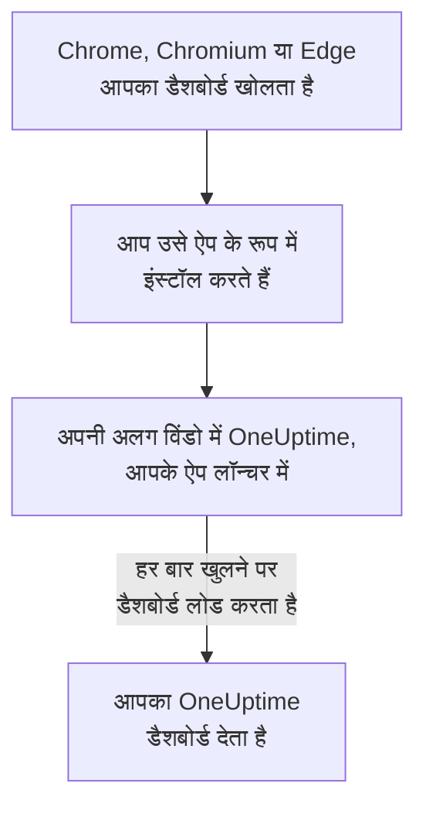

# Linux स्थापना

OneUptime डैशबोर्ड Google Chrome, Chromium या Microsoft Edge से Linux पर ऐप के रूप में इंस्टॉल होता है। यह अपनी अलग विंडो में खुलता है, आपके डेस्कटॉप के ऐप लॉन्चर में इसकी अपनी प्रविष्टि होती है, और यह सूचनाएँ दिखा सकता है। डाउनलोड करने को कुछ नहीं है: ऐप आपके OneUptime का डैशबोर्ड ही है, और जब भी आपका OneUptime अप-टू-डेट होता है, यह भी होता है।

:::cards
- [ऐप इंस्टॉल करें](#ऐप-इंस्टॉल-करें): Chrome, Chromium या Edge से।
- [इसे अपने लॉन्चर से खोलें](#इसे-अपने-लॉन्चर-से-खोलें): किसी भी दूसरे डेस्कटॉप ऐप की तरह।
- [इस कंप्यूटर पर सूचनाएँ पाएँ](#इस-कंप्यूटर-पर-सूचनाएँ-पाएँ): ब्राउज़र को पुश सूचनाओं के लिए पंजीकृत करें।
- [समस्या निवारण](#समस्या-निवारण): इंस्टॉल आइकन नहीं, सूचनाएँ नहीं, लॉन्चर में प्रविष्टि नहीं।
:::

## डेस्कटॉप ऐप कैसे काम करता है

इंस्टॉल किया गया ऐप अपने ब्राउज़र का साइन-इन, सेटिंग्स और सूचना की अनुमति साझा करता है। ब्राउज़र बंद कर दें, तब भी ऐप अपनी विंडो में चलता रहता है।

## शुरू करने से पहले

- नए Google Chrome, Chromium या Microsoft Edge वाला Linux डेस्कटॉप।
- HTTPS पर आपके OneUptime का पता: OneUptime Cloud पर `https://oneuptime.com`, या आपका अपना, जैसे `https://oneuptime.example.com`।
- एक खाता जिससे आप डैशबोर्ड में साइन इन कर सकें।

## ऐप इंस्टॉल करें

:::tabs
@tab Chrome
1. Chrome या Chromium में अपना OneUptime खोलें और साइन इन करें।
2. डैशबोर्ड के किसी भी पेज पर, एड्रेस बार के दाईं ओर इंस्टॉल आइकन पर क्लिक करें, फिर **इंस्टॉल करें** पर। या **⋮ → कास्ट, सेव, और शेयर करें → पेज को ऐप्लिकेशन के तौर पर इंस्टॉल करें...** खोलें।
3. Chrome OneUptime को उसकी अपनी विंडो में खोलता है, और उसे आपके ऐप लॉन्चर में जोड़ता है।
@tab Edge
1. Edge में अपना OneUptime खोलें और साइन इन करें।
2. डैशबोर्ड के किसी भी पेज पर, एड्रेस बार के दाईं ओर इंस्टॉल आइकन पर क्लिक करें, फिर **इंस्टॉल करें** पर। या **सेटिंग्स और अधिक (…) → अधिक टूल → ऐप्स → इस साइट को ऐप के रूप में इंस्टॉल करें** खोलें।
3. Edge OneUptime को उसकी अपनी विंडो में खोलता है, और उसे आपके ऐप लॉन्चर में जोड़ता है।
:::

साइन इन करने के बाद डैशबोर्ड के किसी पेज से इंस्टॉल करें: साइन-इन पेज ऐप नहीं है।

## इसे अपने लॉन्चर से खोलें

ब्राउज़र ऐप के लिए एक डेस्कटॉप प्रविष्टि जोड़ता है, `~/.local/share/applications` में एक `.desktop` फ़ाइल, इसलिए OneUptime GNOME, KDE Plasma और दूसरे लॉन्चर में दिखता है। वहाँ से उसे किसी भी दूसरे ऐप की तरह अपने डॉक या पैनल पर पिन करें।

## इस कंप्यूटर पर सूचनाएँ पाएँ

ऐप अपने ब्राउज़र के ज़रिए सूचनाएँ दिखाता है, जब आप ब्राउज़र को हर उस प्रोजेक्ट में पुश सूचनाओं के लिए पंजीकृत कर देते हैं जिससे आप उन्हें पाना चाहते हैं।

:::steps
### अपने पुश डिवाइस खोलें
ऐप में **उपयोगकर्ता सेटिंग्स → सूचना विधियां** और **Push Notifications** टैब खोलें।

### यह ब्राउज़र पंजीकृत करें
**डिवाइस पंजीकृत करें** पर क्लिक करें, **डिवाइस नाम** में सुझाया गया नाम रहने दें, जैसे `Chrome on Linux`, या उसे बदलें, और फिर से **डिवाइस पंजीकृत करें** पर क्लिक करें। जब ब्राउज़र पूछे कि क्या OneUptime सूचनाएँ दिखा सकता है, तो **अनुमति दें** चुनें।

### परीक्षण भेजें
**Browser Registered** संवाद में **Send Test Notification** पर क्लिक करें। आपका डेस्कटॉप उसे अपनी सूचना सेवा से दिखाता है; अगर कुछ नहीं दिखता, तो [समस्या निवारण](#समस्या-निवारण) देखें।
:::

ब्राउज़र आपके डेस्कटॉप के डू नॉट डिस्टर्ब के पार नहीं बज सकता। जिन पेज पर आपको जागना ज़रूरी है, उनके लिए गंभीर अलर्ट के साथ मोबाइल ऐप इस्तेमाल करें: [Android स्थापना](/docs/mobile-desktop-apps/android-installation#साइलेंट-मोड-के-पार-बजाएँ) देखें।

सेल्फ-होस्टेड OneUptime पर, ब्राउज़र सूचनाओं के लिए सर्वर की VAPID कुंजियाँ चाहिए: [पुश सूचनाएँ](/docs/self-hosted/push-notifications#सेल्फ-होस्टेड-सेटअप) देखें।

## अपडेट

अपडेट करने को कुछ नहीं है। ऐप हर बार खुलने पर आपके OneUptime से डैशबोर्ड लोड करता है, इसलिए आपका OneUptime अपग्रेड होने पर यह भी बदल जाता है। अगर कोई विंडो अपग्रेड के समय से खुली है, तो उसे Ctrl+R से फिर से लोड करें।

## अनइंस्टॉल करें

:::tabs
@tab Chrome
ऐप की विंडो में **⋮** मेनू खोलें, ऐप को अनइंस्टॉल करने वाला आइटम चुनें, फिर **हटाएं**।
@tab Edge
Edge में `edge://apps` खोलें, OneUptime पर **विवरण** चुनें, फिर **अनइंस्टॉल करें**।
:::

ऐप को अनइंस्टॉल करने से उसके ब्राउज़र का पंजीकरण नहीं हटता: उसे अब भी सूचनाएँ मिलती हैं। उन्हें रोकने के लिए, **उपयोगकर्ता सेटिंग्स → सूचना विधियां** में **Push Notifications** टैब पर ब्राउज़र को **हटाएं** से हटाएँ।

## समस्या निवारण

:::details एड्रेस बार में इंस्टॉल आइकन नहीं है
साइन इन करने के बाद डैशबोर्ड का कोई पेज खोलें, साइन-इन पेज नहीं, और जाँचें कि पता `https://` से शुरू होता है: ब्राउज़र केवल सुरक्षित साइटों से ऐप इंस्टॉल करते हैं। अगर आइकन फिर भी नहीं दिखता, तो ऊपर बताए अनुसार ब्राउज़र का मेनू इस्तेमाल करें। दूसरे ब्राउज़र शायद साइटों को ऐप के रूप में इंस्टॉल न करें; Chrome, Chromium या Edge इस्तेमाल करें।
:::

:::details कोई सूचना नहीं दिखती
- **उपयोगकर्ता सेटिंग्स → सूचना विधियां** में **Push Notifications** टैब पर जाँचें कि यह ब्राउज़र सूची में है, और उसे **परीक्षण सूचना** भेजें।
- जाँचें कि आपके डेस्कटॉप का डू नॉट डिस्टर्ब बंद है, और उसकी सूचना सेटिंग्स ब्राउज़र को अनुमति देती हैं।
- अगर ब्राउज़र OneUptime की सूचनाएँ ब्लॉक करता है, तो एड्रेस बार के बाईं ओर के आइकन पर क्लिक करें, साइट के लिए सूचनाओं की अनुमति दें, और ब्राउज़र को फिर से पंजीकृत करें।
- सेल्फ-होस्टेड OneUptime पर, सर्वर के पास VAPID कुंजियाँ न हों तो **डिवाइस पंजीकृत करें** संवाद यह बताता है।
:::

:::details ऐप लॉन्चर में नहीं है
इसके बजाय उसे ब्राउज़र से खोलें: Chrome या Chromium में `chrome://apps`, Edge में `edge://apps`। जो लॉन्चर डेस्कटॉप प्रविष्टियाँ केवल साइन इन के समय पढ़ता है, वह साइन आउट करके फिर से साइन इन करने के बाद उसे दिखाता है।
:::

## अगले कदम

:::cards
- [Android स्थापना](/docs/mobile-desktop-apps/android-installation): गंभीर अलर्ट के साथ अपने फ़ोन पर पेज पाएँ।
- [Windows स्थापना](/docs/mobile-desktop-apps/windows-installation): Windows पर वही ऐप।
- [अक्सर पूछे जाने वाले प्रश्न और समस्या निवारण](/docs/mobile-desktop-apps/faq-troubleshooting): दोनों ऐप्स के बारे में जवाब।
- [आपका खाता](/docs/introduction/your-account): OneUptime हर प्रोजेक्ट में आप तक कैसे पहुँचता है।
:::
