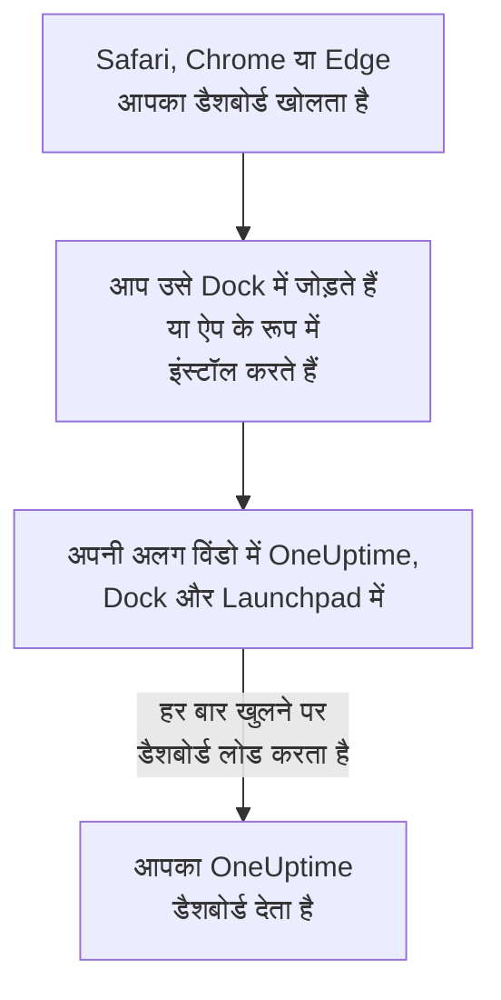

# macOS स्थापना

OneUptime डैशबोर्ड Mac पर ऐप के रूप में इंस्टॉल होता है: Safari से उसे Dock में जोड़ें, या Google Chrome या Microsoft Edge से इंस्टॉल करें। यह अपनी अलग विंडो में खुलता है, Dock और Launchpad में इसका अपना आइकन होता है, और यह सूचनाएँ दिखा सकता है। डाउनलोड करने को कुछ नहीं है: ऐप आपके OneUptime का डैशबोर्ड ही है, और जब भी आपका OneUptime अप-टू-डेट होता है, यह भी होता है।

:::cards
- [ऐप इंस्टॉल करें](#ऐप-इंस्टॉल-करें): Safari, Chrome या Edge से।
- [इसे Dock में रखें](#इसे-dock-में-रखें): एक क्लिक से, या लॉगिन पर खोलें।
- [इस Mac पर सूचनाएँ पाएँ](#इस-mac-पर-सूचनाएँ-पाएँ): ऐप को पुश सूचनाओं के लिए पंजीकृत करें।
- [समस्या निवारण](#समस्या-निवारण): Dock में जोड़ें नहीं, सूचनाएँ नहीं, फिर से साइन इन करना।
:::

## डेस्कटॉप ऐप कैसे काम करता है

Safari वेब ऐप का अपना साइन-इन, कुकीज़ और सेटिंग्स होती हैं, Safari से अलग। Chrome या Edge से इंस्टॉल किया गया ऐप इन्हें उस ब्राउज़र के साथ साझा करता है।

## शुरू करने से पहले

- Safari के लिए macOS Sonoma 14 या बाद का संस्करण। Chrome और Edge हर उस macOS पर ऐप इंस्टॉल करते हैं जिस पर वे चलते हैं।
- HTTPS पर आपके OneUptime का पता: OneUptime Cloud पर `https://oneuptime.com`, या आपका अपना, जैसे `https://oneuptime.example.com`।
- एक खाता जिससे आप डैशबोर्ड में साइन इन कर सकें।

## ऐप इंस्टॉल करें

:::tabs
@tab Safari
1. Safari में अपना OneUptime खोलें और साइन इन करें।
2. डैशबोर्ड के किसी भी पेज पर **फ़ाइल → Dock में जोड़ें** चुनें, या टूलबार में शेयर बटन पर क्लिक करें और फिर **Dock में जोड़ें** पर।
3. नाम रहने दें या बदलें, और **जोड़ें** पर क्लिक करें।
4. Dock से OneUptime खोलें, और एक बार फिर साइन इन करें: वेब ऐप Safari का साइन-इन साझा नहीं करता।
@tab Chrome
1. Chrome में अपना OneUptime खोलें और साइन इन करें।
2. डैशबोर्ड के किसी भी पेज पर, एड्रेस बार के दाईं ओर इंस्टॉल आइकन पर क्लिक करें, फिर **इंस्टॉल करें** पर। या **⋮ → कास्ट, सेव, और शेयर करें → पेज को ऐप्लिकेशन के तौर पर इंस्टॉल करें...** खोलें।
3. Chrome OneUptime को उसकी अपनी विंडो में खोलता है, और उसे Launchpad में जोड़ता है।
@tab Edge
1. Edge में अपना OneUptime खोलें और साइन इन करें।
2. डैशबोर्ड के किसी भी पेज पर, एड्रेस बार के दाईं ओर इंस्टॉल आइकन पर क्लिक करें, फिर **इंस्टॉल करें** पर। या **सेटिंग्स और अधिक (…) → अधिक टूल → ऐप्स → इस साइट को ऐप के रूप में इंस्टॉल करें** खोलें।
3. Edge OneUptime को उसकी अपनी विंडो में खोलता है, और उसे Launchpad में जोड़ता है।
:::

साइन इन करने के बाद डैशबोर्ड के किसी पेज से इंस्टॉल करें: साइन-इन पेज ऐप नहीं है। Safari वेब ऐप को आपके होम फ़ोल्डर के ऐप्लिकेशन फ़ोल्डर में सहेजता है।

## इसे Dock में रखें

- **Dock।** ऐप खुला हो तब, Control दबाकर उसके Dock आइकन पर क्लिक करें और **विकल्प → Dock में रखें** चुनें। Safari वेब ऐप पहले से Dock में होता है।
- **लॉगिन पर खोलें।** Control दबाकर Dock आइकन पर क्लिक करें और **विकल्प → लॉगिन पर खोलें** चुनें।
- **Spotlight।** Command-स्पेस दबाएँ और OneUptime टाइप करें।

## इस Mac पर सूचनाएँ पाएँ

ऐप सूचनाएँ तब दिखाता है जब आप उसे हर उस प्रोजेक्ट में पुश सूचनाओं के लिए पंजीकृत कर देते हैं जिससे आप उन्हें पाना चाहते हैं। Safari वेब ऐप को वेब ऐप के अंदर से ही पंजीकृत करें: वह अपने आप में एक ब्राउज़र है। Chrome या Edge से इंस्टॉल किया गया ऐप अपने ब्राउज़र के साथ पंजीकृत होता है।

:::steps
### अपने पुश डिवाइस खोलें
ऐप में **उपयोगकर्ता सेटिंग्स → सूचना विधियां** और **Push Notifications** टैब खोलें।

### यह ऐप पंजीकृत करें
**डिवाइस पंजीकृत करें** पर क्लिक करें, **डिवाइस नाम** में सुझाया गया नाम रहने दें, जैसे `Safari on macOS`, या उसे बदलें, और फिर से **डिवाइस पंजीकृत करें** पर क्लिक करें। जब macOS या ब्राउज़र पूछे कि क्या OneUptime सूचनाएँ भेज सकता है, तो **अनुमति दें** चुनें।

### परीक्षण भेजें
**Browser Registered** संवाद में **Send Test Notification** पर क्लिक करें। अगर कुछ नहीं दिखता, तो Mac की सूचना सेटिंग्स देखें: [समस्या निवारण](#समस्या-निवारण) देखें।
:::

ब्राउज़र डू नॉट डिस्टर्ब जैसे फ़ोकस के पार नहीं बज सकता। जिन पेज पर आपको जागना ज़रूरी है, उनके लिए गंभीर अलर्ट के साथ मोबाइल ऐप इस्तेमाल करें: [iOS स्थापना](/docs/mobile-desktop-apps/ios-installation#साइलेंट-मोड-के-पार-बजाएँ) देखें।

सेल्फ-होस्टेड OneUptime पर, ब्राउज़र सूचनाओं के लिए सर्वर की VAPID कुंजियाँ चाहिए: [पुश सूचनाएँ](/docs/self-hosted/push-notifications#सेल्फ-होस्टेड-सेटअप) देखें।

## अपडेट

अपडेट करने को कुछ नहीं है। ऐप हर बार खुलने पर आपके OneUptime से डैशबोर्ड लोड करता है, इसलिए आपका OneUptime अपग्रेड होने पर यह भी बदल जाता है। अगर कोई विंडो अपग्रेड के समय से खुली है, तो उसे Command-R से फिर से लोड करें।

## अनइंस्टॉल करें

:::tabs
@tab Safari
Finder में अपना होम फ़ोल्डर खोलें, फिर उसका ऐप्लिकेशन फ़ोल्डर, और OneUptime को ट्रैश में खींचें।
@tab Chrome
ऐप की विंडो में **⋮** मेनू खोलें, ऐप को अनइंस्टॉल करने वाला आइटम चुनें, फिर **हटाएं**।
@tab Edge
Edge में `edge://apps` खोलें, OneUptime पर **विवरण** चुनें, फिर **अनइंस्टॉल करें**।
:::

ऐप को अनइंस्टॉल करने से उसका पंजीकरण नहीं हटता: उसके ब्राउज़र को अब भी सूचनाएँ मिलती हैं। उन्हें रोकने के लिए, **उपयोगकर्ता सेटिंग्स → सूचना विधियां** में **Push Notifications** टैब पर उसे **हटाएं** से हटाएँ।

## समस्या निवारण

:::details Safari में Dock में जोड़ें नहीं है
Safari macOS Sonoma 14 से वेब ऐप्स को Dock में जोड़ता है। macOS अपडेट करें, या इसके बजाय Chrome या Edge से ऐप इंस्टॉल करें।
:::

:::details कोई सूचना नहीं दिखती
- **उपयोगकर्ता सेटिंग्स → सूचना विधियां** में **Push Notifications** टैब पर जाँचें कि ऐप या उसका ब्राउज़र सूची में है, और **परीक्षण सूचना** भेजें।
- Mac पर **सिस्टम सेटिंग्ज़ → सूचनाएँ** खोलें और जाँचें कि OneUptime, या जिस ब्राउज़र से वह इंस्टॉल हुआ, सूचनाएँ भेज सकता है, और कोई फ़ोकस उन्हें रोक नहीं रहा।
- अगर ब्राउज़र OneUptime की सूचनाएँ ब्लॉक करता है, तो साइट के लिए उसकी सेटिंग्स में उन्हें अनुमति दें, और फिर से पंजीकृत करें।
- सेल्फ-होस्टेड OneUptime पर, सर्वर के पास VAPID कुंजियाँ न हों तो **डिवाइस पंजीकृत करें** संवाद यह बताता है।
:::

:::details ऐप फिर से साइन इन करने को कहता है
Safari वेब ऐप का अपना साइन-इन होता है: ऐप के अंदर साइन इन करें। Chrome या Edge से इंस्टॉल किया गया ऐप अपने ब्राउज़र का साइन-इन साझा करता है, इसलिए ब्राउज़र में साइन आउट करने, या उसकी कुकीज़ साफ़ करने से, वह भी साइन आउट हो जाता है।
:::

## अगले कदम

:::cards
- [iOS स्थापना](/docs/mobile-desktop-apps/ios-installation): गंभीर अलर्ट के साथ अपने iPhone पर पेज पाएँ।
- [Windows स्थापना](/docs/mobile-desktop-apps/windows-installation): Windows पर वही ऐप।
- [अक्सर पूछे जाने वाले प्रश्न और समस्या निवारण](/docs/mobile-desktop-apps/faq-troubleshooting): दोनों ऐप्स के बारे में जवाब।
- [आपका खाता](/docs/introduction/your-account): OneUptime हर प्रोजेक्ट में आप तक कैसे पहुँचता है।
:::
