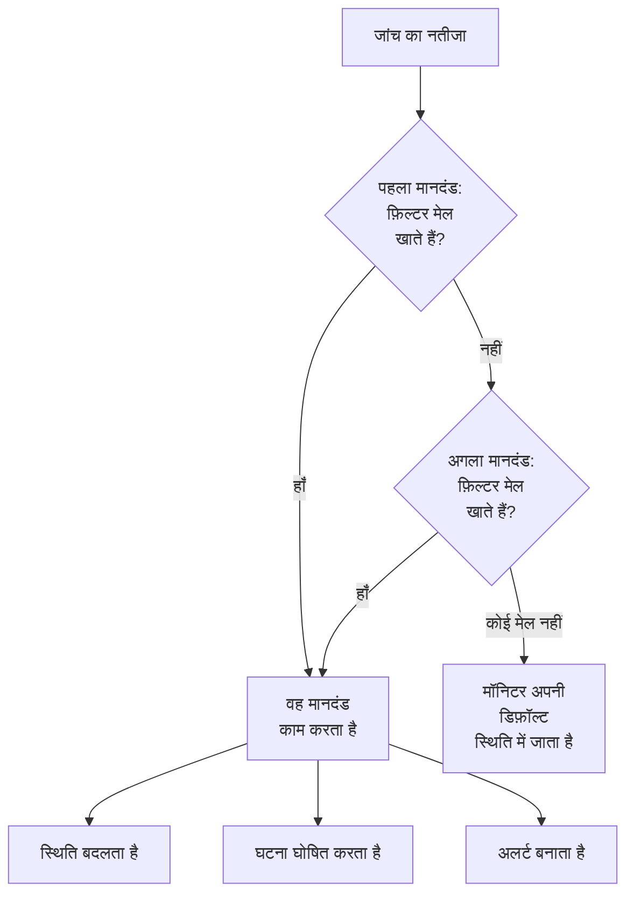
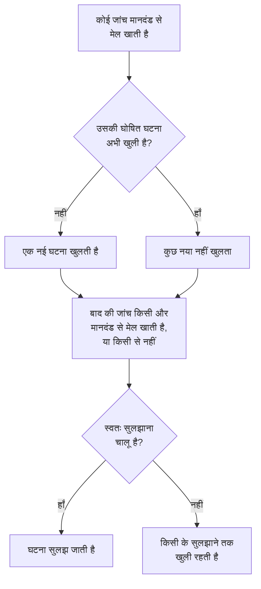

# मॉनिटर मानदंड और स्थितियाँ

मॉनिटर के मानदंड तय करते हैं कि हर जांच का क्या मतलब है: मॉनिटर चालू है या डाउन, और OneUptime घटना घोषित करता है या अलर्ट बनाता है। स्थितियाँ आपके प्रोजेक्ट की वह सूची हैं जो बताती है कि मॉनिटर क्या-क्या हो सकता है, **कार्यरत** से **ऑफ़लाइन** तक। यह पेज हर मॉनिटर प्रकार के लिए दोनों को समझाता है; हर प्रकार का अपना पेज बताता है कि वह कौन से फ़िल्टर देता है।

:::cards
- [मानदंड कैसे तय करते हैं](#मानदंड-कैसे-तय-करते-हैं): ऊपर से नीचे, और पहला मिलान जीतता है।
- [मानदंड में क्या होता है](#मानदंड-में-क्या-होता-है): फ़िल्टर, मिलान शर्त, क्रियाएँ और सेटिंग्स।
- [मॉनिटर के मानदंड बदलें](#मॉनिटर-के-मानदंड-बदलें): मानदंड संपादित करें, जोड़ें, क्रम बदलें और परखें।
- [मॉनिटर स्थितियाँ](#मॉनिटर-स्थितियाँ): अंतर्निर्मित स्थितियाँ, और आपकी अपनी स्थितियाँ।
:::

## मानदंड कैसे तय करते हैं

हर बार जब किसी मॉनिटर की जांच होती है, उसके मानदंड सूची में ऊपर से नीचे की ओर नतीजे को परखते हैं। जिस पहले मानदंड के फ़िल्टर मेल खाते हैं, वही तय करता है कि क्या होगा, और उस जांच के लिए उसके नीचे के मानदंड देखे ही नहीं जाते। जब कोई मेल नहीं खाता, तो मॉनिटर अपनी **डिफ़ॉल्ट मॉनिटर स्थिति** में चला जाता है।

क्रम भी नियम का हिस्सा है। नया मॉनिटर अपने मानदंड सबसे बुरे से शुरू करके रखता है: ऑफ़लाइन, फिर चेतावनी अगर उसके प्रकार में कोई है (जल्द खत्म होने वाला प्रमाणपत्र या डोमेन), फिर ऑनलाइन। **Is Online** को **सही** पर सेट करने जैसा व्यापक स्वस्थ मानदंड लगभग हर जांच से मेल खाता है, इसलिए वह सबसे आखिर में जाता है: बाकी से ऊपर होने पर वह हर बार सबसे पहले मेल खाएगा और बाकी कभी काम नहीं करेंगे।

जो मानदंड मेल खाता है पर कोई स्थिति नहीं बदलता, वह भी जांच का फ़ैसला करता है: मॉनिटर अपनी मौजूदा स्थिति बनाए रखता है, और उसके नीचे के मानदंड अगली जांच का इंतज़ार करते हैं। **डिफ़ॉल्ट मॉनिटर स्थिति** तभी लागू होती है जब कोई मानदंड मेल नहीं खाता। नए मॉनिटर का डिफ़ॉल्ट **कार्यरत** होता है; इसे मानदंडों के नीचे **और फ़ील्ड** में बदलें।

> [!NOTE]
> जो मॉनिटर हर होस्ट, कंटेनर, डिस्क या इंटरफ़ेस के लिए अलग घटना या अलर्ट खोलता है, वह हर जांच पर सभी मानदंड परखता है, इसलिए दो होस्ट एक ही समय में दो अलग मानदंडों से मेल खा सकते हैं। ऐसा मॉनिटर वह है जिसकी क्वेरी में **इसके अनुसार समूहित करें** हो, जैसे मेट्रिक्स या लॉग मॉनिटर, या ऐसा मानदंड जो हर डिस्क या इंटरफ़ेस के लिए `*` लिखता है। पेलोड फ़ील्ड के अनुसार घटनाओं को समूहित करने वाला आने वाले अनुरोध मॉनिटर फिर भी पहले मिलान पर रुक जाता है।

## मानदंड में क्या होता है

किसी मानदंड को खोलें तो उसमें एक नाम और तीन खंड होते हैं, जिनमें से हर एक सिमटकर एक पंक्ति का सारांश बन जाता है।

| हिस्सा | उसमें क्या होता है |
| --- | --- |
| **मानदंड नाम** | मानदंड सूची में दिखने वाला नाम, और मानदंड द्वारा खोली गई हर घटना और अलर्ट के मूल कारण में भी। **मानदंड जोड़ें** नए मानदंड का नाम उसके फ़िल्टर के अनुसार रखता है, और जब तक आप अपना नाम नहीं लिखते, नाम फ़िल्टर के साथ बदलता रहता है। |
| **फ़िल्टर** | जांच को क्या दिखाना चाहिए, एक या अधिक फ़िल्टर के रूप में। Kubernetes और मेट्रिक्स मॉनिटर इन्हें **Alert Rules** कहते हैं। |
| **क्रियाएँ** | फ़िल्टर मेल खाने पर क्या होता है: स्थिति बदलना, अलर्ट बनाना, घटना घोषित करना, या इनमें से कोई भी मेल। |
| **सेटिंग्स** | **इस मानदंड को सक्षम करें**, वैकल्पिक **विवरण** और, आने वाले अनुरोध मॉनिटर पर, **Group incidents and alerts by a payload field**। |

### फ़िल्टर

फ़िल्टर जांच से एक चीज़ पढ़ता है और उसकी तुलना करता है: **फ़िल्टर प्रकार** (क्या पढ़ना है, जैसे **प्रतिक्रिया स्थिति कोड**), **फ़िल्टर शर्त** (तुलना कैसे करनी है, जैसे **से बड़ा**) और **मान**। मेट्रिक्स की तुलना करने वाले मॉनिटर, जैसे Kubernetes और मेट्रिक्स मॉनिटर, इसके बजाय **शर्त** और **सीमा** पूछते हैं। हर मॉनिटर प्रकार अपने फ़िल्टर प्रकार देता है, जो उसके पेज पर दिए हैं, जैसे [निगरानी मानदंड](/docs/monitor/website-monitor#निगरानी-मानदंड)।

दो या अधिक फ़िल्टर होने पर उनके नीचे **मिलान शर्त** दिखती है: **सभी** का मतलब है हर फ़िल्टर का मेल खाना ज़रूरी है, **कोई भी** का मतलब है एक ही काफ़ी है। नया मानदंड **सभी** से शुरू होता है।

हर जांच को मापने वाले फ़िल्टर, जैसे **Is Online**, **प्रतिक्रिया स्थिति कोड** और **प्रतिक्रिया समय (ms में)**, **इस मानदंड का एक समयावधि के दौरान मूल्यांकन करें** देते हैं। यह सिर्फ़ ताज़ा जांच के बजाय हाल की जांचों की एक अवधि को परखता है, और पिछले 5 मिनट तथा **All Values** से शुरू होता है, जो तभी मेल खाता है जब अवधि की हर जांच मेल खा चुकी हो। देखें [एक समयावधि में मूल्यांकन](/docs/monitor/website-monitor#एक-समयावधि-में-मूल्यांकन)।

### क्रियाएँ

हर क्रिया **क्रियाएँ** के अंतर्गत एक स्विच है:

| स्विच | यह क्या करता है |
| --- | --- |
| **जब फ़िल्टर मेल खाते हैं, तो मॉनिटर स्थिति बदलें।** | मॉनिटर को **मॉनिटर स्थिति बदलकर करें** में चुनी गई स्थिति में ले जाता है। |
| **जब फ़िल्टर मेल खाते हैं, तो एक अलर्ट बनाएँ।** | **अलर्ट बनाएं** में सेट किए गए अलर्ट बनाता है। अलर्ट आपकी टीम को बताता है और कभी स्थिति पृष्ठ पर नहीं दिखता। |
| **जब फ़िल्टर मेल खाते हैं, तो एक घटना घोषित करें।** | **घटना बनाएं** में सेट की गई घटनाएँ घोषित करता है। आपके स्थिति पृष्ठ इन्हें दिखा सकते हैं। |

घटना या अलर्ट एक शीर्षक, एक **गंभीरता** और, सिमटे हुए हिस्से में, विवरण, मालिक, लेबल और ऑन-कॉल नीतियाँ पूछता है। शीर्षकों और विवरणों में जांच के मान हो सकते हैं, जैसे `{{monitorName}}`: देखें [घटना और अलर्ट टेम्पलेट](/docs/monitor/incident-alert-templating)। मानदंड मेल खाने पर किसी को पेज करने के लिए **ऑन-कॉल** में एक नीति चुनें: देखें [ऑन-कॉल नीतियां](/docs/on-call/policies)।

### सेटिंग्स

**इस मानदंड को सक्षम करें** हर नए मानदंड के लिए चालू होता है। मानदंड को इस्तेमाल किए बिना रखने के लिए इसे बंद करें: वह हर जांच पर छोड़ दिया जाता है, कोई स्थिति नहीं बदलता, कुछ नहीं खोलता, और उसके हेडर पर **अक्षम** दिखता है।

**Group incidents and alerts by a payload field** आने वाले अनुरोध में मिले हर मान के लिए एक घटना खोलता है, ताकि एक वेबहुक पता कई घटनाएँ खुली रख सके। देखें [घटना समूहन चालू करना](/docs/monitor/incoming-request-monitor#घटना-समूहन-चालू-करना)।

## घटनाएँ और अलर्ट कब खुलते और बंद होते हैं

घटनाएँ घोषित करने वाला मानदंड मेल खाने पर एक घटना खोलता है। मॉनिटर ठीक होने पर, अगर मानदंड ऐसा कहता है, तो घटना अपने आप बंद हो जाती है।

- **एक बार में एक।** जब तक किसी मानदंड की घोषित घटना खुली है, वही मानदंड फिर से मेल खाने पर दूसरी घटना घोषित नहीं करता। अलर्ट भी इसी तरह काम करते हैं। होस्ट या पेलोड फ़ील्ड के अनुसार समूहित करने वाला मॉनिटर हर होस्ट या मान के लिए एक खुली रखता है, और **हर ईमेल के लिए नई घटना खोलें** वाला Incoming Email मानदंड हर ईमेल के लिए एक खोलता है।
- **बंद होना।** बाद की किसी जांच पर, जहाँ कोई और मानदंड मेल खाए या कोई नहीं, वह घटना सुलझ जाती है जिसके मानदंड में **घटना स्वतः सुलझाएं** चालू है, और **अलर्ट स्वतः सुलझाएं** वाला अलर्ट भी। दोनों घटना या अलर्ट के **और फ़ील्ड** में होते हैं, और नए मॉनिटर के शुरुआती मानदंडों में ये चालू होते हैं।
- **कई प्रोब।** एक से ज़्यादा प्रोब द्वारा जांचा जाने वाला मॉनिटर तभी बदलता है जब उसके प्रोब सहमत हों। देखें [मानदंडों का मूल्यांकन कैसे होता है](/docs/monitor/create-monitor#मानदंडों-का-मूल्यांकन-कैसे-होता-है)।
- **डाउन पैरेंट मॉनिटर।** मॉनिटर के **कॉन्फ़िगरेशन → निर्भरताएं** पेज पर **Depends On Monitors** उन मॉनिटरों के नाम देता है जिन पर वह निर्भर है। जब तक उनमें से कोई **Suppress When Parent Status Is** में दी गई स्थिति में है (खाली छोड़ने पर कोई भी ऑफ़लाइन स्थिति), मॉनिटर कोई घटना या अलर्ट नहीं खोलता। उसकी स्थिति फिर भी बदलती है, और जो खुला है वह फिर भी सुलझता है।
- **अनुसूचित रखरखाव।** चल रहे रखरखाव इवेंट में शामिल मॉनिटर की जांच नहीं होती, इसलिए उसके मानदंड नहीं चलते। देखें [अनुसूचित रखरखाव का अवलोकन](/docs/scheduled-maintenance/index)।

कोई जांच कैसे परखी गई, यह देखने के लिए मॉनिटर का **अवलोकन** खोलें: **मॉनिटर सारांश** कार्ड दिखाता है कि कौन सा मानदंड मेल खाया और हर एक ने क्या किया, उस घटना समेत जिसे इसलिए छोड़ा गया क्योंकि एक पहले से खुली थी।

## मॉनिटर के मानदंड बदलें

:::steps
### मानदंड पेज खोलें

**मॉनिटर** पर जाएं और मॉनिटर खोलें। उसके साइड मेनू में **कॉन्फ़िगरेशन** को फैलाएं और **मानदंड** पर क्लिक करें। **निगरानी मानदंड** कार्ड हर मानदंड, वह क्या जांचता है और क्या करता है, दिखाता है।

### Edit Monitoring Criteria पर क्लिक करें

एडिटर हर मानदंड को खुला दिखाता है। किसी मानदंड के हेडर पर क्लिक करके उसे एक पंक्ति में समेटें: उसका नाम, उसमें कितने फ़िल्टर हैं और वह क्या करता है।

### मानदंड जोड़ें, बदलें या क्रम बदलें

**मानदंड जोड़ें** सबसे नीचे एक मानदंड जोड़ता है, खुला हुआ और उसके फ़िल्टर के अनुसार नाम वाला। मानदंड को खिसकाने के लिए उसके बाईं ओर के हैंडल से खींचें: पहला मिलान जीतता है, इसलिए सबसे बुरी स्थिति को सबसे ऊपर रखें। **मानदंड हटाएं** एक को हटाता है; मॉनिटर में कम से कम एक मानदंड रहता है।

### मानदंड सहेजें

**परिवर्तन सहेजें** पर क्लिक करें। अगली जांच नए मानदंडों से परखी जाती है।

### मॉनिटर को परखें

प्रोब द्वारा जांचे जाने वाले मॉनिटर पर, कार्ड पर **मॉनिटर का परीक्षण करें** पर क्लिक करें, **प्रोब चुनें** में एक प्रोब चुनें और **परीक्षण चलाएं** पर क्लिक करें। **मॉनिटर परीक्षण परिणाम** दिखाता है कि जांच में क्या मिला।
:::

मैनुअल मॉनिटर का कोई मानदंड नहीं होता: उसकी स्थिति आप खुद सेट करते हैं। देखें [स्थिति अपडेट करना](/docs/monitor/manual-monitor#स्थिति-अपडेट-करना)।

## मॉनिटर स्थितियाँ

मॉनिटर हमेशा आपके प्रोजेक्ट की किसी एक स्थिति में होता है। नए प्रोजेक्ट में तीन होती हैं, सबसे स्वस्थ से सबसे बुरी तक:

| स्थिति | स्थान | रंग | OneUptime इसके साथ क्या करता है |
| --- | --- | --- | --- |
| **कार्यरत** | 1 | हरा | नए मॉनिटर इसी में शुरू होते हैं, और यह नए मॉनिटर की **डिफ़ॉल्ट मॉनिटर स्थिति** है। अंतर्निर्मित। |
| **प्रदर्शन में गिरावट** | 2 | पीला | अपने आप कुछ नहीं: आपका कोई मानदंड मॉनिटर को यहाँ ले जाता है। |
| **ऑफ़लाइन** | 3 | लाल | नए मॉनिटर का ऑफ़लाइन मानदंड उसे यहाँ ले जाता है, और OneUptime इसमें मौजूद मॉनिटर को डाउन मानता है। अंतर्निर्मित। |

सूची एक क्रम है। जहाँ मॉनिटर साथ दिखाए जाते हैं, वहाँ सूची में सबसे नीचे वाली स्थिति जीतती है: मॉनिटर समूह, स्थिति पृष्ठ समूह और स्थिति पृष्ठ की कुल स्थिति, हर एक अपने मॉनिटरों में सबसे बुरी स्थिति दिखाता है।

### स्थिति कहाँ गिनी जाती है

| कहाँ | स्थिति क्या तय करती है |
| --- | --- |
| **मॉनिटर** सूची | हर मॉनिटर की वर्तमान स्थिति। **गैर-संचालन** कार्यरत के सिवा किसी भी स्थिति वाले मॉनिटर दिखाता है, बगल में लाल गिनती के साथ। |
| स्थिति पृष्ठ | हर पंक्ति का रंग, और उसका अपटाइम: उसके ख़िलाफ़ सिर्फ़ पेज की **डाउनटाइम के रूप में गिना जाता है** सूची की स्थितियाँ गिनी जाती हैं। नया स्थिति पृष्ठ कार्यरत को छोड़कर हर स्थिति के साथ शुरू होता है। देखें [पेज पर क्या दिखेगा, यह चुनना](/docs/status-pages/index#पेज-पर-क्या-दिखेगा-यह-चुनना)। |
| मॉनिटर समूह | समूह की स्थिति: उसके मॉनिटरों में सबसे बुरी। देखें [मॉनिटर समूह](/docs/monitor/monitor-groups)। |
| SLO | SLO द्वारा गिना जाने वाला डाउनटाइम, उसकी अपनी स्थितियों की सूची से। देखें [कौन सी स्थितियाँ डाउनटाइम गिनी जाती हैं](/docs/slo/introduction#कौन-सी-स्थितियाँ-डाउनटाइम-गिनी-जाती-हैं)। |
| निर्भरताएं | क्या पैरेंट मॉनिटर अपने चाइल्ड मॉनिटरों की घटनाएँ और अलर्ट रोकता है: डिफ़ॉल्ट रूप से, जब तक वह किसी ऑफ़लाइन स्थिति में है। |

बाद में जोड़ी गई स्थिति किसी मौजूदा स्थिति पृष्ठ की **डाउनटाइम के रूप में गिना जाता है** सूची में नहीं जुड़ती: उसे वहाँ खुद जोड़ें।

### अपनी स्थिति जोड़ें

:::steps
### मॉनिटर स्थिति खोलें

**मॉनिटर → सेटिंग्स → मॉनिटर स्थिति** पर जाएं। साइड मेनू में **सेटिंग्स** शुरू में सिमटा रहता है: पहले उसे फैलाएं। **मॉनिटर स्थितियां** कार्ड स्थितियों को सबसे स्वस्थ से सबसे बुरी तक दिखाता है।

### स्थिति बनाएं

**मॉनिटर स्थिति बनाएँ** पर क्लिक करें और **नाम**, **विवरण** और **रंग** भरें। नई स्थिति ऑफ़लाइन स्थिति के ठीक ऊपर जाती है, ताकि आउटेज अब भी सबसे बुरा माना जाए।

### उसे उसकी जगह रखें

स्थिति को उसके हैंडल से खींचें। सूची में नीचे वाली स्थिति अपने ऊपर की हर स्थिति से बुरी मानी जाती है।

### उसे किसी मानदंड में इस्तेमाल करें

कोई स्थिति तब तक कुछ नहीं करती जब तक कोई मानदंड मॉनिटरों को उसमें न ले जाए। जिस मानदंड को इसे सेट करना चाहिए, उसके **मॉनिटर स्थिति बदलकर करें** में इसे चुनें।
:::

कार्यरत और ऑफ़लाइन स्थितियों पर **अंतर्निर्मित** का निशान होता है: आप उनका नाम और रंग बदल सकते हैं, पर उन्हें हटा नहीं सकते। OneUptime Cloud पर, स्थिति बनाने या बदलने के लिए Growth प्लान चाहिए। स्थितियाँ प्रबंधित करने के लिए Project Owner, Project Admin या Monitor Admin भूमिका, या मेल खाती मॉनिटर स्थिति अनुमति वाली कस्टम भूमिका चाहिए।

### स्थिति टाइमलाइन

हर स्थिति परिवर्तन मॉनिटर की **स्थिति टाइमलाइन** पर रखा जाता है: वह कब शुरू हुआ, कितनी देर चला, और उसे सेट करने वाले मानदंड के लिए **कारण देखें**। **मॉनिटर स्थिति इवेंट बनाएँ** हाथ से एक स्थिति जोड़ता है। प्रोब द्वारा जांचे जाने वाले मॉनिटर पर, स्थिति वाले किसी मानदंड से मेल खाने वाली अगली जांच वह स्थिति फिर से सेट कर देती है।

मॉनिटर की स्थिति बदलने पर उसके मालिकों को तभी सूचना मिलती है जब उन्होंने अपनी सूचना सेटिंग्स में **मॉनिटर स्थिति बदली गई** चालू किया हो: यह शुरू में बंद रहता है। कोई मानदंड मेल न खाने के कारण अपनी **डिफ़ॉल्ट मॉनिटर स्थिति** में लौटने वाला मॉनिटर किसी को सूचित नहीं करता। देखें [नए सदस्य के लिए क्या चालू है](/docs/notifications/notification-settings#नए-सदस्य-के-लिए-क्या-चालू-है)।

## मॉनिटर स्थिति को संग्रहित करना

जिस स्थिति का उपयोग आपकी टीम को अब नहीं करना चाहिए, उसे हटाने के बजाय संग्रहित करें। संग्रहित करने से कोई मॉनिटर नहीं बदलता: इस स्थिति वाला मॉनिटर अपनी स्थिति बदलने तक इसी में रहता है, और उसकी स्थिति टाइमलाइन इसे अब भी दिखाती है।

- **संग्रहित करें** पंक्ति के **⋯** मेनू में है। यह पहले पुष्टि माँगता है, और उन मॉनिटर मानदंडों, टेम्पलेट और स्टेटस पेजों को सूचीबद्ध करता है जो इस स्थिति का उपयोग करने के लिए सेट हैं: जब तक आप इन्हें नहीं बदलते, ये इसका उपयोग करते रहते हैं।
- **कोई इसे फिर से नहीं चुन सकता।** कोई मानदंड, मॉनिटर का स्थिति मेनू, किसी घटना या रखरखाव इवेंट की मॉनिटर स्थिति और स्टेटस पेज की डाउनटाइम स्थितियाँ इसे नहीं दिखातीं। API, Terraform और MCP इसे अस्वीकार करते हैं।
- **संग्रहीत स्थितियाँ अलग से सूचीबद्ध होती हैं**, तालिका के नीचे मुड़े हुए अनुभाग **संग्रहीत मॉनिटर स्थितियां** में। **अनसंग्रहीत करें** किसी स्थिति को पहले जैसा वापस लाता है।
- **बिल्ट-इन स्थितियाँ संग्रहित नहीं की जा सकतीं।** नए मॉनिटर चालू स्थिति में शुरू होते हैं, और OneUptime ऑफ़लाइन स्थिति वाले मॉनिटर को डाउन मानता है। इनका **संग्रहित करें** कारण के साथ लॉक रहता है।

## समस्या निवारण

:::details साइट डाउन है, पर मॉनिटर कार्यरत ही रहता है
सूची में ऊपर वाला कोई मानदंड पहले मेल खा गया। **कॉन्फ़िगरेशन → मानदंड** खोलें और क्रम जांचें: स्वस्थ मानदंड सबसे आखिर में आता है। यह भी जांचें कि ऑफ़लाइन मानदंड में **इस मानदंड को सक्षम करें** चालू है, और उसकी क्रिया **जब फ़िल्टर मेल खाते हैं, तो मॉनिटर स्थिति बदलें।** एक चुनी गई स्थिति के साथ चालू है।
:::

:::details मॉनिटर डाउन होने पर कोई घटना नहीं खुली
मेल खाए मानदंड को जांचें: **जब फ़िल्टर मेल खाते हैं, तो एक घटना घोषित करें।** चालू होना चाहिए। घटना तब घोषित नहीं होती जब उसी मानदंड की घटना अभी खुली हो, जब **Depends On Monitors** का कोई पैरेंट मॉनिटर डाउन हो, या जब मॉनिटर अनुसूचित रखरखाव में हो। मॉनिटर के **अवलोकन** पर **मॉनिटर सारांश** कार्ड बताता है कि कौन सी वजह थी।
:::

:::details मॉनिटर ठीक होने के बाद भी घटना खुली रहती है
घटना का मानदंड खोलें और उसकी घटना में **और फ़ील्ड** फैलाएं: **घटना स्वतः सुलझाएं** चालू होना चाहिए। जिस मानदंड को आपने बाद में हटा दिया, उसकी घटना मॉनिटर नहीं सुलझाता: उसे हाथ से सुलझाएं।
:::

:::details ऑफ़लाइन का हटाएं बटन लॉक है
**कार्यरत** और **ऑफ़लाइन** अंतर्निर्मित हैं: OneUptime मॉनिटरों को इनमें ले जाता है, इसलिए इनका नाम बदला जा सकता है पर इन्हें हटाया नहीं जा सकता। इसके बजाय अपनी बनाई स्थिति हटाएं, या अंतर्निर्मित स्थिति का नाम बदलें।
:::

## अगले कदम

:::cards
- [मॉनिटर बनाना](/docs/monitor/create-monitor): नए मॉनिटर के तीन चरण।
- [घटना और अलर्ट टेम्पलेट](/docs/monitor/incident-alert-templating): जांच के मान शीर्षकों और विवरणों में डालें।
- [मॉनिटर समूह](/docs/monitor/monitor-groups): कई मॉनिटरों को एक स्थिति में समेटें।
- [घटनाओं का अवलोकन](/docs/incidents/index): मानदंड के घटना घोषित करने के बाद क्या होता है।
:::
