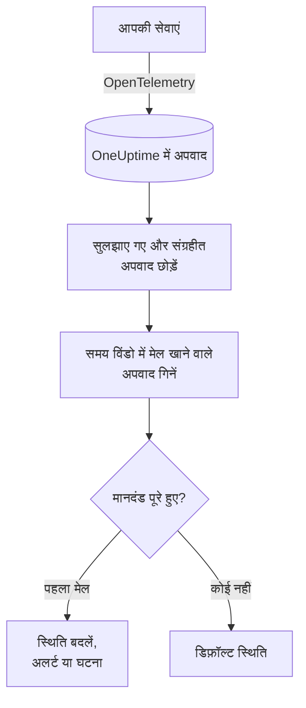

# अपवाद मॉनिटर

अपवाद मॉनिटर एक समय विंडो में उन अपवादों की गिनती करता है जिनकी रिपोर्ट आपकी सेवाएं OneUptime को करती हैं और जो आपके फ़िल्टर (संदेश, अपवाद प्रकार, एनवायरनमेंट, सेवा) से मेल खाते हैं। जब गिनती आपके मानदंड पूरे करती है, तो यह मॉनिटर की स्थिति बदलता है, अलर्ट बनाता है या घटना घोषित करता है। प्रोडक्शन में किसी भी नए क्रैश, किसी एक अपवाद प्रकार, या त्रुटियों में अचानक बढ़ोतरी पर अलर्ट के लिए इसका उपयोग करें।

:::cards
- [मॉनिटर बनाएं](#अपवाद-मॉनिटर-बनाएं): चुनें कि कौन-से अपवाद गिने जाएं और अलर्ट कब हो।
- [एनवायरनमेंट](#एनवायरनमेंट): मॉनिटर को `production` तक सीमित करें।
- [इसका मूल्यांकन कैसे होता है](#इसका-मूल्यांकन-कैसे-होता-है): क्या गिना जाता है, और अपवाद सुलझाने से क्या होता है।
- [मानदंड](#मानदंड): शर्तें और डिफ़ॉल्ट।
:::

## यह कैसे काम करता है



हर मिनट OneUptime उन अपवादों को गिनता है जो मॉनिटर के फ़िल्टर से मेल खाते हैं और उसकी समय विंडो के भीतर हुए, और उन अपवादों को छोड़ देता है जिन्हें आपने सुलझाया हुआ चिह्नित किया है या संग्रहीत किया है। वह इस गिनती की तुलना मॉनिटर के मानदंडों से ऊपर से नीचे करता है, और जो मानदंड सबसे पहले मेल खाता है वही तय करता है कि क्या होगा। जब कोई मेल नहीं खाता, तो मॉनिटर अपनी डिफ़ॉल्ट स्थिति पर लौट आता है।

## शुरू करने से पहले

- आपकी सेवाएं OpenTelemetry के ज़रिए OneUptime को अपवाद भेजती हैं। [OpenTelemetry](/docs/telemetry/open-telemetry) देखें।
- मॉनिटर को किसी एनवायरनमेंट तक सीमित करने के लिए आपकी सेवाओं को रिसोर्स विशेषता `deployment.environment` सेट करनी होगी।

## अपवाद मॉनिटर बनाएं

:::steps
### नया मॉनिटर शुरू करें

**मॉनिटर** पर जाएं और **मॉनिटर बनाएं** पर क्लिक करें। या, किसी अपवाद के पृष्ठ पर **सुलझाएं** के बगल में **मॉनिटर बनाएं** पर क्लिक करें: नया मॉनिटर शुरू से ही उसकी सेवा में उस अपवाद के प्रकार पर नज़र रखता है, और उसके दोबारा होने पर अलर्ट करता है।

### Exceptions चुनें

**मॉनिटर प्रकार** में **और मॉनिटर प्रकार** पर क्लिक करें और **टेलीमेट्री** के अंतर्गत **अपवाद** चुनें, या खोज बॉक्स में `exceptions` टाइप करें। **नाम** डालें, फिर **अगला** पर क्लिक करें।

### चुनें कि मॉनिटर आपको किस बारे में बताए

**यह मॉनिटर आपको किस बारे में बताए?** के अंदर **कोई भी अपवाद** या **बहुत अधिक अपवाद** चुनें। हर विकल्प नियम भर देता है, जिसे आप नीचे बदल सकते हैं। इसे खुद सेट करने के लिए **कुछ और** चुनें। **एक नया अपवाद**, **सुलझाया गया अपवाद फिर से आता है** और **अपवादों में उछाल** पहली बार देखे गए अपवाद, सुलझाने के बाद लौटे अपवाद, और सप्ताह के उस घंटे के सामान्य स्तर से बहुत ज़्यादा बढ़त पर अलर्ट करते हैं।

### गिने जाने वाले अपवाद चुनें

**देखने वाले अपवाद** में **संदेश में शामिल है**, **अपवाद प्रकार** और **परिवेश** सेट करें। खाली छोड़ा गया फ़िल्टर हर अपवाद से मेल खाता है। फ़िल्टर के नीचे **मेल खाने वाले अपवाद** दिखाता है कि वे अभी किन अपवादों से मेल खाते हैं।

### दायरा सीमित करें (वैकल्पिक)

टेलीमेट्री सेवा या इन्फ्रास्ट्रक्चर एंटिटी के आधार पर फ़िल्टर करने, या सुलझाए गए और संग्रहीत अपवाद भी गिनने के लिए **और फ़ील्ड** खोलें।

### बताएं कि कब अलर्ट करें

**कब अलर्ट करें** में एक **शर्त**, **अपवादों की संख्या** और एक **समय-सीमा** चुनें। उनके नीचे का वाक्य नियम को सरल शब्दों में दोहराता है। उसके नीचे का चार्ट पिछले कुछ घंटों में हर विंडो के मेल खाने वाले अपवाद गिनता है, नियम की संख्या को एक रेखा के रूप में दिखाता है, और बताता है कि नियम कितनी बार अलर्ट करता। उसका बटन एक ऐसी संख्या सुझाता है जिसे नियम उस समय में पार न करता। **इस पर अलर्ट करें** चुनता है कि नियम किसकी तुलना करता है: **अपवाद**, **नए अपवाद**, **फिर से आए अपवाद** या **सामान्य से ज़्यादा बढ़त**। चार्ट केवल **अपवाद** के लिए बनता है। **असामान्य रूप से ऊँचा** में, जिसे **अपवादों में उछाल** सेट करता है, कोई संख्या नहीं भरनी होती: इसके बजाय एक **संवेदनशीलता** चुनें।

### चुनें कि क्या होता है

**क्या होता है** में **अलर्ट बनाएं**, **घटना घोषित करें** या **दोनों** चुनें, और उसे एक शीर्षक और एक गंभीरता दें। जब तक नियम मेल खाता है, मॉनिटर **और फ़ील्ड** में दी गई स्थिति दिखाता है; मेल खाना बंद होने पर मॉनिटर अपनी डिफ़ॉल्ट स्थिति पर लौट आता है, और अलर्ट या घटना अपने आप सुलझ जाती है।

### मॉनिटर बनाएं

**मॉनिटर बनाएं** पर क्लिक करें। मॉनिटर अपने **अवलोकन** पृष्ठ पर खुलता है, और उसका पहला मूल्यांकन एक मिनट के भीतर चलता है।
:::

## यह क्या क्वेरी करता है

| फ़ील्ड | किससे मेल खाता है | डिफ़ॉल्ट |
| --- | --- | --- |
| **संदेश में शामिल है** | वे अपवाद जिनके संदेश में यह टेक्स्ट हो, बड़े-छोटे अक्षरों का अंतर किए बिना। | खाली: हर अपवाद |
| **अपवाद प्रकार** | इनमें से किसी भी प्रकार के अपवाद, कॉमा से अलग किए गए, जैसे `TypeError, NullReferenceException`। प्रकार का नाम सटीक रूप से मेल खाना चाहिए। | खाली: हर प्रकार |
| **परिवेश** | इनमें से किसी भी एनवायरनमेंट के अपवाद, कॉमा से अलग किए गए ([एनवायरनमेंट](#एनवायरनमेंट) देखें)। | खाली: हर एनवायरनमेंट |
| **समय-सीमा** (**कब अलर्ट करें** में) | पिछले 5 सेकंड से लेकर पिछले 24 घंटे तक के अपवाद। | **पिछले 5 मिनट** |
| **सेवा के अनुसार फ़िल्टर करें** (**और फ़ील्ड** में) | चुनी गई किसी भी सेवा से आए अपवाद। | खाली: हर सेवा |
| **इन्फ्रास्ट्रक्चर एंटिटी द्वारा फ़िल्टर करें** (**और फ़ील्ड** में) | चुने गए किसी भी होस्ट, पॉड, कंटेनर और दूसरी एंटिटी से आए अपवाद। | खाली: हर एंटिटी |
| **सुलझाए गए अपवाद शामिल करें** (**और फ़ील्ड** में) | सुलझाए हुए चिह्नित अपवाद भी गिनें। | बंद |
| **संग्रहीत अपवाद शामिल करें** (**और फ़ील्ड** में) | संग्रहीत अपवाद भी गिनें। | बंद |

किसी अपवाद को गिने जाने के लिए आपके सेट किए सभी फ़िल्टर से मेल खाना ज़रूरी है।

### एनवायरनमेंट

एनवायरनमेंट हर अपवाद पर मौजूद OpenTelemetry रिसोर्स विशेषता `deployment.environment` से आते हैं, वही मान जिससे अपवाद एक्सप्लोरर `env:production` के साथ फ़िल्टर करता है। एक एनवायरनमेंट डालें, या कई को कॉमा से अलग करके; किसी अपवाद को तब गिना जाता है जब उसका एनवायरनमेंट इनमें से किसी से मेल खाता है।

मिलान सटीक होता है और बड़े-छोटे अक्षरों में अंतर करता है: `production` का मेल `Production` या `prod` से नहीं होता। यह फ़िल्टर सेट होने पर बिना एनवायरनमेंट वाले अपवाद नहीं गिने जाते। बिना एनवायरनमेंट वाले अपवादों सहित हर एनवायरनमेंट के अपवाद गिनने के लिए इसे खाली छोड़ें।

एनवायरनमेंट फ़िल्टर बाकी हर फ़िल्टर के साथ जुड़ता है, इसलिए एक टेलीमेट्री सेवा और `production` तक सीमित मॉनिटर सिर्फ़ उस सेवा के प्रोडक्शन अपवाद गिनता है।

API के ज़रिए मॉनिटर बनाते समय, चरण के `exceptionMonitor` पर `environments` को एनवायरनमेंट नामों की सूची पर सेट करें:

```json
{
  "exceptionMonitor": {
    "telemetryServiceIds": [],
    "environments": ["production"],
    "exceptionTypes": [],
    "message": "",
    "includeResolved": false,
    "includeArchived": false,
    "lastXSecondsOfExceptions": 300
  }
}
```

## इसका मूल्यांकन कैसे होता है

- **हर मिनट।** अपवाद मॉनिटर की जांच प्रोब नहीं करते, इसलिए इसमें सेट करने के लिए कोई अंतराल नहीं है और न ही **प्रोब और अंतराल** पृष्ठ।
- **घटनाएं गिनी जाती हैं, अपवाद प्रकार नहीं।** मॉनिटर हर उस बार को गिनता है जब कोई मेल खाने वाला अपवाद **समय-सीमा** के भीतर हुआ। 40 बार फेंका गया एक अपवाद 40 गिना जाता है।
- **सुलझाए गए और संग्रहीत अपवाद छोड़ दिए जाते हैं।** जब तक आप **सुलझाए गए अपवाद शामिल करें** या **संग्रहीत अपवाद शामिल करें** चालू नहीं करते, तब तक सुलझाए हुए चिह्नित या संग्रहीत किए गए अपवाद की घटनाएं नहीं गिनी जातीं। इसलिए किसी अपवाद को सुलझाया हुआ चिह्नित करने से उसकी खोली घटना बंद हो सकती है। जब कोई सुलझाया गया अपवाद फिर से होता है, तो वह अपने आप फिर से अनसुलझा हो जाता है और दोबारा गिना जाता है।
- **कोई अपवाद नहीं, यानी गिनती 0।**
- **OneUptime का अपना डाउनटाइम खामोशी नहीं है।** जब तक समय विंडो में वह समय शामिल है जब OneUptime खुद डेटा प्राप्त नहीं कर रहा था (वह रीस्टार्ट हो रहा था, अपग्रेड हो रहा था या बैकलॉग निपटा रहा था), जांच इंतज़ार करती है: स्थिति नहीं बदलती, और कोई घटना या अलर्ट न खुलता है न सुलझता है। [जब OneUptime डेटा प्राप्त नहीं कर रहा हो](/docs/monitor/when-oneuptime-is-not-receiving) देखें।
- **मानदंड ऊपर से नीचे।** जो मानदंड सबसे पहले मेल खाता है वही तय करता है, इसलिए सबसे गंभीर को सबसे ऊपर रखें।

हर स्थिति परिवर्तन, उसके कारण के साथ, मॉनिटर की **स्थिति टाइमलाइन** पर दर्ज होता है।

## मानदंड

अपवाद मॉनिटर के मानदंडों में चार **फ़िल्टर प्रकार** होते हैं: **अपवादों की संख्या**, यानी विंडो में मेल खाने वाले अपवादों की संख्या, और **नए अपवाद**, **दोबारा हुए अपवाद** व **अपवादों में वृद्धि (% में)**, जिनका वर्णन नीचे है। **कब अलर्ट करें** एक मानदंड सेट करता है, जिसकी **शर्त** **अधिक**, **कम से कम**, **कम**, **अधिकतम**, **ठीक**, **असामान्य रूप से ऊँचा**, **असामान्य रूप से नीचा** या **असामान्य रूप से ऊँचा या नीचा** होती है। कई मानदंडों, या एक से ज़्यादा फ़िल्टर वाले मानदंड के लिए, **क्या होता है** की **और फ़ील्ड** में **कस्टम मानदंड के रूप में संपादित करें** पर क्लिक करें: वहाँ हर मानदंड में एक **फ़िल्टर शर्त** और एक **मान** होता है।

| फ़िल्टर शर्त | मेल खाती है जब अपवादों की गिनती… |
| --- | --- |
| **से बड़ा** | मान से ऊपर हो |
| **से बड़ा या बराबर** | मान के बराबर या उससे ऊपर हो |
| **से छोटा** | मान से नीचे हो |
| **से छोटा या बराबर** | मान के बराबर या उससे नीचे हो |
| **बराबर है** | ठीक मान के बराबर हो |
| **बराबर नहीं है** | मान के अलावा कुछ भी हो |
| **असामान्य रूप से अधिक** | सप्ताह के इस घंटे के अपेक्षित दायरे से ऊपर हो |
| **असामान्य रूप से कम** | उस दायरे से नीचे हो |
| **असामान्य** | किसी भी दिशा में उस दायरे से बाहर हो |

विसंगति वाली शर्तों में कोई **मान** नहीं होता। एक **संवेदनशीलता** (निम्न, मध्यम जो डिफ़ॉल्ट है, या उच्च) चुनें और, कस्टम मानदंड में, 14 (डिफ़ॉल्ट), 28, 60 या 90 दिनों की **बेसलाइन विंडो**। ये केवल **अपवादों की संख्या** में होती हैं: [सामान्य की तुलना में उछाल](#सामान्य-की-तुलना-में-उछाल) देखें।

मॉनिटर बनाएं में बनाया गया अपवाद मॉनिटर उस विकल्प के नियम से शुरू होता है जो आपने **यह मॉनिटर आपको किस बारे में बताए?** में चुना:

| विकल्प | नियम | क्या होता है |
| --- | --- | --- |
| **कोई भी अपवाद** | **पिछले 5 मिनट** में `0` से **अधिक** | अलर्ट बनाता है, जो अपने आप सुलझ जाता है |
| **बहुत अधिक अपवाद** | **पिछले 5 मिनट** में `20` से **अधिक** | अलर्ट बनाता है, जो अपने आप सुलझ जाता है |
| **एक नया अपवाद** | **नए अपवाद**: **पिछले 10 मिनट** में `0` से **अधिक** | अलर्ट बनाता है, जो अपने आप सुलझ जाता है |
| **सुलझाया गया अपवाद फिर से आता है** | **फिर से आए अपवाद**: **पिछले 10 मिनट** में `0` से **अधिक** | अलर्ट बनाता है, जो अपने आप सुलझ जाता है |
| **अपवादों में उछाल** | **पिछले 15 मिनट** में **असामान्य रूप से ऊँचा** | अलर्ट बनाता है, जो अपने आप सुलझ जाता है |

API या Terraform से बिना मानदंड के बनाया गया अपवाद मॉनिटर इन मानदंडों से शुरू होता है:

| मानदंड | फ़िल्टर | प्रभाव |
| --- | --- | --- |
| Check if … has exceptions | **अपवादों की संख्या** **से बड़ा** `0` | मॉनिटर को ऑफ़लाइन चिह्नित करता है और घटना घोषित करता है, जो अपने आप सुलझ जाती है |
| Check if … has no exceptions | **अपवादों की संख्या** **बराबर है** `0` | मॉनिटर को ऑनलाइन चिह्नित करता है |

## नए, लौटे और तेज़ी से बढ़ते अपवाद

कितने अपवाद हुए, इसके अलावा अपवाद मॉनिटर उन बातों पर भी अलर्ट कर सकता है जिनसे कोई एरर ट्रैकर शुरू करता है। हर एक तभी पढ़ा जाता है जब कोई मानदंड उसे जाँचता है।

| फ़िल्टर प्रकार | विंडो में यह क्या गिनता है |
| --- | --- |
| **नए अपवाद** | पहली बार देखे गए मेल खाने वाले अपवाद, जो न सुलझाए गए हैं न संग्रहीत। |
| **दोबारा हुए अपवाद** | आपके सुलझाए हुए मेल खाने वाले अपवाद, जो लौट आए और अब भी खुले हैं। |
| **अपवादों में वृद्धि (% में)** | मेल खाने वाले अपवादों की संख्या सामान्य से कितनी ज़्यादा है: विंडो से पहले का दिन, उसी लंबाई की हर विंडो के हिसाब से, कम से कम एक। शांत दिन के बाद दस अपवाद 900% होते हैं। |

नए और लौटे अपवाद सेवा, अपवाद प्रकार, परिवेश और संदेश से छाँटे जाते हैं, और इन्फ्रास्ट्रक्चर इकाई से भी: कोई अपवाद तब गिना जाता है जब विंडो में उसकी कोई घटना चुनी गई इकाइयों में से किसी से आई हो।

## सामान्य की तुलना में उछाल

**अपवादों में उछाल** विंडो की तुलना किसी तय संख्या से नहीं, बल्कि पिछले सप्ताहों के उन्हीं घंटों से करता है। सोमवार सुबह का उछाल सोमवार सुबह सामान्य है, वही गिनती रविवार तड़के 3 बजे सामान्य नहीं है, और कई दिनों में धीमी बढ़त पिछले सप्ताह के दायरे से बाहर जाते ही दिख जाती है।

| सेटिंग | यह क्या करती है | डिफ़ॉल्ट |
| --- | --- | --- |
| **संवेदनशीलता** | किसी विंडो को सामान्य दायरे से कितना बाहर होना चाहिए: निम्न पर 4 मानक विचलन, मध्यम पर 3, उच्च पर 2। | मध्यम |
| **बेसलाइन विंडो** (**और फ़ील्ड** के अंतर्गत) | सीखने के लिए कितना इतिहास लिया जाए: 14, 28, 60 या 90 दिन। | 14 दिन |
| **मानक विचलन** (**और फ़ील्ड** के अंतर्गत) | **संवेदनशीलता** की तय की हुई संख्या की जगह आपकी अपनी संख्या। | खाली |
| **न्यूनतम अपवाद** (**और फ़ील्ड** के अंतर्गत) | किसी विंडो में अपवादों की वह सबसे कम संख्या जो अलर्ट कर सकती है: निम्न पर 20, मध्यम पर 10, उच्च पर 5। | खाली |

- **यह आपके फ़िल्टर इस्तेमाल करता है।** इतिहास मॉनिटर के अपने फ़िल्टर से पढ़ा जाता है, इसलिए एक अपवाद प्रकार वाले मॉनिटर की तुलना उसी प्रकार के इतिहास से होती है, और सुलझाए गए व संग्रहित अपवाद दोनों से बाहर रहते हैं।
- **शांत समय भी गिना जाता है।** बिना अपवाद वाली विंडो भी सामान्य का हिस्सा है, इसलिए शांत सेवा का दायरा छोटा रहता है। **न्यूनतम अपवाद** की वजह से उसके शुरुआती कुछ अपवाद अलर्ट नहीं करते, और असली उछाल करता है।
- **नई सेवा इंतज़ार करती है।** जब तक किसी सेवा के पास दो सप्ताह का इतिहास नहीं होता, मानदंड सीख रहा होता है और ट्रिगर नहीं होता, चाहे कितने भी अपवाद आएँ। इतिहास केवल उतना पीछे जाता है जितना OneUptime अपवाद रखता है: जब तक आपने बदला न हो तब तक 15 दिन, और दो सप्ताह से कम रखी जाने वाली सेवा के पास कभी पर्याप्त इतिहास नहीं होता।
- **अलर्ट वजह बताता है।** वह अपेक्षित दायरा और यह बताता है कि विंडो उससे कितनी बाहर थी। हर जाँच यही बात **स्थिति टाइमलाइन** पर लिखती है, या यह कि वह अभी सीख रही है।

## उदाहरण: सिर्फ़ प्रोडक्शन अपवाद

आप चाहते हैं कि जब भी API प्रोडक्शन में अपवाद फेंके तो घटना बने, और staging के लिए कुछ न हो। आप **कोई भी अपवाद** चुनते हैं, **परिवेश** को `production` पर सेट करते हैं, **समय-सीमा** को **पिछले 5 मिनट** पर ही रहने देते हैं, और **क्या होता है** में **घटना घोषित करें** चुनते हैं। पिछले पांच मिनट में:

| अपवाद | एनवायरनमेंट | स्थिति | गिना गया? |
| --- | --- | --- | --- |
| `TypeError` × 3 | `production` | सक्रिय | हां: 3 |
| `TypeError` × 40 | `staging` | सक्रिय | नहीं: दूसरा एनवायरनमेंट |
| `TimeoutError` × 2 | कोई नहीं | सक्रिय | नहीं: कोई एनवायरनमेंट नहीं |
| `NullReferenceException` × 4 | `production` | होने के बाद सुलझाया गया | नहीं: सुलझाया गया |

**अपवादों की संख्या** 3 है, इसलिए `0` से **अधिक** मेल खाता है: मॉनिटर ऑफ़लाइन हो जाता है और घटना घोषित होती है। जब पांच मिनट बिना किसी सक्रिय प्रोडक्शन अपवाद के बीतते हैं, तो नियम मेल खाना बंद कर देता है, मॉनिटर अपनी डिफ़ॉल्ट स्थिति पर लौट आता है और घटना अपने आप सुलझ जाती है।

## समस्या निवारण

:::details एक्सप्लोरर में अपवाद दिखते हैं, लेकिन मॉनिटर 0 गिनता है
**परिवेश** के मान की तुलना एक्सप्लोरर के `env:` फ़िल्टर से करें: मिलान सटीक होता है और बड़े-छोटे अक्षरों में अंतर करता है, और फ़िल्टर सेट होने पर बिना एनवायरनमेंट वाले अपवाद छोड़ दिए जाते हैं। फिर जांचें कि क्या वे अपवाद सुलझाए या संग्रहीत किए गए हैं। मॉनिटर का **मानदंड** पृष्ठ (**कॉन्फ़िगरेशन** के अंतर्गत) खोलें और **मानदंड संपादित करें** पर क्लिक करें: **मेल खाने वाले अपवाद** दिखाता है कि फ़िल्टर किससे मेल खाते हैं।
:::

:::details मैंने अपवाद सुलझाया तो घटना भी सुलझ गई
यह अपेक्षित है। सुलझाए गए अपवाद नहीं गिने जाते, इसलिए गिनती घटी और मानदंड मेल खाना बंद हो गया। अगर अपवाद फिर से होता है, तो वह अनसुलझा हो जाता है और दोबारा गिना जाता है। उन्हें फिर भी गिनने के लिए **सुलझाए गए अपवाद शामिल करें** चालू करें।
:::

:::details अपवाद प्रकार फ़िल्टर किसी से मेल नहीं खाता
**अपवाद प्रकार** का सटीक मिलान उस प्रकार के नाम से होता है जिसके साथ अपवाद की रिपोर्ट हुई, जैसे `TypeError`। प्रकार को अपवाद एक्सप्लोरर से कॉपी करें।
:::

:::details अपवादों में उछाल का नियम कभी अलर्ट नहीं करता
**स्थिति टाइमलाइन** देखें: उसमें अपेक्षित दायरा, अलर्ट के लिए ज़रूरी गिनती, या यह लिखा होता है कि नियम अभी सीख रहा है। सेवा को दो सप्ताह का इतिहास चाहिए, इसलिए दो सप्ताह से कम की रिटेंशन उसे सीखते ही रहने देती है। अगर गिनती **न्यूनतम अपवाद** से नीचे ही रहती है, तो उसे **और फ़ील्ड** के अंतर्गत घटाएँ, या ज़्यादा **संवेदनशीलता** चुनें।
:::

## अगले कदम

:::cards
- [ट्रेस मॉनिटर](/docs/monitor/traces-monitor): विफल स्पैन और एंडपॉइंट पर अलर्ट करें।
- [लॉग मॉनिटर](/docs/monitor/logs-monitor): लॉग की मात्रा और सामग्री पर अलर्ट करें।
- [घटना और अलर्ट टेम्पलेट](/docs/monitor/incident-alert-templating): उपयोगी अलर्ट शीर्षक और विवरण लिखें।
- [OpenTelemetry](/docs/telemetry/open-telemetry): अपवाद OneUptime को भेजें।
:::
