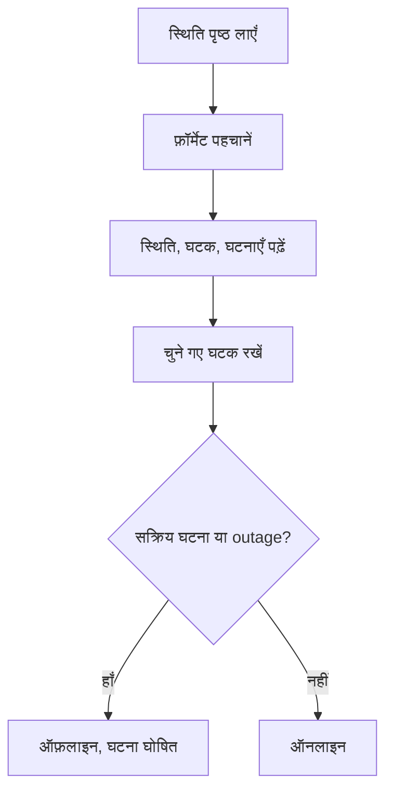

# बाहरी स्थिति पृष्ठ मॉनिटर

बाहरी स्थिति पृष्ठ मॉनिटर उस सेवा के सार्वजनिक स्थिति पृष्ठ पर नज़र रखता है जिस पर आप निर्भर हैं — AWS, GCP, Azure, GitHub, OpenAI, Anthropic और कई अन्य — और जब वह प्रदाता किसी outage या प्रदर्शन में गिरावट की रिपोर्ट करता है, तो आपको अलर्ट करता है। इसका उपयोग upstream समस्याओं के बारे में प्रदाता के रिपोर्ट करते ही जानने के लिए, और उन्हें अपनी समस्याओं से अलग पहचानने के लिए करें।

यह OneUptime से बने स्थिति पृष्ठ भी हर संसाधन के हिसाब से पढ़ता है, और नियोजित रखरखाव को outage से अलग पहचानता है: किसी दूसरी टीम के प्रोजेक्ट पर, या ऐसे विक्रेता पर नज़र रखें जिसका स्थिति पृष्ठ OneUptime पर चलता है।

:::cards
- [मॉनिटर बनाएं](#बाहरी-स्थिति-पृष्ठ-मॉनिटर-बनाएं): स्थिति पृष्ठ का URL paste करें और चुनें कि किस पर नज़र रखनी है।
- [घटक चुनें](#घटक): केवल उन घटकों पर नज़र रखें जिन पर आप निर्भर हैं।
- [मानदंड](#निगरानी-मानदंड): शुरुआत में किसे डाउन माना जाता है।
- [OneUptime स्थिति पृष्ठ](#oneuptime-स्थिति-पृष्ठ): किसी दूसरे प्रोजेक्ट के संसाधन, और उसका रखरखाव।
- [लोकप्रिय स्थिति पृष्ठ](#लोकप्रिय-स्थिति-पृष्ठ-url): उन सेवाओं के URL जिन पर ज़्यादातर टीमें निर्भर हैं।
:::

## यह कैसे काम करता है

हर जाँच पर एक प्रोब स्थिति पृष्ठ लाता है, पता लगाता है कि वह किस फ़ॉर्मेट का है, और समग्र स्थिति, घटक और सक्रिय घटनाएँ पढ़ता है। अगर आपने घटक या कोई घटक समूह चुना है, तो केवल वही गिने जाते हैं। फिर मानदंड तय करते हैं कि मॉनिटर ऑनलाइन है या ऑफ़लाइन।

आप इसका उपयोग इनके लिए कर सकते हैं:

- उन third-party सेवाओं की उपलब्धता की निगरानी जिन पर आपका ऐप्लिकेशन निर्भर है
- upstream प्रदाताओं में outage होने पर अलर्ट पाना
- अलग-अलग घटकों की स्थिति पर नज़र रखना
- केवल उन घटकों पर नज़र रखना जिन पर आप निर्भर हैं (जैसे GitHub के Git Operations और Pull Requests, या OpenAI का "APIs" समूह), ताकि पृष्ठ पर कहीं और की असंबंधित घटनाएँ आपका मॉनिटर trigger न करें
- उपयोगकर्ताओं पर असर पड़ने से पहले प्रदर्शन में गिरावट पकड़ना
- अपनी घटनाओं को upstream प्रदाता की समस्याओं से जोड़कर देखना

## समर्थित प्रदाता

| प्रदाता | विवरण |
| ------------------------ | ---------------------------------------------------------------------- |
| **Auto** (डिफ़ॉल्ट) | स्थिति पृष्ठ का फ़ॉर्मेट अपने आप पहचानता है |
| **Atlassian Statuspage** | Atlassian Statuspage पर चलने वाले स्थिति पृष्ठ (JSON API) |
| **incident.io** | incident.io पर चलने वाले स्थिति पृष्ठ (जैसे `https://status.openai.com`) |
| **OneUptime Status Page** | OneUptime से बने स्थिति पृष्ठ: हर संसाधन की स्थिति, और क्या रखरखाव में है |
| **RSS** | RSS feed देने वाले स्थिति पृष्ठ |
| **Atom** | Atom feed देने वाले स्थिति पृष्ठ |

### अपने आप पहचान

**Auto** पर सेट होने पर OneUptime स्थिति पृष्ठ का फ़ॉर्मेट इस क्रम में अपने आप पहचानता है:

1. पहले वह incident.io स्थिति पृष्ठ API (`/proxy/<host>`) आज़माता है।
2. फिर वह Atlassian Statuspage JSON API (`/api/v2/status.json`, `/api/v2/components.json` और `/api/v2/incidents/unresolved.json`) आज़माता है।
3. फिर वह किसी OneUptime स्थिति पृष्ठ का सारांश (`/status-page-api/summary/<page>`) माँगता है।
4. अगर ये विफल हों, तो वह पृष्ठ को RSS या Atom feed के रूप में parse करने की कोशिश करता है।
5. आख़िरी विकल्प के रूप में वह एक बुनियादी HTTP पहुँच-योग्यता जाँच करता है।

> [!NOTE]
> incident.io को पहले इसलिए जाँचा जाता है क्योंकि कुछ incident.io स्थिति पृष्ठ (जैसे `https://status.openai.com`) एक सीमित, Atlassian-संगत endpoint भी देते हैं जिसमें घटक समूह और सक्रिय घटनाएँ नहीं होतीं। incident.io को पहले जाँचने से समूहों वाला ज़्यादा समृद्ध डेटा इस्तेमाल होता है।

जब आपका स्पष्ट रूप से चुना गया प्रदाता विफल होता है, तब भी पहुँच-योग्यता जाँच ही विकल्प होती है। यह केवल बताती है कि पृष्ठ जवाब देता है या नहीं — `2xx` या `3xx` response पर ऑनलाइन — और कोई घटक या घटना रिपोर्ट नहीं करती।

## बाहरी स्थिति पृष्ठ मॉनिटर बनाएं

:::steps
### नया मॉनिटर शुरू करें

**मॉनिटर** पर जाएँ और **मॉनिटर बनाएं** पर क्लिक करें। **मॉनिटर प्रकार** में **और मॉनिटर प्रकार** पर क्लिक करें और **Basic Monitoring** के अंतर्गत **External Status Page** चुनें, या खोज बॉक्स में `statuspage` टाइप करें। एक **नाम** दर्ज करें, फिर **अगला** पर क्लिक करें।

### स्थिति पृष्ठ का URL दर्ज करें

**स्थिति पृष्ठ URL** दर्ज करें। जब तक आप फ़ॉर्मेट नहीं जानते, **प्रदाता** को **Auto** पर ही रहने दें।

### ज़रूरत हो तो घटक चुनें

**घटक** खोलें और पृष्ठ की अपनी सूची से वे घटक चुनें जिन पर आप निर्भर हैं, जैसे GitHub के `Git Operations` और `Pull Requests`; पूरे पृष्ठ पर नज़र रखने के लिए इसे खाली छोड़ दें। इसके बजाय एक समूह पर नज़र रखने के लिए **और फ़ील्ड** खोलें और `APIs` जैसा एक **Component Group Filter** दर्ज करें।

### परीक्षण करें

पृष्ठ को एक बार लाने के लिए **मॉनिटर का परीक्षण करें** पर क्लिक करें, और उसे मिले प्रदाता, घटक और घटनाएँ जाँचें।

### मानदंडों की समीक्षा करें

मानदंड चरण [डिफ़ॉल्ट मानदंडों](#डिफ़ॉल्ट-मानदंड) से शुरू होता है, जो प्रदाता के दायरे के भीतर किसी सक्रिय घटना या outage की रिपोर्ट करने पर मॉनिटर को ऑफ़लाइन चिह्नित करते हैं। ज़रूरत हो तो इन्हें बदलें, फिर **अगला** पर क्लिक करें।

### प्रोब चुनें और बनाएं

**प्रोब** और एक **निगरानी अंतराल** चुनें — यह **हर 5 मिनट** से शुरू होता है — फिर **मॉनिटर बनाएं** पर क्लिक करें।
:::

## कॉन्फ़िगरेशन विकल्प

| विकल्प | क्या दर्ज करें | डिफ़ॉल्ट |
| --- | --- | --- |
| **स्थिति पृष्ठ URL** | स्थिति पृष्ठ का URL। Atlassian Statuspage और incident.io पर चलने वाली साइटों के लिए यह आम तौर पर root URL होता है (जैसे `https://status.example.com`)। RSS/Atom feeds के लिए सीधे feed URL दर्ज करें। | — |
| **प्रदाता** | फ़ॉर्मेट पहचानने के लिए **Auto**, या पता हो तो **Atlassian Statuspage**, **incident.io**, **OneUptime Status Page**, **RSS** या **Atom**। | **Auto** |
| **घटक** | जिन घटकों पर नज़र रखनी है, पृष्ठ की अपनी सूची से चुने गए या टाइप किए गए। | पूरा पृष्ठ |
| **Component Group Filter** | वह समूह जिस तक मॉनिटर सीमित हो। **और फ़ील्ड** के अंतर्गत। | सभी समूह |
| **टाइमआउट (ms)** | स्थिति पृष्ठ के लिए अधिकतम प्रतीक्षा समय। **और फ़ील्ड** के अंतर्गत। | `10000` (10 सेकंड) |
| **पुनः प्रयास** | पहला प्रयास विफल होने के बाद, एक-एक सेकंड के अंतर पर, कितनी बार फिर से प्रयास करना है; `0` का मतलब एक ही प्रयास। **और फ़ील्ड** के अंतर्गत। | `3` (अधिकतम 4 प्रयास) |

### घटक

जिन घटकों पर आप निर्भर हैं उन्हें चुनें, और मॉनिटर केवल उन्हीं पर नज़र रखता है: **External Status Page Component Status** केवल उनकी स्थितियों की तुलना करता है, समग्र स्थिति उनमें सबसे ख़राब होती है, और **External Status Page Active Incidents** केवल वे घटनाएँ गिनता है जो उनमें से कम से कम एक को प्रभावित करती हैं। आप कितने भी चुनें, पृष्ठ की जाँच फिर भी एक ही होती है।

जब आप **घटक** खोलते हैं, तो आपका ब्राउज़र किसी Atlassian Statuspage, incident.io पृष्ठ या OneUptime स्थिति पृष्ठ से पृष्ठ की अपनी सूची पढ़ता है और उसे पृष्ठ के समूहों में दिखाता है; जो घटक कार्यरत नहीं है, वह बताता है कि उसकी स्थिति क्या है। आपका चुना हुआ नाम ठीक उसी नाम वाले घटक पर नज़र रखता है, case को अनदेखा करते हुए: GitHub के पृष्ठ पर `Copilot` का मतलब `Copilot AI Model Providers` नहीं है।

जब सूची पढ़ी न जा सके (कोई आंतरिक पृष्ठ, ऐसा पृष्ठ जो अपनी सूची आपके ब्राउज़र से साझा नहीं करता, कोई RSS या Atom feed), तो नाम टाइप करें और Enter दबाएँ। `*` किसी भी टेक्स्ट की जगह लेता है: `*us-east-1*` हर उस घटक पर नज़र रखता है जिसके नाम में `us-east-1` हो। RSS या Atom feed पर कोई item तब गिना जाता है जब उसके शीर्षक में इनमें से कोई नाम हो।

जब आप चुने गए घटकों पर नज़र रखते हैं, तो जो घटना किसी घटक का नाम नहीं लेती, वह नहीं गिनी जाती: कुछ भी नहीं बताता कि वह उन्हें प्रभावित करती है। कुछ भी न चुना हो, तो मॉनिटर पूरे पृष्ठ पर नज़र रखता है और हर घटना गिनी जाती है।

पुराने घटक नाम फ़िल्टर के साथ सहेजा गया मॉनिटर वही देखता रहता है जो वह देखता था: फ़िल्टर **घटक** में तारों के बीच उस नाम के रूप में दिखता है, जैसे `*API*`, जो हर उस घटक से मेल खाता है जिसके नाम में वह हो।

> [!WARNING]
> जो नाम किसी से मेल नहीं खाता, वह किसी पर नज़र नहीं रखता, और स्वस्थ दिखता है। **घटक** और **मॉनिटर का परीक्षण करें** दोनों उन चुने गए घटकों के नाम बताते हैं जो पृष्ठ पर नहीं हैं।

### Component Group Filter

अगर स्थिति पृष्ठ अपने घटकों को समूहों में बाँटता है, तो आप मॉनिटर को एक समूह तक सीमित कर सकते हैं। उदाहरण के लिए, `https://status.openai.com` पर `APIs` दर्ज करने से मॉनिटर OpenAI की API सेवाओं तक सीमित हो जाता है।

जब कोई घटक समूह सेट हो, तो **सक्रिय घटना संख्या** और **समग्र स्थिति** केवल उस समूह के घटकों से निकाली जाती है — किसी असंबंधित समूह (जैसे ChatGPT) को प्रभावित करने वाली घटना "APIs" समूह तक सीमित मॉनिटर को trigger नहीं करेगी। घटक भी चुने गए हों, तो केवल उस समूह के चुने गए घटक गिने जाते हैं।

घटक समूह फ़िल्टरिंग **Atlassian Statuspage**, **incident.io** और **OneUptime Status Page** प्रदाताओं के लिए समर्थित है। RSS और Atom feeds घटक समूह नहीं देते।

## निगरानी मानदंड

आप यह तय करने के लिए मानदंड कॉन्फ़िगर कर सकते हैं कि बाहरी सेवा कब ऑनलाइन या ऑफ़लाइन मानी जाए, इनके आधार पर:

| फ़िल्टर प्रकार | यह क्या जाँचता है | फ़िल्टर शर्तें |
| --- | --- | --- |
| **External Status Page Is Online** | क्या स्थिति पृष्ठ पहुँच योग्य है और स्थिति डेटा लौटा रहा है | सही या गलत |
| **External Status Page Overall Status** | पृष्ठ द्वारा बताई गई समग्र स्थिति | बराबर है, बराबर नहीं है, शामिल है, शामिल नहीं है, से शुरू होता है, पर खत्म होता है |
| **External Status Page Component Status** | दायरे के हर घटक की स्थिति (सेट होने पर चुने गए घटक, या समूह के घटक): कार्यरत, Under Maintenance, Degraded Performance, Partial Outage, Major Outage या Full Outage | बराबर है, बराबर नहीं है, शामिल है, शामिल नहीं है, से शुरू होता है, पर खत्म होता है |
| **External Status Page Active Incidents** | स्थिति पृष्ठ पर अभी सक्रिय घटनाओं की संख्या (घटक या समूह चुने होने पर केवल वे जो दायरे के किसी घटक को प्रभावित करती हैं) | बराबर है, बराबर नहीं है, और संख्यात्मक तुलनाएँ |
| **External Status Page Response Time (in ms)** | स्थिति पृष्ठ का डेटा लाने में कितना समय लगता है | से बड़ा, से छोटा, से बड़ा या बराबर, से छोटा या बराबर |

समग्र स्थिति वही है जो पृष्ठ कहता है, इसलिए उसके मान प्रदाता के अनुसार बदलते हैं: Atlassian Statuspage अपना विवरण बताता है, जैसे `All Systems Operational`; OneUptime स्थिति पृष्ठ दायरे के अपने घटकों में सबसे ख़राब स्थिति बताता है, जैसे `under_maintenance`; feed `operational` या `degraded_performance` बताता है; पहुँच-योग्यता जाँच `reachable` या `unreachable` बताती है। घटक या समूह चुने होने पर, किसी भी पृष्ठ पर, यह उनमें सबसे ख़राब स्थिति होती है। ये तुलनाएँ case-sensitive हैं। मॉनिटर का सारांश समग्र स्थिति को शब्दों और रंग में दिखाता है, जैसे हर घटक की स्थिति को (`under_maintenance` **Under Maintenance** के रूप में दिखता है), जबकि मानदंड वही मान तुलना करते हैं जो पृष्ठ बताता है। Outages पर अलर्ट के लिए **External Status Page Active Incidents** और **External Status Page Component Status** आम तौर पर ज़्यादा भरोसेमंद होते हैं।

RSS या Atom feed पर पिछले 24 घंटों के items सक्रिय घटनाएँ गिने जाते हैं: RSS item अपनी प्रकाशन तिथि से, Atom entry अपनी अपडेट तिथि से। भविष्य की तारीख़ वाला item उस तारीख़ तक नहीं गिना जाता।

### डिफ़ॉल्ट मानदंड

डिफ़ॉल्ट रूप से OneUptime ऐसे मानदंड बनाता है जो स्थिति पृष्ठ के लिए वास्तव में मायने रखने वाली चीज़ों पर आधारित हों — उसकी सक्रिय घटनाएँ और घटकों की सेहत, केवल पहुँच-योग्यता नहीं:

| मानदंड | फ़िल्टर | प्रभाव |
| --- | --- | --- |
| Offline | इनमें से **कोई भी**: पृष्ठ ऑनलाइन नहीं है; दायरे में कम से कम एक सक्रिय घटना है; दायरे का कोई घटक Degraded Performance, Partial Outage, Major Outage या Full Outage बताता है | मॉनिटर को ऑफ़लाइन चिह्नित करता है और एक घटना घोषित करता है, जो मानदंड के मेल खाना बंद करने पर अपने आप सुलझ जाती है |
| Online | इनमें से **सभी**: पृष्ठ ऑनलाइन है; दायरे में कोई सक्रिय घटना नहीं है | मॉनिटर को ऑनलाइन चिह्नित करता है |

क्योंकि सक्रिय घटना संख्या और घटक स्थितियाँ चुने गए घटकों और समूह का पालन करती हैं, ये डिफ़ॉल्ट मानदंड अपने आप केवल उन्हीं घटकों पर ध्यान देते हैं जिनकी आपको परवाह है।

## OneUptime स्थिति पृष्ठ

OneUptime से बने किसी स्थिति पृष्ठ पर नज़र रखने के लिए प्रदाता के रूप में **OneUptime Status Page** चुनें, या **Auto** रहने दें: किसी दूसरी टीम का प्रोजेक्ट, या OneUptime Cloud या self-hosted OneUptime पर किसी विक्रेता का पृष्ठ। **स्थिति पृष्ठ URL** में पृष्ठ का अपना पता डालें: उसका डोमेन, जैसे `https://status.example.com`, या बिना अपने डोमेन वाले पृष्ठ के लिए `https://oneuptime.com/status-page/<status-page-id>`।

मॉनिटर पृष्ठ का सारांश, `/status-page-api/summary/<page>`, पढ़ता है (देखें [सारांश पढ़ें](/docs/status-pages/public-api#सारांश-पढ़ें)): केवल वही जो पृष्ठ अपने आगंतुकों को दिखाता है, और दूसरे प्रोजेक्ट का और कुछ नहीं। पृष्ठ का हर संसाधन, कोई मॉनिटर या मॉनिटर समूह, एक घटक है, उस नाम से जो पृष्ठ उसे देता है, पृष्ठ के समूह में; किसी दूसरे समूह के अंदर का समूह `Core / Databases` लिखा जाता है। संसाधन **घटक** में चुनें, या एक समूह पर **Component Group Filter** से नज़र रखें।

किसी घटक की स्थिति वह मान है जिसका अर्थ पृष्ठ पर उसकी स्थिति देती है, इसलिए घटक स्थिति के मानदंड किसी भी स्थिति पृष्ठ की तरह काम करते हैं:

| पृष्ठ पर | घटक स्थिति |
| --- | --- |
| प्रोजेक्ट की चालू स्थिति | `operational` |
| `Degraded` नाम की स्थिति | `degraded_performance` |
| `Offline`, `Down` या `Major Outage` नाम की स्थिति | `major_outage` |
| `Partial Outage` नाम की स्थिति | `partial_outage` |
| `Full Outage` नाम की स्थिति | `full_outage` |
| `Maintenance` नाम की स्थिति | `under_maintenance` |
| कोई और स्थिति | `degraded_performance` |
| वह स्थिति जिसे पृष्ठ छिपाता है, जब **Show current status** बंद हो | `unknown` |

जब तक कोई जारी अनुसूचित रखरखाव इवेंट किसी संसाधन को प्रभावित करता है, क्योंकि वह उसके किसी मॉनिटर या उसके मॉनिटर समूह के किसी मॉनिटर का नाम लेता है, तब तक घटक `under_maintenance` रहता है, चाहे उसके मॉनिटर किसी भी स्थिति में हों: जब तक कोई इवेंट मॉनिटर को रोके रखता है, उसकी जाँच नहीं होती। जो इवेंट अभी आने वाला है, या ख़त्म हो चुका है, वह कुछ नहीं बदलता। पृष्ठ की सक्रिय घटनाएँ उन संसाधनों के लिए गिनी जाती हैं जिन्हें वे प्रभावित करती हैं।

[डिफ़ॉल्ट मानदंड](#डिफ़ॉल्ट-मानदंड) रखरखाव को कभी outage नहीं मानते: दूसरे प्रोजेक्ट के नियोजित काम के दौरान मॉनिटर ऑनलाइन रहता है।

### अपने मॉनिटर पर दूसरे प्रोजेक्ट का रखरखाव दिखाएँ

:::steps
### मानदंड जोड़ें

मॉनिटर के मानदंड में **मानदंड जोड़ें** पर क्लिक करें। उसे फ़िल्टर **External Status Page Component Status**, **बराबर है**, **Under Maintenance** दें, और **मॉनिटर स्थिति बदलकर करें** में अपनी रखरखाव स्थिति चुनें।

### उसे सबसे ऊपर ले जाएँ

नए मानदंड को बाकी मानदंडों के ऊपर खींचें: पहला मेल खाने वाला मानदंड जीतता है।

### मॉनिटर का परीक्षण करें से जाँचें

जब दूसरे प्रोजेक्ट में रखरखाव चल रहा हो, तब **मॉनिटर का परीक्षण करें** पर क्लिक करें: प्रभावित घटक **Under Maintenance** दिखाता है।
:::

### OneUptime स्थिति पृष्ठ मॉनिटर को क्या पढ़ने देता है

जिस पृष्ठ को कोई भी खोल सकता है, उसे वैसे ही पढ़ा जाता है जैसा उसके आगंतुक देखते हैं। निजी पृष्ठ, जो साइन-इन, SSO या पासवर्ड माँगता है, पढ़ा नहीं जा सकता: **OneUptime Status Page** चुना होने पर जाँच विफल होती है और कारण बताती है। IP allowlist वाले पृष्ठ को प्रोब के पते को अंदर आने देना चाहिए: उस नेटवर्क के अंदर के किसी प्रोब से उस पर नज़र रखें।

## टेम्पलेट वेरिएबल

बाहरी स्थिति पृष्ठ मॉनिटर से घटनाएँ या अलर्ट बनाते समय आप शीर्षकों, विवरणों और समाधान नोट में ये वेरिएबल उपयोग कर सकते हैं (देखें [घटना और अलर्ट टेम्पलेट](/docs/monitor/incident-alert-templating)):

| वेरिएबल | विवरण |
| ------------------------- | ------------------------------------------------------------------------------- |
| `{{isOnline}}`            | क्या स्थिति पृष्ठ ऑनलाइन है (true/false) |
| `{{responseTimeInMs}}`    | मिलीसेकंड में response समय |
| `{{failureCause}}`        | विफलता का कारण, अगर कोई हो |
| `{{overallStatus}}`       | समग्र स्थिति संकेतक का मान |
| `{{activeIncidentCount}}` | सक्रिय घटनाओं की संख्या (घटक चुने हों तो केवल उन घटकों की जिन पर यह नज़र रखता है) |
| `{{componentStatuses}}`   | घटक स्थितियों का JSON array (`name`, `status`, `description`, `groupName`) |
| `{{provider}}`            | पहचाना गया प्रदाता (Atlassian Statuspage, incident.io, OneUptime Status Page, RSS, Atom); पहुँच-योग्यता जाँच के बाद खाली |
| `{{componentGroup}}`      | वह घटक समूह जिस तक मॉनिटर सीमित है, अगर कोई हो |
| `{{componentName}}`       | वे घटक जिन पर मॉनिटर नज़र रखता है, अल्पविराम से अलग, अगर उसने कुछ चुने हों |

## लोकप्रिय स्थिति पृष्ठ URL

यहाँ लोकप्रिय सेवाओं के स्थिति पृष्ठों की सूची है। इनमें से कई Atlassian Statuspage या incident.io का उपयोग करते हैं, इसलिए **Auto** प्रदाता इन्हें अपने आप पहचान लेता है। जो पृष्ठ इनमें से किसी पर नहीं बना और feed भी नहीं है, उसे केवल पहुँच-योग्यता जाँच मिलती है — ऐसे पृष्ठों के लिए, अगर प्रदाता RSS या Atom feed प्रकाशित करता है, तो उसकी निगरानी करें।

| सेवा | स्थिति पृष्ठ URL |
| ---------------------------- | --------------------------------------------- |
| AWS                          | `https://health.aws.amazon.com/health/status` |
| Google Cloud Platform        | `https://status.cloud.google.com`             |
| Microsoft Azure              | `https://status.azure.com`                    |
| GitHub                       | `https://www.githubstatus.com`                |
| OpenAI                       | `https://status.openai.com`                   |
| Anthropic                    | `https://status.anthropic.com`                |
| Cloudflare                   | `https://www.cloudflarestatus.com`            |
| Datadog                      | `https://status.datadoghq.com`                |
| PagerDuty                    | `https://status.pagerduty.com`                |
| Twilio                       | `https://status.twilio.com`                   |
| Stripe                       | `https://status.stripe.com`                   |
| Slack                        | `https://status.slack.com`                    |
| Atlassian (Jira, Confluence) | `https://status.atlassian.com`                |
| Vercel                       | `https://www.vercel-status.com`               |
| Netlify                      | `https://www.netlifystatus.com`               |
| DigitalOcean                 | `https://status.digitalocean.com`             |
| Heroku                       | `https://status.heroku.com`                   |
| MongoDB Atlas                | `https://status.cloud.mongodb.com`            |
| Fastly                       | `https://status.fastly.com`                   |
| New Relic                    | `https://status.newrelic.com`                 |
| Sentry                       | `https://status.sentry.io`                    |
| CircleCI                     | `https://status.circleci.com`                 |

## सर्वोत्तम प्रथाएँ

- **Auto प्रदाता का उपयोग करें**, जब तक आप सटीक फ़ॉर्मेट न जानते हों — अपने आप पहचान ज़्यादातर स्थिति पृष्ठों के लिए अच्छा काम करती है।
- **उन घटकों को चुनें जिन पर आप निर्भर हैं** (जैसे GitHub के Git Operations और Pull Requests), ताकि असंबंधित घटनाएँ शोर न करें।
- **पूरे समूह पर नज़र रखें** जब आप उस पूरे समूह पर निर्भर हों (जैसे OpenAI के "APIs"), ताकि बाद में उसमें जुड़ने वाले घटकों पर भी नज़र रहे।
- **अपने मॉनिटरों के साथ मिलाएँ** — बाहरी स्थिति पृष्ठ मॉनिटर को अपने API और वेबसाइट मॉनिटरों के साथ जोड़ें। जब दोनों एक साथ डाउन हों, तो upstream स्थिति पृष्ठ आपको मूल कारण तक जल्दी पहुँचाता है।

## समस्या निवारण

:::details मॉनिटर ऑफ़लाइन है, लेकिन घटना सेवा के उस हिस्से की है जिसका मैं उपयोग नहीं करता
**घटक** में वे घटक चुनें जिन पर आप निर्भर हैं, या **Component Group Filter** में एक समूह। तब सक्रिय घटना संख्या और घटक स्थितियाँ केवल उन्हीं को गिनती हैं; जो घटना किसी घटक का नाम नहीं लेती, वह नहीं गिनी जाती।
:::

:::details Outage के दौरान भी मॉनिटर कभी ऑफ़लाइन नहीं होता
हो सकता है कोई चुना गया नाम पृष्ठ पर किसी से मेल न खाता हो, जो स्वस्थ दिखता है, या पृष्ठ को केवल पहुँच-योग्यता जाँच मिल रही हो। **मॉनिटर का परीक्षण करें** चलाएँ: यह उसे मिले प्रदाता और घटक दिखाता है, और उन चुने गए घटकों के नाम बताता है जो पृष्ठ पर नहीं हैं।
:::

:::details Auto गलत फ़ॉर्मेट चुनता है, या कोई घटक नहीं ढूँढ पाता
**प्रदाता** को वह सेट करें जिसका उपयोग आप जानते हैं कि पृष्ठ करता है। RSS या Atom feed के लिए स्थिति पृष्ठ का नहीं, feed का अपना URL दर्ज करें।
:::

:::details घटक सूची लोड नहीं होती
आपका ब्राउज़र सूची सीधे स्थिति पृष्ठ से पढ़ता है। कोई आंतरिक पृष्ठ जिस तक आपका ब्राउज़र नहीं पहुँच सकता, ऐसा पृष्ठ जो अपनी सूची दूसरी साइटों से साझा नहीं करता, और कोई RSS या Atom feed — इनमें चुनने के लिए कोई सूची नहीं होती: हर घटक का नाम वैसे ही टाइप करें जैसे पृष्ठ उसे दिखाता है, और Enter दबाएँ। प्रोब पहले की तरह पृष्ठ पढ़ते हैं।
:::

:::details OneUptime स्थिति पृष्ठ कोई घटक नहीं दिखाता
**प्रदाता** के रूप में **OneUptime Status Page** चुनें और **मॉनिटर का परीक्षण करें** पर क्लिक करें: परिणाम बताता है कि पृष्ठ निजी है या उसकी IP allowlist प्रोब को बाहर रखती है। जो self-hosted OneUptime काफ़ी समय से अपडेट नहीं हुआ है, वह अभी सारांश नहीं देता: तब तक पृष्ठ को पहुँच-योग्यता जाँच मिलती है, या उसे feed के रूप में पढ़ा जाता है।
:::

:::details कोई आंतरिक स्थिति पृष्ठ पहुँच में नहीं है
प्रोब निजी नेटवर्क पतों को तब तक अस्वीकार करता है जब तक उसे उन तक पहुँचने की अनुमति न हो। अपने नेटवर्क के अंदर किसी प्रोब पर `PROBE_ALLOW_PRIVATE_NETWORK_MONITORS=true` सेट करें — देखें [निजी नेटवर्क पहुँच](/docs/self-hosted/private-network-access)।
:::

## अगले कदम

:::cards
- [घटना और अलर्ट टेम्पलेट](/docs/monitor/incident-alert-templating): प्रदाता की स्थिति को अपनी घटना के शीर्षकों में डालें।
- [API मॉनिटर](/docs/monitor/api-monitor): प्रदाता की स्थिति के साथ अपने endpoints भी जाँचें।
- [मॉनिटर बनाना](/docs/monitor/create-monitor): वे कदम जो हर मॉनिटर प्रकार में एक जैसे हैं।
:::
