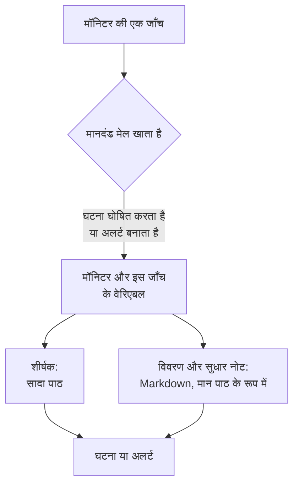

# घटना और अलर्ट टेम्पलेट

जब किसी मॉनिटर का मानदंड घटना घोषित करता है या अलर्ट बनाता है, तो वह शीर्षक, विवरण और सुधार नोट आपके लिखे टेम्पलेट से भरता है। उनमें `{{variable}}` प्लेसहोल्डर (जैसे `{{monitorName}}` या `{{responseStatusCode}}`) डालें, और हर घटना उसे खोलने वाली जाँच के मानों के साथ बताएगी कि क्या गलत हुआ।

:::cards
- [टेम्पलेट कहाँ लिखें](#टेम्पलेट-कहाँ-लिखें): मानदंड से बनने वाली घटना या अलर्ट का शीर्षक, विवरण और सुधार नोट।
- [बुनियादी उपयोग](#बुनियादी-उपयोग): प्लेसहोल्डर, ऑब्जेक्ट के अंदर पथ, और सूचियाँ।
- [हर मॉनिटर के वेरिएबल](#हर-मॉनिटर-के-वेरिएबल): मॉनिटर का नाम, और सीमा पार करने वाला संसाधन।
- [मॉनिटर प्रकार के अनुसार वेरिएबल](#मॉनिटर-प्रकार-के-अनुसार-वेरिएबल): हर तरह की जाँच क्या रिपोर्ट करती है।
:::

## टेम्पलेट कैसे काम करते हैं

टेम्पलेट एक बार भरा जाता है, जब मानदंड घटना या अलर्ट बनाता है। OneUptime मॉनिटर से और मेल खाने वाली जाँच से वेरिएबल इकट्ठा करता है, हर मान को उसके प्लेसहोल्डर की जगह पर रखता है, और परिणाम सहेजता है। बाद में टेम्पलेट बदलने से उसके बाद बनने वाली घटनाएँ और अलर्ट बदलते हैं, पहले से खुले हुए नहीं।



- **शीर्षक सादा पाठ है।** यह जहाँ भी दिखे, ठीक वैसा ही पढ़ा जाता है जैसा टेम्पलेट ने बनाया।
- **विवरण और सुधार नोट Markdown हैं।** आपका लिखा Markdown रेंडर होता है, और निगरानी किए जा रहे सिस्टम का भेजा हर मान पाठ के रूप में रखा जाता है, इसलिए उसमें कुछ भी लिंक, इमेज या मेंशन नहीं जोड़ सकता। देखें [विवरण और सुधार नोट में मान](#विवरण-और-सुधार-नोट-में-मान)।
- **समूहित मॉनिटर हर घटना को उसकी अपनी सीरीज़ के लिए भरता है।** जो मॉनिटर हर होस्ट, पॉड या डिवाइस के लिए एक घटना खोलता है, वह हर टेम्पलेट को उस सीरीज़ के मानों से भरता है, और अगर आपका टेम्पलेट सीरीज़ का नाम पहले से नहीं बताता तो उसे शीर्षक में जोड़ देता है।

## टेम्पलेट कहाँ लिखें

:::steps
### मॉनिटर के मानदंड खोलें

**मॉनिटर** पर जाएँ, मॉनिटर खोलें, और उसके साइड मेन्यू में **मानदंड** पर क्लिक करें। **निगरानी मानदंड संपादित करें** पर क्लिक करें।

### घटना या अलर्ट चालू करें

किसी मानदंड में, **क्रियाएँ** के अंतर्गत, **जब फ़िल्टर मेल खाते हैं, तो एक घटना घोषित करें।** या **जब फ़िल्टर मेल खाते हैं, तो एक अलर्ट बनाएँ।** चालू करें। उसके नीचे घटना या अलर्ट का फ़ॉर्म खुलता है।

### शीर्षक लिखें

**घटना शीर्षक** या **अलर्ट शीर्षक** में शीर्षक लिखें, उदाहरण के लिए `{{monitorName}} is down`। उसके बगल में **Learn about dynamic templates** से **Dynamic Template Variables** खुलता है: इस मॉनिटर प्रकार के सभी वेरिएबल, और हर एक में क्या है। किसी वेरिएबल पर क्लिक करने से वह कॉपी हो जाता है।

### विवरण और सुधार नोट लिखें

**घटना विवरण** या **अलर्ट विवरण** के लिए **विवरण** खोलें, और **सुधार नोट** के लिए **और फ़ील्ड** खोलें। ये एडिटर खुद वेरिएबल सुझाते हैं: **टेम्पलेट वेरिएबल** उन्हें एडिटर के नीचे सूचीबद्ध करता है, टूलबार में **वेरिएबल डालें** वही सूची खोलता है, और `{{` टाइप करने पर वह कर्सर पर खुलती है।

### मानदंड सहेजें

**परिवर्तन सहेजें** पर क्लिक करें। यह मानदंड जो अगली घटना या अलर्ट बनाएगा, वह नए टेम्पलेट का उपयोग करेगा।
:::

## बुनियादी उपयोग

प्लेसहोल्डर दोहरे कर्ली ब्रेसेस में किसी वेरिएबल का नाम है। घटना बनते समय OneUptime उसे वेरिएबल के मान से बदल देता है, और आसपास का पाठ वैसा ही छोड़ता है जैसा आपने लिखा।

```text title="Title template"
{{monitorName}} returned {{responseStatusCode}} in {{responseTimeInMs}} ms
```

अगर मॉनिटर का नाम `Checkout API` है, रिस्पॉन्स स्टेटस कोड `502` है और रिस्पॉन्स में `842` मिलीसेकंड लगे, तो घटना का शीर्षक होगा:

```text title="Title as created"
Checkout API returned 502 in 842 ms
```

### ऑब्जेक्ट और सूचियों में पथ

जिस वेरिएबल में ऑब्जेक्ट या सूची हो, उसे पथ से पढ़ा जाता है, ठीक [JavaScript अभिव्यक्तियाँ](/docs/monitor/javascript-expression) की तरह:

| लिखें | क्या पढ़ा जाता है | उदाहरण |
| --- | --- | --- |
| `{{object.field}}` | किसी ऑब्जेक्ट का एक फ़ील्ड, किसी भी गहराई पर | `{{responseBody.error.message}}` |
| `{{list[0]}}` या `{{list.0}}` | सूची का एक आइटम, 0 से गिनती | `{{diskMetrics[0].usagePercent}}` |
| `{{list[last]}}` | सूची का आखिरी आइटम | `{{processes[last].name}}` |
| `{{object}}` | पूरा ऑब्जेक्ट या सूची, JSON के रूप में | `{{responseBody}}` |

फ़ील्ड के नाम में हाइफ़न हो सकता है, जैसे `{{responseHeaders.content-type}}`। ऋणात्मक इंडेक्स, जैसे `[-1]`, कुछ नहीं पढ़ता: `[last]` का उपयोग करें।

### जब कोई मान मौजूद न हो

जिस प्लेसहोल्डर का पथ कहीं नहीं पहुँचता, वह पाठ में वैसे ही रह जाता है जैसा आपने लिखा, ब्रेसेस समेत: अगर रिस्पॉन्स में `error` फ़ील्ड नहीं है, तो `{{responseBody.error.id}}` शीर्षक में जस का तस दिखता है। यही उस वेरिएबल के साथ होता है जिसे इस जाँच ने रिपोर्ट नहीं किया, जैसे किसी सफल जाँच पर `failureCause`। जिस मान को जाँच ने खाली पाठ के रूप में रिपोर्ट किया, वह कुछ नहीं से बदल दिया जाता है।

ऐसा एक टेम्पलेट लिखने के लिए जो मॉनिटर समूहित हो या न हो, दोनों में काम करे, [प्रभावित संसाधन](#प्रभावित-संसाधन) वाले वेरिएबल का उपयोग करें: वे हमेशा मौजूद रहते हैं, और मॉनिटर समूहित न हो तो खाली होते हैं।

### विवरण और सुधार नोट में मान

विवरण और सुधार नोट Markdown हैं: वे घटना या अलर्ट के पेज पर, ईमेल में, और उसके Slack और Microsoft Teams चैनलों में दिखते हैं। टेम्पलेट वहाँ जो मान रखता है, वे वही हैं जो निगरानी किए जा रहे सिस्टम ने भेजे - रिस्पॉन्स बॉडी या हेडर, आने वाला अनुरोध या ईमेल, किसी डिवाइस या सीरीज़ के लेबल - इसलिए हर मान पाठ के रूप में रखा जाता है। टेम्पलेट उसे जहाँ भी रखे, वह ठीक वैसा ही पढ़ा जाता है जैसा भेजा गया था, और उसमें कोई लिंक, इमेज, HTML टैग या `<!channel>` जैसा Slack मेंशन काम करने के बजाय पाठ के रूप में दिखता है। किसी मान में खाली वेब पता फिर भी लिंक बन जाता है, ऐसा लिंक जो दिखाता है कि वह कहाँ जाता है। टेम्पलेट में आपका लिखा Markdown वैसे ही रेंडर होता है जैसा आपने लिखा।

कोई मान किसी भी आकार का हो सकता है - रिस्पॉन्स बॉडी या कई मेगाबाइट का लॉग - और सूचना फिर भी उसके साथ जाती है। हर चैनल उतना ही ले जाता है जितना वह स्वीकार करता है, और उसके लिए बहुत लंबा विवरण काटा जाता है, लाइन ब्रेक हो तो वहीं, और "… (truncated — see OneUptime for the full text)" पर खत्म होता है:

- **ईमेल**: हर विवरण, नोट या मूल कारण ईमेल के पाठ का लगभग 256 KB तक ले जाता है, और लंबे पाठ के अंत में दिया नोट घटना या अलर्ट से लिंक करता है। पूरा ईमेल - उसका पाठ और उसके स्क्रीनशॉट - 3 MB से कम रहता है, जिसे हर मेल सर्वर और Microsoft Graph स्वीकार करते हैं: जो स्क्रीनशॉट पाठ के साथ नहीं समाता, वह छोड़ दिया जाता है, और उसकी जगह एक नोट रहता है।
- **घटना या अलर्ट का पेज** सब कुछ दिखाता है। 128 KB से बड़ा विवरण, जिसे लेआउट करने में ज़्यादा समय लगेगा, सादे पाठ के रूप में पंक्ति दर पंक्ति दिखाया जाता है।
- **Slack** अधिकतम उतना ले जाता है जितना Slack किसी संदेश में दिखाता है (लगभग 30,000 अक्षर)। **Microsoft Teams** OneUptime ऐप से भेजे संदेश में लगभग 40,000 अक्षर और आने वाले वेबहुक (स्टेटस पेज सब्सक्राइबर, वर्कफ़्लो) से लगभग 12,000 अक्षर ले जाता है - संदेश भेजते समय मापा जाता है, इसलिए तालिका उस HTML के रूप में गिनी जाती है जो वह बनती है।
- **SMS, फ़ोन कॉल, पुश सूचनाएँ, WhatsApp और Telegram** उतना ले जाते हैं जितना उनके प्रदाता स्वीकार करते हैं: देखें [स्तर लोगों को कैसे पेज करते हैं](/docs/on-call/escalation-rules#स्तर-लोगों-को-कैसे-पेज-करते-हैं)।

हर चैनल पाठ को उसकी लंबाई के अनुसार बढ़ने वाले समय में रेंडर करता है। जिस हिस्से में रेंडरर को कहीं ज़्यादा समय लगेगा - 64 KB से लंबी पंक्ति, सादी पंक्तियों का लंबा अनुच्छेद, कभी बंद न होने वाले `*`, `_` या `[` से भरा अनुच्छेद, सोलह स्तरों से ज़्यादा गहराई तक नेस्ट किए गए उद्धरण या सूचियाँ, और घटना या अलर्ट के पेज पर एक हज़ार से ज़्यादा पंक्तियों की तालिका या सूची - वह अपनी जगह पर सादे पाठ के रूप में पढ़ा जाता है, और विवरण का बाकी हिस्सा सामान्य रूप से रेंडर होता है।

## उन्नत उपयोग

### किसी सूची पर लूप

`{{#each path}}` `{{/each}}` तक के पाठ को `path` पर मौजूद सूची के हर आइटम के लिए एक बार दोहराता है:

```text title="Loop syntax"
{{#each arrayPath}}
  ...text with {{field}} placeholders for each item...
{{/each}}
```

लूप के अंदर:

- `{{field}}` और `{{field.nested}}` मौजूदा आइटम को पढ़ते हैं। जो नाम आइटम में नहीं है, उसे बाहरी आइटम में और फिर पूरे टेम्पलेट के वेरिएबल में खोजा जाता है।
- `{{@index}}` आइटम की स्थिति है, 0 से गिनती।
- `{{this}}` आइटम खुद है, स्ट्रिंग जैसे सादे मानों की सूची के लिए।
- ऐसे पथ पर लूप जो सूची नहीं है, या खाली सूची पर लूप, कुछ नहीं लिखता।
- लूप नेस्ट हो सकते हैं: किसी दूसरे लूप के अंदर का `{{#each}}` हर बाहरी आइटम की अंदरूनी सूची पढ़ता है।

उदाहरण के लिए, एक [आने वाले अनुरोध मॉनिटर](/docs/monitor/incoming-request-monitor) को यह अलर्ट सूचना मिलती है:

```json title="Request body"
{
  "receiver": "payments",
  "alerts": [
    { "status": "firing", "labels": { "alertname": "HighLatency" } },
    { "status": "resolved", "labels": { "alertname": "DiskFull" } }
  ]
}
```

और उसका विवरण टेम्पलेट यह है:

```text title="Description template"
Alerts for {{requestBody.receiver}}:
{{#each requestBody.alerts}}
- {{@index}}: {{labels.alertname}} ({{status}})
{{/each}}
```

तो वह ऐसी घटना बनाता है जिसका विवरण नीचे जैसा है। हर आइटम अपने आसपास के लाइन ब्रेक रखता है, इसलिए आइटमों के बीच एक खाली पंक्ति होती है, और विवरण फिर भी एक ही सूची दिखाता है:

```text title="Description as created"
Alerts for payments:

- 0: HighLatency (firing)

- 1: DiskFull (resolved)
```

### समूहित मॉनिटर के मान

**Group by** एट्रिब्यूट वाला मेट्रिक-आधारित मॉनिटर हर सीरीज़ के लिए एक घटना खोलता है, और हर एट्रिब्यूट का मान एट्रिब्यूट के नाम वाला वेरिएबल होता है। `host.name` से समूहित करने पर `{{host.name}}` मिलता है, और `resource.k8s.pod.name` से समूहित करने पर `{{resource.k8s.pod.name}}`। `{{seriesLabels}}` इन सभी को एक ऑब्जेक्ट के रूप में रखता है।

समूहित [लॉग मॉनिटर](/docs/monitor/logs-monitor) भी इसी तरह काम करता है: हर ग्रुप-बाय एट्रिब्यूट का मान उसकी कुंजी वाला वेरिएबल होता है।

## हर मॉनिटर के वेरिएबल

### मॉनिटर

| वेरिएबल | इसमें क्या है | उदाहरण |
| --- | --- | --- |
| `monitorName` | मॉनिटर का नाम। | `Checkout API` |
| `monitorId` | मॉनिटर की ID। | `a0f78958-da0a-4775-9fd9-c9fc63d3456f` |
| `monitorType` | मॉनिटर का प्रकार। | `Website`, `Synthetic Monitor` |

### प्रभावित संसाधन

ये उस सीरीज़ का वर्णन करते हैं जिसके लिए समूहित मॉनिटर ने घटना खोली: एक पॉड, एक कंटेनर, एक होस्ट, एक डिस्क। जो मॉनिटर समूहित नहीं है, उसमें ये खाली होते हैं, इसलिए कोई भी टेम्पलेट इन्हें किसी भी मॉनिटर पर इस्तेमाल कर सकता है।

| वेरिएबल | इसमें क्या है |
| --- | --- |
| `seriesResourceSuffix` | सीरीज़ की पहचान, एक विभाजक से शुरू, शीर्षक के अंत में लगाने के लिए। |
| `seriesResourceSummary` | वही पहचान बिना विभाजक के, किसी वाक्य में डालने के लिए। |
| `seriesResourceBlock` | सीरीज़ का हर लेबल, Markdown सूची के रूप में। विवरण में सबसे अच्छा। |
| `seriesDebugCommands` | ठीक इसी संसाधन के लिए केवल-पढ़ने वाले कमांड, जैसे `kubectl` या `docker`, Markdown सूची के रूप में। |

## मॉनिटर प्रकार के अनुसार वेरिएबल

### वेबसाइट और API मॉनिटर

| वेरिएबल | इसमें क्या है | प्रकार |
| --- | --- | --- |
| `responseBody` | रिस्पॉन्स बॉडी: JSON हो तो ऑब्जेक्ट, वरना पाठ। | `JSON` या `string` |
| `responseHeaders` | रिस्पॉन्स हेडर, छोटे अक्षरों वाले नाम से। | `Dictionary<string>` |
| `responseStatusCode` | HTTP स्टेटस कोड। | `number` |
| `responseTimeInMs` | रिस्पॉन्स समय, मिलीसेकंड में। | `number` |
| `isOnline` | क्या मॉनिटर ने रिस्पॉन्स को ऑनलाइन माना। | `boolean` |

### आने वाले अनुरोध मॉनिटर

| वेरिएबल | इसमें क्या है | प्रकार |
| --- | --- | --- |
| `requestBody` | अनुरोध बॉडी: JSON हो तो ऑब्जेक्ट। | `JSON` या `string` |
| `requestHeaders` | अनुरोध हेडर, छोटे अक्षरों वाले नाम से। | `Dictionary<string>` |
| `requestMethod` | HTTP मेथड, जैसे `POST`। | `string` |
| `incomingRequestReceivedAt` | अनुरोध कब मिला, ISO 8601 टाइमस्टैम्प के रूप में। | `string` |

जब मानदंड में **Group incidents and alerts by a payload field** चालू हो, तो ग्रुपिंग कुंजी भी एक वेरिएबल होती है, जिसका नाम ग्रुपिंग पथ के **आखिरी हिस्से** पर होता है: `requestBody.alerts[*].labels.alertname` से समूहित करने पर `{{alertname}}` मिलता है, और `requestBody.alerts[*].fingerprint` से समूहित करने पर `{{fingerprint}}`। पूरा `requestBody` भी उसके साथ मौजूद रहता है।

> [!NOTE]
> `[*]` केवल ग्रुपिंग पथ फ़ील्ड में काम करता है। टेम्पलेट में यह कुछ नहीं पढ़ता, इसलिए प्लेसहोल्डर जैसा लिखा था वैसा रह जाता है। `{{requestBody.alerts[0].annotations.summary}}` हमेशा पेलोड का पहला अलर्ट पढ़ता है, न कि वह जिसके लिए घटना खोली गई: ग्रुपिंग वेरिएबल और पेलोड के साझा फ़ील्ड, जैसे `commonLabels` और `commonAnnotations`, का उपयोग करें। देखें [आने वाले अनुरोध मॉनिटर](/docs/monitor/incoming-request-monitor)।

### आने वाले ईमेल मॉनिटर

| वेरिएबल | इसमें क्या है | प्रकार |
| --- | --- | --- |
| `emailSubject` | ईमेल का विषय। | `string` |
| `emailFrom` | भेजने वाले का ईमेल पता। | `string` |
| `emailTo` | ईमेल किसे भेजा गया, मॉनिटर का अपना पता छिपाकर। | `string` |
| `emailBody` | ईमेल का सादा पाठ बॉडी। | `string` |
| `emailReceivedAt` | ईमेल कब मिला, UTC में ISO 8601 टाइमस्टैम्प के रूप में। | `string` |

शीर्षक में, इनमें से हर एक को अधिकतम 150 अक्षरों की एक पंक्ति तक काटा जाता है। विवरण और सुधार नोट को पूरा मान मिलता है। देखें [आने वाले ईमेल मॉनिटर](/docs/monitor/incoming-email-monitor#टेम्पलेट-वेरिएबल)।

### Ping, IP और पोर्ट मॉनिटर

| वेरिएबल | इसमें क्या है | प्रकार |
| --- | --- | --- |
| `isOnline` | क्या लक्ष्य ने जवाब दिया। | `boolean` |
| `responseTimeInMs` | रिस्पॉन्स समय, मिलीसेकंड में। पोर्ट के लिए, DNS लुकअप और TCP कनेक्शन मिलाकर। | `number` |
| `failureCause` | जाँच विफल होने पर, उसका कारण। | `string` |
| `isTimeout` | क्या जाँच का समय समाप्त हुआ। | `boolean` |

### NTP मॉनिटर

| वेरिएबल | इसमें क्या है | प्रकार |
| --- | --- | --- |
| `isOnline` | क्या टाइम सर्वर ने प्रोब के अनुरोध का जवाब दिया। | `boolean` |
| `isSynchronized` | क्या उसने stratum 1 से 15 पर, बिना leap अलार्म के और असली टाइमस्टैम्प के साथ जवाब दिया। | `boolean` |
| `stratum` | सर्वर का बताया stratum: प्राथमिक सर्वर के लिए 1, सिंक्रोनाइज़ न होने पर 16, kiss-o'-death के लिए 0। | `number` |
| `clockOffsetInMs` | सर्वर की घड़ी प्रोब की घड़ी से कितनी दूर है, मिलीसेकंड में। धनात्मक का मतलब है सर्वर आगे है। | `number` |
| `referenceId` | सर्वर किससे सिंक्रोनाइज़ होता है: stratum 1 पर `GPS` जैसा स्रोत, या उसके अपस्ट्रीम सर्वर का पता। | `string` |
| `leapIndicator` | सब ठीक होने पर 0 से 2, सर्वर के कहने पर कि उसकी घड़ी सिंक्रोनाइज़ नहीं है, 3। | `number` |
| `kissCode` | stratum 0 पर, वह चार-अक्षर का कोड जो सर्वर ने समय की जगह भेजा, जैसे `RATE`। | `string` |
| `responseTimeInMs` | अनुरोध से जवाब तक का समय, मिलीसेकंड में। | `number` |
| `roundTripDelayInMs` | आदान-प्रदान का नेटवर्क राउंड ट्रिप, सर्वर के अपने प्रोसेसिंग समय के बिना। | `number` |
| `rootDelayInMs` | सर्वर से उसकी संदर्भ घड़ी तक का राउंड ट्रिप, मिलीसेकंड में। | `number` |
| `rootDispersionInMs` | सर्वर का अपनी अधिकतम त्रुटि का अनुमान, मिलीसेकंड में। | `number` |
| `serverTime` | जवाब भेजते समय सर्वर की घड़ी, ISO 8601 टाइमस्टैम्प के रूप में। | `string` |
| `referenceTime` | सर्वर की घड़ी आखिरी बार कब सेट या ठीक की गई, ISO 8601 टाइमस्टैम्प के रूप में। | `string` |
| `serverAddress` | वह पता जिस पर अनुरोध गया। | `string` |
| `port` | वह UDP पोर्ट जिस पर अनुरोध गया। | `number` |
| `failureCause` | सर्वर ने जवाब क्यों नहीं दिया, या वह सिंक्रोनाइज़ क्यों नहीं है। | `string` |
| `isTimeout` | क्या सर्वर ने समय पर जवाब नहीं दिया। | `boolean` |

### SSL प्रमाणपत्र मॉनिटर

| वेरिएबल | इसमें क्या है | प्रकार |
| --- | --- | --- |
| `isOnline` | क्या प्रमाणपत्र जाँच सफल रही। | `boolean` |
| `isSelfSigned` | क्या प्रमाणपत्र स्व-हस्ताक्षरित है। | `boolean` |
| `createdAt` | प्रमाणपत्र कब जारी हुआ, ISO 8601 टाइमस्टैम्प के रूप में। | `string` |
| `expiresAt` | प्रमाणपत्र कब समाप्त होता है, ISO 8601 टाइमस्टैम्प के रूप में। | `string` |
| `commonName` | प्रमाणपत्र का कॉमन नेम (CN)। | `string` |
| `organizationalUnit` | उसकी संगठनात्मक इकाई (OU)। | `string` |
| `organization` | उसका संगठन (O)। | `string` |
| `locality` | उसका स्थान (L)। | `string` |
| `state` | उसका राज्य या प्रांत (ST)। | `string` |
| `country` | उसका देश (C)। | `string` |
| `serialNumber` | उसका सीरियल नंबर। | `string` |
| `fingerprint` | उसका SHA-1 फ़िंगरप्रिंट। | `string` |
| `fingerprint256` | उसका SHA-256 फ़िंगरप्रिंट। | `string` |
| `failureCause` | जाँच विफल होने पर, उसका कारण। | `string` |

### DNS मॉनिटर

| वेरिएबल | इसमें क्या है | प्रकार |
| --- | --- | --- |
| `isOnline` | क्या क्वेरी का जवाब मिला। | `boolean` |
| `responseTimeInMs` | क्वेरी का समय, मिलीसेकंड में। | `number` |
| `isTimeout` | क्या क्वेरी का समय समाप्त हुआ। | `boolean` |
| `isDnssecValid` | DNSSEC सत्यापन का परिणाम। | `boolean` |
| `records` | लौटाए गए रिकॉर्ड, हर एक `{type, value, ttl}` के रूप में। | `Array<Object>` |
| `recordValues` | केवल रिकॉर्ड के मान। | `Array<string>` |
| `failureCause` | क्वेरी विफल होने पर, उसका कारण। | `string` |

### DNSSEC मॉनिटर

| वेरिएबल | इसमें क्या है | प्रकार |
| --- | --- | --- |
| `isOnline` | क्या जाँच पूरी हुई। | `boolean` |
| `domainName` | जाँचा गया ज़ोन। | `string` |
| `isZoneSigned` | क्या ज़ोन में DNSKEY रिकॉर्ड हैं। | `boolean` |
| `isParentDsPresent` | क्या पैरेंट ज़ोन में इसके लिए DS रिकॉर्ड हैं। | `boolean` |
| `isChainValid` | क्या ट्रस्ट की श्रृंखला सत्यापित होती है। | `boolean` |
| `resolverConsensusAd` | क्या हर रिज़ॉल्वर ने AD फ़्लैग लौटाया। | `boolean` |
| `isNameserverConsistent` | क्या हर आधिकारिक नेमसर्वर ने एक ही SOA सीरियल लौटाया। | `boolean` |
| `earliestSignatureExpiration` | पहला RRSIG हस्ताक्षर कब समाप्त होता है, ISO 8601 टाइमस्टैम्प के रूप में। | `string` |
| `daysUntilSignatureExpiry` | उस हस्ताक्षर के समाप्त होने में बचे दिन। | `number` |
| `dnskeyCount` | DNSKEY रिकॉर्ड की संख्या। | `number` |
| `dsRecordCount` | पैरेंट पर DS रिकॉर्ड की संख्या। | `number` |
| `rrsigCount` | देखे गए RRSIG रिकॉर्ड की संख्या। | `number` |
| `responseTimeInMs` | जाँच में कितना समय लगा, मिलीसेकंड में। | `number` |
| `failureCause` | जाँच विफल होने पर, उसका कारण। | `string` |

### डोमेन मॉनिटर

| वेरिएबल | इसमें क्या है | प्रकार |
| --- | --- | --- |
| `isOnline` | क्या पंजीकरण लुकअप सफल रहा। | `boolean` |
| `domainName` | खोजा गया डोमेन। | `string` |
| `lookupMethod` | जवाब देने वाला प्रोटोकॉल: RDAP या WHOIS। | `string` |
| `registrar` | रजिस्ट्रार। | `string` |
| `createdDate` | डोमेन कब पंजीकृत हुआ। | `string` |
| `updatedDate` | पंजीकरण आखिरी बार कब बदला। | `string` |
| `expiresDate` | पंजीकरण कब समाप्त होता है। | `string` |
| `nameServers` | डोमेन के नेमसर्वर। | `Array<string>` |
| `domainStatus` | रजिस्ट्री के स्टेटस कोड, जैसे `clientTransferProhibited`। | `Array<string>` |
| `dnssec` | रजिस्ट्री का DNSSEC स्टेटस। | `string` |
| `responseTimeInMs` | लुकअप में कितना समय लगा, मिलीसेकंड में। | `number` |
| `failureCause` | लुकअप विफल होने पर, उसका कारण। | `string` |

### सर्वर / VM मॉनिटर

| वेरिएबल | इसमें क्या है | प्रकार |
| --- | --- | --- |
| `hostname` | सर्वर का होस्ट नाम। | `string` |
| `requestReceivedAt` | सर्वर की रिपोर्ट कब मिली, ISO 8601 टाइमस्टैम्प के रूप में। | `string` |
| `cpuUsagePercent` | उपयोग में CPU, 0 से 100। | `number` |
| `cpuCores` | CPU कोर की संख्या। | `number` |
| `memoryUsagePercent` | उपयोग में मेमोरी, 0 से 100। | `number` |
| `memoryFreePercent` | खाली मेमोरी, 0 से 100। | `number` |
| `memoryTotalBytes` | कुल मेमोरी, बाइट में। | `number` |
| `diskMetrics` | हर माउंट की गई डिस्क के लिए एक प्रविष्टि। | `Array<Object>` |
| `diskMetrics[].diskPath` | डिस्क का माउंट पॉइंट। | `string` |
| `diskMetrics[].usagePercent` | डिस्क पर उपयोग में जगह, 0 से 100। | `number` |
| `diskMetrics[].freePercent` | डिस्क पर खाली जगह, 0 से 100। | `number` |
| `diskMetrics[].totalBytes` | डिस्क का आकार, बाइट में। | `number` |
| `processes` | एजेंट द्वारा रिपोर्ट की गई चल रही प्रोसेस। | `Array<Object>` |
| `processes[].pid` | प्रोसेस ID। | `number` |
| `processes[].name` | प्रोसेस का नाम। | `string` |
| `processes[].command` | वह कमांड जिससे प्रोसेस शुरू हुई। | `string` |
| `failureCause` | जाँच विफल होने पर, उसका कारण। | `string` |

### सिंथेटिक मॉनिटर

सिंथेटिक मॉनिटर अपनी स्क्रिप्ट हर उस ब्राउज़र और स्क्रीन आकार के लिए एक बार चलाता है जिसे उपयोग करने के लिए वह सेट है, जैसे डेस्कटॉप स्क्रीन पर Chromium और मोबाइल स्क्रीन पर Firefox। `syntheticResponses` हर रन के लिए एक प्रविष्टि रखता है: किसी एक रन को उसकी स्थिति से पढ़ें, जैसे `{{syntheticResponses[0].browserType}}`, या हर रन को `{{#each syntheticResponses}}` से।

| वेरिएबल | इसमें क्या है | प्रकार |
| --- | --- | --- |
| `failureCause` | जाँच विफल होने पर, उसका कारण। | `string` |
| `syntheticResponses` | हर उस ब्राउज़र और स्क्रीन आकार के लिए एक प्रविष्टि जिस पर स्क्रिप्ट चली। | `Array<Object>` |
| `syntheticResponses[].executionTimeInMs` | रन में कितना समय लगा, मिलीसेकंड में। | `number` |
| `syntheticResponses[].result` | स्क्रिप्ट ने क्या लौटाया। | `string`, `number`, `boolean` या `JSON` |
| `syntheticResponses[].scriptError` | वह त्रुटि जिसके साथ रन खत्म हुआ, यदि कोई हो। | `string` |
| `syntheticResponses[].logMessages` | रन ने क्या लॉग किया। | `Array<string>` |
| `syntheticResponses[].screenshots` | रन के लिए गए स्क्रीनशॉट, नाम से, हर एक base64 पाठ के रूप में। देखें [स्क्रीनशॉट दिखाना](#स्क्रीनशॉट-दिखाना)। | `Object` |
| `syntheticResponses[].browserType` | रन का ब्राउज़र। | `string` |
| `syntheticResponses[].screenSizeType` | रन का स्क्रीन आकार। | `string` |

#### स्क्रीनशॉट दिखाना

`screenshots` की हर प्रविष्टि स्क्रिप्ट द्वारा लिया गया एक स्क्रीनशॉट है, उस नाम के तहत जो स्क्रिप्ट ने उसे दिया (`screenshots["login-page"] = await page.screenshot()`), base64 पाठ के रूप में। उसे घटना या अलर्ट के विवरण या सुधार नोट में दिखाने के लिए, उसके चारों ओर एक इमेज लिखें:

```text title="Description template"
{{syntheticResponses[0].scriptError}}


```

तब स्क्रीनशॉट घटना या अलर्ट के पेज पर, घटना दिखाने वाले स्टेटस पेज पर, उसके बारे में ईमेल सूचनाओं में, और उसके बारे में Slack और Microsoft Teams संदेशों में दिखता है। ईमेल में वह अटैच होकर बॉडी में दिखता है, जिसे Gmail, Outlook और Apple Mail सभी दिखाते हैं, इसलिए ऑन-कॉल व्यक्ति OneUptime खोले बिना देख सकता है कि पेज कैसा दिख रहा था।

- PNG, JPEG, GIF और WebP स्क्रीनशॉट दिखाए जाते हैं। `image/png` JPEG स्क्रीनशॉट (`page.screenshot({ type: "jpeg" })`) के लिए भी काम करता है।
- एक ईमेल अधिकतम 2 MB इमेज और अधिकतम 20 इमेज ले जाता है। जो इमेज नहीं समाती, उसकी जगह उसके alt पाठ वाला नोट आता है, इसलिए हर इमेज को alt पाठ दें। JPEG स्क्रीनशॉट PNG से बहुत छोटा होता है, और विफल रन का एक स्क्रीनशॉट आमतौर पर हर रन के हर स्क्रीनशॉट से ज़्यादा बताता है।
- Slack और Microsoft Teams में स्क्रीनशॉट वहीं दिखता है जहाँ वह विवरण में है: अपनी अलग पंक्ति पर रखी इमेज उस पंक्ति की जगह लेती है, और किसी वाक्य, सूची या तालिका के बीच की इमेज वहाँ अपना alt पाठ छोड़ती है और उसके बाद दिखती है। Slack PNG, JPEG और GIF स्क्रीनशॉट दिखाता है, हर संदेश में अधिकतम 10 और 10 MB; OneUptime ऐप हर एक को आपके Slack वर्कस्पेस में निजी रूप से अपलोड करता है और संदेश में दिखाता है। Teams संदेश के कार्ड के अंदर 1 MB तक के PNG, JPEG और GIF स्क्रीनशॉट दिखाता है, हर संदेश में अधिकतम 10 और 2 MB।
- Slack पर अपलोड करने के लिए ऐप को `files:write` अनुमति चाहिए। अगर आपके वर्कस्पेस ने OneUptime के यह अनुमति माँगने से पहले Slack को जोड़ा था, तो **प्रोजेक्ट सेटिंग्स → वर्कस्पेस → Slack** में Slack को फिर से जोड़ें (सेल्फ़-होस्टेड सर्वर पर, पहले अपने Slack ऐप में अनुमति जोड़ें - देखें [Slack एकीकरण](/docs/self-hosted/slack-integration#संदेशों-में-इमेज))।
- जो स्क्रीनशॉट चैट नहीं दिखा सकता - WebP, इन सीमाओं से बड़ा, Slack या Teams द्वारा अस्वीकार किया गया, या आने वाले वेबहुक से भेजे गए संदेश का कोई भी स्क्रीनशॉट - वह अपने alt पाठ के रूप में दिखता है, या alt पाठ न हो तो "[image]" के रूप में, इसलिए हर इमेज को alt पाठ दें। इमेज का base64 कभी चैट तक नहीं पहुँचता।
- केवल वही इमेज दिखती है जो आप टेम्पलेट में लिखते हैं। निगरानी किए जा रहे पेज या स्क्रिप्ट द्वारा रिपोर्ट किए गए मान - त्रुटि संदेश, लॉग पंक्ति - में मौजूद इमेज फिर भी पाठ के रूप में दिखती है (देखें [विवरण और सुधार नोट में मान](#विवरण-और-सुधार-नोट-में-मान))।
- OneUptime AI स्क्रीनशॉट के आसपास का पाठ पढ़ता है, स्क्रीनशॉट नहीं। जाँच-पड़ताल, ड्राफ़्ट किया गया पोस्टमॉर्टम या नोट, रनबुक का AI चरण या वर्कफ़्लो का AI चरण मॉडल को जो देता है, उसमें इमेज की जगह एक छोटा नोट होता है, जैसे `[image omitted: PNG, 340 KB]`: मॉडल पाठ पढ़ता है, इमेज नहीं, और स्क्रीनशॉट का base64 हर कॉल पर लाखों टोकन होगा। जाँच-पड़ताल की गतिविधि बताती है कि क्या छोड़ा गया।

हर विफल रन का स्क्रीनशॉट दिखाने के लिए, इमेज को लूप में रखें। यहाँ स्क्रिप्ट हर स्क्रीनशॉट को `screenshots["failure"]` के रूप में सहेजती है:

```text title="Description template"
### What the page looked like
{{#each syntheticResponses}}
**{{browserType}} / {{screenSizeType}}**: {{scriptError}}


{{/each}}
```

### कस्टम JavaScript कोड मॉनिटर

| वेरिएबल | इसमें क्या है | प्रकार |
| --- | --- | --- |
| `result` | स्क्रिप्ट ने क्या लौटाया। किसी फ़ील्ड को पथ से पढ़ें, जैसे `{{result.status}}`। | `string`, `number`, `boolean` या `JSON` |
| `executionTimeInMs` | स्क्रिप्ट कितनी देर चली, मिलीसेकंड में। | `number` |
| `scriptError` | वह त्रुटि जिसके साथ स्क्रिप्ट खत्म हुई, यदि कोई हो। | `string` |
| `logMessages` | स्क्रिप्ट ने `console.log` से क्या लॉग किया। | `Array<string>` |
| `failureCause` | जाँच विफल होने पर, उसका कारण। | `string` |

### नेटवर्क डिवाइस मॉनिटर

| वेरिएबल | इसमें क्या है | प्रकार |
| --- | --- | --- |
| `isOnline` | क्या डिवाइस तक ping **या** SNMP से पहुँचा जा सकता है। हर पोल पर सेट होता है। | `boolean` |
| `responseTimeInMs` | SNMP **वॉक** का रिस्पॉन्स समय, मिलीसेकंड में। कभी भी ping का राउंड ट्रिप नहीं। | `number` |
| `failureCause` | SNMP वॉक विफल होने पर, उसका कारण। | `string` |
| `isTimeout` | क्या SNMP वॉक का समय समाप्त हुआ। | `boolean` |
| `oidResponses` | क्वेरी किए गए OID, हर एक `{oid, name, value, type}` के रूप में। | `Array<Object>` |
| `{{OID_NAME}}` | किसी नामित OID का मान, उसके नाम से, जैसे `{{sysUpTime}}`। | `string` या `number` |
| `sysName` | डिवाइस का नाम, SNMP सिस्टम समूह से। | `string` |
| `sysDescr` | डिवाइस का विवरण, SNMP सिस्टम समूह से। | `string` |
| `sysObjectId` | विक्रेता का पंजीकृत एंटरप्राइज़ OID: डिवाइस का फ़िंगरप्रिंट। | `string` |
| `sysLocation` | डिवाइस का स्थान, SNMP सिस्टम समूह से। | `string` |
| `downInterfaces` | ऐसे इंटरफ़ेस जो प्रशासनिक रूप से चालू पर परिचालन रूप से बंद हैं, हर एक `{name, alias, interfaceIndex}` के रूप में। इंटरफ़ेस निगरानी ज़रूरी है। | `Array<Object>` |
| `interfacesTotal` | वॉक किए गए इंटरफ़ेस की संख्या। | `number` |
| `interfacesUp` | ऐसे इंटरफ़ेस जो प्रशासनिक और परिचालन दोनों रूप से चालू हैं। | `number` |
| `interfacesDown` | ऐसे इंटरफ़ेस जो प्रशासनिक रूप से चालू पर परिचालन रूप से बंद हैं। | `number` |
| `interfaceWalkFailure` | इंटरफ़ेस वॉक विफल होने पर, त्रुटि। | `string` |
| `tables` | डिवाइस की SNMP तालिकाएँ, कुंजी से: हर एक के `rowCount`, `rows`, `unhealthyRowCount` और `unhealthyRows`, जैसे `{{tables.ipsec_tunnels.unhealthyRowCount}}`। | `Object` |
| `snmpTable` | वह SNMP तालिका जिसके बारे में प्रति-पंक्ति अलर्ट है। | `string` |
| `snmpTableRow` | वह पंक्ति जिसके बारे में प्रति-पंक्ति अलर्ट है: एक टनल, एक रेडियो, एक पड़ोसी। | `string` |
| `trapOid` | ट्रैप का OID। केवल तब जब SNMP ट्रैप ने जाँच शुरू की हो। | `string` |
| `trapSourceIp` | वह पता जहाँ से ट्रैप आया। केवल तब जब SNMP ट्रैप ने जाँच शुरू की हो। | `string` |
| `trapVarbinds` | ट्रैप के varbind, हर एक `{oid, value}` के रूप में। केवल तब जब SNMP ट्रैप ने जाँच शुरू की हो। | `Array<Object>` |

नेटवर्क डिवाइस को हर पोल पर ping किया जाता है और SNMP से वॉक केवल तभी किया जाता है जब उसके क्रेडेंशियल हों, इसलिए **ऊपर के वेरिएबल में से केवल-ping वाला डिवाइस सिर्फ़ `isOnline` भरता है**: बाकी हर एक SNMP वॉक से आता है और उसके बिना जैसा लिखा था वैसा रह जाता है। जिन टेम्पलेट का उपयोग बिना क्रेडेंशियल वाले डिवाइस के लिए हो सकता है, उनमें `{{isOnline}}` और डिवाइस के नाम से शुरुआत करें। हर तरह का पोल क्या इकट्ठा करता है, यह देखें [नेटवर्क डिवाइस मॉनिटर](/docs/monitor/network-device-monitor#what-a-poll-actually-does) में।

### डेटाबेस हेल्थ मॉनिटर

| वेरिएबल | इसमें क्या है | प्रकार |
| --- | --- | --- |
| `isOnline` | क्या प्रोब कनेक्ट होकर बेसलाइन क्वेरी चला सका। गायब मेट्रिक्स इसे कभी false नहीं बनाते। | `boolean` |
| `responseTimeInMs` | कनेक्ट होने और बेसलाइन क्वेरी चलाने का समय, मिलीसेकंड में। | `number` |
| `failureCause` | जाँच विफल होने पर, उसका कारण। | `string` |
| `connectionError` | कनेक्शन त्रुटि, क्रेडेंशियल या कनेक्शन स्ट्रिंग के बिना। | `string` |
| `engineVersion` | डेटाबेस सर्वर द्वारा बताया गया संस्करण। | `string` |
| `collectedGroups` | वे मेट्रिक समूह जिन्होंने इस जाँच में मान दिए। | `Array<string>` |
| `unavailableGroups` | वे समूह जो इकट्ठा नहीं हो सके, हर एक `{group, reason, message, remediation}` के रूप में। | `Array<Object>` |
| `collectionIssueSummary` | हर अनुपलब्ध समूह के बारे में एक पंक्ति, शीर्षक के लिए तैयार। सब इकट्ठा होने पर खाली। | `string` |
| `metrics` | इकट्ठा किए गए मान, सीरीज़ के नाम से। | `Object` |

`metrics` में सीरीज़ के नामों में बिंदु होते हैं, जैसे `oneuptime.monitor.database.connections.used.percent`, और पथ हर बिंदु को किसी ऑब्जेक्ट के अंदर एक कदम के रूप में पढ़ता है, इसलिए टेम्पलेट `metrics` से कोई एक मान नहीं निकाल सकता। `{{metrics}}` को पूरा, JSON के रूप में रखें, या `{{collectionIssueSummary}}` का उपयोग करें। जो मेट्रिक इकट्ठा नहीं हुआ, वह `metrics` में मौजूद नहीं होता, शून्य नहीं होता। किसी एक मान पर कार्रवाई के लिए, उसे मानदंड में [JavaScript अभिव्यक्तियाँ](/docs/monitor/javascript-expression) से तुलना करें।

### बाहरी स्टेटस पेज मॉनिटर

| वेरिएबल | इसमें क्या है | प्रकार |
| --- | --- | --- |
| `overallStatus` | स्टेटस पेज का समग्र स्टेटस, जैसे `major_outage`। | `string` |
| `activeIncidentCount` | स्टेटस पेज पर खुली घटनाओं की संख्या। | `number` |
| `componentStatuses` | उसके कंपोनेंट, हर एक `{name, status, description, groupName}` के रूप में। | `Array<Object>` |
| `provider` | स्टेटस पेज का प्रकार: Atlassian Statuspage, incident.io, RSS या Atom। | `string` |
| `componentGroup` | वह कंपोनेंट समूह जिसे मॉनिटर देखता है, यदि देखता हो। | `string` |
| `componentName` | वह कंपोनेंट जिसे मॉनिटर देखता है, यदि देखता हो। | `string` |
| `isOnline` | क्या स्टेटस पेज ने जवाब दिया। | `boolean` |
| `responseTimeInMs` | स्टेटस पेज को जवाब देने में कितना समय लगा, मिलीसेकंड में। | `number` |
| `failureCause` | जाँच विफल होने पर, उसका कारण। | `string` |

### मेट्रिक और इन्फ्रास्ट्रक्चर मॉनिटर

Metrics, Kubernetes, Docker, Host, Podman, Docker Swarm, Proxmox, VMware, Ceph और Storage Array मॉनिटर में एक अपना वेरिएबल होता है:

| वेरिएबल | इसमें क्या है | प्रकार |
| --- | --- | --- |
| `metricName` | उस मेट्रिक का नाम जिसे मॉनिटर की पहली क्वेरी पढ़ती है, जैसे `container.cpu.time`। | `string` |

समूहित होने पर, उनमें हर **Group by** एट्रिब्यूट का मान और `seriesLabels` भी होता है: देखें [समूहित मॉनिटर के मान](#समूहित-मॉनिटर-के-मान)। IoT Device मॉनिटर में `metricName` नहीं होता, लेकिन समूहित मॉनिटर में, जैसे उसके टेम्पलेट होते हैं, `{{device.id}}` होता है।

### अन्य मॉनिटर प्रकार

Logs, Traces, Exceptions, Security Events, AI / LLM और SQL Query मॉनिटर में अपने कोई वेरिएबल नहीं होते। [हर मॉनिटर के वेरिएबल](#हर-मॉनिटर-के-वेरिएबल) का उपयोग करें, और समूहित Logs मॉनिटर पर [समूह के मान](#समूहित-मॉनिटर-के-मान) का।

## उदाहरण

### धीमा API

```text title="Title"
{{monitorName}} is slow: {{responseTimeInMs}} ms
```

```text title="Description"
### API error
Status: **{{responseStatusCode}}**
Latency: **{{responseTimeInMs}} ms**
Message: `{{responseBody.error.message}}`
```

### जल्द समाप्त होने वाला प्रमाणपत्र

```text title="Title"
Certificate for {{commonName}} expires {{expiresAt}}
```

### जगह खत्म होता सर्वर

```text title="Description"
### {{hostname}}
CPU: **{{cpuUsagePercent}}%**
Memory: **{{memoryUsagePercent}}%**

**Disks:**
{{#each diskMetrics}}
- {{diskPath}}: {{usagePercent}}% used ({{freePercent}}% free)
{{/each}}

**Processes:**
{{#each processes}}
- [{{pid}}] {{name}}: {{command}}
{{/each}}
```

### विफल Ping, IP या पोर्ट जाँच

```text title="Description"
{{monitorName}} could not be reached: {{failureCause}}
Timed out: {{isTimeout}}
Response time: {{responseTimeInMs}} ms
```

### सिंथेटिक मॉनिटर का हर रन

```text title="Description"
### Synthetic monitor results
{{#each syntheticResponses}}
- **{{browserType}} / {{screenSizeType}}**: {{result}} in {{executionTimeInMs}} ms
  - Script error: {{scriptError}}
  - First log line: {{logMessages[0]}}
{{/each}}
```

### कस्टम कोड जाँच

```text title="Description"
The script ran for {{executionTimeInMs}} ms and returned {{result}}.
Last log line: {{logMessages[last]}}
```

### नेटवर्क डिवाइस

ये मानते हैं कि डिवाइस के पास SNMP क्रेडेंशियल हैं: केवल-ping वाले डिवाइस पर, `{{isOnline}}` को छोड़कर सब कुछ जैसा लिखा था वैसा रह जाता है।

```text title="Title"
{{sysName}}: {{interfacesDown}} interfaces down
```

```text title="Description"
### {{sysName}} ({{sysLocation}})
Online: {{isOnline}}
SNMP walk: {{responseTimeInMs}} ms

{{#each downInterfaces}}
- {{name}} ({{alias}}) is down
{{/each}}
```

### Alertmanager या Grafana अलर्ट

```text title="Title"
[{{requestBody.status}}] {{requestBody.receiver}}
```

```text title="Description"
### Alerts from {{requestBody.receiver}}
{{#each requestBody.alerts}}
**Alert {{@index}}**: {{labels.alertname}}
- Status: {{status}}
- Summary: {{annotations.summary}}
- Source: {{generatorURL}}
{{/each}}
```

## समस्या निवारण

:::details शीर्षक में प्लेसहोल्डर ब्रेसेस समेत दिखता है
इस जाँच में पथ किसी मान तक नहीं पहुँचता। वेरिएबल के नाम और केस को ऊपर की तालिकाओं से मिलाएँ, या मानदंड में **Learn about dynamic templates** खोलें: यह इस मॉनिटर प्रकार के वेरिएबल सूचीबद्ध करता है। रिस्पॉन्स या अनुरोध बॉडी के अंदर का पथ भेजी गई बॉडी से मेल खाना चाहिए, और `[*]` और `[-1]` जैसे ऋणात्मक इंडेक्स कुछ नहीं पढ़ते: `[0]` या `[last]` का उपयोग करें।
:::

:::details कोई मान JSON के रूप में दिखता है
पथ किसी ऑब्जेक्ट या सूची पर रुक जाता है, इसलिए वह पूरा JSON के रूप में रखा जाता है। जो फ़ील्ड चाहिए उसे पथ में जोड़ें, जैसे `{{responseBody.error.message}}`, या `{{#each}}` से सूची पर लूप करें।
:::

:::details लूप कुछ नहीं लिखता
इस जाँच में `#each` के बाद का पथ सूची नहीं है, या सूची खाली है। पथ को पेलोड से मिलाएँ, और देखें कि हर `{{#each}}` का अपना `{{/each}}` हो।
:::

:::details किसी मान में Markdown पाठ के रूप में दिखता है
यह जानबूझकर है: निगरानी किए जा रहे सिस्टम का भेजा मान पाठ के रूप में रखा जाता है, इसलिए वह विवरण में कभी लिंक, इमेज या मेंशन नहीं जोड़ सकता। इसके बजाय मान के आसपास के टेम्पलेट में फ़ॉर्मैटिंग लिखें। देखें [विवरण और सुधार नोट में मान](#विवरण-और-सुधार-नोट-में-मान)।
:::

:::details स्क्रीनशॉट Slack, Microsoft Teams या ईमेल में नहीं दिखता
इमेज के फ़ॉर्मैट और आकार को [स्क्रीनशॉट दिखाना](#स्क्रीनशॉट-दिखाना) से मिलाएँ। Slack में, OneUptime ऐप को `files:write` अनुमति चाहिए: अगर आपके वर्कस्पेस ने OneUptime के यह अनुमति माँगने से पहले Slack को जोड़ा था, तो **प्रोजेक्ट सेटिंग्स → वर्कस्पेस → Slack** में Slack को फिर से जोड़ें।
:::

## अगले कदम

:::cards
- [JavaScript अभिव्यक्तियाँ](/docs/monitor/javascript-expression): वही प्लेसहोल्डर, मानदंड की शर्तों में।
- [घटना घोषित करना](/docs/incidents/declaring-incidents): मानदंड के घटना घोषित करने के बाद क्या होता है।
- [सिंथेटिक मॉनिटर](/docs/monitor/synthetic-monitor): वे स्क्रीनशॉट लें जिन्हें विवरण दिखा सकता है।
- [आने वाले अनुरोध मॉनिटर](/docs/monitor/incoming-request-monitor): वेबहुक को हर अलर्ट के नाम वाली घटनाओं में बदलें।
:::
