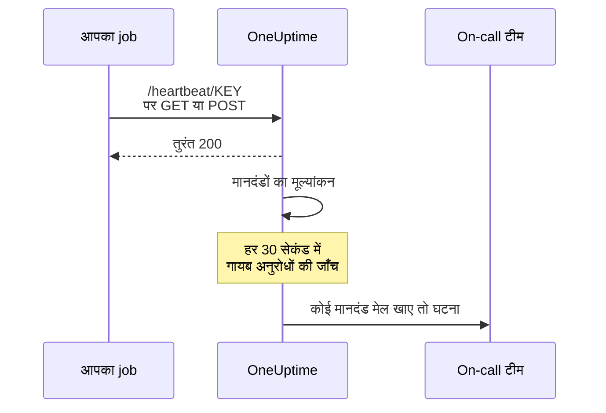
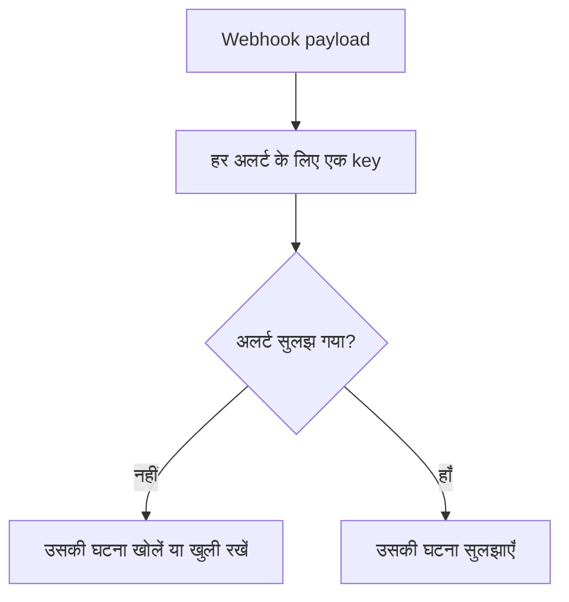

# आने वाले अनुरोध मॉनिटर

आने वाले अनुरोध मॉनिटर आपको एक URL देता है जिस पर दूसरे सिस्टम HTTP अनुरोध भेजते हैं। OneUptime हर अनुरोध को आपके मानदंडों पर परखता है, और मॉनिटर की स्थिति बदल सकता है, घटनाएँ घोषित कर सकता है, और आपकी on-call टीम को पेज कर सकता है।

यह दो अलग-अलग काम संभालता है:

- **Heartbeat निगरानी** — कोई cron job, worker या device तय शेड्यूल पर URL को ping करता है, और ping आना बंद होने पर OneUptime एक घटना खोलता है।
- **किसी दूसरे सिस्टम से अलर्ट प्राप्त करना** — Prometheus Alertmanager, Grafana, या कोई भी चीज़ जो JSON POST कर सके, अलर्ट भेजती है, और OneUptime हर एक को on-call escalation और ठीक होने पर अपने आप सुलझने वाली घटना में बदल देता है।

दोनों एक ही मॉनिटर प्रकार का उपयोग करते हैं। उन्हें अलग करते हैं वे मानदंड जो आप कॉन्फ़िगर करते हैं।

:::cards
- [मॉनिटर बनाएं](#आने-वाले-अनुरोध-मॉनिटर-बनाएं): कुछ ही कदमों में एक heartbeat URL पाएँ।
- [Heartbeat भेजें](#heartbeat-भेजें): curl, cron, Node.js, Python या Go से।
- [Ping रुकने पर अलर्ट](#10-मिनट-में-कोई-heartbeat-न-आने-पर-ऑफ़लाइन-चिह्नित-करें-एक-dead-mans-switch): मॉनिटर को dead-man's switch बनाएं।
- [अलर्ट प्राप्त करें](#किसी-दूसरे-सिस्टम-से-अलर्ट-प्राप्त-करना): हर Alertmanager या Grafana अलर्ट के लिए एक घटना।
- [SNS या Event Grid को सब्सक्राइब करें](#amazon-sns-या-azure-event-grid-का-सब्सक्रिप्शन-लेना): एक क्लिक में सब्सक्रिप्शन की पुष्टि करें।
:::

## यह कैसे काम करता है

बाहर से कुछ भी आपके सिस्टम की जाँच नहीं करता: आपका सिस्टम मॉनिटर के URL को कॉल करता है, OneUptime तुरंत जवाब देता है, और फिर मॉनिटर के मानदंडों पर अनुरोध को परखता है। जो मानदंड ऐसे अनुरोधों को देखता है जो आना *बंद* हो गए, उसकी हर 30 सेकंड में पृष्ठभूमि में फिर से जाँच होती है, ताकि खामोशी भी एक घटना खोल सके।



इसका उपयोग इनके लिए करें:

- cron jobs और scheduled tasks की निगरानी
- यह पुष्टि करना कि background workers चल रहे हैं
- firewalls के पीछे की उन सेवाओं की निगरानी जिन तक बाहर से नहीं पहुँचा जा सकता
- Prometheus Alertmanager, Grafana और दूसरे alerting सिस्टम से अलर्ट प्राप्त करना
- HTTP बोल सकने वाले किसी भी सिस्टम से heartbeat signals ट्रैक करना

## आने वाले अनुरोध मॉनिटर बनाएं

:::steps
### नया मॉनिटर शुरू करें

**मॉनिटर** पर जाएँ और **मॉनिटर बनाएं** पर क्लिक करें।

### इनकमिंग अनुरोध चुनें

**मॉनिटर प्रकार** में **इनकमिंग अनुरोध** चुनें — यह ऊपर दिए आम प्रकारों में से एक है। एक **नाम** दर्ज करें, फिर **अगला** पर क्लिक करें।

### मानदंडों की समीक्षा करें

**मानदंड** चरण [डिफ़ॉल्ट मानदंडों](#आपको-शुरुआत-में-क्या-मिलता-है) से शुरू होता है। Heartbeat के लिए **मानदंड जोड़ें** पर क्लिक करें और नए मानदंड को एक **इनकमिंग अनुरोध** / **मिनटों में प्राप्त नहीं** फ़िल्टर दें जो स्थिति को ऑफ़लाइन करे और एक घटना घोषित करे, और **घटना स्वतः सुलझाएं** चालू रखें। फिर उसे सूची में सबसे ऊपर खींचें — क्यों, यह [उदाहरण मानदंड](#उदाहरण-मानदंड) में देखें।

### मॉनिटर बनाएं

**मॉनिटर बनाएं** पर क्लिक करें। मॉनिटर अपने **अवलोकन** पेज पर खुलता है, जहाँ **Send the first heartbeat** कार्ड copy बटन के साथ **Heartbeat URL** और एक उदाहरण `curl` command दिखाता है।

### पहला अनुरोध भेजें

अपनी सेवा को उस URL पर अनुरोध भेजने के लिए कॉन्फ़िगर करें (देखें [Heartbeat भेजें](#heartbeat-भेजें))। पहला अनुरोध आने पर कार्ड मॉनिटर के इतिहास के लिए जगह छोड़ देता है, और एक **Heartbeat URL** कार्ड URL और पिछला अनुरोध कब आया, यह दिखाता है।
:::

> [!NOTE]
> URL में मॉनिटर की सीक्रेट कुंजी होती है, इसलिए केवल वे लोग इसे देख सकते हैं जो मॉनिटर संपादित कर सकते हैं। आप इसे कभी भी मॉनिटर के **दस्तावेज़ीकरण** पेज पर, उसके साइड मेन्यू के **कॉन्फ़िगरेशन** खंड में, फिर से पा सकते हैं।

## अनुरोध URL

आपके मॉनिटर का इस फ़ॉर्मेट में एक अनोखा URL है:

```text
https://oneuptime.com/heartbeat/YOUR_SECRET_KEY
```

Self-hosted होने पर `https://oneuptime.com` को अपने OneUptime instance के URL से बदलें।

इस URL पर **GET** या **POST** अनुरोध भेजें। HEAD स्वीकार किया जाता है और GET की तरह माना जाता है; PUT, PATCH और DELETE 404 लौटाते हैं। पथ में मौजूद सीक्रेट कुंजी ही क्रेडेंशियल है: कोई header या token ज़रूरी नहीं, जब तक प्रोजेक्ट [हर अनुरोध पर सीक्रेट अनिवार्य न करे](#हर-अनुरोध-पर-सीक्रेट-अनिवार्य-करें)। Query strings अनदेखी की जाती हैं: मानदंडों को जो पढ़ना है, वह body या headers में भेजें।

> [!WARNING]
> जो भी यह URL जानता है, वह मॉनिटर को स्वस्थ चिह्नित कर सकता है, इसलिए इसे एक रहस्य की तरह रखें। अगर यह लीक हो जाए, तो मॉनिटर का **सेटिंग्स** पेज खोलें और **इनकमिंग अनुरोध सीक्रेट कुंजी रीसेट करें** पर क्लिक करें, फिर हर भेजने वाले को अपडेट करें। मॉनिटर का ओवरव्यू नवीनतम अनुरोध वैसे ही दिखाता है जैसे उसके लॉग उसे रखते हैं: secrets और व्यक्तिगत डेटा छिपे हुए, और **अनुरोध सामग्री रखें** बंद होने पर कोई headers या body नहीं। छिपाना केवल उन्हीं नामों और पैटर्न को पकड़ता है जिन्हें वह जानता है, इसलिए इस endpoint पर API keys या tokens न भेजें।

> [!IMPORTANT]
> OneUptime तुरंत एक खाली JSON object (`{}`) के साथ `200` का जवाब देता है और अनुरोध को एक queue पर संसाधित करता है। यह जवाब किसी भी सत्यापन से पहले लिखा जाता है, इसलिए `200` इस बात की पुष्टि **नहीं** है कि अनुरोध स्वीकार हुआ — गलत सीक्रेट कुंजी, हटाया गया मॉनिटर और अक्षम मॉनिटर भी `200` लौटाते हैं। यह पुष्टि करने के लिए कि अनुरोध पहुँच रहे हैं, मॉनिटर की अपनी timeline देखें। जो प्रोजेक्ट हर अनुरोध पर सीक्रेट मांगता है, वह बिना सीक्रेट वाले अनुरोध का जवाब `401` से देता है, और जो सेवा कुछ भी भेजने से पहले URL की जाँच करती है, उसे वही जवाब मिलता है जिसकी वह अपेक्षा करती है: देखें [वे सेवाएँ जो पहले URL की जाँच करती हैं](#वे-सेवाएँ-जो-पहले-url-की-जाँच-करती-हैं)।

### अनुरोध body भेजना

अगर आप body के अंदर के fields को संबोधित करना चाहते हैं — घटना शीर्षक में `{{requestBody.status}}`, घटना समूहन में JSON पथ, या JavaScript expression वाला मानदंड — तो `Content-Type: application/json` भेजें। ये दस्तावेज़ हर जगह यही फ़ॉर्मेट मानकर चलते हैं। Body एक JSON object या array होनी चाहिए: गलत JSON, या `"error"` जैसा अकेला मान, `500` के साथ अस्वीकार होता है।

| Content type | मानदंड और टेम्पलेट क्या देखते हैं |
| --- | --- |
| `application/json` | Parse किया गया JSON। |
| `application/x-www-form-urlencoded` | Parse किया गया फ़ॉर्म। कोष्ठक वाली keys nest होती हैं (`alerts[0][status]=firing`), और हर मान एक string होता है। |
| `text/plain` | Parse किया गया JSON, जब text कोई JSON object या array हो: Amazon SNS अपने संदेश इसी तरह भेजता है। कोई भी दूसरा text खुद वही text होता है, इसलिए `backup failed: error 42` डिफ़ॉल्ट मानदंडों के तहत मॉनिटर को offline कर देता है। |
| `application/cloudevents+json`, या कोई दूसरा `+json` type | Parse किया गया JSON: Azure Event Grid CloudEvents इसी तरह पहुँचाता है। |
| कुछ और, या कुछ नहीं | खाली body (`{}`), इसलिए `requestBody` का कोई संदर्भ हल नहीं होता, और टेम्पलेट उसे जैसा का तैसा छोड़ देता है। |

50 MB तक की bodies स्वीकार की जाती हैं; इससे बड़ी `413` के साथ अस्वीकार होती है। Body को `Content-Encoding: gzip` से compress न करें: तब वह JSON के रूप में संग्रहीत नहीं होती, और उसके अंदर के पथ हल नहीं होंगे।

### Heartbeat भेजें

हर उदाहरण एक अनुरोध भेजता है। `YOUR_SECRET_KEY` को अपने मॉनिटर के URL की कुंजी से बदलें।

:::tabs
@tab curl
```bash
# Simple GET request
curl https://oneuptime.com/heartbeat/YOUR_SECRET_KEY

# POST request with a JSON body
curl -X POST https://oneuptime.com/heartbeat/YOUR_SECRET_KEY \
  -H "Content-Type: application/json" \
  -d '{"status": "healthy", "version": "1.2.3"}'
```
@tab Cron
```bash
# Send a heartbeat every 5 minutes
*/5 * * * * curl -fsS https://oneuptime.com/heartbeat/YOUR_SECRET_KEY > /dev/null

# Or ping only when the job succeeds, so a failed run counts as a missed heartbeat
0 2 * * * /usr/local/bin/backup.sh && curl -fsS https://oneuptime.com/heartbeat/YOUR_SECRET_KEY > /dev/null
```
@tab Node.js
```javascript title="heartbeat.mjs"
// Node.js 18 or later: fetch is built in. Run with `node heartbeat.mjs`.
const response = await fetch(
  "https://oneuptime.com/heartbeat/YOUR_SECRET_KEY",
  {
    method: "POST",
    headers: { "Content-Type": "application/json" },
    body: JSON.stringify({ status: "healthy", version: "1.2.3" }),
  },
);

console.log(response.status); // 200
```
@tab Python
```python title="heartbeat.py"
# Python 3, standard library only. Run with `python3 heartbeat.py`.
import json
import urllib.request

request = urllib.request.Request(
    "https://oneuptime.com/heartbeat/YOUR_SECRET_KEY",
    data=json.dumps({"status": "healthy", "version": "1.2.3"}).encode(),
    headers={"Content-Type": "application/json"},
    method="POST",
)

with urllib.request.urlopen(request, timeout=10) as response:
    print(response.status)  # 200
```
@tab Go
```go title="heartbeat.go"
// Run with `go run heartbeat.go`.
package main

import (
	"bytes"
	"fmt"
	"net/http"
)

func main() {
	body := []byte(`{"status": "healthy", "version": "1.2.3"}`)

	resp, err := http.Post(
		"https://oneuptime.com/heartbeat/YOUR_SECRET_KEY",
		"application/json",
		bytes.NewReader(body),
	)
	if err != nil {
		panic(err)
	}
	defer resp.Body.Close()

	fmt.Println(resp.StatusCode) // 200
}
```
@tab PowerShell
```powershell
# Windows PowerShell 5.1 or PowerShell 7
Invoke-RestMethod -Method Post `
  -Uri "https://oneuptime.com/heartbeat/YOUR_SECRET_KEY" `
  -ContentType "application/json" `
  -Body '{"status": "healthy", "version": "1.2.3"}'
```
:::

## हर अनुरोध पर सीक्रेट अनिवार्य करें

जिसके पास भी किसी मॉनिटर का URL है, वह उसे अनुरोध भेज सकता है। कोई प्रोजेक्ट स्वामी या प्रोजेक्ट एडमिन प्रोजेक्ट के हर इनकमिंग अनुरोध मॉनिटर से प्रोजेक्ट का अपना कोई सीक्रेट भी अनिवार्य करवा सकता है, चाहे मॉनिटर किसी ने भी सेट किया हो: **हर अनुरोध पर सीक्रेट अनिवार्य करें** चालू करें। बिना सीक्रेट वाला अनुरोध कारण के साथ `401` से अस्वीकार किया जाता है, इससे पहले कि वह heartbeat के रूप में गिना जाए, मॉनिटर के आख़िरी अनुरोध के रूप में रखा जाए या किसी मानदंड तक पहुंचे। सीक्रेट वाला अनुरोध पहले की तरह मॉनिटर के अपने मानदंडों तक जाता है।

सीक्रेट और स्विच को प्रोजेक्ट स्वामी और प्रोजेक्ट एडमिन संभालते हैं, और Create, Read, Edit और Delete Incoming Request Secret अनुमतियों वाली कस्टम भूमिका भी: Read से सीक्रेट के मान दिखते हैं, और Edit से स्विच भी चालू और बंद होता है।

:::steps
### एक सीक्रेट बनाएं

**मॉनिटर → सेटिंग्स → इनकमिंग अनुरोध सीक्रेट** पर जाएं और एक सीक्रेट बनाएं। उसे एक नाम दें और OneUptime मान जनरेट करेगा; उसे सूची से कॉपी करें।

### हर सेंडर से उसे भेजें

सीक्रेट को `X-OneUptime-Secret` हेडर में, या `Authorization` हेडर में Bearer टोकन के रूप में भेजें, जो भी आपका सेंडर सेट कर सके। जो सेंडर अपना हेडर सेट नहीं कर सकता, वह इसके बजाय हर अनुरोध पर सीक्रेट से हस्ताक्षर कर सकता है: [सीक्रेट से अनुरोधों पर हस्ताक्षर करें](#सीक्रेट-से-अनुरोधों-पर-हस्ताक्षर-करें) देखें।

### छूटे हुए सेंडर खोजें

जैसे ही प्रोजेक्ट में कोई सीक्रेट होता है, OneUptime हर अनुरोध में सीक्रेट जांचता है, पर अभी किसी को अस्वीकार नहीं करता। उसी पेज पर **बिना सीक्रेट वाले अनुरोध** हर उस इनकमिंग अनुरोध मॉनिटर को दिखाता है जिसे पिछले 24 घंटों में बिना मान्य सीक्रेट वाला अनुरोध मिला, और उसका कारण भी: कोई सीक्रेट नहीं भेजा गया, या गलत भेजा गया। उन सेंडर को ठीक करें। जिस मॉनिटर के सेंडर ठीक हो चुके हैं, उसमें **आख़िरी बार सीक्रेट के साथ** का समय **आख़िरी बार बिना सीक्रेट** के समय से बाद का होता है, और वह 24 घंटों के भीतर सूची से हट जाता है।

### अनिवार्यता चालू करें

**हर अनुरोध पर सीक्रेट अनिवार्य करें** चालू करें। जब तक प्रोजेक्ट में कोई सीक्रेट नहीं है, इसे चालू नहीं किया जा सकता, ताकि कोई सेंडर गलती से अस्वीकार न हो। चालू होने से पहले यह बताता है कि पिछले 24 घंटों में कितने इनकमिंग अनुरोध मॉनिटरों को बिना मान्य सीक्रेट वाला अनुरोध मिला, अगर कोई मिला हो: तब से उनके सेंडर अस्वीकार किए जाते हैं।
:::

```bash
curl -X POST https://oneuptime.com/heartbeat/YOUR_SECRET_KEY \
  -H "X-OneUptime-Secret: YOUR_PROJECT_SECRET"

# Or as a bearer token
curl -X POST https://oneuptime.com/heartbeat/YOUR_SECRET_KEY \
  -H "Authorization: Bearer YOUR_PROJECT_SECRET"
```

OneUptime सीक्रेट को कभी स्टोर नहीं करता: कुछ भी रखने से पहले वह अनुरोध से हेडर हटा देता है, और प्रोजेक्ट के सीक्रेट वाले Bearer टोकन को मास्क कर देता है।

जो पता किसी एक मॉनिटर को 15 मिनट में 10 से ज़्यादा अलग-अलग गलत सीक्रेट भेजता है, उसके बाद उसका भेजा हर सीक्रेट, सही हो या गलत, `429` से अस्वीकार किया जाता है, उस समय तक जो उसका `Retry-After` हेडर बताता है, अधिकतम 15 मिनट। दूसरे पतों के सेंडर पर कोई असर नहीं पड़ता, और जो सेंडर एक ही पुराना सीक्रेट भेजता रहता है उसे वही `401` मिलता रहता है जो बताता है कि क्या गलत है।

> [!TIP]
> किसी को अस्वीकार किए बिना सीक्रेट बदलने के लिए, दूसरा सीक्रेट बनाएं, अपने सेंडर उस पर ले जाएं, फिर पुराने का **आख़िरी बार उपयोग** बदलना बंद होने पर उसे हटा दें। प्रोजेक्ट का कोई भी सीक्रेट स्वीकार किया जाता है, जब तक वह दूसरे मॉनिटरों तक सीमित न हो, और अनिवार्यता चालू रहते किसी मॉनिटर को कवर करने वाला आख़िरी सीक्रेट हटाया नहीं जा सकता।

### सीक्रेट से अनुरोधों पर हस्ताक्षर करें

सेंडर सीक्रेट भेजने के बजाय हर अनुरोध पर सीक्रेट से हस्ताक्षर कर सकता है, जो ज़्यादा सुरक्षित है: कुछ भी गोपनीय नहीं भेजा जाता, और किसी के बीच में पकड़ा गया अनुरोध बाद में दोबारा नहीं भेजा जा सकता। जहाँ भी सेंडर हस्ताक्षर कर सके, इसे ही चुनें। OneUptime ये हस्ताक्षर जांचता है, हर एक हेक्स में HMAC-SHA256 है जिसकी कुंजी सीक्रेट है:

| सेंडर | हेडर | किस पर हस्ताक्षर होता है |
| --- | --- | --- |
| आपका अपना कोड | `X-OneUptime-Signature: t=<time>,v1=<signature>` | `<time>.<body>` |
| GitHub webhook | `X-Hub-Signature-256` | बॉडी |
| Slack | `X-Slack-Signature`, `X-Slack-Request-Timestamp` के साथ | `v0:<time>:<body>` |
| Stripe | `Stripe-Signature` | `<time>.<body>` |

`<time>` वह समय है जब अनुरोध पर हस्ताक्षर किया गया, 1970 से सेकंड में। जो हस्ताक्षर OneUptime की घड़ी से 5 मिनट से ज़्यादा दूर है वह अस्वीकार होता है, और दूसरी बार भेजा गया हस्ताक्षरित अनुरोध भी; GitHub के हस्ताक्षर में समय नहीं होता, इसलिए OneUptime हर एक को एक दिन तक याद रखता है। GitHub के लिए webhook को प्रोजेक्ट का कोई सीक्रेट उसके सीक्रेट के रूप में दें। Slack और Stripe अपना साइनिंग सीक्रेट बनाते हैं: उस मान से प्रोजेक्ट का सीक्रेट **और फ़ील्ड** में बनाएं।

```bash
body='{"status":"healthy"}'
t=$(date +%s)
sig=$(printf '%s.%s' "$t" "$body" | openssl dgst -sha256 -hmac "YOUR_PROJECT_SECRET" | sed 's/^.* //')

curl -X POST https://oneuptime.com/heartbeat/YOUR_SECRET_KEY \
  -H "Content-Type: application/json" \
  -H "X-OneUptime-Signature: t=$t,v1=$sig" \
  -d "$body"
```

URL की query string में भेजा गया सीक्रेट स्वीकार नहीं होता: प्रॉक्सी और एक्सेस लॉग पूरे URL रखते हैं, मॉनिटर की अपनी कुंजी के साथ। प्रोब का आने वाले अनुरोध Ingress हस्ताक्षरित अनुरोध की बॉडी को वैसे ही आगे भेजता है जैसे वह आई थी, इसलिए प्रोब के रास्ते भी हस्ताक्षर मान्य रहता है।

### किसी सीक्रेट को कुछ मॉनिटरों तक सीमित करें

कोई सीक्रेट प्रोजेक्ट के हर इनकमिंग अनुरोध मॉनिटर द्वारा स्वीकार किया जाता है, जब तक आप उसे सीमित न करें, जैसा वह प्रोजेक्ट करता है जिसके हर टेनेंट अपना सीक्रेट भेजते हैं: **और फ़ील्ड** में **विशिष्ट मॉनिटर** या **लेबल वाले मॉनिटर** चुनें। कोई भी दूसरा मॉनिटर उसे `401` से अस्वीकार करता है, जैसे गलत सीक्रेट को करता है, और **बिना सीक्रेट वाले अनुरोध** कारण के रूप में **सीक्रेट इस मॉनिटर के लिए नहीं** दिखाता है। जब तक अनिवार्यता चालू है, प्रोजेक्ट में कम से कम एक ऐसा सीक्रेट रहता है जो किसी मॉनिटर को कवर करता है।

## निगरानी मानदंड

आप यह तय करने के लिए मानदंड कॉन्फ़िगर कर सकते हैं कि आपकी सेवा कब ऑनलाइन, प्रदर्शन में गिरावट वाली या ऑफ़लाइन मानी जाए। हर मानदंड फ़िल्टर में एक **फ़िल्टर प्रकार** (क्या देखना है), एक **फ़िल्टर शर्त** (तुलना कैसे करनी है) और एक **मान** होता है।

### आपको शुरुआत में क्या मिलता है

नया आने वाले अनुरोध मॉनिटर दो मानदंडों के साथ बनता है जो अनुरोध body पढ़ते हैं:

| मानदंड | फ़िल्टर प्रकार | फ़िल्टर शर्त | मान | प्रभाव |
| -------- | ------------ | ---------------- | ------- | -------------------------------------------- |
| Offline  | अनुरोध बॉडी | शामिल है | `error` | मॉनिटर को ऑफ़लाइन चिह्नित करता है, एक घटना खोलता है |
| Online   | अनुरोध बॉडी | शामिल नहीं है | `error` | मॉनिटर को ऑनलाइन चिह्नित करता है |

यह उस आम स्थिति के लिए ठीक है जहाँ भेजने वाला payload में अपना स्वास्थ्य खुद बताता है: जिस अनुरोध की body में `error` का ज़िक्र हो, वह मॉनिटर को डाउन कर देता है, और उसके बिना अगला अनुरोध मॉनिटर को फिर ऊपर लाता है और घटना सुलझा देता है। बिना body वाला अनुरोध "`error` शामिल नहीं" माना जाता है, इसलिए एक सादा heartbeat ping मॉनिटर को ऑनलाइन रखता है।

मान को वह बना दें जो आपका भेजने वाला वास्तव में भेजता है (`"status":"firing"`, `FAILED` वगैरह) — मिलान पूरी body पर, keys सहित, case-sensitive substring खोज है, इसलिए `{"error":null}` भी `error` से मेल खाता है।

> [!NOTE]
> ये डिफ़ॉल्ट dead-man's switch **नहीं** हैं: अनुरोध आना बंद होने पर यहाँ कुछ भी trigger नहीं होता। अगर आप खामोशी पर अलर्ट चाहते हैं, तो नीचे बताए अनुसार एक **इनकमिंग अनुरोध** / **मिनटों में प्राप्त नहीं** मानदंड जोड़ें।

### उपलब्ध फ़िल्टर प्रकार

| फ़िल्टर प्रकार | जाँचता है | टिप्पणियाँ |
| --------------------- | ------------------------------------------------------ | -------------------------------------------------------------------------------------------- |
| इनकमिंग अनुरोध | क्या किसी समय सीमा के भीतर कोई अनुरोध मिला | एकमात्र जाँच जो कुछ न आने पर trigger हो सकती है |
| अनुरोध बॉडी | अनुरोध की body | Substring मिलान। Object bodies की तुलना compact JSON के रूप में होती है |
| अनुरोध हेडर | अनुरोध headers के नाम | पूरे header नाम से सटीक मिलान, case को अनदेखा करते हुए |
| अनुरोध हेडर मान | अनुरोध headers के मान | पूरे header मान से सटीक मिलान, case को अनदेखा करते हुए |
| JavaScript एक्सप्रेशन | `requestBody` और `requestHeaders` पर कोई भी expression | सबसे लचीला विकल्प — देखें [JavaScript अभिव्यक्तियाँ](/docs/monitor/javascript-expression) |

### फ़िल्टर शर्तें

हर फ़िल्टर प्रकार की अपनी शर्तें होती हैं:

| फ़िल्टर प्रकार | शर्तें |
| --- | --- |
| **इनकमिंग अनुरोध** | **मिनटों में प्राप्त** — तय मिनटों के भीतर एक अनुरोध मिला। **मिनटों में प्राप्त नहीं** — तय मिनटों के भीतर कोई अनुरोध नहीं मिला। |
| **अनुरोध बॉडी**, **अनुरोध हेडर**, **अनुरोध हेडर मान** | **शामिल है** और **शामिल नहीं है** |
| **JavaScript एक्सप्रेशन** | **मूल्यांकन सत्य होता है** |

> [!NOTE]
> Header नाम और मान lower case में, पूरे नाम या मान से, तुलना किए जाते हैं, substring के रूप में नहीं: `application/json` `application/json; charset=utf-8` से मेल नहीं खाता। केवल **अनुरोध बॉडी** substring मिलान करता है। आपके proxy या OneUptime के अपने load balancer द्वारा जोड़े गए headers (`x-forwarded-for`, `x-real-ip`) भी संग्रहीत होते हैं।

Object bodies की तुलना बिना spaces वाले compact JSON के रूप में होती है, इसलिए **अनुरोध बॉडी** / **शामिल है** फ़िल्टर को `"status":"firing"` लिखा जाना चाहिए — pretty-printed payload से `"status": "firing"` कॉपी करने पर कभी मेल नहीं होगा।

### उदाहरण मानदंड

#### 10 मिनट में कोई heartbeat न आने पर ऑफ़लाइन चिह्नित करें (एक dead-man's switch)

| Field | मान |
| --- | --- |
| **फ़िल्टर प्रकार** | इनकमिंग अनुरोध |
| **फ़िल्टर शर्त** | मिनटों में प्राप्त नहीं |
| **मान** | `10` |

#### अनुरोध body की सामग्री के आधार पर प्रदर्शन में गिरावट चिह्नित करें

| Field | मान |
| --- | --- |
| **फ़िल्टर प्रकार** | अनुरोध बॉडी |
| **फ़िल्टर शर्त** | शामिल है |
| **मान** | `"status":"degraded"` |

> [!IMPORTANT]
> Dead-man's switch को डिफ़ॉल्ट मानदंडों के **ऊपर** रखें। मानदंड ऊपर से जाँचे जाते हैं, और जो पहले मेल खाए वही तय करता है। पृष्ठभूमि जाँच पिछला अनुरोध फिर से पढ़ती है, इसलिए डिफ़ॉल्ट ऑनलाइन मानदंड — "अनुरोध बॉडी शामिल नहीं है `error`" — उससे मेल खाता रहता है, और उसके नीचे वाले मानदंड की बारी कभी नहीं आती। **मानदंड जोड़ें** सबसे नीचे एक मानदंड जोड़ता है: उसे ऊपर खींचें।

> [!WARNING]
> किसी मॉनिटर का पृष्ठभूमि में फिर से मूल्यांकन तभी होता है जब उसका कम से कम एक मानदंड **इनकमिंग अनुरोध** जाँचता हो। जिस मॉनिटर के मानदंड केवल अनुरोध बॉडी, अनुरोध हेडर या JavaScript expression जाँचते हैं, उसका मूल्यांकन तभी होता है जब कोई अनुरोध आता है, और किसी और समय नहीं — इसलिए वह कभी अपने आप ऑफ़लाइन नहीं हो सकता। अगर आपको गायब heartbeat का alarm चाहिए, तो आपको एक **इनकमिंग अनुरोध** मानदंड चाहिए।

पृष्ठभूमि जाँच पूरे मिनट गिनती है और मान से *ज़्यादा* समय बीतते ही trigger होती है: "मिनटों में प्राप्त नहीं: 10" पिछले अनुरोध के लगभग 11 मिनट बाद trigger होता है (जाँच हर 30 सेकंड चलती है)। जिस मॉनिटर को कभी कोई अनुरोध नहीं मिला, उसके बनने के समय को ही पिछला अनुरोध माना जाता है, इसलिए बिल्कुल नए मॉनिटर पर वही मानदंड उसे बनाने के लगभग 11 मिनट बाद trigger होता है, भले भेजने वाला कभी जोड़ा ही न गया हो। मान में केवल वे मिनट गिने जाते हैं जब OneUptime डेटा ले रहा था: जिन मिनटों में OneUptime खुद restart, upgrade या बकाया काम पूरा कर रहा होता है, वे नहीं गिने जाते, जैसा [जब OneUptime डेटा प्राप्त नहीं कर रहा हो](/docs/monitor/when-oneuptime-is-not-receiving) बताता है।

## किसी दूसरे सिस्टम से अलर्ट प्राप्त करना

Alertmanager, Grafana और ऐसे ही टूल एक या अधिक अलर्ट का वर्णन करने वाला JSON दस्तावेज़ POST करते हैं। डिफ़ॉल्ट रूप से एक मानदंड **एक** घटना खोलता है, इसलिए पाँच अलर्ट वाला payload एक ही घटना बनाएगा। घटना समूहन इसे बदल देता है: यह payload से एक मान निकालता है और **हर अलग मान के लिए एक अलग घटना** खोलता है, जो सब एक साथ खुली रह सकती हैं।



### घटना समूहन चालू करना

:::steps
1. मानदंड खोलें और **सेटिंग्स** को फैलाएँ।
2. **Group incidents and alerts by a payload field** चालू करें।
3. **Open a separate incident for each…** भरें। हर घटना अपने आप सुलझे, इसके लिए **Auto-resolve each incident when…** के नीचे field और मान भी भरें (नीचे देखें)। फिर मॉनिटर सहेजें।
:::

| Field | उदाहरण | यह क्या करता है |
| ---------------------------------- | ---------------------------------------- | ---------------------------------------------------------------------- |
| Open a separate incident for each… | `requestBody.alerts[*].labels.alertname` | वह पथ जिसके अलग-अलग मान घटनाओं को अलग करते हैं |
| Field that signals recovery | `requestBody.alerts[*].status` | वह पथ जिसकी जाँच यह तय करने के लिए होती है कि अलर्ट ठीक हो गया |
| Value that means recovered | `resolved` | वह सटीक मान जो ठीक होने का संकेत है |
| Max incidents per request | `100` (डिफ़ॉल्ट) | सुरक्षा सीमा, ताकि बहुत सारे मानों वाला field अनगिनत घटनाएँ न खोल सके |

समूहन उसी मानदंड का होता है जिसमें वह चालू किया गया है। मॉनिटर के बाकी मानदंड समूहन नहीं करते: जब उनमें से कोई किसी अनुरोध से मेल खाता है, तो वह अपनी घटना और अलर्ट वैसे ही खोलता है जैसे उस मॉनिटर पर खोलता जिसका कोई मानदंड समूहन नहीं करता।

### पथ का syntax

पथ शाब्दिक उपसर्ग `requestBody.` से शुरू होने चाहिए। इसके बिना वाला पथ — `alerts[*].labels.alertname` — किसी भी अनुरोध में कोई मान नहीं पाता। `{{ }}` wrapper वैकल्पिक है: `requestBody.status` और `{{requestBody.status}}` एक जैसे व्यवहार करते हैं।

- `[*]` एक array पर फैलता है — हर **अलग** मान के लिए एक घटना। एक जैसा मान देने वाले दो elements एक घटना में मिल जाते हैं, और उस घटना की स्थिति (सक्रिय/सुलझी) **पहले** मेल खाने वाले element से ली जाती है। **किसी पथ में केवल पहला `[*]` wildcard है**; `requestBody.groups[*].alerts[*].name` किसी से मेल नहीं खाता।
- `[0]` और `[last]` एक element चुनते हैं, और `[*]` के बाद आ सकते हैं।
- Object और array मान, खाली strings और nulls छोड़ दिए जाते हैं। `0` और `false` मान्य keys हैं।
- Body एक JSON object होनी चाहिए; जिस payload का सबसे ऊपरी स्तर array हो, उसका समूहन नहीं होता।

### बिना field वाले अनुरोध

जो अनुरोध किसी समूहित मानदंड से मेल खाता है पर उसके पथ पर कोई मान नहीं रखता — field गायब या खाली है, उसमें कोई object या list है, या body कोई JSON object नहीं है — वह फिर भी उस मानदंड की घटना और अलर्ट खोलता है: पूरे मॉनिटर के लिए एक, जैसे मानदंड बिना समूहन के खोलता। वह समूहित मानदंड भी यही करता है जो इसलिए मेल खाता है कि अनुरोध आने बंद हो गए। जो शीर्षक समूहन variable का नाम लेता है, जैसे `{{alertname}}`, वह उसे वैसा ही दिखाता है जैसा लिखा है, क्योंकि भरने के लिए कोई मान नहीं है।

अगर **घटना स्वतः सुलझाएं** चालू हो, तो वह घटना तब सुलझती है जब field के बिना कोई बाद का अनुरोध बताए कि वह ठीक हो गया है, या कोई बाद का अनुरोध किसी दूसरे मानदंड से मेल खाए। ऐसी recovery कुछ नया नहीं खोलती।

जब किसी array के कुछ elements में मान हो और कुछ में नहीं, तो हर मान अपनी घटना खोलता है, और बिना मान वाले elements अपनी ओर से कुछ नहीं खोलते।

मॉनिटर के **अवलोकन** पर **मॉनिटर सारांश** कार्ड दिखाता है कि हर अनुरोध ने क्या किया, जिसमें यह भी शामिल है कि कब किसी मानदंड ने उसे पूरे मॉनिटर के लिए संभाला या कुछ नया नहीं खोला।

### सुलझाना events पर आधारित है

एक webhook केवल वही बताता है जो उस payload में है, इसलिए OneUptime किसी घटना को इस वजह से कभी नहीं सुलझाता कि उसकी key दिखना बंद हो गई। कोई घटना तभी सुलझती है जब कोई payload स्पष्ट रूप से कहे कि वह key ठीक हो गई। दोनों बातें सच होनी चाहिए:

1. **Field that signals recovery** और **Value that means recovered** भरे हों, और payload से मेल खाएँ। तुलना सटीक और case-sensitive है — `Resolved` `resolved` से मेल नहीं खाता।
2. मानदंड की घटना पर, घटना फ़ॉर्म में **और फ़ील्ड** के अंतर्गत, **घटना स्वतः सुलझाएं** चालू हो। इसके बिना मेल खाने वाले recovery events अनदेखे किए जाते हैं और घटनाएँ खुली रहती हैं। (अलर्ट और **अलर्ट स्वतः सुलझाएं** पर भी यही लागू होता है।) डिफ़ॉल्ट ऑफ़लाइन मानदंड में यह शुरू से चालू रहता है; किसी मानदंड में खुद जोड़ी गई घटना में यह शुरू में बंद रहता है।

किसी मानदंड में खुद जोड़े गए अलर्ट में भी **अलर्ट स्वतः सुलझाएं** शुरू में बंद रहता है, इसलिए जब तक यह चालू न हो, रिकवरी अलर्ट को खुला छोड़ देती है। **Auto-resolve each incident when…** बताता है कि रिकवरी मानदंड की किन घटनाओं और अलर्ट को सुलझाती है, और जिन्हें वह खुला छोड़ेगी उनमें से हर एक को उसकी सेटिंग चालू करने वाले बटन के साथ दिखाता है। मॉनिटर के **अवलोकन** पर **मॉनिटर सारांश** कार्ड हर उस घटना और अलर्ट का नाम बताता है जिसे रिकवरी ने खुला छोड़ा, और क्यों।

रिकवरी केवल उसी मानदंड की घटनाएं और अलर्ट सुलझाती है जो उसे पढ़ता है: वह, जिसके **Field that signals recovery** और **Value that means recovered** payload से मेल खाते हैं। उसी मान के लिए किसी दूसरे मानदंड की घटनाएं और अलर्ट खुले रहते हैं, और जिस मानदंड ने ये फ़ील्ड खाली छोड़े हैं, उसकी घटनाएं और अलर्ट हाथ से सुलझाए जाते हैं।

**Max incidents per request** केवल बनाने को नहीं, निकालने को भी सीमित करता है। सीमा से आगे की keys recovery को भी नहीं दिखतीं, इसलिए सीमा से ज़्यादा अलग keys वाले payload में, सीमा से आगे `resolved` बताने वाला अलर्ट अपनी घटना बंद नहीं करेगा।

> [!NOTE]
> जिस मॉनिटर का कोई मानदंड payload के किसी फ़ील्ड से समूहन करता है, वह मिलने वाले हर अनुरोध का एक-एक करके, आने के क्रम में मूल्यांकन करता है, इसलिए अलर्ट और रिकवरी की बौछार हर मान की घटना और अलर्ट को खोलती और सुलझाती है। मूल्यांकन के लिए 1,000 तक अनुरोध, या उनके 16 MB, प्रतीक्षा कर सकते हैं; उससे आगे प्रतीक्षा कर रहे सबसे पुराने छोड़ दिए जाते हैं, और **मॉनिटर सारांश** कार्ड बताता है कि कितने। बिना समूहन वाला मॉनिटर अपनी प्रतीक्षा कर रहे अनुरोधों में से केवल सबसे नए का मूल्यांकन करता है।

> [!NOTE]
> अगर **Field that signals recovery** में `[*]` है लेकिन **Open a separate incident for each…** में नहीं, तो कोई अनुरोध तभी ठीक हुआ माना जाता है जब उस array का हर element यही कहे। `requestBody.alerts[*].status` और `resolved` के साथ, `requestBody.groupLabels.alertname` से समूहित घटना तब सुलझती है जब किसी अनुरोध के सारे अलर्ट सुलझ जाएं, और तब तक खुली रहती है जब तक कोई एक अभी सक्रिय है।

> [!WARNING]
> बिना `[*]` वाला recovery पथ पूरे payload पर मूल्यांकित होता है, इसलिए payload-स्तर का `status: resolved` उस payload की हर key को सुलझा देता है — उन अलर्ट को भी जिनकी अपनी स्थिति अभी सक्रिय है।

### घटनाओं के नाम

समूहन key घटना और अलर्ट टेम्पलेट को **पथ के अंतिम खंड** के नाम वाले वेरिएबल के रूप में मिलती है:

| पथ | वेरिएबल |
| ---------------------------------------- | ----------------- |
| `requestBody.alerts[*].labels.alertname` | `{{alertname}}`   |
| `requestBody.alerts[*].fingerprint`      | `{{fingerprint}}` |
| `requestBody.commonLabels.severity`      | `{{severity}}`    |

पूरा payload भी साथ में उपलब्ध है, इसलिए `{{alertname}}` वाला घटना शीर्षक और `{{requestBody.commonAnnotations.summary}}` का संदर्भ देने वाला विवरण, दोनों काम करते हैं। देखें [घटना और अलर्ट टेम्पलेट](/docs/monitor/incident-alert-templating)।

> [!WARNING]
> वेरिएबल का नाम उस पहचान का हिस्सा है जिससे OneUptime किसी recovery event को खुली घटना से मिलाता है। समूहन पथ को किसी अलग अंतिम खंड वाले पथ में बदलने से पुराने पथ के तहत खुली हर घटना अनाथ हो जाती है — उन्हें अब अपने आप नहीं सुलझाया जा सकता और हाथ से बंद करना होगा।

`[*]` **केवल** दो समूहन पथ fields में काम करता है। दूसरी जगहों पर यह हल नहीं होता, और हल न हुआ placeholder खाली किए जाने के बजाय **जैसा का तैसा** छपता है — `{{requestBody.alerts[*].labels.alertname}}` वाला शीर्षक braces के साथ ही दिखता है। `{{requestBody.alerts[0].annotations.summary}}` वाला शीर्षक हल होता है, लेकिन हमेशा payload का पहला अलर्ट पढ़ता है, वह नहीं जिसके लिए यह घटना खुली। समूहन वेरिएबल और payload के साझा `commonAnnotations` fields को प्राथमिकता दें।

### पूरा उदाहरण

पूरे Alertmanager कॉन्फ़िगरेशन के लिए देखें [Prometheus Alertmanager](/docs/integrations/prometheus-alertmanager)। Grafana के लिए देखें [Grafana](/docs/integrations/grafana)।

## वे सेवाएँ जो पहले URL की जाँच करती हैं

कुछ सेवाएँ किसी नए endpoint को कुछ भी भेजने से पहले उसकी जाँच करती हैं: वे उसे एक अनुरोध भेजती हैं, और तभी भेजना शुरू करती हैं जब वह वैसा जवाब दे जैसी उन्हें अपेक्षा है। OneUptime इन जाँचों का जवाब खुद देता है, इसलिए सेवा में बस मॉनिटर का **Heartbeat URL** चिपकाना होता है।

| सेवा | जाँच | OneUptime क्या जवाब देता है |
| --- | --- | --- |
| Azure Event Grid, Event Grid schema | एक `SubscriptionValidationEvent` | उसका `validationCode`, `validationResponse` के रूप में |
| Azure Event Grid, CloudEvents schema | एक `OPTIONS` अनुरोध जो अपना स्रोत बताता है | `WebHook-Allowed-Origin`, उसी स्रोत के साथ |
| Slack Events API | एक `url_verification` अनुरोध | उसका `challenge` |
| Microsoft Graph के बदलाव सूचनाएँ | एक `validationToken` के साथ `POST` | token, `text/plain` के रूप में |
| Okta event hooks | `X-Okta-Verification-Challenge` के साथ `GET` | header का मान, `verification` के रूप में |

जाँच का जवाब केवल मॉनिटर के अपने URL पर मिलता है, और तभी जब अनुरोध गिना जाए: जो प्रोजेक्ट हर अनुरोध पर सीक्रेट मांगता है, उसमें बिना सीक्रेट वाली जाँच किसी भी अनुरोध की तरह `401` के साथ अस्वीकार होती है, इसलिए सेवा को सीक्रेट एक header में भेजना होगा। जवाब में वही होता है जो सेवा ने वापस पाने के लिए भेजा, अनुरोध का और कुछ नहीं, और वह भी तभी जब उसका रूप वैसा हो जैसा सेवा उसे देती है।

जाँच किसी भी अनुरोध की तरह मॉनिटर तक पहुँचती है, इसलिए उसके मानदंड उसका मूल्यांकन करते हैं और वह मॉनिटर के **अवलोकन** पर दिखती है; CloudEvents जाँच का केवल जवाब दिया जाता है, और कुछ नहीं। प्रोब का आने वाले अनुरोध Ingress जाँच का जवाब भी हर अनुरोध की तरह `{}` से देता है, इसलिए इन सेवाओं को OneUptime के अपने URL पर भेजें।

## Amazon SNS या Azure Event Grid का सब्सक्रिप्शन लेना

Amazon SNS किसी नए endpoint को तब तक कुछ नहीं भेजता जब तक कोई सब्सक्रिप्शन की पुष्टि न करे, यानी SNS का वहाँ भेजा गया लिंक न खोले। Azure Event Grid भी ऐसा लिंक भेजता है, उस endpoint को जो उसकी जाँच का जवाब नहीं देता, और OneUptime उस जाँच का जवाब देता है। जब कोई ऐसा लिंक आता है जिसे अभी खोलना बाकी है, तो मॉनिटर के **अवलोकन** पर **मॉनिटर सारांश** कार्ड दिखाता है कि सेवा किस बात की प्रतीक्षा कर रही है, टॉपिक कौन सा है, और एक बटन जो लिंक को नए टैब में खोलता है।

| सेवा | अनुरोध | बटन | लिंक कब तक काम करता है |
| --- | --- | --- | --- |
| Amazon SNS | `SubscriptionConfirmation`, नए HTTPS सब्सक्रिप्शन के लिए | **सब्सक्रिप्शन की पुष्टि करें** | दो दिन |
| Amazon SNS | `UnsubscribeConfirmation`, जब सब्सक्रिप्शन हटाया जाता है | **सब्सक्रिप्शन पुनर्स्थापित करें** | दो दिन |
| Azure Event Grid | `SubscriptionValidationEvent`, नए webhook इवेंट सब्सक्रिप्शन के लिए | **सब्सक्रिप्शन सत्यापित करें** | 10 मिनट |

बटन मॉनिटर का अगला अनुरोध आने तक बना रहता है, लिंक खोलने के बाद भी। लिंक का समय खत्म हो जाने पर कार्ड बटन की जगह बताता है कि नया लिंक कैसे पाएँ। अगर नए अनुरोध आ चुके हैं, तो **निगरानी लॉग** खोलें और उस अनुरोध की पंक्ति पर **सारांश देखें** पर क्लिक करें।

लिंक, और उसमें मौजूद token, अनुरोध जहाँ भी रखा जाता है वहाँ बिना छिपाए रखे जाते हैं: उसके विवरण में, उसके लॉग में, और उससे खुली घटनाओं और अलर्ट में। यह लिंक बस इस मॉनिटर पर डिलीवरी शुरू करवा सकता है। केवल सेवा के अपने पते वाला लिंक ही गिना जाता है: कोई भी दूसरा लिंक हमेशा की तरह छिपाया जाता है और उसके लिए कोई बटन नहीं आता।

### Amazon SNS

:::steps
1. Amazon SNS console में टॉपिक खोलें और **Create subscription** चुनें। Protocol के रूप में `HTTPS` चुनें, और endpoint के रूप में मॉनिटर का **Heartbeat URL** चिपकाएँ।
2. मॉनिटर का **अवलोकन** खोलें, और **मॉनिटर सारांश** कार्ड में **सब्सक्रिप्शन की पुष्टि करें** पर क्लिक करें। SNS console में सब्सक्रिप्शन की स्थिति **Pending confirmation** से बदलकर पुष्ट हो जाती है।
:::

SNS अपने संदेश `text/plain` लेबल वाले JSON के रूप में भेजता है, और मॉनिटर उन्हें JSON के रूप में पढ़ता है, इसलिए मानदंड, टेम्पलेट और घटना समूहन उनके fields का उपयोग कर सकते हैं, जैसे `{{requestBody.Subject}}` और `{{requestBody.Message}}`। किसी notification का अपना JSON, जैसे किसी CloudWatch alarm का, `Message` में text के रूप में आता है।

अगर कार्ड कहे कि लिंक अब खोला नहीं जा सकता, तो SNS console में सब्सक्रिप्शन चुनें और **Request confirmation** चुनें। SNS उस सब्सक्रिप्शन को हटा देता है जिसकी 48 घंटे के भीतर पुष्टि न हो; ऐसा हो जाए तो सब्सक्रिप्शन फिर से बनाएँ।

### Azure Event Grid

:::steps
1. Azure portal में वह resource खोलें जिसके इवेंट आप चाहते हैं, और एक इवेंट सब्सक्रिप्शन जोड़ें। इवेंट schema के रूप में **Event Grid Schema** या **Cloud Event Schema v1.0**, endpoint type के रूप में **Web Hook**, और endpoint के रूप में मॉनिटर का **Heartbeat URL** चुनें।
2. इवेंट सब्सक्रिप्शन बनाएँ। OneUptime Event Grid की जाँच का जवाब देता है, इसलिए सब्सक्रिप्शन बनते ही सत्यापित हो जाता है, और उसके इवेंट आने लगते हैं।
:::

Event Grid ऐसे endpoint को सत्यापित करता है जो उसे एक code वापस लौटाए, या जिसका मालिक उसका भेजा लिंक खोले। OneUptime code लौटाता है, इसलिए **मॉनिटर सारांश** कार्ड **सब्सक्रिप्शन सत्यापित करें** केवल उस सत्यापन के लिए दिखाता है जिसका OneUptime ने जवाब नहीं दिया: उसे 10 मिनट के भीतर खोलें। लिंक port 553 पर Event Grid की ओर ले जाता है, इसलिए आपके ब्राउज़र के आगे लगे firewall को इसकी अनुमति देनी होगी। अगर पहले 10 मिनट बीत जाएँ, तो इवेंट सब्सक्रिप्शन विफल हो जाता है: उसे फिर से बनाएँ।

## सर्वोत्तम प्रथाएँ

1. **समय सीमा उचित रखें** — अगर आपका cron job हर 5 मिनट चलता है, तो कभी-कभार की देरी के लिए "मिनटों में प्राप्त नहीं" सीमा 10–15 मिनट रखें, और उस मानदंड को सबसे पहले रखें।
2. **सार्थक डेटा शामिल करें** — अनुरोध body में स्थिति की जानकारी भेजें ताकि आप बारीक मानदंड सेट कर सकें।
3. **`Content-Type: application/json` के साथ POST का उपयोग करें** — body के अंदर पढ़ने वाली हर चीज़ इसी पर निर्भर है।
4. **दोनों कामों को एक मॉनिटर पर न मिलाएँ** — event-driven अलर्ट पाने वाले मॉनिटर की कोई नियमित लय नहीं होती, इसलिए उस पर "मिनटों में प्राप्त नहीं" मानदंड बार-बार बदलता रहेगा। Dead-man's switch के लिए अलग मॉनिटर का उपयोग करें।
5. **मॉनिटर की भी निगरानी करें** — सुनिश्चित करें कि अनुरोध भेजने वाली सेवा त्रुटियों को ठीक से संभाले, ताकि विफल अनुरोध नज़रअंदाज़ न हों।

## समस्या निवारण

:::details मेरे भेजने वाले को 200 मिलता है, लेकिन मॉनिटर पर कुछ नहीं दिखता
`200` अनुरोध के सत्यापन से पहले भेजा जाता है, इसलिए यह साबित नहीं करता कि अनुरोध स्वीकार हुआ। जाँचें कि URL की सीक्रेट कुंजी मॉनिटर के **Heartbeat URL** से मेल खाती है, और मॉनिटर अक्षम नहीं है। फिर मॉनिटर की timeline में देखें कि अनुरोध पहुँच रहे हैं या नहीं।
:::

:::details मेरे सेंडर को 401 मिलता है
प्रोजेक्ट हर अनुरोध पर सीक्रेट मांगता है, और अनुरोध ने कोई सीक्रेट नहीं भेजा, या ऐसा भेजा जो प्रोजेक्ट का नहीं है: जवाब बताता है कि कौन सा। [हर अनुरोध पर सीक्रेट अनिवार्य करें](#हर-अनुरोध-पर-सीक्रेट-अनिवार्य-करें) में बताए अनुसार प्रोजेक्ट का कोई सीक्रेट `X-OneUptime-Secret` हेडर में या Bearer टोकन के रूप में भेजें। अस्वीकार किया गया अनुरोध कभी मॉनिटर तक नहीं पहुंचता। उसे `401` तब भी मिलता है जब वह किसी दूसरे मॉनिटर तक सीमित प्रोजेक्ट का सीक्रेट भेजे, और ऐसे हस्ताक्षरित अनुरोध के लिए जिसका हस्ताक्षर 5 मिनट से पुराना हो, पहले भेजा जा चुका हो, या किसी दूसरे सीक्रेट से या रास्ते में बदली बॉडी पर बना हो।
:::

:::details मेरे सेंडर को 429 मिलता है
उसके पते ने 15 मिनट में किसी एक मॉनिटर को 10 से ज़्यादा अलग-अलग गलत सीक्रेट या हस्ताक्षर भेजे, इसलिए वह उस मॉनिटर को सीक्रेट के साथ जो भी अनुरोध भेजता है, वह उसके `Retry-After` हेडर के समय तक अस्वीकार होता है। गलत सीक्रेट से हस्ताक्षर करने वाला सेंडर हर बार नया गलत हस्ताक्षर बनाता है और जल्दी यहाँ पहुँच जाता है: [हर अनुरोध पर सीक्रेट अनिवार्य करें](#हर-अनुरोध-पर-सीक्रेट-अनिवार्य-करें) में बताए अनुसार उसे ऐसा सीक्रेट दें जिसे मॉनिटर स्वीकार करता है, और समय पूरा होने पर उसके अनुरोध स्वीकार होंगे।
:::

:::details सीक्रेट अनिवार्य करने के बाद मॉनिटर को अनुरोध मिलने बंद हो गए
इसके सेंडर कोई सीक्रेट नहीं भेजते, या गलत भेजते हैं, इसलिए उनका हर अनुरोध अस्वीकार किया जाता है। मॉनिटर के **Heartbeat URL** के नीचे की एक पंक्ति बताती है कि सबसे हाल का अस्वीकार किया गया अनुरोध कब आया, और **बिना सीक्रेट वाले अनुरोध** हर उस मॉनिटर को कारण सहित दिखाता है जिसे पिछले 24 घंटों में ऐसा अनुरोध मिला। [हर अनुरोध पर सीक्रेट अनिवार्य करें](#हर-अनुरोध-पर-सीक्रेट-अनिवार्य-करें) में बताए अनुसार उन सेंडर से प्रोजेक्ट का कोई सीक्रेट भेजें।
:::

:::details Heartbeats रुकने पर भी मॉनिटर कभी ऑफ़लाइन नहीं होता
केवल **इनकमिंग अनुरोध** मानदंड (**मिनटों में प्राप्त नहीं**) खामोशी पकड़ सकता है। अगर नहीं है तो एक जोड़ें, और उसे डिफ़ॉल्ट मानदंडों के ऊपर खींचें: डिफ़ॉल्ट ऑनलाइन मानदंड हर पृष्ठभूमि जाँच पर पिछले अनुरोध से मेल खाता है, और जो मानदंड पहले मेल खाए वही तय करता है।
:::

:::details अनुरोध बॉडी फ़िल्टर कभी मेल नहीं खाता
`Content-Type: application/json` भेजें, और मान को compact JSON के रूप में लिखें — `"status":"firing"`, colon के बाद कोई space नहीं। JSON, form या `text/plain` content type के बिना body खाली होती है, और उस पर कोई फ़िल्टर कभी मेल नहीं खाता।
:::

:::details कोई सेवा कहती है कि URL ने उसकी जाँच का जवाब नहीं दिया
सेवा को मॉनिटर का **Heartbeat URL** दें, किसी प्रोब का नहीं बल्कि खुद OneUptime का। अगर प्रोजेक्ट हर अनुरोध पर सीक्रेट मांगता है, तो जब तक सेवा सीक्रेट न भेजे, जाँच `401` के साथ अस्वीकार होती है। फिर सेवा से URL की दोबारा जाँच करवाएँ: उसका जवाब तुरंत मिलता है।
:::

:::details अनुरोध हेडर फ़िल्टर कभी मेल नहीं खाता
Header नाम और मान पूरे-पूरे तुलना किए जाते हैं। उसका कोई हिस्सा नहीं, पूरा मान दें, जैसे `application/json; charset=utf-8`।
:::

:::details Amazon SNS कहता है कि सब्सक्रिप्शन की पुष्टि बाकी है
मॉनिटर के **अवलोकन** पर **मॉनिटर सारांश** कार्ड में **सब्सक्रिप्शन की पुष्टि करें** पर क्लिक करें। अगर नए अनुरोध आ चुके हैं, तो **निगरानी लॉग** खोलें और पुष्टि वाले अनुरोध की पंक्ति पर **सारांश देखें** पर क्लिक करें। **अनुरोध सामग्री रखें** बंद होने पर मॉनिटर कोई body नहीं रखता, इसलिए लिंक भी नहीं: इसे मॉनिटर की **सेटिंग्स** में चालू करें, और नवीनतम अनुरोध अपने लिंक के साथ फिर से दिखेगा।
:::

:::details भेजने वाले को 500 मिलता है
अनुरोध `Content-Type: application/json` कहता है, लेकिन उसकी body JSON object या array नहीं है। मान्य JSON भेजें, या कोई दूसरा content type।
:::

## अगले कदम

:::cards
- [Prometheus Alertmanager](/docs/integrations/prometheus-alertmanager): आने वाले अलर्ट का पूरा सेटअप।
- [Grafana](/docs/integrations/grafana): यही, Grafana अलर्ट के लिए।
- [घटना और अलर्ट टेम्पलेट](/docs/monitor/incident-alert-templating): शीर्षकों और विवरणों में उपलब्ध हर वेरिएबल।
- [JavaScript अभिव्यक्तियाँ](/docs/monitor/javascript-expression): Expression syntax और उद्धरण के नियम।
:::
