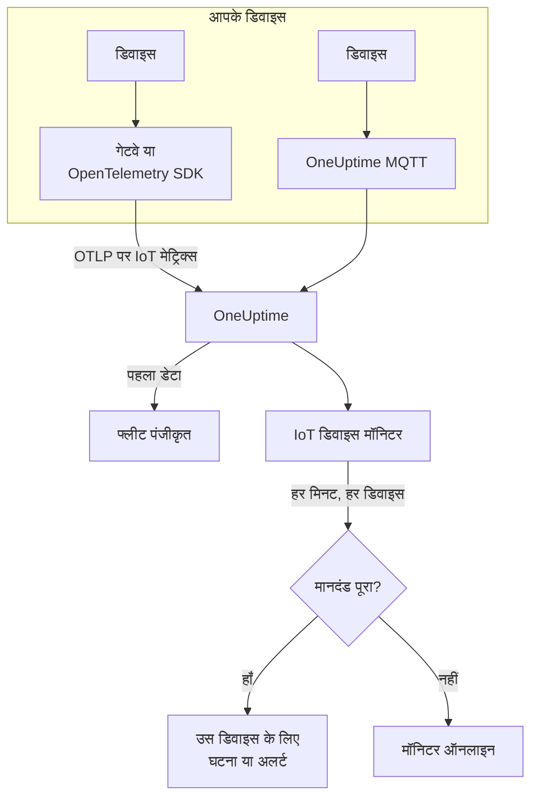

# IoT डिवाइस मॉनिटर

IoT डिवाइस मॉनिटर डिवाइस के एक फ्लीट पर नज़र रखता है और आपको तब बताता है जब कोई डिवाइस ऑफ़लाइन होता है, उसकी बैटरी कम होती है, उसका सिग्नल कमज़ोर होता है, वह ज़्यादा गर्म होता है, या उसका CPU व्यस्त बना रहता है। यह वे `iot_*` मेट्रिक्स पढ़ता है जो आपके डिवाइस OpenTelemetry या MQTT पर OneUptime को भेजते हैं, इसलिए बाहर से कुछ भी जाँचा नहीं जाता और कोई प्रोब शामिल नहीं होता।

:::cards
- [मॉनिटर बनाएँ](#iot-डिवाइस-मॉनिटर-बनाएँ): डैशबोर्ड में छह चरण।
- [टेम्पलेट](#पहले-से-बने-अलर्ट-टेम्पलेट): पाँच तैयार अलर्ट, हर डिवाइस के लिए एक घटना।
- [ऑफ़लाइन पहचान](#ऑफ़लाइन-पहचान): बंद या चुप डिवाइस का पता कैसे चलता है।
- [मेट्रिक्स](#इकट्ठा-किए-गए-मेट्रिक्स): वे `iot_*` सीरीज़ जिन्हें मॉनिटर पढ़ता है।
:::

## यह कैसे काम करता है

आपके डिवाइस, या जिस गेटवे से वे बात करते हैं, अपनी रीडिंग OneUptime को भेजते हैं: OpenTelemetry पर, या सीधे OneUptime के MQTT एंडपॉइंट पर। हर रीडिंग में फ्लीट का नाम `iot.fleet.name` और डिवाइस की अपनी ID `device.id` होती है। पहला डेटा फ्लीट को पंजीकृत करता है।

IoT डिवाइस मॉनिटर एक फ्लीट से जुड़ा होता है। हर मिनट वह उस फ्लीट के मेट्रिक्स पर अपनी क्वेरी चलाता है और परिणाम की तुलना अपने मानदंड से करता है। टेम्पलेट `device.id` से समूहित करते हैं, इसलिए 30 ऑफ़लाइन सेंसर 30 घटनाएँ खोलते हैं, हर एक अपने डिवाइस का नाम बताती है, और हर एक अपने डिवाइस के ठीक होने पर खुद सुलझ जाती है।



## शुरू करने से पहले

- **अपने डिवाइस से रिपोर्टिंग शुरू करवाएँ।** [IoT डिवाइस गाइड](/docs/telemetry/iot-devices) बताती है कि OpenTelemetry SDK या Collector से, या MQTT पर, मेट्रिक्स कैसे भेजें।
- **जाँचें कि फ्लीट पंजीकृत है।** यह डिवाइस के भेजे `iot.fleet.name` के नाम से **उत्पाद → बुनियादी ढांचा → IoT → All Fleets** के अंतर्गत दिखता है।
- **जिन डिवाइस की आप अपेक्षा करते हैं उन्हें पंजीकृत करें**, फ्लीट की **Device Registry** के अंतर्गत, ताकि कोई डिवाइस चुप होने पर आपको बताया जाए: देखें [ऑफ़लाइन पहचान](#ऑफ़लाइन-पहचान)।

## IoT डिवाइस मॉनिटर बनाएँ

:::steps
### नया मॉनिटर शुरू करें

**मॉनिटर** पर जाएँ और **मॉनिटर बनाएं** पर क्लिक करें।

### IoT Device चुनें

**मॉनिटर प्रकार** में **और मॉनिटर प्रकार** पर क्लिक करें और **बुनियादी ढांचा** के अंतर्गत **IoT Device** चुनें, या खोज बॉक्स में `iot` टाइप करें। एक **नाम** दर्ज करें - यह घटना और अलर्ट के शीर्षकों में उपयोग होता है - और **अगला** पर क्लिक करें।

### फ्लीट चुनें

**IoT Monitor Configuration** के अंतर्गत, **IoT Fleet** से फ्लीट चुनें। हर वह फ्लीट जिसने डेटा भेजा है, सूची में है।

### क्या देखना है चुनें

तीन टैब में से एक चुनें:

- **Quick Setup** - एक [टेम्पलेट](#पहले-से-बने-अलर्ट-टेम्पलेट) पर क्लिक करें। यह मेट्रिक, एकत्रीकरण, समय सीमा, `device.id` पर ग्रुप-बाय और थ्रेशोल्ड सेट करता है, और नीचे के मानदंड को अपने मानदंड से बदल देता है। आप फिर भी **समय सीमा** बदल सकते हैं।
- **Custom Metric** - **IoT Metric** से एक मेट्रिक चुनें, फिर **एकत्रीकरण** और **समय सीमा** सेट करें। [फ़िल्टर](#मॉनिटर-सेटिंग्स) इसे एक डिवाइस या एक प्रकार के डिवाइस तक सीमित करते हैं। कस्टम मेट्रिक समूहित नहीं होता: यह पूरे फ्लीट को एक साथ आँकता है।
- **उन्नत** - **मेट्रिक्स चुनें** के अंतर्गत खुद क्वेरी और सूत्र बनाएँ, अपने खुद के मेट्रिक नामों पर भी, उदाहरण के लिए डिवाइस के मेमोरी आकार के प्रतिशत के रूप में उपयोग में मेमोरी। हर डिवाइस को अलग से आँकने के लिए `device.id` से **Group by** करें।

### मानदंड जाँचें

**मॉनिटर मानदंड** के अंतर्गत हर मानदंड खोलें और उसके **Select Metric Variable**, **एकत्रीकरण**, **शर्त** और **Threshold** जाँचें। टेम्पलेट इन्हें भरता है। **Custom Metric** या **उन्नत** के साथ, मॉनिटर [डिफ़ॉल्ट मानदंड](#डिफ़ॉल्ट-मानदंड) से शुरू होता है, जो केवल मेट्रिक के शून्य पर गिरने को देखता है, इसलिए अपना थ्रेशोल्ड सेट करें।

### मॉनिटर बनाएँ

**मॉनिटर बनाएं** पर क्लिक करें। OneUptime मॉनिटर का पेज खोलता है और हर मिनट उसका मूल्यांकन करता है। उसके उठाए घटनाएँ और अलर्ट किसी भी दूसरे मॉनिटर की तरह आपकी ऑन-कॉल नीतियों, Slack, Microsoft Teams, ईमेल, SMS और वेबहुक तक पहुँचते हैं।
:::

> [!TIP]
> एक साथ कई टेम्पलेट सेट करने के लिए, **उत्पाद → बुनियादी ढांचा → IoT** से फ्लीट खोलें और **Recommendations** पर जाएँ। जो टेम्पलेट चाहिए वे चुनें, चुनें कि किसे पेज किया जाए, और OneUptime हर टेम्पलेट के लिए एक मॉनिटर बनाता है।

## मॉनिटर सेटिंग्स

| फ़ील्ड | टैब | यह क्या करता है |
| --- | --- | --- |
| **IoT Fleet** | सभी | ज़रूरी। हर क्वेरी को `resource.iot.fleet.name` तक सीमित करता है। |
| **संसाधन क्षेत्र** | Custom Metric, उन्नत | वैकल्पिक। **डिवाइस** या **Fleet**: `iot.scope` एट्रिब्यूट पर सटीक मिलान। मेट्रिक चुनने पर यह **डिवाइस** पर सेट हो जाता है। |
| **Device ID** | Custom Metric, उन्नत | वैकल्पिक। एक डिवाइस, उसके `device.id` से, जैसे `sensor-001`। |
| **Device Type** | Custom Metric, उन्नत | वैकल्पिक। वे डिवाइस जो यह `iot.device.type` रिपोर्ट करते हैं, जैसे `sensor` या `gateway`। |
| **IoT Metric** | Custom Metric | [कैटलॉग](#इकट्ठा-किए-गए-मेट्रिक्स) से एक मेट्रिक। |
| **एकत्रीकरण** | Custom Metric | सैंपल कैसे मिलाए जाते हैं: **औसत**, **अधिकतम**, **न्यूनतम**, **योग** या **गणना**। मेट्रिक के सामान्य एकत्रीकरण से शुरू होता है। |
| **समय सीमा** | सभी | क्वेरी जो रोलिंग विंडो पढ़ती है, **Past 1 Minute** से **Past 365 Days** तक। नया मॉनिटर **Past 1 Minute** से शुरू होता है; टेम्पलेट अपना मान सेट करते हैं। |
| **मेट्रिक्स चुनें** | उन्नत | क्वेरी बिल्डर: **मीट्रिक**, **Aggregate by**, **Filter by attributes**, **Group by**, साथ ही क्वेरी मिलाने के लिए **मीट्रिक जोड़ें** और **सूत्र जोड़ें**। |

फ़िल्टर एक साथ काम करते हैं: **Device ID** और **Device Type** दोनों के साथ, दूसरे प्रकार का डिवाइस किसी से मेल नहीं खाता।

## पहले से बने अलर्ट टेम्पलेट

**Quick Setup** 5 टेम्पलेट देता है। हर एक पूरा मॉनिटर बनाता है: मेट्रिक क्वेरी, `device.id` पर ग्रुप-बाय, एक मानदंड जो ट्रिगर करता है और एक जो रिकवर करता है। थ्रेशोल्ड शुरुआती बिंदु हैं जिन्हें आप संपादित कर सकते हैं।

मानदंड तभी ट्रिगर होता है जब शर्त विंडो के हर मिनट के लिए सही हो - **Device Offline** को छोड़कर, जो 1 से नीचे की पहली रीडिंग पर ट्रिगर होता है। थ्रेशोल्ड मानदंड अपने थ्रेशोल्ड से 10% आगे जाने पर रिकवर होता है, इसलिए रेखा के आसपास मँडराता मान बार-बार बदलाव नहीं करता।

| टेम्पलेट | श्रेणी | गंभीरता | किस पर नज़र | कब ट्रिगर होता है | कब रिकवर होता है |
| --- | --- | --- | --- | --- | --- |
| Device Offline | उपलब्धता | गंभीर | `iot_device_up`, `device.id` के अनुसार Min, पिछले 30 मिनट | कोई भी रीडिंग 1 से नीचे है, या कोई पंजीकृत डिवाइस पूरी विंडो में कुछ नहीं भेजता | फिर से 1 पर |
| Low Battery | Power | Warning | `iot_battery_percent`, `device.id` के अनुसार Avg, पिछले 5 मिनट | 20% से नीचे | 22% या ऊपर |
| Weak Signal | Connectivity | Warning | `iot_signal_strength_dbm`, `device.id` के अनुसार Avg, पिछले 5 मिनट | -100 dBm से नीचे | -90 dBm या ऊपर |
| High Temperature | एनवायरनमेंट | गंभीर | `iot_temperature_celsius`, `device.id` के अनुसार Max, पिछले 5 मिनट | 70 °C से ऊपर | 63 °C या नीचे |
| High CPU Usage | System | Warning | `iot_cpu_usage_ratio`, `device.id` के अनुसार Avg, पिछले 5 मिनट | 0.9 से ऊपर (उसके CPU का 90%) | 0.81 या नीचे |

**गंभीरता** वह लेबल है जो पिकर दिखाता है। टेम्पलेट जो घटना और अलर्ट बनाता है, वे आपके प्रोजेक्ट की सबसे गंभीर घटना और अलर्ट गंभीरता से शुरू होते हैं; उन्हें मानदंड में बदलें।

- **Device Offline 30 मिनट पढ़ता है**, ताकि हर कुछ मिनट में रिपोर्ट करने वाला डिवाइस दो रिपोर्ट के बीच ऑफ़लाइन न कहलाए। जो डिवाइस लगभग हर 15 मिनट से कम बार रिपोर्ट करता है, उसे लंबी विंडो चाहिए।
- **High Temperature हर मिनट में Max का उपयोग करता है**, ताकि एक गर्म रीडिंग उसी मिनट की ठंडी रीडिंग से छिप न जाए। फिर भी उसे विंडो के हर मिनट गर्म रहना होगा।
- **High CPU Usage एक अनुपात की तुलना करता है:** `iot_cpu_usage_ratio` 0 से 1 तक चलता है, इसलिए 0.9 का मतलब 90% है।

## ऑफ़लाइन पहचान

**Device Offline** तब ट्रिगर होता है जब कोई डिवाइस `iot_device_up = 0` रिपोर्ट करता है। बंद या चुप डिवाइस इसे तीन तरीकों से ट्रिगर करता है:

| कैसे | क्या होता है |
| --- | --- |
| **गेटवे इसकी रिपोर्ट करता है** | गेटवे या कलेक्टर उस डिवाइस के लिए `iot_device_up = 0` भेजता है जिस तक वह अब नहीं पहुँच सकता। |
| **MQTT Last Will** | OneUptime के MQTT एंडपॉइंट से जुड़ा डिवाइस अपने `status` टॉपिक पर एक Last Will पंजीकृत करता है। जब डिवाइस बंद होता है, तो ब्रोकर सेशन टूटते ही उसके लिए `iot_device_up = 0` भेजता है: न पोलिंग, न छूटी रिपोर्ट का इंतज़ार। देखें [MQTT के माध्यम से मेट्रिक्स भेजना](/docs/telemetry/iot-devices#mqtt-के-माध्यम-से-मेट्रिक्स-भेजना)। |
| **डिवाइस पंजीकृत है** | फ्लीट की **Device Registry** में मौजूद डिवाइस से डेटा अपेक्षित है। जब वह पूरी विंडो में कुछ नहीं भेजता, तो मॉनिटर उसे ऐसे मानता है जैसे उसने `0` रिपोर्ट किया हो, इसलिए उसे अपनी घटना मिलती है, जो डिवाइस के फिर से रिपोर्ट करने पर खुद सुलझ जाती है। |

पंजीकृत डिवाइस को फ्लीट की इन्वेंट्री में ऑफ़लाइन के रूप में भी रखा जाता है, जबकि अपंजीकृत डिवाइस 15 मिनट की चुप्पी के बाद हटा दिया जाता है। चुप्पी की पहचान के लिए `iot_device_up` मानदंड पर **Treat As Zero** नो-डेटा नीति चाहिए, जो टेम्पलेट से बने Device Offline मॉनिटर में होती है। डिवाइस पंजीकरण आने से पहले बने Device Offline मॉनिटर में इसे हाथ से सेट करना होगा, या उसे टेम्पलेट से फिर से बनाना होगा।

> [!NOTE]
> जो अपंजीकृत डिवाइस बिना Last Will या गेटवे रिपोर्ट के चुप हो जाता है, वह बस डेटा भेजना बंद कर देता है, और प्रति डिवाइस समूहित मॉनिटर उसे अलग से नहीं पहचान सकता। अपने डिवाइस पंजीकृत करें, या किसी महत्वपूर्ण डिवाइस को उसका अपना मॉनिटर दें (**Custom Metric**, उसकी **Device ID** के साथ) और **यदि कोई डेटा नहीं** को **ट्रिगर** पर सेट करें। चुप्पी की पहचान के लिए यह भी ज़रूरी है कि फ्लीट का कम से कम एक दूसरा डिवाइस रिपोर्ट करता रहे: जो फ्लीट पूरी तरह शांत हो जाता है, उदाहरण के लिए गेटवे आउटेज के दौरान, वह मॉनिटर के लिए एक घटना उठाता है, हर डिवाइस के लिए एक नहीं।

## इकट्ठा किए गए मेट्रिक्स

हर सीरीज़ में डिवाइस का `device.id` लेबल, और `iot.scope`, `iot.device.type` और `iot.device.kind` एट्रिब्यूट होते हैं।

| मेट्रिक | इकाई | विवरण |
| --- | --- | --- |
| `iot_device_up` | — | डिवाइस चालू होने पर 1, बंद या ऑफ़लाइन होने पर 0। |
| `iot_battery_percent` | `%` | बची हुई बैटरी चार्ज, 0 से 100। गिरते स्तर का मतलब है कि डिवाइस जल्द रिपोर्ट करना बंद कर देगा। |
| `iot_signal_strength_dbm` | `dBm` | वायरलेस सिग्नल की ताकत। 0 के करीब ज़्यादा मज़बूत है; कमज़ोर सिग्नल कनेक्शन टूटने से पहले आता है। |
| `iot_temperature_celsius` | `°C` | डिवाइस का तापमान। ऊँची रीडिंग का मतलब ज़्यादा गर्म हार्डवेयर या उसके आसपास कोई समस्या हो सकती है। |
| `iot_cpu_usage_ratio` | `ratio` | उपयोग में CPU, 0 से 1, जहाँ 1 पूरी तरह उपयोग में है। |
| `iot_memory_usage_bytes` | `bytes` | उपयोग में मेमोरी। मेमोरी दबाव देखने के लिए इसकी तुलना डिवाइस के मेमोरी आकार से करें। |
| `iot_uptime_seconds` | `s` | डिवाइस कितनी देर से चल रहा है। रीस्टार्ट होने पर शून्य पर गिर जाता है। |

## निगरानी मानदंड

मानदंड मॉनिटर की किसी क्वेरी या सूत्र की तुलना एक थ्रेशोल्ड से करता है। IoT डिवाइस मॉनिटर के मानदंड एक **फ़िल्टर प्रकार** देते हैं, **Metric Value**: हर नियम इन फ़ील्ड के साथ मेट्रिक मान जाँचता है।

| फ़ील्ड | यह क्या करता है |
| --- | --- |
| **फ़िल्टर प्रकार** | हमेशा **Metric Value**, वह एकमात्र जाँच जो यह मॉनिटर देता है। |
| **Select Metric Variable** | जाँचने वाली क्वेरी या सूत्र, उसके वेरिएबल नाम से। |
| **एकत्रीकरण** | विंडो के मान एक उत्तर कैसे बनते हैं: **औसत**, **योग**, **Maximum Value**, **Minimum Value**, **All Values** (हर मान को मेल खाना चाहिए) या **Any Value** (एक काफ़ी है)। |
| **शर्त** | **Greater Than**, **Less Than**, **Greater Than Or Equal To**, **Less Than Or Equal To** या **Equal To** — या कोई विसंगति शर्त: **Anomalously High**, **Anomalously Low** या **Anomalous**। |
| **Threshold** | तुलना के लिए मान। मेट्रिक की इकाई होने पर उसके बगल में इकाई सूची होती है। विसंगति शर्तों के लिए नहीं दिखता। |
| **संवेदनशीलता** | केवल विसंगति शर्तें। **निम्न** (4σ), **मध्यम** (3σ, डिफ़ॉल्ट) या **उच्च** (2σ)। |
| **बेसलाइन विंडो** | केवल विसंगति शर्तें। 14 दिन (डिफ़ॉल्ट), 28, 60 या 90 दिन का इतिहास। |
| **यदि कोई डेटा नहीं** | **और फ़ील्ड** के अंतर्गत। जब किसी सीरीज़ के पास विंडो में कोई सैंपल न हो तो क्या होता है: **Ignore** (डिफ़ॉल्ट) उसे छोड़ देता है, **Treat As Zero** उसे `0` के रूप में पढ़ता है, और **ट्रिगर** मानदंड को मेल करवाता है। |

विसंगति शर्तें हर मान की तुलना बेसलाइन में सप्ताह के उसी घंटे से करती हैं। जब तक बेसलाइन विंडो में पर्याप्त इतिहास न हो, वे "Learning" स्थिति में रहती हैं, और कुछ नहीं उठातीं।

### डिफ़ॉल्ट मानदंड

जो मॉनिटर आप टेम्पलेट से नहीं बनाते, वह दो मानदंडों से शुरू होता है:

| क्रम | मानदंड | कब मेल खाता है | फिर |
| --- | --- | --- | --- |
| 1 | Check if _monitor name_ is offline | पहली क्वेरी का कोई भी मान `0` है | मॉनिटर को **ऑफ़लाइन** चिह्नित करता है और घटना "_monitor name_ is offline" घोषित करता है, जो मॉनिटर के ठीक होने पर खुद सुलझ जाती है। |
| 2 | Check if _monitor name_ is online | कोई भी मान `0` से ऊपर है | मॉनिटर को **कार्यरत** चिह्नित करता है। |

> [!IMPORTANT]
> चुप्पी किसी भी मानदंड से मेल नहीं खाती: डेटा भेजना बंद करने वाला फ्लीट मॉनिटर को वैसे ही छोड़ देता है जैसा वह था। डेटा रुकने पर सूचना पाने के लिए, किसी मानदंड पर **यदि कोई डेटा नहीं** को **ट्रिगर** पर सेट करें। जिस समय OneUptime खुद डेटा प्राप्त नहीं कर रहा था, वह कभी डेटा न होना नहीं माना जाता: जिस जाँच की विंडो में वह समय है, वह इसके बजाय प्रतीक्षा करती है, जैसा [जब OneUptime डेटा प्राप्त नहीं कर रहा हो](/docs/monitor/when-oneuptime-is-not-receiving) समझाता है।

## Terraform

[OneUptime Terraform प्रोवाइडर](/docs/terraform/monitor-steps) IoT डिवाइस मॉनिटर चरण के कॉन्फ़िगरेशन को `iot_monitor` एट्रिब्यूट में रखता है: `iotMonitor` कॉन्फ़िगरेशन (`fleetIdentifier`, `resourceFilters`, `metricViewConfig`, `rollingTime`) का कच्चा JSON, `jsonencode()` से लिखा गया:

```hcl title="main.tf"
monitor_steps = [{
  iot_monitor = jsonencode({
    fleetIdentifier = "building-a-sensors"
    resourceFilters = {}
    rollingTime     = "Past 5 Minutes"
    metricViewConfig = {
      queryConfigs = [{
        metricAliasData = { metricVariable = "battery_percent", title = "Battery", description = "", legend = "" }
        metricQueryData = {
          filterData = {
            metricName     = "iot_battery_percent"
            attributes     = {}
            aggegationType = "Avg"
            aggregateBy    = {}
          }
          groupByAttributeKeys = ["device.id"]
        }
      }]
      formulaConfigs = []
    }
  })
  criteria = [ /* ... */ ]
}]
```

`fleetIdentifier` फ्लीट का `iot.fleet.name` है, न कि उसकी OneUptime ID।

## समस्या निवारण

:::details फ्लीट IoT Fleet सूची में नहीं है
फ्लीट डिवाइस के डेटा से खुद पंजीकृत होते हैं। जाँचें कि डिवाइस `iot.fleet.name` भेजते हैं, और डेटा आ रहा है यह पक्का करने के लिए [IoT डिवाइस गाइड](/docs/telemetry/iot-devices) का पालन करें।
:::

:::details हर डिवाइस के बजाय पूरे फ्लीट के लिए एक घटना ट्रिगर होती है
क्वेरी समूहित नहीं है। **Custom Metric** वाले मॉनिटर पूरे फ्लीट को एक साथ आँकते हैं; कोई टेम्पलेट उपयोग करें, या **उन्नत** में `device.id` से **Group by** करें।
:::

:::details डिवाइस बंद हुआ, पर Device Offline ट्रिगर नहीं हुआ
डिवाइस ने कोई Last Will नहीं भेजा और किसी गेटवे ने उसकी रिपोर्ट नहीं की, इसलिए वह बस चुप हो गया। उसे फ्लीट की **Device Registry** के अंतर्गत पंजीकृत करें, और जाँचें कि `iot_device_up` मानदंड का **यदि कोई डेटा नहीं** **Treat As Zero** है। देखें [ऑफ़लाइन पहचान](#ऑफ़लाइन-पहचान)।
:::

:::details Device Offline ठीक चल रहे डिवाइस के लिए ट्रिगर होता है
वे 30 मिनट की विंडो की तुलना में कम बार रिपोर्ट करते हैं, इसलिए कुछ विंडो में उनसे कुछ नहीं होता। **समय सीमा** बढ़ाएँ, या डिवाइस को ज़्यादा बार रिपोर्ट करवाएँ। WebSocket MQTT एंडपॉइंट पर, MQTT keepalive को 5 मिनट से कम रखें: OneUptime निष्क्रिय WebSocket कनेक्शन 300 सेकंड बाद बंद कर देता है, जिससे Last Will भेजा जाता है।
:::

:::details कोई टेम्पलेट डेटा नहीं दिखाता
टेम्पलेट `iot_*` मेट्रिक नाम ठीक-ठीक पढ़ते हैं, और `device.id` लेबल से समूहित करते हैं। फ्लीट के **मेट्रिक्स** पेज पर अपने डिवाइस जो भेजते हैं उसकी तुलना [मेट्रिक परंपराएँ](/docs/telemetry/iot-devices#मेट्रिक-परंपराएँ) से करें।
:::

## अगले कदम

:::cards
- [IoT डिवाइस](/docs/telemetry/iot-devices): OpenTelemetry या MQTT पर डिवाइस मेट्रिक्स भेजें।
- [मेट्रिक्स मॉनिटर](/docs/monitor/metrics-monitor): किसी भी मेट्रिक पर अलर्ट करें, सिर्फ़ IoT मेट्रिक्स पर नहीं।
- [घटना और अलर्ट टेम्पलेट](/docs/monitor/incident-alert-templating): घटना के शीर्षकों में डिवाइस की ID डालें।
:::
