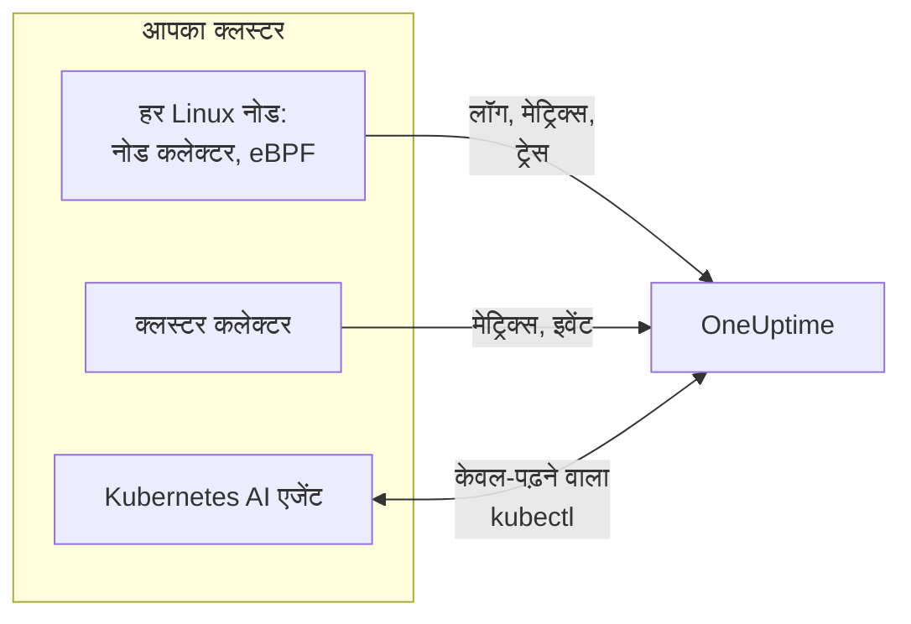

# Kubernetes एजेंट (Helm स्थापना)

OneUptime Kubernetes एजेंट एक Helm चार्ट है जो आपके क्लस्टर के मेट्रिक्स, इवेंट और पॉड लॉग, eBPF से कैप्चर किए गए एप्लिकेशन ट्रेस, और हर नोड के OS मेट्रिक्स इकट्ठा करके OneUptime को भेजता है। एक `helm install` इसे लगा देता है, आपके ऐप के कोड में कोई बदलाव किए बिना। [Kubernetes मॉनिटर](/docs/monitor/kubernetes-monitor) इसके भेजे डेटा पर अलर्ट करते हैं।

:::cards
- [एजेंट इंस्टॉल करें](#एजेंट-इंस्टॉल-करें): Helm के साथ चार चरण।
- [प्रीसेट चुनें](#प्रीसेट-चुनें): मानक क्लस्टर, GKE Autopilot या EKS Fargate।
- [सामान्य विकल्प](#सामान्य-विकल्प): वे सेटिंग जिन्हें ज़्यादातर क्लस्टर बदलते हैं।
- [समस्या निवारण](#समस्या-निवारण): एक डायग्नोस्टिक स्क्रिप्ट, और आम समस्याएँ।
:::

## चार्ट क्या इंस्टॉल करता है

चार्ट अपने नेमस्पेस में कुछ वर्कलोड चलाता है। हर एक जो इकट्ठा करता है, उसे आपकी दी गई इंजेशन कुंजी के साथ OTLP पर आपके OneUptime URL पर भेजता है।



| वर्कलोड | प्रकार | यह क्या करता है | डिफ़ॉल्ट रूप से चालू |
| --- | --- | --- | --- |
| क्लस्टर कलेक्टर | Deployment | Kubernetes API से क्लस्टर मेट्रिक्स, Kubernetes इवेंट, और पॉड, नोड और वर्कलोड के पूरे स्पेसिफ़िकेशन। | हाँ |
| नोड कलेक्टर | DaemonSet | `/var/log/pods` से पॉड लॉग, kubelet और cAdvisor मेट्रिक्स, और नोड के OS मेट्रिक्स। | हाँ |
| eBPF इंस्ट्रूमेंटेशन (OBI) | DaemonSet | हर पॉड से HTTP, gRPC, SQL और Redis ट्रेस और अनुरोध मेट्रिक्स, और सर्विस मैप। | हाँ |
| Kubernetes AI एजेंट | Deployment | इस क्लस्टर पर किसी घटना या अलर्ट की जाँच करते समय OneUptime AI को केवल-पढ़ने वाला `kubectl` चलाने देता है। | हाँ |
| लॉग टेलर | Deployment | जहाँ नोड कलेक्टर पॉड लॉग नहीं पढ़ सकता, वहाँ उन्हें Kubernetes API से पढ़ता है। | `gke-autopilot` और `eks-fargate` प्रीसेट के साथ |
| eBPF प्रोफ़ाइलर | DaemonSet | हर प्रोसेस के निरंतर CPU फ़्लेम ग्राफ़। | नहीं |
| kube-state-metrics | Deployment | पॉड फ़ेज़, कंटेनर के प्रतीक्षा कारण और रिसोर्स कोटा। | नहीं |

हर एजेंट इमेज केवल Linux के लिए है, इसलिए हर वर्कलोड Linux नोड पर पिन किया जाता है।

## शुरू करने से पहले

- **एक इंजेशन कुंजी।** इसे OneUptime में **प्रोजेक्ट सेटिंग्स → टेलीमेट्री और APM → इंजेशन कुंजियाँ** के अंतर्गत बनाएँ। एजेंट इसे `x-oneuptime-token` हेडर के रूप में भेजता है, इसलिए प्रोजेक्ट API कुंजी यहाँ काम नहीं करती।
- **Helm 3** और क्लस्टर तक `kubectl` पहुँच। अपग्रेड `--reset-then-reuse-values` का उपयोग करते हैं, जिसके लिए Helm 3.14 या बाद का संस्करण चाहिए।
- **क्लस्टर का नाम**, आपके प्रोजेक्ट में अद्वितीय। इसके बिना चार्ट इंस्टॉल होने से मना कर देता है: एक ही नाम वाले दो क्लस्टर एक के रूप में दिखेंगे।
- क्लस्टर से आपके OneUptime URL तक **आउटबाउंड HTTPS**।

## एजेंट इंस्टॉल करें

:::steps
### Helm रिपॉज़िटरी जोड़ें

```bash
helm repo add oneuptime https://helm-chart.oneuptime.com
helm repo update
```

### चार्ट इंस्टॉल करें

URL को अपने OneUptime URL से बदलें, और दोनों प्लेसहोल्डर को अपनी इंजेशन कुंजी और क्लस्टर के नाम से:

```bash
helm install oneuptime-agent oneuptime/kubernetes-agent \
  --namespace oneuptime-kubernetes-agent \
  --create-namespace \
  --set oneuptime.url=https://oneuptime.com \
  --set oneuptime.apiKey=<YOUR_API_KEY> \
  --set clusterName=<A_UNIQUE_NAME_FOR_THIS_CLUSTER>
```

यह `standard` प्रीसेट का उपयोग करता है। GKE Autopilot या EKS Fargate पर, इसके बजाय [उनका प्रीसेट चुनें](#प्रीसेट-चुनें)।

### जाँचें कि पॉड चल रहे हैं

```bash
kubectl get pods -n oneuptime-kubernetes-agent
```

हर पॉड को एक-दो मिनट में `Running` तक पहुँच जाना चाहिए।

### OneUptime में क्लस्टर खोजें

**उत्पाद → बुनियादी ढांचा → Kubernetes → सभी क्लस्टर** खोलें। कुछ मिनटों में क्लस्टर अपने नाम से दिखता है, और उसके नोड, पॉड और वर्कलोड भर जाते हैं।
:::

## प्रीसेट चुनें

कुछ Kubernetes प्लेटफ़ॉर्म किसी वर्कलोड को `hostPath` वॉल्यूम माउंट करने या DaemonSet चलाने नहीं देते, जिनका उपयोग नोड कलेक्टर करता है। `preset` सेटिंग चुनती है कि आपके प्लेटफ़ॉर्म पर क्या काम करता है:

| प्रीसेट | किसके लिए | पॉड लॉग | हर नोड पर |
| --- | --- | --- | --- |
| `standard` (डिफ़ॉल्ट) | सेल्फ़-मैनेज्ड, **EKS on EC2**, **GKE Standard**, **AKS**, minikube, kind, k3s | नोड कलेक्टर `/var/log/pods` पढ़ता है | kubelet, cAdvisor और OS मेट्रिक्स |
| `gke-autopilot` | **GKE Autopilot** | लॉग टेलर उन्हें Kubernetes API से पढ़ता है | kubelet और cAdvisor मेट्रिक्स, बिना `hostPath` के |
| `eks-fargate` | **EKS Fargate** | लॉग टेलर उन्हें Kubernetes API से पढ़ता है | कुछ नहीं: Fargate कोई DaemonSet नहीं चलाता |

अगर पक्का न हो, तो `standard` पाने के लिए `preset` को खाली छोड़ दें। अगर इंस्टॉल `hostPath` का नाम लेने वाली Pod Security त्रुटि के साथ विफल हो, तो `gke-autopilot` के साथ फिर से इंस्टॉल करें, या EKS Fargate पर `eks-fargate` के साथ।

GKE Autopilot और EKS Fargate विशेषाधिकार वाले पॉड भी अस्वीकार करते हैं, जिनकी eBPF इंस्ट्रूमेंटेशन को ज़रूरत होती है, इसलिए वहाँ इसे `--set ebpf.enabled=false` से बंद करें:

:::tabs
@tab Standard
```bash
helm install oneuptime-agent oneuptime/kubernetes-agent \
  --namespace oneuptime-kubernetes-agent --create-namespace \
  --set oneuptime.url=https://oneuptime.com \
  --set oneuptime.apiKey=<YOUR_API_KEY> \
  --set clusterName=prod
```
@tab GKE Autopilot
```bash
helm install oneuptime-agent oneuptime/kubernetes-agent \
  --namespace oneuptime-kubernetes-agent --create-namespace \
  --set oneuptime.url=https://oneuptime.com \
  --set oneuptime.apiKey=<YOUR_API_KEY> \
  --set clusterName=prod-gke-autopilot \
  --set preset=gke-autopilot \
  --set ebpf.enabled=false
```
@tab EKS Fargate
```bash
helm install oneuptime-agent oneuptime/kubernetes-agent \
  --namespace oneuptime-kubernetes-agent --create-namespace \
  --set oneuptime.url=https://oneuptime.com \
  --set oneuptime.apiKey=<YOUR_API_KEY> \
  --set clusterName=prod-eks-fargate \
  --set preset=eks-fargate \
  --set ebpf.enabled=false
```
:::

## क्लस्टर को लेबल दें

इंस्टॉल के समय दिए गए लेबल क्लस्टर से, और इस एजेंट द्वारा रिपोर्ट की गई सेवाओं और होस्ट से जुड़ते हैं। `--set oneuptime.labels.<key>=<value>` `<key>:<value>` नाम का प्रोजेक्ट लेबल बन जाता है:

```bash
helm install oneuptime-agent oneuptime/kubernetes-agent \
  --namespace oneuptime-kubernetes-agent \
  --create-namespace \
  --set oneuptime.url=https://oneuptime.com \
  --set oneuptime.apiKey=<YOUR_API_KEY> \
  --set clusterName=prod \
  --set oneuptime.labels.team=payments \
  --set oneuptime.labels.env=production \
  --set oneuptime.labels.region=us-east-1
```

या उन्हें values फ़ाइल में रखें:

```yaml title="values.yaml"
oneuptime:
  url: https://oneuptime.com
  apiKey: <YOUR_API_KEY>
  labels:
    team: payments
    env: production
    region: us-east-1
clusterName: prod
```

```bash
helm install oneuptime-agent oneuptime/kubernetes-agent \
  --namespace oneuptime-kubernetes-agent --create-namespace \
  -f values.yaml
```

तब यह एजेंट जो भी रिकॉर्ड भेजता है - लॉग, मेट्रिक्स, ट्रेस और प्रोफ़ाइल - उसमें `team:payments`, `env:production` और `region:us-east-1` होते हैं। हर लेबल एक `oneuptime.label.<key>=<value>` रिसोर्स एट्रिब्यूट है, और OneUptime `oneuptime.label.` से शुरू होने वाले हर एट्रिब्यूट को लेबल में बदल देता है। लेबल का मिलान केस की परवाह किए बिना होता है, इसलिए मौजूदा `Production` लेबल दोबारा उपयोग होता है, नकल नहीं बनती। एजेंट वह लेबल कभी नहीं हटाता जो आपने OneUptime में जोड़ा हो।

## पॉड लॉग

`preset` `logs.mode` सेट करता है, जिसे आप खुद भी सेट कर सकते हैं:

| `logs.mode` | लॉग कैसे पढ़े जाते हैं | फ़ायदे | किस बात का ध्यान रखें |
| --- | --- | --- | --- |
| `daemonset` | हर नोड पर एक नोड कलेक्टर `/var/log/pods` के नीचे की फ़ाइलें टेल करता है। | सबसे कम ओवरहेड, नोड के साथ स्केल होता है, Kubernetes API सर्वर पर कोई भार नहीं, लॉग रोटेशन का पालन करता है। | `hostPath` और DaemonSet चाहिए। |
| `api` | एक लॉग टेलर हर कंटेनर का लॉग Kubernetes API से स्ट्रीम करता है, जैसे `kubectl logs -f` करता है। | वहाँ भी काम करता है जहाँ `hostPath` ब्लॉक है या `restricted` Pod Security Standard लागू है। | हर कंटेनर स्ट्रीम API सर्वर से एक लंबा कनेक्शन है। एक रेप्लिका कुछ हज़ार कंटेनर संभालती है। |
| `disabled` | कुछ नहीं। | उन ऐप के लिए जो पहले से अपने लॉग किसी और तरीके से भेजते हैं। | |

लॉग संग्रह बंद करने के लिए, `--set logs.enabled=false` सेट करें और इसके बजाय एप्लिकेशन लॉग [OpenTelemetry](/docs/telemetry/open-telemetry) SDK से भेजें। मेट्रिक्स पर असर नहीं पड़ता: नोड कलेक्टर चलता रहता है।

### मिश्रित OS क्लस्टर (Windows नोड पूल)

Windows नोड पर कभी एजेंट पॉड नहीं चलता। उनके और उनके पॉड के बारे में क्लस्टर-स्तर का डेटा फिर भी आता है, क्योंकि वह Kubernetes API से आता है: नोड की स्थितियाँ, पॉड फ़ेज़, Kubernetes इवेंट और kube-state-metrics। Windows नोड में वह नहीं होता जो नोड पर इकट्ठा होता है: OS मेट्रिक्स, kubelet और cAdvisor मेट्रिक्स, eBPF ट्रेस, प्रोफ़ाइल और, `daemonset` लॉग मोड में, पॉड लॉग।

Windows नोड पर पॉड के लॉग भी इकट्ठा करने के लिए, हाइब्रिड मोड चालू करें:

```bash
helm upgrade oneuptime-agent oneuptime/kubernetes-agent \
  --namespace oneuptime-kubernetes-agent --reset-then-reuse-values \
  --set logs.windowsPods.enabled=true
```

तब लॉग टेलर नोड कलेक्टर के साथ चलता है, केवल Windows नोड पर मौजूद पॉड के लिए। Linux पॉड सस्ती फ़ाइल टेलिंग रखते हैं, और दोनों नोड OS के आधार पर पॉड बाँट लेते हैं, इसलिए कोई लॉग पंक्ति दो बार नहीं भेजी जाती।

- **टेलर इमेज का संस्करण।** केवल-Windows वाला बँटवारा `kubernetes-log-tailer` इमेज में बना है। पुरानी इमेज इसे अनदेखा करती है और *हर* पॉड को टेल करती है, जिससे हर Linux पॉड के लॉग दो बार भेजे जाते हैं। `logs.api.image.tag` को चार्ट रिलीज़ से पुराने संस्करण पर पिन न करें, और अगर किसी नोड ने पुरानी `release` इमेज कैश की हो सकती है, तो अपग्रेड में `--set logs.api.image.pullPolicy=Always` जोड़ें।
- **गंभीरता के आधार पर फ़िल्टरिंग।** `filters.logs.minSeverity` सेट होने पर, बिना पहचानने योग्य गंभीरता वाली पंक्ति नोड कलेक्टर के रास्ते पर हटा दी जाती है पर लॉग टेलर के रास्ते पर रखी जाती है - देखें [Log गंभीरता द्वारा फ़िल्टरिंग](/docs/telemetry/kubernetes-agent#log-गंभीरता-द्वारा-फ़िल्टरिंग)। तब Windows पॉड Linux पॉड से ज़्यादा बिना स्तर वाली पंक्तियाँ भेज सकते हैं।

## eBPF के साथ एप्लिकेशन ट्रेस

चार्ट हर नोड पर [OpenTelemetry eBPF Instrumentation (OBI)](https://opentelemetry.io/docs/zero-code/obi/) चलाता है। OBI Linux कर्नेल में eBPF प्रोग्राम लोड करता है और हर पॉड का नेटवर्क ट्रैफ़िक देखता है, इसलिए वह आपके ऐप में कोई बदलाव किए बिना HTTP और HTTPS, gRPC, और SQL और Redis कॉल फिर से बना सकता है: न SDK, न sidecar। वह इन्हें ट्रेस और अनुरोध मेट्रिक्स के रूप में OneUptime को भेजता है।

आपकी सेवाएँ एक-दो मिनट में **उत्पाद → ट्रेस** के अंतर्गत और सर्विस मैप पर दिखती हैं, `k8s.cluster.name` को क्लस्टर के नाम पर सेट करके, ताकि आप क्लस्टर के आधार पर फ़िल्टर कर सकें।

### eBPF कब बंद करें

eBPF डिफ़ॉल्ट रूप से चालू है। इसे `--set ebpf.enabled=false` से तब बंद करें जब:

- क्लस्टर **GKE Autopilot** या **EKS Fargate** हो। वे विशेषाधिकार वाले पॉड अस्वीकार करते हैं, और OBI को अपने प्रोग्राम लोड करने के लिए विशेषाधिकार चाहिए।
- नोड **Linux 5.8** से पुराना और बिना BTF वाला कर्नेल चलाते हों। Debian 11, Ubuntu 20.10, Fedora 34, RHEL 9 और बाद के संस्करण ठीक हैं।
- आपके ऐप पहले से OpenTelemetry SDK से ट्रेस भेजते हों, और आप उन्हें दो बार नहीं चाहते।

### eBPF क्या भेजता है

OBI कई तरह के सिग्नल भेजता है। हर एक को `--set ebpf.features.<key>=false` से बंद किया जा सकता है:

| सेटिंग | डिफ़ॉल्ट | यह क्या जोड़ता है |
| --- | --- | --- |
| `ebpf.features.httpMetrics` | चालू | हर सेवा के HTTP और gRPC अनुरोध मेट्रिक्स: अनुरोध दर, लेटेंसी हिस्टोग्राम और त्रुटियाँ। |
| `ebpf.features.spanMetrics` | चालू | स्पैन मेट्रिक्स: हर सेवा, रूट या ऑपरेशन, स्पैन प्रकार और स्टेटस के अनुसार कॉल और अवधि - `traces.span.metrics.calls` और `traces.span.metrics.duration` (सेकंड)। |
| `ebpf.features.serviceGraph` | चालू | एक सेवा से दूसरी सेवा तक हर कॉल की दर और लेटेंसी, जिनसे सर्विस मैप बनता है। |
| `ebpf.features.networkMetrics` | चालू | हर पॉड जोड़े के बीच TCP और UDP पर बाइट और पैकेट, उनके Kubernetes नामों के साथ। बात करने वाले हर पॉड जोड़े को दिखाता है, उन प्रोटोकॉल पर भी जिन्हें OBI नहीं पढ़ सकता। |
| `ebpf.features.networkInterZoneMetrics` | बंद | यही, ज़ोन के बीच। सीरीज़ की संख्या दोगुनी कर देता है: इसे तभी चालू करें जब आप ज़ोन के आधार पर शेड्यूल करते हों। |
| `ebpf.features.tcpStats` | चालू | प्रति-नोड TCP आँकड़े: राउंड-ट्रिप समय, विफल कनेक्शन और रीट्रांसमिट। |

### सेवाओं के बीच ट्रेस जोड़ना

OBI किसी कॉल के पार ट्रेस को आगे भी ले जा सकता है: जब पॉड A HTTP या gRPC पर पॉड B को कॉल करता है, तो B की तरफ़ का स्पैन A के ट्रेस से जुड़ जाता है, किसी भी ऐप में SDK के बिना। **यह डिफ़ॉल्ट रूप से बंद है।** नीचे की चेतावनी पढ़ने के बाद इसे `--set ebpf.contextPropagation=true` से चालू करें।

| विकल्प | डिफ़ॉल्ट | यह क्या करता है |
| --- | --- | --- |
| `ebpf.contextPropagation` | बंद | आउटगोइंग ट्रैफ़िक में W3C `traceparent` लिखता है, ताकि स्पैन सेवाओं के बीच जुड़ें। |
| `ebpf.contextPropagationMode` | `headers` | कैसे: `headers` (HTTP/1.1 अनुरोध हेडर, सबसे सीमित), `tcp` (एक TCP विकल्प, Linux Traffic Control के ज़रिए) या `all` (दोनों)। केवल तब पढ़ा जाता है जब `contextPropagation` चालू हो। |
| `ebpf.trackRequestHeaders` | चालू | कर्नेल में अनुरोध हेडर ट्रैक करता है, ताकि प्राप्त करने वाली तरफ़ सादे HTTP सर्वर पर भी `traceparent` पा सके। केवल तब असर करता है जब `contextPropagation` चालू हो। |

> [!WARNING]
> हर प्रोपेगेशन मोड पहले से चल रहे ट्रैफ़िक को बदलता है। सादे HTTP के लिए, OBI हेडर समाने के लिए कर्नेल में आउटगोइंग अनुरोध को बड़ा करता है; TLS और रॉ TCP के लिए वह Traffic Control हुक से एक TCP विकल्प जोड़ता है, पैकेट और उसका चेकसम दोबारा लिखता है। अगर इसके बाद कनेक्शन की बाइट गिनती ठीक-ठीक सुधारी नहीं जाती, तो स्ट्रीम **डीसिंक्रोनाइज़ हो जाती है**: nginx जैसे प्रॉक्सी से गुज़रने वाले ट्रांसफ़र, जवाब लगभग 64 KB पार करते ही, आधे में अटक जाते हैं, जब तक कनेक्शन का समय समाप्त न हो। छोटे अनुरोध काम करते रहते हैं, इसलिए यह एप्लिकेशन या प्रॉक्सी का बग लगता है। कोई कर्नेल संस्करण इस रीराइट को खत्म नहीं करता। ट्रेस, अनुरोध मेट्रिक्स और सर्विस मैप सभी इसके बिना काम करते हैं; आपकी सेवाओं में OpenTelemetry SDK कर्नेल रीराइट के बिना ही ट्रेस जोड़ता है। अगर आप इसे चालू करते हैं, तो पहले किसी ऐसे क्लस्टर पर आज़माएँ जो प्रोडक्शन नहीं है, और अपने प्रॉक्सी से बड़े ट्रांसफ़र जाँचें।

### लॉग को ट्रेस से जोड़ना

**डिफ़ॉल्ट रूप से बंद।** चालू होने पर, OBI हर उस प्रोसेस की `write()` सिस्टम कॉल से एक प्रोब जोड़ता है जिसे वह इंस्ट्रूमेंट करता है, और:

- **JSON लॉग पंक्ति** को `trace_id` और `span_id` फ़ील्ड मिलते हैं (पंक्ति में पहले से मौजूद फ़ील्ड रखे जाते हैं)। नोड कलेक्टर उन्हें लॉग रिकॉर्ड के अपने ट्रेस फ़ील्ड में ले जाता है, इसलिए OneUptime में किसी स्पैन के लॉग एक क्लिक की दूरी पर होते हैं, और किसी लॉग पंक्ति का ट्रेस भी।
- **कोई भी दूसरी लॉग पंक्ति** बिना बदलाव के, बिना लिंक के इकट्ठा होती है।

```bash
helm upgrade oneuptime-agent oneuptime/kubernetes-agent \
  --namespace oneuptime-kubernetes-agent --reset-then-reuse-values \
  --set ebpf.logToTraceCorrelation=true
```

| विकल्प | डिफ़ॉल्ट | यह क्या करता है |
| --- | --- | --- |
| `ebpf.logToTraceCorrelation` | `false` | OBI का लॉग एनरिचर और नोड कलेक्टर का `trace_id` उठाना चालू करता है। |
| `ebpf.logEnricher.services` | `[{service: [{exe_path: "*"}]}]` | एनरिचर किन प्रोसेस को छूता है। हर प्रविष्टि एक OBI [GlobAttributes](https://opentelemetry.io/docs/zero-code/obi/configure/options/#service-discovery) सिलेक्टर है, `exe_path`, `languages`, `k8s_pod_labels`, `k8s_pod_annotations`, `open_ports` और `cmd_args` जैसे फ़ील्ड के साथ। |

#### इसके साथ क्रैश होने वाले APM एजेंट

एनरिचर ऐप के आउटपुट बफ़र को **प्रोसेस के अंदर** दोबारा लिखता है: जब कोई मेल खाने वाला प्रोसेस `write()` कॉल करता है, तो OBI मूल बाइट खाली करके एक एनरिच की गई कॉपी लिखता है। जो APM एजेंट `LD_PRELOAD` से लोड होते हैं और खुद `write()` को रैप करते हैं, वे इसे नहीं झेल पाते:

| APM एजेंट | लाइब्रेरी | क्या होता है |
| --- | --- | --- |
| Dynatrace OneAgent | `liboneagentproc.so` | ऐप SIGSEGV (एग्ज़िट 139) के साथ क्रैश होता है। Dynatrace वॉचडॉग का अपना `write()` अपनी 10-सेकंड की सीमा से आगे अटक जाता है और OneAgent लूप में फिर से शुरू होता रहता है। |
| New Relic | `libnewrelic*.so` | उसी तरह का क्रैश। |
| AppDynamics | `libappdynamics*.so` | उसी तरह का क्रैश। |
| Datadog | `libdd*.so` | उसी तरह का क्रैश। |
| Instana | `libinstana*.so` | उसी तरह का क्रैश। |

**.NET ऐप सबसे ज़्यादा जोखिम में हैं:** Dynatrace का .NET एजेंट हमेशा `LD_PRELOAD` से लोड होता है, और Microsoft.Extensions.Logging का कंसोल लॉग अनबफ़र्ड होता है, इसलिए हर पंक्ति यही रास्ता लेती है। Python और Go ऐप आमतौर पर प्रभावित नहीं होते।

इनमें से किसी एजेंट के साथ इसका उपयोग करने के लिए, `logEnricher.services` को केवल उन पॉड की ओर इंगित करें जिनमें वह एजेंट नहीं है। एनरिचर के पास बाहर रखने का कोई तरीका नहीं है, इसलिए जिन्हें एनरिच करना है उन्हें सूचीबद्ध करें:

```yaml title="values.yaml"
ebpf:
  logToTraceCorrelation: true
  logEnricher:
    services:
      # Enrich only pods with the apm-agent=none label
      - service:
          - k8s_pod_labels:
              apm-agent: "none"
```

या रनटाइम के आधार पर चुनें। Dynatrace की `LD_PRELOAD` लोडिंग .NET को लक्ष्य करती है, इसलिए केवल Python, Go, Ruby और Node.js को एनरिच करने से इससे बचा जा सकता है:

```yaml title="values.yaml"
ebpf:
  logToTraceCorrelation: true
  logEnricher:
    services:
      - service:
          - languages: "python,go,ruby,nodejs"
```

#### लॉग JSON और अनबफ़र्ड होने चाहिए

- **केवल JSON पंक्तियों को `trace_id` मिलता है।** लॉगर को JSON फ़ॉर्मैट पर बदलें: `structlog`, `pino`, `winston`, `serilog`, `logback-json`, klog `--logging-format=json` और ऐसे ही।
- **बफ़र्ड आउटपुट लिंक तोड़ देता है**, क्योंकि तब `write()` अनुरोध से अलग थ्रेड पर होता है। **Python** में, `PYTHONUNBUFFERED=1` सेट करें। **.NET** में, स्टार्टअप पर `Console.SetOut(new StreamWriter(Console.OpenStandardOutput()) { AutoFlush = true })` कॉल करें; Microsoft.Extensions.Logging का `AddConsole()` और Serilog के async सिंक काम नहीं करते, Serilog का सादा `WriteTo.Console()` काम करता है।
- Greenlet, gevent, Tornado और अन्य कस्टम async रनटाइम समर्थित नहीं हैं।

### eBPF को ट्यून करना

| विकल्प | डिफ़ॉल्ट | यह क्या करता है |
| --- | --- | --- |
| `ebpf.enabled` | `true` | eBPF DaemonSet चलाता है। `false` इसे बाहर रखता है। |
| `ebpf.image.tag` | `v0.14.0` | OBI इमेज। OBI अभी 1.0 से पहले है: जिस संस्करण को आपने परखा है उसे पिन करें, और बदलने से पहले फिर से परखें। |
| `ebpf.autoTargetExe` | `*` | इंस्ट्रूमेंट करने वाले एग्ज़िक्यूटेबल के ग्लोब, कॉमा से अलग। कम रनटाइम इंस्ट्रूमेंट करने के लिए इसे सीमित करें, जैसे `*/python,*/java`। |
| `ebpf.excludeExePaths` | शेल, क्लस्टर का बुनियादी ढांचा, सर्विस-मेश sidecar, CNI एजेंट, ब्राउज़र, ClickHouse, कलेक्टर और खुद OBI | छोड़े जाने वाले एग्ज़िक्यूटेबल के ग्लोब, कॉमा से अलग। बहुत व्यापक ग्लोब आपकी अपनी बाइनरी भी छोड़ देता है। |
| `ebpf.logLevel` | `info` | `debug`, `info`, `warn` या `error`। |
| `ebpf.printTraces` | `false` | स्पैन को OBI के अपने लॉग में भी प्रिंट करता है, ताकि जाँच सकें कि वह क्या कैप्चर करता है। |
| `ebpf.resources.*` | अनुरोध `100m` CPU और `512Mi` मेमोरी, सीमाएँ `2000m` और `2Gi` | भारी ट्रैफ़िक या बहुत सारे अल्पकालिक प्रोसेस वाले नोड के लिए इन्हें बढ़ाएँ। |

यह जाँचने के लिए कि OBI चल रहा है और ट्रैफ़िक देख रहा है:

```bash
kubectl get pods -n oneuptime-kubernetes-agent -l component=ebpf-instrument
kubectl logs -n oneuptime-kubernetes-agent -l component=ebpf-instrument --tail=200
```

## निरंतर CPU प्रोफ़ाइलिंग

[OpenTelemetry eBPF Profiler](https://github.com/open-telemetry/opentelemetry-ebpf-profiler) भी हर नोड पर चल सकता है, `otel/opentelemetry-collector-ebpf-profiler` इमेज के रूप में। यह हर प्रोसेस जो चला रहा है उसका सेकंड में 19 बार सैंपल लेता है, Go, Java, .NET, Python, Ruby, Node.js, PHP, Perl, C, C++ और Rust में, और प्रोफ़ाइल OneUptime को भेजता है। वे **उत्पाद → प्रदर्शन प्रोफाइल** के अंतर्गत, और हर ट्रेस स्पैन पर फ़्लेम ग्राफ़ के रूप में दिखती हैं।

**प्रोफ़ाइलिंग डिफ़ॉल्ट रूप से बंद है:** इसमें प्रति नोड eBPF इंस्ट्रूमेंटेशन से ज़्यादा CPU और मेमोरी लगती है। इसे `--set profiling.enabled=true` से चालू करें।

eBPF इंस्ट्रूमेंटेशन भी चालू होने पर (डिफ़ॉल्ट), हर सैंपल में वह ट्रेस होता है जिससे वह जुड़ा है, इसलिए किसी स्पैन का अपना फ़्लेम ग्राफ़ होता है। इसके लिए, चार्ट OBI से चल रहे ट्रेस कॉन्टेक्स्ट को उपलब्ध रखने को कहता है (`OTEL_EBPF_BPF_POPULATE_TRACE_CONTEXT=true`), जिससे इंस्ट्रूमेंट किए गए ऐप को हर async कॉन्टेक्स्ट स्विच पर थोड़ी लागत आती है। स्पैन से लिंक के बिना फ़्लेम ग्राफ़ के लिए `profiling.obiProcessContext=false` सेट करें।

प्रोफ़ाइलिंग के लिए **Linux 5.10** या बाद का संस्करण, और नोड की प्रोसेस ID वाला विशेषाधिकार वाला पॉड चाहिए: यह GKE Autopilot या EKS Fargate पर नहीं चल सकती। जो नोड खुद कंटेनर हैं, जैसे kind या k3d, उन पर यह प्रोसेस को अलग नहीं कर पाती, और लगभग कोई सैंपल किसी स्पैन से नहीं जुड़ता।

| विकल्प | डिफ़ॉल्ट | यह क्या करता है |
| --- | --- | --- |
| `profiling.enabled` | `false` | प्रोफ़ाइलर DaemonSet चलाता है। |
| `profiling.image.tag` | `0.152.0` | प्रोफ़ाइलर इमेज। यह 1.0 से पहले है: जिस संस्करण को आपने परखा है उसे पिन करें। |
| `profiling.samplesPerSecond` | `19` | सेकंड में कितने सैंपल। 19 सामान्य टाइमर आवृत्तियों से मेल खाने से बचाता है। |
| `profiling.offCpuThreshold` | `0` | 0 से ऊपर और 1 तक का मान CPU से बाहर बिताए समय को भी प्रोफ़ाइल करता है, जिससे लॉक कंटेंशन और ब्लॉकिंग I/O दिखते हैं, कुछ अतिरिक्त लागत पर। |
| `profiling.tracers` | `""` (हर रनटाइम) | लोड करने वाले भाषा ट्रेसर, कॉमा से अलग, जैसे `go,python`। |
| `profiling.obiProcessContext` | `true` | सैंपल को OBI के ट्रेस से जोड़ता है, और इसके लिए OBI से ट्रेस कॉन्टेक्स्ट उपलब्ध रखवाता है। |

## अन्य डेटा संग्रह

| विकल्प | डिफ़ॉल्ट | यह क्या जोड़ता है |
| --- | --- | --- |
| `hostMetrics.enabled` | चालू | `/proc` और `/sys` से हर नोड के OS मेट्रिक्स: डिस्क I/O कतारें, फ़ाइल सिस्टम inode, नेटवर्क इंटरफ़ेस त्रुटियाँ, पेजिंग और लोड एवरेज। नोड कलेक्टर में चलता है, बिना अतिरिक्त पॉड के। |
| `kubeletstats.utilizationMetrics.enabled` | चालू | कंटेनर और पॉड का CPU और मेमोरी, उनके request और limit के प्रतिशत के रूप में, जिन्हें CPU और मेमोरी सैचुरेशन मॉनिटर पढ़ते हैं। बिना request या limit वाले पॉड के लिए हमेशा 0। |
| `kubeletstats.volumeMetrics.enabled` | चालू | हर PVC की खाली और कुल जगह (`k8s.volume.available`, `k8s.volume.capacity`), जिसे PVC Low Disk Space मॉनिटर पढ़ता है। हर पॉड के हर PVC के लिए एक सीरीज़। |
| `cadvisor.enabled` | चालू | हर kubelet के `/metrics/cadvisor` से CPU थ्रॉटलिंग और OOM किल: `container_cpu_cfs_throttled_seconds_total`, `container_cpu_cfs_periods_total` और `container_oom_events_total`, और कुछ नहीं। |
| `kubeStateMetrics.enabled` | बंद | kube-state-metrics से पॉड फ़ेज़ (Pending, Terminating), शेड्यूल न हो सकने वाले पॉड, कंटेनर के प्रतीक्षा कारण (CrashLoopBackOff, ImagePullBackOff) और रिसोर्स कोटा का उपयोग। `kubeStateMetrics.mode: bundled` (डिफ़ॉल्ट) आपके लिए एक छोटा kube-state-metrics चलाता है; `external` उसे पढ़ता है जो आप पहले से चलाते हैं, `kubeStateMetrics.endpoint` पर। |
| `auditLogs.enabled` | बंद | Kubernetes ऑडिट लॉग, `/var/log/kubernetes/audit.log`: API को हर अनुरोध, किसने, किस पर। केवल सेल्फ़-मैनेज्ड क्लस्टर: मैनेज्ड क्लस्टर (EKS, GKE, AKS, DOKS) इसे क्लाउड प्रदाता को भेजते हैं। |
| `csi.enabled` | बंद | `app=csi-driver` या `app.kubernetes.io/component=csi-driver` लेबल वाले पॉड से CSI स्टोरेज ड्राइवर के मेट्रिक्स: वॉल्यूम अटैच और डिटैच समय, प्रोविज़निंग विफलताएँ, IOPS। |
| `coreDns.enabled` | बंद | `:9153/metrics` पर CoreDNS के मेट्रिक्स: क्वेरी दर, लेटेंसी, कैश हिट और त्रुटियाँ। |
| `controlPlane.enabled` | बंद | etcd, API सर्वर, शेड्यूलर और कंट्रोलर मैनेजर। केवल सेल्फ़-मैनेज्ड क्लस्टर: मैनेज्ड क्लस्टर इन्हें उजागर नहीं करते। |
| `cost.enabled` | बंद | हर वर्कलोड की लागत। देखें [Kubernetes लागत ऑब्ज़र्वेबिलिटी](/docs/telemetry/kubernetes-cost)। |

## सामान्य विकल्प

| विकल्प | डिफ़ॉल्ट | यह क्या करता है |
| --- | --- | --- |
| `oneuptime.url` | (ज़रूरी) | आपका OneUptime URL। |
| `oneuptime.apiKey` | (ज़रूरी) | इंजेशन कुंजी, **प्रोजेक्ट सेटिंग्स → टेलीमेट्री और APM → इंजेशन कुंजियाँ** से। `x-oneuptime-token` हेडर के रूप में भेजी जाती है; प्रोजेक्ट API कुंजी काम नहीं करती। |
| `clusterName` | (ज़रूरी) | क्लस्टर का नाम, प्रोजेक्ट में अद्वितीय। हर रिकॉर्ड इसे `k8s.cluster.name` के रूप में रखता है। |
| `preset` | (खाली: `standard`) | `standard`, `gke-autopilot` या `eks-fargate`। देखें [प्रीसेट चुनें](#प्रीसेट-चुनें)। |
| `oneuptime.labels` | `{}` | इस एजेंट के हर रिकॉर्ड के लिए लेबल। देखें [क्लस्टर को लेबल दें](#क्लस्टर-को-लेबल-दें)। |
| `namespaceFilters.rules` | `kube-system` को `podLogs` और `ebpfDiscovery` से बाहर रखता है | ऐसे नियम जो `podLogs`, `ebpfDiscovery`, `metrics` और `traces` के लिए नेमस्पेस शामिल या बाहर करते हैं। पैटर्न `*` का उपयोग कर सकते हैं, और बाहर करना हमेशा जीतता है। |
| `filters.logs.minSeverity` | `""` | इस स्तर से नीचे की पॉड लॉग पंक्तियाँ हटाता है: `TRACE`, `DEBUG`, `INFO`, `WARN`, `ERROR` या `FATAL`। |
| `filters.metrics.exclude` | `[]` | हटाए जाने वाले मेट्रिक नाम। |
| `sampling.traces.percentage` | `100` | रखे जाने वाले ट्रेस का हिस्सा, 0 से 100। पूरे ट्रेस रखे या हटाए जाते हैं। |
| `logs.enabled` | `true` | पॉड लॉग इकट्ठा करता है। |
| `logs.mode` | (`preset` से) | `daemonset`, `api` या `disabled`। प्रीसेट को ओवरराइड करता है। |
| `logs.windowsPods.enabled` | `false` | Windows नोड पर पॉड को भी टेल करता है। देखें [मिश्रित OS क्लस्टर](#मिश्रित-os-क्लस्टर-windows-नोड-पूल)। |
| `logs.api.replicas` | `1` | `api` मोड में लॉग टेलर की रेप्लिका। |
| `ebpf.enabled` | `true` | eBPF ट्रेस और अनुरोध मेट्रिक्स। देखें [eBPF के साथ एप्लिकेशन ट्रेस](#ebpf-के-साथ-एप्लिकेशन-ट्रेस)। |
| `profiling.enabled` | `false` | CPU फ़्लेम ग्राफ़। देखें [निरंतर CPU प्रोफ़ाइलिंग](#निरंतर-cpu-प्रोफ़ाइलिंग)। |
| `kubeStateMetrics.enabled` | `false` | kube-state-metrics से क्लस्टर की स्थिति। |
| `aiAgent.enabled` | `true` | Kubernetes AI एजेंट। यह क्या कर सकता है, इसके लिए देखें [Kubernetes AI एजेंट](/docs/telemetry/kubernetes-agent)। |

चार्ट का [`values.yaml`](https://github.com/OneUptime/oneuptime/blob/master/HelmChart/Public/kubernetes-agent/values.yaml) हर विकल्प को सूचीबद्ध करता है और समझाता है, और [Kubernetes एजेंट](/docs/telemetry/kubernetes-agent) फ़िल्टरिंग, सैंपलिंग और डेटा की मात्रा कम रखने को कवर करता है।

## अपग्रेड करना

```bash
helm repo update
helm upgrade oneuptime-agent oneuptime/kubernetes-agent \
  --namespace oneuptime-kubernetes-agent \
  --reset-then-reuse-values
```

`--reset-then-reuse-values` (Helm 3.14 और बाद के संस्करण) आपके सेट किए मान रखता है - प्रीसेट, क्लस्टर का नाम, फ़िल्टर - और बाकी हर मान नए चार्ट से लेता है। इसके बाद कोई भी नया `--set` जोड़ें। Helm 3.13 या पहले के संस्करण पर, इसके बजाय अपने सेट किए मानों के साथ अपग्रेड करें:

```bash
helm repo update
helm get values oneuptime-agent --namespace oneuptime-kubernetes-agent -o yaml > values.yaml && \
  helm upgrade oneuptime-agent oneuptime/kubernetes-agent \
  --namespace oneuptime-kubernetes-agent -f values.yaml
```

`--reuse-values` से अपग्रेड न करें: यह उस चार्ट के डिफ़ॉल्ट भी रखता है जिससे आप अपग्रेड कर रहे हैं, इसलिए नए चार्ट के डिफ़ॉल्ट, जिनमें उसकी eBPF इमेज भी है, कभी लागू नहीं होते। जब कोई रिलीज़ पुराने चार्ट के डिफ़ॉल्ट पर चलती है, तो इंस्टॉल या अपग्रेड के बाद Helm जो नोट्स प्रिंट करता है, वे एक चेतावनी और उसे ठीक करने वाले कमांड के साथ खत्म होते हैं।

> [!WARNING]
> **eBPF स्पैन मेट्रिक्स के नए नाम हैं।** `ebpf.features.spanMetrics` अब `traces.span.metrics.calls` और `traces.span.metrics.duration` (सेकंड) भेजता है, `traces_spanmetrics_calls_total` और `traces_spanmetrics_latency` के बजाय: वही सीरीज़, उन नामों के तहत जिन्हें OBI रखता है (उसने पुराने नाम डेप्रिकेट कर दिए)। पुराने नाम पर बना डैशबोर्ड, चार्ट या मेट्रिक मॉनिटर अपग्रेड के बाद कोई नया डेटा नहीं पाता, बिना किसी त्रुटि के - उसे नए नाम पर ले जाएँ, और हर उस `filters.metrics` प्रविष्टि को अपडेट करें जो पुराने नाम का उल्लेख करती है।

## अनइंस्टॉल करना

```bash
helm uninstall oneuptime-agent --namespace oneuptime-kubernetes-agent
kubectl delete namespace oneuptime-kubernetes-agent
```

## समस्या निवारण

:::details क्लस्टर Disconnected दिखता है, या कोई डेटा नहीं आता
चार्ट की डायग्नोस्टिक स्क्रिप्ट चलाएँ। यह पॉड, इंजेशन कुंजी और क्लस्टर से बाहर जाने के रास्ते की जाँच करती है, OneUptime से पूछती है कि कुंजी स्वीकार है या नहीं, और एक निष्कर्ष प्रिंट करती है। यह केवल पढ़ती है, और कुछ नहीं बदलती:

```bash
curl -fsSL https://raw.githubusercontent.com/OneUptime/oneuptime/master/HelmChart/Public/kubernetes-agent/troubleshoot.sh \
  | bash -s -- -n oneuptime-kubernetes-agent
```

आम कारण, खासकर दोबारा इंस्टॉल के बाद, गलत या रद्द की गई इंजेशन कुंजी है: OneUptime उसे अस्वीकार करता है, और कलेक्टर हर बैच हटा देता है जबकि उसके पॉड `Running` बने रहते हैं।
:::

:::details इंस्टॉल "hostPath volumes are not allowed" के साथ विफल होता है
क्लस्टर `hostPath` को ब्लॉक करता है। ऐसे प्रीसेट पर जाएँ जो लॉग Kubernetes API से पढ़ता है, और eBPF बंद करें:

```bash
helm upgrade oneuptime-agent oneuptime/kubernetes-agent \
  --namespace oneuptime-kubernetes-agent \
  --reset-then-reuse-values \
  --set preset=gke-autopilot \
  --set ebpf.enabled=false
```

EKS Fargate पर, `--set preset=eks-fargate` का उपयोग करें।
:::

:::details Windows नोड पर एजेंट पॉड ImagePullBackOff में अटके हैं
पुराने चार्ट एजेंट के DaemonSet को Windows नोड पर शेड्यूल करते थे, जहाँ उनकी Linux इमेज कभी पुल नहीं हो सकती। `helm upgrade` चलाएँ: मौजूदा चार्ट हर वर्कलोड को Linux नोड पर पिन करता है, और अटके पॉड हट जाते हैं। Windows नोड पर पॉड के लॉग इकट्ठा करने के लिए, देखें [मिश्रित OS क्लस्टर](#मिश्रित-os-क्लस्टर-windows-नोड-पूल)।
:::

:::details OneUptime में कोई लॉग नहीं आते
एजेंट के पॉड और उनके लॉग जाँचें:

```bash
kubectl get pods -n oneuptime-kubernetes-agent
kubectl logs -n oneuptime-kubernetes-agent -l app.kubernetes.io/part-of=oneuptime --tail=200
```

`api` मोड में, लॉग टेलर `/healthz`, पोर्ट 13133, पर अपने एक्सपोर्ट की स्थिति के साथ जवाब देता है: इस तक `kubectl port-forward` से पहुँचें।
:::

:::details eBPF पॉड CrashLoopBackOff में हैं, या शुरू नहीं होते
OBI का लॉग पढ़ें:

```bash
kubectl logs -n oneuptime-kubernetes-agent -l component=ebpf-instrument --tail=200
```

- **कर्नेल बहुत पुराना है, या उसमें BTF नहीं है।** OBI को BTF के साथ Linux 5.8 या बाद का संस्करण चाहिए; किसी नोड पर `uname -r` से जाँचें। अगर आप इसे अपग्रेड नहीं कर सकते, तो `--set ebpf.enabled=false` से eBPF बंद करें।
- **विशेषाधिकार वाले पॉड अस्वीकार होते हैं।** कुछ क्लस्टर Autopilot और Fargate के बाहर भी इन्हें अस्वीकार करते हैं। eBPF बंद करें।
- **OBI चलता है, पर कोई ट्रेस नहीं आता।** `--set ebpf.printTraces=true` सेट करें और OBI का लॉग फिर से पढ़ें। वहाँ स्पैन होने का मतलब है कि OneUptime को एक्सपोर्ट विफल होता है: URL और इंजेशन कुंजी जाँचें। वहाँ कोई स्पैन न होने का मतलब हो सकता है कि ट्रैफ़िक ऐसी TLS लाइब्रेरी से एन्क्रिप्ट है जिसे OBI नहीं पढ़ सकता, जैसे स्टैटिक रूप से लिंक की गई लाइब्रेरी।
:::

:::details ट्रेस लिंकिंग चालू करने के बाद बड़े ट्रांसफ़र अटकते हैं
यह `ebpf.contextPropagation` के ट्रैफ़िक दोबारा लिखने से होता है: देखें [सेवाओं के बीच ट्रेस जोड़ना](#सेवाओं-के-बीच-ट्रेस-जोड़ना) में दी चेतावनी। इसे `--set ebpf.contextPropagation=false` से बंद करें।
:::

:::details लॉग लिंकिंग चालू करने के बाद ऐप एग्ज़िट कोड 139 के साथ क्रैश होते हैं
उन्हीं पॉड में `LD_PRELOAD` से लोड होने वाला APM एजेंट है: देखें [इसके साथ क्रैश होने वाले APM एजेंट](#इसके-साथ-क्रैश-होने-वाले-apm-एजेंट)। `ebpf.logToTraceCorrelation` बंद करें, या `ebpf.logEnricher.services` को उस एजेंट के बिना वाले पॉड की ओर इंगित करें।
:::

:::details क्लस्टर के लिए एक लॉग टेलर काफ़ी नहीं है (api मोड)
नेमस्पेस को कई रिलीज़ में बाँटें, हर एक को उसके अपने नेमस्पेस नियमों के साथ इंस्टॉल करके:

```bash
helm install oneuptime-agent-ns-a oneuptime/kubernetes-agent \
  --set preset=gke-autopilot \
  --set-json 'namespaceFilters.rules=[{"action":"include","namespaces":["app-a","app-b"],"scopes":["podLogs"]}]' \
  ...
```

`logs.api.replicas` बढ़ाने से टेलर जुड़ते हैं, पर हर एक हर अनुमत नेमस्पेस पढ़ता है, इसलिए दोहराव से बचने के लिए आपको फिर भी नेमस्पेस बाँटने होंगे।
:::

## अगले कदम

:::cards
- [Kubernetes मॉनिटर](/docs/monitor/kubernetes-monitor): एजेंट जो भेजता है उस पर अलर्ट करें।
- [Kubernetes एजेंट](/docs/telemetry/kubernetes-agent): फ़िल्टरिंग, सैंपलिंग, AI एजेंट, और डेटा की मात्रा कम रखना।
- [Kubernetes लागत ऑब्ज़र्वेबिलिटी](/docs/telemetry/kubernetes-cost): देखें कि हर वर्कलोड की लागत कितनी है।
- [ट्रेस मॉनिटर](/docs/monitor/traces-monitor): eBPF से कैप्चर किए गए ट्रेस पर अलर्ट करें।
:::
