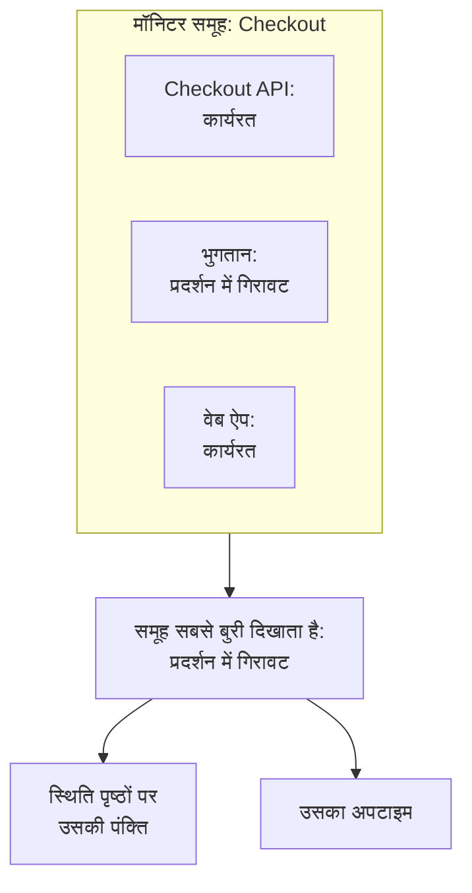

# मॉनिटर समूह

मॉनिटर समूह कई मॉनिटरों को एक स्थिति में समेटता है। उन मॉनिटरों को समूह में रखें जो मिलकर एक सेवा बनाते हैं, जैसे Checkout: उसका API, उसकी भुगतान सेवा और उसका वेब ऐप। समूह उनमें सबसे बुरी स्थिति दिखाता है, अपना अपटाइम रखता है, और कोई स्थिति पृष्ठ पूरे समूह को एक पंक्ति के रूप में दिखा सकता है।

:::cards
- [समूह की स्थिति कैसे तय होती है](#समूह-की-स्थिति-कैसे-तय-होती-है): उसके मॉनिटरों में सबसे बुरी स्थिति।
- [मॉनिटर समूह चालू करें](#मॉनिटर-समूह-चालू-करें): प्रोजेक्ट सेटिंग्स में एक स्विच।
- [मॉनिटर समूह बनाएं](#मॉनिटर-समूह-बनाएं): उसे नाम दें, फिर उसके मॉनिटर जोड़ें।
- [स्थिति पृष्ठ पर समूह दिखाएं](#स्थिति-पृष्ठ-पर-समूह-दिखाएं): पूरे समूह के लिए एक पंक्ति।
:::

## समूह की स्थिति कैसे तय होती है

समूह आपकी कार्यरत स्थिति से शुरू होता है और अपने मॉनिटरों में सबसे बुरी स्थिति लेता है: वह जो आपके प्रोजेक्ट की मॉनिटर स्थितियों की सूची में सबसे नीचे है। एक मॉनिटर के **प्रदर्शन में गिरावट** में जाने पर पूरा समूह **प्रदर्शन में गिरावट** में चला जाता है; एक के **ऑफ़लाइन** होने पर समूह **ऑफ़लाइन** हो जाता है।

- **संग्रहीत मॉनिटर नहीं गिने जाते।** संग्रहीत मॉनिटर की जांच नहीं होती, इसलिए उसकी स्थिति जमी रहती है; समूह उसे छोड़ देता है।
- **खाली समूह कार्यरत होता है।** बिना मॉनिटर वाला, या सिर्फ़ संग्रहीत मॉनिटरों वाला समूह आपकी कार्यरत स्थिति दिखाता है।
- **क्रम आपका है।** कौन सी स्थिति सबसे बुरी है, यह **मॉनिटर → सेटिंग्स → मॉनिटर स्थिति** के क्रम से तय होता है। देखें [मॉनिटर स्थितियाँ](/docs/monitor/criteria-and-statuses#मॉनिटर-स्थितियाँ)।

मॉनिटर समूह स्थिति पृष्ठ समूह नहीं है। स्थिति पृष्ठ समूह किसी एक स्थिति पृष्ठ पर एक शीर्षक है जिसमें पंक्तियाँ होती हैं। मॉनिटर समूह एक पंक्ति है जो कई मॉनिटरों का प्रतिनिधित्व करती है, और कोई भी स्थिति पृष्ठ उसे दिखा सकता है।

## शुरू करने से पहले

- **आपका प्लान।** OneUptime Cloud पर, मॉनिटर समूहों के लिए Scale प्लान चाहिए।
- **स्विच।** मॉनिटर समूह तब तक छिपे रहते हैं जब तक प्रोजेक्ट के लिए **मॉनिटर समूह** चालू न हो (नीचे देखें)। इसे चालू करने के लिए Project Owner भूमिका, या Edit Project या Manage Billing अनुमति वाली कस्टम भूमिका चाहिए।
- **आपकी भूमिका।** समूह बनाने, बदलने और हटाने के लिए Project Owner, Project Admin, Project Member, Monitor Admin या Monitor Member भूमिका, या मेल खाती मॉनिटर समूह अनुमतियों वाली कस्टम भूमिका चाहिए। Viewer समूह देख सकता है, पर बदल नहीं सकता।

## मॉनिटर समूह चालू करें

:::steps
### फ़ीचर फ़्लैग खोलें

**प्रोजेक्ट सेटिंग्स → उन्नत → फ़ीचर फ़्लैग** पर जाएं। साइड मेनू में **उन्नत** शुरू में सिमटा रहता है: पहले उसे फैलाएं।

### स्विच पलटें

**मॉनिटर समूह** स्विच पलटें। यह तुरंत सहेजा जाता है: **मॉनिटर** साइड मेनू में **मॉनिटर समूह** दिखने लगता है, और हर स्थिति पृष्ठ के **मॉनिटर** आइटम का नाम बदलकर **संसाधन** हो जाता है, जहाँ आप समूह जोड़ सकते हैं।
:::

स्विच को फिर से बंद करने पर **मॉनिटर समूह** मेनू से छिप जाता है। इससे कोई समूह नहीं हटता।

## मॉनिटर समूह बनाएं

:::steps
### मॉनिटर समूह खोलें

**मॉनिटर → मॉनिटर समूह** पर जाएं। **मॉनिटर समूह** कार्ड हर समूह को उसकी **वर्तमान स्थिति**, लेबल और मालिकों के साथ दिखाता है।

### समूह बनाएं

**मॉनिटर समूह बनाएँ** पर क्लिक करें, **नाम** और, चाहें तो, **विवरण** भरें, और फ़ॉर्म के नीचे **मॉनिटर समूह बनाएँ** पर क्लिक करें। समूह बिना किसी मॉनिटर के शुरू होता है।

### उसके मॉनिटर जोड़ें

समूह खोलें: जब तक उसमें कोई मॉनिटर नहीं है, उसका **अवलोकन** **Add Monitors** दिखाता है। बाद में, उसके साइड मेनू में **मॉनिटर** पर क्लिक करें, फिर **Add Monitors** पर। **मॉनिटर** में समूह के हर मॉनिटर को चुनें और **Add Monitors** पर क्लिक करें।

### उसकी स्थिति जांचें

**अवलोकन** पर क्लिक करें। **वर्तमान स्थिति** समूह की अभी की स्थिति दिखाती है, और **अपटाइम ग्राफ़** उसके पिछले 90 दिन, हर दिन के लिए एक बार।
:::

समूह से किसी मॉनिटर को निकालने के लिए **समूह में मॉनिटर** में उसकी पंक्ति पर **हटाएं** पर क्लिक करें। मॉनिटर खुद नहीं बदलता। एक मॉनिटर एक से ज़्यादा समूहों में हो सकता है।

## समूह के पेज

समूह खोलें, तो उसके पेज साइड मेनू में दिखते हैं:

| पेज | यह क्या दिखाता है |
| --- | --- |
| **अवलोकन** | **मॉनिटर समूह विवरण**, **वर्तमान स्थिति**, और पिछले 90 दिनों के समूह के अपटाइम प्रतिशत के साथ **अपटाइम ग्राफ़**। जिस समूह में कोई मॉनिटर नहीं है, वह ग्राफ़ की जगह **Add Monitors** दिखाता है। |
| **मॉनिटर** | **समूह में मॉनिटर**, **Add Monitors** और **हटाएं** के साथ। |
| **घटनाएं** | समूह के किसी भी मॉनिटर की घटनाएँ। |
| **अलर्ट** | समूह के किसी भी मॉनिटर के अलर्ट। |
| **मालिक** | समूह के लिए ज़िम्मेदार लोग और टीमें। यह **उन्नत** के अंतर्गत है, जो शुरू में सिमटा रहता है। |
| **ऑडिट लॉग** | किसने समूह बदला, और कब; यह भी **उन्नत** के अंतर्गत है। |
| **समूह हटाएं** | समूह हटाता है, यह भी **उन्नत** के अंतर्गत है। |

**अवलोकन** पर अपटाइम कार्यरत को छोड़कर हर स्थिति को डाउनटाइम गिनता है। स्थिति पृष्ठ सिर्फ़ अपनी **डाउनटाइम के रूप में गिना जाता है** सूची की स्थितियाँ गिनता है: देखें [पेज पर क्या दिखेगा, यह चुनना](/docs/status-pages/index#पेज-पर-क्या-दिखेगा-यह-चुनना)।

**मॉनिटर समूह** सूची समूहों को मालिक और लेबल से फ़िल्टर कर सकती है, कई समूहों पर एक साथ लेबल और मालिक सेट कर सकती है, और समूहों को JSON के रूप में एक्सपोर्ट या इंपोर्ट कर सकती है।

## स्थिति पृष्ठ पर समूह दिखाएं

:::steps
### स्थिति पृष्ठ के संसाधन खोलें

**स्थिति पृष्ठ** पर जाएं, पेज खोलें और उसके साइड मेनू में **संसाधन** पर क्लिक करें।

### डायलॉग को समूह पर बदलें

**मॉनिटर जोड़ें** पर क्लिक करें। मॉनिटर ड्रॉपडाउन के नीचे **Add a Monitor Group instead.** पर क्लिक करें। ड्रॉपडाउन **मॉनिटर समूह** बन जाता है।

### समूह चुनें और जोड़ें

समूह चुनें। **प्रदर्शन नाम**, यानी वह नाम जो आगंतुक पढ़ते हैं, तब तक समूह के नाम से भरा रहता है जब तक आप अपना नाम नहीं लिखते। **मॉनिटर जोड़ें** पर क्लिक करें: पंक्ति समूह की स्थिति के साथ पेज पर दिखती है।
:::

स्थिति पृष्ठ पर, पंक्ति समूह के हर मॉनिटर का प्रतिनिधित्व करती है:

- **उसकी स्थिति।** यह समूह की है: उसके मॉनिटरों में सबसे बुरी।
- **उसकी घटनाएँ।** समूह के किसी भी मॉनिटर की घटना पेज पर दिखती है, और प्रभावित संसाधनों में समूह का नाम होता है।
- **उसके सब्सक्राइबर।** समूह चुनने वाले सब्सक्राइबर को उसके हर मॉनिटर की खबर मिलती है। देखें [सब्सक्राइबर को संसाधन और इवेंट प्रकार चुनने देना](/docs/status-pages/subscribers#सब्सक्राइबर-को-संसाधन-और-इवेंट-प्रकार-चुनने-देना)।

पंक्ति के बाकी विकल्पों, जैसे उसके अपटाइम और इतिहास चार्ट, के लिए देखें [स्थिति पृष्ठ संसाधन और समूह](/docs/status-pages/resources-and-groups)।

> [!WARNING]
> मॉनिटर समूह हटाने से उसकी पंक्ति हर उस स्थिति पृष्ठ से भी हट जाती है जो उसे दिखाता है। समूह के मॉनिटर, और उनकी घटनाएँ, नहीं हटतीं।

## API और Terraform

समूह `/api/monitor-group` है, और उसका हर मॉनिटर `/api/monitor-group-resource` की एक पंक्ति है जो `monitorGroupId` को `monitorId` से जोड़ती है। Terraform में ये `oneuptime_monitor_group` और `oneuptime_monitor_group_resource` हैं: देखें [मॉनिटर समूह](/docs/terraform/examples#मॉनिटर-समूह)।

## समस्या निवारण

:::details मॉनिटर मेनू में मॉनिटर समूह नहीं है
**मॉनिटर समूह** स्विच बंद है। इसे **प्रोजेक्ट सेटिंग्स → उन्नत → फ़ीचर फ़्लैग** में चालू करें। OneUptime Cloud पर, समूहों के लिए Scale प्लान भी चाहिए।
:::

:::details समूह ऑफ़लाइन दिखाता है, पर उसके ज़्यादातर मॉनिटर चालू हैं
यही नियम है: समूह अपना सबसे बुरा मॉनिटर दिखाता है। डाउन मॉनिटर ढूँढने के लिए समूह पर **मॉनिटर** खोलें, या ऐसा मॉनिटर हटाएं जो समूह में नहीं होना चाहिए।
:::

:::details स्थिति पृष्ठ समूह नहीं जोड़ पाता
**Add a Monitor Group instead.** डायलॉग में तभी दिखता है जब प्रोजेक्ट के लिए **मॉनिटर समूह** स्विच चालू हो।
:::

## अगले कदम

:::cards
- [मॉनिटर मानदंड और स्थितियाँ](/docs/monitor/criteria-and-statuses): हर मॉनिटर की स्थिति कौन तय करता है।
- [स्थिति पृष्ठ संसाधन और समूह](/docs/status-pages/resources-and-groups): स्थिति पृष्ठ की पंक्तियाँ सजाएं।
- [सब्सक्राइबर और घोषणाएँ](/docs/status-pages/subscribers): ग्राहकों को समूह की घटनाओं के बारे में बताएं।
:::
