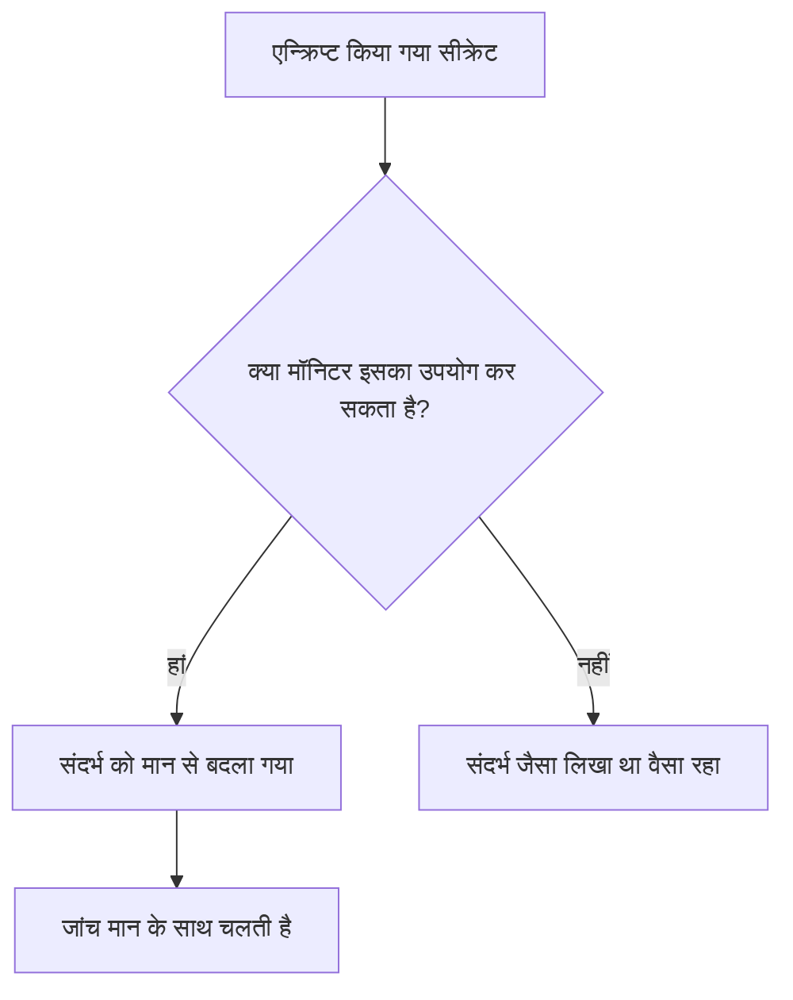

# मॉनिटर रहस्य

मॉनिटर सीक्रेट आपके मॉनिटरों को चाहिए पासवर्ड, API कुंजियों और टोकनों को खुद मॉनिटर से बाहर रखते हैं। आप कोई मान एक बार, एन्क्रिप्ट करके, सहेजते हैं, चुनते हैं कि कौन-से मॉनिटर उसका उपयोग कर सकते हैं, और जहां भी मॉनिटर को उसकी ज़रूरत हो, उसे `{{monitorSecrets.NAME}}` के रूप में संदर्भित करते हैं।

:::cards
- [सीक्रेट जोड़ें](#सीक्रेट-जोड़ना): कोई मान सहेजें और चुनें कि उसका उपयोग कौन कर सकता है।
- [एक्सेस चुनें](#चुनना-कि-कौन-से-मॉनिटर-किसी-सीक्रेट-का-उपयोग-कर-सकते-हैं): सभी मॉनिटर, विशिष्ट मॉनिटर, या लेबल वाले मॉनिटर।
- [सीक्रेट का उपयोग करें](#सीक्रेट-का-उपयोग-करना): `{{monitorSecrets.NAME}}` कहां काम करता है।
- [वन-टाइम कोड से साइन इन करें](#वन-टाइम-कोड-से-साइन-इन-करना): किसी मॉनिटर को साइट के दो-कारक साइन इन से गुज़रने दें।
:::

## सीक्रेट मॉनिटर तक कैसे पहुंचते हैं

सीक्रेट एन्क्रिप्ट करके संग्रहीत किया जाता है और सहेजने के बाद फिर कभी नहीं दिखाया जाता। किसी मॉनिटर को प्रोब को सौंपने से पहले, OneUptime हर उस संदर्भ को डिक्रिप्ट किए गए मान से बदल देता है जिसका मॉनिटर उपयोग कर सकता है; जिस संदर्भ का मॉनिटर उपयोग नहीं कर सकता, वह वैसा ही रहता है जैसा लिखा गया। वन-टाइम कोड सीक्रेट इसका अपवाद है: प्रोब जाँच चलने पर उसका कोड बनाता है ([वन-टाइम कोड से साइन इन करना](#वन-टाइम-कोड-से-साइन-इन-करना) देखें)।



जांच चलाने वाले प्रोब को मान मिलता है, इसलिए सीक्रेट का उपयोग करने वाले मॉनिटर को उन प्रोब पर चलना चाहिए जिन पर आप भरोसा करते हैं: OneUptime के अपने प्रोब, या कोई [कस्टम प्रोब](/docs/probe/custom-probe) जिसे आप खुद चलाते हैं।

## शुरू करने से पहले

- **Growth प्लान या उससे ऊपर**, OneUptime Cloud पर। सेल्फ़-होस्टेड इंस्टॉल में कोई प्लान नहीं होते।
- **ऐसी भूमिका जो सीक्रेट प्रबंधित कर सके**: प्रोजेक्ट स्वामी, प्रोजेक्ट एडमिन, या Create Monitor Secret अनुमति वाली कोई कस्टम भूमिका।

## सीक्रेट के साथ काम करें

### सीक्रेट जोड़ना

:::steps
1. **मॉनिटर → सेटिंग्स → सीक्रेट** पर जाएं और **मॉनिटर गुप्त बनाएँ** पर क्लिक करें।
2. **नाम** और **सीक्रेट मान** डालें। नाम वह है जिसे आप संदर्भित करते हैं, जैसे `ApiKey`। इसमें केवल अक्षर, अंक, हाइफ़न (`-`) और अंडरस्कोर (`_`) हो सकते हैं, और किसी प्रोजेक्ट में दो सीक्रेट का नाम एक नहीं हो सकता। किसी साइट की दो-कारक सेटअप कुंजी के लिए पहले **वन-टाइम कोड (TOTP)** चुनें ([वन-टाइम कोड से साइन इन करना](#वन-टाइम-कोड-से-साइन-इन-करना) देखें)।
3. **एक्सेस** चरण में चुनें कि कौन-से मॉनिटर इसका उपयोग कर सकते हैं (अगला खंड देखें), फिर **मॉनिटर गुप्त बनाएँ** पर क्लिक करें।
:::

> [!IMPORTANT]
> सीक्रेट एन्क्रिप्ट किए जाते हैं और सुरक्षित रूप से संग्रहीत होते हैं। सीक्रेट मान सहेजे जाने के बाद फिर कभी नहीं दिखाया जाता — न तालिका में, न संपादन फ़ॉर्म में, और न API से। अगर मान खो जाए, तो आपको उसे वहीं से दोबारा लेना होगा जहां से वह आया था और फिर से सेट करना होगा। किसी सीक्रेट को रोटेट करने के लिए उसकी पंक्ति पर **सीक्रेट मान अपडेट करें** बटन का उपयोग करें; उसे हटाकर फिर से बनाने की ज़रूरत नहीं है। यही बटन नए मान के साथ यह भी बदलता है कि सीक्रेट में क्या है, **टेक्स्ट** या **वन-टाइम कोड (TOTP)**, और सीक्रेट का उपयोग करने वाले मॉनिटर अपनी अगली जाँच में नया प्रकार अपना लेते हैं।

### चुनना कि कौन-से मॉनिटर किसी सीक्रेट का उपयोग कर सकते हैं

हर सीक्रेट के पास तीन एक्सेस विकल्पों में से एक होता है:

| विकल्प | कौन-से मॉनिटर सीक्रेट का उपयोग कर सकते हैं | किसके लिए |
| --- | --- | --- |
| **सभी मॉनिटर** | प्रोजेक्ट का हर मॉनिटर, बाद में बनाए जाने वाले मॉनिटर भी। | ऐसा क्रेडेंशियल जिसे कई मॉनिटर साझा करते हैं। |
| **विशिष्ट मॉनिटर** | केवल वे मॉनिटर जिन्हें आप चुनते हैं। यह डिफ़ॉल्ट है, और इन विकल्पों के आने से पहले बने सीक्रेट इसी तरह काम करते हैं। | एक या कुछ मॉनिटरों के लिए क्रेडेंशियल। |
| **लेबल वाले मॉनिटर** | ऐसे मॉनिटर जिनमें आपके चुने लेबल में से कम से कम एक हो। किसी मॉनिटर में उनमें से कोई लेबल जोड़ने पर उसे एक्सेस मिल जाता है, और लेबल हटाने पर मॉनिटर के अगले रन से एक्सेस हट जाता है। | समय के साथ बदलने वाले मॉनिटरों के समूह के लिए क्रेडेंशियल। |

आप सीक्रेट की पंक्ति पर **संपादित करें** से कभी भी विकल्प बदल सकते हैं। केवल चुने गए विकल्प की सूची रखी जाती है: **सभी मॉनिटर** पर जाने से सीक्रेट की मॉनिटर और लेबल सूचियां खाली हो जाती हैं, और **विशिष्ट मॉनिटर** व **लेबल वाले मॉनिटर** के बीच बदलने पर वह सूची खाली हो जाती है जिससे आप हटे।

कोई सीक्रेट किसी दूसरे प्रोजेक्ट के मॉनिटरों को कभी उपलब्ध नहीं होता।

> [!WARNING]
> जो कोई भी ऐसे मॉनिटर को संपादित कर सकता है जो किसी सीक्रेट का उपयोग कर सकता है, वह उस सीक्रेट को कहीं भी भेज सकता है जहां मॉनिटर कनेक्ट होता है। **सभी मॉनिटर** के साथ, इसमें वे सभी शामिल हैं जो प्रोजेक्ट में मॉनिटर बना या संपादित कर सकते हैं। **लेबल वाले मॉनिटर** के साथ, इसमें वे सभी भी शामिल हैं जो किसी मॉनिटर में उनमें से कोई लेबल जोड़ सकते हैं।

API में एक्सेस विकल्प `monitorAccess` फ़ील्ड है: `All Monitors`, `Specific Monitors` या `Monitors With Labels`। `monitors` और `labels` फ़ील्ड में सूचियां होती हैं। `monitorAccess` के बिना बनाए गए सीक्रेट को `Specific Monitors` मिलता है।

### सीक्रेट का उपयोग करना

सीक्रेट का उपयोग करने के लिए, सीक्रेट स्वीकार करने वाले फ़ील्ड में `{{monitorSecrets.SECRET_NAME}}` लिखें। उदाहरण के लिए, `Authorization: Bearer {{monitorSecrets.ApiKey}}` वाला अनुरोध हेडर `ApiKey` सीक्रेट का मान भेजता है।

ये मॉनिटर प्रकार और फ़ील्ड सीक्रेट स्वीकार करते हैं:

| मॉनिटर प्रकार | फ़ील्ड |
| --- | --- |
| API | URL, अनुरोध के हेडर और बॉडी, और क्लाइंट प्रमाणपत्र, निजी कुंजी और पासफ़्रेज़ (mTLS) |
| वेबसाइट | URL, और क्लाइंट प्रमाणपत्र, निजी कुंजी और पासफ़्रेज़ (mTLS) |
| Ping, IP, पोर्ट, NTP, SSL प्रमाणपत्र | जांचा जाने वाला होस्ट या URL |
| DNS | डोमेन नाम और DNS सर्वर |
| DNSSEC, डोमेन | डोमेन नाम |
| SQL क्वेरी | होस्ट, डेटाबेस नाम, उपयोगकर्ता नाम, पासवर्ड और क्वेरी |
| डेटाबेस स्वास्थ्य | होस्ट, डेटाबेस नाम, उपयोगकर्ता नाम और पासवर्ड |
| बाहरी स्थिति पृष्ठ | स्थिति पृष्ठ का URL |
| सिंथेटिक मॉनिटर, कस्टम JavaScript कोड | स्क्रिप्ट |
| नेटवर्क डिवाइस | SNMP कम्युनिटी स्ट्रिंग, और SNMPv3 की प्रमाणीकरण व गोपनीयता कुंजियां |

सिंथेटिक मॉनिटर या कस्टम JavaScript कोड मॉनिटर की स्क्रिप्ट चलने से पहले सीक्रेट भर दिए जाते हैं, इसलिए स्क्रिप्ट के अंदर `{{monitorSecrets.ApiKey}}` जैसा संदर्भ चलते समय डिक्रिप्ट किया गया मान होता है।

अगर कोई मॉनिटर ऐसे सीक्रेट को संदर्भित करता है जिसका वह उपयोग नहीं कर सकता, तो संदर्भ जैसा है वैसा ही रहता है और मान से नहीं बदला जाता।

जब किसी API, वेबसाइट या बाहरी स्थिति पृष्ठ मॉनिटर की जाँच विफल होती है, तो उसकी त्रुटि URL को सिर्फ़ उसकी स्कीम, होस्ट और पोर्ट से बताती है, जैसे `https://api.example.com`, इसलिए URL में रखा सीक्रेट कभी नहीं दिखता।

जब आप किसी मॉनिटर को सहेजने से पहले उसका परीक्षण करते हैं, तो केवल **सभी मॉनिटर** के लिए उपलब्ध सीक्रेट भरे जाते हैं, क्योंकि नया मॉनिटर अभी किसी सूची में नहीं है और उसके कोई लेबल नहीं हैं। मॉनिटर सहेजने के बाद, परीक्षण हर उस सीक्रेट का उपयोग करते हैं जिसका मॉनिटर उपयोग कर सकता है।

## वन-टाइम कोड से साइन इन करना

कुछ साइटें साइन इन करते समय किसी ऑथेंटिकेटर ऐप का कोड माँगती हैं। **वन-टाइम कोड (TOTP)** सीक्रेट उस साइट की सेटअप कुंजी रखता है, ताकि मॉनिटर ठीक आपकी तरह साइन इन कर सके: मॉनिटर जहाँ भी सीक्रेट का उपयोग करता है, प्रोब ठीक उसी पल, जब जाँच को कोड की ज़रूरत होती है, अपनी घड़ी से वर्तमान कोड बनाता है। सेटअप कुंजी किसी भी सीक्रेट मान की तरह एन्क्रिप्ट करके रखी जाती है और फिर कभी नहीं दिखाई जाती, और इसे कभी मॉनिटर में नहीं लिखा जाता।

1. जिस खाते से मॉनिटर साइन इन करता है, उसके लिए दो-कारक साइन इन चालू करें। जहाँ साइट QR कोड दिखाती है, वहाँ इसके बजाय कुंजी हाथ से दर्ज करने का विकल्प चुनें, और सेटअप कुंजी या `otpauth://` लिंक कॉपी करें।
2. **मॉनिटर → सेटिंग्स → सीक्रेट** पर जाएं, **मॉनिटर गुप्त बनाएँ** पर क्लिक करें, **वन-टाइम कोड (TOTP)** चुनें, और कुंजी या लिंक को **सेटअप कुंजी** में चिपकाएँ।
3. जाँचें कि उसके नीचे दिखने वाला **वर्तमान कोड** आपके ऑथेंटिकेटर ऐप में अभी दिख रहे कोड से मेल खाता है, फिर किसी भी सीक्रेट की तरह **एक्सेस** चरण में चुनें कि कौन-से मॉनिटर सीक्रेट का उपयोग कर सकते हैं।

| आप क्या चिपकाते हैं | मॉनिटर कौन-से कोड बनाता है |
| --- | --- |
| सेटअप कुंजी, जैसे `JBSW Y3DP EHPK 3PXP` | SHA1, 6 अंक, और हर 30 सेकंड में नया कोड: जो हर ऑथेंटिकेटर ऐप मानकर चलता है |
| `otpauth://totp/` लिंक | लिंक का `algorithm` (`SHA1`, `SHA256` या `SHA512`), `digits` (`6` या `8`) और सेकंड में `period` (लिंक में न हो तो `30`) |

| मॉनिटर प्रकार | कोड कहाँ जाता है, और कब बनता है |
| --- | --- |
| API | URL, किसी अनुरोध हेडर या अनुरोध बॉडी में `{{monitorSecrets.NAME}}`, हर प्रयास भेजे जाने से ठीक पहले |
| सिंथेटिक मॉनिटर, कस्टम JavaScript कोड | स्क्रिप्ट में `{{monitorSecrets.NAME}}`, जब स्क्रिप्ट शुरू होती है, और `await oneuptime.getTotpCode("NAME")`, जब स्क्रिप्ट माँगती है |

बाकी हर फ़ील्ड `{{monitorSecrets.NAME}}` को जैसा लिखा है वैसा ही रखती है। JSON अनुरोध बॉडी में संदर्भ को उद्धरण चिह्नों में रखें, जैसे `{"otp": "{{monitorSecrets.LoginCode}}"}`, क्योंकि कोड शून्य से शुरू हो सकता है।

साइन इन आम तौर पर स्क्रिप्ट शुरू होने के कुछ पेज बाद कोड वाले चरण तक पहुँचता है, इसलिए कोड वहीं माँगें। यह स्क्रिप्ट पासवर्ड और वन-टाइम कोड से साइन इन करती है:

```javascript
await page.goto("https://app.example.com/login");
await page.fill("#email", "monitoring@example.com");
await page.fill("#password", "{{monitorSecrets.AppPassword}}");
await page.click("button[type=submit]");

// The code is made now, when the sign-in asks for it.
await page.waitForSelector("#otp");
await page.fill("#otp", await oneuptime.getTotpCode("AppLoginCode"));
await page.click("button[type=submit]");

await page.waitForSelector(".dashboard", { timeout: 10000 });

return {
  data: { signedIn: true },
};
```

प्रोब कभी ऐसा कोड नहीं देता जिसमें पाँच सेकंड से कम समय बचा हो, या अवधि छोटी होने पर अवधि के एक-तिहाई से कम: वह इसके बजाय अगले कोड का इंतज़ार करता है, अधिकतम पाँच सेकंड, और उस इंतज़ार को जाँच के निष्पादन समय में नहीं गिनता। जाँच का बनाया हर कोड उसके लॉग संदेशों, परिणाम, त्रुटि और स्क्रीनशॉट के नामों में तारांकनों के रूप में दिखता है, जैसे `******`। स्क्रीनशॉट पेज की तस्वीर होता है, इसलिए उसे कोड टाइप करने से पहले या पेज आगे बढ़ने के बाद लें।

> [!NOTE]
> कोड प्रोब बनाता है, इसलिए कस्टम प्रोब को OneUptime 17.1.0 या बाद का संस्करण चाहिए। पुराने प्रोब पर, जिस जाँच को कोड चाहिए वह नहीं चलती, और प्रोब को अपडेट करने को कहने वाले वाक्य के साथ विफल होती है; मॉनिटर का फ़ॉर्म और प्रोब का पेज बहुत पुराने प्रोब का नाम बताते हैं, और [प्रोब अपडेट करें](/docs/probe/custom-probe#प्रोब-अपडेट-करें) बताता है कि कैसे। प्रोब की घड़ी भी सही होनी चाहिए, क्योंकि एक मिनट आगे-पीछे चल रहा प्रोब ऐसे कोड बनाता है जिन्हें साइट पीछे छोड़ चुकी होती है।

## समस्या निवारण

:::details मॉनिटर `{{monitorSecrets.NAME}}` को ज्यों का त्यों भेजता है
मॉनिटर सीक्रेट का उपयोग नहीं कर सकता, या नाम मेल नहीं खाता। सीक्रेट की पंक्ति पर **संपादित करें** से उसका एक्सेस विकल्प जांचें, और यह भी कि संदर्भ में नाम ठीक वही है जो सीक्रेट का नाम है।
:::

:::details नए मॉनिटर का परीक्षण करते समय सीक्रेट नहीं भरा जाता
मॉनिटर सहेजे जाने से पहले केवल **सभी मॉनिटर** के लिए उपलब्ध सीक्रेट भरे जाते हैं। मॉनिटर सहेजें, फिर दोबारा परीक्षण करें।
:::

:::details कोई फ़ील्ड सीक्रेट को अनदेखा करता है
केवल ऊपर की तालिका के फ़ील्ड सीक्रेट स्वीकार करते हैं। किसी भी दूसरे फ़ील्ड में `{{monitorSecrets.NAME}}` वैसा ही भेजा जाता है जैसा लिखा गया।
:::

:::details साइट वन-टाइम कोड अस्वीकार कर देती है
जाँचें कि सीक्रेट सहेजते समय **वर्तमान कोड** आपके ऑथेंटिकेटर ऐप से मेल खाता था, कि प्रोब की घड़ी सही है, और कि JSON अनुरोध बॉडी में संदर्भ उद्धरण चिह्नों में है। अगर साइन इन को कोड वाले चरण तक पहुँचने में समय लगता है, तो कोड वहीं `oneuptime.getTotpCode` से माँगें।
:::

:::details जाँच कहती है कि प्रोब वन-टाइम कोड बनाने के लिए बहुत पुराना है
प्रोब OneUptime 17.1.0 से पुराना संस्करण चलाता है, जो वन-टाइम कोड नहीं बना सकता, इसलिए उस पर जाँच नहीं चली। प्रोब को अपडेट करें ([प्रोब अपडेट करें](/docs/probe/custom-probe#प्रोब-अपडेट-करें) देखें), या 17.1.0 या बाद का संस्करण चलाने वाले प्रोब से मॉनिटर की जाँच कराएँ।
:::

## अगले कदम

:::cards
- [API मॉनिटर](/docs/monitor/api-monitor): अनुरोध हेडर में सीक्रेट भेजें।
- [सिंथेटिक मॉनिटर](/docs/monitor/synthetic-monitor): ब्राउज़र स्क्रिप्ट के अंदर सीक्रेट का उपयोग करें।
- [SQL क्वेरी मॉनिटर](/docs/monitor/sql-monitor): डेटाबेस पासवर्ड को एन्क्रिप्टेड रखें।
:::
