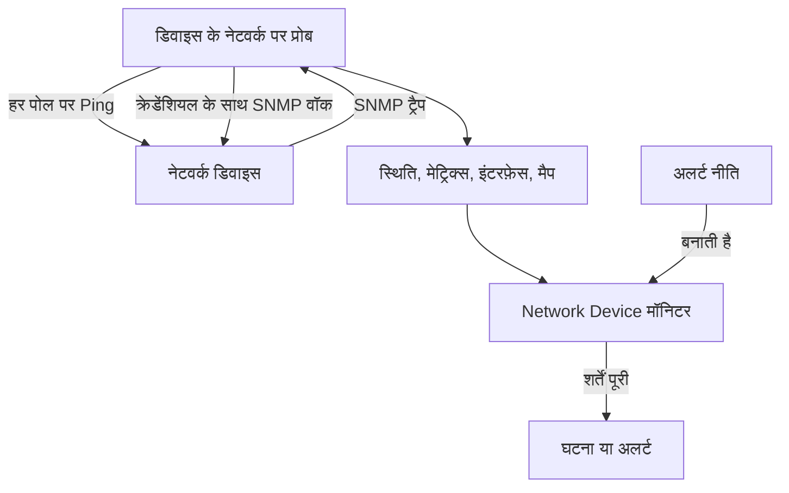
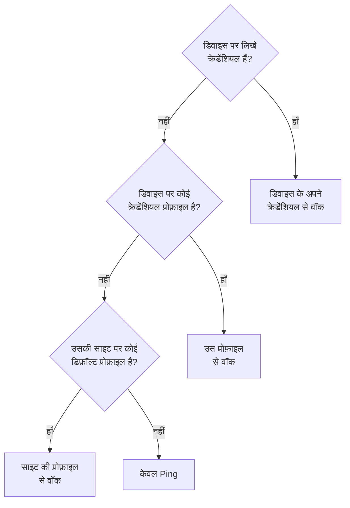
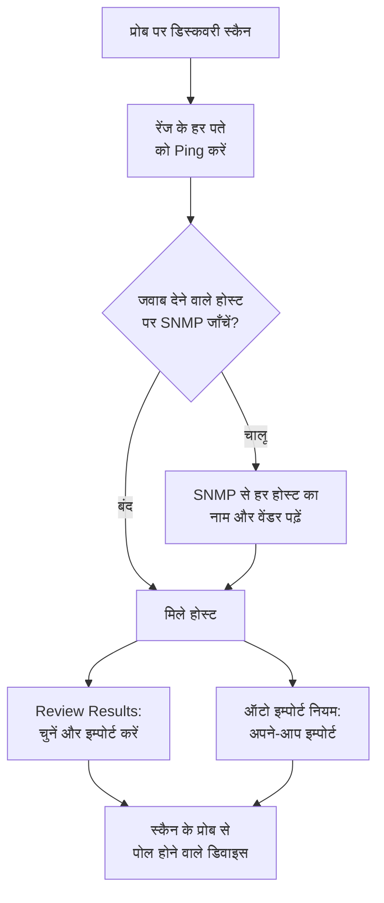
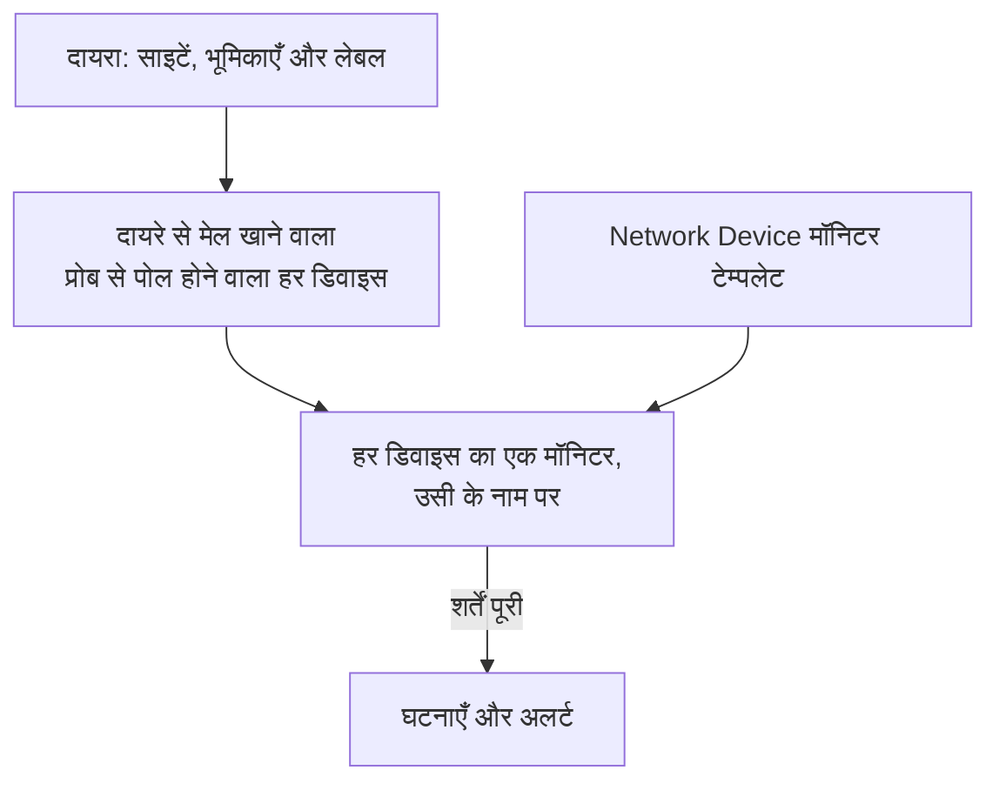
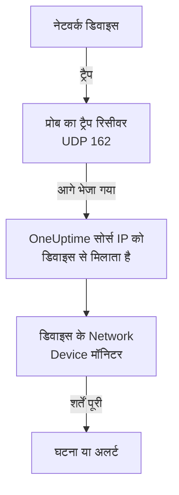

# नेटवर्क डिवाइस मॉनिटर

स्विच, राउटर, फ़ायरवॉल, एक्सेस पॉइंट, PDU, कैमरे और प्रिंटर मॉनिटर करें: आपके नेटवर्क पर पते वाली कोई भी चीज़, चाहे वह SNMP बोलती हो या नहीं।

किसी डिवाइस को उसके पते और एक प्रोब के साथ जोड़ें, और प्रोब तय समय पर उसे Ping करता है: डिवाइस को चालू या बंद की स्थिति मिलती है, नेटवर्क मैप पर एक जगह मिलती है और उसकी साइट की स्थिति में एक वोट मिलता है। उसे SNMP क्रेडेंशियल दें, और वही प्रोब उसे वॉक भी करता है: इंटरफ़ेस और उनमें लगे ऑप्टिक, हार्डवेयर इन्वेंटरी, LLDP और CDP पड़ोसी, और हेल्थ OID। एक मॉनिटर जोड़ें, या पूरे बेड़े के लिए एक अलर्ट नीति, और उसके पोल और ट्रैप घटनाएँ और अलर्ट बनाते हैं।

:::cards
- [डिवाइस जोड़ें](#नेटवर्क-डिवाइस-जोड़ना): उसका पता और एक प्रोब, एक ही पेज पर।
- [नेटवर्क खोजें](#नेटवर्क-स्कैन-से-डिवाइस-खोजना): पतों की एक रेंज स्कैन करें और जो जवाब दे उसे इम्पोर्ट करें।
- [SNMP से डिवाइस पढ़ें](#snmp-क्रेडेंशियल-और-क्रेडेंशियल-प्रोफ़ाइल): इंटरफ़ेस, ऑप्टिक, इन्वेंटरी और स्थिति।
- [अलर्ट पाएँ](#अलर्टिंग): एक डिवाइस के लिए मॉनिटर, बेड़े के लिए नीति।
- [मैप देखें](#नेटवर्क-टोपोलॉजी): लाइव बनते पड़ोसी, PDF के रूप में एक्सपोर्ट।
- [समस्या ठीक करें](#समस्या-निवारण): लंबित डिवाइस, विफल वॉक, न पहुँचने वाले ट्रैप।
:::

## यह कैसे काम करता है



डिवाइस और मॉनिटर अलग-अलग काम करते हैं:

| हिस्सा | यह क्या करता है | कब ज़रूरी है |
| --- | --- | --- |
| डिवाइस | उसका प्रोब उसे डिवाइस के अपने शेड्यूल पर पोल करता है। हर पोल पहुँच, Ping राउंड-ट्रिप टाइम और पैकेट लॉस दर्ज करता है; SNMP क्रेडेंशियल वाला पोल डिवाइस की पहचान, इंटरफ़ेस, पड़ोसी और हेल्थ OID भी पढ़ता है। | हमेशा: आप डिवाइस ही जोड़ते हैं। |
| मॉनिटर | डिवाइस के हर पोल परिणाम और हर ट्रैप पर शर्तें जाँचता है, और घटनाएँ और अलर्ट खोलता है। | केवल घटनाओं और अलर्ट के लिए। स्थिति, इन्वेंटरी, चार्ट और मैप के लिए मॉनिटर की ज़रूरत नहीं। |

## शुरू करने से पहले

- **डिवाइस तक पहुँच सकने वाला प्रोब।** प्रोब डिवाइस को अपने ही नेटवर्क से Ping और वॉक करता है, इसलिए निजी पते वाले डिवाइस को उसी नेटवर्क के अंदर एक [कस्टम प्रोब](/docs/probe/custom-probe) चाहिए: सार्वजनिक इंटरनेट पर मौजूद प्रोब उस तक नहीं पहुँच सकता।
- **Ping से आगे के लिए SNMP।** वैकल्पिक। डिवाइस पर सेट v1 या v2c कम्युनिटी स्ट्रिंग, या SNMPv3 यूज़र, और प्रोब से UDP 161 खुला होना चाहिए। इसके बिना डिवाइस को केवल Ping किया जाता है।
- **ट्रैप, syslog और फ़्लो।** वैकल्पिक। प्रोब UDP 162 पर SNMP ट्रैप लेता है, चालू करने पर UDP 5140 पर syslog, और UDP 2055, 4739 और 6343 पर फ़्लो रिकॉर्ड, इसलिए अपने डिवाइसों से प्रोब तक ये पोर्ट खोलें।

## नेटवर्क अवलोकन

**नेटवर्क → अवलोकन** वह जगह है जहाँ नेटवर्क क्षेत्र खुलता है, और यह जवाब से शुरू होता है: एक वाक्य जो बताता है कि आपका नेटवर्क ठीक है या नहीं, और अगर नहीं, तो क्या गड़बड़ है, सबसे बुरी ख़बर पहले।

| यह क्या कहता है | कब |
| --- | --- |
| **3 डिवाइस बंद हैं** | किसी डिवाइस का प्रोब या मॉनिटर उस तक नहीं पहुँच पाता। |
| **2 साइटों पर ध्यान देना ज़रूरी है** | हर डिवाइस जवाब देता है, लेकिन किसी साइट की स्थिति ऑपरेशनल नहीं है। |
| **5 इंटरफ़ेस बंद हैं** | हर डिवाइस जवाब देता है, लेकिन कुछ पोर्ट बंद हैं। |
| **2 डिवाइस अपना विवरण नहीं भेज रहे** | वे Ping का जवाब देते हैं, लेकिन उनका SNMP वॉक विफल हो रहा है, इसलिए उनके इंटरफ़ेस और स्थिति ताज़ा नहीं होते: आम तौर पर क्रेडेंशियल की समस्या। |
| **पहली जाँच की प्रतीक्षा** | डिवाइस जोड़े गए हैं और उनके प्रोब ने अभी तक उनकी जाँच नहीं की है। |
| **सभी 40 डिवाइस चालू हैं** | हर डिवाइस जवाब देता है। जो डिवाइस अभी पहली जाँच की प्रतीक्षा में हैं, उन्हें अलग पंक्ति में गिना जाता है। |

उसके नीचे, एक पंक्ति बताती है कि डिवाइस बंद होने पर कोई चीज़ घटना बनाती है या नहीं: कितनी [अलर्ट नीतियाँ](#अलर्ट-नीतियाँ) चालू हैं, या कोई न हो तो **Set up alerts** लिंक। उसके बगल के **Add Device** और **Discover Devices** बटन वे फ़ॉर्म खोलते हैं, और नीचे की टाइलें और सूचियाँ विवरण देती हैं: ध्यान माँगने वाले डिवाइस और साइटें, वेंडर के अनुसार बेड़ा, और हाल के स्कैन।

कुछ भी जोड़े जाने से पहले, अवलोकन इसके बजाय शुरुआत के दो रास्ते दिखाता है: **डिवाइस खोजें** पतों की एक रेंज स्कैन करता है ताकि आप चुन सकें कि क्या जोड़ना है, जो पूरे नेटवर्क या नई साइट के लिए सबसे अच्छा है, और **एक डिवाइस जोड़ें** IP पते या होस्टनाम से एक डिवाइस जोड़ता है।

नेटवर्क मेन्यू वह सब सामने रखता है जो आप रोज़ खोलते हैं: **अवलोकन**, **Devices**, **साइटें**, **Map**, **Traffic** और **Discovery**। बाक़ी सेक्शन में मुड़ा रहता है, और किसी सेक्शन का कोई भी पेज खुलने पर वह सेक्शन अपने-आप खुल जाता है:

| सेक्शन | पेज |
| --- | --- |
| **टोपोलॉजी** | **Device Topology**, **एंडपॉइंट**, **Latency Matrix**, **Site Links**, **Device Links** |
| **नियम** | **Auto Import Rules**, **Site Assignment Rules**, **स्वामी नियम**, **लेबल नियम**, **Link Rules** |
| **सेटिंग्स** | **Alert Policies**, **SNMP क्रेडेंशियल**, **Device Roles**, **Site Types**, **OID Collection Templates** |
| **उन्नत** | **Archived Devices** |

## नेटवर्क डिवाइस जोड़ना

:::steps
### Devices सूची खोलें
**नेटवर्क → Devices** पर जाएँ और **Add Device** पर क्लिक करें। नेटवर्क **अवलोकन** पर **Add Device** भी यही फ़ॉर्म खोलता है।

### डिवाइस का पता लिखें
**होस्टनाम** में उसका IP पता या होस्टनाम लिखें। डिवाइस को उसके होस्टनाम से नाम देने के लिए **नाम** खाली छोड़ें।

### साइट और प्रोब जाँचें
अगर आप साइटें इस्तेमाल करते हैं, तो वह **Site** चुनें जिसमें डिवाइस है। **प्रोब** अपने-आप साइट के डिफ़ॉल्ट प्रोब से, या प्रोजेक्ट के इकलौते कस्टम प्रोब से भर जाता है; पक्का करें कि वह डिवाइस तक पहुँच सकता है।

### डिवाइस जोड़ें
**Add Device** पर क्लिक करें। कुछ ही मिनटों में प्रोब डिवाइस को Ping करता है और उसकी स्थिति **Up** या **Down** हो जाती है। SNMP क्रेडेंशियल होने पर, पहले सफल वॉक के बाद उसके अवलोकन में डिवाइस की पहचान, इंटरफ़ेस और स्थिति भी भर जाती है।
:::

फ़ॉर्म एक पेज का है — होस्टनाम, नाम, साइट और प्रोब — और उसके नीचे **SNMP** और **और फ़ील्ड** मुड़े हुए हैं। यह नहीं पूछता कि डिवाइस को कैसे मॉनिटर किया जाए: आपके जोड़े हर डिवाइस को उसका प्रोब पोल करता है, और जिन गिने-चुने डिवाइसों को ज़रूरत हो उनके लिए [बाउंड-मॉनिटर ओवरराइड](#बाउंड-मॉनिटर-ओवरराइड) डिवाइस के **सेटिंग्स** पेज पर है।

डिवाइस का विवरण — उसका नाम, विवरण, भूमिका, साइट, लेबल और पते — बाद में एक ही जगह संपादित होता है: उसके **सेटिंग्स** पेज पर **Device Settings** कार्ड। उसके अवलोकन पर **डिवाइस विवरण** कार्ड इन्हें दिखाता है, **सेटिंग्स में संपादित करें** लिंक के साथ।

### डिवाइस

| फ़ील्ड | विवरण | आवश्यक |
| --- | --- | --- |
| होस्टनाम | वह IP पता या होस्टनाम जिसे प्रोब Ping करता है, और डिवाइस के पास क्रेडेंशियल होने पर SNMP से वॉक करता है। | हाँ |
| नाम | एक आसान नाम, जैसे core-switch-01। इसे खाली छोड़ें और डिवाइस का नाम उसके होस्टनाम पर रखा जाता है। API भी यही करता है: बिना नाम के बनाए गए डिवाइस का नाम उसके होस्टनाम पर रखा जाता है। | नहीं |
| Site | वह [नेटवर्क साइट](/docs/monitor/network-sites) जिसमें डिवाइस है। साइट की स्थिति उसके डिवाइसों से ऊपर जुड़ती है, और डिफ़ॉल्ट प्रोब वाली साइट नीचे का प्रोब भर देती है। | नहीं |
| प्रोब | वह प्रोब जो इस डिवाइस को Ping करता है, क्रेडेंशियल होने पर उसे SNMP से वॉक करता है, और उसके ट्रैप, syslog और [फ़्लो रिकॉर्ड](/docs/monitor/network-traffic) लेता है। उसे डिवाइस तक सीधे पहुँचना चाहिए: सार्वजनिक इंटरनेट पर मौजूद प्रोब निजी पते तक नहीं पहुँच सकता। | हाँ |

**प्रोब** जहाँ हो सके अपने-आप भर जाता है: ठीक एक कस्टम प्रोब वाला प्रोजेक्ट उसी से शुरू होता है, और साइट चुनने पर उसकी जगह [साइट का डिफ़ॉल्ट प्रोब](/docs/monitor/network-sites#मॉनिटरिंग-डिफ़ॉल्ट) आ जाता है। यह आपके ख़ुद चुने प्रोब को कभी नहीं बदलता। अपनी साइटों पर डिफ़ॉल्ट प्रोब सेट करें, और डिवाइस सिर्फ़ उसके पते से जोड़ा जा सकता है।

### और फ़ील्ड (मुड़े हुए)

| फ़ील्ड | विवरण | आवश्यक |
| --- | --- | --- |
| विवरण | मुक्त टेक्स्ट। | नहीं |
| Device Role | कोर स्विच, एक्सेस स्विच, फ़ायरवॉल आदि। यह मैप पर डिवाइस का स्तर तय करता है और अलर्ट नीतियों का दायरा सीमित करता है। | नहीं |
| MAC पता | डिवाइस का अपना MAC। मैप इसका इस्तेमाल उस डिवाइस को, जो न LLDP बोलता है न CDP, उस स्विच पोर्ट पर रखने के लिए करता है जिसने उसे सीखा; देखें [केवल-Ping डिवाइस और उनका स्विच पोर्ट](#केवल-ping-डिवाइस-और-उनका-स्विच-पोर्ट)। आम तौर पर राउटर की ARP टेबल से अपने-आप सीखा जाता है। | नहीं |
| घटनाओं के लिए एक Ping मॉनिटर भी बनाएँ | प्रोब पहले से डिवाइस को Ping करता है और उसे स्थिति देता है; विफल Ping को घटना में बदलने वाला Ping मॉनिटर है। इसे टिक करें और सेव करते समय होस्टनाम पर एक मॉनिटर बनकर डिवाइस से बाँध दिया जाता है। यह आपके प्लान में गिना जाता है, और जब तक आप मॉनिटर के पेज से इन्हें चालू न करें, इसकी घटनाएँ बंद रहती हैं। | नहीं |

Ping मॉनिटर बॉक्स टिक करने पर **Ping from probes** दिखता है, यानी मॉनिटर के अपने प्रोब। उन्हें डिवाइस के नेटवर्क तक पहुँचना चाहिए; प्रोजेक्ट के डिफ़ॉल्ट प्रोब इस्तेमाल करने के लिए फ़ील्ड खाली छोड़ें। एक साथ कई डिवाइसों पर अलर्ट के लिए, इसके बजाय [अलर्ट नीतियाँ](#अलर्ट-नीतियाँ) इस्तेमाल करें।

### SNMP (मुड़ा हुआ, वैकल्पिक)

इसे मुड़ा रहने दें और डिवाइस को केवल Ping किया जाता है: मुड़ा हुआ सेक्शन यह एक वाक्य में बताता है। डिवाइस को फिर भी पहले पोल से स्थिति मिलती है और वह अपनी साइट में और मैप पर रहता है, लेकिन क्रेडेंशियल मिलने तक उसके कोई इंटरफ़ेस, इन्वेंटरी या हेल्थ OID नहीं होते। कम्युनिटी स्ट्रिंग या v3 यूज़र लिखने, या सेव की गई क्रेडेंशियल प्रोफ़ाइल चुनने के लिए सेक्शन खोलें।

:::tabs
@tab SNMP v1 / v2c
| फ़ील्ड | विवरण | आवश्यक |
| --- | --- | --- |
| SNMP संस्करण | V1, V2c या V3। | हाँ, V2c से शुरू |
| SNMP Community String | v1 या v2c कम्युनिटी स्ट्रिंग, जैसे `public`। | नहीं: खाली का मतलब केवल Ping |
| SNMP Port | वह UDP पोर्ट जिस पर एजेंट सुनता है। | नहीं, डिफ़ॉल्ट 161 |
| SNMP Credential Profile | यहाँ क्रेडेंशियल लिखने के बजाय इस्तेमाल करने के लिए सेव किया गया क्रेडेंशियल सेट। | नहीं |
@tab SNMPv3
| फ़ील्ड | विवरण | आवश्यक |
| --- | --- | --- |
| SNMP v3 Security Level | No Auth, No Priv; Auth, No Priv; या Auth, Priv। | हाँ |
| SNMP v3 Username | डिवाइस पर कॉन्फ़िगर किया गया सुरक्षा नाम (यूज़र)। | हाँ: खाली का मतलब केवल Ping |
| SNMP v3 Authentication Protocol | MD5, SHA, SHA-256 या SHA-512। | प्रमाणीकरण के साथ |
| SNMP v3 Authentication Key | प्रमाणीकरण पासफ़्रेज़। | प्रमाणीकरण के साथ |
| SNMP v3 Privacy Protocol | DES, AES या AES-256। | प्राइवेसी के साथ |
| SNMP v3 Privacy Key | प्राइवेसी (एन्क्रिप्शन) पासफ़्रेज़। | प्राइवेसी के साथ |
:::

डिवाइस पर लिखे गए क्रेडेंशियल उसके बगल में चुनी गई क्रेडेंशियल प्रोफ़ाइल पर भारी पड़ते हैं, और डिवाइस की साइट भी एक डिफ़ॉल्ट प्रोफ़ाइल रख सकती है। प्रोफ़ाइल पर क्रेडेंशियल स्टोरेज में एन्क्रिप्ट रहते हैं। डिवाइस पर लिखे गए क्रेडेंशियल उन्हीं पढ़ने की अनुमतियों से सुरक्षित हैं, लेकिन स्टोरेज में एन्क्रिप्ट नहीं होते: साझा क्रेडेंशियल को प्रोफ़ाइल पर रखने का एक और कारण।

## एक साथ कई डिवाइस बदलना

किसी ग्राहक के नेटवर्क का डिस्कवरी स्कैन दर्जनों ऐसे डिवाइस लाता है जो एक ही साइट के हैं, एक ही भूमिका साझा करते हैं और एक ही वेंडर से आते हैं। आपको उनमें से हर एक को नहीं खोलना पड़ता: **Devices** सूची में पंक्तियाँ टिक करके या फ़िल्टर से मेल खाने वाले हर डिवाइस को चुनकर उन्हें चुनें, और **बल्क कार्रवाइयाँ** खोलें।

| कार्रवाई | यह क्या करती है |
| --- | --- |
| **साइट सेट करें** / **साइट हटाएँ** | हर चुने गए डिवाइस को आपकी चुनी साइट में ले जाती है, जहाँ वह साइट की स्थिति में गिना जाता है; जिस डिवाइस का अपना प्रोब नहीं है, उसे साइट का डिफ़ॉल्ट प्रोब मिल जाता है। **साइट हटाएँ** उन्हें उनकी साइटों से बाहर कर देता है। जिस डिवाइस से कोई साइट असाइनमेंट नियम मेल खाता है, वह अपने अगले पोल पर नियम की साइट में लौट जाता है, इसलिए जिन डिवाइसों को डिस्कवरी बार-बार ढूँढती है, उनके लिए इसके बजाय **नेटवर्क → नियम → Site Assignment Rules** के तहत नियम जोड़ें; **साइट सेट करें** डायलॉग वहाँ का लिंक देता है। |
| **डिवाइस की भूमिका सेट करें** / **डिवाइस की भूमिका हटाएँ** | हर चुने गए डिवाइस को एक भूमिका देती है, जैसे बीस स्विच जो सभी "Access Switch" हैं। भूमिकाएँ प्रोजेक्ट की अपनी हैं, **नेटवर्क → सेटिंग्स → Device Roles** के तहत, जिसका लिंक डायलॉग देता है। **डिवाइस की भूमिका हटाएँ** हर डिवाइस की भूमिका उसकी SNMP पहचान से फिर से तय करता है। |
| **वेंडर टेम्पलेट लागू करें** | किसी [वेंडर टेम्पलेट](#वेंडर-हेल्थ-टेम्पलेट) के हेल्थ OID और SNMP टेबल हर चुने गए डिवाइस में जोड़ती है। **हर डिवाइस के वेंडर से मिलाएँ**, डायलॉग का पहला विकल्प, हर डिवाइस का अपना टेम्पलेट उसके SNMP वॉक की जानकारी से चुनता है, ताकि मिली-जुली चुनी गई सूची में भी हर जगह सही टेम्पलेट लगे; या सभी के लिए एक टेम्पलेट चुनें। |

हर कार्रवाई पूरे चयन के लिए एक डायलॉग और एक सेव है, और हर डिवाइस उन्हीं जाँचों से गुज़रता है जो उसके अपने सेटिंग्स पेज पर संपादन में होती हैं: अनुमतियाँ, आपकी भूमिका का लेबल और स्वामी दायरा, और यह सीमा कि डिवाइस क्या-क्या इकट्ठा कर सकता है।

**वेंडर टेम्पलेट लागू करें** कुछ भी करने से पहले दिखाता है कि वह क्या करेगा: कितने डिवाइसों को कौन-सा टेम्पलेट मिलेगा, और कितने छोड़ दिए जाएँगे और क्यों। यह हर डिवाइस के पहले से इकट्ठा किए जा रहे डेटा में जोड़ता है और कुछ नहीं हटाता, और जिस डिवाइस के पास टेम्पलेट का सब कुछ पहले से है, उसे दोबारा नहीं लिखा जाता। यह मॉनिटर-आधारित डिवाइस (जिसे कुछ पोल नहीं करता), किसी [OID Collection Template](#oid-कलेक्शन-टेम्पलेट) से जुड़े डिवाइस (टेम्पलेट तय करता है कि वह क्या इकट्ठा करे, इसलिए वेंडर के OID वहाँ जोड़ें), और मिलान करते समय ऐसे डिवाइस को छोड़ देता है जिसे अभी SNMP से वॉक नहीं किया गया है या जिसके वेंडर का कोई टेम्पलेट नहीं है।

कार्रवाई पूरी होने पर यह बताती है कि कितने डिवाइस बदले, कौन-से विफल हुए और क्यों — ऐसा डिवाइस जिसे आपकी भूमिका संपादित नहीं कर सकती, सीमा से बड़ी सूची — और कौन-से नहीं बदले और क्यों: जो डिवाइस पहले से उस साइट या भूमिका में है, या जिसे वेंडर टेम्पलेट छोड़ देता है।

बाक़ी बल्क कार्रवाइयाँ वहीं बताई गई हैं जहाँ वे आती हैं: **Set OID Collection Template** [OID कलेक्शन टेम्पलेट](#oid-कलेक्शन-टेम्पलेट) में, **Set SNMP Credential Profile**, **Switch to Probe Polling** और **Create Ping Monitors** [एक साथ कई डिवाइसों पर](#एक-साथ-कई-डिवाइसों-पर) में, और **Shorten Names to Hostname** [खोजे गए डिवाइसों के नाम कैसे रखे जाते हैं](#खोजे-गए-डिवाइसों-के-नाम-कैसे-रखे-जाते-हैं) में।

## एक पोल असल में क्या करता है

प्रोब से पोल होने वाले डिवाइस का हर पोल एक Ping है। जब डिवाइस के पास इस्तेमाल लायक SNMP क्रेडेंशियल हों, तो प्रोब एक पूरा SNMP वॉक भी चलाता है। दोनों साथ-साथ चलते हैं और वॉक कभी Ping का इंतज़ार नहीं करता, इसलिए ICMP गिराने वाले ACL के पीछे का SNMP उपकरण भी **Up** रिपोर्ट करता है।

| परिणाम | केवल-Ping डिवाइस | SNMP क्रेडेंशियल वाला डिवाइस |
| --- | --- | --- |
| स्थिति (Up या Down) | Ping से | Ping या वॉक से: किसी एक का जवाब काफ़ी है |
| Ping राउंड-ट्रिप टाइम और पैकेट लॉस | डिवाइस मेट्रिक्स के रूप में दर्ज | डिवाइस मेट्रिक्स के रूप में दर्ज |
| SNMP प्रतिक्रिया समय | — | वॉक का समय, Ping का कभी नहीं |
| इंटरफ़ेस, पड़ोसी, एंडपॉइंट | — | सफल वॉक से |
| सिस्टम पहचान, वेंडर, मॉडल, सीरियल | — | सफल वॉक से |
| हेल्थ OID और SNMP टेबल | — | सफल वॉक से |

इस्तेमाल लायक क्रेडेंशियल का मतलब है [क्रेडेंशियल चेन](#snmp-क्रेडेंशियल-और-क्रेडेंशियल-प्रोफ़ाइल) से मिला कम्युनिटी स्ट्रिंग वाला v1 या v2c सेट, या यूज़रनेम वाला v3 सेट। खाली सेट छोड़ दिया जाता है, इसलिए किसी डिवाइस को कभी अनुमानित डिफ़ॉल्ट कम्युनिटी से वॉक नहीं किया जाता।

पैकेट लॉस [Ping मॉनिटर](/docs/monitor/ping-monitor) की सीरीज़ को ही इस्तेमाल करता है, इसलिए पूरे प्रोडक्ट में एक जैसा पढ़ा जाता है। राउंड-ट्रिप टाइम की अपनी सीरीज़ है, `oneuptime.monitor.ping.round.trip.time`, क्योंकि नेटवर्क डिवाइस पर सामान्य प्रतिक्रिया समय SNMP वॉक का होता है। डिवाइस का **मेट्रिक्स** पेज इंटरफ़ेस उपयोग और हेल्थ OID के चार्ट दिखाता है; पिछले एक घंटे का राउंड-ट्रिप टाइम मैप पर डिवाइस के ड्रॉअर में दिखता है।

### "SNMP failing" का मतलब "Down" नहीं है

जो डिवाइस Ping का जवाब देता है लेकिन जिसका वॉक विफल होता है, वह **Up** है, **SNMP failing** टैग के साथ, और दोनों हिस्से मायने रखते हैं:

- वह Up है क्योंकि उस पते पर कुछ जवाब दे रहा है। उसे लाल दिखाने से ठीक चल रहा डिवाइस आपकी घटनाओं की गिनती में आ जाएगा।
- वह SNMP failing है क्योंकि उसके इंटरफ़ेस, इन्वेंटरी और हेल्थ OID ताज़ा होना बंद हो गए हैं, लगभग हमेशा क्रेडेंशियल, बंद SNMP एजेंट या किसी ACL की वजह से। पेज पर और कुछ भी आपको यह नहीं बताएगा कि आँकड़े जमे हुए हैं।

जिस डिवाइस का Ping और वॉक दोनों विफल हों, वह सीधे **Down** है, इसलिए यह टैग हमेशा केवल हरे बैज के बगल में दिखता है।

### डिवाइस की स्थिति पढ़ना

डिवाइस दिखाने वाली हर जगह — Devices सूची, किसी साइट का Devices पेज, अवलोकन, मैप — वही तीन फ़ैसले और उनके बगल में वही क्वालिफ़ायर इस्तेमाल करती है।

| फ़ैसला | मतलब |
| --- | --- |
| **Up** | पिछला पोल (Ping या SNMP), या बाउंड मॉनिटर, डिवाइस तक पहुँचा। |
| **Down** | पिछला पोल (Ping या SNMP), या बाउंड मॉनिटर, डिवाइस तक नहीं पहुँच सका। |
| **लंबित** | अभी कोई फ़ैसला नहीं: कभी पोल नहीं हुआ, कोई प्रोब असाइन नहीं है, या कोई मॉनिटर बाउंड नहीं है। |

| क्वालिफ़ायर | कब दिखता है | क्या करें |
| --- | --- | --- |
| **Stale** | डिवाइस के अंतराल से काफ़ी ज़्यादा समय से कोई पोल नहीं हुआ है। | जाँचें कि डिवाइस का प्रोब ऑनलाइन है और अपने बेड़े के साथ तालमेल रख पा रहा है। |
| **No probe** | डिवाइस प्रोब से पोल होता है लेकिन उसका कोई प्रोब नहीं है, या उसका पोलिंग बंद है। | ऐसा प्रोब असाइन करें जो उस तक पहुँच सके; तब तक उसे कुछ पोल नहीं करता। |
| **No monitor** | डिवाइस [बाउंड-मॉनिटर ओवरराइड](#बाउंड-मॉनिटर-ओवरराइड) इस्तेमाल करता है और कुछ भी बाउंड नहीं है। | एक मॉनिटर बाँधें, या उसे वापस प्रोब पोलिंग पर ले आएँ। |
| **SNMP failing** | Ping पर Up, लेकिन पिछला SNMP वॉक विफल हुआ। | क्रेडेंशियल, SNMP एजेंट या ACL जाँचें। |

**Devices** सूची में तीन मानों वाला **SNMP** फ़िल्टर है: **OK** (पिछला वॉक सफल), **Failing** (पिछला वॉक विफल) और **Not configured** (केवल Ping, कोई क्रेडेंशियल नहीं, या कभी पोल नहीं हुआ)। "किन डिवाइसों के क्रेडेंशियल ने काम करना बंद कर दिया" बस एक क्लिक है। जिस डिवाइस को Ping किया जाता है और कभी वॉक नहीं किया जाता, उसके लिए सूची का **Interfaces (Up / Down)** कॉलम `0 / 0` के बजाय **No SNMP** दिखाता है: शून्य चालू पोर्ट एक अलग दावा होता, और ग़लत भी।

## SNMP क्रेडेंशियल और क्रेडेंशियल प्रोफ़ाइल

डिवाइस को इस क्रम में मिले पहले इस्तेमाल लायक क्रेडेंशियल सेट से वॉक किया जाता है, और पहला मिलते ही खोज रुक जाती है:



साइट वाला कदम सिर्फ़ डिवाइस की अपनी साइट पढ़ता है, उससे ऊपर नहीं: किसी Unit में मौजूद डिवाइस उसके ऊपर के Region पर सेट प्रोफ़ाइल नहीं लेता। साइट का डिफ़ॉल्ट प्रोब ट्री में नीचे तक पहुँचता है, क्योंकि प्रोब डिवाइस पर एक बार कॉपी होता है जबकि क्रेडेंशियल हर पोल पर दोबारा पढ़े जाते हैं; विवरण [नेटवर्क साइटें](/docs/monitor/network-sites#मॉनिटरिंग-डिफ़ॉल्ट) में है।

### SNMP क्रेडेंशियल पेज

**नेटवर्क → सेटिंग्स → SNMP क्रेडेंशियल** में प्रोजेक्ट की क्रेडेंशियल प्रोफ़ाइलें रहती हैं। एक प्रोफ़ाइल एक नामित सेट है — v1 या v2c कम्युनिटी स्ट्रिंग, या अपने सुरक्षा स्तर, प्रोटोकॉल और कुंजियों वाला v3 यूज़र — जिसकी ओर कितने भी डिवाइस और साइटें इशारा कर सकती हैं। डिवाइसों पर कुछ कॉपी नहीं होता, इसलिए कम्युनिटी स्ट्रिंग बदलना यहाँ बस एक संपादन है, और प्रोफ़ाइल इस्तेमाल करने वाला हर डिवाइस अगले पोल पर नया मान ले लेता है।

प्रोफ़ाइल पर रखे सीक्रेट स्टोरेज में एन्क्रिप्ट रहते हैं, और उन्हें केवल वही भूमिकाएँ पढ़ सकती हैं जो डिवाइस के अपने क्रेडेंशियल पढ़ सकती हैं। अपनी प्रोफ़ाइल दिखाने वाला डिवाइस या साइट प्रोफ़ाइल का नाम और संस्करण दिखाता है, उसके सीक्रेट कभी नहीं।

जिस प्रोफ़ाइल की ओर कोई डिवाइस या साइट अब भी इशारा करती है, उसे हटाया नहीं जा सकता: हटाना रास्ते में आ रही चीज़ों की गिनती के साथ अस्वीकार हो जाता है। उन डिवाइसों और साइटों को दूसरी प्रोफ़ाइल पर ले जाएँ, या उन पर से प्रोफ़ाइल हटाएँ, फिर उसे हटाएँ।

### डिवाइस को वापस केवल-Ping डिवाइस बनाना

डिवाइस के **सेटिंग्स** पेज पर, **सेटिंग्स संपादित करें** के **SNMP क्रेडेंशियल** चरण में एक **Ping only — clear this device's own SNMP credentials** चेकबॉक्स है। सेव करने पर यह डिवाइस की अपनी कम्युनिटी स्ट्रिंग और v3 यूज़रनेम साफ़ कर देता है। यह इसलिए है क्योंकि सही फ़ील्ड खाली करना साफ़ नहीं होता: v3 डिवाइस तब तक वॉक होता रहता है जब तक उसका यूज़रनेम बचा है, चाहे आप और कुछ भी खाली कर दें।

डिवाइस के अपने क्रेडेंशियल साफ़ करने से प्रोफ़ाइल साफ़ नहीं होती। अगर डिवाइस या उसकी साइट अब भी किसी प्रोफ़ाइल का नाम लेती है, तो डिवाइस उसी से वॉक होता रहता है; डिवाइस को केवल Ping कराने के लिए प्रोफ़ाइल भी साफ़ करें।

### एक साथ कई डिवाइसों पर

**Devices** सूची में डिवाइस चुनें और इस्तेमाल करें:

- **Set SNMP Credential Profile** / **Clear SNMP Credential Profile**: किसी चयन पर प्रोफ़ाइल लगाएँ, या उसे हटाएँ।
- **Switch to Probe Polling**: बाउंड-मॉनिटर ओवरराइड वाले डिवाइसों के लिए। एक प्रोब चुनें, और उसके बाद हर चुना गया डिवाइस अपने शेड्यूल पर Ping होता है, और क्रेडेंशियल मिलते ही वॉक भी। पहले से बाउंड मॉनिटर बाउंड रहता है; डिवाइस की स्थिति अब प्रोब से आती है।
- **Create Ping Monitors**: बाउंड-मॉनिटर ओवरराइड वाले डिवाइसों के लिए, हर डिवाइस के होस्टनाम पर एक Ping मॉनिटर बनाकर उसे बाँध देता है, ताकि डिवाइस Up या Down दिखे।

जब प्रोजेक्ट में बाउंड-मॉनिटर ओवरराइड वाले ऐसे डिवाइस हों जिनसे कुछ भी बाउंड नहीं है — ऐसे डिवाइस जिन्हें न कुछ पोल करता है न कुछ रिपोर्ट करता है — तो **Devices** पेज एक बैनर दिखाता है और उन्हें ठीक करने वाले चयन का लिंक देता है।

## साइट मॉनिटरिंग डिफ़ॉल्ट

एक [नेटवर्क साइट](/docs/monitor/network-sites#मॉनिटरिंग-डिफ़ॉल्ट) अपने डिवाइसों के लिए दो डिफ़ॉल्ट रखती है। उसका **Default Probe** उस डिवाइस पर कॉपी होता है जो साइट में बनाया जाता है या साइट में लाया जाता है और जिसका अपना प्रोब नहीं है। उसकी **Default SNMP Credential Profile** साइट के उस डिवाइस के हर पोल पर पढ़ी जाती है जिसके अपने क्रेडेंशियल नहीं हैं। साइट पर दोनों सेट करें, और वहाँ का डिवाइस सिर्फ़ अपने पते से जोड़ा जा सकता है, फिर पहले पोल से Ping और वॉक होता है। साइट गाइड बताती है कि हर डिफ़ॉल्ट साइट ट्री में कितनी दूर तक नीचे पहुँचता है।

## बाउंड-मॉनिटर ओवरराइड

कुछ उपकरण ऐसे होते हैं जिन तक कोई प्रोब नहीं पहुँच सकता या जिन्हें Ping करना काम का नहीं: NAT के पीछे का डिवाइस, ऐसा अप्लायंस जिसकी स्थिति HTTP जाँच से बेहतर आँकी जाती है, ऐसी सेवा जिसका असली संकेत पोर्ट जाँच है। इनके लिए, डिवाइस के **सेटिंग्स** पेज पर **सेटिंग्स संपादित करें** में एक **Monitoring Method** है:

| तरीक़ा | इसका मतलब |
| --- | --- |
| **प्रोब** | डिफ़ॉल्ट। असाइन किया गया प्रोब इसे शेड्यूल पर Ping करता है, और क्रेडेंशियल होने पर SNMP से वॉक करता है। |
| **Bound monitor** | किसी मौजूदा मॉनिटर की स्थिति ही इस डिवाइस की स्थिति है। |

डिवाइस को **Bound monitor** पर बदलने से उसका पोलिंग बंद हो जाता है। प्रोब, अंतराल और पोलिंग स्विच **Polling & Data Collection** कार्ड से हट जाते हैं, डिवाइस के पुराने पोल परिणाम साफ़ हो जाते हैं, और उसकी स्थिति आपके बाँधे मॉनिटर से आती है। मॉनिटर बाँधना वैकल्पिक है: जब तक आप न बाँधें, डिवाइस **लंबित** दिखता है, **No monitor** टैग के साथ।

वापस **प्रोब** पर बदलने से पोलिंग लौट आता है और एक प्रोब माँगा जाता है। जो मॉनिटर बाउंड था वह बाउंड रहता है और अलर्ट भेजता रहता है; बस वह अब डिवाइस की स्थिति तय नहीं करता।

ज़्यादातर डिवाइसों को इसकी ज़रूरत नहीं होती। प्रोब से पोल होने वाले हर डिवाइस के पास पहले से पहुँच की स्थिति है, इसलिए उसे पाने के लिए Ping मॉनिटर बाँधने की ज़रूरत नहीं; मॉनिटर तब बाँधें जब आपको उस मॉनिटर की घटनाएँ चाहिए हों।

## पोलिंग और डेटा संग्रह

पोलिंग डिवाइस के **सेटिंग्स** पेज पर, **Polling & Data Collection** कार्ड (**Polling संपादित करें**) में रहती है। डिफ़ॉल्ट नए डिवाइस के लिए ठीक हैं, इसलिए कुछ बदलने की ज़रूरत नहीं:

| सेटिंग | विवरण | डिफ़ॉल्ट |
| --- | --- | --- |
| प्रोब | डिवाइस को पोल करने वाला प्रोब। | डिवाइस जोड़ते समय सेट |
| Polling Enabled | प्रोब नीचे दिए शेड्यूल पर डिवाइस को पोल करता है। डिवाइस हटाए बिना पोलिंग रोकने के लिए इसे बंद करें। | चालू |
| Polling Interval (Minutes) | प्रोब डिवाइस को कितनी बार पोल करता है। कम से कम 1 मिनट। | 5 |
| Walk Interfaces | हर पोल पर इंटरफ़ेस टेबल (IF-MIB) वॉक करता है: हर पोर्ट की स्थिति, बैंडविड्थ, उपयोग और त्रुटियाँ, साथ में मैप के लिए LLDP और CDP पड़ोसी। | चालू |
| Collect Connected Endpoints | डिवाइस में क्या लगा है यह जानने के लिए ARP और ब्रिज-फ़ॉरवर्डिंग टेबल भी वॉक करता है: POS टर्मिनल, प्रिंटर, फ़ोन, लैपटॉप। ARP टेबल से यह उन पतों पर रजिस्टर डिवाइसों का MAC पता भी भरता है। हर पोल पर अतिरिक्त वॉक लगते हैं। | बंद |
| OID Collection Template | एक साझा, नामित OID सूची जिसे डिवाइस इकट्ठा करता है। टेम्पलेट संपादित करने से हर जुड़ा डिवाइस अपने अगले पोल पर बदल जाता है। | कोई नहीं |
| Device-Specific Health OIDs | अतिरिक्त OID जिन्हें केवल यह डिवाइस इकट्ठा करता है, उसके टेम्पलेट के OID के ऊपर। | कोई नहीं |
| Auto-Apply Vendor Health Template | जब डिवाइस का वेंडर पहचाना जाता है और उसकी अपनी OID सूची खाली होती है, तो अगले पोल पर वेंडर के टेम्पलेट से सूची भर देता है। | बंद; डिस्कवरी से इम्पोर्ट हुए डिवाइसों के लिए चालू |
| Device-Specific SNMP Tables | अतिरिक्त [SNMP टेबल](#snmp-टेबल) जिन्हें केवल यह डिवाइस वॉक करता है, उसके टेम्पलेट की टेबल के ऊपर। टेम्पलेट की किसी टेबल जैसी कुंजी वाली टेबल इस डिवाइस पर उसकी जगह ले लेती है। | कोई नहीं |

**Walk Interfaces** से नीचे की हर चीज़ के लिए SNMP क्रेडेंशियल चाहिए: केवल-Ping डिवाइस पर वे सेटिंग्स बनी रहती हैं, पर उनके लागू होने के लिए कोई वॉक नहीं होता।

### इंटरफ़ेस वॉकिंग

**Walk Interfaces** चालू हो और क्रेडेंशियल मिल जाएँ, तो हर पोल हर इंटरफ़ेस की ऑपरेशनल और एडमिनिस्ट्रेटिव स्थिति, आने और जाने वाले बिट, उपयोग और त्रुटियाँ ट्रैक करता है। वही वॉक मैप के लिए LLDP और CDP पड़ोसी इकट्ठा करता है।

किसी लैब पोर्ट या जानबूझकर निकाले गए लिंक के लिए, डिवाइस के **Interfaces** पेज पर इंटरफ़ेस को म्यूट करें, और वह इन्वेंटरी में बना रहता है लेकिन अलर्टिंग और मेट्रिक्स से बाहर हो जाता है। विफल वॉक इकट्ठा किए गए डेटा को कभी आधा नहीं मिटाता: आख़िरी इंटरफ़ेस स्नैपशॉट बना रहता है, और डिवाइस पर **SNMP failing** टैग लग जाता है ताकि कोई उसे मौजूदा न समझ बैठे।

### वेंडर हेल्थ टेम्पलेट

**Health OIDs** एडिटर में, **Vendor Health Template** डिवाइस के वेंडर के लिए पहले से बना OID सेट लागू करता है। कई टेम्पलेट [SNMP टेबल](#snmp-टेबल) भी लाते हैं, जिन्हें **SNMP Tables** एडिटर में **Add a Vendor's Tables** से जोड़ा जाता है।

| वेंडर टेम्पलेट | हेल्थ OID | SNMP टेबल |
| --- | --- | --- |
| Generic (Host Resources MIB) | CPU लोड, कुल और उपलब्ध RAM, लोड एवरेज | CPU कोर (हर कोर की एक पंक्ति, प्लेटफ़ॉर्म उन्हें चाहे जैसे गिने) |
| Arista EOS | CPU लोड, लोड एवरेज, कुल और उपलब्ध RAM | — |
| Cambium Networks cnMatrix | CPU, RAM, फ़्लैश, तापमान, सप्लाई वोल्टेज | पंखे, PoE पोर्ट, रिडंडेंट पावर सप्लाई |
| Cambium Networks Enterprise Wi-Fi (cnPilot, XV, XE, XH) | CPU, ख़ाली मेमोरी, Wi-Fi क्लाइंट, cnMaestro कनेक्शन | Wi-Fi रेडियो (बैंड, चैनल, चौड़ाई, TX पावर, क्लाइंट, नॉइज़ फ़्लोर, एयरटाइम, स्थिति), SSID |
| Cisco IOS / IOS-XE | CPU, इस्तेमाल और ख़ाली मेमोरी, तापमान, पंखे की स्थिति, पावर सप्लाई की स्थिति | — |
| Dell Force10 / OS9 | CPU, मेमोरी | — |
| Extreme Networks EXOS / Switch Engine | CPU, तापमान, अधिक-तापमान अलार्म, पावर स्थिति | पावर सप्लाई, पंखे, हर स्लॉट की मेमोरी, स्टैक सदस्य |
| Extreme Networks Fabric Engine / VOSS | vIST सेशन, I-SID संख्या | पड़ोसी के नाम वाली Fabric (IS-IS) एडजेसेंसी, हर स्लॉट का CPU और मेमोरी, तापमान सेंसर, पंखे, पावर सप्लाई |
| Extreme Networks IQ Engine (HiveOS) Access Points | CPU, मेमोरी, Wi-Fi क्लाइंट, तापमान | Wi-Fi रेडियो (चैनल, TX पावर, नॉइज़ फ़्लोर), SSID |
| Extreme Networks Wireless Controller (XIQ-C, ExtremeWireless) | एक्सेस पॉइंट, सक्रिय एक्सेस पॉइंट, Wi-Fi क्लाइंट | एक्सेस पॉइंट (स्थिति, क्लाइंट, पता, सॉफ़्टवेयर), Wi-Fi रेडियो (बैंड, चैनल, चौड़ाई, नॉइज़ फ़्लोर, व्यस्त एयरटाइम), WLAN (SSID, क्लाइंट) |
| Fortinet FortiGate | CPU, मेमोरी, डिस्क | — |
| HPE / Aruba ProCurve | CPU, कुल और ख़ाली मेमोरी | — |
| HPE Aruba Instant (AOS 8) | क्लस्टर का नाम, फ़र्मवेयर संस्करण, कंडक्टर | एक्सेस पॉइंट (स्थिति, मॉडल, CPU, मेमोरी), एक्सेस पॉइंट के नाम वाले Wi-Fi रेडियो (चैनल, TX पावर, नॉइज़ फ़्लोर, उपयोग, क्लाइंट, स्थिति), SSID (क्लाइंट) |
| HPE Aruba Mobility Controller (AOS 8) | एक्सेस पॉइंट, Wi-Fi क्लाइंट, कंट्रोलर की भूमिका | एक्सेस पॉइंट (स्थिति, मॉडल, AP ग्रुप), एक्सेस पॉइंट के नाम वाले Wi-Fi रेडियो (बैंड, चैनल, TX पावर, उपयोग, क्लाइंट, मोड), SSID (क्लाइंट, चालू और बंद एक्सेस पॉइंट), प्रोसेसर, मेमोरी |
| Huawei VRP | CPU, मेमोरी, तापमान | — |
| Juniper Junos | CPU, मेमोरी बफ़र, तापमान | — |
| MikroTik RouterOS | CPU लोड, तापमान, वोल्टेज | — |
| Palo Alto PAN-OS | मैनेजमेंट CPU, सेशन उपयोग, सक्रिय सेशन | — |
| Sophos Firewall (SFOS / XGS) | मेमोरी, डिस्क, स्वैप, HA स्थिति और पीयर स्थिति, IPsec सेवा, CPU तापमान (SFOS v22 और बाद के) | IPsec टनल (स्थिति के लिए SFOS v20 और बाद का चाहिए), CPU कोर |
| TP-Link Omada Access Points (EAP) | Wi-Fi क्लाइंट | — |
| Ubiquiti EdgeOS / EdgeSwitch / UniFi Switches | CPU लोड, कुल और उपलब्ध RAM | — |
| Ubiquiti UniFi Access Points | आइसोलेटेड स्थिति, लोड एवरेज, कुल और उपलब्ध RAM | Wi-Fi रेडियो (बैंड, एयरटाइम), SSID (बैंड, चैनल, क्लाइंट, TX पावर, कनेक्शन गुणवत्ता), CPU कोर |

टेम्पलेट के OID डिवाइस की अपनी सूची में कॉपी होते हैं, जहाँ आप उन्हें छाँट या बढ़ा सकते हैं। पहला वॉक वेंडर की पहचान कर ले, तो डिवाइस पेज मेल खाने वाला टेम्पलेट सुझाता है। मिलान डिवाइस का `sysObjectID` पढ़ता है, और जहाँ एक एंटरप्राइज़ नंबर के तहत दो ऑपरेटिंग सिस्टम हों वहाँ उसका `sysDescr` भी: यूनिवर्सल हार्डवेयर पर Extreme Fabric Engine वही एंटरप्राइज़ (1916) रिपोर्ट करता है जो EXOS करता है, और केवल उसका विवरण (`…-FabricEngine (9.0.4.0)`) दोनों में फ़र्क़ करता है। UniFi एक्सेस पॉइंट भी Ubiquiti के राउटरों से इसी तरह अलग पहचाने जाते हैं (`U6-Pro 6.6.50.15098`), तब भी जब पुराना फ़र्मवेयर Net-SNMP की आर्क से जवाब देता है, और IQ Engine एक्सेस पॉइंट उन Aerohive स्विचों से जो उनकी आर्क साझा करते हैं (`AP230, HiveOS 8.2r1`)।

**Auto-Apply Vendor Health Template** चालू वाले डिवाइसों को पहले पोल पर टेम्पलेट के OID और टेबल मिलते हैं: वे डिवाइस जिन्हें कोई ऑटो इम्पोर्ट नियम लाता है, और वे डिवाइस जो **Review Results** से उसके वेंडर टेम्पलेट स्विच के चालू रहते इम्पोर्ट हुए, जो तब तक चालू रहता है जब तक आप उसे बंद न करें। एक साथ कई डिवाइसों को उनका टेम्पलेट देने के लिए, जैसे उस स्विच से पहले खोजा गया बेड़ा, उन्हें **Devices** सूची में चुनें और **वेंडर टेम्पलेट लागू करें** इस्तेमाल करें (देखें [एक साथ कई डिवाइस बदलना](#एक-साथ-कई-डिवाइस-बदलना))।

वेंडर टेम्पलेट लागू करना एक बार की कॉपी है, इसलिए टेम्पलेट बदलने पर कुछ आगे नहीं जाता। एक डिवाइस से आगे की किसी भी चीज़ के लिए, इसके बजाय **OID Collection Template** इस्तेमाल करें; नया बनाते समय वेंडर टेम्पलेट शुरुआती बिंदु के रूप में मिलते हैं।

### OID कलेक्शन टेम्पलेट

**OID Collection Template** (**नेटवर्क → सेटिंग्स → OID Collection Templates**) एक नामित OID सूची है, आम तौर पर "Cisco Catalyst 9300" जैसे डिवाइस प्रकार के नाम पर, जिससे कितने भी डिवाइस जुड़ सकते हैं। यह जुड़ाव लाइव है, कॉपी नहीं: डिवाइस की OID सूची हर पोल पर जोड़ी जाती है, इसलिए टेम्पलेट संपादित करने से हर जुड़ा डिवाइस अपने अगले पोल पर जो इकट्ठा करता है वह बदल जाता है, बिना किसी सिंक कदम के।

बनाने से पहले जाँच लें कि आपको इसकी ज़रूरत है। हर पोर्ट के आने और जाने वाले बिट, ऑपरेशनल स्थिति, उपयोग और प्रति सेकंड त्रुटियाँ हर पोल पर हर पोर्ट के लिए बिना किसी OID के इकट्ठा होती हैं (देखें [इंटरफ़ेस वॉकिंग](#इंटरफ़ेस-वॉकिंग)), और उन पर पहले से हर पोर्ट के लिए अलर्ट लगाया जा सकता है। टेम्पलेट उन चीज़ों के लिए हैं जो हर पोर्ट की नहीं हैं: CPU, मेमोरी, तापमान, पंखे, पावर सप्लाई, BGP पीयर।

Zabbix से आ रहे हैं:

| Zabbix | OneUptime |
| --- | --- |
| Template | OID Collection Template |
| Item | उस टेम्पलेट पर एक OID |
| आइटम प्रोटोटाइप वाला डिस्कवरी नियम "Network interfaces by SNMP" | इंटरफ़ेस काउंटर के लिए बिल्ट-इन और हमेशा चालू: लिखने को कुछ नहीं |
| Trigger | मॉनिटर की शर्तें |
| ट्रिगर प्रोटोटाइप, हर खोजे गए इंटरफ़ेस के लिए एक | **इंटरफ़ेस** को `*` पर सेट करने वाली शर्त, जो हर पोर्ट पर फैल जाती है |
| किसी और SNMP टेबल (टनल, रेडियो, पंखे) पर आइटम प्रोटोटाइप वाला डिस्कवरी नियम | टेम्पलेट पर एक [SNMP टेबल](#snmp-टेबल) |
| ऐसी टेबल पर ट्रिगर प्रोटोटाइप | **Row** को `*` पर सेट करने वाली SNMP Table Value या SNMP Table Row Is Unhealthy शर्त |
| Host group | लेबल |
| "Link template on host discovery" एक्शन | ऑटो इम्पोर्ट नियम का **OID Collection Template** |
| होस्ट ग्रुप पर एक्शन ("हर स्विच पर अलर्ट") | एक [अलर्ट नीति](#अलर्ट-नीतियाँ) |

टेम्पलेट पर OID जैसा लिखा है वैसा ही इकट्ठा होता है, इसलिए किसी टेबल की एक पंक्ति का नाम लेने वाला OID (`…ifSpeed.3`) केवल वही पंक्ति इकट्ठा करता है, पोल वाले दिन इंडेक्स 3 पर जो भी हो। जो कुछ भी सूची है — टनल, रेडियो, पंखे, पड़ोसी — वह [SNMP टेबल](#snmp-टेबल) में जाना चाहिए, जो हर पंक्ति को वॉक करती है और पंक्तियों के आने-जाने के साथ चलती है। हर पोर्ट के इंटरफ़ेस डेटा को दोनों में से किसी की ज़रूरत नहीं: इंटरफ़ेस वॉक ऑपरेशनल स्थिति, प्रति सेकंड आने और जाने वाले बिट, उपयोग और प्रति सेकंड त्रुटियों की संयुक्त दर को सीरीज़ के रूप में दर्ज करता है। हर दिशा की त्रुटियाँ, डिस्कार्ड, एडमिन स्थिति और लिंक स्पीड डिवाइस की इंटरफ़ेस इन्वेंटरी में जाती हैं, लेकिन वे सीरीज़ नहीं हैं और उन पर अलर्ट नहीं लगाया जा सकता।

डिवाइस जोड़ने के तीन तरीक़े हैं, और जिस बेड़े को डिस्कवरी बार-बार ढूँढती है, उसके लिए तीसरा सबसे अहम है:

- एक बार में एक डिवाइस, डिवाइस के **Polling & Data Collection** कार्ड पर।
- एक साथ कई, **Devices** सूची में डिवाइस चुनकर और **Set OID Collection Template** इस्तेमाल करके। सूची का **Template** कॉलम दिखाता है कि कौन-सा डिवाइस किससे जुड़ा है।
- अपने-आप, किसी ऑटो इम्पोर्ट नियम पर OID Collection Template सेट करके, ताकि स्कैन से इम्पोर्ट हुआ हर डिवाइस बनते ही जुड़ जाए।

डिवाइस पहले अपने टेम्पलेट के OID इकट्ठा करता है, फिर अपने **Device-Specific Health OIDs**। जब दोनों एक ही OID का नाम लें, तो वह एक बार इकट्ठा होता है, डिवाइस के नाम और विवरण को प्राथमिकता के साथ, और टेम्पलेट की प्रविष्टियाँ अपनी जगह बनाए रखती हैं, इसलिए डिवाइस-विशिष्ट जोड़ उन्हें कभी बाहर नहीं धकेल सकते।

| सीमा | मान |
| --- | --- |
| डिवाइस जितने हेल्थ OID पोल करता है | 200 |
| टेम्पलेट पर OID | 150 |
| जुड़े डिवाइस के अपने OID | 50 |
| बिना जुड़े डिवाइस के अपने OID | 200 |

सीमाएँ जुड़ती हैं, इसलिए जुड़ा डिवाइस कभी 200 से ज़्यादा OID पोल नहीं कर सकता। सीमा से ऊपर जाना सेव करते समय वैलिडेशन त्रुटि है, पोल के समय चुपचाप कटौती कभी नहीं, और जिस डिवाइस के पास पहले से 50 से ज़्यादा अपने OID हैं उसे जोड़ना एक संदेश के साथ अस्वीकार होता है जो बताता है कि कितने हटाने हैं।

जिस टेम्पलेट से डिवाइस अब भी जुड़े हैं, उसे हटाया नहीं जा सकता। पहले उन्हें अलग करें, उदाहरण के लिए **Clear OID Collection Template** बल्क कार्रवाई से, ताकि कोई हटाना पूरे बेड़े में संग्रह को चुपचाप न रोक दे।

### कस्टम OID

कोई भी OID जोड़ें जिसे आप हर पोल पर इकट्ठा करवाना चाहते हैं, टेम्पलेट पर या डिवाइस-विशिष्ट जोड़ के रूप में:

| फ़ील्ड | विवरण | आवश्यक |
| --- | --- | --- |
| OID | अंकों वाला OID, जैसे 1.3.6.1.2.1.1.1.0। | हाँ |
| नाम | OID के लिए एक आसान नाम, जैसे sysDescr। | नहीं |
| विवरण | OID क्या दर्शाता है। | नहीं |

इकट्ठा किए गए मान डिवाइस के **मेट्रिक्स** पेज पर चार्ट होते हैं, और **SNMP OID Value** और **SNMP OID Exists** शर्तें उन पर अलर्ट करती हैं। उन शर्तों का OID पिकर चुने गए डिवाइस के इकट्ठा किए OID दिखाता है, उसके टेम्पलेट के और उसके अपने, इसलिए कुछ लिखना नहीं पड़ता।

लंबी OID सूचियाँ कई SNMP GET अनुरोधों में बँट जाती हैं ताकि हर एक एक UDP डेटाग्राम में समा जाए। अगर आपने अपनी OID सूचियाँ इसलिए छोटी रखी थीं क्योंकि पुराना रिलीज़ `tooBig` का जवाब देने वाले डिवाइस को ऑफ़लाइन बताता था, तो अब इसकी ज़रूरत नहीं।

### SNMP टेबल

डिवाइस जो कुछ जानता है उसमें से कुछ एक सूची है: हर IPsec टनल, Wi-Fi रेडियो, SSID, फ़ैब्रिक पड़ोसी, पंखे या पावर सप्लाई की एक पंक्ति। SNMP टेबल अपने कॉलम से परिभाषित होती है, और हर पोल पर हर पंक्ति वॉक होती है, इसलिए जोड़ी गई, नाम बदली गई या हटाई गई टनल पर बिना किसी के कुछ संपादित किए नज़र रहती है।

| फ़ील्ड | यह क्या करता है |
| --- | --- |
| नाम और कुंजी | टेबल का नाम। कुंजी (अक्षर, अंक और अंडरस्कोर, खाली छोड़ने पर नाम से बनती है) वह है जिसे शर्तें, मेट्रिक्स और टेम्पलेट वेरिएबल इस्तेमाल करते हैं, इसलिए टेबल का नाम बदलने से कोई अलर्ट कभी नहीं टूटता। |
| प्रकार | पंक्तियाँ क्या हैं: VPN टनल, Wi-Fi एक्सेस पॉइंट, Wi-Fi रेडियो, Wi-Fi SSID, रूटिंग पड़ोसी, हार्डवेयर, या सामान्य। Wi-Fi प्रकार डिवाइस के [Wi-Fi पेज](#wi-fi-टैब) को डेटा देते हैं। |
| कॉलम | इकट्ठा करने वाले कॉलम OID (टेबल एंट्री का OID और कॉलम नंबर, जैसे Sophos टनल की स्थिति के लिए `1.3.6.1.4.1.2604.5.1.6.1.1.1.1.9`), हर एक के साथ एक नाम और, वैकल्पिक रूप से, एक इकाई, एक भूमिका (स्थिति, बैंड, चैनल, चैनल चौड़ाई, TX पावर, क्लाइंट, नॉइज़ फ़्लोर, उपयोग, SSID), वैल्यू लेबल और स्वस्थ मान। |
| पंक्ति के नाम | वैकल्पिक कॉलम जिनके मान हर पंक्ति को नाम देते हैं, जैसे किसी टनल का कनेक्शन नाम। इनके बिना पंक्तियों के नाम उनके इंडेक्स से रखे जाते हैं। नाम उसी इंडेक्स वाली सहोदर टेबल से आ सकता है (Fabric Engine IS-IS एडजेसेंसी के नाम `rcIsisAdjHostName` से रखता है), या ऐसी पैरेंट टेबल से जिसका इंडेक्स इस टेबल के इंडेक्स की शुरुआत है (Aruba Instant हर रेडियो का नाम उसके एक्सेस पॉइंट पर रखता है)। नाम से इंडेक्स की गई टेबल (ArubaOS अपने SSID को SSID से इंडेक्स करता है) का नाम उसके डिकोड किए इंडेक्स से रखा जाता है। |
| पंक्ति सीमा | कितनी पंक्तियाँ रखनी हैं: डिफ़ॉल्ट 100, अधिकतम 250। |

संख्याएँ संख्या के रूप में पढ़ी जाती हैं, और संख्या से शुरू होने वाला टेक्स्ट उसी संख्या के रूप में पढ़ा जाता है (`"36"`, `"-95 dBm"`, `"80MHz"`), क्योंकि बहुत से वेंडर स्ट्रिंग में संख्याएँ रखते हैं। जो मान केवल संख्या जैसे दिखते हैं, उनके लिए कॉलम का वैल्यू टाइप **Text only** पर सेट करें। **Value labels** कोड को शब्दों में बदलते हैं (`0=inactive, 1=active`): चार्ट और तुलना में अब भी कच्चा मान इस्तेमाल होता है, दिखता लेबल है। **Healthy values** (`1`) बताते हैं कि कौन-से मान सब ठीक होने का मतलब हैं: वे डिवाइस के **SNMP Tables** पेज पर पंक्ति को रंग देते हैं और **SNMP Table Row Is Unhealthy** शर्त को चलाते हैं।

कुछ वेंडर टेम्पलेट कॉलम पढ़ी गई संख्या को **समायोजित** भी करते हैं, उन MIB के लिए जो कोई मान अपनी ही इकाई में रखते हैं: ArubaOS ट्रांसमिट पावर दोगुनी बताता है (पढ़ा गया × 0.5), Aruba Instant नॉइज़ फ़्लोर बिना चिह्न के (× −1), Aerohive नॉइज़ फ़्लोर में 256 जोड़कर (− 256), और Extreme का कंट्रोलर चैनल चौड़ाई 20 MHz के कदमों में (× 20)। दिखाई, चार्ट और तुलना की जाने वाली संख्या समायोजित संख्या है, इसलिए **Noise Floor Greater Than -80** का मतलब हर वेंडर पर एक ही है, और टेबल एडिटर कॉलम के नीचे यह गणित दिखाता है।

टेबल किसी [OID Collection Template](#oid-कलेक्शन-टेम्पलेट) से आती हैं, जिसे हर जुड़ा डिवाइस साझा करता है (10 टेबल तक), या ख़ुद डिवाइस से **Device-Specific SNMP Tables** के तहत (10 और तक)। वे हर पोल पर कुंजी के अनुसार मिलती हैं, टेम्पलेट पहले, और उसी कुंजी वाली डिवाइस टेबल टेम्पलेट वाली की जगह ले लेती है। दोनों एडिटर **Add a Vendor's Tables** देते हैं।

प्रोब हर कॉलम को एक सबट्री की तरह वॉक करता है, डिवाइस की सभी टेबलों में साझा 30 सेकंड के बजट के भीतर। जो टेबल वॉक नहीं हो पाती वह कारण बताती है और कभी पोल को विफल नहीं करती: डिवाइस का **SNMP Tables** पेज उसकी आख़िरी सही पंक्तियाँ रखता है और बताता है कि नवीनतम वॉक विफल हुआ, जबकि शर्तें केवल इस वॉक के नतीजे को आँकती हैं, इसलिए टाइमआउट को कभी ख़ाली टेबल नहीं माना जाता। हर संख्यात्मक सेल मेट्रिक `oneuptime.monitor.snmp.table.value` के रूप में दर्ज होता है, `snmpTableKey`, `snmpTableName`, `snmpTableColumn`, `snmpTableColumnOid`, `snmpTableRow` और `snmpTableRowIndex` एट्रिब्यूट के साथ, ताकि डैशबोर्ड हर टनल की स्थिति या हर रेडियो की ट्रांसमिट पावर का चार्ट बना सके, और Metrics मॉनिटर `snmpTableRow` के अनुसार समूह बना सके।

### Wi-Fi टैब

जिस डिवाइस के वॉक में Wi-Fi टेबल होती है — एक्सेस पॉइंट, रेडियो या SSID, जैसा Wi-Fi वेंडर टेम्पलेट लाते हैं — उसे एक **Wi-Fi** पेज मिलता है। यह चालू एक्सेस पॉइंट (कंट्रोलर पर), चालू रेडियो, क्लाइंट और SSID से खुलता है, फिर कंट्रोलर के प्रबंधित हर एक्सेस पॉइंट को उसकी स्थिति, रेडियो और क्लाइंट के साथ; हर रेडियो को उसके बैंड, चैनल, फ़्रीक्वेंसी, चैनल चौड़ाई, ट्रांसमिट पावर, क्लाइंट, नॉइज़ फ़्लोर और एयरटाइम के साथ; और हर SSID को उसके बैंड और क्लाइंट के साथ सूचीबद्ध करता है। कॉलम उनकी भूमिका से पहचाने जाते हैं, इसलिए जिस भी वेंडर की टेबल अपने कॉलम टैग करती है, वह इसी तरह दिखती है।

वेंडर ये जानकारियाँ अलग-अलग तरह से बाँटते हैं, और पेज उन्हें वापस जोड़ता है:

- फ़्रीक्वेंसी बैंड और चैनल से 802.11 चैनल योजना (2.4, 5 और 6 GHz) के अनुसार निकाली जाती है। जो कंट्रोलर वहाँ फ़्रीक्वेंसी बताता है जहाँ उसका MIB चैनल कहता है (Extreme का), उसे उल्टी तरह पढ़ा जाता है।
- जो रेडियो कोई बैंड नहीं बताता, उसे उसके चैनल से रखा जाता है: 1 से 14 2.4 GHz है, 32 से 177 5 GHz है, और केवल 6 GHz में इस्तेमाल होने वाली संख्या (37, 53, 181…) 6 GHz है।
- UniFi चैनल, ट्रांसमिट पावर और क्लाइंट हर SSID के लिए बताता है: रेडियो उन्हें अपने बैंड के SSID से लेता है।
- Aruba क्लाइंट हर रेडियो के लिए गिनता है: एक्सेस पॉइंट के क्लाइंट उसके रेडियो के क्लाइंट हैं।
- जो इंटरफ़ेस कोई नेटवर्क प्रसारित नहीं करता (IQ Engine हर इंटरफ़ेस सूचीबद्ध करता है, ऐसों के लिए N/A के साथ), उसे SSID के रूप में सूचीबद्ध नहीं किया जाता।

जो डिवाइस अभी कोई Wi-Fi नहीं बताता, उसका पेज पिछले पोल से, ऑटो-अप्लाई की तरह मिलाकर, उसके वेंडर के टेम्पलेट का नाम बताता है, और आप उसे **टेम्पलेट लागू करें** से लागू कर सकते हैं; रेडियो अगले पोल के बाद दिखते हैं।

### समर्थित Wi-Fi वेंडर

हर Wi-Fi वेंडर SNMP पर क्या बताता है, और क्या केवल उसके क्लाउड में है:

| वेंडर | एक्सेस पॉइंट और कंट्रोलर | वेंडर टेम्पलेट | SNMP पर पढ़ा जाता है | वेंडर के क्लाउड API की ज़रूरत (बनाया नहीं गया) |
| --- | --- | --- | --- | --- |
| Cambium Networks | Enterprise Wi-Fi एक्सेस पॉइंट (cnPilot, XV, XE, XH) | Cambium Networks Enterprise Wi-Fi (cnPilot, XV, XE, XH) | हर रेडियो का बैंड, चैनल, चौड़ाई, TX पावर, क्लाइंट, नॉइज़ फ़्लोर, एयरटाइम और स्थिति; SSID; CPU, मेमोरी | cnMaestro में बेड़े के व्यू |
| Ubiquiti UniFi | UniFi एक्सेस पॉइंट (UAP, U6, U7, UK) | Ubiquiti UniFi Access Points | हर रेडियो का बैंड और एयरटाइम; हर SSID का चैनल, क्लाइंट और TX पावर; हर कोर का CPU, मेमोरी | UniFi Network एप्लिकेशन में हर क्लाइंट का डेटा और साइट व्यू |
| HPE Aruba | Instant क्लस्टर (AOS 8), उनके वर्चुअल कंट्रोलर के ज़रिए | HPE Aruba Instant (AOS 8) | हर एक्सेस पॉइंट की स्थिति, CPU और मेमोरी; हर रेडियो का चैनल, TX पावर, नॉइज़ फ़्लोर, उपयोग, क्लाइंट और स्थिति; क्लाइंट सहित SSID | — |
| HPE Aruba | Mobility Controller (AOS 8) | HPE Aruba Mobility Controller (AOS 8) | हर प्रबंधित एक्सेस पॉइंट की स्थिति; हर रेडियो का बैंड, चैनल, TX पावर, उपयोग और क्लाइंट; क्लाइंट सहित SSID; कंट्रोलर का CPU और मेमोरी | — |
| HPE Aruba | AOS 10 पर एक्सेस पॉइंट, Aruba Central द्वारा प्रबंधित | — | पहुँच (Ping) | रेडियो, SSID और क्लाइंट: Aruba Central API |
| Extreme Networks | IQ Engine (HiveOS) एक्सेस पॉइंट | Extreme Networks IQ Engine (HiveOS) Access Points | हर रेडियो का चैनल, TX पावर और नॉइज़ फ़्लोर; SSID; CPU, मेमोरी, क्लाइंट, तापमान | ExtremeCloud IQ में क्लाइंट और बेड़े के व्यू |
| Extreme Networks | ExtremeCloud IQ Controller (पहले Extreme Campus Controller) और ExtremeWireless कंट्रोलर | Extreme Networks Wireless Controller (XIQ-C, ExtremeWireless) | हर एक्सेस पॉइंट की स्थिति और क्लाइंट; हर रेडियो का बैंड, चैनल, चौड़ाई, नॉइज़ फ़्लोर और व्यस्त एयरटाइम; क्लाइंट सहित WLAN | — |
| TP-Link | Omada एक्सेस पॉइंट (EAP) | TP-Link Omada Access Points (EAP) | क्लाइंट की संख्या, TP-Link के EAP क्लाइंट MIB वाले फ़र्मवेयर पर | रेडियो, चैनल और SSID: Omada Controller API |
| Juniper | Mist एक्सेस पॉइंट | — | पहुँच (Ping); Mist के वेबहुक से एक्सेस पॉइंट का चालू और बंद होना | बाक़ी सब: Mist क्लाउड API |

टेम्पलेट हर डिवाइस के `sysObjectID` और `sysDescr` से मिलाए जाते हैं, इसलिए ऑटो-अप्लाई, **वेंडर टेम्पलेट लागू करें** बल्क कार्रवाई का **हर डिवाइस के वेंडर से मिलाएँ** और Wi-Fi पेज उन्हें बिना बताए चुन लेते हैं, TP-Link को छोड़कर, जिसे आप ख़ुद लागू करते हैं। वेंडर के अनुसार SNMP चालू करना:

- **Cambium**: cnMaestro में SNMP हर AP ग्रुप के लिए सेट होता है (Configuration → Wi-Fi Profiles → AP Groups → Management → SNMP), v2c कम्युनिटी या v3 यूज़र के साथ। हर एक्सेस पॉइंट जोड़ें।
- **Ubiquiti UniFi**: UniFi Network एप्लिकेशन में SNMP चालू करें, जो उसे अपने प्रबंधित डिवाइसों पर सेट कर देता है। हर एक्सेस पॉइंट जोड़ें।
- **HPE Aruba Instant**: क्लस्टर के लिए SNMP चालू करें और उसके वर्चुअल कंट्रोलर का पता एक डिवाइस के रूप में जोड़ें; वह हर एक्सेस पॉइंट की ओर से जवाब देता है।
- **HPE Aruba Mobility Controller**: कंट्रोलर जोड़ें; कैंपस एक्सेस पॉइंट ख़ुद SNMP का जवाब नहीं देते।
- **Extreme IQ Engine**: ExtremeCloud IQ जिस नेटवर्क पॉलिसी को एक्सेस पॉइंट पर भेजता है उसमें SNMP चालू करें, और हर एक्सेस पॉइंट जोड़ें।
- **Extreme Wireless Controller**: कंट्रोलर की एडमिनिस्ट्रेशन सेटिंग्स में SNMP चालू करें और कंट्रोलर जोड़ें।
- **TP-Link Omada**: Omada Controller में साइट के लिए SNMP चालू करें (Network Config → SNMP), एक्सेस पॉइंट जोड़ें, और उनके सेटिंग्स पेज से या **वेंडर टेम्पलेट लागू करें** से टेम्पलेट लागू करें।
- **Juniper Mist**: Mist एक्सेस पॉइंट SNMP का जवाब नहीं देते। पहुँच के लिए उन्हें केवल-Ping डिवाइस के रूप में जोड़ें, और किसी एक्सेस पॉइंट के ऑफ़लाइन होने को घटना में बदलने के लिए Mist का `device-updowns` वेबहुक किसी [Incoming Request मॉनिटर](/docs/monitor/incoming-request-monitor) पर भेजें।

किसी कंट्रोलर की टेबल 250 पंक्तियों तक रखती है: 250 से ज़्यादा एक्सेस पॉइंट या रेडियो वाले कंट्रोलर पर बाक़ी सूचीबद्ध नहीं होते, और टेबल यह बताती है। उसके एक्सेस पॉइंट और क्लाइंट की गिनती हेल्थ OID हैं, इसलिए वे सब कुछ गिनती हैं।

### ट्रांसीवर

डिवाइस के पोर्ट में लगे SFP, SFP+, SFP28 और QSFP ऑप्टिक इंटरफ़ेस वॉक करने वाले हर पोल पर पढ़े जाते हैं: कुछ चालू करने या कोई टेम्पलेट लागू करने की ज़रूरत नहीं। हर ऑप्टिक के लिए OneUptime रखता है:

- वह क्या है: वेंडर, पार्ट नंबर, सीरियल नंबर, रिविज़न, प्रकार और वेवलेंथ, जैसा ऑप्टिक बताता है। थर्ड-पार्टी ऑप्टिक (FS.com, FLEXOPTIX, Carritech और बाक़ी) स्विच वेंडर के अपने ऑप्टिक जैसे ही पढ़े जाते हैं।
- उसकी रीडिंग: उसकी डिजिटल ऑप्टिकल मॉनिटरिंग (DOM, जिसे DDM भी कहते हैं) से तापमान, सप्लाई वोल्टेज, लेज़र बायस करंट, और ट्रांसमिट और रिसीव पावर। QSFP पावर और बायस हर लेन के लिए बताता है।
- डिवाइस की अपनी थ्रेशोल्ड: हर रीडिंग के लिए स्विच की बताई निचली और ऊपरी चेतावनी और अलार्म सीमाएँ। ऑप्टिक को इन्हीं से आँका जाता है और किसी और चीज़ से नहीं; OneUptime कभी अपनी सीमाएँ नहीं गढ़ता।
- एक महीने की रिसीव पावर: पिछले 30 दिनों में सबसे कमज़ोर लेन का दैनिक औसत। गंदा कनेक्टर, मुड़ा हुआ फ़ाइबर या घिसता हुआ ऑप्टिक लिंक गिरने से हफ़्तों पहले यहाँ दिख जाता है।

डिवाइस का **Interfaces** पेज **ट्रांसीवर** कार्ड से खुलता है: पहले समस्याएँ, फिर हर ऑप्टिक की एक पंक्ति उसके पोर्ट, वह क्या है, शब्दों में स्थिति और उसकी रीडिंग के साथ। थ्रेशोल्ड पार करने वाली रीडिंग रंगीन होती है और उसका नाम दिखता है (**निचला अलार्म**, **ऊपरी चेतावनी**), और RX मान के बगल में महीने की रिसीव पावर का एक छोटा चार्ट होता है; QSFP की पंक्ति उसकी सबसे ख़राब लेन दिखाती है। हर थ्रेशोल्ड के सामने हर लेन, सबसे अच्छे दिन के साथ रिसीव पावर का रुझान और ऑप्टिक की पहचान देखने के लिए किसी पंक्ति पर क्लिक करें। जो डिवाइस कोई ऑप्टिक नहीं बताता, सिर्फ़ कॉपर पोर्ट वाला या ऐसे एजेंट वाला जो उन्हें नहीं दिखाता, उस पर कोई कार्ड नहीं दिखता।

| स्थिति | मतलब |
| --- | --- |
| स्वस्थ | जिन रीडिंग के लिए डिवाइस की थ्रेशोल्ड हैं, वे सब उनके भीतर हैं। |
| Warning | कोई रीडिंग चेतावनी थ्रेशोल्ड पर या उससे आगे है। |
| अलार्म | कोई रीडिंग अलार्म थ्रेशोल्ड पर या उससे आगे है, या डिवाइस सिग्नल लॉस या ट्रांसमीटर फ़ॉल्ट का फ़्लैग देता है। |
| नहीं मिला | पोर्ट में ऑप्टिक था और अब नहीं दिखता, जबकि पोर्ट अब भी सक्षम है। पेज फिर भी बताता है कि वहाँ पहले क्या था। |
| कोई थ्रेशोल्ड नहीं | ऑप्टिक रीडिंग बताता है, लेकिन डिवाइस उन्हें आँकने के लिए कोई सीमा नहीं बताता। उन पर **SNMP Transceiver Reading** से अलर्ट लगाएँ। |
| Detected | ऑप्टिक कोई डायग्नॉस्टिक नहीं बताता: कॉपर SFP और डायरेक्ट-अटैच केबल के लिए आम बात। |
| पोर्ट अक्षम | पोर्ट बंद है, इसलिए उसका लेज़र जानबूझकर बंद है: उसकी रीडिंग दिखती हैं लेकिन कभी आँकी नहीं जातीं। |

डिवाइस का `sysObjectID` तय करता है कि रीडिंग कहाँ से आती हैं: पहले वेंडर की अपनी टेबल, जहाँ उसमें वह हो जो मानक टेबल में नहीं, और फ़ॉलबैक के रूप में ENTITY-SENSOR-MIB।

| डिवाइस | कहाँ से पढ़ा जाता है | थ्रेशोल्ड |
| --- | --- | --- |
| Cisco | CISCO-ENTITY-SENSOR-MIB, ENTITY-MIB के ज़रिए पोर्ट से मिलाया गया | हाँ |
| Arista | ENTITY-SENSOR-MIB, ARISTA-ENTITY-SENSOR-MIB थ्रेशोल्ड के साथ | हाँ |
| Juniper | JUNIPER-DOM-MIB, मल्टी-लेन ऑप्टिक के लिए हर लेन की रीडिंग के साथ | हाँ |
| HPE Comware और H3C | HH3C-TRANSCEIVER-INFO-MIB | हाँ |
| HPE Aruba ProCurve / ArubaOS-Switch | HP-ICF-TRANSCEIVER-MIB | हाँ |
| MikroTik RouterOS | MIKROTIK-MIB (`mtxrOpticalTable`), सिग्नल लॉस और ट्रांसमीटर फ़ॉल्ट फ़्लैग के साथ | नहीं |
| Cambium Networks cnMatrix (4.5 और बाद का) | CAMBIUM-NETWORKS-TRANSCEIVER-MIB | नहीं |
| बाक़ी हर डिवाइस | ENTITY-SENSOR-MIB (RFC 3433), ENTITY-MIB के ज़रिए पोर्ट से मिलाया गया | नहीं |

पहला पोल सब कुछ पढ़ता है। बाद के पोल केवल वही पढ़ते हैं जो बदलता है — रीडिंग, और वे सीरियल नंबर जो बदले गए ऑप्टिक को पहचानते हैं — और बाक़ी (थ्रेशोल्ड, पहचान, कौन-सा ऑप्टिक किस पोर्ट में है) तब दोबारा पढ़ा जाता है जब कोई ऑप्टिक लगाया, निकाला या बदला जाता है, और कम से कम हर घंटे एक बार। जिस डिवाइस में इनमें से कोई MIB नहीं, उस पर हर आज़माए गए MIB के लिए एक अनुरोध लगता है। इस पढ़ाई का अपना 20 सेकंड का बजट है, और टाइमआउट होने या बीच में कटने वाली पढ़ाई डिवाइस के आख़िरी सही ऑप्टिक रखती है, उन्हें ग़ायब नहीं बताती।

सक्षम पोर्ट से ग़ायब ऑप्टिक पेज पर तुरंत **नहीं मिला** दिखता है, और लगातार दो पोल के बाद अलर्टिंग के लिए ग़ायब गिना जाता है, इसलिए एक बार ख़ाली जवाब देने वाला एजेंट किसी को पेज नहीं करता। बंद पोर्ट से निकाला गया ऑप्टिक बस भुला दिया जाता है, और म्यूट किया गया इंटरफ़ेस अपना ऑप्टिक पेज पर रखता है लेकिन उस पर कभी अलर्ट नहीं होता।

हर रीडिंग एक डिवाइस मेट्रिक भी है, हर पोर्ट और लेन की एक सीरीज़, उसी इकाई में जो पेज दिखाता है: `oneuptime.monitor.snmp.transceiver.temperature` (°C), `oneuptime.monitor.snmp.transceiver.voltage` (V), `oneuptime.monitor.snmp.transceiver.bias.current` (mA), `oneuptime.monitor.snmp.transceiver.tx.power` और `oneuptime.monitor.snmp.transceiver.rx.power` (dBm), `interfaceName`, `interfaceIndex` और `lane` एट्रिब्यूट के साथ। डैशबोर्ड महीनों तक किसी लिंक की रोशनी का चार्ट बना सकता है, और Metrics मॉनिटर उस पर अलर्ट कर सकता है।

Network Device मॉनिटर की किसी घटना या अलर्ट की OneUptime AI जाँच उन पोर्ट के ऑप्टिक से शुरू होती है जिनके बारे में वह है: अब भी मिल रहे हैं या नहीं, डिवाइस की थ्रेशोल्ड के सामने हर रीडिंग, और हाल के हफ़्तों की रिसीव पावर। आपके पूछने पर AI किसी भी डिवाइस के ऑप्टिक पढ़ सकता है।

### डिवाइस पहचान

पहले सफल वॉक के बाद, OneUptime SNMPv2 सिस्टम ग्रुप और, जहाँ डिवाइस समर्थन करे, ENTITY-MIB पढ़ता है, और डिवाइस रिकॉर्ड भरता है: सिस्टम का नाम, विवरण, स्थान, संपर्क, अपटाइम, वेंडर, मॉडल, सीरियल नंबर और फ़र्मवेयर संस्करण। वेंडर का एंटरप्राइज़ OID (`sysObjectID`) डिवाइस की पहचान-छाप है: यह वेंडर बताता है और मेल खाने वाला वेंडर टेम्पलेट चुनता है। यही जानकारी [इन्वेंटरी](/docs/inventory/cmdb-sync#network-device-asset-attributes) में बाक़ी हर एसेट के साथ दिखती है।

केवल-Ping डिवाइस वही नाम और पता रखता है जो आपने, या किसी डिस्कवरी स्कैन ने, उसे दिया: बेहतर कुछ पूछने के लिए कोई SNMP एजेंट नहीं है।

## नेटवर्क स्कैन से डिवाइस खोजना

डिवाइसों को एक-एक करके जोड़ने के बजाय, किसी प्रोब से पतों की एक रेंज स्कैन करें और जो जवाब दे उसे इम्पोर्ट करें।



:::steps
### Discovery खोलें
**नेटवर्क → Discovery** पर जाएँ और **स्कैन शुरू करें** पर क्लिक करें। नेटवर्क **अवलोकन** पर **Discover Devices** भी यही फ़ॉर्म खोलता है।

### बताएँ कि क्या स्कैन करना है
**स्कैन लक्ष्य** चरण पर रेंज लिखें, **प्रोब** जाँचें, और तय करें कि **Check SNMP on hosts that answer** करना है या नहीं।

### आज़माने के लिए क्रेडेंशियल जोड़ें
SNMP चालू होने पर, **SNMP क्रेडेंशियल** चरण आज़माने के लिए क्रेडेंशियल सेट माँगता है। बंद होने पर कोई दूसरा चरण नहीं होता: स्कैन एक [केवल-Ping स्कैन](#केवल-ping-स्कैन) है, और **स्कैन शुरू करें** पहले पेज पर होता है।

### स्कैन शुरू करें
**स्कैन शुरू करें** पर क्लिक करें। प्रोब रेंज स्कैन करता है और बताता है कि उसने कितने होस्ट स्कैन किए और कितनों ने जवाब दिया: कितनों ने SNMP का जवाब दिया, या केवल-Ping स्कैन पर, कितनों ने Ping का।

### जो मिला उसे इम्पोर्ट करें
पूरे हुए स्कैन पर **Review Results** पर क्लिक करें, अपने चाहे डिवाइस चुनें, और **Import Selected** पर क्लिक करें।
:::

| फ़ील्ड | विवरण | आवश्यक |
| --- | --- | --- |
| स्कैन लक्ष्य | स्कैन करने वाले पते, [CIDR या ऑक्टेट-रेंज नोटेशन](#स्कैन-लक्ष्य-नोटेशन) में। | हाँ |
| प्रोब | स्कैन चलाने वाला प्रोब। उसे रेंज तक सीधे पहुँचना चाहिए। ठीक एक कस्टम प्रोब वाला प्रोजेक्ट उसी से शुरू होता है। | हाँ |
| Check SNMP on hosts that answer | स्कैन पहले रेंज को Ping करता है; यह तय करता है कि जवाब देने वाले होस्ट से फिर SNMP पर उनका नाम और वेंडर पूछा जाए या नहीं। [केवल-Ping स्कैन](#केवल-ping-स्कैन) के लिए इसे बंद करें। स्कैन बनाते समय चुना जाता है और उसके बाद तय रहता है। डिफ़ॉल्ट रूप से चालू। | नहीं |
| SNMP Configs | दूसरा चरण: आज़माने वाले क्रेडेंशियल सेट, क्रम से। हर होस्ट से हर सेट के साथ तब तक पूछा जाता है जब तक कोई जवाब न दे, इसलिए एक ही संस्करण और कम्युनिटी या v3 यूज़र साझा करने वाले डिवाइसों के हर समूह के लिए एक सेट जोड़ें। | जब Check SNMP चालू हो |

पहले चरण पर **और फ़ील्ड** के नीचे मुड़े हुए, उन स्कैन के लिए जिन्हें इनकी ज़रूरत हो:

| फ़ील्ड | विवरण | डिफ़ॉल्ट |
| --- | --- | --- |
| नाम | स्कैन किस लिए है, ताकि आप उसे दूसरे स्कैन से अलग पहचान सकें। यह ख़ाली हो तो सूची स्कैन लक्ष्य दिखाती है। | ख़ाली |
| Windows नाम खोजें (NetBIOS) | जिस होस्ट का कोई SNMP सिस्टम नाम नहीं है, उससे UDP 137 पर उसका NetBIOS नाम, यानी उसका Windows कंप्यूटर नाम, पूछें। वह नाम होस्ट के रिवर्स-DNS नाम पर भारी पड़ता है। केवल निजी पते और कस्टम प्रोब; देखें [खोजे गए डिवाइसों के नाम कैसे रखे जाते हैं](#खोजे-गए-डिवाइसों-के-नाम-कैसे-रखे-जाते-हैं)। | चालू |
| Name devices by their short hostname | इम्पोर्ट हुए डिवाइसों का नाम पूरी तरह योग्य होस्टनाम के पहले हिस्से पर रखें: `core-sw-01.corp.example.com` की जगह `core-sw-01`। | बंद |
| Repeat this scan | डिस्कवरी जारी रखने के लिए स्कैन को एक अंतराल पर, **Rescan Interval (Minutes)** पर, कम से कम 15 मिनट, फिर से चलाएँ; देखें [ऑटो इम्पोर्ट नियम](#ऑटो-इम्पोर्ट-नियमों-से-अपने-आप-इम्पोर्ट-करना)। दोहराए गए स्कैन से मिले होस्ट आपकी समीक्षा का इंतज़ार करते हैं, जब तक कोई ऑटो इम्पोर्ट नियम उनसे मेल न खाए। | बंद |

### स्कैन लक्ष्य नोटेशन

स्कैन लक्ष्य दो नोटेशन लेता है, दोनों केवल IPv4। CIDR एक लगातार सबनेट है:

```text
192.168.1.0/24
10.0.5.0/28
```

नेटवर्क और ब्रॉडकास्ट पते छोड़ दिए जाते हैं, इसलिए `/24` 254 होस्ट स्कैन करता है। `/31` और `/32` में छोड़ने के लिए कोई नेटवर्क या ब्रॉडकास्ट पता नहीं होता, इसलिए उनका हर पता स्कैन होता है।

ऑक्टेट रेंज में, चारों में से कोई भी ऑक्टेट एक संख्या के बजाय दोनों सिरों को शामिल करने वाली `low-high` रेंज हो सकता है:

```text
10.16-22.0-255.51-66
10.48-50.0-255.51-66
192.168.1.10-40
10.0.0.5
```

नतीजे का हर पता स्कैन होता है, और किसी को नेटवर्क या ब्रॉडकास्ट पता नहीं माना जाता, क्योंकि उसे निकालने के लिए कोई प्रीफ़िक्स लंबाई नहीं है: `10.0.0.0-255` में `10.0.0.0` और `10.0.0.255` शामिल हैं।

- हर ऑक्टेट 0 से 255 तक की संख्या है, या ऐसी रेंज जिसकी निचली सीमा पहले आती है। `10.22-16.0.1` को चुपचाप कुछ भी स्कैन न करने के बजाय उल्टी रेंज के रूप में अस्वीकार किया जाता है।
- अकेला पता (`10.0.0.5`) ठीक उसी होस्ट को स्कैन करता है।
- एक स्कैन अधिकतम 32,768 पते कवर करता है। बड़ा लक्ष्य स्कैन सेव करते समय अस्वीकार होता है: उसे कई स्कैन में बाँटें, या रेंज छोटी करें।

स्कैन सेव होते समय लक्ष्य जाँचे जाते हैं, इसलिए टाइपो फ़ॉर्म पर दिखता है, न कि मिनटों बाद एक विफल स्कैन के रूप में।

ऑक्टेट रेंज उन नेटवर्क के लिए हैं जिनका आकार CIDR ब्लॉक जैसा नहीं होता। `10.16-22.0-255.51-66` `10.16` से `10.22` तक के हर `/24` में `.51` से `.66` तक स्कैन करता है: 28,672 पते। CIDR में लिखने पर इसके लिए 1,792 स्कैन लगते, और इसे समेटने वाला सबसे छोटा CIDR ब्लॉक (`10.16.0.0/13`) 512k पतों का है, जिनमें से 98% जाँचने लायक नहीं।

### स्कैन क्या इम्पोर्ट करता है

स्कैन को मिला हर होस्ट प्रोब से पोल होने वाले डिवाइस के रूप में इम्पोर्ट होता है, स्कैन के प्रोब के साथ और पोलिंग चालू, इसलिए पहले पोल से उसकी स्थिति होती है। होस्ट के बीच फ़र्क़ इसमें है कि उनके साथ क्या आता है:

- जिन होस्ट ने SNMP का जवाब दिया, वे जवाब देने वाले पते को होस्टनाम, नीचे बताए अनुसार चुने गए नाम, और जवाब देने वाले क्रेडेंशियल के साथ इम्पोर्ट होते हैं, इसलिए v3 स्कैन ऐसे डिवाइस इम्पोर्ट करता है जो v3 पर वॉक के लिए तैयार हैं और तुरंत इंटरफ़ेस और इन्वेंटरी इकट्ठा करना शुरू कर देते हैं।
- जिन होस्ट ने Ping का जवाब दिया लेकिन SNMP का नहीं — [केवल-Ping स्कैन](#केवल-ping-स्कैन) को मिला हर होस्ट, और वे होस्ट जिन्हें SNMP स्कैन पहचान नहीं सका — वे बिना क्रेडेंशियल के इम्पोर्ट होते हैं। प्रोब उन्हें उनके शेड्यूल पर Ping करता है; बाद में क्रेडेंशियल जोड़ें, डिवाइस पर या उस पर या उसकी साइट पर प्रोफ़ाइल के रूप में, और वही प्रोब उन्हें वॉक भी करने लगता है।

पहले से रजिस्टर डिवाइस चिह्नित करके छोड़ दिए जाते हैं। किसी इम्पोर्ट हुए डिवाइस से [Ping](/docs/monitor/ping-monitor) या [IP](/docs/monitor/ip-monitor) मॉनिटर तभी बाँधें जब आपको उस मॉनिटर की घटनाएँ चाहिए हों; बेड़े के लिए आम तौर पर [अलर्ट नीति](#अलर्ट-नीतियाँ) बेहतर जवाब है।

जब किसी स्कैन को SNMP होस्ट मिले हों, तो **Review Results** **हर SNMP होस्ट का वेंडर टेम्पलेट उसके पहले पोल पर लागू करें (अनुशंसित)** देता है, जो डिफ़ॉल्ट रूप से चालू है: इम्पोर्ट हुए हर SNMP डिवाइस को उसके पहले वॉक की जानकारी के अनुसार [वेंडर टेम्पलेट](#वेंडर-हेल्थ-टेम्पलेट) मिलता है, उसके हेल्थ OID और SNMP टेबल, ठीक वैसे ही जैसे ऑटो इम्पोर्ट नियम से आने वाले डिवाइसों को। जिस डिवाइस के वेंडर का कोई टेम्पलेट नहीं, उसे जैसा है वैसा छोड़ दिया जाता है। जिस बैच को बिना टेम्पलेट के शुरू करना हो, उसके लिए स्विच बंद करें।

### खोजे गए डिवाइसों के नाम कैसे रखे जाते हैं

खोजे गए होस्ट का नाम इनमें से उसके पास पहली उपलब्ध चीज़ पर रखा जाता है:

1. उसका SNMP सिस्टम नाम (`sysName`), वह नाम जो डिवाइस अपने लिए बताता है। `localhost` जैसा प्लेसहोल्डर, या कोई IP पता, नहीं गिना जाता।
2. उसका NetBIOS नाम, वह कंप्यूटर नाम जो Windows या Samba होस्ट अपने लिए बताता है, जब स्कैन में **Windows नाम खोजें (NetBIOS)** चालू हो। यह होस्ट का बताया केस बनाए रखता है: `WB0024KDS03`।
3. उसका रिवर्स-DNS नाम, वह PTR रिकॉर्ड जो प्रोब स्कैन के बाद देखता है।
4. उसका IP पता।

डिवाइस के अपने नाम पहले आते हैं क्योंकि वही नाम उसके मालिक इस्तेमाल करते हैं: `WB0024KDS03` नाम वाला Windows होस्ट वही नाम रखता है, भले ही उसका रिवर्स ज़ोन उसे `wb-0024-kds03.wbhq.com` कहे। रिवर्स-DNS नाम भी रखा जाता है: **Review Results** उसे पते के बगल में दिखाता है, और डिवाइस उसे अपने **DNS Name** के रूप में रखता है। NetBIOS कंप्यूटर नाम को 15 अक्षरों तक काटता है, इसलिए जो NetBIOS नाम किसी लंबे रिवर्स-DNS नाम की शुरुआत है (`wb-0024-kitchen-display-03.wbhq.com` के लिए `WB-0024-KITCHEN`), वह रिवर्स-DNS नाम को जगह दे देता है।

**Review Results** वह नाम दिखाता है जो डिवाइस को मिलेगा, और उसे वही नाम मिलता है चाहे आप उसे वहाँ इम्पोर्ट करें या कोई [ऑटो इम्पोर्ट नियम](#ऑटो-इम्पोर्ट-नियमों-से-अपने-आप-इम्पोर्ट-करना) करे। डिवाइस का होस्टनाम हमेशा उसका IP पता होता है। जब तक डिवाइस का नाम वही है जो डिस्कवरी ने दिया, उसका अवलोकन दिखाता है कि नाम कहाँ से आया, **नाम का स्रोत** के रूप में।

**Name devices by their short hostname** पूरी तरह योग्य नाम को उसके पहले लेबल तक काटता है: `core-sw-01.corp.example.com` `core-sw-01` के रूप में इम्पोर्ट होता है। यह रिवर्स-DNS नाम पर और ऐसे `sysName` पर लागू होता है जो पूरी तरह योग्य होस्टनाम हो; बाक़ी कुछ भी (`Core Switch`, `ubuntu-22.04`, IP पता) जैसा है वैसा रहता है। यह केवल बदलता है कि डिवाइसों को क्या कहा जाता है, इसलिए दोबारा स्कैन की ज़रूरत नहीं: **Review Results** और ऑटो इम्पोर्ट नियम अगली बार किसी होस्ट का नाम रखते समय इसे इस्तेमाल करते हैं, और पहले से इम्पोर्ट हुए डिवाइस अपने नाम रखते हैं।

रिवर्स-DNS नाम वाले होस्ट से इम्पोर्ट हुआ डिवाइस पूरा नाम अपने **DNS Name** के रूप में रखता है, चाहे स्कैन छोटे नाम इस्तेमाल करे या नहीं। यह डिवाइस के अवलोकन पर दिखता है, **Devices** सूची की खोज इससे मेल खाती है, और साइट असाइनमेंट नियम होस्टनाम पैटर्न इसी से मिलाते हैं, इसलिए `*.store-0660.corp.example.com` नियम उस डिवाइस को भी सही जगह रखता रहता है जिसके नाम से डोमेन हट गया। NetBIOS नाम कभी DNS Name के रूप में नहीं रखा जाता: होस्ट उसे अपने बारे में बताता है, और वह कोई DNS रिकॉर्ड नहीं है।

> [!WARNING]
> लेबल और स्वामी नियम डिवाइस के नाम पर मिलान करते हैं। DNS नामों (`*.wbhq.com`) या पूरे नामों (`*.corp.example.com`) के हिसाब से लिखा पैटर्न ऐसे डिवाइस से मेल नहीं खाता जिसका नाम उसके अपने नाम या छोटे नाम पर रखा गया है। साइट असाइनमेंट नियम DNS Name भी आज़माते हैं, इसलिए वे मेल खाते रहते हैं।

पहले से इम्पोर्ट हुए डिवाइसों के नाम छोटे करने के लिए, उन्हें **Devices** सूची में चुनें और **Shorten Names to Hostname** इस्तेमाल करें। पुष्टि बताती है कि कितने डिवाइसों के नाम बदलेंगे, उदाहरणों के साथ। जिस डिवाइस का कोई DNS Name नहीं है, वह अपना पूरा नाम अपने DNS Name के रूप में रखता है, जब तक वह नाम उसका SNMP सिस्टम नाम भी न हो या इतना लंबा न हो कि इम्पोर्ट पर काटा गया हो। कोई डिवाइस तब छोड़ा जाता है जब किसी और डिवाइस के पास पहले से उसका छोटा नाम हो, जब दो चुने गए डिवाइसों को एक ही छोटा नाम मिलता, या जब आपके चुनने के बाद उसका नाम बदल गया हो। नाम बदले हर डिवाइस के लिए साइट असाइनमेंट नियम फिर चलते हैं; लेबल और स्वामी नियम नहीं, इसलिए डिवाइस के नामों से मेल खाने वाले नियम पर [Run Now](/docs/configuration/run-rules-now) इस्तेमाल करें। मौजूदा Ping मॉनिटर अपने नाम रखते हैं, और डिवाइस के नाम से लेबल की गई मेट्रिक सीरीज़ नए नाम के तहत एक नई सीरीज़ शुरू करती हैं।

:::details NetBIOS नाम: खोज कैसे काम करती है
Windows और Samba होस्ट के पास अक्सर कोई SNMP एजेंट नहीं होता, इसलिए इसके बिना वे ऐसे रिवर्स-DNS नाम से सूचीबद्ध होते हैं जिसे शायद उनके मालिक इस्तेमाल न करते हों, या पते से। **Windows नाम खोजें (NetBIOS)** चालू होने पर, प्रोब स्कैन के बाद हर उस होस्ट से जिसका कोई SNMP सिस्टम नाम नहीं, UDP 137 पर NBSTAT क्वेरी से उसका NetBIOS नाम पूछता है, बिना रिवर्स-DNS नाम वाले होस्ट पहले। यह विकल्प नए स्कैन के लिए चालू है और इसके आने से पहले बने स्कैन के लिए बंद; इसे चालू या बंद करने से स्कैन के नतीजे बने रहते हैं और बदलाव अगली बार स्कैन चलने पर लागू होता है। यह सर्वोत्तम-प्रयास पर आधारित है:

- केवल निजी (`10.0.0.0/8`, `172.16.0.0/12`, `192.168.0.0/16`) और कैरियर-ग्रेड NAT (`100.64.0.0/10`) पतों वाले होस्ट से पूछा जाता है। सार्वजनिक पतों से कभी नहीं।
- स्कैन चाहे जो कहे, ग्लोबल प्रोब कभी ये क्वेरी नहीं भेजते। स्कैन नेटवर्क के अंदर के [कस्टम प्रोब](/docs/probe/custom-probe) से चलाएँ, और प्रोब से UDP 137 और वापस आने वाले जवाबों की अनुमति दें।
- नाम होस्ट का बताया केस बनाए रखता है (`FILESRV01`), और तभी इस्तेमाल होता है जब वह 1 से 15 अक्षरों का हो, एक मान्य होस्टनाम लेबल हो, और उसमें कोई अक्षर हो।
- खोज हर स्कैन में अधिकतम 2,000 होस्ट से पूछती है और स्कैन के अंत में लगभग एक मिनट तक जोड़ती है। कस्टम प्रोब `PROBE_DISCOVERY_NETBIOS_MAX_HOSTS` से होस्ट की संख्या बढ़ा सकता है। जब सीमा या समय-सीमा इसे बीच में रोक दे, तो स्कैन का स्थिति संदेश बताता है कि कितने होस्ट से नहीं पूछा गया, और जवाब न देने वाला होस्ट अपना रिवर्स-DNS नाम, या अपना पता, नाम के रूप में रखता है।
- कई होस्ट को भेजी गई NBSTAT क्वेरी इंट्रूज़न डिटेक्शन नियमों को ट्रिगर कर सकती हैं। जिन नेटवर्क में यह मायने रखता हो, उनके स्कैन पर यह विकल्प बंद करें, या पहले अपनी सुरक्षा टीम को बताएँ।
:::

:::details जब किसी होस्ट का कोई नाम न हो
**Review Results** में अपने पते से सूचीबद्ध होस्ट **No name found** और उसके बगल में एक (i) दिखाता है। नाम देने के हर तरीक़े से क्या मिला, यह देखने के लिए (i) पर होवर करें या उस पर फ़ोकस करें:

- SNMP: स्कैन ने SNMP नहीं जाँचा, होस्ट ने उसका जवाब नहीं दिया, या उसने बिना सिस्टम नाम के जवाब दिया या ऐसे नाम के साथ जो नाम नहीं हो सकता, जैसे `localhost` या कोई IP पता।
- NetBIOS: स्कैन के लिए विकल्प बंद है, स्कैन किसी ग्लोबल प्रोब पर चला, पते से पूछा नहीं गया (सार्वजनिक पता, या होस्ट या समय की सीमा पूरी हो गई), या होस्ट ने UDP 137 पर जवाब नहीं दिया।
- रिवर्स DNS: प्रोब के DNS सर्वर के पास उस पते का कोई PTR रिकॉर्ड नहीं है, उसने ऐसा रिकॉर्ड लौटाया जो मान्य होस्टनाम नहीं है, समय पर जवाब नहीं दिया, विफल हुआ (SERVFAIL), क्वेरी अस्वीकार की या उस तक पहुँचा नहीं जा सका; या पते को कभी देखा ही नहीं गया, क्योंकि स्कैन का नाम खोजने का समय ख़त्म हो गया या DNS सर्वर बिल्कुल जवाब नहीं दे रहा था।

प्रोब नाम अपने ही DNS सर्वर से खोजता है, यानी जहाँ वह चलता है वहाँ के `/etc/resolv.conf` वाले सर्वर: बंडल किए Docker Compose प्रोब के लिए होस्ट के, Kubernetes के प्रोब के लिए क्लस्टर का DNS। ये वे सर्वर नहीं भी हो सकते जिनसे आपका वर्कस्टेशन पूछता है, इसलिए जब कोई होस्ट जिसके बारे में आप जानते हैं कि उसका PTR रिकॉर्ड है, कोई रिकॉर्ड न दिखाए, तो तुलना के लिए प्रोब के कंटेनर या पॉड के अंदर से `nslookup <address>` चलाएँ। टाइमआउट या विफल होने वाली खोज स्कैन के नाम खोजने के समय के भीतर एक बार दोबारा आज़माई जाती है, हर कॉन्फ़िगर किए नेमसर्वर से बारी-बारी पूछते हुए (तीन तक), और केवल पहले नेमसर्वर का "कोई PTR रिकॉर्ड नहीं" अंतिम है। जब खोज फिर भी विफल हो, तो स्कैन का स्थिति संदेश बताता है कि कितने होस्ट के लिए, और दोबारा स्कैन फिर कोशिश करता है। प्रोब के `/etc/hosts` के नाम DNS से पूछने से पहले इस्तेमाल होते हैं।
:::

:::details बाद में मिले बेहतर नाम
स्कैन हमेशा पहली बार में होस्ट का सबसे अच्छा नाम नहीं ढूँढता। चलता हुआ स्कैन जो आंशिक नतीजे अपलोड करता है उनमें कोई नाम नहीं होता, क्योंकि रिवर्स-DNS और NetBIOS नाम स्कैन के बाद एक बार खोजे जाते हैं, इसलिए उनसे इम्पोर्ट हुआ होस्ट — किसी ऑटो इम्पोर्ट नियम से, या स्कैन चलते रहते **Review Results** से — शुरू में अपने IP पते से नाम पाता है। NetBIOS जवाब खो सकता है, और इम्पोर्ट होने के बाद किसी होस्ट को SNMP एजेंट मिल सकता है।

इसलिए जिस डिवाइस का नाम डिस्कवरी ने रखा, वह याद रखता है कि उसका नाम कहाँ से आया। जब उसके पते का पूरा हुआ स्कैन कोई बेहतर नाम ढूँढता है — रिवर्स-DNS नाम की जगह उसका SNMP सिस्टम नाम या NetBIOS नाम, IP पते की जगह कोई भी नाम — तो डिवाइस का नाम बदलकर वह कर दिया जाता है जो अभी इम्पोर्ट करने पर मिलता, और अगर उसका DNS Name न हो तो वह भर दिया जाता है। अगर किसी और डिवाइस के पास पहले से वह नाम है, तो डिवाइस का नाम कोष्ठक में उसके पते के साथ रखा जाता है (`FILESRV01 (10.0.0.5)`), और अगर वह भी लिया हुआ है, तो वह अपना नाम रखता है।

नाम केवल बेहतर ही होता है: जब उसका DNS रिकॉर्ड बदलता है, या बाद के स्कैन को कोई NetBIOS जवाब नहीं मिलता, तो डिवाइस अपना नाम रखता है। DNS नाम वाले डिवाइस का नाम केवल वही स्कैन बदलता है जो उसके पते पर वही DNS नाम पाता है, इसलिए जब वह पता अब किसी और मशीन का हो (मान लीजिए DHCP लीज़ खिसक गई), तो डिवाइस उस मशीन का नाम नहीं लेता। जिस डिवाइस का नाम आपने बदला — उसके सेटिंग्स पेज पर, API से, या **Shorten Names to Hostname** से — उसका नाम कोई स्कैन कभी नहीं बदलता। डिस्कवरी के नामों का स्रोत दर्ज करने से पहले इम्पोर्ट हुए डिवाइस अपने नाम रखते हैं, सिवाय उसके जिसे कोई अब भी चल रहा स्कैन उसके IP पते से इम्पोर्ट करे, जिसका नाम उस स्कैन के पूरा होने पर बदल जाता है।
:::

### ऑटो इम्पोर्ट नियमों से अपने-आप इम्पोर्ट करना

हर स्कैन की हाथ से समीक्षा पहले कुछ सबनेट के बाद नहीं चल पाती। **नेटवर्क → नियम → Auto Import Rules** वह जगह है जहाँ आप इम्पोर्ट को एक बार लिख देते हैं: नियम बताता है कि कौन-से खोजे गए होस्ट लेने हैं (एक IP रेंज, और वैकल्पिक सिस्टम नाम, विवरण और `sysObjectID` पैटर्न) और, वैकल्पिक रूप से, उसके इम्पोर्ट किए डिवाइसों को कौन-सा मॉनिटर टेम्पलेट और [OID Collection Template](#oid-कलेक्शन-टेम्पलेट) मिलता है। अपवाद के रूप में चिह्नित नियम कुछ नहीं लेता और बाक़ी नियमों को रोक देता है: इसी तरह प्रिंटर और फ़ोन किसी चौड़े सबनेट नियम से अलग किए जाते हैं।

नियमों का अपना कोई शेड्यूल नहीं होता और उन्हें इसकी ज़रूरत भी नहीं। सक्षम नियम हर स्कैन के नतीजे आते ही उन पर अपने-आप चलते हैं, उन आंशिक नतीजों पर भी जो कोई लंबा स्कैन चलते हुए अपलोड करता है, इसलिए होस्ट रेंज के अंत में नहीं बल्कि मिलने के एक मिनट के भीतर इम्पोर्ट हो जाते हैं। किसी डिस्कवरी स्कैन पर **Repeat this scan** चालू करें और यह जोड़ी एक स्थायी व्यवस्था बन जाती है: स्कैन आपके अंतराल पर अपनी रेंज फिर से स्कैन करता है, और उसे मिला हर नया होस्ट बिना किसी के कुछ दबाए इम्पोर्ट हो जाता है।

नियम सेव करने पर वह उन नतीजों पर भी लागू होता है जो प्रोजेक्ट के पास पहले से हैं: आज लिखा या सक्षम किया गया नियम लगभग एक मिनट के भीतर पिछले 24 घंटों में खोजे गए होस्ट तक पहुँचता है, इसलिए किसी एक बार के स्कैन के बाद लिखा नियम ऐसे स्कैन के इंतज़ार में नहीं रहता जो फिर कभी नहीं चलेगा। पुराने नतीजे छुए नहीं जाते, क्योंकि पिछले महीने खोजे गए पूरे नेटवर्क को इम्पोर्ट करना एक फ़ैसला है, नियम सेव करने का साइड इफ़ेक्ट नहीं। नियम पर मौजूद दो बटन वह फ़ैसला लेने का तरीक़ा हैं, और वे प्रोजेक्ट के हर स्कैन तक पहुँचते हैं, चाहे वह कितना भी पुराना हो:

- **Dry Run** हर पूरे हुए स्कैन का मूल्यांकन करता है और बताता है कि नियम क्या इम्पोर्ट और मॉनिटर करेगा। कुछ लिखा नहीं जाता, इसलिए किसी लाइव नेटवर्क पर नियम सक्षम करने से पहले यह देखने का सुरक्षित तरीक़ा है कि वह क्या लेगा। अक्षम नियम का भी Dry Run हो सकता है; केवल असली रन के लिए उसका सक्षम होना ज़रूरी है, इसीलिए डैशबोर्ड में बना नियम **सक्षम** बंद के साथ शुरू होता है: पहले उसका Dry Run करें, फिर उसे चालू करें।
- **Run Rule** वही मूल्यांकन करता है और इम्पोर्ट करता है।

**नियम कौन चला सकता है।** एक रन प्रोजेक्ट के हर स्कैन तक पहुँचता है, इसलिए **Dry Run** या **Run Rule** दबाने के लिए ऐसी अनुमतियाँ चाहिए जो पूरे प्रोजेक्ट तक पहुँचें: नियम संपादित करने की, नेटवर्क डिवाइस बनाने की और - जब नियम में Monitor Template हो - मॉनिटर बनाने की अनुमति, हर एक का दायरा प्रोजेक्ट के सभी संसाधन। लेबल या अपने स्वामित्व वाले डिवाइसों तक सीमित अनुमति काफ़ी नहीं है, और डिवाइस या मॉनिटर बनाने पर लेबल वाली किसी टीम की रोक रन को अस्वीकार कर देती है। साइट असाइनमेंट या डिवाइस लेबल नियम के **Run Now** के लिए नियम संपादित करने और नेटवर्क डिवाइस संपादित करने की अनुमति चाहिए, उसी तरह पूरे प्रोजेक्ट तक पहुँचती हुई (देखें [मौजूदा संसाधनों पर नियम चलाना](/docs/configuration/run-rules-now#शुरू-करने-से-पहले), जो हर अनुमति का नाम देता है)।

बड़े नेटवर्क नियंत्रित बैचों में इम्पोर्ट होते हैं। डिवाइस या मॉनिटर बनाना पूरी पाइपलाइन चलाता है — साइट असाइनमेंट, स्वामी, लेबल और, मॉनिटर के लिए, प्लान, स्थिति और स्टेटस पेज का काम — इसलिए एक रन हर एक के कुछ सौ एक बार में बनाता है, न कि एक साथ दसियों हज़ार। **Run Rule** का एक बार दबाना नेटवर्क के लिए जितने बैच चाहिए उतने चलाता है और कुल बताता है, इसलिए 900 राउटर का स्कैन एक बार दबाना है। अगर कोई रन काम बाक़ी रहते रुकता है, तो रिपोर्ट ठीक-ठीक बताती है कि कितना ("Stopped at the run cap with 409 active Network Device monitors still to create"), और बटन फिर से दबाने पर काम जारी रहता है: पहले से इम्पोर्ट हुए होस्ट और पहले से बने मॉनिटर छोड़ दिए जाते हैं, इसलिए फिर से चलाने पर कभी दो बार नहीं जुड़ता।

डिवाइस और मॉनिटर अलग-अलग सीमाओं वाले अलग काम हैं: जिस नियम को उसके डिवाइस इम्पोर्ट होने के बाद मॉनिटर टेम्पलेट मिलता है, वह कोई डिवाइस नहीं बनाता, केवल मॉनिटर, और उसकी रिपोर्ट यही बताती है।

### केवल-Ping स्कैन

**Check SNMP on hosts that answer** बंद करें और स्कैन एक सादा ICMP स्कैन बन जाता है: यह रेंज के हर पते को Ping करता है, जवाब देने वालों को बताता है, और कोई SNMP पैकेट नहीं भेजता। SNMP क्रेडेंशियल चरण फ़ॉर्म से हट जाता है, इसलिए यह **स्कैन शुरू करें** वाला एक पेज होता है, और स्कैन पर न कोई संस्करण, कम्युनिटी स्ट्रिंग या v3 क्रेडेंशियल माँगा जाता है न रखा जाता है।

यह विकल्प स्कैन बनाते समय चुना जाता है और बदला नहीं जा सकता: केवल-Ping बनाया गया स्कैन केवल-Ping ही रहता है, दोहराए गए स्कैन के हर रन सहित। उसी रेंज को दूसरे तरीक़े से स्कैन करने के लिए, दूसरा स्कैन बनाएँ।

इसे तब इस्तेमाल करें जब:

- आपके पास रेंज के लिए कोई SNMP क्रेडेंशियल नहीं: एक लैब, किसी टेनेंट का नेटवर्क, विरासत में मिला सबनेट। केवल-Ping स्कैन आपको बताता है कि वहाँ क्या ज़िंदा है, बिना पहले कोई कम्युनिटी स्ट्रिंग अनुमान लगाए।
- आप पहचान जाँच के बजाय इन्वेंटरी स्कैन चाहते हैं: इस रेंज पर क्या जवाब देता है, न कि वह कौन-सा मॉडल है। यह दोनों में तेज़ भी है, क्योंकि यह उन होस्ट पर SNMP जाँच और उसका प्रति-होस्ट टाइमआउट छोड़ देता है जो Ping का जवाब देते हैं पर आपसे SNMP में बात नहीं करेंगे।

चलाने से पहले दो बातें जान लें:

- प्रोब को ऐसा रनटाइम चाहिए जो ICMP की अनुमति दे। स्कैन ऑपरेटिंग सिस्टम का `ping` चलाता है, इसलिए प्रोब कंटेनर को `NET_RAW` क्षमता और बाइनरी चाहिए। OneUptime की अपनी डिप्लॉयमेंट में दोनों हैं: `docker-compose.base.yml` और Helm चार्ट का `probeContainerSecurityContext` `NET_RAW` जोड़ते हैं, और प्रोब इमेज `iputils-ping` इंस्टॉल करती है। यहाँ विफलता का आम तौर पर मतलब होता है कि किसी सख़्त किए गए Kubernetes `securityContext` ने `NET_RAW` हटा दिया, या किसी कस्टम प्रोब इमेज में `ping` छूट गया। तब केवल-Ping स्कैन के पास आज़माने को कुछ नहीं बचता, इसलिए वह ख़ाली रेंज बताने के बजाय यह बताने वाले संदेश के साथ विफल होता है। अगर Ping बीच में काम करना बंद कर दे, तो स्कैन पहले से पक्के किए होस्ट रखता है और बताता है कि रेंज पूरी तरह जाँची नहीं गई।
- इसे जो कुछ भी मिलता है वह बिना क्रेडेंशियल के, प्रोब से पोल होने वाले डिवाइस के रूप में इम्पोर्ट होता है, जिसे पहले पोल से स्कैन का प्रोब Ping करता है। जब भी आपके पास हों, क्रेडेंशियल जोड़ें, डिवाइस पर या उस पर या उसकी साइट पर प्रोफ़ाइल के रूप में, और प्रोब डिवाइस को वॉक भी करने लगता है।

केवल-Ping स्कैन केवल वही होस्ट ढूँढता है जो ICMP इको का जवाब देते हैं। जो होस्ट Ping गिरा देते हैं (डिफ़ॉल्ट रूप से Windows होस्ट, और अक्सर मैनेजमेंट VLAN), वे इससे अदृश्य रहते हैं, भले ही वे SNMP का जवाब दें। SNMP स्कैन यह मामला सँभालता है: जब उसके Ping चरण को कोई SNMP जवाब देने वाला नहीं मिलता, तो वह वापस जाकर चुप पतों से भी SNMP पर पूछता है। इसलिए अगर आप किसी रेंज में प्रबंधित डिवाइस की उम्मीद करते हैं और केवल-Ping स्कैन ख़ाली लौटता है, तो **Check SNMP on hosts that answer** चालू करके उसे फिर स्कैन करें।

## अलर्टिंग

पोलिंग आपको स्थिति, इन्वेंटरी और चार्ट देती है। घटनाओं, अलर्ट और पेज के लिए मॉनिटर चाहिए, और उसे पाने के दो तरीक़े हैं: एक अलर्ट नीति जो किसी समूह के हर डिवाइस पर एक मॉनिटर बनाए रखती है, या एक डिवाइस के लिए आपका बनाया मॉनिटर।

### अलर्ट नीतियाँ

**नेटवर्क → सेटिंग्स → Alert Policies** वह जगह है जहाँ किसी बेड़े की अलर्टिंग एक बार लिखी जाती है। नीति बताती है कि कौन-से डिवाइस (साइटों, डिवाइस भूमिकाओं और लेबल का दायरा) और उन पर किस बात का अलर्ट हो (एक Network Device मॉनिटर टेम्पलेट), इसलिए "हर गोदाम स्विच पहुँच से बाहर होने पर घटना बनाता है" दो सौ मॉनिटर के बजाय एक पंक्ति है।



फिर OneUptime हर मेल खाने वाले डिवाइस के लिए टेम्पलेट से बना एक Network Device मॉनिटर बनाए रखता है, जैसे-जैसे डिवाइस जोड़े जाते हैं, साइटों के बीच ले जाए जाते हैं, उनके लेबल बदलते हैं, आर्काइव होते हैं और हटाए जाते हैं; दो सौ एकवाँ स्विच खोजे जाते ही कवर हो जाता है। कुछ डिवाइसों में बदलाव तुरंत लागू होता है, और हर पाँच मिनट में एक जाँच बड़े बदलाव लाती है, जैसे एक हज़ार डिवाइसों को किसी साइट में ले जाना।

- **दायरा** प्रकारों के बीच AND और एक प्रकार के भीतर OR है: डिवाइस को साइटों और भूमिकाओं और लेबल से मेल खाना चाहिए, जहाँ "साइट A या साइट B में" दोनों में से किसी से पूरा होता है। ख़ाली प्रकार हर चीज़ से मेल खाता है, इसलिए हर प्रकार ख़ाली वाली नीति प्रोजेक्ट के हर डिवाइस को कवर करती है, और टेबल उसके सामने **All devices** दिखाती है।
- केवल वे प्रोब से पोल होने वाले डिवाइस कवर होते हैं जिनके पास प्रोब है। बाउंड-मॉनिटर ओवरराइड वाले डिवाइस का अपना मॉनिटर पहले से है, और आर्काइव डिवाइस को छोड़ दिया जाता है।
- बनाए गए मॉनिटर डिवाइस के नाम पर होते हैं और टेम्पलेट के साथ तालमेल में रहते हैं: टेम्पलेट की शर्तें संपादित करें और हर मॉनिटर उसका पालन करता है; किसी बनाए गए मॉनिटर को हाथ से संपादित करें और अगला सिंक उसे ओवरराइट कर देता है। नीति अक्षम करने से उसके मॉनिटर बिना हटाए रुक जाते हैं; नीति हटाने से उसके बनाए मॉनिटर हट जाते हैं।
- एक टेम्पलेट केवल एक नीति का आधार हो सकता है, और साथ ही उसे कोई ऑटो इम्पोर्ट नियम नहीं चुन सकता, क्योंकि बनाया गया मॉनिटर एक डिवाइस और एक टेम्पलेट का होता है। फ़ॉर्म ऐसे विकल्पों को एक वाक्य के साथ अस्वीकार करता है। नीति अपने टेम्पलेट से ज़्यादा जीती है: वह अपना नाम और दायरा रखती है, दूसरा टेम्पलेट चुने जाने तक कुछ नहीं बनाती, और टेबल में बिना टेम्पलेट के दिखती है।

> [!IMPORTANT]
> नीति का बनाया हर मॉनिटर आपके प्लान में गिना जाता है। किसी बड़े नेटवर्क पर नीति एक सेव से बहुत सारे मॉनिटर होती है, इसलिए अनुशंसित नीति की पुष्टि कुछ भी बनाने से पहले प्रोजेक्ट के डिवाइसों की गिनती बताती है।

टेबल का **Covered Devices** कॉलम नीति के पहले सिंक तक **Not counted yet** दिखाता है, और **Last Sync** बताता है कि वह कब हुआ, या क्यों विफल हुआ।

अभी कोई नीति न हो तो पेज **Create the recommended policy** देता है: एक **Network device alert pack (recommended)** मॉनिटर टेम्पलेट, जिसमें [अनुशंसित अलर्ट पैक](#अनुशंसित-अलर्ट-पैक) है, और एक **Alert on every device** नीति जो उसे पूरे प्रोजेक्ट पर लागू करती है। टेम्पलेट उसके विवरण में एक मार्कर से फिर पहचाना जाता है, इसलिए यह कार्रवाई कभी दूसरी कॉपी नहीं बनाती, और यह एक मॉनिटर टेम्पलेट है जिसे आप अपने बनाए मॉनिटर के लिए भी इस्तेमाल कर सकते हैं। अगर पूरा प्रोजेक्ट बहुत ज़्यादा है, तो बाद में नीति का दायरा छोटा करें।

### एक बार में एक डिवाइस

डिवाइस का पेज खोलें और **Monitors alerting on this device** कार्ड पर **मॉनिटर बनाएं** पर क्लिक करें। मॉनिटर फ़ॉर्म Network Device प्रकार और चुने गए डिवाइस के साथ खुलता है, और [अनुशंसित अलर्ट पैक](#अनुशंसित-अलर्ट-पैक) भरा होता है: उसकी समीक्षा करें, गंभीरता और ऑन-कॉल नीतियाँ सेट करें, और सेव करें।

इसके बजाय **मॉनिटर** से बनाने के लिए:

1. **मॉनिटर** पर जाएँ और **मॉनिटर बनाएं** पर क्लिक करें।
2. मॉनिटर प्रकार के रूप में **Network Device** चुनें।
3. वह नेटवर्क डिवाइस चुनें जिस पर अलर्ट करना है। डेटा इकट्ठा करने से जुड़ी हर चीज़ — होस्टनाम, क्रेडेंशियल, शेड्यूल, इंटरफ़ेस वॉक, हेल्थ OID — डिवाइस से आती है; मॉनिटर केवल अपनी शर्तों के ज़रिए चुनता है कि किस पर अलर्ट करना है।

Network Device मॉनिटर का अपना कोई अंतराल नहीं होता: हर बार जब डिवाइस के पोल परिणाम आते हैं, और हर बार जब डिवाइस से कोई ट्रैप आता है, उसका मूल्यांकन होता है।

### कस्टम फ़ील्ड डिफ़ॉल्ट

अगर आपका प्रोजेक्ट मॉनिटर कस्टम फ़ील्ड परिभाषित करता है — वेंडर, कॉन्फ़िगरेशन आइटम, स्वामी सेवा, जो भी आपके CMDB को चाहिए — तो मॉनिटर टेम्पलेट उन्हें भर सकता है। **मॉनिटर → सेटिंग्स → टेम्पलेट** से टेम्पलेट खोलें और उसके **Custom Field Defaults** सेट करें।

उसके बाद उस टेम्पलेट से बना हर मॉनिटर ये मान रखता है: जो आप **टेम्पलेट से मॉनिटर बनाएँ** से बनाते हैं, और जो कोई ऑटो इम्पोर्ट नियम या अलर्ट नीति बनाती है जब कोई [डिस्कवरी स्कैन](#नेटवर्क-स्कैन-से-डिवाइस-खोजना) एक साथ एक हज़ार डिवाइस लाता है।

- टेम्पलेट पर ख़ाली छोड़ा गया फ़ील्ड डिफ़ॉल्ट नहीं है: हर मॉनिटर उसे अपने लिए भरता रहता है, इसलिए टेम्पलेट पूरे स्विच बेड़े में वेंडर का डिफ़ॉल्ट दे सकता है जबकि कॉन्फ़िगरेशन आइटम हर डिवाइस का अलग रहता है।
- डिफ़ॉल्ट मॉनिटर बनाते समय लागू होते हैं, पहले से मौजूद मॉनिटर पर नहीं। उसी कार्ड पर **Sync Custom Fields to Linked Monitors** उन्हें मौजूदा मॉनिटर पर पहुँचाता है। यह उन फ़ील्ड को ओवरराइट करता है जिनका डिफ़ॉल्ट टेम्पलेट देता है, हाथ से लिखे मानों सहित, और इसकी पुष्टि पहले उन फ़ील्ड के नाम बताती है; जिन फ़ील्ड को टेम्पलेट ख़ाली छोड़ता है उन्हें कभी छुआ नहीं जाता।

सादा **टेम्पलेट से सिंक करें** कस्टम फ़ील्ड को नहीं छूता: शर्तें या अंतराल भेजने से आपके मॉनिटर के मान कभी दोबारा नहीं लिखे जाते।

## मॉनिटरिंग की शर्तें

शर्तें हर पोल परिणाम और ट्रैप जाँचती हैं, और घटनाएँ या अलर्ट खोलती हैं।

### उपलब्ध फ़िल्टर प्रकार

| फ़िल्टर प्रकार | यह क्या जाँचता है | केवल-Ping पोल पर |
| --- | --- | --- |
| SNMP Device Is Online | डिवाइस Ping या SNMP से पहुँच में है या नहीं: वही फ़ैसला जो उसकी स्थिति है। | मूल्यांकन होता है |
| SNMP Walk Is Succeeding | पिछला SNMP वॉक सफल हुआ या नहीं। False "SNMP failing" स्थिति है: पहुँच में है, लेकिन इंटरफ़ेस और इन्वेंटरी ताज़ा होना बंद हो गए हैं। | मूल्यांकन नहीं होता |
| SNMP Response Time (in ms) | वॉक का प्रतिक्रिया समय मिलीसेकंड में, Ping का कभी नहीं। | मूल्यांकन नहीं होता |
| SNMP OID Value | किसी एक OID का लौटाया मान। | मूल्यांकन नहीं होता |
| SNMP OID Exists | कोई OID मान लौटाता है या नहीं। | मूल्यांकन नहीं होता |
| SNMP Interface Is Down | तब true जब प्रशासनिक रूप से सक्षम इंटरफ़ेस ऑपरेशनल रूप से बंद हो। | मूल्यांकन नहीं होता |
| SNMP Interface Utilization (in %) | सबसे व्यस्त इंटरफ़ेस का लिंक उपयोग। | मूल्यांकन नहीं होता |
| SNMP Interface Errors (per second) | सबसे ख़राब इंटरफ़ेस की त्रुटि दर। | मूल्यांकन नहीं होता |
| SNMP Transceiver Not Detected | तब true जब जिस पोर्ट में ऑप्टिक था उसने लगातार दो पोल में कोई ऑप्टिक नहीं बताया, जबकि पोर्ट सक्षम है। | मूल्यांकन नहीं होता |
| SNMP Transceiver Past Alarm Threshold | तब true जब किसी ऑप्टिक की रीडिंग डिवाइस की बताई अलार्म थ्रेशोल्ड पर या उससे आगे हो, या डिवाइस सिग्नल लॉस या ट्रांसमीटर फ़ॉल्ट का फ़्लैग दे। | मूल्यांकन नहीं होता |
| SNMP Transceiver Past Warning Threshold | चेतावनी थ्रेशोल्ड पर वही; अलार्म थ्रेशोल्ड पार कर चुका ऑप्टिक भी गिना जाता है। | मूल्यांकन नहीं होता |
| SNMP Transceiver RX Power Drop (in dB) | किसी ऑप्टिक की रिसीव पावर पिछले 30 दिनों के उसके सबसे अच्छे दैनिक औसत से कितनी नीचे है। | मूल्यांकन नहीं होता |
| SNMP Transceiver Reading | एक रीडिंग — RX या TX पावर (dBm), तापमान (°C), सप्लाई वोल्टेज (V) या बायस करंट (mA) — आपके अपने मान के सामने, उन डिवाइसों के लिए जो कोई थ्रेशोल्ड नहीं बताते। दायरे के किसी भी ऑप्टिक की कोई भी लेन मेल खाए तो पूरी होती है। | मूल्यांकन नहीं होता |
| SNMP Table Value | किसी [SNMP टेबल](#snmp-टेबल) का एक कॉलम, पंक्ति दर पंक्ति। दायरे की कोई भी पंक्ति मेल खाए तो पूरी होती है; Row `*` हर पंक्ति के लिए एक अलर्ट बनाता है। | मूल्यांकन नहीं होता |
| SNMP Table Row Is Unhealthy | तब true जब दायरे की किसी पंक्ति की स्थिति उसके कॉलम के स्वस्थ मानों से बाहर हो। Row `*` हर पंक्ति के लिए एक अलर्ट बनाता है। | मूल्यांकन नहीं होता |
| SNMP Table Row Count | किसी टेबल में, या दायरे की पंक्तियों में, कितनी पंक्तियाँ हैं। | मूल्यांकन नहीं होता |
| SNMP Trap Received (Trap OID) | तब पूरी होती है जब डिवाइस से दिए गए OID वाला ट्रैप आता है। | ट्रैप से चलती है |
| SNMP Trap Varbind Value | ट्रैप में आए मान, या उसका कोई एक varbind। | ट्रैप से चलती है |

जिस पोल पर कोई वॉक नहीं चला, उस पर "मूल्यांकन नहीं होता" चिह्नित शर्तें विफल फ़ैसले के बजाय कोई फ़ैसला नहीं लौटातीं। SNMP प्रतिक्रिया समय बहुत ज़्यादा होने पर घटना खोलने वाली शर्त ऐसे डिवाइस पर नहीं चल सकती जिसे केवल Ping किया जाता है, इसलिए वॉक-आधारित शर्तों से देखा जाने वाला केवल-Ping डिवाइस कभी झूठा अलार्म नहीं बजाता।

इंटरफ़ेस जाँचों के लिए डिवाइस की पोलिंग सेटिंग्स में **Walk Interfaces** चालू होना चाहिए, जो डिफ़ॉल्ट रूप से है। OID जाँचें डिवाइस के कॉन्फ़िगर किए हेल्थ OID पढ़ती हैं। प्रशासनिक रूप से अक्षम इंटरफ़ेस जानबूझकर बंद हैं और कभी विफलता नहीं गिने जाते।

SNMP टेबल शर्तें एक टेबल, एक कॉलम (SNMP Table Value के लिए) और एक पंक्ति दायरा चुनती हैं। ख़ाली हर पंक्ति को एक संयुक्त अलर्ट के रूप में आँकता है; `*` हर पंक्ति के लिए अलग अलर्ट बनाता है, हर एक अपने-आप हल होता है और अपनी पंक्ति के नाम पर होता है; बाक़ी कुछ भी किसी एक पंक्ति का नाम या इंडेक्स से उल्लेख करता है। संख्याओं की तुलना संख्या के रूप में होती है, और टेक्स्ट की तुलना कच्चे मान और उसके लेबल दोनों से होती है, इसलिए Not Equal To `active` और Not Equal To `1` दोनों बंद पड़ी Sophos टनल को पकड़ते हैं। जिस टेबल का वॉक इस पोल पर विफल हुआ, उसे ख़ाली मानने के बजाय उसका मूल्यांकन नहीं होता, और टेबल शर्तें केवल मौजूदा वॉक को आँकती हैं, किसी समयावधि को नहीं।

ट्रांसीवर शर्तों का दायरा इंटरफ़ेस जाँचों जैसा होता है: ख़ाली हर ऑप्टिक को एक संयुक्त अलर्ट के रूप में आँकता है, `*` ऑप्टिक वाले हर पोर्ट के लिए अलग अलर्ट बनाता है (हर एक अपने-आप हल होता है और अपने पोर्ट के नाम पर होता है), और बाक़ी कुछ भी किसी एक पोर्ट का उसके नाम या उपनाम से उल्लेख करता है। ये डिवाइस के [ट्रांसीवर](#ट्रांसीवर) को इस पोल के हिसाब से आँकती हैं, जिनमें पहले से उनका इतिहास है — कोई ऑप्टिक कितने पोल से ग़ायब है, एक महीने की रिसीव पावर — इसलिए इनका मूल्यांकन भी किसी समयावधि पर नहीं होता। जिस पोल का ट्रांसीवर पढ़ना विफल हुआ, उस पर ये आख़िरी सही पढ़ाई को आँकती रहती हैं, इसलिए खुला अलर्ट ऐसे पोल पर हल नहीं होता जो देख नहीं सका।

### अनुशंसित अलर्ट पैक

पहले से बनी शर्तों का सेट जोड़ने के लिए शर्त फ़ॉर्म पर **Add Recommended Alerts** पर क्लिक करें: वे अलर्ट जो ज़्यादातर नेटवर्क ऑपरेटर चाहते हैं, हर बार हाथ से बनाए बिना। डिवाइस के पेज से मॉनिटर बनाने पर पैक भर जाता है, और अनुशंसित अलर्ट नीति का टेम्पलेट भी यही रखता है।

| शर्त | कब चलती है | क्या बनाती है |
| --- | --- | --- |
| Device unreachable | डिवाइस Ping और SNMP का जवाब देना बंद कर देता है। | घटना |
| SNMP walk failing | डिवाइस Ping का जवाब देता है लेकिन उसका SNMP वॉक विफल हो रहा है। | अलर्ट |
| Interface down | प्रशासनिक रूप से सक्षम इंटरफ़ेस ऑपरेशनल रूप से बंद हो जाता है। | घटना |
| Interface saturated | कोई इंटरफ़ेस 80% उपयोग से ऊपर चलता है। | अलर्ट |
| Interface errors | कोई इंटरफ़ेस प्रति सेकंड 1 से ज़्यादा त्रुटि दर्ज करता है। | अलर्ट |
| Transceiver not detected | अब भी सक्षम पोर्ट में कोई ऑप्टिक लगातार दो पोल तक नहीं मिलता। | अलर्ट |
| Transceiver past its alarm threshold | किसी ऑप्टिक की रीडिंग डिवाइस की बताई अलार्म थ्रेशोल्ड से आगे है, या डिवाइस सिग्नल लॉस या ट्रांसमीटर फ़ॉल्ट का फ़्लैग देता है। | अलर्ट |
| Transceiver RX power dropping | कोई ऑप्टिक पिछले 30 में से अपने सबसे अच्छे दिन से कम से कम 2 dB कम रोशनी पाता है। | अलर्ट |

जब डिवाइस ऐसी [SNMP टेबल](#snmp-टेबल) वॉक करता है जो स्वस्थ मान घोषित करती हैं, तो पैक हर ऐसी टेबल के लिए Row `*` के साथ एक **SNMP Table Row Is Unhealthy** शर्त भी जोड़ता है: टनल, रूटिंग पड़ोसियों और कंट्रोलर के एक्सेस पॉइंट के लिए हर पंक्ति की एक घटना ("IPsec Tunnels: row unhealthy", या कंट्रोलर से ग़ायब हुए एक्सेस पॉइंट के लिए "Access Points: row unhealthy"), और हार्डवेयर टेबल और रेडियो के लिए हर पंक्ति का एक अलर्ट।

SNMP walk failing जानबूझकर घटना के बजाय अलर्ट है: डिवाइस बंद नहीं है, इसलिए उसके लिए रात 2 बजे किसी को जगाना ग़लत होगा, लेकिन उसकी इन्वेंटरी ताज़ा होना बंद हो गई है और किसी को क्रेडेंशियल ठीक करने चाहिए। यह केवल-Ping डिवाइस पर कभी नहीं चलती, क्योंकि जब कोई वॉक नहीं चला तो शर्त का मूल्यांकन नहीं होता।

तीन ट्रांसीवर शर्तें हर पोर्ट के लिए एक अलर्ट बनाती हैं (`*`), और इसी कारण घटना के बजाय अलर्ट हैं: बुझा हुआ ऑप्टिक पहले ही अपना इंटरफ़ेस बंद कर देता है, और Interface down उसके लिए पेज करता है, जबकि ये बताती हैं कि क्यों, या होने से पहले चेतावनी देती हैं। 2 dB का मतलब है लगभग एक तिहाई रोशनी चली गई: एक स्वस्थ लिंक के रोज़ के कुछ दसवें हिस्से dB के उतार-चढ़ाव से काफ़ी आगे, और इतना जल्दी कि लिंक का मार्जिन ख़त्म होने से पहले कनेक्टर साफ़ किया जा सके। कोई ऑप्टिक न बताने वाले डिवाइस पर इनमें से कोई नहीं चल सकती।

पैक जोड़ने के बाद, हमेशा की तरह हर शर्त के लिए गंभीरता और ऑन-कॉल नीतियाँ चुनें; थ्रेशोल्ड आपकी अपनी बनाई किसी भी शर्त की तरह संपादित की जा सकती हैं।

## SNMP ट्रैप

पोलिंग किसी समस्या को अगले पोल पर पकड़ती है; ट्रैप उसे सेकंडों में पकड़ते हैं। हर प्रोब एक SNMP ट्रैप रिसीवर चलाता है जो v1 और v2c ट्रैप और इन्फ़ॉर्म लेता है और उन्हें OneUptime को आगे भेजता है।



### ट्रैप रिसीवर चालू करना

रिसीवर डिफ़ॉल्ट रूप से चालू है और UDP 162 पर सुनता है। इसे प्रोब पर एनवायरनमेंट वेरिएबल से कॉन्फ़िगर करें:

| एनवायरनमेंट वेरिएबल | विवरण | डिफ़ॉल्ट |
| --- | --- | --- |
| `PROBE_SNMP_TRAP_RECEIVER_ENABLED` | ट्रैप रिसीवर बंद करने के लिए `false` पर सेट करें। | `true` |
| `PROBE_SNMP_TRAP_RECEIVER_PORT` | वह UDP पोर्ट जिस पर रिसीवर सुनता है। | `162` |
| `PROBE_SNMP_TRAP_RATE_LIMIT_PER_MINUTE` | बाक़ी को गिराने से पहले यह हर मिनट कितने ट्रैप आगे भेजता है। | `300` |

अगर प्रोब Docker में चलता है, तो UDP पोर्ट पब्लिश करें ताकि ट्रैप उस तक पहुँच सकें:

```bash
docker run ... -p 162:162/udp oneuptime/probe
```

Docker के बाहर, 1024 से नीचे के पोर्ट के लिए ऊँचे विशेषाधिकार चाहिए: प्रोब को उनके साथ चलाएँ, या `PROBE_SNMP_TRAP_RECEIVER_PORT` को 1024 से ऊपर के पोर्ट पर सेट करें और अपने डिवाइसों के ट्रैप वहाँ भेजें। विफल बाइंड लॉग होता है और पोलिंग पर कभी असर नहीं डालता।

फिर अपने डिवाइसों का ट्रैप गंतव्य प्रोब पर सेट करें; उदाहरण के लिए Cisco IOS पर:

```text
snmp-server host <probe-ip> traps version 2c <community>
```

### ट्रैप मॉनिटर से कैसे जुड़ते हैं

ट्रैप डिवाइस इन्वेंटरी के ज़रिए मिलाए जाते हैं:

1. ट्रैप किसी प्रोब के रिसीवर पर आता है और OneUptime को आगे भेजा जाता है।
2. OneUptime उस प्रोब को असाइन किए गए वे नेटवर्क डिवाइस ढूँढता है जिनका होस्टनाम, या जिनके **अन्य पते** में से कोई एक, ट्रैप का सोर्स IP पता है।
3. ट्रैप डिवाइस के ट्रैप इतिहास में दर्ज होता है, और मेल खाने वाले डिवाइस का हर Network Device मॉनिटर उसे अपनी शर्तों पर जाँचता है, आम तौर पर **SNMP Trap Received (Trap OID)** फ़िल्टर।

मिलान पते से होता है, क्रेडेंशियल से नहीं, इसलिए केवल-Ping डिवाइस भी ट्रैप पा सकता है: जिस डिवाइस के पढ़ने के क्रेडेंशियल आपके पास नहीं हैं, वह भी उन्हें भेज सकता है। डिवाइस को उसी पते से रजिस्टर करें जिससे वह ट्रैप भेजता है, या वह पता उसके **सेटिंग्स** पेज पर उसके **अन्य पते** में जोड़ें। SNMPv1 जेनेरिक ट्रैप (coldStart, linkDown, linkUp आदि) उनके मानक SNMPv2 नोटिफ़िकेशन OID में बदल दिए जाते हैं, इसलिए SNMP संस्करण चाहे जो हो, linkDown ट्रैप OID `1.3.6.1.6.3.1.1.5.3` से मेल खाता है।

#### उदाहरण: linkDown पर घटना बनाएँ

- **फ़िल्टर प्रकार**: SNMP Trap Received (Trap OID)
- **फ़िल्टर शर्त**: Equal To
- **मान**: `1.3.6.1.6.3.1.1.5.3`

फ़िल्टर Contains, Starts With और Ends With भी देता है, इसलिए एक शर्त OID प्रीफ़िक्स से एंटरप्राइज़ ट्रैप के पूरे परिवार से मेल खा सकती है।

#### उदाहरण: एक ही ट्रैप OID साझा करने वाली घटनाओं में फ़र्क़ करें

कुछ वेंडर हर इवेंट को एक ही ट्रैप के रूप में भेजते हैं और इवेंट को एक टेक्स्ट varbind में रखते हैं: हर Sophos Firewall नोटिफ़िकेशन `sfosNotification` (`1.3.6.1.4.1.2604.5.1.8.1.1`) है, और संदेश `sfosTrapMessage` (`1.3.6.1.4.1.2604.5.1.8.1.2`) में होता है। दोनों को एक शर्त में जोड़ें:

- **SNMP Trap Received (Trap OID)**: Equal To `1.3.6.1.4.1.2604.5.1.8.1.1`
- **SNMP Trap Varbind Value**: varbind OID `1.3.6.1.4.1.2604.5.1.8.1.2`, Contains `IPSec`

नकारात्मक फ़िल्टर (Not Contains, Not Equal To, Is Empty) तभी पूरा होता है जब दायरे का कोई भी varbind उसके सकारात्मक रूप से मेल न खाए। ट्रैप में आए हर varbind को खोजने के लिए varbind OID ख़ाली छोड़ें।

## अलर्ट के लिए टेम्पलेट वेरिएबल

Network Device मॉनिटर पर घटना और अलर्ट टेम्पलेट ये वेरिएबल इस्तेमाल कर सकते हैं:

| वेरिएबल | विवरण |
| --- | --- |
| `{{isOnline}}` | डिवाइस Ping या SNMP से पहुँच में है या नहीं (true या false) |
| `{{responseTimeInMs}}` | SNMP वॉक का समय मिलीसेकंड में |
| `{{failureCause}}` | SNMP वॉक विफल होने पर त्रुटि संदेश |
| `{{oidResponses}}` | OID के जवाब, एक ऐरे के रूप में |
| `{{OID_NAME}}` | किसी एक OID का मान, उसके नाम से: `{{sysUpTime}}` |
| `{{sysName}}` | SNMP सिस्टम ग्रुप से डिवाइस का नाम |
| `{{sysDescr}}` | SNMP सिस्टम ग्रुप से डिवाइस का विवरण |
| `{{sysObjectId}}` | वेंडर का एंटरप्राइज़ OID (डिवाइस की पहचान-छाप) |
| `{{sysLocation}}` | SNMP सिस्टम ग्रुप से डिवाइस का स्थान |
| `{{downInterfaces}}` | वे इंटरफ़ेस जो प्रशासनिक रूप से चालू लेकिन ऑपरेशनल रूप से बंद हैं, हर एक `name`, `alias` और `interfaceIndex` के साथ |
| `{{interfacesTotal}}` | कितने इंटरफ़ेस वॉक किए गए |
| `{{interfacesUp}}` | वे इंटरफ़ेस जो प्रशासनिक और ऑपरेशनल दोनों रूप से चालू हैं |
| `{{interfacesDown}}` | वे इंटरफ़ेस जो प्रशासनिक रूप से चालू लेकिन ऑपरेशनल रूप से बंद हैं |
| `{{interfaceWalkFailure}}` | इंटरफ़ेस वॉक विफल होने पर त्रुटि संदेश |
| `{{trapOid}}` | ट्रैप OID, ट्रैप से शुरू हुई जाँचों पर |
| `{{trapSourceIp}}` | वह पता जहाँ से ट्रैप आया, ट्रैप से शुरू हुई जाँचों पर |
| `{{trapVarbinds}}` | ट्रैप में आए varbind, हर एक `oid` और `value` के साथ |
| `{{tables.<key>.rowCount}}` | किसी [SNMP टेबल](#snmp-टेबल) में वॉक हुई पंक्तियाँ, उसकी कुंजी से: `{{tables.ipsec_tunnels.rowCount}}` |
| `{{tables.<key>.unhealthyRowCount}}` / `{{tables.<key>.unhealthyRows}}` | वे पंक्तियाँ जिनकी स्थिति उनके स्वस्थ मानों से बाहर है, हर एक `name`, `index` और `values.<column>` के साथ |
| `{{tables.<key>.rows}}` | हर पंक्ति (50 तक), हर एक `name`, `index` और `values.<column>` के साथ, कॉलम नाम छोटे अक्षरों में और स्पेस `_` के रूप में |
| `{{snmpTable}}` / `{{snmpTableRow}}` | हर पंक्ति वाले अलर्ट (Row `*`) पर, वह टेबल और पंक्ति जिसके बारे में अलर्ट है |

`{{isOnline}}` हर पोल पर भरा जाता है। बाक़ी हर वेरिएबल SNMP वॉक से आता है, इसलिए केवल-Ping पोल पर वे सब ख़ाली होते हैं: अगर किसी नीति के दायरे में बिना क्रेडेंशियल वाले डिवाइस आ सकते हैं, तो ऐसे टेम्पलेट लिखें जो `{{isOnline}}` और डिवाइस के नाम से शुरू हों। इंटरफ़ेस और सिस्टम वेरिएबल के लिए इंटरफ़ेस वॉकिंग भी चालू होनी चाहिए, और ट्रैप वेरिएबल तभी सेट होते हैं जब कोई ट्रैप जाँच शुरू करे। इस तरह का घटना शीर्षक:

```text
{{downInterfaces.0.name}} on {{sysName}} is down
```

"Gi0/1 on core-switch-01 is down" के रूप में पढ़ा जाता है। [घटना और अलर्ट टेम्पलेट](/docs/monitor/incident-alert-templating) टेम्पलेटिंग को सामान्य रूप से समझाता है।

## नेटवर्क टोपोलॉजी

**नेटवर्क → टोपोलॉजी → Device Topology** आपके नेटवर्क का लाइव मैप है, जो इंटरफ़ेस वॉक से इकट्ठा होने वाले LLDP पड़ोसियों से बनता है, और Cisco नेटवर्क पर CDP भी जोड़ा जाता है। प्रबंधित डिवाइस भरे हुए होते हैं और अप्रबंधित LLDP पीयर खोखले; किसी नोड का रंग उसके डिवाइस की स्थिति है, और किसी प्रबंधित डिवाइस पर क्लिक करने से वह खुलता है।

मैप भरने के लिए:

- डिवाइसों को SNMP क्रेडेंशियल दें। पड़ोसी टेबल वॉक से आती हैं, इसलिए केवल-Ping डिवाइस मैप पर दिखता है लेकिन अपने कोई पड़ोसी नहीं बताता।
- डिवाइसों की पोलिंग सेटिंग्स में **Walk Interfaces** चालू रखें: पड़ोसी टेबल इंटरफ़ेस के साथ वॉक होती हैं।
- ख़ुद डिवाइसों पर LLDP, या Cisco डिवाइसों पर CDP, चालू करें।

किसी अप्रबंधित पीयर पर क्लिक करें और **Add to Monitoring** उसे प्रोब से पोल होने वाले डिवाइस के रूप में रजिस्टर कर देता है। उसे वह प्रोब मिलता है जिस पर उसके पड़ोसी सहमत हैं, इसलिए वह पहले पोल से Ping होता है, और अगर उसमें SNMP निकले तो आप बाद में क्रेडेंशियल जोड़ सकते हैं।

### मैप को PDF के रूप में एक्सपोर्ट करें

मैप के ऊपर **PDF निर्यात करें** आप जो मैप देख रहे हैं उसे एक PDF के रूप में डाउनलोड करता है, जिसे आप किसी आकलन, बदलाव अनुरोध या घटना समीक्षा के साथ लगा सकते हैं, या ऑफ़लाइन पढ़ सकते हैं। डिवाइस मैप के हर व्यू में यह है: **Device Topology**, **Map** पर कोई साइट, और **टोपोलॉजी** का **नेटवर्क** टैब।

PDF में होता है:

- पूरा मैप, केवल स्क्रीन वाला हिस्सा नहीं, वेक्टर के रूप में बना ताकि किसी भी ज़ूम पर साफ़ रहे। हर डिवाइस का नाम, उसके प्रकार का आकार और उसकी स्थिति का रंग (Up, Down या Unknown) होता है। हर लिंक अपनी स्थिति में बनाया जाता है, और बिना लिंक वाले डिवाइस **Not linked to anything** के तहत समूहित होते हैं।
- आपका व्यू: आपका चुना लेआउट, आपके खींचे डिवाइस, और आपके फ़िल्टर — छिपे नोड प्रकार, एंडपॉइंट VLAN, स्थिति फ़िल्टर, या कोई खोज, जो मेल न खाने वाले डिवाइसों को फीका कर देती है। हेडर बताता है कि कौन-से फ़िल्टर चालू थे।
- लेजेंड, और प्रोजेक्ट, साइट और एक्सपोर्ट के समय वाला हेडर।
- दो टेबल: हर डिवाइस (प्रकार, किस्म, स्थिति, वेंडर और मॉडल, पता, इंटरफ़ेस और लिंक की संख्या), और हर कनेक्शन (दोनों सिरों का पोर्ट, उसकी स्थिति, उसका उपयोग और वह कैसे मिला)।

छोटी साइट एक A4 पेज पर आ जाती है। बड़े नेटवर्क को बड़ा पहला पेज मिलता है, ताकि ज़ूम करने पर डिवाइस के नाम पढ़ने लायक रहें, और टेबल A4 पेजों पर आगे आती हैं। आप कोई भी थीम इस्तेमाल करें, PDF हमेशा हल्की थीम में होता है, और स्क्रीन के मैप से आपके ब्राउज़र में बनता है। इसका टेक्स्ट अंग्रेज़ी में है: जिन लिपियों को इसका बिल्ट-इन फ़ॉन्ट नहीं बना सकता, जैसे देवनागरी, चीनी, जापानी या सिरिलिक, उनमें लिखे नाम बदल दिए जाते हैं, और PDF यह बताता है।

### मैप से Ping और traceroute

मैप पर किसी प्रबंधित डिवाइस पर क्लिक करने से उसका ड्रॉअर खुलता है, और ड्रॉअर का **Connectivity** सेक्शन उन दो सवालों का जवाब देता है जो आम तौर पर "क्या यह चालू है?" के बाद आते हैं: यह कैसा रहा है, और क्या मैं इस तक अभी पहुँच सकता हूँ।

- **Round-trip time, past hour** डिवाइस के अपने पोल से उसके Ping राउंड-ट्रिप टाइम का एक छोटा चार्ट है, नीचे मौजूदा, औसत और अधिकतम मान और उनके बगल में उस घंटे का सबसे ख़राब पैकेट लॉस। **Open metrics** डिवाइस का **मेट्रिक्स** पेज खोलता है। पिछले एक घंटे में Ping न हुआ डिवाइस **No ping data in the last hour.** दिखाता है।
- **Ping** डिवाइस को पाँच ICMP इको अनुरोध भेजता है और बताता है कि उसने जवाब दिया या नहीं, न्यूनतम, औसत और अधिकतम राउंड-ट्रिप टाइम, जिटर और पैकेट लॉस। जो डिवाइस उनमें से कुछ का जवाब देता है, उसे पैकेट लॉस के साथ पहुँच में बताया जाता है।
- **Traceroute** प्रोब से डिवाइस तक का रास्ता हॉप दर हॉप बताता है — हॉप नंबर, जवाब देने वाला होस्ट और उसका राउंड-ट्रिप टाइम — टाइमआउट वाले हॉप `* * *` से चिह्नित, और जब रूट डिवाइस तक नहीं पहुँचा, तो वह हॉप जहाँ वह टूटा।

दोनों डिवाइस को असाइन किए गए प्रोब से चलते हैं, OneUptime सर्वर से नहीं, इसलिए जवाब वहीं से दिखने वाला नज़ारा है जहाँ से डिवाइस असल में मॉनिटर होता है। प्रोब लगभग दस सेकंड में अनुरोध उठा लेता है और जवाब देते ही नतीजा दिख जाता है। अगर प्रोब ने दो मिनट में जवाब नहीं दिया, तो ड्रॉअर यह बताता है और जाँचने का सुझाव देता है कि प्रोब ऑनलाइन है और डायग्नॉस्टिक का समर्थन करने वाला संस्करण चला रहा है। बिना प्रोब वाला डिवाइस बटनों के बजाय उसके **सेटिंग्स** पेज की ओर इशारा करने वाला एक नोट दिखाता है। डायग्नॉस्टिक चलाने के लिए **Create Network Device Diagnostic** अनुमति चाहिए, जो प्रोजेक्ट सदस्यों के पास होती है; इसके बिना बटन छिपे रहते हैं, लेकिन राउंड-ट्रिप चार्ट फिर भी दिखता है।

नतीजे दो दिन रखे जाते हैं और फिर हटा दिए जाते हैं। यही टूल डिवाइस के अवलोकन पर **Connectivity tools** कार्ड में भी हैं, उस स्थिति के लिए जब आप मैप के बजाय डिवाइस पर पहुँचते हैं।

### केवल-Ping डिवाइस और उनका स्विच पोर्ट

कोई बिलिंग काउंटर, हैंडसेट, कियोस्क या कैमरा न LLDP बोलता है न CDP, इसलिए उसकी बताई कोई भी चीज़ उसे मैप पर नहीं रख सकती। लेकिन उसका स्विच जानता है: हर वॉक किया गया स्विच अपनी फ़ॉरवर्डिंग टेबल बताता है, यानी किस पोर्ट पर कौन-सा MAC सीखा, और मैप इसका इस्तेमाल डिवाइस की केबल बनाने के लिए करता है, स्विच से डिवाइस के अपने नोड तक, उस पोर्ट और VLAN के साथ जिस पर वह सीखा गया। हर बार मैप लोड होने पर लिंक नवीनतम वॉक से निकाला जाता है, इसलिए जब डिवाइस किसी दूसरे पोर्ट या स्विच पर जाता है तो मैप अगले पोल पर साथ चलता है।

इसके लिए मैप को जानना होता है कि सीखा गया कौन-सा MAC उस डिवाइस का है। इसके दो तरीक़े हैं, और आपको शायद ही कभी इनमें से किसी को हाथ से करना पड़ता है:

- ARP टेबल से: जब साइट के किसी राउटर पर, या किसी भी वॉक होने वाले डिवाइस पर जिसका वॉक ARP टेबल लौटाता है, **Collect Connected Endpoints** चालू हो, तो टेबल हर पते को एक MAC से जोड़ती है, और जिस रजिस्टर डिवाइस का होस्टनाम वह पता है, उसका **MAC पता** भर जाता है। इस तरह सीखा गया MAC तब सुधर जाता है जब बाद का कोई वॉक उस पते को किसी दूसरे MAC से जोड़ता है; आपका लिखा MAC कभी नहीं छुआ जाता। IP पते से रजिस्टर डिवाइसों को, जैसे डिस्कवरी उन्हें इम्पोर्ट करती है, और कुछ नहीं चाहिए।
- लिखकर: जब डिवाइस का होस्टनाम कोई DNS नाम हो या साइट का कोई राउटर वॉक न होता हो, तो डिवाइस पर, उसके **सेटिंग्स** पेज या अवलोकन कार्ड पर, **MAC पता** सेट करें। कोई भी आम लिखावट स्वीकार है।

जिस स्विच से डिवाइस जुड़ा है उस पर भी **Collect Connected Endpoints** चालू होना चाहिए: पोर्ट वहीं से आता है। पते डिवाइस की साइट के भीतर मिलाए जाते हैं, क्योंकि हर ब्रांच में एक `10.0.0.5` होता है; MAC साइट चाहे जो हो, मेल खाता है।

डिवाइस के अवलोकन पर एक **Connected to** कार्ड है जो स्विच, पोर्ट और VLAN बताता है। मैप पर, डिवाइस का ड्रॉअर **Connected to** के तहत यही दिखाता है, और लिंक का ड्रॉअर बताता है कि यह स्विच की फ़ॉरवर्डिंग टेबल से सीखा गया। Parent-Child व्यू डिवाइस को उसके स्विच के नीचे बनाता है। उसी जोड़ी के लिए **Device Links** के तहत आपका हाथ से बनाया लिंक सीखे गए लिंक के साथ मिल जाता है, दोहराता नहीं: सीखा गया पोर्ट ग़लत लिखे पोर्ट की जगह ले लेता है, और हाथ से बनाए लिंक पर आपका सेट किया पैरेंट बना रहता है।


## सर्वोत्तम तरीक़े

- **सब कुछ रजिस्टर करें, जहाँ हो सके क्रेडेंशियल जोड़ें।** बिना SNMP क्रेडेंशियल वाले डिवाइस की भी स्थिति, साइट और मैप पर जगह होती है, इसलिए कम्युनिटी स्ट्रिंग ढूँढते हुए कुछ भी न छोड़ें।
- **अपनी साइटों पर मॉनिटरिंग डिफ़ॉल्ट सेट करें।** हर साइट का एक डिफ़ॉल्ट प्रोब और एक डिफ़ॉल्ट क्रेडेंशियल प्रोफ़ाइल होने का मतलब है कि नया डिवाइस सिर्फ़ अपने पते से जोड़ा जा सकता है, और पूरी साइट के क्रेडेंशियल बदलना एक संपादन है।
- **हर डिवाइस के क्रेडेंशियल के बजाय क्रेडेंशियल प्रोफ़ाइल, और v2c के बजाय SNMPv3 को प्राथमिकता दें।** तब कम्युनिटी स्ट्रिंग बदलना सैकड़ों डिवाइसों के बजाय एक प्रोफ़ाइल को छूता है, और v3 प्रमाणीकरण और एन्क्रिप्शन जोड़ता है।
- **पहले खोजें, फिर इम्पोर्ट करें।** डिस्कवरी स्कैन हाथ से डिवाइस जोड़ने से तेज़ और कम ग़लती वाला है, और उसे मिली हर चीज़ इम्पोर्ट होते ही पोल होने लगती है।
- **बेड़े की अलर्टिंग को नीति के रूप में लिखें।** नीति उन डिवाइसों को भी कवर करती है जिन्हें आप खोजने वाले हैं और उन्हें भी जो आपके पास हैं; हाथ से बनाए मॉनिटर केवल उन्हें कवर करते हैं जो तब आपके पास थे।
- **डिवाइसों को उसी पते से रजिस्टर करें जिससे वे ट्रैप भेजते हैं**, या वह पता **अन्य पते** के तहत सूचीबद्ध करें: ट्रैप सोर्स IP से मिलाए जाते हैं।
- **स्विच और राउटर के लिए इंटरफ़ेस वॉकिंग चालू रखें, और हर साइट के स्विच और राउटर पर Collect Connected Endpoints चालू करें।** इंटरफ़ेस वॉक इंटरफ़ेस अलर्ट, उपयोग और मैप को चलाता है; एंडपॉइंट वॉक हर केवल-Ping डिवाइस को उस पोर्ट पर रखते हैं जिसमें वह लगा है।
- **बाउंड-मॉनिटर ओवरराइड को उन उपकरणों के लिए रखें जिन तक कोई प्रोब नहीं पहुँच सकता।** यह पोलिंग बंद कर देता है, और उसके साथ इंटरफ़ेस, इन्वेंटरी और डिवाइस के अपने मेट्रिक्स भी।

## समस्या निवारण

:::details कोई डिवाइस लंबित ही रहता है
जब तक किसी चीज़ ने डिवाइस के बारे में कुछ नहीं बताया, वह **लंबित** दिखता है। बैज के बगल का क्वालिफ़ायर पढ़ें:

- **No probe**: एक प्रोब असाइन करें, या **Polling Enabled** फिर से चालू करें। तब तक डिवाइस को कुछ पोल नहीं करता।
- **No monitor**: डिवाइस [बाउंड-मॉनिटर ओवरराइड](#बाउंड-मॉनिटर-ओवरराइड) पर है और कुछ भी बाउंड नहीं है। एक मॉनिटर बाँधें, या उसके प्रोब से उसे Ping कराने के लिए **Switch to Probe Polling** इस्तेमाल करें।
- कोई क्वालिफ़ायर ही नहीं: डिवाइस के पास प्रोब है और वह अपने पहले पोल का इंतज़ार कर रहा है। बड़े बेड़े पर प्रोब हर चक्र में सीमित संख्या में डिवाइस देता है, इसलिए पहले पोल में डिवाइस के अंतराल से ज़्यादा समय लग सकता है।

अगर कोई केवल-Ping डिवाइस घंटों लंबित रहता है जबकि उसी प्रोब पर क्रेडेंशियल वाले डिवाइस ठीक हैं, तो उस प्रोब का संस्करण जाँचें। Ping-पहले पोलिंग से पहले का प्रोब किसी डिवाइस को Ping नहीं कर सकता, और उसे बिना क्रेडेंशियल का डिवाइस सौंपने से वह डिफ़ॉल्ट कम्युनिटी से वॉक करेगा और एक स्वस्थ डिवाइस को Down बताएगा। इसलिए सर्वर पुराने प्रोब से केवल-Ping डिवाइस रोक लेता है और हर बैच में एक चेतावनी लॉग करता है जिसमें प्रोब का नाम और रोके गए डिवाइसों की संख्या होती है। वे डिवाइस प्रोब अपग्रेड होने तक लंबित रहते हैं, साफ़ तौर पर इंतज़ार करते हुए और कभी ग़लती से Down नहीं; फिर वे अगले चक्र पर बिना कुछ और किए रिपोर्ट करने लगते हैं।
:::

:::details डिवाइस Up है लेकिन "SNMP failing" टैग लगा है
डिवाइस Ping का जवाब देता है और उसका SNMP वॉक नहीं। संभावना के क्रम में:

- क्रेडेंशियल ग़लत हैं या बदल दिए गए। [क्रेडेंशियल चेन](#snmp-क्रेडेंशियल-और-क्रेडेंशियल-प्रोफ़ाइल) जाँचें: डिवाइस के अपने क्रेडेंशियल उसकी प्रोफ़ाइल पर भारी पड़ते हैं, जो उसकी साइट की प्रोफ़ाइल पर भारी पड़ती है।
- डिवाइस पर SNMP सक्षम नहीं है, या एजेंट रुक गया है।
- कोई ACL या फ़ायरवॉल प्रोब से UDP 161 को रोकता है।
- v3 के लिए, यूज़रनेम, प्रमाणीकरण प्रोटोकॉल या कुंजी, प्राइवेसी प्रोटोकॉल या कुंजी, या सुरक्षा स्तर डिवाइस से मेल नहीं खाता।

इस बीच डिवाइस अपने आख़िरी इंटरफ़ेस और इन्वेंटरी रखता है: वे जमे हुए हैं, साफ़ नहीं हुए, और टैग ठीक यही बताता है।
:::

:::details Interfaces कॉलम में "No SNMP" दिखता है
डिवाइस पोल हुआ और कोई वॉक आज़माया नहीं गया, क्योंकि उसकी चेन में कहीं भी इस्तेमाल लायक क्रेडेंशियल नहीं मिले। डिवाइस पर क्रेडेंशियल जोड़ें, उसे किसी क्रेडेंशियल प्रोफ़ाइल की ओर इंगित करें, या उसकी साइट पर डिफ़ॉल्ट प्रोफ़ाइल सेट करें। फ़ोन, कैमरे या PDU के लिए यह सामान्य स्थिति है: हर डिवाइस को वॉक करने की ज़रूरत नहीं।
:::

:::details क्रेडेंशियल वाले डिवाइस पर इंटरफ़ेस नहीं दिखते
- जाँचें कि डिवाइस की पोलिंग सेटिंग्स में **Walk Interfaces** चालू है।
- `{{interfaceWalkFailure}}` टेम्पलेट वेरिएबल और मॉनिटर के लॉग जाँचें: डिवाइस आपके क्रेडेंशियल के लिए IF-MIB सबट्री सीमित कर सकता है।
:::

:::details केवल-Ping डिवाइस अपने स्विच से नहीं जुड़ा
मैप केवल-Ping डिवाइस की केबल उसके स्विच की फ़ॉरवर्डिंग टेबल से बनाता है, जिसके लिए तीन चीज़ों का मेल होना ज़रूरी है:

- स्विच एंडपॉइंट इकट्ठा करता है: उसकी पोलिंग सेटिंग्स में **Collect Connected Endpoints** चालू, ऐसे क्रेडेंशियल के साथ जिनसे वॉक सफल हो। स्विच के डिवाइस को सीख लेने पर डिवाइस का अवलोकन एक **Connected to** कार्ड दिखाता है।
- डिवाइस का MAC पता है: उसका **MAC पता** सेट है, या साइट का कोई राउटर एंडपॉइंट इकट्ठा करता है और डिवाइस का होस्टनाम वह पता है जिसे उस राउटर की ARP टेबल जोड़ती है। DNS नाम से रजिस्टर और बिना MAC वाला डिवाइस मिलाया नहीं जा सकता, इसलिए MAC लिख दें।
- एक ही साइट: पता केवल उसी डिवाइस से मिलाया जाता है जो उसे सीखने वाले स्विच की साइट में हो। बिना साइट वाला डिवाइस पते से तभी मेल खाता है जब उस स्विच की भी कोई साइट न हो; अगर स्विच किसी साइट में है, तो डिवाइस को उसी साइट में रखें। MAC साइट चाहे जो हो, मेल खाता है।

अगर डिवाइस किसी अप्रबंधित स्विच या हब के पीछे है, तो प्रबंधित स्विच उसके पीछे का हर MAC एक ही पोर्ट पर सीखता है, और मैप वही पोर्ट बनाता है: वह भौतिक सच जो प्रबंधित स्विच देखता है।
:::

:::details खोजे गए कुछ ही डिवाइस इम्पोर्ट हुए
रन रिपोर्ट इसका जवाब देती है, किसी लॉग में नहीं बल्कि रन पूरा होने पर खुलने वाले डायलॉग में। जो रन अपनी बैच सीमा पर रुका, वह यह बताता है और बताता है कि क्या बचा है: **Run Rule** फिर दबाएँ और वह वहीं से जारी होता है जहाँ रुका था। जो रन पूरा हुआ लेकिन उम्मीद से कम होस्ट लिए, वह बताता है कि बाक़ी कहाँ गए: किसी अपवाद नियम ने रोका, उस पते पर पहले से रजिस्टर था, या नियम की शर्तों से मेल नहीं खाया।

जब डिवाइस सब हैं लेकिन मॉनिटर नहीं: डिवाइस और मॉनिटर अलग काम हैं, इसलिए जिस नियम को उसके डिवाइस इम्पोर्ट होने के बाद मॉनिटर टेम्पलेट मिला, वह बताता है कि कोई डिवाइस इम्पोर्ट नहीं हुआ और केवल मॉनिटर बने। यह नियम ठीक वही काम कर रहा है जो बचा था, विफल इम्पोर्ट नहीं; देखें [ऑटो इम्पोर्ट नियमों से अपने-आप इम्पोर्ट करना](#ऑटो-इम्पोर्ट-नियमों-से-अपने-आप-इम्पोर्ट-करना)।
:::

:::details किसी SNMP टेबल में कोई पंक्ति नहीं
- डिवाइस ने उन कॉलम OID के तहत कुछ नहीं लौटाया। प्रोब के नेटवर्क से उनमें से एक वॉक करें (`snmpwalk -v2c -c <community> <device> <column OID>`): जिस कॉलम को डिवाइस लागू नहीं करता, उसमें कोई पंक्ति नहीं होती।
- आपके क्रेडेंशियल जो SNMP व्यू इस्तेमाल करते हैं उसमें वह सबट्री शायद शामिल नहीं; सीमित v3 यूज़र अक्सर केवल सिस्टम ग्रुप और IF-MIB देखता है।
- Sophos टनल की स्थिति के लिए SFOS v20 या बाद का चाहिए; फ़र्मवेयर 6.5.3 से पहले Cambium क्लाइंट की गिनती 0 पढ़ी जाती है।
- Wi-Fi टेबल तब तक ख़ाली रहती है जब तक वहाँ SNMP चालू न हो जहाँ वेंडर उसे सेट करता है (देखें [समर्थित Wi-Fi वेंडर](#समर्थित-wi-fi-वेंडर)); Juniper Mist एक्सेस पॉइंट और Aruba Central के AOS 10 एक्सेस पॉइंट SNMP का बिल्कुल जवाब नहीं देते।
- **Waiting for the first walk** के तहत सूचीबद्ध टेबल अभी वॉक नहीं हुई है; वह डिवाइस के अगले सफल SNMP पोल के बाद दिखती है।
:::

:::details ट्रांसीवर कार्ड नहीं दिखता
- डिवाइस कोई ऑप्टिक नहीं बताता, या SNMP पर ऐसा कोई ऑप्टिक नहीं दिखाता। प्रोब के नेटवर्क से ENTITY-SENSOR-MIB वॉक करें (`snmpwalk -v2c -c <community> <device> 1.3.6.1.2.1.99.1.1.1.1`): कोई पंक्ति न होने का मतलब है कि एजेंट सेंसर इस तरह नहीं बताता।
- डिवाइस की पोलिंग सेटिंग्स में **Walk Interfaces** बंद है: ट्रांसीवर इंटरफ़ेस वॉक के साथ पढ़े जाते हैं और उसके पाए पोर्ट से मिलाए जाते हैं।
- आपके क्रेडेंशियल जो SNMP व्यू इस्तेमाल करते हैं उसमें ENTITY-MIB या वेंडर की ट्रांसीवर टेबल शायद शामिल नहीं; सीमित v3 यूज़र अक्सर केवल सिस्टम ग्रुप और IF-MIB देखता है।
- Cambium cnMatrix स्विच फ़र्मवेयर 4.5 से अपने ट्रांसीवर बताता है।
:::

:::details ट्रैप नहीं पहुँच रहे
- प्रोब तक UDP 162, या `PROBE_SNMP_TRAP_RECEIVER_PORT` का पोर्ट, पब्लिश करें और उसकी अनुमति दें।
- जाँचें कि डिवाइस का होस्टनाम, या उसके **अन्य पते** में से कोई एक, वही पता है जिससे वह ट्रैप भेजता है: ट्रैप इसी से डिवाइसों से मिलाए जाते हैं।
- बाइंड त्रुटियों के लिए प्रोब के लॉग जाँचें: पोर्ट इस्तेमाल में है, या 1024 से नीचे के पोर्ट के लिए विशेषाधिकार नहीं हैं।
:::

:::details प्रोब के नेटवर्क से SNMP का परीक्षण
किसी डिवाइस में क्रेडेंशियल जोड़ने से पहले, प्रोब के अपने नेटवर्क से कमांड-लाइन टूल के साथ उनका परीक्षण करें:

:::tabs
@tab SNMP v2c
```bash
snmpget -v2c -c public 192.168.1.1 1.3.6.1.2.1.1.1.0
```
@tab SNMPv3
```bash
snmpget -v3 -u username -l authPriv -a SHA -A authpassword -x AES -X privpassword 192.168.1.1 1.3.6.1.2.1.1.1.0
```
:::

डिवाइस के विवरण वाले जवाब का मतलब है कि प्रोब उन क्रेडेंशियल से उसे वॉक कर सकता है।
:::

## अगले कदम

:::cards
- [नेटवर्क साइटें](/docs/monitor/network-sites): डिवाइसों को जगहों में समूहित करें और उनकी स्थिति ट्री में ऊपर तक जोड़ें।
- [नेटवर्क ट्रैफ़िक](/docs/monitor/network-traffic): अपने डिवाइसों के फ़्लो रिकॉर्ड से देखें कि कौन किससे बात करता है।
- [नेटवर्क वेंडर गाइड](/docs/monitor/network-vendor-guides): Sophos, Extreme और Cambium, शुरू से अंत तक।
- [पैकेट कैप्चर](/docs/probe/packet-capture): Wireshark के लिए डिवाइस के प्रोब पर पैकेट कैप्चर करें।
:::
