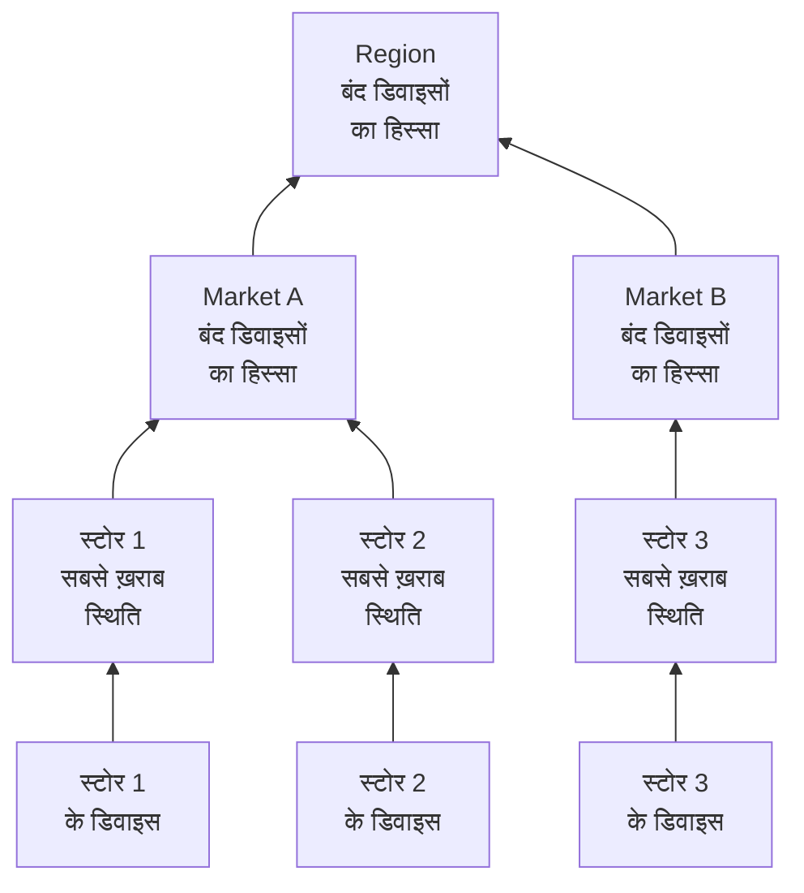

# नेटवर्क साइटें (स्थिति सारांश और अपटाइम)

नेटवर्क साइट एक जगह है: एक क्षेत्र, एक बाज़ार, एक फ़्रेंचाइज़ी, एक डिस्ट्रीब्यूशन सेंटर, एक स्टोर। साइटें एक-दूसरे के अंदर रखी जाती हैं, नेटवर्क डिवाइस उनसे जुड़ते हैं, और OneUptime डिवाइसों की स्थिति को ट्री में ऊपर तक जोड़ता है, ताकि किसी Region की एक स्थिति इस सवाल का जवाब दे कि "वहाँ कहीं कुछ गड़बड़ है?"।

इन्हें **नेटवर्क → साइटें** के तहत, और मैप पर **नेटवर्क → Map** के तहत पाएँ। यह पेज तय करता है कि किसी साइट की स्थिति उसके नीचे की चीज़ों से कैसे निकाली जाती है, उसके अपटाइम का क्या मतलब है, और अनुसूचित रखरखाव दोनों को कैसे बदलता है।

:::cards
- [साइट जोड़ें](#साइट-जोड़ना): तीन चरण, या पूरे नेटवर्क के लिए एक CSV फ़ाइल।
- [मॉनिटरिंग डिफ़ॉल्ट सेट करें](#मॉनिटरिंग-डिफ़ॉल्ट): साइट के हर डिवाइस के लिए एक प्रोब और क्रेडेंशियल।
- [चुनें कि स्थिति कैसे जुड़ती है](#पैरेंट-की-स्थिति-कैसे-निकाली-जाती-है): स्टोर के लिए सबसे ख़राब स्थिति, क्षेत्र के लिए एक हिस्सा।
- [अपटाइम पढ़ें](#अपटाइम): प्रतिशत क्या गिनते हैं, दिन-ब-दिन।
:::

## यह कैसे काम करता है



हर साइट की स्थिति उसकी सबट्री के हर डिवाइस से आती है, साइट की अपनी [सारांश नीति](#पैरेंट-की-स्थिति-कैसे-निकाली-जाती-है) से आँकी जाती है। साइट का अपटाइम उसकी अपनी स्थिति टाइमलाइन से आता है, और किसी साइट पर [रखरखाव विंडो](#नेटवर्क-साइटों-के-लिए-अनुसूचित-रखरखाव) उसके डिवाइसों को ऊपर के वोट से बाहर कर देती है।

## पदानुक्रम

साइटें एक ट्री बनाती हैं। हर साइट का एक **Site Type** और एक वैकल्पिक पैरेंट साइट होती है। साइट प्रकार प्रोजेक्ट की अपनी सूची हैं, **नेटवर्क → सेटिंग्स → Site Types** के तहत, और नया प्रोजेक्ट ऊपर से इस क्रम में Account Type, Region, Franchisee, Market और Unit के साथ शुरू होता है, साथ में Data Center और Other। प्रकारों का अपना पदानुक्रम होता है (**Parent Site Type**), जो तय करता है कि कौन-सी साइटें किसी साइट की पैरेंट हो सकती हैं। **Is Unit Level** चिह्नित प्रकार आपके नेटवर्क का सबसे निचला स्तर है, अलग-अलग स्टोर या ब्रांच: उसकी साइटों में डिवाइस होते हैं, दूसरी साइटें नहीं।

साइट का प्रकार, नाम, विवरण, पैरेंट और स्थान एक ही जगह संपादित होते हैं: साइट के **सेटिंग्स** पेज पर **Site Settings** कार्ड। साइट का अवलोकन इन्हें **सेटिंग्स में संपादित करें** लिंक के साथ दिखाता है, और **साइटें** सूची साइटें जोड़ती है पर उन्हें संपादित नहीं करती।

हर डिवाइस एक साइट से जुड़ता है। किसी साइट की सबट्री ख़ुद वह साइट और उसके नीचे की हर साइट है, और सबट्री के डिवाइस ही वे हैं जिनसे उसकी स्थिति जुड़ती है, इसलिए बिना अपने डिवाइसों वाले Region की भी एक स्थिति होती है, क्योंकि उसके नीचे की Unit के डिवाइस हैं।

> [!NOTE]
> सारांश तब फिर से निकाला जाता है जब किसी डिवाइस की स्थिति बदलती है, जब कोई डिवाइस दूसरी साइट में जाता है, जब कोई साइट ट्री में खिसकती है, और हर पाँच मिनट की एक जाँच से जो उन मामलों को पकड़ती है जहाँ केवल समय बीतने से जवाब बदल गया।

## साइट जोड़ना

:::steps
### नई साइट शुरू करें
**नेटवर्क → साइटें** पर जाएँ और **Site जोड़ें** पर क्लिक करें।

### बताएँ कि साइट क्या है
**Site Details** चरण पर **Site Type** चुनें (यह किस तरह की जगह है: एक क्षेत्र, एक स्टोर, एक डेटा सेंटर) और एक **नाम** लिखें। विवरण, सड़क का पता, और मैप पर साइट को दिखाने वाले अक्षांश और देशांतर **और फ़ील्ड** के नीचे मुड़े हुए हैं: इन्हें अभी या बाद में भरें।

### इसे ट्री में रखें
**Hierarchy** चरण पर, अगर साइट किसी दूसरी साइट के नीचे है तो **Parent Site** चुनें। साइट को सबसे ऊपरी स्तर पर रखने के लिए इसे ख़ाली छोड़ें।

### इसके डिफ़ॉल्ट सेट करें
**Monitoring Defaults** चरण पर, साइट में जोड़े जाने वाले डिवाइसों के लिए [डिफ़ॉल्ट प्रोब और क्रेडेंशियल प्रोफ़ाइल](#मॉनिटरिंग-डिफ़ॉल्ट) चुनें, और **Site जोड़ें** पर क्लिक करें।
:::

किसी साइट के अपने **Child Sites** पेज पर, **चाइल्ड साइट जोड़ें** केवल प्रकार और नाम पूछता है, एक पेज पर जिसमें स्थान मुड़ा होता है, और नई साइट को उसी साइट के नीचे रखता है।

### CSV फ़ाइल से साइटें इम्पोर्ट करें

पूरा नेटवर्क एक साथ लाने के लिए, **साइटें** सूची के ऊपर का मेन्यू खोलें और **Import from CSV** पर क्लिक करें। फ़ाइल में एक हेडर पंक्ति चाहिए; कॉलम किसी भी क्रम में आ सकते हैं और उनके नाम केस-संवेदनशील नहीं हैं:

```csv title="sites.csv"
name,siteType,parentName,address,latitude,longitude
North,Region,,,,
Leeds,Market,North,,,
Store 0660,Unit,Leeds,"1 High Street, Leeds",53.7997,-1.5492
```

- `name` और `siteType` ज़रूरी हैं। `siteType` प्रोजेक्ट के साइट प्रकारों में से एक होना चाहिए।
- `parentName` पैरेंट साइट का नाम देता है, जो उसी फ़ाइल में हो सकती है: बिना पैरेंट वाली पंक्तियाँ, या ऐसे पैरेंट वाली जो पहले से मौजूद है, पहले जाती हैं, फिर उनकी चाइल्ड। सबसे ऊपरी स्तर की साइट के लिए इसे ख़ाली छोड़ें।
- जिस पंक्ति का पैरेंट नहीं मिलता उसे छोड़ दिया जाता है, और नतीजे उसे सूचीबद्ध करते हैं। **Preview Import** कुछ भी लिखे जाने से पहले दिखाता है कि फ़ाइल क्या बनाएगी।

## मैप

**नेटवर्क → Map** आपकी साइटों को मैप पर दिखाता है, जहाँ भी वे हों वहाँ तक फ़्रेम करके; अंदर जाने के लिए किसी साइट पर क्लिक करें। जिस साइट के नीचे साइटें हैं वह उन्हें दिखाती है, मैप पर और उनके बीच के लिंक के ग्राफ़ के रूप में। जिस साइट के नीचे कोई साइट नहीं लेकिन उसके अपने डिवाइस हैं, या जिस साइट का प्रकार यूनिट-स्तर का है, वह उन डिवाइसों की लाइव टोपोलॉजी खोलती है।

जिस प्रोजेक्ट में अभी कोई साइट नहीं, उसका भी मैप होता है: Map इसके बजाय उसके डिवाइसों की टोपोलॉजी दिखाता है, और डिवाइसों को साइटों में समूहित करने से वे स्थान के अनुसार मैप पर आ जाते हैं।

## मॉनिटरिंग डिफ़ॉल्ट

साइट वह जगह भी है जहाँ आप एक बार बताते हैं कि उसके डिवाइस कैसे मॉनिटर हों। **Site Settings** कार्ड पर **सेटिंग्स संपादित करें** में दो फ़ील्ड वाला एक **Monitoring Defaults** चरण है:

| सेटिंग | असर |
| --- | --- |
| **Default Probe** | वह प्रोब जो इस साइट के डिवाइसों को Ping करता है, और उनके पास क्रेडेंशियल होने पर उन्हें SNMP से वॉक करता है। साइट में बिना अपने प्रोब के बनाया गया डिवाइस इसे लेता है, और बिना प्रोब के लाया गया डिवाइस भी। |
| **Default SNMP Credential Profile** | वह [क्रेडेंशियल प्रोफ़ाइल](/docs/monitor/network-device-monitor#snmp-क्रेडेंशियल-और-क्रेडेंशियल-प्रोफ़ाइल) जिससे इस साइट के डिवाइस तब वॉक होते हैं जब न डिवाइस के पास क्रेडेंशियल हों न उसकी अपनी प्रोफ़ाइल के पास। |

किसी साइट पर दोनों सेट करें और वहाँ का नया डिवाइस सिर्फ़ अपने पते से जोड़ा जा सकता है: वह पहले पोल से Ping होता है और पहले पोल से वॉक होता है।

दोनों जानबूझकर अलग तरह से व्यवहार करते हैं:

- प्रोब डिवाइस पर तब कॉपी होता है जब डिवाइस साइट में बनाया जाता है, या उसमें लाया जाता है। बाद में साइट का डिफ़ॉल्ट प्रोब बदलने से वे डिवाइस नहीं हिलते जिनके पास पहले से प्रोब है: कौन-सा प्रोब किसी डिवाइस तक पहुँच सकता है यह नेटवर्क के बारे में एक तथ्य है, कोई ऐसी पसंद नहीं जिसे साइट फ़ॉर्म से एक साथ फिर से लिखा जाए।
- क्रेडेंशियल प्रोफ़ाइल हर पोल पर लाइव पढ़ी जाती है। इसे किसी साइट पर सेट करें और उसमें बिना क्रेडेंशियल वाला हर डिवाइस अपने अगले पोल पर वॉक होने लगता है, बिना किसी डिवाइस-स्तर के संपादन के; इसे हटाएँ और वे फिर से केवल Ping होने लगते हैं।

ये ट्री में नीचे तक अलग-अलग दूरी तक भी पहुँचते हैं:

- प्रोब पूरे ट्री तक पहुँचता है। बिना डिफ़ॉल्ट प्रोब वाली साइट में आने वाला डिवाइस सबसे नज़दीकी पूर्वज का प्रोब लेता है, इसलिए किसी Region पर सेट एक प्रोब उसके नीचे की हर Market और Unit को कवर करता है, और जो Market अपना प्रोब बताती है वह अपनी सबट्री के लिए उसे ओवरराइड करती है।
- क्रेडेंशियल प्रोफ़ाइल केवल डिवाइस की अपनी साइट से पढ़ी जाती है। किसी Unit का डिवाइस उसके Region पर सेट प्रोफ़ाइल नहीं लेता, इसलिए इसे उन साइटों पर सेट करें जिनसे डिवाइस असल में जुड़ते हैं।

## पैरेंट की स्थिति कैसे निकाली जाती है

हर साइट अपने **सेटिंग्स** पेज के **Health Rollup** कार्ड (**Rollup Policy**) पर दो में से एक सारांश नीति चुनती है।

### किसी भी डिवाइस की सबसे ख़राब स्थिति (डिफ़ॉल्ट)

सबट्री का कोई भी डिवाइस जो सबसे ख़राब स्थिति बताता है, वही साइट की स्थिति बन जाती है। कोई स्थिति कितनी ख़राब है यह मॉनिटर स्थिति के रूप में उसकी प्राथमिकता से तय होता है: नए प्रोजेक्ट की स्थितियाँ Operational (1), Degraded (2) और Offline (3) हैं, और ऊँची ज़्यादा ख़राब है। एक ऑफ़लाइन डिवाइस साइट को ऑफ़लाइन कर देता है, उसके बगल में चाहे जितने स्वस्थ डिवाइस हों।

किसी Unit के लिए यही सही जवाब है। एक इमारत के चार स्विच और एक फ़ायरवॉल स्वतंत्र नहीं हैं: उनमें से एक का बुझ जाना उस पते पर एक समस्या है, और उसे औसत में छिपा देना असली आउटेज को छिपाता है।

चार सौ स्टोर के ऊपर के Region के लिए यह आम तौर पर ग़लत जवाब है। स्टोर 12,000 में एक बुझा स्विच पूरे क्षेत्र को Offline रंग देता है: सबसे संकरे अर्थ में सच, और हर व्यावहारिक अर्थ में बेकार, क्योंकि तब जब भी कहीं भी किसी स्टोर में समस्या हो, क्षेत्र लाल हो जाता है, और आपको कुछ भी बताना बंद कर देता है।

### बंद डिवाइसों का प्रतिशत

साइट की स्थिति सबट्री के रिपोर्ट करने वाले उन डिवाइसों के हिस्से से तय होती है जो ऑपरेशनल स्थिति में नहीं हैं:

| बंद डिवाइसों का हिस्सा | साइट की स्थिति |
| --- | --- |
| 0% | Operational |
| 0% से ऊपर, थ्रेशोल्ड से नीचे | Degraded: प्रोजेक्ट की वह स्थिति जो न ऑपरेशनल है न ऑफ़लाइन, या प्रोजेक्ट में ऐसी न हो तो Offline |
| थ्रेशोल्ड पर या उससे ऊपर | Offline |

थ्रेशोल्ड हर साइट के लिए सेट होती है, **Offline Threshold (%)** के रूप में, और डिफ़ॉल्ट रूप से 50 है।

कुछ भी बंद न हो तो थ्रेशोल्ड कितनी भी कम सेट हो, स्थिति Operational है: 0 की थ्रेशोल्ड का मतलब है "कोई भी डिवाइस बंद हो तो यह ऑफ़लाइन", न कि "स्वस्थ क्षेत्र ऑफ़लाइन है"।

### किन डिवाइसों को वोट मिलता है

दोनों नीतियाँ यहाँ सहमत हैं, और यह जितना लगता है उससे ज़्यादा मायने रखता है:

- आर्काइव डिवाइस कभी वोट नहीं देते। वे सेवा से हटाए जा चुके हैं: वे अपनी साइट रखते हैं लेकिन बाहर रखे जाते हैं।
- जिन डिवाइसों ने कभी कुछ नहीं बताया, वे कभी वोट नहीं देते। अपने पहले पोल का इंतज़ार कर रहा डिवाइस किसी आउटेज का सबूत नहीं है, इसलिए उसे हिस्से के दोनों पक्षों से बाहर रखा जाता है, और ऑनबोर्डिंग के आधे रास्ते पर पहुँचा क्षेत्र उस आधे पर आँका जाता है जिसने जवाब दिया है।
- प्रोब से पोल होने वाला डिवाइस, सामान्य प्रकार, अपने पिछले पोल के नतीजे से वोट देता है: Ping या SNMP से पहुँच में, न कि वह आख़िरी बार कितनी देर पहले सफल हुआ। जो डिवाइस Ping का जवाब देता है जबकि उसका SNMP वॉक विफल हो रहा है, वह पहुँच में है और उसी तरह वोट देता है; साइट कहती है कि वह चालू है, और डिवाइस की पंक्ति **SNMP failing** कहती है ताकि कोई क्रेडेंशियल ठीक करे।
- मॉनिटर-आधारित डिवाइस, यानी जिसे उसके सेटिंग्स पेज पर बाउंड-मॉनिटर ओवरराइड पर बदला गया, उससे बाँधे गए मॉनिटर की स्थिति से वोट देता है, क्योंकि उसे कुछ पोल नहीं करता। कुछ भी बाउंड न हो तो उसने कभी कुछ नहीं बताया, इसलिए वह बिल्कुल वोट नहीं देता।

प्रोब से पोल होने वाले डिवाइस पर Network Device मॉनिटर यह नहीं बदलता कि डिवाइस कैसे वोट देता है। "इंटरफ़ेस बंद, इसलिए Offline" शर्त वाला मॉनिटर हर Ping का जवाब देने वाले स्विच पर Offline की मुहर लगा देगा, और एक बुझा पोर्ट पूरी साइट को लाल कर देगा जबकि उसके नीचे हर डिवाइस पंक्ति Up पढ़ती है: साइट उसी सूची से असहमत होगी जिसका वह सारांश है। पोल होने वाले डिवाइस के लिए पोल ही उसकी स्थिति का स्रोत है; मॉनिटर घटनाएँ बनाने के लिए है।

### नीति चुनना

फ़्रेंचाइज़ी नेटवर्क के लिए एक उचित शुरुआत:

| स्तर | नीति | क्यों |
| --- | --- | --- |
| Unit या स्टोर | सबसे ख़राब स्थिति | एक डिवाइस बंद होना एक साइट का मुसीबत में होना है। |
| Market | प्रतिशत, थ्रेशोल्ड लगभग 50% | जिस मार्केट के आधे स्टोर बंद हैं, वह बंद है। |
| Region | प्रतिशत, थ्रेशोल्ड 25% से 50% | एक स्टोर की विफलता क्षेत्र को Offline नहीं बल्कि Degraded करती है, और कुछ व्यवस्थागत होने पर वह Offline होता है। |

नीति हर साइट के लिए सेट होती है, इसलिए आप Region पंक्तियों को प्रतिशत नीति दे सकते हैं और उनके नीचे की हर चीज़ को डिफ़ॉल्ट पर छोड़ सकते हैं।

## अपटाइम

हर साइट की एक स्थिति टाइमलाइन होती है: उसकी सारांश स्थिति के हर बदलाव की एक पंक्ति, जो स्थिति बदलने पर खुलती है और फिर बदलने पर बंद होती है। अपटाइम इसी से निकाला जाता है:

- ऑपरेशनल न चिह्नित स्थिति में बिताया समय डाउनटाइम है।
- एक-दूसरे पर चढ़ी पंक्तियाँ मिला दी जाती हैं, इसलिए कोई सेकंड दो बार नहीं गिना जाता।
- जो समय किसी पंक्ति में नहीं आता उसे चालू गिना जाता है। टाइमलाइन को पंक्तियाँ तभी मिलती हैं जब कोई सारांश चल चुका हो, और सबूत न होना आउटेज नहीं है।
- अब भी खुली पंक्ति मापी जा रही विंडो के अंत तक चलती है।

Degraded ऑपरेशनल नहीं है, इसलिए उसे भी बंद गिना जाता है। तो किसी भी नीति में, साइट का अपटाइम उस समय का हिस्सा है जब उसके नीचे का कोई रिपोर्ट करने वाला डिवाइस बंद नहीं था: नीति यह बदलती है कि आंशिक आउटेज कौन-सी स्थिति दिखाता है, Degraded या Offline, न कि वह गिना जाता है या नहीं।

जिस साइट की कोई टाइमलाइन पंक्ति ही नहीं, वह 100% के बजाय `—` दिखाती है: जिस साइट का कभी सारांश नहीं बना वह बिना मॉनिटरिंग की है, परफ़ेक्ट नहीं।

### दैनिक अपटाइम

30 दिन के आँकड़े के बगल में, हर साइट का अवलोकन **Uptime (24h)** दिखाता है, और उसका **स्थिति टाइमलाइन** पेज पिछले 24 घंटे, 7, 30 और 90 दिन, और पिछले 30 दिनों के हर दिन का एक बार दिखाता है।

30 दिन का औसत एक बुरा दिन नहीं दिखा सकता। 30 दिन की विंडो में पूरे एक दिन का आउटेज 3.3 अंक घटाता है, इसलिए जो साइट पूरे एक मंगलवार बुझी रही, वह फिर भी महीने के लिए 96.7% बताती है, एक ऐसी संख्या जो राउंडिंग जैसी पढ़ी जाती है। दैनिक बार वही डेटा वहाँ रखते हैं जहाँ एक बुरा दिन एक बुरा बार होता है।

दिन अभी ख़त्म होने वाले रोलिंग 24 घंटे के हिस्से हैं, कैलेंडर के दिन नहीं: डिवाइस, देखने वाला और सर्वर हर एक अलग टाइम ज़ोन में हो सकते हैं, और कोई एक "दिन" नहीं है जिस पर वे सहमत हों।

### पैरेंट का अपटाइम चाइल्ड के अपटाइम का औसत नहीं है

पैरेंट का अपटाइम पैरेंट की अपनी टाइमलाइन से आता है, जिसे उसकी सारांश नीति ने बनाया, न कि उसकी चाइल्ड साइटों के प्रतिशतों के औसत से।

चाइल्ड साइटों का औसत दो डिवाइसों वाले स्टोर को दो सौ डिवाइसों वाले डिस्ट्रीब्यूशन सेंटर के बराबर तौलता है। पैरेंट की अपनी टाइमलाइन इसके बजाय एक ऐसी रीडिंग देती है जिसे आप एक वाक्य में कह सकें: उस समय का हिस्सा जब क्षेत्र में कुछ भी बंद नहीं था। यह जानबूझकर सख़्त है, इसलिए किसी बड़े क्षेत्र पर इसे दैनिक बार के साथ पढ़ें, और स्थिति के साथ, जो बताती है कि आंशिक आउटेज Degraded था या Offline।

## नेटवर्क साइटों के लिए अनुसूचित रखरखाव

किसी अनुसूचित रखरखाव इवेंट के **प्रभावित संसाधन** चरण पर, **अन्य प्रभावित संसाधन** के तहत साइटें जोड़ें, जैसे आप किसी होस्ट को जोड़ते हैं। किसी साइट का अपना **अनुसूचित रखरखाव** पेज उससे जुड़े इवेंट सूचीबद्ध करता है, और उसका **अनुसूचित रखरखाव इवेंट बनाएँ** साइट पहले से चुनी हुई के साथ फ़ॉर्म खोलता है।

पैरेंट पर विंडो उसके नीचे की हर चीज़ को कवर करती है: किसी Region पर विंडो उसकी हर Market और Unit को कवर करती है, उन साइटों सहित जो विंडो तय होने के बाद बनीं, इसलिए किसी क्षेत्रीय कैरियर कटओवर में चार सौ स्टोर सूचीबद्ध करने की ज़रूरत नहीं।

कवरेज केवल नीचे की ओर पहुँचता है। किसी एक Unit पर विंडो उसके Region को रखरखाव में नहीं डालती: क्षेत्र से अब भी चालू रहने की उम्मीद है, और उन्हीं घंटों में किसी दूसरी Unit की असली विफलता अब भी उसके ख़िलाफ़ गिनी जाती है।

### रखरखाव विंडो क्या बदलती है

| विंडो के दौरान | क्या होता है |
| --- | --- |
| साइट की लाइव स्थिति | कोई बदलाव नहीं। योजनाबद्ध काम के लिए बंद Unit मैप पर और ट्री में अब भी Offline पढ़ती है, बगल में "In maintenance" बैज के साथ: जो भी उसे देखे उसे पता होना चाहिए कि वह बंद है। |
| साइट का अपटाइम | विंडो डाउनटाइम और मापी गई अवधि दोनों से निकाल दी जाती है। दो घंटे का रखरखाव दिन को 22 घंटे का बना देता है, और उन दो घंटों के अंदर का कुछ भी किसी तरफ़ नहीं गिना जाता। |
| उसके पूर्वजों का स्थिति सारांश | रखरखाव वाली सबट्री के डिवाइस वोट देना बंद कर देते हैं, इसलिए कैलेंडर पर पहले से तय कटओवर के लिए क्षेत्र लाल नहीं होता। |
| उसके पूर्वजों का अपटाइम | अप्रभावित, सुधारने को कुछ नहीं, क्योंकि योजनाबद्ध आउटेज कभी उनकी टाइमलाइन तक पहुँचा ही नहीं। |

आख़िरी पंक्ति ही वजह है कि पूर्वजों को उनके अपटाइम से विंडो निकालकर नहीं बल्कि वोट रोककर सँभाला जाता है: क्षेत्र की अवधि से विंडो निकालने से उन्हीं घंटों में क्षेत्र में कहीं और हुई असली विफलता भी मिट जाती।

अपटाइम इवेंट के घोषित शुरू और अंत के समय से सुधारा जाता है, न कि उस समय से जब किसी वर्कर ने उसे स्थितियों के बीच बदला, इसलिए संख्या को कैलेंडर से हाथ से जाँचा जा सकता है। जो दिन पूरी तरह किसी विंडो के अंदर आता है, वह दैनिक बार में परफ़ेक्ट दिन के बजाय रखरखाव के रूप में दिखता है, और औसत में कुछ नहीं जोड़ता।

### मॉनिटर के साथ परस्पर क्रिया

उसी इवेंट से किसी मॉनिटर को जोड़ना अब भी वही करता है जो हमेशा करता है: उस मॉनिटर की सक्रिय मॉनिटरिंग विंडो के लिए रुक जाती है। दोनों स्वतंत्र हैं: साइट को सारांश और उसके अपटाइम से बाहर रखने के लिए साइट जोड़ें, और मॉनिटर के अलर्ट रोकने के लिए मॉनिटर जोड़ें।

## किसी साइट पर अलर्टिंग

किसी साइट के **सेटिंग्स** पेज पर **Alerting** कार्ड में **Alert When Unhealthy** है: जब साइट का सारांश ऐसी स्थिति में जाता है जो ऑपरेशनल नहीं है तो एक अलर्ट खुलता है, और साइट ठीक होने पर अपने-आप हल हो जाता है। **अलर्ट गंभीरता** उसकी गंभीरता सेट करती है; ख़ाली छोड़ने पर यह प्रोजेक्ट की सबसे गंभीर होती है।

यह केवल बदलाव पर अलर्ट करता है: पहले से अस्वस्थ साइट के लिए इसे चालू करना बीते समय पर अलर्ट करने के बजाय अगले बदलाव के लिए तैयार करता है। Degraded ऑपरेशनल नहीं है, इसलिए प्रतिशत नीति वाली साइट उसके रिपोर्ट करने वाले डिवाइसों में से एक के बंद होते ही अलर्ट करती है, जैसे सबसे ख़राब स्थिति नीति वाली साइट करती है; जब साइट Degraded और Offline के बीच आती-जाती है तो अलर्ट खुला रहता है, कोई दूसरा अलर्ट नहीं बनता, और उसका शीर्षक वह स्थिति बताता है जिस पर साइट पहले पहुँची।

## समस्या निवारण

:::details कोई क्षेत्र हमेशा लाल रहता है
साइट सबसे ख़राब स्थिति वाली नीति पर है, इसलिए उसके नीचे कहीं भी एक ऑफ़लाइन डिवाइस उसे ऑफ़लाइन कर देता है। क्षेत्र को उसके **Health Rollup** कार्ड पर **Percentage of devices down** पर बदलें, ऐसी थ्रेशोल्ड के साथ जो इससे मेल खाए कि आप क्षेत्र को बंद कहने से पहले उसका कितना हिस्सा बंद होना चाहिए।
:::

:::details साइट अपटाइम के बजाय — दिखाती है
साइट के लिए कभी कोई सारांश नहीं चला, इसलिए उसकी कोई टाइमलाइन पंक्ति नहीं है: वह बिना मॉनिटरिंग की है, परफ़ेक्ट नहीं। साइट में, या उसके नीचे की साइटों में डिवाइस जोड़ें, और अगला सारांश उसकी टाइमलाइन शुरू कर देता है।
:::

:::details कोई डिवाइस अपनी साइट में नहीं गिना जाता
आर्काइव डिवाइस, और वे डिवाइस जिन्होंने अभी तक कुछ नहीं बताया, कभी वोट नहीं देते। बिना बाउंड मॉनिटर वाले मॉनिटर-आधारित डिवाइस ने भी कभी कुछ नहीं बताया। डिवाइस की स्थिति जाँचें: **लंबित** डिवाइस अपने पहले पोल के बाद वोट देना शुरू करता है।
:::

:::details किसी साइट का अलर्ट नहीं चला
**Alert When Unhealthy** किसी ऑपरेशनल स्थिति से किसी दूसरी स्थिति में बदलाव पर चलता है, इसलिए जो साइट इसे चालू करते समय पहले से अस्वस्थ थी, वह ठीक होने के बाद अपने अगले बदलाव पर अलर्ट करती है। यह भी जाँचें कि उसके डिवाइस वोट देते हैं: आर्काइव डिवाइस और अपने पहले पोल का इंतज़ार कर रहे डिवाइस कभी नहीं देते, और रखरखाव में चल रही साइट के डिवाइस उसके ऊपर के सारांशों में वोट नहीं देते।
:::

## अगले कदम

:::cards
- [नेटवर्क डिवाइस मॉनिटर](/docs/monitor/network-device-monitor): इन साइटों से जुड़ने वाले डिवाइसों को जोड़ें, पोल करें और उन पर अलर्ट लगाएँ।
- [नेटवर्क ट्रैफ़िक](/docs/monitor/network-traffic): किसी साइट का ट्रैफ़िक उसके डिवाइसों के फ़्लो रिकॉर्ड से देखें।
- [इन्वेंटरी](/docs/inventory/overview): नेटवर्क डिवाइस आपकी हर दूसरी एसेट के साथ।
:::
