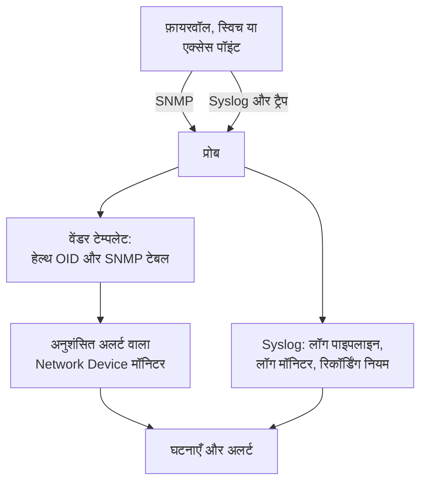

# नेटवर्क वेंडर गाइड (Sophos, Extreme, Cambium)

OneUptime से तीन आम नेटवर्क को शुरू से अंत तक कैसे मॉनिटर करें: अपनी IPsec टनल, WAN लिंक और SD-WAN के साथ Sophos Firewall (XGS, SFOS); अपने फ़ैब्रिक के साथ Extreme Networks स्विच (EXOS / Switch Engine और Fabric Engine / VOSS); और Cambium Networks cnMatrix स्विच और Enterprise Wi-Fi एक्सेस पॉइंट, हर रेडियो के चैनल और ट्रांसमिट पावर तक।

:::cards
- [Sophos Firewall](#sophos-firewall-xgs-sfos): टनल, WAN लिंक, गेटवे और SD-WAN।
- [Extreme Networks](#extreme-networks-exos-switch-engine-और-fabric-engine-voss): स्विच, फ़ैब्रिक और उसका हार्डवेयर।
- [Cambium Networks](#cambium-networks-enterprise-wi-fi-और-cnmatrix): हर रेडियो तक एक्सेस पॉइंट, और cnMatrix स्विच।
:::

## यह कैसे काम करता है

हर गाइड वही हिस्से इस्तेमाल करती है:

- हर बॉक्स के लिए एक [नेटवर्क डिवाइस](/docs/monitor/network-device-monitor), जिसे उस तक पहुँच सकने वाला प्रोब पोल करता है, एक ऐसे वेंडर टेम्पलेट के साथ जो सही हेल्थ OID और [SNMP टेबल](/docs/monitor/network-device-monitor#snmp-टेबल) लाता है।
- अलर्टिंग के लिए हर डिवाइस का एक Network Device मॉनिटर। इसे डिवाइस के पेज से बनाएँ ताकि [अनुशंसित अलर्ट](/docs/monitor/network-device-monitor#अनुशंसित-अलर्ट-पैक) आपके लिए भर जाएँ, जिनमें हर उस टेबल के लिए एक हर-पंक्ति अलर्ट शामिल है जो जानती है कि स्वस्थ होना कैसा दिखता है। बेड़े के लिए, एक [अलर्ट नीति](/docs/monitor/network-device-monitor#अलर्ट-नीतियाँ) हर डिवाइस पर एक मॉनिटर बनाए रखती है।
- उन चीज़ों के लिए जो वेंडर केवल अपने लॉग में बताता है: प्रोब को syslog, हर पंक्ति को एट्रिब्यूट में बदलने के लिए एक [लॉग पाइपलाइन](/docs/telemetry/log-pipelines), हर टनल या गेटवे पर एक बार अलर्ट के लिए [Group By वाले लॉग मॉनिटर](/docs/monitor/logs-monitor#समूह-के-अनुसार-अलर्ट-group-by), और उन लॉग की संख्याओं के चार्ट के लिए [लॉग रिकॉर्डिंग नियम](/docs/telemetry/log-recording-rules)।

## Sophos Firewall (XGS / SFOS)

| आप क्या देखना चाहते हैं | यह कहाँ से आता है |
| --- | --- |
| फ़ायरवॉल की स्थिति: मेमोरी, डिस्क, स्वैप, HA स्थिति, IPsec सेवा, हर कोर का CPU | SNMP, **Sophos Firewall (SFOS / XGS)** वेंडर टेम्पलेट के साथ |
| हर IPsec टनल की स्थिति, नाम से | SNMP टेबल `ipsec_tunnels` (SFOS v20 और बाद का) |
| हर WAN लिंक की स्थिति, थ्रूपुट, उपयोग और त्रुटियाँ | WAN पोर्ट का इंटरफ़ेस वॉक |
| हर WAN लिंक की लेटेंसी, पैकेट लॉस और जिटर | OneUptime प्रोब से Ping मॉनिटर और डिवाइस पोल |
| गेटवे चालू और बंद, SD-WAN SLA पूरा हुआ या नहीं, SD-WAN रूट बदलाव | फ़ायरवॉल का syslog |
| हर गेटवे की SD-WAN लेटेंसी, जिटर और पैकेट लॉस, चार्ट के रूप में | SD-WAN SLA लॉग पर लॉग रिकॉर्डिंग नियम |

Sophos किसी भी SFOS संस्करण में गेटवे या SD-WAN की स्थिति SNMP पर नहीं बताता: वह केवल फ़ायरवॉल के लॉग में, और Sophos Central के अलर्ट में है, इसीलिए आख़िरी तीन पंक्तियाँ syslog से होकर जाती हैं।

### फ़ायरवॉल रजिस्टर करें

:::steps
1. फ़ायरवॉल पर **Administration → SNMP** के तहत SNMP चालू करें: एक SNMPv3 यूज़र, या एक v2c कम्युनिटी, जोड़ें और प्रोब के पते को उससे क्वेरी करने दें।
2. OneUptime में **नेटवर्क → Devices** पर जाएँ और **Add Device** पर क्लिक करें। फ़ायरवॉल का मैनेजमेंट पता लिखें, उस तक पहुँच सकने वाला प्रोब चुनें, और **SNMP** के तहत SNMP क्रेडेंशियल जोड़ें।
3. डिवाइस के **सेटिंग्स** पेज पर, **Polling & Data Collection** के तहत, **Vendor Health Template** से **Sophos Firewall (SFOS / XGS)** टेम्पलेट लागू करें और **Add a Vendor's Tables** से उसकी टेबल जोड़ें। या **Auto-Apply Vendor Health Template** चालू करें, और पहला पोल दोनों कर देता है।
:::

अगले पोल के बाद, डिवाइस का **SNMP Tables** पेज हर IPsec कनेक्शन को उसकी स्थिति (active, inactive, partially active) के साथ, और CPU कोर, सूचीबद्ध करता है। SFOS अपने कोर 196608 से गिनता है, इसीलिए CPU किसी अकेले `hrProcessorLoad.1` के बजाय एक टेबल से आता है।

### हर IPsec टनल पर अलर्ट

डिवाइस के पेज पर **मॉनिटर बनाएं** पर क्लिक करें। अनुशंसित अलर्ट में **IPsec Tunnels: row unhealthy** शामिल है, यानी `ipsec_tunnels` टेबल पर Row `*` वाली एक **SNMP Table Row Is Unhealthy** शर्त: यह हर उस टनल के लिए जो active नहीं है, टनल के नाम पर एक घटना खोलती है, और टनल लौटने पर हर एक को हल कर देती है।

Sophos जिस टनल को active बताता है, उसके केवल सिक्योरिटी एसोसिएशन चालू होते हैं। यह साबित करने के लिए कि उससे ट्रैफ़िक गुज़रता है, एक साइट के प्रोब से हर टनल के दूसरी ओर के किसी होस्ट तक एक [Ping मॉनिटर](/docs/monitor/ping-monitor) जोड़ें, और टनल को **नेटवर्क → टोपोलॉजी → Site Links** के तहत दो [साइटों](/docs/monitor/network-sites) के बीच साइट लिंक के रूप में बनाएँ, उस मॉनिटर से बाँधकर: तब मैप पर लिंक मॉनिटर का रंग ले लेता है।

### WAN लिंक

- **पोर्ट की स्थिति।** इंटरफ़ेस वॉक पहले से हर WAN पोर्ट की स्थिति, आने और जाने वाले बिट, उपयोग और त्रुटियाँ मापता है। फ़ायरवॉल के मॉनिटर पर, **इंटरफ़ेस** को WAN पोर्ट के नाम पर, या हर पोर्ट के लिए `*` पर सेट करने वाली **SNMP Interface Is Down** या **SNMP Interface Utilization (in %)** शर्त हर लिंक पर अलर्ट करती है।
- **पाथ की गुणवत्ता।** हर लिंक की लेटेंसी, पैकेट लॉस और जिटर फ़ायरवॉल के बाहर से मापे जाते हैं: OneUptime क्लाउड प्रोब से हर WAN लिंक के सार्वजनिक पते तक एक Ping मॉनिटर, और साइट के प्रोब से हर ISP के गेटवे तक एक Ping मॉनिटर। उन मॉनिटर पर पैकेट लॉस और जिटर की शर्तें हर लिंक पर अलर्ट करती हैं, और **नेटवर्क → टोपोलॉजी → Latency Matrix** हर प्रोब को हर मॉनिटर के सामने एक नज़र में दिखाता है।
- **ट्रैफ़िक।** SFOS NetFlow v5 एक्सपोर्ट करता है। इसे प्रोब को UDP 2055 पर भेजें, जहाँ प्रोब का फ़्लो कलेक्टर डिफ़ॉल्ट रूप से सुनता है, और डिवाइस का **Traffic** पेज दिखाता है कि हर WAN लिंक पर कौन किससे बात करता है; विवरण [नेटवर्क ट्रैफ़िक](/docs/monitor/network-traffic) में है।

### syslog से गेटवे और SD-WAN

:::steps
1. प्रोब का syslog रिसीवर चालू करें: प्रोब पर `PROBE_SYSLOG_RECEIVER_ENABLED=true` सेट करें। यह डिफ़ॉल्ट रूप से UDP 5140 पर सुनता है (`PROBE_SYSLOG_RECEIVER_PORT` इसे बदलता है); अगर प्रोब Docker में चलता है तो पोर्ट पब्लिश करें। संदेश उस नेटवर्क डिवाइस से मिलाए जाते हैं जिसका होस्टनाम, या जिसके **अन्य पते** में से कोई एक, भेजने वाले का पता है, और डिवाइस के **लॉग** पेज पर दिखते हैं।
2. फ़ायरवॉल पर **System services → Log settings** के तहत प्रोब और उस पोर्ट की ओर इशारा करने वाला syslog सर्वर जोड़ें, और IPsec और गेटवे के लिए **Event** लॉग प्रकार और **SD-WAN** लॉग प्रकार टिक करें: इसे टिक करने तक SLA लॉग बंद रहते हैं।
3. **लॉग → सेटिंग्स → पाइपलाइन** के तहत ऐसी पाइपलाइन बनाएँ जिसका फ़िल्टर फ़ायरवॉल के लॉग से मेल खाए, जैसे `attributes.networkDevice.name = 'hq-firewall'`, और **Target Prefix** `sophos` के साथ एक **Key=Value Parser** जोड़ें। आपका SFOS संस्करण जो सटीक एट्रिब्यूट नाम बनाता है उन्हें देखने के लिए फ़ायरवॉल की एक पंक्ति उसके टेस्टर में चिपकाएँ; [Sophos उदाहरण](/docs/telemetry/log-pipelines#उदाहरण-sophos-xgs-फ़ायरवॉल) इसे क़दम-दर-क़दम बताता है।
4. फ़ायरवॉल के लॉग पर [लॉग मॉनिटर](/docs/monitor/logs-monitor) बनाएँ, हर एक **Group by Attributes** के साथ ताकि हर टनल या गेटवे अपने-आप अलर्ट करे, और कुछ मिनटों पर शर्त **Log Count** **Greater Than** `0`। नीचे की पंक्तियाँ शुरू करने के लिए तीन हैं।
5. SD-WAN गुणवत्ता का चार्ट बनाएँ: SD-WAN लॉगिंग चालू होने पर, फ़ायरवॉल हर प्रोफ़ाइल और गेटवे के लिए एक SLA सारांश लिखता है (`latency`, `jitter`, `packet_loss`)। **लॉग → सेटिंग्स → रिकॉर्डिंग नियम** के तहत हर संख्या के लिए एक नियम बनाएँ, जैसे `sophos.gw_name` और `sophos.profile_name` से समूहित `sophos.latency` का औसत, फिर नतीजों का चार्ट बनाएँ, या गेटवे से समूह बनाने वाले [Metrics मॉनिटर](/docs/monitor/metrics-monitor) से उन पर अलर्ट करें। [लॉग रिकॉर्डिंग नियम](/docs/telemetry/log-recording-rules) इस उदाहरण को क़दम-दर-क़दम बताता है।
:::

| अलर्ट | गिनने वाले लॉग | समूह आधार |
| --- | --- | --- |
| IPsec टनल समाप्त | एट्रिब्यूट `sophos.log_component` = `IPSec`, बॉडी में `terminated` | `sophos.con_name` |
| गेटवे बंद | एट्रिब्यूट `sophos.log_component` = `Gateway`, बॉडी में `is Down` | `sophos.gatewayname` |
| SD-WAN SLA पूरा नहीं | एट्रिब्यूट `sophos.log_type` = `SD-WAN`, बॉडी में `SLA not met` | `sophos.gw_name` |

syslog इवेंट SNMP टेबल के पूरक हैं: वे टनल गिरते ही पहुँचते हैं, जबकि टेबल उस टनल को भी पकड़ती है जो कभी चालू ही नहीं हुई।

### ट्रैप

हर Sophos नोटिफ़िकेशन एक ही ट्रैप है, `sfosNotification` (`1.3.6.1.4.1.2604.5.1.8.1.1`), इवेंट `sfosTrapMessage` (`1.3.6.1.4.1.2604.5.1.8.1.2`) में टेक्स्ट के रूप में। किसी एक तरह के इवेंट पर अलर्ट के लिए, **SNMP Trap Received (Trap OID)** Equal To `1.3.6.1.4.1.2604.5.1.8.1.1` को उस varbind पर **SNMP Trap Varbind Value** के साथ जोड़ें, उदाहरण के लिए Contains `IPSec`। फ़ायरवॉल का ट्रैप गंतव्य SNMP v2c पर सेट करें: प्रोब का ट्रैप रिसीवर v1 और v2c ट्रैप लेता है।

## Extreme Networks (EXOS / Switch Engine और Fabric Engine / VOSS)

| आप क्या देखना चाहते हैं | यह कहाँ से आता है |
| --- | --- |
| EXOS: CPU, तापमान और उसका अलार्म, पावर स्थिति, पावर सप्लाई, पंखे, हर स्लॉट की मेमोरी, स्टैक सदस्य | **Extreme Networks EXOS / Switch Engine** टेम्पलेट |
| Fabric Engine: हर स्लॉट का CPU और मेमोरी, तापमान सेंसर, पंखे, पावर सप्लाई, vIST सेशन, I-SID संख्या | **Extreme Networks Fabric Engine / VOSS** टेम्पलेट |
| हर Fabric Connect (IS-IS) एडजेसेंसी, उसके पड़ोसी के नाम से | Fabric Engine टेम्पलेट की टेबल `isis_adjacencies` |
| पोर्ट, LLDP पड़ोसी, नेटवर्क मैप | इंटरफ़ेस वॉक, दोनों पर |

### कौन-सा टेम्पलेट

Extreme के यूनिवर्सल हार्डवेयर (5000 और 7000 सीरीज़) पर Fabric Engine वही एंटरप्राइज़ नंबर बताता है जो EXOS: केवल उसका सिस्टम विवरण (`7520-48Y-8C-FabricEngine (9.0.4.0)`) बताता है कि कौन-सा ऑपरेटिंग सिस्टम चल रहा है। OneUptime दोनों पढ़ता है, इसलिए ऑटो-अप्लाई और डिवाइस पेज का सुझाव सही टेम्पलेट चुनते हैं, और पुराने VSP स्विच Avaya/Nortel आर्क बताते हैं और सीधे Fabric Engine के रूप में पहचाने जाते हैं।

### फ़ैब्रिक और हार्डवेयर अलर्ट

Fabric Engine स्विच पर अनुशंसित अलर्ट में **Fabric Adjacencies (IS-IS): row unhealthy** शामिल है, यानी हर उस पड़ोसी के लिए एक घटना जिसकी एडजेसेंसी चालू नहीं है। एडजेसेंसी बदलने पर Fabric Engine एक ट्रैप भी भेजता है, `rcnIsisPlsbAdjStateTrap` (`1.3.6.1.4.1.2272.1.21.0.281`), और उस पर **SNMP Trap Received (Trap OID)** शर्त अगले पोल से पहले, सेकंडों में अलर्ट करती है।

पावर सप्लाई, पंखे, तापमान सेंसर और स्टैक सदस्य ऐसी टेबल हैं जो अपने स्वस्थ मान घोषित करती हैं, इसलिए अनुशंसित अलर्ट में हर एक को हर-पंक्ति अलर्ट मिलता है।

### फ़्लो और Wi-Fi

EXOS और Fabric Engine फ़्लो को sFlow और IPFIX के रूप में एक्सपोर्ट करते हैं। sFlow को प्रोब पर UDP 6343 पर, या IPFIX को UDP 4739 पर भेजें, और डिवाइस का **Traffic** पेज उसका ट्रैफ़िक दिखाता है; देखें [नेटवर्क ट्रैफ़िक](/docs/monitor/network-traffic)।

IQ Engine (HiveOS) एक्सेस पॉइंट और ExtremeCloud IQ Controller के अपने वेंडर टेम्पलेट हैं, जो डिवाइस का **Wi-Fi** पेज भरते हैं। [समर्थित Wi-Fi वेंडर](/docs/monitor/network-device-monitor#समर्थित-wi-fi-वेंडर) इन्हें, Ubiquiti UniFi, HPE Aruba, TP-Link Omada और Juniper Mist के साथ, कवर करता है।

## Cambium Networks (Enterprise Wi-Fi और cnMatrix)

### एक्सेस पॉइंट

:::steps
1. एक्सेस पॉइंट पर SNMP चालू करें। cnMaestro में SNMP हर AP ग्रुप के लिए सेट होता है: **Configuration → Wi-Fi Profiles → AP Groups → Management → SNMP**। इसे v2c रीड कम्युनिटी या SNMPv3 यूज़र के साथ चालू करें।
2. हर एक्सेस पॉइंट को उसके मैनेजमेंट पते और उन क्रेडेंशियल के साथ जोड़ें, और **Cambium Networks Enterprise Wi-Fi (cnPilot, XV, XE, XH)** टेम्पलेट लागू करें, या ऑटो-अप्लाई चालू करें।
3. डिवाइस का **Wi-Fi** पेज खोलें। यह दिखाता है कि कितने रेडियो चालू हैं, क्लाइंट और SSID, फिर हर रेडियो का बैंड, चैनल, फ़्रीक्वेंसी, चैनल चौड़ाई, ट्रांसमिट पावर, क्लाइंट, नॉइज़ फ़्लोर और एयरटाइम, और हर SSID उसके क्लाइंट के साथ। फ़्रीक्वेंसी बैंड और चैनल से निकाली जाती है; एक्सेस पॉइंट उसे नहीं बताता।
:::

काम के अलर्ट, सभी `wifi_radios` टेबल पर Row `*` के साथ, ताकि हर रेडियो अपने-आप अलर्ट करे:

| अलर्ट | शर्त |
| --- | --- |
| कोई रेडियो बंद हुआ | **SNMP Table Row Is Unhealthy**, अनुशंसित अलर्ट का हिस्सा |
| ट्रांसमिट पावर बदली | **SNMP Table Value**, कॉलम TX Power, आपकी योजना की पावर से Not Equal To |
| भीड़ वाला रेडियो | **SNMP Table Value**, कॉलम Clients, आपकी सीमा से Greater Than |
| शोर वाला चैनल | **SNMP Table Value**, कॉलम Noise Floor, Greater Than `-80` |

हर संख्यात्मक रेडियो मान एक मेट्रिक भी है (`oneuptime.monitor.snmp.table.value`, हर रेडियो और कॉलम की एक सीरीज़), इसलिए चैनल, पावर और क्लाइंट का समय के साथ किसी डैशबोर्ड पर चार्ट बन सकता है; बार-बार बदलता चैनल DFS के काम करने का संकेत है।

Cambium कुल क्लाइंट संख्या केवल फ़र्मवेयर 6.5.3 से बताता है; पहले का फ़र्मवेयर 0 लौटाता है।

### cnMatrix स्विच

**Cambium Networks cnMatrix** टेम्पलेट CPU, RAM, फ़्लैश, तापमान और सप्लाई वोल्टेज इकट्ठा करता है, और पंखे, रिडंडेंट पावर सप्लाई और हर पोर्ट का PoE खपत टेबल के रूप में। पोर्ट और LLDP पड़ोसी किसी भी स्विच की तरह इंटरफ़ेस वॉक से आते हैं।

### cnMaestro अलार्म

cnMaestro अपने अलार्म, जैसे किसी एक्सेस पॉइंट का ऑफ़लाइन होना, किसी HTTPS वेबहुक पर भेज सकता है। उन अलार्म को SNMP डेटा के बगल में OneUptime घटनाओं में बदलने के लिए इसे किसी [Incoming Request मॉनिटर](/docs/monitor/incoming-request-monitor) की ओर इंगित करें।

## समस्या निवारण

:::details IPsec Tunnels टेबल में कोई स्थिति नहीं
टनल की स्थिति के लिए SFOS v20 या बाद का चाहिए। यह भी जाँचें कि आपके क्रेडेंशियल के SNMP व्यू में Sophos एंटरप्राइज़ ट्री (`1.3.6.1.4.1.2604`) शामिल है: सीमित v3 यूज़र अक्सर केवल सिस्टम ग्रुप और IF-MIB देखता है।
:::

:::details फ़ायरवॉल से कोई syslog नहीं आता
प्रोब का syslog रिसीवर डिफ़ॉल्ट रूप से बंद है: `PROBE_SYSLOG_RECEIVER_ENABLED=true` सेट करें और प्रोब तक UDP 5140, या आपका `PROBE_SYSLOG_RECEIVER_PORT`, पब्लिश करें। संदेश भेजने वाले के पते से किसी डिवाइस से मिलाए जाते हैं, इसलिए OneUptime में फ़ायरवॉल का होस्टनाम, या उसके **अन्य पते** में से कोई एक, वही पता होना चाहिए जिससे वह syslog भेजता है।
:::

:::details किसी Fabric Engine स्विच को EXOS टेम्पलेट मिल गया
टेम्पलेट स्विच के सिस्टम विवरण से चुना जाता है। जाँचें कि डिवाइस का अवलोकन Fabric Engine का नाम लेने वाला विवरण दिखाता है (जैसे `7520-48Y-8C-FabricEngine (9.0.4.0)`); अगर हाँ, तो EXOS के OID और टेबल हटाएँ और **Vendor Health Template** से **Extreme Networks Fabric Engine / VOSS** लागू करें।
:::

:::details Cambium एक्सेस पॉइंट 0 क्लाइंट बताते हैं
कुल क्लाइंट संख्या के लिए फ़र्मवेयर 6.5.3 या बाद का चाहिए। पुराने फ़र्मवेयर पर भी रेडियो अपना चैनल, पावर और नॉइज़ फ़्लोर बताते हैं।
:::

## अगले कदम

:::cards
- [नेटवर्क डिवाइस मॉनिटर](/docs/monitor/network-device-monitor): डिवाइस जो कुछ इकट्ठा करता है, और हर शर्त जिस पर वह अलर्ट कर सकता है।
- [लॉग पाइपलाइन](/docs/telemetry/log-pipelines): फ़ायरवॉल लॉग को एट्रिब्यूट में पार्स करें।
- [लॉग मॉनिटर](/docs/monitor/logs-monitor): हर टनल या गेटवे पर एक बार अलर्ट करें।
:::
