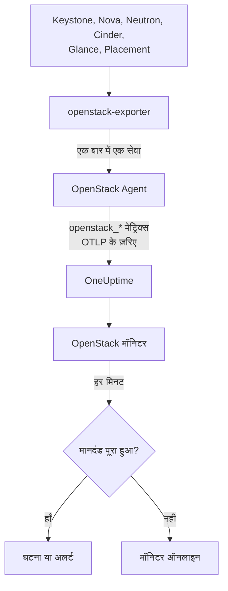

# OpenStack मॉनिटर

OpenStack मॉनिटर एक क्लाउड पर नज़र रखता है - उसके API, उनके पीछे चलने वाले वर्कर, हाइपरवाइज़र, इंस्टेंस, नेटवर्क, स्टोरेज पूल और प्रोजेक्ट कोटा - और जब कोई API जवाब देना बंद कर दे, कोई वर्कर डाउन हो जाए, किसी हाइपरवाइज़र में देने के लिए जगह न बचे या कोई पूल भर जाए, तब आपको सूचित करता है। यह उन `openstack_*` सीरीज़ को पढ़ता है जिन्हें OneUptime OpenStack Agent, openstack-exporter से इकट्ठा करता है, या कोई प्रोब क्लाउड के API से इकट्ठा करता है।

:::cards
- [मॉनिटर बनाएं](#openstack-मॉनिटर-बनाएं): डैशबोर्ड में छह चरण।
- [टेम्पलेट](#पहले-से-बने-अलर्ट-टेम्पलेट): तैयार अलर्ट, हर वर्कर, इंस्टेंस, नेटवर्क या रीजन के लिए एक अलग घटना।
- [बाहर से जाँच](#बाहर-से-जाँच): क्या कोई सच में इंस्टेंस बूट कर सकता है, यह क्लाउड के बाहर के प्रोब से जाँचें।
- [पहचान एट्रिब्यूट](#पहचान-एट्रिब्यूट): किसी एक रीजन, होस्ट या प्रोजेक्ट को कैसे टार्गेट करें।
- [मीट्रिक](#इकट्ठा-किए-गए-मेट्रिक्स): वे सभी सीरीज़ जिन पर मॉनिटर अलर्ट कर सकता है।
:::

## यह कैसे काम करता है

एजेंट एक OpenTelemetry Collector और एक openstack-exporter है, जिसे आप ऐसी मशीन पर चलाते हैं जो क्लाउड के API तक पहुँच सकती हो। यह हर OpenStack सेवा को उसके अपने अलग संग्रह में पढ़ता है, इसलिए Nova के खराब होने पर केवल Nova की सीरीज़ जाती हैं, और यह धीरे-धीरे पढ़ता है: compute, network, volume और placement हर 2 मिनट में, identity और image हर 5 मिनट में।

हर सीरीज़ पर क्लाउड का नाम `openstack.cloud.name` लगा होता है, और हर डेटापॉइंट पर `openstack.region.name` और `openstack_service`। एक क्लाउड यानी एक Keystone, और एक OpenStack मॉनिटर एक ही क्लाउड से जुड़ा होता है। हर मिनट यह उस क्लाउड के मेट्रिक्स पर अपनी क्वेरी चलाता है और नतीजे की तुलना अपने मानदंड से करता है।



## शुरू करने से पहले

- OpenStack Agent से, या [एक प्रोब](/docs/telemetry/openstack-agentless) से, **क्लाउड के मेट्रिक्स इकट्ठा करें**। **दस्तावेज़ीकरण**, **उत्पाद → बुनियादी ढांचा → OpenStack** के तहत, एजेंट को इंस्टॉल करने के चरण बताता है।
- **जाँचें कि क्लाउड रजिस्टर हो गया है।** पहले संग्रह के बाद वह **उत्पाद → बुनियादी ढांचा → OpenStack** में एजेंट के `OPENSTACK_CLOUD_NAME` के नाम से दिखता है।

## OpenStack मॉनिटर बनाएं

:::steps
### नया मॉनिटर शुरू करें

**मॉनिटर** पर जाएं और **मॉनिटर बनाएं** पर क्लिक करें।

### OpenStack चुनें

**मॉनिटर प्रकार** के तहत **और मॉनिटर प्रकार** पर क्लिक करें और **बुनियादी ढांचा** के तहत **OpenStack** चुनें, या खोज बॉक्स में `openstack` टाइप करें। एक **नाम** दें - यह घटनाओं और अलर्ट के शीर्षकों में इस्तेमाल होता है - और **अगला** पर क्लिक करें।

### क्लाउड चुनें

**OpenStack Monitor Configuration** के तहत **OpenStack क्लाउड** से क्लाउड चुनें। जिस भी क्लाउड ने डेटा भेजा है, वह सूची में है। चुनने के बाद फ़ील्ड के नीचे एक पंक्ति बताती है कि डेटा आ रहा है या नहीं।

### चुनें कि क्या देखना है

नया मॉनिटर **किस पर अलर्ट करना है** के तहत **Cloud Stopped Reporting** पर शुरू होता है। कुछ और देखने के लिए:

- **बदलें** - कोई दूसरा [टेम्पलेट](#पहले-से-बने-अलर्ट-टेम्पलेट) चुनें। यह मीट्रिक, एट्रिब्यूट फ़िल्टर, एकत्रीकरण, समय सीमा, ग्रुप-बाय और सीमाएँ तय करता है, और नीचे के मानदंड को अपने मानदंड से बदल देता है। आप **समय सीमा** फिर भी बदल सकते हैं।
- **Custom Metric** (**और फ़ील्ड** के तहत) - **OpenStack मीट्रिक** से एक मीट्रिक चुनें, फिर **एकत्रीकरण** और **समय सीमा** सेट करें, और [फ़िल्टर](#मॉनिटर-सेटिंग्स) से उसे सीमित करें।
- **उन्नत** (**और फ़ील्ड** के तहत) - **मेट्रिक्स चुनें** के तहत क्वेरी और फ़ॉर्मूले खुद बनाएं, `status`, `adminState` या `resourcetype` जैसे एट्रिब्यूट पर फ़िल्टर के साथ। हर हिस्से को अलग से परखने के लिए किसी [पहचान एट्रिब्यूट](#पहचान-एट्रिब्यूट) के अनुसार **इसके अनुसार समूहित करें** का उपयोग करें।

### मानदंड जाँचें

**मानदंड** के तहत हर मानदंड खोलें और उसका **मीट्रिक**, **एकत्रीकरण**, **शर्त** और **सीमा** जाँचें। टेम्पलेट इन्हें खुद भर देता है। **Custom Metric** या **उन्नत** में मॉनिटर डिफ़ॉल्ट मानदंड के साथ शुरू होता है, जो केवल यह देखता है कि मीट्रिक ने डेटा भेजना बंद कर दिया है, इसलिए अपनी सीमा खुद सेट करें।

### मॉनिटर बनाएं

**मॉनिटर बनाएं** पर क्लिक करें। OneUptime मॉनिटर का पेज खोलता है और उसे हर मिनट जाँचता है। इससे उठी घटनाएं और अलर्ट क्लाउड के **घटनाएं** और **अलर्ट** पेज पर भी सूचीबद्ध होते हैं।
:::

> [!TIP]
> एक साथ कई टेम्पलेट सेट करने के लिए **उत्पाद → बुनियादी ढांचा → OpenStack** से क्लाउड खोलें और **सुझाव** पर जाएं। जो टेम्पलेट चाहिए उन्हें चुनें, तय करें कि किसे पेज किया जाए, और OneUptime हर टेम्पलेट के लिए एक मॉनिटर बना देता है।

## मॉनिटर सेटिंग्स

| फ़ील्ड | टैब | यह क्या करता है |
| --- | --- | --- |
| **OpenStack क्लाउड** | सभी | ज़रूरी। हर क्वेरी को `resource.openstack.cloud.name` तक सीमित करता है। |
| **क्षेत्र** | Custom Metric, उन्नत | वैकल्पिक। एक रीजन: `openstack.region.name`। हर सीरीज़ में यह होता है। |
| **एवेलेबिलिटी ज़ोन** | Custom Metric, उन्नत | वैकल्पिक। एक ज़ोन: हाइपरवाइज़र, इंस्टेंस, वॉल्यूम और Neutron एजेंट पर `availability_zone`, Nova और Cinder के वर्कर पर `zone`। |
| **हाइपरवाइज़र** | Custom Metric, उन्नत | वैकल्पिक। एक होस्ट: वर्कर, हाइपरवाइज़र और Placement पर `hostname`, इंस्टेंस पर `hypervisor_hostname`। Nova के वर्कर होस्ट का छोटा नाम बताते हैं, जबकि हाइपरवाइज़र, Placement और इंस्टेंस उसका पूरा नाम, इसलिए वही चुनें जो सीरीज़ में दिया हो। |
| **सेवा** | Custom Metric, उन्नत | वैकल्पिक। एक वर्कर की बाइनरी, जैसे `nova-compute`: `service`। |
| **प्रोजेक्ट ID** | Custom Metric, उन्नत | वैकल्पिक। एक प्रोजेक्ट: Nova और Cinder की सीरीज़ तथा नेटवर्क और सबनेट पर `tenant_id`, फ़्लोटिंग IP, राउटर और एड्रेस उपलब्धता पर `project_id`। |
| **OpenStack मीट्रिक** | Custom Metric | [कैटलॉग](#इकट्ठा-किए-गए-मेट्रिक्स) से एक मीट्रिक। |
| **एकत्रीकरण** | Custom Metric | सैंपल कैसे मिलाए जाते हैं: **औसत**, **अधिकतम**, **न्यूनतम**, **योग** या **गणना**। मीट्रिक के सामान्य एकत्रीकरण से शुरू होता है। |
| **समय सीमा** | सभी | वह रोलिंग विंडो जिसे क्वेरी पढ़ती है, **Past 1 Minute** से **Past 365 Days** तक। नया मॉनिटर **पिछले 15 मिनट** पर शुरू होता है; टेम्पलेट अपनी सीमा खुद तय करते हैं। |
| **मेट्रिक्स चुनें** | उन्नत | क्वेरी बिल्डर: **मीट्रिक**, **Aggregate by**, **Filter by attributes**, **इसके अनुसार समूहित करें**, साथ में क्वेरी जोड़ने के लिए **मीट्रिक जोड़ें** और **सूत्र जोड़ें**। |

फ़िल्टर केवल उसी सीरीज़ को सीमित करता है जिसमें उसका लेबल हो: `openstack_nova_up` में कोई प्रोजेक्ट नहीं होता, इसलिए प्रोजेक्ट फ़िल्टर उसे जस का तस छोड़ देता है।

विंडो को जो आप पढ़ रहे हैं उसके तीन या अधिक संग्रहों के बराबर रखें: compute, network, volume और placement के लिए 6 मिनट, identity और image के लिए 15। इससे छोटी विंडो में इतने संग्रह नहीं होते कि **सभी मान** किसी अवधि का अर्थ दे सके।

## पहचान एट्रिब्यूट

हर सीरीज़ में `openstack.cloud.name` **रिसोर्स एट्रिब्यूट** के रूप में होता है, और `openstack.region.name` तथा `openstack_service` डेटापॉइंट एट्रिब्यूट के रूप में। बाकी बातें exporter के अपने लेबल बताते हैं:

| हिस्सा | सीरीज़ | इसे पहचानने वाले लेबल |
| --- | --- | --- |
| API | `openstack_*_up` | `openstack.region.name`, `openstack_service` |
| वर्कर | `openstack_nova_agent_state`, `openstack_neutron_agent_state`, `openstack_cinder_agent_state` | `hostname`, `service`। `adminState` बताता है कि ऑपरेटर ने इसे चालू छोड़ा है या नहीं। Cinder के मामले में `uuid` से कभी ग्रुप न करें: exporter हर संग्रह पर नया बना देता है |
| हाइपरवाइज़र | `openstack_placement_resource_*`, `openstack_nova_vcpus_*` | `hostname` (उसका पूरा नाम), Placement की सीरीज़ पर `resourcetype` |
| इंस्टेंस | `openstack_nova_server_status` | `uuid`, `name`, `tenant_id`, `hypervisor_hostname`, `status`। मान एक कोड है: `status` शब्द पर फ़िल्टर करें |
| वॉल्यूम | `openstack_cinder_volume_gb` | `id`, `name`, `tenant_id`, `status` |
| स्टोरेज पूल | `openstack_cinder_pool_capacity_*` | `name`, `volume_backend_name` |
| नेटवर्क | `openstack_neutron_network_ip_availabilities_*` | `network_id`, `network_name`, `cidr`, `ip_version` |
| राउटर | `openstack_neutron_l3_agent_of_router` | `router_id`, `agent_host`, `ha_state`, `agent_alive`, `agent_admin_up` |
| प्रोजेक्ट | `openstack_nova_limits_*`, `openstack_cinder_limits_*` | `tenant_id`, `tenant` |

मॉनिटर फ़िल्टर और ग्रुप-बाय कीज़ में रिसोर्स एट्रिब्यूट `resource.` से शुरू होता है (`resource.openstack.cloud.name`), और डेटापॉइंट एट्रिब्यूट नहीं (`openstack.region.name`, `hostname`, `status`)। खाली लेबल OneUptime तक नहीं पहुँचता, इसलिए `disabledReason` केवल उसी वर्कर पर होता है जिसे किसी ने डिसेबल किया हो।

## पहले से बने अलर्ट टेम्पलेट

OneUptime सामान्य OpenStack समस्याओं के लिए 120 टेम्पलेट के साथ आता है, और **किस पर अलर्ट करना है** सूची उन्हें पेश करती है। क्लाउड का सुझाव पेज Heat, Magnum, Ironic, Manila, Octavia, Trove, Designate, Gnocchi या Swift का टेम्पलेट केवल उस क्लाउड को देता है जो उसे चलाता है; ऐसी सीरीज़ पर बना टेम्पलेट, जिसे केवल प्रोब भेजता है, केवल उस क्लाउड को देता है जिसे प्रोब इकट्ठा करता है; और [बाहर से जाँच](#बाहर-से-जाँच) पर बना टेम्पलेट केवल उस क्लाउड को देता है जिसमें वह जाँच चालू हो: किसी और क्लाउड पर उसकी सीरीज़ मौजूद ही नहीं होतीं, इसलिए वह कभी ट्रिगर नहीं हो सकता। हर टेम्पलेट एक पूरा मॉनिटर बनाता है: मीट्रिक क्वेरी, उसके एट्रिब्यूट फ़िल्टर, उस चीज़ पर ग्रुप-बाय जिसके बारे में एक घटना होती है, एक मानदंड जो ट्रिगर करता है और एक जो रिकवर करता है। सीमाएँ वही रेखाएँ हैं जो क्लाउड के अपने पेज खींचते हैं, और ये शुरुआती बिंदु हैं जिन्हें आप बदल सकते हैं।

हर टेम्पलेट जिस चीज़ को देखता है उसके कम से कम तीन संग्रह पढ़ता है, और तभी ट्रिगर होता है जब शर्त पूरी विंडो में बनी रहे। किसी हिस्सेदारी (शेयर) पर सीमा अपनी रेखा से 10% आगे जाकर रिकवर होती है, ताकि वहाँ मंडराता मान बार-बार ऊपर-नीचे न हो।

| टेम्पलेट | श्रेणी | गंभीरता | क्या देखता है | कब ट्रिगर होता है | कब रिकवर होता है |
| --- | --- | --- | --- | --- | --- |
| Cloud Stopped Reporting | उपलब्धता | क्रिटिकल | `openstack_identity_up`, पूरे क्लाउड पर गणना, **पिछले 15 मिनट** | पूरी विंडो में कोई डेटा नहीं: एजेंट रुक गया है या OneUptime तक नहीं पहुँच पा रहा, या exporter Keystone में लॉग इन नहीं कर पा रहा | डेटा फिर आने लगता है |
| Identity API Down | उपलब्धता | क्रिटिकल | `identity` के लिए `openstack_identity_up` और `scrape_samples_scraped`, हर रीजन पर न्यूनतम, **पिछले 15 मिनट** | हर कॉल विफल रही, या संग्रह खाली लौटा क्योंकि exporter लॉग इन नहीं कर सका | दोनों 1 या उससे अधिक पढ़ते हैं |
| Compute API Down | उपलब्धता | क्रिटिकल | `compute` के लिए `openstack_nova_up` और `scrape_samples_scraped`, हर रीजन पर न्यूनतम, **पिछले 10 मिनट** | हर कॉल विफल रही, या संग्रह खाली लौटा क्योंकि exporter Nova के API तक नहीं पहुँच सका | दोनों 1 या उससे अधिक पढ़ते हैं |
| Network API Down | उपलब्धता | क्रिटिकल | `network` के लिए `openstack_neutron_up` और `up`, हर रीजन पर न्यूनतम, **पिछले 10 मिनट** | हर कॉल विफल रही, या exporter ने जवाब नहीं दिया | दोनों 1 पढ़ते हैं |
| Block Storage API Down | उपलब्धता | क्रिटिकल | `volume` के लिए `openstack_cinder_up` और `up`, हर रीजन पर न्यूनतम, **पिछले 10 मिनट** | हर कॉल विफल रही, या exporter ने जवाब नहीं दिया | दोनों 1 पढ़ते हैं |
| Image API Down | उपलब्धता | क्रिटिकल | `image` के लिए `openstack_glance_up` और `up`, हर रीजन पर न्यूनतम, **पिछले 15 मिनट** | हर कॉल विफल रही, या exporter ने जवाब नहीं दिया | दोनों 1 पढ़ते हैं |
| Placement API Down | उपलब्धता | क्रिटिकल | `placement` के लिए `openstack_placement_up` और `up`, हर रीजन पर न्यूनतम, **पिछले 10 मिनट** | हर कॉल विफल रही, या exporter ने जवाब नहीं दिया | दोनों 1 पढ़ते हैं |
| Compute Service Down | कंट्रोल प्लेन | क्रिटिकल | `service = nova-compute` और `adminState = enabled` पर फ़िल्टर किया गया `openstack_nova_agent_state`, हर होस्ट पर न्यूनतम, **पिछले 10 मिनट** | 1 से नीचे: कोई चालू nova-compute डाउन है। जिसे किसी ने डिसेबल किया हो वह कभी ट्रिगर नहीं होता | अप हो जाए, या डिसेबल हो जाए |
| Compute Service Disabled | कंट्रोल प्लेन | चेतावनी | `service = nova-compute` और `adminState = disabled` पर फ़िल्टर किया गया `openstack_nova_agent_state`, हर होस्ट पर गणना, **पिछले 10 मिनट** | 0 से ऊपर: किसी `nova-compute` को डिसेबल किया गया, और उसके होस्ट, उसके एवेलेबिलिटी ज़ोन या क्लाउड को कोई चालू रखरखाव इवेंट कवर नहीं करता। जो libvirt के चले जाने से खुद डिसेबल हुआ (उसका कारण `AUTO:` से शुरू होता है) वह तब तक शांत रहता है जब तक libvirt Service Down खुला है। प्रोजेक्ट को इसकी सूचना नहीं दी जाती | यह फिर चालू हो जाए, या कोई इवेंट इसे कवर कर ले |
| Scheduler or Conductor Down | कंट्रोल प्लेन | चेतावनी | `nova-scheduler` या `nova-conductor` और `adminState = enabled` पर फ़िल्टर किया गया `openstack_nova_agent_state`, हर होस्ट और बाइनरी पर न्यूनतम, **पिछले 10 मिनट** | 1 से नीचे। जब तक कोई बचा है, बाकी काम चलाते रहते हैं | अप हो जाए, या डिसेबल हो जाए |
| Every Scheduler or Conductor Down | कंट्रोल प्लेन | क्रिटिकल | वही, हर रीजन और बाइनरी पर अधिकतम, **पिछले 10 मिनट** | 1 से नीचे: कोई भी जीवित नहीं, इसलिए कुछ नया बूट नहीं हो सकता | कोई एक अप हो जाए |
| Network Agent Down | कंट्रोल प्लेन | क्रिटिकल | `adminState = up` पर फ़िल्टर किया गया `openstack_neutron_agent_state`, हर होस्ट और बाइनरी पर न्यूनतम, **पिछले 10 मिनट** | 1 से नीचे: अप सेट किया गया एजेंट जीवित नहीं है। जिसे किसी ने डाउन सेट किया हो वह कभी ट्रिगर नहीं होता | जीवित हो जाए, या डाउन सेट हो जाए |
| Block Storage Service Down | कंट्रोल प्लेन | क्रिटिकल | `adminState = enabled` पर फ़िल्टर किया गया `openstack_cinder_agent_state`, हर होस्ट और बाइनरी पर न्यूनतम, **पिछले 10 मिनट** | 1 से नीचे: कोई चालू Cinder सेवा डाउन है। जिसे किसी ने डिसेबल किया हो वह कभी ट्रिगर नहीं होती | अप हो जाए, या डिसेबल हो जाए |
| vCPU Allocation High | कंप्यूट | चेतावनी | `resourcetype = VCPU` पर फ़िल्टर किया गया `openstack_placement_resource_*`, उपयोग / ((कुल - आरक्षित) x अनुपात), हर हाइपरवाइज़र पर, **पिछले 10 मिनट** | 90% से ऊपर: आवंटन, लोड नहीं | 81% या उससे नीचे |
| Memory Allocation High | कंप्यूट | चेतावनी | वही, `resourcetype = MEMORY_MB` | 90% से ऊपर | 81% या उससे नीचे |
| Local Disk Allocation High | कंप्यूट | चेतावनी | वही, `resourcetype = DISK_GB` | 90% से ऊपर | 81% या उससे नीचे |
| Hypervisor CPU Saturated | कंप्यूट | चेतावनी | `openstack.hypervisor.instances.cpu.utilization`, हर हाइपरवाइज़र पर, **पिछले 15 मिनट**। libvirt या Ceilometer का exporter चाहिए | अपने CPU थ्रेड के 90% से ऊपर: लोड, आवंटन नहीं। इसका पेज ज़िम्मेदार इंस्टेंस के नाम बताता है | 81% या उससे नीचे |
| Hypervisor Memory Pressure | कंप्यूट | चेतावनी | `openstack.hypervisor.instances.memory.utilization`, हर हाइपरवाइज़र पर, **पिछले 15 मिनट**। libvirt का exporter, या Ceilometer का `memory.resident` पोल करना चाहिए | अपनी मेमोरी के 90% से ऊपर: उपयोग में, वादा की हुई नहीं | 81% या उससे नीचे |
| Instance CPU Saturated | कंप्यूट | चेतावनी | `openstack.instance.cpu.utilization`, हर इंस्टेंस पर अधिकतम, **पिछले 15 मिनट**। libvirt या Ceilometer का exporter चाहिए | अपने vCPU के 95% से ऊपर | 85.5% या उससे नीचे |
| Instance Disk Latency High | कंप्यूट | चेतावनी | `openstack.instance.disk.read.latency` और `openstack.instance.disk.write.latency`, हर इंस्टेंस और डिस्क पर अधिकतम, **पिछले 15 मिनट**। libvirt का exporter, या Ceilometer का `disk.device.read.latency` और `disk.device.write.latency` पोल करना चाहिए | प्रति अनुरोध 50 ms से ऊपर। जिस डिस्क पर कोई अनुरोध नहीं, उसकी कोई लेटेंसी नहीं होती, इसलिए निष्क्रिय डिस्क कभी ट्रिगर नहीं होती | 45 ms या उससे नीचे, या उसका उपयोग बंद हो जाए |
| Instances in Error | कंप्यूट | चेतावनी | `status = ERROR` पर फ़िल्टर किया गया `openstack_nova_server_status`, हर रीजन पर गणना, **पिछले 10 मिनट** | 0 से ऊपर | कोई नहीं बचा |
| Instance Stuck Building | कंप्यूट | चेतावनी | `status = BUILD` या `BUILD(spawning)` पर फ़िल्टर किया गया `openstack_nova_server_status`, हर इंस्टेंस पर अधिकतम, **पिछले 1 घंटा** | एक घंटे तक हर संग्रह में उसी स्थिति में | उससे बाहर निकल गया |
| Instance Stuck Transitioning | कंप्यूट | चेतावनी | वही `REBUILD`, `RESIZE`, `REVERT_RESIZE`, `MIGRATING`, `REBOOT`, `HARD_REBOOT` और `PASSWORD` के लिए, **पिछले 1 घंटा** | एक घंटे तक हर संग्रह में इनमें से किसी एक में | उससे बाहर निकल गया |
| Instance Stuck in Verify Resize | कंप्यूट | चेतावनी | वही `VERIFY_RESIZE` के लिए, **पिछले 1 घंटा** | एक घंटे से किसी के पुष्टि या वापस लेने का इंतज़ार | पुष्टि हो गई या वापस ले लिया गया |
| Router Not Active | नेटवर्क | चेतावनी | `openstack_neutron_routers_not_active`, हर रीजन पर अधिकतम, **पिछले 10 मिनट** | 0 से ऊपर | 0 पर |
| Floating IP Not Active | नेटवर्क | चेतावनी | `openstack_neutron_floating_ips_associated_not_active`, हर रीजन पर अधिकतम, **पिछले 10 मिनट** | 0 से ऊपर: उपयोग में चल रहा कोई ACTIVE नहीं है। खाली पड़ा आईपी डाउन ही होना चाहिए | 0 पर |
| External IP Pool Nearly Full | नेटवर्क | चेतावनी | `openstack_neutron_network` पर `is_external = true` के साथ `ip_version = 4` वाला `openstack_neutron_network_ip_availabilities_*`, हर नेटवर्क पर, **पिछले 10 मिनट** | किसी एक्सटर्नल नेटवर्क के IPv4 पतों के 90% से ऊपर। किसी टेनेंट का नेटवर्क कभी ट्रिगर नहीं होता | 81% या उससे नीचे |
| Network Out of IPs | नेटवर्क | क्रिटिकल | वही | 100% पर: कोई पता नहीं बचा | 90% से नीचे |
| Router Without Active Agent | नेटवर्क | क्रिटिकल | `agent_admin_up = true` पर फ़िल्टर किया गया `openstack_neutron_l3_agent_of_router`, हर राउटर पर अधिकतम, **पिछले 10 मिनट** | 1 से नीचे: उसे थामे कोई एजेंट जीवित नहीं। OVN पर शांत रहता है, जहाँ ऐसे एजेंट नहीं होते | कोई एक जीवित हो जाए |
| Router With Two Active Agents | नेटवर्क | क्रिटिकल | वही, `ha_state = active` और `agent_alive = true` पर फ़िल्टर किया हुआ, हर राउटर पर गणना, **पिछले 10 मिनट** | 1 से ऊपर: स्प्लिट ब्रेन। OVN पर शांत रहता है | 1 या उससे नीचे |
| Storage Pool Warning | स्टोरेज | चेतावनी | `openstack_cinder_pool_capacity_*`, (कुल - खाली) / कुल, हर पूल पर, **पिछले 10 मिनट** | 85% से ऊपर | 76.5% या उससे नीचे |
| Storage Pool Critical | स्टोरेज | क्रिटिकल | वही | 95% से ऊपर | 85.5% या उससे नीचे |
| Volumes in Error | स्टोरेज | चेतावनी | हर एरर शब्द के लिए `openstack_cinder_volume_status_counter`, हर रीजन और शब्द पर अधिकतम, **पिछले 10 मिनट** | 0 से ऊपर | 0 पर |
| Volume Stuck | स्टोरेज | चेतावनी | हर गुज़रते स्टेटस शब्द के लिए `openstack_cinder_volume_gb`, हर वॉल्यूम पर अधिकतम, **पिछले 30 मिनट** | 30 मिनट तक हर संग्रह में उसी स्थिति में | उससे बाहर निकल गया |
| Image Stuck | स्टोरेज | चेतावनी | हर गुज़रते स्टेटस शब्द के लिए `openstack_glance_image_created_at`, हर इमेज पर अधिकतम, **पिछले 1 घंटा** | एक घंटे तक हर संग्रह में उसी स्थिति में | उससे बाहर निकल गया, या हटा दिया गया |
| Orchestration API Down | उपलब्धता | क्रिटिकल | `orchestration` के लिए `openstack_heat_up` और `up`, हर रीजन पर न्यूनतम, **पिछले 15 मिनट** | हर कॉल विफल रही, जो रुके हुए `heat-engine` से भी ऐसी ही दिखती है, या exporter ने जवाब नहीं दिया | दोनों 1 पढ़ते हैं |
| Kubernetes Clusters API Down | उपलब्धता | क्रिटिकल | `container-infra` के लिए `openstack_container_infra_up` और `up`, हर रीजन पर न्यूनतम, **पिछले 15 मिनट** | हर कॉल विफल रही, या exporter ने जवाब नहीं दिया | दोनों 1 पढ़ते हैं |
| Rating API Down | उपलब्धता | क्रिटिकल | `rating` के लिए `openstack_cloudkitty_up` और `up`, हर रीजन पर न्यूनतम, **पिछले 15 मिनट**। इसे केवल प्रोब भेजता है | CloudKitty का API जवाब नहीं देता, इसलिए हर प्रोजेक्ट की रेटिंग आगे नहीं बढ़ती | दोनों 1 पढ़ते हैं |
| Heat Engine Down | कंट्रोल प्लेन | चेतावनी | `openstack_heat_agent_state`, हर होस्ट पर न्यूनतम, **पिछले 15 मिनट**। इसे केवल प्रोब भेजता है | Heat किसी `heat-engine` को डाउन बताता है। सभी इंजन रुक जाने पर Heat उन्हें सूचीबद्ध नहीं कर पाता, और तब Orchestration API Down ट्रिगर होता है | यह 1 पढ़ता है, या Heat अपना रिकॉर्ड हटा देता है |
| Magnum Conductor Down | कंट्रोल प्लेन | क्रिटिकल | `adminState=enabled` वाला `openstack_container_infra_agent_state`, हर होस्ट पर न्यूनतम, **पिछले 15 मिनट**। इसे केवल प्रोब भेजता है | Magnum किसी चालू `magnum-conductor` को डाउन बताता है। Magnum का API जवाब देता रहता है, इसलिए और कुछ यह नहीं बताता | यह 1 पढ़ता है, या कोई इसे डिसेबल कर देता है |
| Stack Failed | ऑर्केस्ट्रेशन | चेतावनी | हर `*_FAILED` स्टेटस वाला `openstack_heat_stack_status`, हर स्टैक पर, **पिछले 15 मिनट** | कोई स्टैक पूरी विंडो में फ़ेल स्टेटस पर रहता है | उसे अपडेट या डिलीट कर दिया जाए |
| Stack Stuck In Progress | ऑर्केस्ट्रेशन | चेतावनी | हर `*_IN_PROGRESS` स्टेटस वाला `openstack_heat_stack_status`, हर स्टैक पर, **पिछले 2 घंटे** | कोई स्टैक पूरी विंडो में इन-प्रोग्रेस स्टेटस पर रहता है, उस एक घंटे के बाद भी जो Heat देता है, जब तक किसी ने ज़्यादा न चुना हो | वह अपने अगले स्टेटस पर पहुँच जाए, या डिलीट हो जाए |
| Kubernetes Cluster Failed | ऑर्केस्ट्रेशन | चेतावनी | हर `*_FAILED` स्टेटस वाला `openstack_container_infra_cluster_status`, हर क्लस्टर पर, **पिछले 15 मिनट** | कोई क्लस्टर पूरी विंडो में फ़ेल स्टेटस पर रहता है | उसे अपडेट या डिलीट कर दिया जाए |
| Kubernetes Cluster Stuck | ऑर्केस्ट्रेशन | चेतावनी | हर `*_IN_PROGRESS` स्टेटस वाला `openstack_container_infra_cluster_status`, हर क्लस्टर पर, **पिछले 2 घंटे** | कोई क्लस्टर पूरी विंडो में इन-प्रोग्रेस स्टेटस पर रहता है। उसे केवल Magnum का कंडक्टर आगे बढ़ाता है | वह अपने अगले स्टेटस पर पहुँच जाए, या डिलीट हो जाए |
| Shared File Systems API Down | उपलब्धता | क्रिटिकल | `sharev2` के लिए `openstack_sharev2_up` और `up`, हर रीजन पर न्यूनतम, **पिछले 15 मिनट** | हर कॉल विफल रही, या exporter ने जवाब नहीं दिया। लॉग इन कर सकने वाला हर क्रेडेंशियल 1 पढ़ता है, इसलिए यह क्रेडेंशियल के ठुकराए जाने की वजह से नहीं हो सकता | दोनों 1 पढ़ते हैं |
| Manila Service Down | कंट्रोल प्लेन | चेतावनी | `adminState=enabled` वाला `openstack_sharev2_agent_state`, हर होस्ट और सेवा पर न्यूनतम, **पिछले 15 मिनट**। इसे केवल प्रोब भेजता है | Manila किसी चालू सेवा को रुका हुआ या डाउन बताता है। इसका API जवाब देता रहता है, इसलिए और कुछ यह नहीं बताता | यह 1 पढ़ता है, या कोई इसे डिसेबल कर देता है |
| Share in Error | स्टोरेज | चेतावनी | हर एरर स्टेटस वाला `openstack_sharev2_share_gb`, हर शेयर पर, **पिछले 15 मिनट** | कोई शेयर पूरी विंडो में एरर स्टेटस पर रहता है | उसे ठीक या डिलीट कर दिया जाए |
| Share Stuck | स्टोरेज | चेतावनी | हर गुज़रते स्टेटस वाला `openstack_sharev2_share_gb`, हर शेयर पर, **पिछले 1 घंटा** | कोई शेयर पूरी विंडो में गुज़रते स्टेटस पर रहता है। धीमे बैकएंड के लिए Manila का अपना कोई टाइमआउट नहीं है। जो माइग्रेट हो रहा हो या बैकअप लिया जा रहा हो, उस पर नज़र नहीं रखी जाती | वह अपने अगले स्टेटस पर पहुँच जाए, या डिलीट हो जाए |
| Load Balancers API Down | लोड बैलेंसर | क्रिटिकल | `openstack_loadbalancer_up`, हर रीजन पर न्यूनतम, **पिछले 15 मिनट** | 1 से नीचे। रुका हुआ Octavia API एजेंट के exporter को 0 की जगह खाली जवाब देता है, ठीक वैसे ही जैसे Octavia के बिना क्लाउड, इसलिए एजेंट के क्लाउड पर यह शांत रहता है और क्लाउड के पेज बताते हैं कि Octavia की आखिरी खबर कब मिली | 1 पढ़ता है, या गायब हो गया |
| Load Balancer in Error | लोड बैलेंसर | क्रिटिकल | `provisioning_status=ERROR` वाला `openstack_loadbalancer_loadbalancer_status`, हर लोड बैलेंसर पर गणना, **पिछले 15 मिनट** | कोई लोड बैलेंसर पूरी विंडो में provisioning ERROR पर रहता है। Octavia इनमें से किसी को दोबारा नहीं आज़माता | वह वापस ACTIVE हो जाए, या डिलीट हो जाए |
| Load Balancer Stuck Pending | लोड बैलेंसर | चेतावनी | हर `PENDING_*` provisioning स्टेटस वाला `openstack_loadbalancer_loadbalancer_status`, हर लोड बैलेंसर पर गणना, **पिछले 1 घंटा** | कोई लोड बैलेंसर पूरी विंडो में PENDING स्टेटस पर रहता है: Octavia का वर्कर रुका है, या अनुरोध खो गया | वह ACTIVE या ERROR पर पहुँच जाए, या डिलीट हो जाए |
| Load Balancer With Two Masters | लोड बैलेंसर | क्रिटिकल | `role=MASTER` और `status=ALLOCATED` वाला `openstack_loadbalancer_amphora_status`, हर लोड बैलेंसर पर गणना, **पिछले 15 मिनट**। ऐसा क्रेडेंशियल चाहिए जो amphora सूचीबद्ध कर सके | एक लोड बैलेंसर के लिए एक से अधिक आवंटित amphora MASTER बताते हैं | केवल एक बताता है |
| Amphora in Error | लोड बैलेंसर | क्रिटिकल | `status=ERROR` वाला `openstack_loadbalancer_amphora_status`, हर amphora पर गणना, **पिछले 15 मिनट**। ऐसा क्रेडेंशियल चाहिए जो amphora सूचीबद्ध कर सके | कोई amphora पूरी विंडो में ERROR पर रहता है: स्वास्थ्य मैनेजर उसे बदल नहीं सका | उसे बदल दिया जाए |
| Pool Has No Healthy Members | लोड बैलेंसर | क्रिटिकल | `operating_status=ERROR` वाला `openstack_loadbalancer_pool_status`, हर पूल पर गणना, **पिछले 15 मिनट** | पूल का हर मेंबर अपनी स्वास्थ्य जाँच में फ़ेल है, जबकि पूल और उसका लोड बैलेंसर अब भी ACTIVE प्रोविज़न दिखाते हैं | कोई मेंबर फिर स्वस्थ हो जाए |
| DNS API Down | उपलब्धता | क्रिटिकल | `openstack_designate_up`, हर रीजन पर न्यूनतम, **पिछले 15 मिनट**। इसे केवल प्रोब देता है | 1 से नीचे। रुका हुआ Designate एजेंट के exporter को खाली जवाब देता है, ठीक वैसे ही जैसे Designate के बिना क्लाउड, इसलिए एजेंट जिस क्लाउड को इकट्ठा करता है वह केवल इतना कह सकता है कि वह शांत हो गया | 1 पढ़ता है |
| DNS Zone in Error | नेटवर्क | चेतावनी | `status=ERROR` वाले `openstack_designate_zone_status` की गणना, हर ज़ोन पर, **पिछले 15 मिनट** | कोई ज़ोन पूरी विंडो में `ERROR` पढ़ता है: उसके वर्कर ने उसे DNS सर्वर पर लिखना छोड़ दिया | वह कुछ और पढ़ने लगे |
| DNS Zone Stuck Pending | नेटवर्क | चेतावनी | `status=PENDING` वाले `openstack_designate_zone_status` की गणना, हर ज़ोन पर, **पिछले 30 मिनट** | कोई ज़ोन पूरी विंडो में `PENDING` पढ़ता है। उसका वर्कर कुछ मिनट में हार मान लेता है, इसलिए उस पर कोई काम नहीं कर रहा | वह कुछ और पढ़ने लगे |
| DNS Recordset in Error | नेटवर्क | चेतावनी | `status=ERROR` और किसी के माँगे हर प्रकार वाले `openstack_designate_recordsets_status` की गणना, हर ज़ोन पर, **पिछले 15 मिनट** | ज़ोन के अपने SOA और NS के अलावा कोई रिकॉर्डसेट `ERROR` पढ़ता है। वे दोनों अपने ज़ोन के साथ `ERROR` पढ़ते हैं, इसलिए DNS Zone in Error यह बताता है | वह कुछ और पढ़ने लगे |
| Metrics API Down | उपलब्धता | क्रिटिकल | `gnocchi` के लिए `openstack_gnocchi_up` और `up`, हर रीजन पर न्यूनतम, **पिछले 15 मिनट** | exporter का Gnocchi पढ़ना विफल रहा, या exporter ने जवाब नहीं दिया। Gnocchi द्वारा ठुकराया गया क्रेडेंशियल भी ऐसा ही पढ़ता है, इसलिए जिस क्लाउड के क्रेडेंशियल ने कभी Gnocchi नहीं पढ़ा उसे यह नहीं दिया जाता | दोनों 1 पढ़ते हैं |
| Gnocchi No Processors | मेट्रिक्स | क्रिटिकल | `openstack_gnocchi_status_metricd_processors`, हर रीजन पर अधिकतम, **पिछले 15 मिनट** | Gnocchi की स्थिति में कोई प्रोसेसर नहीं है। इसका API जवाब देता और माप लेता रहता है, इसलिए **Metrics API Down** इस बारे में कुछ नहीं कहता | यह किसी एक का नाम बताता है |
| Gnocchi Backlog Growing | मेट्रिक्स | चेतावनी | `openstack_gnocchi_status_measures_to_process`, **पिछले 2 घंटे** से गुज़रती एक रेखा | रेखा अगले एक घंटे में 10,000 माप पार कर जाती है। उससे ऊपर का बैकलॉग जो गिर रहा हो, ट्रिगर नहीं करता | रेखा अब 9,000 तक नहीं पहुँचती |
| Object Storage API Down | उपलब्धता | क्रिटिकल | `object-store` के लिए `openstack_object_store_up` और `up`, हर रीजन पर न्यूनतम, **पिछले 15 मिनट** | exporter का Swift पढ़ना विफल रहा, या exporter ने जवाब नहीं दिया। Swift द्वारा ठुकराया गया क्रेडेंशियल भी ऐसा ही पढ़ता है, इसलिए जिस क्लाउड के क्रेडेंशियल ने कभी Swift नहीं पढ़ा उसे यह नहीं दिया जाता | दोनों 1 पढ़ते हैं |
| Object Container Growth Forecast | स्टोरेज | चेतावनी | `openstack_object_store_bytes`, **पिछले 7 दिन** से गुज़रती एक रेखा, हर कंटेनर पर | रेखा अगले एक हफ़्ते में 1 TiB पार कर जाती है। इसे उस मान पर बदलें जिसकी खबर आपके क्लाउड को होनी चाहिए | रेखा अब उसके 90% तक नहीं पहुँचती |
| Key Manager API Down | उपलब्धता | क्रिटिकल | `openstack_barbican_up`, हर रीजन पर न्यूनतम, **पिछले 15 मिनट**। इसे केवल प्रोब देता है | 1 से नीचे। exporter के पास Barbican का कोई रीडर ही नहीं है | 1 पढ़ता है |
| Swift Storage Server Not Answering | स्टोरेज | चेतावनी | `openstack_object_store_recon_up`, हर सर्वर पर न्यूनतम, **पिछले 15 मिनट**। इसे केवल प्रोब देता है, जहाँ क्लाउड की सेटिंग्स उसके स्टोरेज सर्वर के नाम बताती हैं | सर्वर `/recon` का जवाब नहीं देता। Swift का प्रॉक्सी उसके बिना भी जवाब देता रहता है | वह जवाब देने लगे |
| Swift Rings Differ | स्टोरेज | चेतावनी | `openstack_object_store_recon_rings_differ`, हर रिंग पर न्यूनतम, **पिछले 15 मिनट**। इसे केवल प्रोब देता है | नामित सर्वर किसी रिंग के अलग-अलग चेकसम बताते हैं | वे सहमत हो जाएँ |
| Swift Replication Stale | स्टोरेज | चेतावनी | `openstack_object_store_recon_replication_age_seconds`, हर सर्वर और रिंग पर न्यूनतम, **पिछले 15 मिनट**। इसे केवल प्रोब देता है | किसी सर्वर ने आखिरी पास 6 घंटे से भी पहले पूरा किया था | कोई एक पूरा कर ले |
| Databases API Down | उपलब्धता | क्रिटिकल | `database` के लिए `openstack_trove_up` और `up`, हर रीजन पर न्यूनतम, **पिछले 15 मिनट** | exporter का Trove पढ़ना विफल रहा, या exporter ने जवाब नहीं दिया। यह Trove का mgmt API पढ़ता है, इसलिए ठुकराया गया क्रेडेंशियल रुके हुए API जैसा ही पढ़ता है, और जिस क्लाउड के क्रेडेंशियल ने कभी Trove नहीं पढ़ा उसे यह नहीं दिया जाता | दोनों 1 पढ़ते हैं |
| Database Instance in Error | डेटाबेस | चेतावनी | हर एरर स्टेटस वाले `openstack_trove_instance_status` की गणना, हर इंस्टेंस पर, **पिछले 15 मिनट** | कोई इंस्टेंस पूरी विंडो में एरर स्टेटस पर रहता है | उसे ठीक या डिलीट कर दिया जाए |
| Database Instance Stuck | डेटाबेस | चेतावनी | हर गुज़रते स्टेटस वाले `openstack_trove_instance_status` की गणना, हर इंस्टेंस पर, **पिछले 1 घंटा** | कोई इंस्टेंस पूरी विंडो में गुज़रते स्टेटस पर रहता है। Trove के पास अपने वर्कर की सूची नहीं है, इसलिए यही बताता है कि `trove-taskmanager` रुक गया | वह अपने अगले स्टेटस पर पहुँच जाए, या डिलीट हो जाए |
| Database Volume Nearly Full | डेटाबेस | चेतावनी | `openstack_trove_instance_volume_used_gb` को `openstack_trove_instance_volume_size_gb` से भाग देकर, हर इंस्टेंस पर, **पिछले 15 मिनट** | 85% या उससे ऊपर। जो इंस्टेंस चल नहीं रहा वह 0 उपयोग पढ़ता है। चालू इंस्टेंस की कोई रिकॉर्डिंग नहीं होती | उसका आकार बढ़ा दिया जाए, या वह सिकुड़ जाए |
| Bare Metal API Down | बेयर मेटल | क्रिटिकल | `openstack_ironic_up`, हर रीजन पर न्यूनतम, **पिछले 15 मिनट** | 1 से नीचे। केवल वहीं बोलता है जहाँ Ironic का पढ़ना यह कह सके: प्रोब, या exporter 1.7.0। रुका हुआ Ironic एजेंट के exporter को पढ़ने को कुछ नहीं देता, ठीक वैसे ही जैसे Ironic के बिना क्लाउड, इसलिए वहाँ यह शांत रहता है और क्लाउड के पेज बताते हैं कि Ironic की आखिरी खबर कब मिली | 1 पढ़ता है, या गायब हो गया |
| Bare Metal Conductor Down | बेयर मेटल | चेतावनी | `openstack_ironic_agent_state`, हर होस्ट पर न्यूनतम, **पिछले 15 मिनट**। इसे केवल प्रोब भेजता है, और केवल तब जब क्लाउड की पॉलिसी उसके क्रेडेंशियल को Ironic के कंडक्टर पढ़ने दे: डिफ़ॉल्ट रूप से यह किसी प्रोजेक्ट के क्रेडेंशियल को ठुकराती है | Ironic किसी कंडक्टर को जीवित नहीं बताता। इसका API जवाब देता रहता है, और हर नोड वैसा ही पढ़ता है जैसा था, इसलिए और कुछ यह नहीं बताता | यह 1 पढ़ता है, या Ironic अपना रिकॉर्ड हटा देता है |
| Bare Metal Node in Error | बेयर मेटल | चेतावनी | हर फ़ेल `provision_state` के लिए `openstack_ironic_node`, हर नोड पर अधिकतम, **पिछले 15 मिनट** | 15 मिनट तक हर संग्रह में उसी स्थिति में, रखरखाव में हो या नहीं | उससे बाहर निकल गया, या हटा दिया गया |
| Bare Metal Node Stuck Transitioning | बेयर मेटल | चेतावनी | `maintenance = false` के साथ हर गुज़रते `provision_state` के लिए `openstack_ironic_node`, हर नोड पर अधिकतम, **पिछले 2 घंटे** | 2 घंटे तक हर संग्रह में उसी स्थिति में। लंबा डिस्क इरेज़ सचमुच इतना समय ले सकता है, जो नोड का पेज बता सकता है और यह नहीं | उससे बाहर निकल गया, या हटा दिया गया |
| Bare Metal Node in Maintenance Too Long | बेयर मेटल | चेतावनी | `maintenance = true` वाला `openstack_ironic_node`, हर नोड पर अधिकतम, **पिछले 7 दिन** | 7 दिन तक हर संग्रह में रखरखाव में। इसके लिए आपके मेट्रिक्स इतने समय तक रखे होने चाहिए | रखरखाव से बाहर आ गया, या हटा दिया गया |
| Bare Metal Power State Unexpected | बेयर मेटल | चेतावनी | `provision_state = active`, `power_state = power off` और `maintenance = false` वाला `openstack_ironic_node`, हर नोड पर अधिकतम, **पिछले 15 मिनट** | 15 मिनट तक हर संग्रह में। जिस इंस्टेंस को उसके मालिक ने रोका हो वह भी ऐसा ही पढ़ता है, जो नोड का पेज बता सकता है और यह नहीं | चालू कर दिया गया, या अब डिप्लॉय नहीं है |
| Project Quota Nearly Reached | प्रोजेक्ट | चेतावनी | `openstack_nova_limits_*` और `openstack_cinder_limits_volume_*`, उपयोग / अधिकतम हर प्रोजेक्ट पर, **पिछले 3 घंटे** | उसके vCPU, मेमोरी, इंस्टेंस या वॉल्यूम कोटा के 90% से ऊपर। इसके लिए [limits सीरीज़ चालू](#limits-सीरीज़-चालू-करें) होनी चाहिए | 81% या उससे नीचे |
| Token Issue Failing | उपलब्धता | क्रिटिकल | `openstack_check_token_success`, हर रीजन पर न्यूनतम, **पिछले 5 मिनट**। API जाँच चालू होनी चाहिए | 1 से नीचे: Keystone ने प्रोब को कोई टोकन नहीं दिया | टोकन जारी हो जाए |
| Service API Check Failing | उपलब्धता | क्रिटिकल | `openstack_check_api_success`, हर रीजन और `service_type` पर न्यूनतम, **पिछले 5 मिनट**। API जाँच चालू होनी चाहिए | 1 से नीचे: उस सेवा ने जवाब नहीं दिया, कैटलॉग की किसी भी सेवा के लिए | वह जवाब दे, या कैटलॉग से हट जाए |
| Public Certificate Expiring in 30 Days | उपलब्धता | चेतावनी | `openstack_check_certificate_expiry_days`, हर रीजन, होस्ट और पोर्ट पर न्यूनतम, **पिछले 5 मिनट**। API जाँच चालू होनी चाहिए | 30 दिन से कम बचे | 33 दिन या अधिक बचे, या एंडपॉइंट कैटलॉग से हट जाए |
| Public Certificate Expiring in 7 Days | उपलब्धता | क्रिटिकल | वही | 7 दिन से कम बचे | 7.7 दिन या अधिक बचे, या एंडपॉइंट कैटलॉग से हट जाए |
| Instance Boot Failing | कंप्यूट | क्रिटिकल | `phase = boot` पर फ़िल्टर किया गया `openstack_check_lifecycle_phase_success`, हर रीजन पर न्यूनतम, **पिछले 5 मिनट**। लाइफ़साइकल जाँच चालू होनी चाहिए | 1 से नीचे: आखिरी रन इंस्टेंस बूट नहीं कर सका | कोई रन एक बूट कर ले |
| Instance Boot Slow | कंप्यूट | चेतावनी | `step = server_active` पर फ़िल्टर किया गया `openstack_check_lifecycle_step_duration_seconds`, हर रीजन पर अधिकतम, **पिछले 5 मिनट**। लाइफ़साइकल जाँच चालू होनी चाहिए | 300 सेकंड से ऊपर, Tempest का अपना `build_timeout` | 270 सेकंड या उससे नीचे, या ऐसा रन जो बूट नहीं हुआ, जिसकी बात Instance Boot Failing करता है |
| Volume Attach Failing | स्टोरेज | क्रिटिकल | `phase = volume` पर फ़िल्टर किया गया `openstack_check_lifecycle_phase_success`, हर रीजन पर न्यूनतम, **पिछले 5 मिनट**। जाँच का वॉल्यूम वाला हिस्सा चालू होना चाहिए | 1 से नीचे: आखिरी रन वॉल्यूम बना या अटैच नहीं कर सका | कोई रन एक अटैच कर ले |
| Floating IP Unreachable | नेटवर्क | क्रिटिकल | `phase = floating_ip` पर फ़िल्टर किया गया `openstack_check_lifecycle_phase_success`, हर रीजन पर न्यूनतम, **पिछले 5 मिनट**। जाँच का फ़्लोटिंग IP वाला हिस्सा चालू होना चाहिए | 1 से नीचे: आखिरी रन फ़्लोटिंग IP के ज़रिए अपने सर्वर तक नहीं पहुँच सका | कोई रन एक तक पहुँच जाए |
| Flavor Can No Longer Be Placed | क्षमता | चेतावनी | `openstack_capacity_flavor_fits`, **हर फ़्लेवर और हर रीजन पर** | 10 मिनट तक किसी होस्ट में एक और के लिए जगह नहीं। केवल वे फ़्लेवर जो कोई माँग सकता है, और कभी वह नहीं जो हर होस्ट के लिए बहुत बड़ा हो, या जिसकी एकमात्र जगह किसी के डिसेबल किए होस्ट पर हो | किसी होस्ट में जगह हो जाए, या फ़्लेवर पर अब नज़र न रखी जाए |
| Capacity Forecast Under 14 Days | क्षमता | चेतावनी | `openstack_capacity_days_until_full`, **हर ज़ोन और रिसोर्स क्लास, एक्सटर्नल नेटवर्क या स्टोरेज पूल पर** | पिछले हफ़्ते की बढ़त के हिसाब से भरने में 14 दिन से कम, 10 मिनट तक। एक दिन से कम इतिहास हो, या वह बढ़ न रहा हो, तो शांत रहता है | 15.4 दिन से ऊपर, या अब कोई अनुमान नहीं |
| Reserved Headroom Gone | क्षमता | चेतावनी | `openstack_capacity_can_lose_a_host`, **हर ज़ोन पर** | वह अपना सबसे बड़ा होस्ट खोकर भी उस पर चल रहे को समा नहीं सकता, 10 मिनट तक। एक होस्ट वाले ज़ोन पर, या किसी के डिसेबल किए होस्ट के साथ, शांत रहता है | वह समा सकता है, या ज़ोन को अब परखा नहीं जाता |

**गंभीरता** वह लेबल है जो पिकर दिखाता है। टेम्पलेट जो घटनाएं और अलर्ट बनाता है वे आपके प्रोजेक्ट की सबसे गंभीर घटना और अलर्ट गंभीरता पर शुरू होते हैं; उन्हें मानदंड में बदलें।

- **अप, अलाइव और स्टेट सीरीज़ न्यूनतम (Min) इस्तेमाल करती हैं**, ताकि कोई एक भी डाउन हो तो 0 पढ़ा जाए। **गणना और इन्फ़ो सीरीज़ अधिकतम (Max) इस्तेमाल करती हैं।** कोई भी योग (Sum) इस्तेमाल नहीं करता, क्योंकि मॉनिटर सीरीज़ और स्क्रैप के पार एक-मिनट के बकेट पढ़ता है, और Sum उन्हें आपस में जोड़ देता है।
- **Cloud Stopped Reporting को छोड़कर हर टेम्पलेट उस चीज़ के अनुसार ग्रुप करता है जिसके बारे में एक घटना होती है:** वर्कर का होस्ट और बाइनरी, API का रीजन, इंस्टेंस, राउटर, नेटवर्क, पूल, प्रोजेक्ट। घटना उसका नाम बताती है, साथ में [आगे चलाने के कमांड](#आगे-चलाने-के-कमांड)।
- **स्टेटस सीरीज़ का मान एक कोड होता है**, गिनती नहीं: `openstack_nova_server_status` ERROR वाले इंस्टेंस के लिए 4 पढ़ता है। टेम्पलेट `status` शब्द पर फ़िल्टर करते हैं।
- **जो सीरीज़ अभी-अभी दिखी है वह पूरी विंडो का इंतज़ार करती है,** इसलिए कोई इंस्टेंस, वॉल्यूम या इमेज जो किसी और स्थिति की ओर जाते हुए एक बार दिख गई, कुछ नहीं उठाती। हर टेम्पलेट उस सेवा की अपनी `_up` सीरीज़ से जानता है कि वह सेवा कितनी बार इकट्ठा की जाती है।
- **जो सीरीज़ गायब हो जाती है वह रिकवर मानी जाती है:** किसी का डिसेबल किया वर्कर, ERROR वाला आखिरी इंस्टेंस जो डिलीट हो गया, हटाया गया पूल। हर टेम्पलेट अपनी सीरीज़ के साथ अपनी सेवा की `_up` सीरीज़ भी पढ़ता है, ताकि वह गायब हुए हिस्से और शांत हुए क्लाउड में फ़र्क कर सके। जब कुछ भी नहीं आता, उसकी घटनाएं खुली रहती हैं और **Cloud Stopped Reporting** बोलता है।
- **जब कोई API डाउन होता है, उसकी अपनी सीरीज़ भी चली जाती हैं**, इसलिए उस सेवा के बाकी टेम्पलेट रिज़ॉल्व हो जाते हैं, और खराबी अब भी हो तो उसके लौटने के एक विंडो बाद फिर ट्रिगर होते हैं। अगर हर API एक साथ डाउन पढ़े, तो पहले exporter को देखें।
- **जिस क्लाउड में ऐसी कोई सेवा नहीं, वह शांत रहता है।** जो सेवा क्लाउड के कैटलॉग में नहीं है, उसके लिए exporter खाली जवाब देता है, और **नेटवर्क**, **Block Storage**, **छवि** और **Placement API Down** इसे आउटेज नहीं मानते। **पहचान** और **Compute API Down** मानते हैं, क्योंकि exporter Keystone या Nova के API के पूरी तरह रुक जाने की रिपोर्ट भी इसी तरह देता है, और हर क्लाउड में ये दोनों होते हैं।

### जब कोई ट्रिगर होता है

`nova-compute` रुकने पर क्लाउड के **सेवाएं** पेज पर उसकी पंक्ति कुछ ही मिनट में डाउन हो जाती है:


जब यह टेम्पलेट की पूरी विंडो तक बना रहता है, **Compute Service Down** एक घटना खोलता है, जो होस्ट का नाम बताती है और सेवा लौटने पर अपने आप रिज़ॉल्व हो जाती है:


### सेवाएं क्या कहती हैं

सात और टेम्पलेट क्लाउड के मेट्रिक्स की जगह उसके लॉग पढ़ते हैं, इसलिए वे Logs मॉनिटर हैं, और उन्हें एजेंट की [लॉग प्रोफ़ाइल](/docs/telemetry/openstack#सेवा-लॉग) चाहिए। हर एक केवल इसी क्लाउड के लॉग पढ़ता है, जिसे वह खोज रहा है उसकी गिनती करता है, और गिनती गिरने पर अपने आप रिज़ॉल्व हो जाता है।

| टेम्पलेट | श्रेणी | गंभीरता | क्या पढ़ता है | कब ट्रिगर होता है | कब रिकवर होता है |
| --- | --- | --- | --- | --- | --- |
| No Valid Host | सर्विस लॉग | चेतावनी | किसी सेवा की `WARNING` या उससे बदतर स्तर पर लिखी वे पंक्तियाँ जिनमें `No valid host was found` हो, **पिछले 15 मिनट** | एक या अधिक | विंडो में कोई नहीं बची |
| RabbitMQ Connection Lost | सर्विस लॉग | क्रिटिकल | `AMQP server on <host> is unreachable`, `Unable to connect to AMQP server`, oslo.messaging का `Connection failed` या `MessagingTimeout`, **पिछले 5 मिनट** | 5 या अधिक | 5 से कम |
| Database Connection Lost | सर्विस लॉग | क्रिटिकल | `DBConnectionError`, `SQL connection failed`, या MySQL का `Lost connection` और `Can't connect`, **पिछले 5 मिनट** | 5 या अधिक | 5 से कम |
| Too Many Errors from a Service | सर्विस लॉग | चेतावनी | `ERROR` और `CRITICAL` पंक्तियाँ, हर सेवा और मशीन पर, **पिछले 5 मिनट** | 50 या अधिक | 50 से कम |
| Token Validation Failing | सर्विस लॉग | क्रिटिकल | किसी सेवा का `Authorization failed for token`, **पिछले 5 मिनट** | 10 या अधिक। एक तो किसी का पुराना सेशन है। जिस कंट्रोलर की Fernet कीज़ बाकियों से अलग हैं वह इसी रूप में पढ़ा जाता है और कोई पंक्ति इससे ज़्यादा नहीं बताती, इसलिए हर एक पर `/etc/keystone/fernet-keys` की तुलना करें | 10 से कम |
| Instance Action Failed | इवेंट | चेतावनी | `compute.exception` और कोई भी `instance.*.error`, हर इंस्टेंस, इवेंट और कारण पर, **पिछले 15 मिनट**। [नोटिफ़िकेशन](/docs/telemetry/openstack#नोटिफ़िकेशन-चालू-करें) या प्रोब चाहिए | एक या अधिक | विंडो में कोई नहीं बची |
| Scheduling Failed | इवेंट | चेतावनी | `NoValidHost` का नाम लेने वाली कंप्यूट टास्क की एरर, जैसे `compute_task.build_instances.error`, जो Nova भेजता है। साथ ही Cinder का `scheduler.create_volume`, और `scheduler.select_destinations.error`, जिसका नाम Nova के दस्तावेज़ में है पर हमारे टेस्ट क्लाउड ने कभी नहीं भेजा। हर इंस्टेंस, इवेंट और कारण पर, **पिछले 15 मिनट**। यही चीज़ें चाहिए | एक या अधिक | विंडो में कोई नहीं बची |

### क्लाउड किस पर खड़ा है

ये वह पढ़ते हैं जो [एजेंट क्लाउड के नीचे पढ़ता है](/docs/telemetry/openstack#क्लाउड-किस-पर-खड़ा-है), एक बार आप उसका नाम दे दें। विंडो कम से कम तीन संग्रह पढ़ती है। कोई भी योग (Sum) इस्तेमाल नहीं करता, और जो सीरीज़ गायब हो जाती है वह रिकवर मानी जाती है। हर एक उस पर लिखा गया जो असली क्लस्टरों ने जानबूझकर तोड़े जाने पर कहा।

| टेम्पलेट | गंभीरता | क्या देखता है | कब ट्रिगर होता है | हर एक के लिए एक घटना |
| --- | --- | --- | --- | --- |
| RabbitMQ Down | क्रिटिकल | `up`, **पिछले 5 मिनट** | कोई नोड जवाब नहीं देता | रीजन |
| RabbitMQ Node Down | चेतावनी | `up`, **पिछले 10 मिनट** | कोई नोड जवाब नहीं देता | मशीन |
| RabbitMQ Partition Detected | क्रिटिकल | `erlang_vm_dist_node_state`, **पिछले 5 मिनट** | हर नोड जवाब देता है, और दो के बीच का कोई लिंक अप नहीं है | रीजन |
| RabbitMQ Memory Alarm | क्रिटिकल | `rabbitmq_alarms_memory_used_watermark`, **पिछले 5 मिनट** | 0 से ऊपर: उसने संदेश लेना बंद कर दिया है | मशीन |
| RabbitMQ Disk Alarm | क्रिटिकल | `rabbitmq_alarms_free_disk_space_watermark`, **पिछले 5 मिनट** | 0 से ऊपर: उसने संदेश लेना बंद कर दिया है | मशीन |
| RabbitMQ File Descriptors High | चेतावनी | खुले हुए बनाम अनुमत, **पिछले 5 मिनट** | 90% से ऊपर | मशीन |
| RabbitMQ Messages Unacknowledged | चेतावनी | `rabbitmq_queue_messages_unacked`, **पिछले 10 मिनट** | 1000 से ऊपर | मशीन |
| RabbitMQ Queue Without Consumers | चेतावनी | `/metrics/detailed` से हर क्यू, **पिछले 10 मिनट** | संदेश तैयार हैं और कोई पढ़ नहीं रहा। रिप्लाई या फ़ैनआउट क्यू छोड़ दिया जाता है | क्यू |
| MariaDB Cluster Down | क्रिटिकल | `up`, `mysql_up` और `wsrep_cluster_status`, **पिछले 5 मिनट** | कोई नोड जवाब नहीं देता, या कोई नोड Primary कंपोनेंट में नहीं है | रीजन |
| Galera Cluster Size Dropped | चेतावनी | पढ़े गए नोड बनाम `wsrep_cluster_size`, **पिछले 10 मिनट** | Galera आपके बताए नोड से कम गिनता है | रीजन |
| Galera Node Not Ready | चेतावनी | `wsrep_ready`, **पिछले 10 मिनट** | Galera चालू होने पर 1 से नीचे | मशीन |
| Galera Node Out of Sync | चेतावनी | `wsrep_local_state`, **पिछले 10 मिनट** | Synced नहीं, जब तक `wsrep_desync` यह न कहे कि किसी ने ऐसा माँगा है, जैसा बैकअप करता है | मशीन |
| MariaDB Too Many Connections | चेतावनी | जुड़े हुए बनाम अनुमत, **पिछले 5 मिनट** | 80% से ऊपर | मशीन |
| MariaDB Slow Queries | चेतावनी | `mysql_slow_queries_increase`, **पिछले 10 मिनट** | प्रति मिनट 10 से ऊपर | मशीन |
| Memcached Cluster Down | चेतावनी | `memcached_up`, **पिछले 5 मिनट** | कोई जवाब नहीं देता। कुछ रुकता नहीं, और API धीमे हो जाते हैं | रीजन |
| Memcached No Connections | चेतावनी | `memcached_current_connections` और कमांड, **पिछले 15 मिनट** | 10 से कम कनेक्शन और कोई माँग नहीं रहा। यह कभी 0 नहीं पढ़ता: उसके अपने लिसनर और exporter कुछ कनेक्शन थामे रखते हैं | रीजन |
| Memcached Evictions High | चेतावनी | `memcached_items_evicted_increase`, **पिछले 10 मिनट** | प्रति मिनट 100 से ऊपर | मशीन |
| HAProxy Down | क्रिटिकल | `up`, **पिछले 5 मिनट** | कोई जवाब नहीं देता | रीजन |
| HAProxy Backend Down | क्रिटिकल | `DOWN` के लिए `haproxy_backend_status`, **पिछले 5 मिनट** | जवाब देने वाले हर लोड बैलेंसर पर डाउन | बैकएंड |
| HAProxy Server Down | चेतावनी | `DOWN` के लिए `haproxy_server_status`, **पिछले 10 मिनट** | कोई सर्वर डाउन है और उसके बैकएंड में और भी हैं | बैकएंड |
| API 5xx Rate High | क्रिटिकल | `haproxy_backend_http_responses_increase`, **पिछले 5 मिनट** | 5% से ऊपर, जबकि जवाब देने को सर्वर बचे हों | बैकएंड |
| API 4xx Rate High | चेतावनी | वही, **पिछले 5 मिनट** | 25% से ऊपर। HAProxy वर्ग के अनुसार गिनता है, इसलिए 401 की बौछार यहीं दिखती है | बैकएंड |
| OVN Controller Not Running | क्रिटिकल | `ovnc_encap_ip` और `ovnc_rconn_queued`, **पिछले 5 मिनट** | जिस चेसिस में एक था उसमें अब नहीं है | मशीन |
| Northbound or Southbound Database Without a Leader | क्रिटिकल | `ovn_raft_cluster_leader`, **पिछले 5 मिनट** | कोई मेंबर नहीं कहता कि वह लीडर है | डेटाबेस |
| OVN Northd Not Active | क्रिटिकल | `ovn_northd_status`, **पिछले 10 मिनट** | कोई एक्टिव नहीं, जो OVN के सभी डेटाबेस के रुकने पर भी ऐसा ही पढ़ा जाता है | रीजन |
| Geneve Transmit Errors | चेतावनी | `type = geneve` के लिए `ovs_interface_tx_errors_increase`, **पिछले 10 मिनट** | हर मिनट में एरर | मशीन |
| Open vSwitch Service Down | क्रिटिकल | `ovs_memory_rules_total`, **पिछले 5 मिनट** | जिस मशीन में था वहाँ से गायब, जबकि exporter जवाब दे रहा है | मशीन |
| Exporter Lost Open vSwitch's Database | चेतावनी | `ovs_build_info`, **पिछले 10 मिनट** | जिस मशीन में था वहाँ से गायब, जबकि Open vSwitch जवाब दे रहा है। exporter को रीस्टार्ट करें | मशीन |
| Network Exporter Target Down | चेतावनी | `up`, **पिछले 10 मिनट** | openstack-network-exporter जवाब नहीं देता | मशीन |
| libvirt Service Down | क्रिटिकल | `libvirt_up`, **पिछले 5 मिनट** | 1 से नीचे। nova-compute खुद को डिसेबल कर लेता है, इसलिए Compute Service Down और Compute Service Disabled शांत रहते हैं | मशीन |
| libvirt Exporter Target Down | चेतावनी | `up`, **पिछले 10 मिनट** | prometheus-libvirt-exporter जवाब नहीं देता | मशीन |

**एक खराबी एक घटना खोलती है।** रुका हुआ RabbitMQ अपने साथ `nova-compute` को और ML2/OVS पर Neutron के एजेंट को ले जाता है, हर एक का अपना टेम्पलेट है। इसलिए जो किसी के साथ जाता है वह उससे ज़्यादा इंतज़ार करता है, और उसका मॉनिटर उस मॉनिटर से जुड़ा होता है जिसका वह इंतज़ार करता है: एक मॉनिटर डिपेंडेंसी, जो आपके लिए तब बन जाती है जब दोनों इन्हीं टेम्पलेट से आए हों, चाहे आप पहले कोई भी बनाएं। किसी रीजन में RabbitMQ Down खुला होने पर, उस पर निर्भर चीज़ वहाँ कुछ नहीं खोलती, और अपने पेज पर डाउन पढ़ी जाती है। RabbitMQ Down के रिज़ॉल्व होने के बाद भी वह 10 मिनट इंतज़ार करता रहता है, क्योंकि एजेंट उन वर्करों को हर 2 से 5 मिनट में पढ़ता है, और उसके बाद भी जो वर्कर डाउन है उसमें कुछ और गड़बड़ है।

| क्या जाता है | कौन उसका इंतज़ार करता है |
| --- | --- |
| RabbitMQ Down | RabbitMQ Node Down, हर वर्कर और API टेम्पलेट, और लॉग के RabbitMQ Connection Lost और Too Many Errors from a Service |
| MariaDB Cluster Down | Galera के नोड और साइज़ टेम्पलेट, हर वर्कर और API टेम्पलेट, Cloud Stopped Reporting, और लॉग के Database Connection Lost, Token Validation Failing और Too Many Errors from a Service |
| HAProxy Down | HAProxy के बाकी टेम्पलेट, हर API टेम्पलेट और Cloud Stopped Reporting |
| OVN Controller Not Running, Open vSwitch Service Down | Network Agent Down, उस रीजन में केवल `ovn-controller`, `neutron-ovn-agent` और `neutron-openvswitch-agent` के लिए, किसी और के लिए नहीं |
| Northbound or Southbound Database Without a Leader | OVN Northd Not Active |

exporter किसी मशीन को उस पते से नाम देता है जिस पर वह उस तक पहुँचता है, और Neutron उसे उसके होस्ट नाम से, इसलिए इन दोनों का मशीन के आधार पर मेल नहीं बैठाया जा सकता। जब एक मशीन का ovn-controller डाउन है, तो रीजन की किसी दूसरी मशीन पर डाउन `ovn-controller` एजेंट उसके साथ इंतज़ार करता है।

घटना बताती है कि वह क्या गिराता है, और किसी वर्कर पर अलर्ट, जब उसकी डिपेंडेंसी डाउन हो, बताता है कि उसका संभावित कारण क्या है।

### limits सीरीज़ चालू करें

तीनों **क्षमता** टेम्पलेट वे सीरीज़ पढ़ते हैं जिन्हें OneUptime क्लाउड की इन्वेंटरी से खुद लिखता है, हर दो मिनट में, जब तक क्लाउड रिपोर्ट करता है। किसी exporter सीरीज़ में ज़ोन या फ़्लेवर की गिनती नहीं होती। इनका मतलब जानने के लिए [क्षमता](/docs/telemetry/openstack#क्षमता) देखें। तीनों आवंटन के बारे में हैं, यानी जिसका वादा किया जा चुका है, और कोई भी लोड के बारे में नहीं है।

**Project Quota Nearly Reached** `openstack_nova_limits_*` और `openstack_cinder_limits_*` पढ़ता है, जो डिफ़ॉल्ट रूप से बंद रहती हैं, क्योंकि हर प्रोजेक्ट के लिए API कॉल का खर्च आता है। टेम्पलेट तब तक शांत रहता है जब तक आप इन्हें चालू नहीं करते: एजेंट की `install.sh` को `OPENSTACK_COLLECT_QUOTAS=true` के साथ फिर चलाएं। तब एक दूसरा exporter इन्हें घंटे में एक बार पढ़ता है, और टेम्पलेट इनमें से तीन रीडिंग का इंतज़ार करता है। जिस क्लाउड को प्रोब पढ़ता है, उसके **सेटिंग्स** पेज पर **डेटा संग्रह** के तहत **प्रोजेक्ट सीमाएँ** चालू करें।

### आगे चलाने के कमांड

टेम्पलेट जो घटना खोलता है वह बताता है कि जिस हिस्से का नाम है उसके लिए क्या चलाना है, हमेशा केवल-पढ़ने वाला और अपने ही रीजन के लिए। उदाहरण के लिए:

| घटना किसका नाम लेती है | यह क्या सुझाता है |
| --- | --- |
| कोई nova-compute | `openstack compute service list --host <host> --service nova-compute --long`, `openstack server list --all-projects --host <host>` |
| कोई Neutron एजेंट | `openstack network agent list --host <host> --long` |
| कोई Cinder सेवा | `openstack volume service list --host <host> --service <binary> --long` |
| कोई हाइपरवाइज़र | `openstack hypervisor show <hypervisor>` |
| कोई इंस्टेंस | `openstack server show <instance>`, `openstack server event list <instance> --long` |
| कोई राउटर | `openstack router show <router>`, `openstack network agent list --router <router> --long` |
| कोई नेटवर्क | `openstack ip availability show <network>`, `openstack floating ip list --network <network> --long` |
| कोई प्रोजेक्ट | `openstack limits show --absolute --project <project>` |
| कोई बेयर मेटल नोड | `openstack baremetal node show <node>`, काम पूरा होने पर `openstack baremetal node maintenance unset <node>` |

## इकट्ठा किए गए मेट्रिक्स

नीचे के मेट्रिक्स वह कैटलॉग हैं जो मॉनिटर फ़ॉर्म पेश करता है। **रीड** उसका सामान्य एकत्रीकरण है, जिस पर फ़ॉर्म शुरू होता है। GiB और MiB के आकार वही हैं जो OpenStack के अपने `_gb` और `_mb` फ़ील्ड में होते हैं।

### उपलब्धता

| मीट्रिक | इकाई | रीड | विवरण |
| --- | --- | --- | --- |
| `up` | - | न्यूनतम | exporter ने इस संग्रह का जवाब दिया (1) या नहीं (0): वह रुका था, टाइमआउट हुआ, या उसने एरर के साथ जवाब दिया। 1 से API के बारे में कुछ पता नहीं चलता, क्योंकि exporter तब भी जवाब देता है जब वह उस तक नहीं पहुँच सका। एजेंट के कलेक्टर द्वारा रिपोर्ट किया जाता है, हर रीजन में हर सेवा की एक सीरीज़। |
| `scrape_samples_scraped` | `count` | न्यूनतम | exporter ने संग्रह का जवाब कितनी सीरीज़ से दिया। 0 का मतलब उसके पास कहने को कुछ नहीं था: वह Keystone में लॉग इन नहीं कर सका, या माइक्रोवर्ज़न तय करने के लिए Nova के API तक नहीं पहुँच सका, और इन विफलताओं में कोई openstack सीरीज़ बचती ही नहीं। एजेंट के कलेक्टर द्वारा रिपोर्ट किया जाता है, हर रीजन में हर सेवा की एक सीरीज़। |
| `openstack_identity_up` | - | न्यूनतम | Keystone के API ने exporter की कॉल का जवाब दिया (1) या हर एक विफल रही (0)। जब Keystone में लॉग इन ही नहीं हो सकता, exporter खाली जवाब देता है, इसलिए यह सीरीज़ 0 पढ़ने की जगह गायब हो जाती है। |
| `openstack_nova_up` | - | न्यूनतम | Nova के API ने exporter की कॉल का जवाब दिया (1) या हर एक विफल रही (0)। जब Nova के API तक पहुँचा ही नहीं जा सकता, exporter खाली जवाब देता है, इसलिए यह सीरीज़ 0 पढ़ने की जगह गायब हो जाती है। |
| `openstack_neutron_up` | - | न्यूनतम | Neutron के API ने exporter की कॉल का जवाब दिया (1) या हर एक विफल रही (0)। |
| `openstack_cinder_up` | - | न्यूनतम | Cinder के API ने exporter की कॉल का जवाब दिया (1) या हर एक विफल रही (0)। |
| `openstack_glance_up` | - | न्यूनतम | Glance के API ने exporter की कॉल का जवाब दिया (1) या हर एक विफल रही (0)। |
| `openstack_placement_up` | - | न्यूनतम | Placement के API ने exporter की कॉल का जवाब दिया (1) या हर एक विफल रही (0)। |

### कंट्रोल प्लेन

| मीट्रिक | इकाई | रीड | विवरण |
| --- | --- | --- | --- |
| `openstack_nova_agent_state` | - | न्यूनतम | Nova का वर्कर (nova-compute, nova-scheduler, nova-conductor) अप (1) है या डाउन (0), हर वर्कर की एक सीरीज़। adminState बताता है enabled या disabled, और डिसेबल किया हुआ नियोजित काम है, जिसका कारण disabledReason में होता है। hostname Nova का छोटा होस्ट नाम है, जबकि हाइपरवाइज़र और Placement सीरीज़ पूरा नाम बताती हैं। forced_down बताता है कि किसी ऑपरेटर ने Nova को कहा है कि यह डाउन है: इसे केवल प्रोब भेजता है। |
| `openstack_neutron_agent_state` | - | न्यूनतम | Neutron एजेंट जीवित (1) है या नहीं (0), हर होस्ट और बाइनरी की एक सीरीज़। adminState बताता है up या down, और डाउन सेट किया हुआ नियोजित काम है। dhcp_network_count बताता है कि DHCP एजेंट कितने नेटवर्क सँभालता है: इसे केवल प्रोब भेजता है। |
| `openstack_cinder_agent_state` | - | न्यूनतम | Cinder सेवा (cinder-volume, cinder-scheduler, cinder-backup) अप (1) है या डाउन (0), हर होस्ट और बाइनरी की एक सीरीज़। adminState बताता है enabled या disabled, और डिसेबल किया हुआ नियोजित काम है। uuid लेबल हर संग्रह पर नए सिरे से बनाया जाता है, इसलिए उससे कभी ग्रुप न करें। |

### RabbitMQ

| मीट्रिक | इकाई | रीड | विवरण |
| --- | --- | --- | --- |
| `erlang_vm_dist_node_state` | - | न्यूनतम | इस नोड के दूसरे नोड से लिंक की स्थिति: 3 अप है, 1 पेंडिंग है, जो पार्टिशन से कटा हुआ पीयर पढ़ता है। जो पीयर रुक गया उसकी कोई सीरीज़ ही नहीं होती। |
| `rabbitmq_alarms_memory_used_watermark` | - | अधिकतम | जब तक इस नोड ने अपना मेमोरी वॉटरमार्क पार किया है तब तक 1। इस दौरान RabbitMQ क्लस्टर के हर पब्लिशर को रोक देता है। |
| `rabbitmq_alarms_free_disk_space_watermark` | - | अधिकतम | जब तक इस नोड के पास अपनी सीमा से कम खाली डिस्क है तब तक 1। इस दौरान RabbitMQ क्लस्टर के हर पब्लिशर को रोक देता है। |
| `rabbitmq_process_open_fds` | `count` | अधिकतम | इस नोड के खुले फ़ाइल डिस्क्रिप्टर। हर कनेक्शन एक थामता है। |
| `rabbitmq_process_max_fds` | `count` | अधिकतम | यह नोड कितने फ़ाइल डिस्क्रिप्टर खोल सकता है। |
| `rabbitmq_queue_messages_unacked` | `count` | अधिकतम | इस नोड की क्यू ने जो संदेश डिलीवर किए और जिनकी पावती नहीं मिली। जो गिनती केवल चढ़ती जाए वह ऐसा कंज़्यूमर है जो काम करना बंद कर चुका है पर छोड़ा नहीं गया। |
| `rabbitmq_queue_messages` | `count` | अधिकतम | इस नोड की क्यू में संदेश, तैयार या बिना पावती के। |
| `rabbitmq_connections` | `count` | अधिकतम | इस नोड के थामे हुए कनेक्शन। |
| `rabbitmq_detailed_queue_messages_ready` | `count` | अधिकतम | एक क्यू में इंतज़ार करते संदेश, RabbitMQ के डिटेल्ड एंडपॉइंट से। रिप्लाई और फ़ैनआउट क्यू छोड़ दी जाती हैं। |
| `rabbitmq_detailed_queue_consumers` | `count` | अधिकतम | एक क्यू पर कंज़्यूमर, RabbitMQ के डिटेल्ड एंडपॉइंट से। रिप्लाई और फ़ैनआउट क्यू छोड़ दी जाती हैं। |

### MariaDB और Galera

| मीट्रिक | इकाई | रीड | विवरण |
| --- | --- | --- | --- |
| `mysql_up` | - | न्यूनतम | MariaDB ने अपने exporter को जवाब दिया (1) या नहीं (0)। exporter उसके बगल में चलता है, इसलिए रुका हुआ MariaDB इसे गायब करने की जगह 0 पढ़ता छोड़ता है। |
| `mysql_global_status_wsrep_cluster_status` | - | अधिकतम | जब तक यह नोड Primary कंपोनेंट में है तब तक 1, वरना 0। जिस MariaDB को किसी ने क्लस्टर नहीं किया वह भी 0 पढ़ता है, इसलिए इसे Galera On के साथ पढ़ें। |
| `mysql_global_variables_wsrep_on` | - | अधिकतम | जहाँ Galera चालू है वहाँ 1। MariaDB के पैकेज Galera को भीतर ही बनाते हैं, इसलिए जिस सर्वर को किसी ने क्लस्टर नहीं किया वह भी इनमें से बाकी सीरीज़ रिपोर्ट करता है, और यह 0 पर रहता है। |
| `mysql_global_status_wsrep_cluster_size` | `count` | न्यूनतम | यह नोड कहता है कि क्लस्टर में कितने नोड हैं। |
| `mysql_global_status_wsrep_ready` | - | न्यूनतम | जब तक यह नोड क्वेरी लेता है तब तक 1, जब तक उन्हें ठुकराता है तब तक 0। |
| `mysql_global_status_wsrep_local_state` | - | न्यूनतम | यह नोड कहाँ खड़ा है, मात्रा की जगह कोड के रूप में: 4 Synced, 3 Joined, 2 Donor या Desynced, 1 Joining, और Primary कंपोनेंट के बाहर 0। |
| `mysql_global_variables_wsrep_desync` | - | अधिकतम | जब तक किसी ने इस नोड को तालमेल से बाहर जाने को कहा है तब तक 1, आमतौर पर बैकअप के लिए। यह नियोजित काम है, और इस पर कोई अलर्ट ट्रिगर नहीं होता। |
| `mysql_global_status_threads_connected` | `count` | अधिकतम | इस नोड के थामे हुए कनेक्शन। |
| `mysql_global_variables_max_connections` | `count` | अधिकतम | यह नोड कितने कनेक्शन लेता है। |
| `mysql_slow_queries_increase` | `count` | अधिकतम | पिछले संग्रह के बाद इस नोड ने long_query_time से लंबी कितनी क्वेरी गिनीं: mysql_global_status_slow_queries कितना बढ़ा। |

### Memcached

| मीट्रिक | इकाई | रीड | विवरण |
| --- | --- | --- | --- |
| `memcached_up` | - | न्यूनतम | Memcached ने अपने exporter को जवाब दिया (1) या नहीं (0)। exporter उसके बगल में चलता है, इसलिए रुका हुआ Memcached इसे गायब करने की जगह 0 पढ़ता छोड़ता है। |
| `memcached_current_connections` | `count` | अधिकतम | इस Memcached के थामे हुए कनेक्शन। यह कभी 0 नहीं पढ़ता, क्योंकि उसके अपने लिसनर और exporter कुछ थामे रखते हैं। |
| `memcached_commands_increase` | `count` | अधिकतम | पिछले संग्रह के बाद इस Memcached से हर चीज़ कितनी बार माँगी गई: memcached_commands_total कितना बढ़ा। |
| `memcached_items_evicted_increase` | `count` | अधिकतम | पिछले संग्रह के बाद इस Memcached ने जगह बनाने के लिए कितने आइटम समय से पहले निकाल दिए: memcached_items_evicted_total कितना बढ़ा। |

### HAProxy

| मीट्रिक | इकाई | रीड | विवरण |
| --- | --- | --- | --- |
| `haproxy_backend_status` | - | अधिकतम | बैकएंड जितनी अवस्थाओं में हो सकता है उनमें से हर एक की एक सीरीज़, जिस अवस्था में वह है उस पर 1। state लेबल शब्द है। |
| `haproxy_server_status` | - | अधिकतम | बैकएंड का सर्वर जितनी अवस्थाओं में हो सकता है उनमें से हर एक की एक सीरीज़, जिस अवस्था में वह है उस पर 1। state लेबल शब्द है। Maintenance न अप पढ़ा जाता है न डाउन। |
| `haproxy_backend_active_servers` | `count` | न्यूनतम | हर बैकएंड के कितने सर्वर अप हैं। जिस सेक्शन में कोई सर्वर नहीं वह हमेशा 0 पढ़ता है, इसलिए अकेला यही नहीं बताता कि बैकएंड डाउन है। |
| `haproxy_backend_http_responses_increase` | `count` | अधिकतम | पिछले संग्रह के बाद हर बैकएंड ने वर्ग के अनुसार कितने जवाब दिए: 2xx, 3xx, 4xx और 5xx। HAProxy इन्हें इससे बारीक नहीं गिनता, इसलिए 401 भी 4xx है। |

### OVN और Open vSwitch

| मीट्रिक | इकाई | रीड | विवरण |
| --- | --- | --- | --- |
| `ovnc_encap_ip` | - | न्यूनतम | OVN चेसिस के रूप में सेट मशीन पर 1, उसके टनल पते के लेबल के साथ। यह Open vSwitch से पढ़ा जाता है, इसलिए ovn-controller रुकने पर भी बना रहता है और Open vSwitch के साथ जाता है। |
| `ovnc_rconn_queued` | `count` | अधिकतम | शुरू होने के बाद ovn-controller ने कितने OpenFlow संदेश क्यू किए। यह सीरीज़ केवल चलते हुए ovn-controller के पास होती है, और यहाँ इसे इसी लिए पढ़ा जाता है। |
| `ovn_raft_cluster_leader` | - | अधिकतम | OVN डेटाबेस के उस मेंबर पर 1 जो उसे लीड करता है, और बाकियों पर 0। openstack-network-exporter ऐसी मशीन पर Southbound पढ़ता है जिसके पास दोनों डेटाबेस के सॉकेट हैं, इसलिए Northbound केवल वहाँ दिखता है जहाँ मशीन के पास पढ़ने को Southbound नहीं है। |
| `ovn_northd_status` | - | अधिकतम | जो ovn-northd एक्टिव है उस पर 1, और स्टैंडबाय पर 0। OVN के डेटाबेस रुकने पर यह हर जगह 0 पढ़ता है। |
| `ovs_memory_rules_total` | `count` | अधिकतम | ovs-vswitchd कितने OpenFlow नियम थामे है। यह ovs-vswitchd के अपने सॉकेट पर पूछा जाता है, इसलिए यह उसके रुकने पर चला जाता है और शुरू होते ही तुरंत लौट आता है। |
| `ovs_build_info` | - | अधिकतम | जब तक openstack-network-exporter Open vSwitch का डेटाबेस पढ़ सकता है तब तक 1, उसके वर्ज़न के लेबल के साथ। वर्ज़न 0.3.0 उस डेटाबेस से एक ही बार जुड़ता है, इसलिए Open vSwitch के रीस्टार्ट होने के बाद यह तब तक गायब रहता है जब तक exporter भी रीस्टार्ट न हो। |
| `ovs_interface_tx_errors_increase` | `count` | अधिकतम | पिछले संग्रह के बाद मशीन की Geneve टनल ने कितनी ट्रांसमिट एरर रिपोर्ट कीं। एजेंट Geneve के इंटरफ़ेस रखता है और बाकी कोई नहीं, क्योंकि मशीन में हर पोर्ट का एक इंटरफ़ेस होता है। |

### libvirt

| मीट्रिक | इकाई | रीड | विवरण |
| --- | --- | --- | --- |
| `libvirt_up` | - | न्यूनतम | libvirt ने अपने exporter को जवाब दिया (1) या नहीं (0)। exporter उसके बगल में चलता है, इसलिए रुका हुआ libvirt इसे 0 पर रखकर भी जवाब देता रहता है। |

### कंप्यूट

| मीट्रिक | इकाई | रीड | विवरण |
| --- | --- | --- | --- |
| `openstack_placement_resource_total` | - | अधिकतम | किसी हाइपरवाइज़र के पास किसी रिसोर्स का कितना है, किसी आवंटन अनुपात से पहले: resourcetype लेबल के अनुसार VCPU के लिए vCPU, MEMORY_MB के लिए MiB, DISK_GB के लिए GiB। hostname हाइपरवाइज़र का पूरा नाम है। |
| `openstack_placement_resource_reserved` | - | अधिकतम | Placement किसी हाइपरवाइज़र पर इंस्टेंस से कितना रिसोर्स रोककर रखता है, Placement Capacity वाली ही इकाइयों में। |
| `openstack_placement_resource_allocation_ratio` | `ratio` | अधिकतम | Placement किसी हाइपरवाइज़र का रिसोर्स कितनी गुना ज़्यादा देने का वादा करेगा। वह जो वादा करेगा वह (capacity - reserved) x यह अनुपात है। |
| `openstack_placement_resource_usage` | - | अधिकतम | Placement ने किसी हाइपरवाइज़र पर इंस्टेंस से किसी रिसोर्स का कितना वादा किया है। यह आवंटन है, लोड नहीं: निष्क्रिय इंस्टेंस भी पूरा थामे रहता है। |
| `openstack_placement_resource_generation` | `count` | अधिकतम | Placement की गिनती में किसी हाइपरवाइज़र की इन्वेंटरी कितनी बार बदली। यह हर बदलाव पर चढ़ता है, इसलिए बताता है कि कुछ बदला, यह नहीं कि क्या। |
| `openstack_placement_resource_provider_allocations` | - | अधिकतम | किसी हाइपरवाइज़र पर एक कंज़्यूमर, यानी उसका uuid, किसी रिसोर्स का कितना थामे है। |
| `openstack_placement_flavor_fits` | `count` | अधिकतम | Placement के अनुसार किसी फ़्लेवर के और कितने समाएँगे, होस्ट दर होस्ट गिना हुआ, `GET /allocation_candidates` से: रीजन की एक सीरीज़ और हर ज़ोन और एग्रीगेट की एक। बारी-बारी से पढ़ा जाता है, हर संग्रह में कुछ फ़्लेवर, और बीच में आखिरी पढ़े गए मान की तरह भेजा जाता है। इसे केवल प्रोब पूछता है। |
| `openstack_nova_vcpus_available` | `count` | अधिकतम | हाइपरवाइज़र के पास जितने vCPU हैं, नाम जो भी कहे, किसी आवंटन अनुपात से पहले। Nova ने माइक्रोवर्ज़न 2.88 पर इसे रिपोर्ट करना बंद कर दिया, इसलिए भरोसा Placement की सीरीज़ पर करें। |
| `openstack_nova_vcpus_used` | `count` | अधिकतम | Nova ने हाइपरवाइज़र पर इंस्टेंस से जितने vCPU का वादा किया है। आवंटन, लोड नहीं। |
| `openstack_nova_memory_available_bytes` | `bytes` | अधिकतम | हाइपरवाइज़र के पास जितनी मेमोरी है, नाम जो भी कहे, किसी आवंटन अनुपात से पहले। |
| `openstack_nova_memory_used_bytes` | `bytes` | अधिकतम | Nova ने हाइपरवाइज़र पर इंस्टेंस से जितनी मेमोरी का वादा किया है। आवंटन, लोड नहीं। |
| `openstack_nova_local_storage_available_bytes` | `bytes` | अधिकतम | हाइपरवाइज़र के पास जितनी लोकल डिस्क है, नाम जो भी कहे, किसी आवंटन अनुपात से पहले। |
| `openstack_nova_local_storage_used_bytes` | `bytes` | अधिकतम | Nova ने हाइपरवाइज़र पर इंस्टेंस से जितनी लोकल डिस्क का वादा किया है। आवंटन, उपयोग नहीं। |
| `openstack_nova_free_disk_bytes` | `bytes` | न्यूनतम | हाइपरवाइज़र पर जितनी लोकल डिस्क को Nova खाली गिनता है। जब हाइपरवाइज़र ने अपने पास जितना है उससे ज़्यादा का वादा कर दिया हो तो यह ऋणात्मक हो सकती है। |
| `openstack_nova_current_workload` | `count` | अधिकतम | हाइपरवाइज़र पर कितने build, resize, snapshot, migrate और rescue ऑपरेशन चल रहे हैं। यह CPU लोड नहीं है। |
| `openstack_nova_running_vms` | `count` | अधिकतम | हाइपरवाइज़र के पास कितने ACTIVE इंस्टेंस हैं। hostname हाइपरवाइज़र का पूरा नाम है। |
| `openstack_nova_server_status` | - | अधिकतम | हर इंस्टेंस की एक सीरीज़, जिसका मान उसके स्टेटस का संख्यात्मक कोड है: ACTIVE 0, BUILD 1, ERROR 4 है। शब्द status लेबल से पढ़ें, और उसी पर फ़िल्टर करें: कोड न गिनती है न गंभीरता। असली क्लाउड पर एजेंट का exporter address_ipv4 और address_ipv6 खाली छोड़ता है, और प्रोब उन्हें Nova के सूचीबद्ध पतों से भर देता है। hypervisor_hostname, host_id और availability_zone इंस्टेंस के शेड्यूल होने तक खाली रहते हैं। image_id उस इमेज का नाम बताता है जिससे वह बूट हुआ: इसे केवल प्रोब भेजता है, और वॉल्यूम से बूट हुए इंस्टेंस के लिए नहीं। network_names उन नेटवर्क की सूची देता है जिन पर उसका पता है, उनके नामों के JSON ऐरे के रूप में: इसे केवल प्रोब भेजता है। |
| `openstack_nova_server_local_gb` | `GiB` | अधिकतम | एक इंस्टेंस जो लोकल डिस्क थामे है। _डिफ़ॉल्ट रूप से बंद:_ exporter से `--disable-metric=nova-server_local_gb` हटाएं। |
| `openstack_nova_total_vms` | `count` | अधिकतम | रीजन में किसी भी स्टेटस के कितने इंस्टेंस हैं। |
| `openstack_nova_instances_by_status` | `count` | अधिकतम | हर स्टेटस में कितने इंस्टेंस हैं, हर रीजन में हर स्टेटस की एक सीरीज़। सारांश आकार से बड़ा क्लाउड हर इंस्टेंस की सीरीज़ की जगह इसे रखता है। दूसरे क्लाउड इसे नहीं भेजते। |
| `openstack_nova_instances_by_project` | `count` | अधिकतम | हर प्रोजेक्ट के कितने इंस्टेंस हैं, हर रीजन में हर प्रोजेक्ट की एक सीरीज़। सारांश आकार से बड़ा क्लाउड हर इंस्टेंस की सीरीज़ की जगह इसे रखता है। दूसरे क्लाउड इसे नहीं भेजते। |
| `openstack_nova_flavors` | `count` | अधिकतम | रीजन में कितने फ़्लेवर हैं। |
| `openstack_nova_flavor` | `count` | अधिकतम | हर फ़्लेवर की एक सीरीज़, हमेशा 1, उसके आकार के साथ vcpus, ram (MiB) और disk (GiB) लेबल में। |
| `openstack_nova_availability_zones` | `count` | अधिकतम | रीजन में Nova के कितने एवेलेबिलिटी ज़ोन हैं। |
| `openstack_nova_security_groups` | `count` | अधिकतम | रीजन में Nova कितने सिक्योरिटी ग्रुप रिपोर्ट करता है। एजेंट इसे `--disable-metric=nova-security_groups` से छोड़ देता है, क्योंकि Nova में अब यह रूट नहीं है। |
| `openstack.instance.cpu.usage` | `{cpu}` | अधिकतम | यह इंस्टेंस अपने हाइपरवाइज़र के कितने CPU थ्रेड इस्तेमाल कर रहा है, उसके संचयी CPU समय से निकाला गया। केवल वहीं रिपोर्ट होता है जहाँ libvirt या Ceilometer का exporter पढ़ा जाता है। |
| `openstack.instance.cpu.utilization` | `%` | अधिकतम | वह CPU इंस्टेंस के अपने vCPU के हिस्से के रूप में। 100 का मतलब हर vCPU व्यस्त है, और यह 100 से ऊपर भी पढ़ सकता है जब QEMU के अपने थ्रेड उसके लिए काम करते हैं। केवल वहीं रिपोर्ट होता है जहाँ libvirt या Ceilometer का exporter पढ़ा जाता है। |
| `openstack.instance.cpu.contention` | `%` | अधिकतम | इंस्टेंस के vCPU कितने समय चलना चाहते थे और हाइपरवाइज़र ने उन्हें इंतज़ार कराया, उसके vCPU के हिस्से के रूप में: गेस्ट इसे steal कहता है। यह बताता है कि समस्या इंस्टेंस की नहीं, पड़ोसी की है। libvirt के exporter से। किसी जारी Ceilometer में अभी उसका `cpu.delay` मीटर नहीं है, और जब होगा तब इसे पढ़ा जाएगा। |
| `openstack.instance.memory.usage` | `By` | अधिकतम | गेस्ट कहता है कि वह कितना इस्तेमाल कर रहा है, उसके बैलून ड्राइवर से। बिना बैलून ड्राइवर वाले गेस्ट की ऐसी कोई रीडिंग नहीं होती। केवल वहीं रिपोर्ट होता है जहाँ libvirt या Ceilometer का exporter पढ़ा जाता है। |
| `openstack.instance.memory.resident` | `By` | अधिकतम | गेस्ट जो भी कहे, इंस्टेंस असल में अपने हाइपरवाइज़र की कितनी मेमोरी थामे है, जो उसके फ़्लेवर के आकार से ज़्यादा है क्योंकि QEMU खुद उसमें है। वहाँ रिपोर्ट होता है जहाँ libvirt का exporter पढ़ा जाता है, या Ceilometer `memory.resident` पोल करता है। |
| `openstack.instance.disk.read.rate` | `By/s` | अधिकतम | यह इंस्टेंस एक डिस्क, यानी उसके `device`, से प्रति सेकंड कितने बाइट पढ़ रहा है। केवल वहीं रिपोर्ट होता है जहाँ libvirt या Ceilometer का exporter पढ़ा जाता है। |
| `openstack.instance.disk.write.rate` | `By/s` | अधिकतम | यह इंस्टेंस एक डिस्क पर प्रति सेकंड कितने बाइट लिख रहा है। केवल वहीं रिपोर्ट होता है जहाँ libvirt या Ceilometer का exporter पढ़ा जाता है। |
| `openstack.instance.disk.read.operations` | `{operation}/s` | अधिकतम | इस इंस्टेंस की एक डिस्क पर प्रति सेकंड रीड अनुरोध। केवल वहीं रिपोर्ट होता है जहाँ libvirt या Ceilometer का exporter पढ़ा जाता है। |
| `openstack.instance.disk.write.operations` | `{operation}/s` | अधिकतम | इस इंस्टेंस की एक डिस्क पर प्रति सेकंड राइट अनुरोध। केवल वहीं रिपोर्ट होता है जहाँ libvirt या Ceilometer का exporter पढ़ा जाता है। |
| `openstack.instance.disk.read.latency` | `ms` | अधिकतम | इस इंस्टेंस की एक डिस्क पर औसतन एक रीड में कितना समय लगा। जिस डिस्क पर कोई रीड नहीं होता उसकी 0 पढ़ने की जगह कोई रीडिंग ही नहीं होती। केवल वहीं रिपोर्ट होता है जहाँ libvirt या Ceilometer का exporter पढ़ा जाता है। |
| `openstack.instance.disk.write.latency` | `ms` | अधिकतम | इस इंस्टेंस की एक डिस्क पर औसतन एक राइट में कितना समय लगा। जिस डिस्क पर कोई राइट नहीं होता उसकी 0 पढ़ने की जगह कोई रीडिंग ही नहीं होती। केवल वहीं रिपोर्ट होता है जहाँ libvirt या Ceilometer का exporter पढ़ा जाता है। |
| `openstack.instance.network.receive.rate` | `By/s` | अधिकतम | एक नेटवर्क इंटरफ़ेस, यानी उसके `device`, पर इस इंस्टेंस तक प्रति सेकंड पहुँचने वाले बाइट। केवल वहीं रिपोर्ट होता है जहाँ libvirt या Ceilometer का exporter पढ़ा जाता है। |
| `openstack.instance.network.transmit.rate` | `By/s` | अधिकतम | एक नेटवर्क इंटरफ़ेस पर इस इंस्टेंस से प्रति सेकंड निकलने वाले बाइट। केवल वहीं रिपोर्ट होता है जहाँ libvirt या Ceilometer का exporter पढ़ा जाता है। |
| `openstack.hypervisor.instances.cpu.usage` | `{cpu}` | अधिकतम | इस हाइपरवाइज़र के कितने CPU थ्रेड उसके इंस्टेंस आपस में इस्तेमाल कर रहे हैं। होस्ट की अपनी प्रोसेस इसमें नहीं हैं: वे Host प्रोडक्ट में हैं, जहाँ OneUptime का एजेंट उस पर चलता है। केवल वहीं रिपोर्ट होता है जहाँ libvirt या Ceilometer का exporter पढ़ा जाता है। |
| `openstack.hypervisor.instances.cpu.utilization` | `%` | अधिकतम | वही, इस हाइपरवाइज़र के पास जितने CPU थ्रेड हैं उनके हिस्से के रूप में, किसी आवंटन अनुपात से पहले। 100 का मतलब हर थ्रेड व्यस्त है। केवल वहीं रिपोर्ट होता है जहाँ libvirt या Ceilometer का exporter पढ़ा जाता है, और तब जब इन्वेंटरी जान ले कि हाइपरवाइज़र के पास क्या है। |
| `openstack.hypervisor.instances.memory.resident` | `By` | अधिकतम | इस हाइपरवाइज़र के इंस्टेंस आपस में उसकी मेमोरी असल में कितनी थामे हैं, उनसे जो भी वादा किया गया हो। केवल वहीं रिपोर्ट होता है जहाँ libvirt या Ceilometer का exporter पढ़ा जाता है। |
| `openstack.hypervisor.instances.memory.utilization` | `%` | अधिकतम | वही, इस हाइपरवाइज़र के पास जितनी मेमोरी है उसके हिस्से के रूप में, किसी आवंटन अनुपात से पहले। केवल वहीं रिपोर्ट होता है जहाँ libvirt या Ceilometer का exporter पढ़ा जाता है, और तब जब इन्वेंटरी जान ले कि हाइपरवाइज़र के पास क्या है। |
| `openstack.hypervisor.instances.reporting` | `{instance}` | अधिकतम | वे सीरीज़ कितने इंस्टेंस का जोड़ हैं, ताकि कुल को ऐसे कुल से अलग पहचाना जा सके जिसमें कुछ गायब हैं। केवल वहीं रिपोर्ट होता है जहाँ libvirt या Ceilometer का exporter पढ़ा जाता है। |

### नेटवर्क

| मीट्रिक | इकाई | रीड | विवरण |
| --- | --- | --- | --- |
| `openstack_neutron_routers_not_active` | `count` | अधिकतम | रीजन के कितने राउटर का स्टेटस ACTIVE के अलावा कुछ और है। सब ठीक होने पर 0 पढ़ता है। |
| `openstack_neutron_floating_ips_associated_not_active` | `count` | अधिकतम | रीजन के कितने फ़्लोटिंग IP किसी चीज़ से जुड़े हैं और ACTIVE नहीं हैं। खाली पड़ा आईपी डाउन ही होना चाहिए, इसलिए यहाँ नहीं गिना जाता। सब ठीक होने पर 0 पढ़ता है। |
| `openstack_neutron_l3_agent_of_router` | - | अधिकतम | हर राउटर और उसे थामने वाले L3 एजेंट की एक सीरीज़: एजेंट के जीवित रहने तक 1, न होने पर 0, उसके ha_state (active या standby) और agent_admin_up लेबल के साथ। राउटर तब तक ठीक है जब तक कोई एजेंट जीवित है, इसलिए इसे राउटर के अनुसार अधिकतम (Max) से पढ़ें। OVN वाले क्लाउड में ऐसे एजेंट नहीं होते, और इसलिए ऐसी सीरीज़ भी नहीं। |
| `openstack_neutron_network_ip_availabilities_total` | `count` | अधिकतम | सबनेट के कितने पते हैं, हर नेटवर्क के हर सबनेट की एक सीरीज़। |
| `openstack_neutron_network_ip_availabilities_used` | `count` | अधिकतम | सबनेट के कितने पते लिए जा चुके हैं, हर नेटवर्क के हर सबनेट की एक सीरीज़। |
| `openstack_neutron_network` | - | अधिकतम | हर नेटवर्क की एक सीरीज़, जिसका मान उसके स्टेटस का संख्यात्मक कोड है: ACTIVE 0, BUILD 1, DOWN 2, ERROR 3 है। वह एक्सटर्नल है या नहीं, यह is_external लेबल में है। |
| `openstack_neutron_networks` | `count` | अधिकतम | रीजन में कितने नेटवर्क हैं। |
| `openstack_neutron_subnet` | `count` | अधिकतम | हर सबनेट की एक सीरीज़, हमेशा 1, उसका ब्योरा लेबल में। |
| `openstack_neutron_subnets` | `count` | अधिकतम | रीजन में कितने सबनेट हैं। |
| `openstack_neutron_subnets_total` | `count` | अधिकतम | सबनेट पूल कुल कितने किसी प्रीफ़िक्स लंबाई के सबनेट थाम सकता था। _डिफ़ॉल्ट रूप से बंद:_ exporter से `--disable-metric=neutron-subnets_total` हटाएं। |
| `openstack_neutron_subnets_used` | `count` | अधिकतम | सबनेट पूल ने किसी प्रीफ़िक्स लंबाई के कितने सबनेट दे दिए हैं। _डिफ़ॉल्ट रूप से बंद:_ exporter से `--disable-metric=neutron-subnets_total` हटाएं। |
| `openstack_neutron_subnets_free` | `count` | न्यूनतम | सबनेट पूल के पास किसी प्रीफ़िक्स लंबाई के कितने सबनेट देने को बचे हैं। _डिफ़ॉल्ट रूप से बंद:_ exporter से `--disable-metric=neutron-subnets_total` हटाएं। |
| `openstack_neutron_router` | `count` | अधिकतम | हर राउटर की एक सीरीज़, हमेशा 1, उसके status और admin_state_up लेबल के साथ। |
| `openstack_neutron_routers` | `count` | अधिकतम | रीजन में कितने राउटर हैं। |
| `openstack_neutron_floating_ip` | `count` | अधिकतम | हर फ़्लोटिंग IP की एक सीरीज़, हमेशा 1, उसके status और जिस राउटर से वह जाता है उसके साथ लेबल में। खाली पड़ा आईपी router_id के बिना DOWN पढ़ता है। |
| `openstack_neutron_floating_ips` | `count` | अधिकतम | रीजन में कितने फ़्लोटिंग IP हैं। |
| `openstack_neutron_security_groups` | `count` | अधिकतम | रीजन में Neutron के कितने सिक्योरिटी ग्रुप हैं। |
| `openstack_neutron_port` | `count` | अधिकतम | हर पोर्ट की एक सीरीज़, हमेशा 1, उसके status और binding_vif_type लेबल के साथ। एजेंट इसे बंद रखता है, क्योंकि एडमिन क्रेडेंशियल से हर पोर्ट की सूची बनाना बड़े क्लाउड पर Neutron को संतृप्त कर सकता है। _डिफ़ॉल्ट रूप से बंद:_ exporter से `--disable-metric=neutron-port` हटाएं। |
| `openstack_neutron_ports` | `count` | अधिकतम | रीजन में कितने पोर्ट हैं। एजेंट इसे बंद रखता है, क्योंकि एडमिन क्रेडेंशियल से हर पोर्ट की सूची बनाना बड़े क्लाउड पर Neutron को संतृप्त कर सकता है। _डिफ़ॉल्ट रूप से बंद:_ exporter से `--disable-metric=neutron-ports` हटाएं। |
| `openstack_neutron_ports_no_ips` | `count` | अधिकतम | कितने ACTIVE पोर्ट के पास कोई पता नहीं है। एजेंट इसे बाकी पोर्ट सीरीज़ के साथ बंद रखता है। _डिफ़ॉल्ट रूप से बंद:_ exporter से `--disable-metric=neutron-ports_no_ips` हटाएं। |
| `openstack_neutron_ports_lb_not_active` | `count` | अधिकतम | कितने लोड बैलेंसर पोर्ट ACTIVE नहीं हैं। एजेंट इसे बाकी पोर्ट सीरीज़ के साथ बंद रखता है। _डिफ़ॉल्ट रूप से बंद:_ exporter से `--disable-metric=neutron-ports_lb_not_active` हटाएं। |
| `openstack_neutron_vpn_endpoint_groups` | `count` | अधिकतम | रीजन में कितने VPN एंडपॉइंट ग्रुप हैं। |
| `openstack_neutron_vpn_ike_policies` | `count` | अधिकतम | रीजन में कितनी VPN IKE पॉलिसी हैं। |
| `openstack_neutron_vpn_ipsec_policies` | `count` | अधिकतम | रीजन में कितनी VPN IPsec पॉलिसी हैं। |
| `openstack_neutron_vpn_services` | `count` | अधिकतम | रीजन में कितनी VPN सेवाएं हैं। |
| `openstack_neutron_vpn_service` | - | अधिकतम | हर VPN सेवा की एक सीरीज़, जिसका मान उसके स्टेटस का संख्यात्मक कोड है: ACTIVE 0, DOWN 1, BUILD 2, ERROR 3 है। |
| `openstack_neutron_vpn_siteconnections` | `count` | अधिकतम | रीजन में कितने VPN साइट कनेक्शन हैं। |
| `openstack_neutron_vpn_siteconnection` | - | अधिकतम | हर VPN साइट कनेक्शन की एक सीरीज़, जिसका मान उसके स्टेटस का संख्यात्मक कोड है: ACTIVE 0, DOWN 1, BUILD 2, ERROR 3 है। |

### स्टोरेज

| मीट्रिक | इकाई | रीड | विवरण |
| --- | --- | --- | --- |
| `openstack_cinder_pool_capacity_total_gb` | `GiB` | अधिकतम | Cinder स्टोरेज पूल कितना थामता है, जैसा उसका बैकएंड बताता है। |
| `openstack_cinder_pool_capacity_free_gb` | `GiB` | न्यूनतम | Cinder स्टोरेज पूल का कितना खाली है, जैसा उसका बैकएंड बताता है। |
| `openstack_cinder_volume_status_counter` | `count` | अधिकतम | हर स्टेटस में कितने वॉल्यूम हैं, status लेबल में हर स्टेटस शब्द की एक सीरीज़। जिस जाने-पहचाने स्टेटस में कोई वॉल्यूम नहीं वह 0 पढ़ता है। |
| `openstack_cinder_volume_gb` | `GiB` | अधिकतम | हर वॉल्यूम की एक सीरीज़, जिसका मान उसका आकार है, status लेबल में उसके स्टेटस शब्द के साथ। जिस क्लाउड को प्रोब इकट्ठा करता है, वहाँ ऐसे क्रेडेंशियल के लिए जिसे Cinder एडमिन मानता है, pool लेबल बताता है कि उसे कौन-सा पूल थामे है। |
| `openstack_cinder_volume_status` | - | अधिकतम | हर वॉल्यूम की एक सीरीज़, जिसका मान उसके स्टेटस का संख्यात्मक कोड है। exporter ने इसे अप्रचलित कर दिया है: Volume Size का status लेबल, या Volumes by Status पढ़ें। |
| `openstack_cinder_volumes` | `count` | अधिकतम | रीजन में कितने वॉल्यूम हैं। |
| `openstack_cinder_snapshots` | `count` | अधिकतम | रीजन में कितने वॉल्यूम स्नैपशॉट हैं। |
| `openstack_cinder_snapshot_gb` | `GiB` | अधिकतम | हर वॉल्यूम स्नैपशॉट की एक सीरीज़, जिसका मान उसका आकार है, status लेबल में उसके स्टेटस शब्द के साथ। इसे केवल प्रोब भेजता है: एजेंट का exporter केवल स्नैपशॉट गिनता है। |
| `openstack_cinder_backup_gb` | `GiB` | अधिकतम | हर वॉल्यूम बैकअप की एक सीरीज़, जिसका मान उसका आकार है, status लेबल में उसके स्टेटस शब्द के साथ, ताकि बार-बार फ़ेल होने वाला बैकअप दिख सके। इसे केवल प्रोब भेजता है: एजेंट के exporter में बैकअप नहीं हैं। |

### क्षमता

OneUptime इन्हें खुद लिखता है, क्लाउड की इन्वेंटरी से, हर दो मिनट में, जब तक क्लाउड रिपोर्ट करता है। इन्हें कोई इकट्ठा नहीं करता। हर एक आवंटन है, यानी जिसका वादा किया जा चुका है, और इनमें से कुछ भी लोड नहीं है।

| मीट्रिक | इकाई | रीड | इसमें क्या है |
| --- | --- | --- | --- |
| `openstack_capacity_allocated` | - | अधिकतम | भरने वाली किसी चीज़ का कितना आवंटित है: ज़ोन की रिसोर्स क्लास, एक्सटर्नल नेटवर्क के IPv4 पते या स्टोरेज पूल के बाइट। `capacity_scope`, `capacity_name` और `resourcetype` बताते हैं कि कौन-सा। इसमें वह भी गिना जाता है जो खोए और डिसेबल होस्ट थामे हैं, क्योंकि वे इंस्टेंस मौजूद हैं। |
| `openstack_capacity_total` | - | अधिकतम | उसका कितना आवंटित किया जा सकता है, देने में सक्षम होस्ट से: ज़ोन के लिए (total - reserved) x allocation ratio। |
| `openstack_capacity_days_until_full` | `d` | अधिकतम | पिछले हफ़्ते की बढ़त के हिसाब से भरने में कितने दिन बचे हैं, और भर जाने पर 0। एक दिन से कम इतिहास हो, या वह बढ़ न रहा हो, तो कोई सीरीज़ नहीं। |
| `openstack_capacity_flavor_fits` | `count` | अधिकतम | किसी फ़्लेवर के और कितने समाते हैं, होस्ट दर होस्ट गिना हुआ, हर रीजन में। `source` बताता है कि Placement ने जवाब दिया या इन्वेंटरी जोड़ी गईं। केवल वे फ़्लेवर जो कोई माँग सकता है, और कोई ऐसा नहीं जो हर होस्ट के लिए बहुत बड़ा हो। |
| `openstack_capacity_can_lose_a_host` | - | न्यूनतम | 1 जब ज़ोन अपना सबसे बड़ा होस्ट खोकर भी उस पर चल रहे को समा सके, और 0 जब न समा सके, हर रिसोर्स क्लास के लिए। एक होस्ट वाले ज़ोन के लिए, या किसी के डिसेबल किए होस्ट के साथ, कोई सीरीज़ नहीं। |

### इमेज

| मीट्रिक | इकाई | रीड | विवरण |
| --- | --- | --- | --- |
| `openstack_glance_images` | `count` | अधिकतम | रीजन में कितनी इमेज हैं। |
| `openstack_glance_image_bytes` | `bytes` | अधिकतम | हर इमेज की एक सीरीज़, जिसका मान उसका आकार है। |
| `openstack_glance_image_created_at` | `seconds` | अधिकतम | हर इमेज की एक सीरीज़, जिसका मान यह है कि वह कब बनी, Unix समय के रूप में। |

### पहचान

| मीट्रिक | इकाई | रीड | विवरण |
| --- | --- | --- | --- |
| `openstack_identity_project_info` | `count` | अधिकतम | हर प्रोजेक्ट की एक सीरीज़, हमेशा 1, उसके name, domain और enabled लेबल के साथ। |
| `openstack_identity_projects` | `count` | अधिकतम | क्लाउड में कितने प्रोजेक्ट हैं। |
| `openstack_identity_domain_info` | `count` | अधिकतम | हर डोमेन की एक सीरीज़, हमेशा 1, उसके name और enabled लेबल के साथ। |
| `openstack_identity_domains` | `count` | अधिकतम | क्लाउड में कितने डोमेन हैं। |
| `openstack_identity_users` | `count` | अधिकतम | क्लाउड में कितने यूज़र हैं। |
| `openstack_identity_groups` | `count` | अधिकतम | क्लाउड में कितने ग्रुप हैं। |
| `openstack_identity_regions` | `count` | अधिकतम | Keystone कितने रीजन जानता है। |

### ऑर्केस्ट्रेशन

जो क्लाउड Heat या Magnum चलाता है उसके पास ये होते हैं। जो नहीं चलाता उसके पास इनमें से कोई नहीं होता, और उसके किसी पेज या सुझाव में इनका ज़िक्र नहीं होता।

| मीट्रिक | इकाई | रीड | विवरण |
| --- | --- | --- | --- |
| `openstack_heat_up` | | न्यूनतम | Heat के API ने जवाब दिया या नहीं। रुका हुआ `heat-engine` भी 0 पढ़ता है, क्योंकि Heat का API अपनी सूचियों के लिए इंजन से पूछता है। |
| `openstack_heat_stack_status` | | अधिकतम | हर स्टैक की एक सीरीज़, `id`, `name`, `project_id` और `status` के साथ। इसका मान एक कोड है, इसलिए इसका `status` लेबल पढ़ें। एडमिन से नीचे किसी के लिए `project_id` खाली होता है। |
| `openstack_heat_stack_status_counter` | `count` | अधिकतम | हर रीजन में कितने स्टैक हर स्टेटस पर हैं। |
| `openstack_heat_agent_state` | | न्यूनतम | Heat हर `heat-engine` को अप सूचीबद्ध करता है या नहीं। इसे केवल प्रोब भेजता है। |
| `openstack_container_infra_up` | | न्यूनतम | Magnum के API ने जवाब दिया या नहीं। रुका हुआ `magnum-conductor` इसे 1 पर छोड़ देता है। |
| `openstack_cloudkitty_up` | | न्यूनतम | CloudKitty के API ने जवाब दिया या नहीं, उस क्लाउड पर जो इसे चलाता है। इसे केवल प्रोब भेजता है। |
| `openstack_cloudkitty_rated` | | अधिकतम | CloudKitty ने किसी प्रोजेक्ट को एक महीने के लिए क्या रेट किया, घंटे में एक बार, प्रोजेक्ट और महीने के अनुसार। एक संख्या, चाहे उसकी दरें जिस भी इकाई में हों। इसे केवल प्रोब भेजता है। |
| `openstack_container_infra_total_clusters` | `count` | अधिकतम | इस क्रेडेंशियल के लिए Magnum ने कितने क्लस्टर सूचीबद्ध किए। |
| `openstack_container_infra_cluster_status` | | अधिकतम | हर क्लस्टर की एक सीरीज़, `uuid`, `name`, `stack_id`, `status`, `node_count`, `master_count` और `project_id` के साथ। इसका मान एक कोड है, इसलिए इसका `status` लेबल पढ़ें। exporter से `project_id` खाली आता है। |
| `openstack_container_infra_cluster_masters` | `count` | अधिकतम | हर क्लस्टर से कितने कंट्रोल प्लेन नोड माँगे गए थे। |
| `openstack_container_infra_cluster_nodes` | `count` | अधिकतम | हर क्लस्टर से कितने वर्कर नोड माँगे गए थे। |
| `openstack_container_infra_agent_state` | | न्यूनतम | Magnum हर `magnum-conductor` को अप सूचीबद्ध करता है या नहीं। इसे केवल प्रोब भेजता है। |

### शेयर्ड फ़ाइल सिस्टम

ये केवल वही क्लाउड भेजता है जो Manila चलाता है, और उसके बिना क्लाउड में इनका कोई निशान नहीं दिखता।

| मीट्रिक | इकाई | रीड | विवरण |
| --- | --- | --- | --- |
| `openstack_sharev2_up` | | न्यूनतम | Manila के API ने जवाब दिया या नहीं। रुका हुआ API 0 पढ़ता है, और लॉग इन कर सकने वाला हर क्रेडेंशियल 1 पढ़ता है। रुका हुआ `manila-share` इसे 1 पर छोड़ देता है। |
| `openstack_sharev2_share_gb` | `GiB` | अधिकतम | हर शेयर की एक सीरीज़, `id`, `name`, `project_id`, `availability_zone`, `share_proto`, `share_type` और `status` के साथ। इसका मान कभी 0 नहीं होता, इसलिए यह बताता है कि शेयर कुछ समय से किसी स्टेटस पर है। |
| `openstack_sharev2_share_status` | | अधिकतम | हर शेयर की एक सीरीज़। इसका मान एक कोड है, और `creating` का 0 है, इसलिए इसका `status` लेबल पढ़ें। |
| `openstack_sharev2_share_status_counter` | `count` | अधिकतम | हर रीजन में कितने शेयर हर स्टेटस पर हैं। |
| `openstack_sharev2_shares_counter` | `count` | अधिकतम | हर रीजन में इस क्रेडेंशियल के लिए Manila ने कितने शेयर सूचीबद्ध किए। |
| `openstack_sharev2_agent_state` | | न्यूनतम | Manila हर सेवा को अप सूचीबद्ध करता है या नहीं, `state` के साथ जो साफ़ तरीके से बंद हुई सेवा के लिए `stopped` और मर चुकी सेवा के लिए `down` बताता है। इसे केवल प्रोब भेजता है। |

### लोड बैलेंसर

ये केवल वही क्लाउड भेजता है जो Octavia चलाता है, और उसके बिना क्लाउड में इनका कोई निशान नहीं दिखता। Octavia की सीरीज़ अपना स्टेटस लेबल में और कोड मान में रखती हैं, और स्वस्थ का कोड 0 होता है, इसलिए टेम्पलेट यह पढ़ता है कि कौन-सी सीरीज़ मौजूद हैं, मान कभी नहीं।

| मीट्रिक | इकाई | रीड | विवरण |
| --- | --- | --- | --- |
| `openstack_loadbalancer_up` | | न्यूनतम | Octavia की रीडिंग कुछ कहने लायक आगे तक पहुँची या नहीं। रुका हुआ API 0 नहीं देता, केवल खाली जवाब देता है। |
| `openstack_loadbalancer_loadbalancer_status` | | अधिकतम | हर लोड बैलेंसर की एक सीरीज़, `provisioning_status`, `operating_status`, `provider`, `vip_address` और `project_id` के साथ। इसका मान operating status का कोड है: शब्द पढ़ें। |
| `openstack_loadbalancer_pool_status` | | अधिकतम | हर पूल की एक सीरीज़, `provisioning_status`, `operating_status`, `protocol` और `lb_algorithm` के साथ। जिस पूल के सारे मेंबर डाउन हैं वह भी 0 पढ़ता है: `operating_status` पढ़ें। |
| `openstack_loadbalancer_amphora_status` | | अधिकतम | हर amphora की एक सीरीज़, `status`, `role`, `compute_id`, `loadbalancer_id` और `cert_expiration` के साथ, जो संख्या नहीं बल्कि पाठ है। केवल एडमिन amphora सूचीबद्ध कर सकता है। |
| `openstack_loadbalancer_listener_status` | | अधिकतम | हर लिसनर की एक सीरीज़, हमेशा 1, `provisioning_status`, `operating_status`, `protocol`, `protocol_port` और `loadbalancer_id` के साथ। इसे केवल प्रोब भेजता है। |
| `openstack_loadbalancer_member_status` | | अधिकतम | पूल के हर मेंबर की एक सीरीज़, हमेशा 1, सबसे ऊपर `operating_status`, `pool_id`, `address`, `protocol_port` और `weight` के साथ। इसे केवल प्रोब भेजता है। |
| `openstack_loadbalancer_stats_active_connections` | `{connection}` | अधिकतम | रीडिंग के क्षण पर खुले कनेक्शन, हर लोड बैलेंसर के लिए। इसे केवल प्रोब भेजता है: यह Octavia का API पढ़ता है। |
| `openstack_loadbalancer_stats_connections_per_second` | `{connection}/s` | अधिकतम | दो रीडिंग के बीच हर सेकंड खुले कनेक्शन, हर लोड बैलेंसर के लिए। इसे केवल प्रोब भेजता है। |
| `openstack_loadbalancer_stats_bytes_in_per_second` | `By/s` | अधिकतम | हर सेकंड पहुँचे बाइट, हर लोड बैलेंसर के लिए। इसे केवल प्रोब भेजता है। |
| `openstack_loadbalancer_stats_bytes_out_per_second` | `By/s` | अधिकतम | हर सेकंड भेजे गए बाइट, हर लोड बैलेंसर के लिए। इसे केवल प्रोब भेजता है। |
| `openstack_loadbalancer_stats_request_errors_per_second` | `{request}/s` | अधिकतम | हर सेकंड फ़ेल हुए अनुरोध, हर लोड बैलेंसर के लिए। इसे केवल प्रोब भेजता है। |
| `openstack_loadbalancer_listener_stats_active_connections` | `{connection}` | अधिकतम | वही, हर लिसनर के लिए। इसे केवल प्रोब भेजता है। |
| `openstack_loadbalancer_listener_stats_connections_per_second` | `{connection}/s` | अधिकतम | वही, हर लिसनर के लिए। इसे केवल प्रोब भेजता है। |
| `openstack_loadbalancer_listener_stats_bytes_in_per_second` | `By/s` | अधिकतम | वही, हर लिसनर के लिए। इसे केवल प्रोब भेजता है। |
| `openstack_loadbalancer_listener_stats_bytes_out_per_second` | `By/s` | अधिकतम | वही, हर लिसनर के लिए। इसे केवल प्रोब भेजता है। |
| `openstack_loadbalancer_listener_stats_request_errors_per_second` | `{request}/s` | अधिकतम | वही, हर लिसनर के लिए। इसे केवल प्रोब भेजता है। |
| `openstack_loadbalancer_total_loadbalancers` | `count` | अधिकतम | हर रीजन में इस क्रेडेंशियल के लिए Octavia ने कितने लोड बैलेंसर सूचीबद्ध किए। |
| `openstack_loadbalancer_total_pools` | `count` | अधिकतम | हर रीजन में इस क्रेडेंशियल के लिए Octavia ने कितने पूल सूचीबद्ध किए। |
| `openstack_loadbalancer_total_amphorae` | `count` | अधिकतम | हर रीजन में इस क्रेडेंशियल के लिए Octavia ने कितने amphora सूचीबद्ध किए। |

### DNS

ये केवल वही क्लाउड भेजता है जो Designate चलाता है, और उसके बिना क्लाउड में इनका कोई निशान नहीं दिखता।

| मीट्रिक | इकाई | रीड | विवरण |
| --- | --- | --- | --- |
| `openstack_designate_up` | | न्यूनतम | 1 जब exporter ने Designate के ज़ोन पढ़ लिए। रुका हुआ API कुछ भी नहीं कहता, इसलिए यह 0 पढ़ने की जगह शांत हो जाता है। यानी 0 का मतलब है कि Designate ने जवाब दिया और ज़ोन देने से मना किया, जो एडमिन से कम किसी भी क्रेडेंशियल को मिलता है। |
| `openstack_designate_zones` | `count` | अधिकतम | Designate ने हर रीजन में कितने ज़ोन सूचीबद्ध किए। |
| `openstack_designate_zone_status` | | अधिकतम | हर ज़ोन की एक सीरीज़, `id`, `name`, `tenant_id`, `type` और `status` के साथ। इसका मान एक कोड है, और `PENDING` का 0 है, इसलिए इसका `status` लेबल पढ़ें। |
| `openstack_designate_recordsets` | `count` | अधिकतम | हर ज़ोन में कितने रिकॉर्डसेट हैं। यह बताने के लिए exporter हर स्क्रैप पर हर ज़ोन की एक कॉल करता है। |
| `openstack_designate_recordsets_status` | | अधिकतम | हर रिकॉर्डसेट की एक सीरीज़, `id`, `name`, `type`, `zone_id`, `zone_name` और `status` के साथ। इसका मान एक कोड है, और `PENDING` का 0 है, इसलिए इसका `status` लेबल पढ़ें। |
| `openstack_designate_agent_state` | | न्यूनतम | Designate अपनी हर सेवा को अप सूचीबद्ध करता है या नहीं। इसे केवल प्रोब भेजता है। |

### मेट्रिक्स

ये केवल वही क्लाउड भेजता है जो Gnocchi चलाता है, और उसके बिना क्लाउड में इनका कोई निशान नहीं दिखता।

| मीट्रिक | इकाई | रीड | विवरण |
| --- | --- | --- | --- |
| `openstack_gnocchi_up` | | न्यूनतम | exporter की Gnocchi की रीडिंग ने जवाब दिया या नहीं। यह Gnocchi की स्थिति पढ़ता है, जो केवल एडमिन पढ़ सकता है, इसलिए उससे कम कोई भी क्रेडेंशियल रुके हुए API की तरह ही 0 पढ़ता है। |
| `openstack_gnocchi_status_measures_to_process` | `count` | अधिकतम | `gnocchi-metricd` को अभी कितने माप प्रोसेस करने हैं। |
| `openstack_gnocchi_status_metric_having_measures_to_process` | `count` | अधिकतम | कितने मेट्रिक्स के माप इंतज़ार में हैं। |
| `openstack_gnocchi_status_metricd_processors` | `count` | अधिकतम | Gnocchi की स्थिति कितने प्रोसेसर का नाम बताती है। |

### ऑब्जेक्ट स्टोरेज

ये केवल वही क्लाउड भेजता है जो Swift चलाता है, और उसके बिना क्लाउड में इनका कोई निशान नहीं दिखता।

| मीट्रिक | इकाई | रीड | विवरण |
| --- | --- | --- | --- |
| `openstack_object_store_up` | | न्यूनतम | exporter की Swift की रीडिंग ने जवाब दिया या नहीं। जिस क्रेडेंशियल को Swift ठुकराता है वह रुके हुए प्रॉक्सी की तरह ही 0 पढ़ता है। |
| `openstack_object_store_bytes` | `bytes` | अधिकतम | कंटेनर कितना थामता है, `container_name` के साथ। केवल क्रेडेंशियल के अपने प्रोजेक्ट के, बिना प्रोजेक्ट लेबल के। |
| `openstack_object_store_recon_servers` | `count` | अधिकतम | क्लाउड की सेटिंग्स `/recon` के लिए Swift के कितने स्टोरेज सर्वर का नाम बताती हैं। इसे केवल प्रोब भेजता है। |
| `openstack_object_store_recon_up` | | न्यूनतम | नामित सर्वर ने `/recon` का जवाब दिया या नहीं, `address` के साथ। इसे केवल प्रोब भेजता है। |
| `openstack_object_store_recon_servers_not_answering` | `count` | अधिकतम | नामित सर्वरों में से कितने जवाब नहीं दे रहे। इसे केवल प्रोब भेजता है। |
| `openstack_object_store_recon_replication_age_seconds` | `s` | न्यूनतम | सर्वर ने रेप्लिकेशन का आखिरी पास कितनी देर पहले पूरा किया, `address` और `ring` के साथ। इसे केवल प्रोब भेजता है। |
| `openstack_object_store_recon_replication_failures` | `count` | अधिकतम | उस पास के कितने प्रयास विफल रहे, `address` और `ring` के साथ। इसे केवल प्रोब भेजता है। |
| `openstack_object_store_recon_oldest_replication_seconds` | `s` | अधिकतम | इनमें से किसी का सबसे लंबा इंतज़ार। इसे केवल प्रोब भेजता है। |
| `openstack_object_store_recon_unmounted_drives` | `count` | अधिकतम | सर्वर के अनुसार कितनी ड्राइव माउंट नहीं हैं, `address` के साथ। इसे केवल प्रोब भेजता है। |
| `openstack_object_store_recon_rings_differ` | | न्यूनतम | नामित सर्वर किसी रिंग के अलग-अलग चेकसम रिपोर्ट करते हैं या नहीं, `ring` के साथ। इसे केवल प्रोब भेजता है। |
| `openstack_object_store_recon_rings_differing` | `count` | अधिकतम | कितनी रिंग के लिए वे ऐसा करते हैं। इसे केवल प्रोब भेजता है। |
| `openstack_object_store_objects` | `count` | अधिकतम | कंटेनर में कितने ऑब्जेक्ट हैं, `container_name` के साथ। केवल क्रेडेंशियल के अपने प्रोजेक्ट के, बिना प्रोजेक्ट लेबल के। |

### की मैनेजर

ये केवल प्रोब भेजता है, ऐसे क्लाउड पर जिसका कैटलॉग Barbican का नाम बताता है: exporter के पास इसका कोई रीडर नहीं है। इसके बिना क्लाउड में इनका कोई निशान नहीं दिखता, और एजेंट जिस क्लाउड को इकट्ठा करता है उसमें भी नहीं।

| मीट्रिक | इकाई | रीड | विवरण |
| --- | --- | --- | --- |
| `openstack_barbican_up` | | न्यूनतम | Barbican के API ने जवाब दिया या नहीं। जिस क्रेडेंशियल को वह ठुकराता है वह 1 पढ़ता है, क्योंकि उसने जवाब दिया। इसे केवल प्रोब भेजता है। |
| `openstack_barbican_secrets` | `count` | अधिकतम | इस क्रेडेंशियल के अपने प्रोजेक्ट में कितने सीक्रेट हैं। इसे केवल प्रोब भेजता है। |
| `openstack_barbican_orders` | `count` | अधिकतम | इस क्रेडेंशियल के अपने प्रोजेक्ट में कितने ऑर्डर हैं। इसे केवल प्रोब भेजता है। |
| `openstack_barbican_containers` | `count` | अधिकतम | इस क्रेडेंशियल के अपने प्रोजेक्ट में कितने सीक्रेट कंटेनर हैं। इसे केवल प्रोब भेजता है। |

### डेटाबेस

ये केवल वही क्लाउड भेजता है जो Trove चलाता है, और उसके बिना क्लाउड में इनका कोई निशान नहीं दिखता।

| मीट्रिक | इकाई | रीड | विवरण |
| --- | --- | --- | --- |
| `openstack_trove_up` | | न्यूनतम | exporter की Trove की रीडिंग ने जवाब दिया या नहीं। यह Trove का mgmt API पढ़ता है, जिसे केवल एडमिन पढ़ सकता है, इसलिए उससे कम कोई भी क्रेडेंशियल रुके हुए API की तरह ही 0 पढ़ता है। रुका हुआ `trove-taskmanager` इसे 1 पर छोड़ देता है। |
| `openstack_trove_total_instances` | `count` | अधिकतम | Trove ने हर रीजन में कितने डेटाबेस इंस्टेंस सूचीबद्ध किए। |
| `openstack_trove_instance_status` | | अधिकतम | हर इंस्टेंस की एक सीरीज़, `id`, `name`, `tenant_id`, `datastore_type`, `datastore_version` और `status` के साथ। इसका मान एक कोड है, इसलिए इसका `status` लेबल पढ़ें। |
| `openstack_trove_instance_volume_size_gb` | `GiB` | अधिकतम | हर इंस्टेंस का वॉल्यूम कितने GiB थामता है। |
| `openstack_trove_instance_volume_used_gb` | `GiB` | अधिकतम | हर इंस्टेंस के वॉल्यूम के कितने GiB उसके डेटाबेस ने इस्तेमाल किए हैं। जो इंस्टेंस चल नहीं रहा वह 0 पढ़ता है, उसमें जो भी हो। |

### बेयर मेटल

ये केवल वही क्लाउड भेजता है जो Ironic चलाता है, और उसके बिना क्लाउड में इनका कोई निशान नहीं दिखता।

| मीट्रिक | इकाई | रीड | विवरण |
| --- | --- | --- | --- |
| `openstack_ironic_up` | | न्यूनतम | 1 जब Ironic की रीडिंग कुछ कहने लायक आगे तक पहुँची। रुकने पर, OpenStack Agent जो exporter चलाता है वह खाली 200 देता है, जैसा Ironic के बिना क्लाउड के लिए, इसलिए यह सीरीज़ 0 पढ़ने की जगह शांत हो जाती है: प्रोब और exporter 1.7.0 0 बता सकते हैं। |
| `openstack_ironic_node` | | अधिकतम | Ironic इस क्रेडेंशियल को जितने नोड दिखाता है उनमें से हर एक की एक सीरीज़, हमेशा 1: जो वह कहती है वह उसके लेबल में है, उसकी provision state, power state और वह रखरखाव में है या नहीं। Ironic किसी प्रोजेक्ट को केवल वही नोड दिखाता है जिनका वह मालिक है। |
| `openstack_ironic_node_provision_updated_at` | `seconds` | अधिकतम | Ironic ने इस नोड की provision state को आखिरी बार कब हिलते देखा, Unix समय के रूप में। डिप्लॉय एजेंट की हार्टबीट भी इसे हिलाती है, इसलिए लंबा इरेज़ अटका हुआ नोड नहीं है। जिस नोड की स्थिति कभी नहीं बदली उसकी ऐसी कोई सीरीज़ नहीं होती। |
| `openstack_ironic_node_updated_at` | `seconds` | अधिकतम | इस नोड का रिकॉर्ड आखिरी बार कब बदला, Unix समय के रूप में। जो नोड कभी नहीं बदला उसकी ऐसी कोई सीरीज़ नहीं होती। |
| `openstack_ironic_agent_state` | | न्यूनतम | जब तक Ironic कंडक्टर को जीवित कहता है तब तक 1, और उसकी हार्टबीट पुरानी पड़ जाने पर 0। इसे केवल प्रोब भेजता है: exporter में ऐसी कोई सीरीज़ नहीं है, और किसी प्रोजेक्ट तक सीमित क्रेडेंशियल को यह सूची देने से मना किया जाता है। |

### प्रोजेक्ट

| मीट्रिक | इकाई | रीड | विवरण |
| --- | --- | --- | --- |
| `openstack_nova_limits_vcpus_max` | `count` | अधिकतम | प्रोजेक्ट कितने vCPU इस्तेमाल कर सकता है, और सीमा न होने पर -1। _डिफ़ॉल्ट रूप से बंद:_ इसे घंटे में एक बार पढ़ने के लिए एजेंट की `install.sh` को `OPENSTACK_COLLECT_QUOTAS=true` के साथ चलाएं। |
| `openstack_nova_limits_vcpus_used` | `count` | अधिकतम | प्रोजेक्ट के इंस्टेंस कितने vCPU थामे हैं। _डिफ़ॉल्ट रूप से बंद:_ इसे घंटे में एक बार पढ़ने के लिए एजेंट की `install.sh` को `OPENSTACK_COLLECT_QUOTAS=true` के साथ चलाएं। |
| `openstack_nova_limits_memory_max` | `MiB` | अधिकतम | प्रोजेक्ट कितनी मेमोरी, MiB में, इस्तेमाल कर सकता है, और सीमा न होने पर -1। _डिफ़ॉल्ट रूप से बंद:_ इसे घंटे में एक बार पढ़ने के लिए एजेंट की `install.sh` को `OPENSTACK_COLLECT_QUOTAS=true` के साथ चलाएं। |
| `openstack_nova_limits_memory_used` | `MiB` | अधिकतम | प्रोजेक्ट के इंस्टेंस कितनी मेमोरी, MiB में, थामे हैं। _डिफ़ॉल्ट रूप से बंद:_ इसे घंटे में एक बार पढ़ने के लिए एजेंट की `install.sh` को `OPENSTACK_COLLECT_QUOTAS=true` के साथ चलाएं। |
| `openstack_nova_limits_instances_max` | `count` | अधिकतम | प्रोजेक्ट के कितने इंस्टेंस हो सकते हैं, और सीमा न होने पर -1। _डिफ़ॉल्ट रूप से बंद:_ इसे घंटे में एक बार पढ़ने के लिए एजेंट की `install.sh` को `OPENSTACK_COLLECT_QUOTAS=true` के साथ चलाएं। |
| `openstack_nova_limits_instances_used` | `count` | अधिकतम | प्रोजेक्ट के कितने इंस्टेंस हैं। _डिफ़ॉल्ट रूप से बंद:_ इसे घंटे में एक बार पढ़ने के लिए एजेंट की `install.sh` को `OPENSTACK_COLLECT_QUOTAS=true` के साथ चलाएं। |
| `openstack_cinder_limits_volume_max_gb` | `GiB` | अधिकतम | प्रोजेक्ट कितनी वॉल्यूम जगह इस्तेमाल कर सकता है, और सीमा न होने पर -1। _डिफ़ॉल्ट रूप से बंद:_ इसे घंटे में एक बार पढ़ने के लिए एजेंट की `install.sh` को `OPENSTACK_COLLECT_QUOTAS=true` के साथ चलाएं। |
| `openstack_cinder_limits_volume_used_gb` | `GiB` | अधिकतम | प्रोजेक्ट कितनी वॉल्यूम जगह थामे है। _डिफ़ॉल्ट रूप से बंद:_ इसे घंटे में एक बार पढ़ने के लिए एजेंट की `install.sh` को `OPENSTACK_COLLECT_QUOTAS=true` के साथ चलाएं। |
| `openstack_cinder_limits_backup_max_gb` | `GiB` | अधिकतम | प्रोजेक्ट कितनी बैकअप जगह इस्तेमाल कर सकता है, और सीमा न होने पर -1। _डिफ़ॉल्ट रूप से बंद:_ इसे घंटे में एक बार पढ़ने के लिए एजेंट की `install.sh` को `OPENSTACK_COLLECT_QUOTAS=true` के साथ चलाएं। |
| `openstack_cinder_limits_backup_used_gb` | `GiB` | अधिकतम | प्रोजेक्ट कितनी बैकअप जगह थामे है। _डिफ़ॉल्ट रूप से बंद:_ इसे घंटे में एक बार पढ़ने के लिए एजेंट की `install.sh` को `OPENSTACK_COLLECT_QUOTAS=true` के साथ चलाएं। |
| `openstack_cinder_volume_type_quota_gigabytes` | `GiB` | अधिकतम | प्रोजेक्ट एक वॉल्यूम प्रकार का कितना इस्तेमाल कर सकता है। _डिफ़ॉल्ट रूप से बंद:_ इसे घंटे में एक बार पढ़ने के लिए एजेंट की `install.sh` को `OPENSTACK_COLLECT_QUOTAS=true` के साथ चलाएं। |
| `openstack_nova_quota_cores` | `count` | अधिकतम | प्रोजेक्ट का vCPU कोटा। इसका type लेबल बताता है कि यह कौन-सी संख्या है: in_use, reserved या limit। _डिफ़ॉल्ट रूप से बंद:_ exporter से `--disable-metric=nova-quota_cores` हटाएं। |
| `openstack_nova_quota_instances` | `count` | अधिकतम | प्रोजेक्ट का इंस्टेंस कोटा। इसका type लेबल बताता है कि यह कौन-सी संख्या है: in_use, reserved या limit। _डिफ़ॉल्ट रूप से बंद:_ exporter से `--disable-metric=nova-quota_cores` हटाएं। |
| `openstack_nova_quota_ram` | `MiB` | अधिकतम | प्रोजेक्ट का मेमोरी कोटा MiB में। इसका type लेबल बताता है कि यह कौन-सी संख्या है: in_use, reserved या limit। _डिफ़ॉल्ट रूप से बंद:_ exporter से `--disable-metric=nova-quota_cores` हटाएं। |
| `openstack_nova_quota_key_pairs` | `count` | अधिकतम | प्रोजेक्ट का की पेयर कोटा। इसका type लेबल बताता है कि यह कौन-सी संख्या है: in_use, reserved या limit। _डिफ़ॉल्ट रूप से बंद:_ exporter से `--disable-metric=nova-quota_cores` हटाएं। |
| `openstack_nova_quota_metadata_items` | `count` | अधिकतम | प्रोजेक्ट का प्रति इंस्टेंस मेटाडेटा आइटम का कोटा। इसका type लेबल बताता है कि यह कौन-सी संख्या है: in_use, reserved या limit। _डिफ़ॉल्ट रूप से बंद:_ exporter से `--disable-metric=nova-quota_cores` हटाएं। |
| `openstack_nova_quota_server_groups` | `count` | अधिकतम | प्रोजेक्ट का सर्वर ग्रुप कोटा। इसका type लेबल बताता है कि यह कौन-सी संख्या है: in_use, reserved या limit। _डिफ़ॉल्ट रूप से बंद:_ exporter से `--disable-metric=nova-quota_cores` हटाएं। |
| `openstack_nova_quota_server_group_members` | `count` | अधिकतम | प्रोजेक्ट का प्रति सर्वर ग्रुप मेंबर का कोटा। इसका type लेबल बताता है कि यह कौन-सी संख्या है: in_use, reserved या limit। _डिफ़ॉल्ट रूप से बंद:_ exporter से `--disable-metric=nova-quota_cores` हटाएं। |
| `openstack_nova_quota_fixed_ips` | `count` | अधिकतम | Nova में प्रोजेक्ट का फ़िक्स्ड IP कोटा, जिसे आधुनिक क्लाउड Neutron पर छोड़ देते हैं। इसका type लेबल बताता है कि यह कौन-सी संख्या है: in_use, reserved या limit। _डिफ़ॉल्ट रूप से बंद:_ exporter से `--disable-metric=nova-quota_cores` हटाएं। |
| `openstack_nova_quota_floating_ips` | `count` | अधिकतम | Nova में प्रोजेक्ट का फ़्लोटिंग IP कोटा, जिसे आधुनिक क्लाउड Neutron पर छोड़ देते हैं। इसका type लेबल बताता है कि यह कौन-सी संख्या है: in_use, reserved या limit। _डिफ़ॉल्ट रूप से बंद:_ exporter से `--disable-metric=nova-quota_cores` हटाएं। |
| `openstack_nova_quota_security_groups` | `count` | अधिकतम | Nova में प्रोजेक्ट का सिक्योरिटी ग्रुप कोटा, जिसे आधुनिक क्लाउड Neutron पर छोड़ देते हैं। इसका type लेबल बताता है कि यह कौन-सी संख्या है: in_use, reserved या limit। _डिफ़ॉल्ट रूप से बंद:_ exporter से `--disable-metric=nova-quota_cores` हटाएं। |
| `openstack_nova_quota_security_group_rules` | `count` | अधिकतम | Nova में प्रोजेक्ट का सिक्योरिटी ग्रुप नियम कोटा, जिसे आधुनिक क्लाउड Neutron पर छोड़ देते हैं। इसका type लेबल बताता है कि यह कौन-सी संख्या है: in_use, reserved या limit। _डिफ़ॉल्ट रूप से बंद:_ exporter से `--disable-metric=nova-quota_cores` हटाएं। |
| `openstack_nova_quota_injected_files` | `count` | अधिकतम | प्रोजेक्ट का प्रति इंस्टेंस इंजेक्ट की गई फ़ाइलों का कोटा। इसका type लेबल बताता है कि यह कौन-सी संख्या है: in_use, reserved या limit। _डिफ़ॉल्ट रूप से बंद:_ exporter से `--disable-metric=nova-quota_cores` हटाएं। |
| `openstack_nova_quota_injected_file_content_bytes` | `bytes` | अधिकतम | इंजेक्ट की गई फ़ाइल के आकार पर प्रोजेक्ट का कोटा। इसका type लेबल बताता है कि यह कौन-सी संख्या है: in_use, reserved या limit। _डिफ़ॉल्ट रूप से बंद:_ exporter से `--disable-metric=nova-quota_cores` हटाएं। |
| `openstack_nova_quota_injected_file_path_bytes` | `bytes` | अधिकतम | इंजेक्ट की गई फ़ाइल के पाथ की लंबाई पर प्रोजेक्ट का कोटा। इसका type लेबल बताता है कि यह कौन-सी संख्या है: in_use, reserved या limit। _डिफ़ॉल्ट रूप से बंद:_ exporter से `--disable-metric=nova-quota_cores` हटाएं। |
| `openstack_neutron_quota_network` | `count` | अधिकतम | प्रोजेक्ट का नेटवर्क कोटा। इसका type लेबल बताता है कि यह कौन-सी संख्या है: used, reserved या limit। _डिफ़ॉल्ट रूप से बंद:_ इसे घंटे में एक बार पढ़ने के लिए एजेंट की `install.sh` को `OPENSTACK_COLLECT_QUOTAS=true` के साथ चलाएं। |
| `openstack_neutron_quota_subnet` | `count` | अधिकतम | प्रोजेक्ट का सबनेट कोटा। इसका type लेबल बताता है कि यह कौन-सी संख्या है: used, reserved या limit। _डिफ़ॉल्ट रूप से बंद:_ इसे घंटे में एक बार पढ़ने के लिए एजेंट की `install.sh` को `OPENSTACK_COLLECT_QUOTAS=true` के साथ चलाएं। |
| `openstack_neutron_quota_subnetpool` | `count` | अधिकतम | प्रोजेक्ट का सबनेट पूल कोटा। इसका type लेबल बताता है कि यह कौन-सी संख्या है: used, reserved या limit। _डिफ़ॉल्ट रूप से बंद:_ इसे घंटे में एक बार पढ़ने के लिए एजेंट की `install.sh` को `OPENSTACK_COLLECT_QUOTAS=true` के साथ चलाएं। |
| `openstack_neutron_quota_port` | `count` | अधिकतम | प्रोजेक्ट का पोर्ट कोटा। इसका type लेबल बताता है कि यह कौन-सी संख्या है: used, reserved या limit। _डिफ़ॉल्ट रूप से बंद:_ इसे घंटे में एक बार पढ़ने के लिए एजेंट की `install.sh` को `OPENSTACK_COLLECT_QUOTAS=true` के साथ चलाएं। |
| `openstack_neutron_quota_router` | `count` | अधिकतम | प्रोजेक्ट का राउटर कोटा। इसका type लेबल बताता है कि यह कौन-सी संख्या है: used, reserved या limit। _डिफ़ॉल्ट रूप से बंद:_ इसे घंटे में एक बार पढ़ने के लिए एजेंट की `install.sh` को `OPENSTACK_COLLECT_QUOTAS=true` के साथ चलाएं। |
| `openstack_neutron_quota_floatingip` | `count` | अधिकतम | प्रोजेक्ट का फ़्लोटिंग IP कोटा। इसका type लेबल बताता है कि यह कौन-सी संख्या है: used, reserved या limit। _डिफ़ॉल्ट रूप से बंद:_ इसे घंटे में एक बार पढ़ने के लिए एजेंट की `install.sh` को `OPENSTACK_COLLECT_QUOTAS=true` के साथ चलाएं। |
| `openstack_neutron_quota_security_group` | `count` | अधिकतम | प्रोजेक्ट का सिक्योरिटी ग्रुप कोटा। इसका type लेबल बताता है कि यह कौन-सी संख्या है: used, reserved या limit। _डिफ़ॉल्ट रूप से बंद:_ इसे घंटे में एक बार पढ़ने के लिए एजेंट की `install.sh` को `OPENSTACK_COLLECT_QUOTAS=true` के साथ चलाएं। |
| `openstack_neutron_quota_security_group_rule` | `count` | अधिकतम | प्रोजेक्ट का सिक्योरिटी ग्रुप नियम कोटा। इसका type लेबल बताता है कि यह कौन-सी संख्या है: used, reserved या limit। _डिफ़ॉल्ट रूप से बंद:_ इसे घंटे में एक बार पढ़ने के लिए एजेंट की `install.sh` को `OPENSTACK_COLLECT_QUOTAS=true` के साथ चलाएं। |
| `openstack_neutron_quota_rbac_policy` | `count` | अधिकतम | प्रोजेक्ट का RBAC पॉलिसी कोटा। इसका type लेबल बताता है कि यह कौन-सी संख्या है: used, reserved या limit। _डिफ़ॉल्ट रूप से बंद:_ इसे घंटे में एक बार पढ़ने के लिए एजेंट की `install.sh` को `OPENSTACK_COLLECT_QUOTAS=true` के साथ चलाएं। |

### जाँचें

प्रोब क्लाउड के बाहर से क्या पाता है: [बाहर से जाँच](#बाहर-से-जाँच) देखें। इन्हें कोई इकट्ठा नहीं करता, इसलिए जब तक कोई जाँच चालू नहीं करता ये खाली रहते हैं। हर एक में `openstack.region.name` होता है।

| मीट्रिक | इकाई | रीड | विवरण |
| --- | --- | --- | --- |
| `openstack_check_token_success` | - | न्यूनतम | इस क्लाउड को बाहर से जाँचने वाले प्रोब को Keystone ने टोकन जारी किया या नहीं: जारी किया तो 1, नहीं तो 0। |
| `openstack_check_token_duration_seconds` | `s` | अधिकतम | Keystone को वह टोकन जारी करने में कितना समय लगा। |
| `openstack_check_api_success` | - | न्यूनतम | कैटलॉग की किसी सेवा ने एक-पंक्ति वाली रीड का जवाब दिया या नहीं: जवाब दिया, या इस क्रेडेंशियल को ठुकराया, तो 1, क्योंकि तब उसका API काम कर रहा है, और विफल हुई, टाइमआउट हुई या पहुँची नहीं जा सकी तो 0। लेबल `service_type`, `service_name`, `outcome`। |
| `openstack_check_api_duration_seconds` | `s` | अधिकतम | उस सेवा को जवाब देने में कितना समय लगा। लेबल `service_type`, `service_name`। |
| `openstack_check_certificate_expiry_days` | `d` | न्यूनतम | कैटलॉग में बताए एंडपॉइंट का सर्टिफ़िकेट कितने दिन में एक्सपायर होगा, एक्सपायर हो चुकने पर ऋणात्मक। लेबल `host`, `port`। |
| `openstack_check_lifecycle_success` | - | न्यूनतम | किसी रीजन में पूरा हुआ आखिरी लाइफ़साइकल रन हर चरण में सफल रहा या नहीं: 1 या 0। अगला रन पूरा होने तक हर मिनट फिर बताया जाता है, इसलिए एक महीने में इसका औसत यह है कि महीने के कितने हिस्से में कोई इंस्टेंस बूट कर सकता था। |
| `openstack_check_lifecycle_phase_success` | - | न्यूनतम | लाइफ़साइकल जाँच के हर हिस्से का आखिरी नतीजा क्या रहा: लेबल `phase`, `credential`, `boot`, `floating_ip`, `volume` और `cleanup` में से एक। जिस हिस्से तक रन नहीं पहुँचा वह अपना पिछला नतीजा रखता है। |
| `openstack_check_lifecycle_step_success` | - | न्यूनतम | आखिरी रन का हर चरण सफल रहा या नहीं: लेबल `step`। जिन चरणों तक रन नहीं पहुँचा उनकी कोई सीरीज़ नहीं होती। |
| `openstack_check_lifecycle_step_duration_seconds` | `s` | अधिकतम | आखिरी रन के हर चरण में कितना समय लगा, उन चरणों के लिए जो सफल रहे: लेबल `step`। `server_active` खुद बूट है। |
| `openstack_check_lifecycle_run_duration_seconds` | `s` | अधिकतम | आखिरी रन में कितना समय लगा, उसके पहले अनुरोध से आखिरी तक। |
| `openstack_check_lifecycle_run_age_seconds` | `s` | अधिकतम | आखिरी रन कितनी देर पहले पूरा हुआ। |
| `openstack_check_lifecycle_leftovers` | `count` | अधिकतम | आखिरी रन कितनी चीज़ें डिलीट नहीं कर सका। |
| `openstack_check_lifecycle_janitor_removed` | `count` | अधिकतम | आखिरी रन की शुरुआत में janitor ने कितनी चीज़ें हटाईं: जो मर चुका कोई रन पीछे छोड़ गया। |
| `openstack_check_lifecycle_refused` | - | अधिकतम | जब तक जाँच अपने क्रेडेंशियल से लिखने से इनकार करती है तब तक 1, इसलिए किसी रन का कोई नतीजा नहीं होता। |

## बाहर से जाँच

हर सेवा स्वस्थ बता सकती है जबकि कोई इंस्टेंस बूट नहीं कर पा रहा हो। `oslo.middleware` का `/healthcheck` केवल यह दिखाता है कि सेवा तक पहुँचा जा सकता है, इसलिए सबसे सच्ची परीक्षा वही करना है जो यूज़र करते हैं। प्रोब इसे क्लाउड के बाहर से करता है, क्योंकि खराब हो चुके क्लाउड के भीतर की जाँच कुछ नहीं बताती। इन्हें क्लाउड के **जाँचें** पेज से चालू करें। [गाइड](/docs/telemetry/openstack#बाहर-से-क्लाउड-जाँचें) बताती है कैसे, और लाइफ़साइकल जाँच ठीक क्या बनाती है और क्या छू सकती है।

- **API जाँच** डिफ़ॉल्ट रूप से हर मिनट चलती हैं और केवल पढ़ती हैं। Keystone एक टोकन जारी करता है, कैटलॉग की हर सेवा प्रमाणित एक-पंक्ति वाली रीड का जवाब देती है, और हर एंडपॉइंट का सर्टिफ़िकेट पढ़ा जाता है कि वह कब एक्सपायर होगा। रखने को कोई सूची नहीं है: कैटलॉग में जो सेवा कोई जोड़ता है उसकी जाँच उसी समय से होने लगती है।
- **लाइफ़साइकल जाँच** डिफ़ॉल्ट रूप से हर 30 मिनट में चलती है, और केवल तब जब आप ऑप्ट इन करें। यह एक प्रोजेक्ट में, जो उसका अपना है, एक सर्वर बनाती है, `ACTIVE` का इंतज़ार करती है, वैकल्पिक रूप से फ़्लोटिंग IP जोड़कर उसे पिंग करती है, वैकल्पिक रूप से वॉल्यूम बनाकर अटैच करती है, फिर सब कुछ डिलीट कर देती है। हर चरण की अवधि एक सीरीज़ है।

### विफल रन से अच्छे रन तक, हर रीजन में एक घटना

लाइफ़साइकल रन हर 30 मिनट में एक बार रिपोर्ट करता है, और टेम्पलेट कई संग्रह पढ़ता है। इसलिए आखिरी रन ने जो पाया वह हर मिनट की API जाँच के साथ फिर बताया जाता है, जब तक वही आखिरी है। विफल रन के कुछ ही मिनट में घटना खुलती है, और अगले सफल रन के कुछ ही मिनट में बंद हो जाती है, अंतराल जो भी हो। विफल रन की घटना उस चरण और उस खराबी का नाम बताती है जो Nova या Cinder ने दी, जो रन की रिपोर्ट से पढ़ी जाती है। खराबी मुक्त पाठ है, इसलिए वह लेबल नहीं है: जो बूट अगली बार किसी और तरह से फ़ेल हो वह भी वही घटना है।

चुप्पी रिकवरी नहीं है। ढाई अंतराल से पुराना नतीजा अब नहीं बताया जाता, और प्रोब रुकने के बाद कुछ भी नहीं, इसलिए खुली घटना रिज़ॉल्व जैसी पढ़े जाने की जगह खुली रहती है।

### इन सीरीज़ पर निर्माण

ये नाम और लेबल स्थिर हैं, और SLO और स्टेटस पेज इन पर खड़े हो सकते हैं।

- `openstack_check_lifecycle_success` इस बात का सबसे सच्चा संकेत है कि रीजन काम कर रहा है। किसी भी क्षण यह पढ़ता है कि आखिरी रन सफल रहा या नहीं, इसलिए एक महीने में इसका औसत महीने का वह हिस्सा है जिसमें कोई इंस्टेंस बूट कर सकता था।
- `openstack_check_api_success` और `openstack_check_token_success` हर API के लिए यही बात बताते हैं, मिनट में एक बार।
- जो जाँच अपने ही क्रेडेंशियल से ठुकरा दी जाए, या इसलिए छोड़ दी गई हो कि कोई दूसरा रन चल रहा हो सकता है, वह क्लाउड के बारे में कुछ नहीं कहती, और इन सीरीज़ को जैसी थीं वैसी छोड़ देती है।

## निगरानी मानदंड

मानदंड मॉनिटर की किसी एक क्वेरी या फ़ॉर्मूले की तुलना सीमा से करता है। OpenStack मॉनिटर के मानदंड में कोई **फ़िल्टर प्रकार** नहीं होता: हर नियम मीट्रिक का मान जाँचता है, इन फ़ील्ड के साथ।

| फ़ील्ड | यह क्या करता है |
| --- | --- |
| **मीट्रिक** | जाँचने वाली क्वेरी या फ़ॉर्मूला, उसके वेरिएबल नाम से। |
| **एकत्रीकरण** | विंडो के मान कैसे एक उत्तर बनते हैं: **औसत**, **योग**, **अधिकतम मान**, **न्यूनतम मान**, **सभी मान** (पूरी विंडो में हर मान मेल खाना चाहिए) या **कोई भी मान** (एक काफ़ी है)। |
| **शर्त** | **से बड़ा**, **से छोटा**, **से बड़ा या बराबर**, **से छोटा या बराबर** या **बराबर है** — या कोई विसंगति शर्त: **असामान्य रूप से अधिक**, **असामान्य रूप से कम** या **असामान्य**। **कोई डेटा नहीं** तब मेल खाता है जब क्वेरी ने विंडो में कुछ नहीं भेजा, **डेटा है** तब जब उसने कुछ भी भेजा। **ऊपर जाने का अनुमान** और **नीचे जाने का अनुमान** तब मेल खाते हैं जब विंडो में मीट्रिक का रुझान **अनुमान अवधि** के अंत तक सीमा के पार होगा। |
| **सीमा** | तुलना करने का मान। मीट्रिक की इकाई हो तो उसके बगल में इकाइयों की सूची होती है। विसंगति शर्तों के लिए नहीं दिखता। |
| **संवेदनशीलता** | केवल विसंगति शर्तों के लिए। **निम्न** (4σ), **मध्यम** (3σ, डिफ़ॉल्ट) या **उच्च** (2σ)। |
| **बेसलाइन विंडो** | केवल विसंगति शर्तों के लिए। 14 दिन (डिफ़ॉल्ट), 28, 60 या 90 दिन का इतिहास। |
| **यदि कोई डेटा नहीं** | **और फ़ील्ड** के तहत। जब विंडो में कोई सैंपल न हो तो क्या होता है: **Ignore** (डिफ़ॉल्ट), **Treat As Zero** या **ट्रिगर**। |

विसंगति शर्तें हर मान की तुलना बेसलाइन में हफ़्ते के उसी घंटे से करती हैं। जब तक बेसलाइन विंडो में पर्याप्त इतिहास नहीं होता, वे "Learning" अवस्था में रहती हैं, और कुछ नहीं उठातीं। यह मॉनिटर अपनी क्वेरी को एट्रिब्यूट से फ़िल्टर करता है, इसलिए हर क्वेरी, और ग्रुप की गई क्वेरी की हर सीरीज़, की तुलना उसके अपने इतिहास से होती है, जितना पीछे आपके मेट्रिक्स रखे जाते हैं। अगर वह दो हफ़्ते से कम है, तो योग, गणना या हिस्टोग्राम की क्वेरी हमेशा उसी अवस्था में रहती है, और बाकी सब की तुलना मीट्रिक की हर सीरीज़ से होती है। हिस्टोग्राम का पर्सेंटाइल हमेशा उसी अवस्था में रहता है।

शुरू करने के लिए कुछ मानदंड:

- **किसी ज़ोन का nova-compute डाउन है:** `service = nova-compute`, `adminState = enabled` और `zone = nova` पर फ़िल्टर किया गया `openstack_nova_agent_state`, न्यूनतम, `hostname` से ग्रुप किया हुआ, **से छोटा** `1`, पिछले 10 मिनट पर।
- **किसी होस्ट पर बहुत ज़्यादा इंस्टेंस हैं:** `openstack_nova_running_vms`, अधिकतम, `hostname` से ग्रुप किया हुआ, **से बड़ा** वह संख्या जितनी एक होस्ट पर होनी चाहिए।
- **किसी स्टोरेज पूल में जगह कम बची है:** `openstack_cinder_pool_capacity_free_gb`, न्यूनतम, `name` से ग्रुप किया हुआ, **से छोटा** `100`।
- **एक साथ बहुत ज़्यादा इंस्टेंस बन रहे हैं:** `status = BUILD` पर फ़िल्टर किया गया `openstack_nova_server_status`, गणना, `openstack.region.name` से ग्रुप किया हुआ, **से बड़ा** `20`।

### डिफ़ॉल्ट मानदंड

जो मॉनिटर आप टेम्पलेट से नहीं बनाते वह दो मानदंड के साथ शुरू होता है:

| क्रम | मानदंड | कब मेल खाता है | तब |
| --- | --- | --- | --- |
| 1 | Check if _monitor name_ is offline | पहली क्वेरी में पूरी विंडो में कोई डेटा नहीं | मॉनिटर को **ऑफ़लाइन** मार्क करता है और घटना "_monitor name_ is offline" घोषित करता है, जो मॉनिटर के रिकवर होने पर अपने आप रिज़ॉल्व हो जाती है। |
| 2 | Check if _monitor name_ is online | पहली क्वेरी में डेटा है | मॉनिटर को **कार्यरत** मार्क करता है। |

> [!IMPORTANT]
> `0` का मान डेटा है, इसलिए जो मीट्रिक अक्सर शून्य रहता है, जैसे रीस्टार्ट या एरर, वह मॉनिटर को ऑफ़लाइन नहीं करता। किसी मान पर अलर्ट करने के लिए टेम्पलेट से शुरू करें या सीमा वाला मानदंड जोड़ें। जब कोई डेटा बिल्कुल नहीं आता और कोई मानदंड मेल नहीं खाता, तो मॉनिटर अपनी स्थिति रखता है और खुली घटनाएं खुली रहती हैं: चुप्पी रिकवरी नहीं है। जिस समय OneUptime खुद डेटा नहीं पा रहा था वह कभी "कोई डेटा नहीं" नहीं होता: जिस जाँच की विंडो में वह समय हो वह इंतज़ार करती है, जैसा [जब OneUptime को डेटा नहीं मिल रहा](/docs/monitor/when-oneuptime-is-not-receiving) बताता है।

## Terraform

[OneUptime Terraform प्रोवाइडर](/docs/terraform/monitor-steps) OpenStack मॉनिटर स्टेप का कॉन्फ़िगरेशन `openstack_monitor` एट्रिब्यूट में रखता है: `openstackMonitor` कॉन्फ़िगरेशन का कच्चा JSON (`cloudIdentifier`, `resourceFilters`, `metricViewConfig`, `rollingTime`)।

```hcl title="main.tf"
monitor_steps = [{
  openstack_monitor = jsonencode({
    cloudIdentifier = "production"
    resourceFilters = { regionName = "RegionOne" }
    rollingTime     = "Past 10 Minutes"
    metricViewConfig = {
      queryConfigs = [{
        metricAliasData = { metricVariable = "compute_service_up", title = "Compute Service", description = "", legend = "" }
        metricQueryData = {
          filterData = {
            metricName     = "openstack_nova_agent_state"
            attributes     = { service = "nova-compute", adminState = "enabled" }
            aggegationType = "Min"
            aggregateBy    = {}
          }
          groupByAttributeKeys = ["openstack.region.name", "hostname", "service"]
        }
      }]
      formulaConfigs = []
    }
  })
  criteria = [ /* ... */ ]
}]
```

`cloudIdentifier` क्लाउड का `openstack.cloud.name` है - वही `OPENSTACK_CLOUD_NAME` जिसके साथ एजेंट शुरू किया गया था - उसकी OneUptime ID नहीं।

## समस्या निवारण

:::details क्लाउड, क्लाउड सूची में नहीं है
क्लाउड एजेंट के डेटा से खुद को रजिस्टर करता है। जाँचें कि एजेंट के कंटेनर चल रहे हैं और वह अपने टोकन से OneUptime तक पहुँच सकता है।
:::

:::details Project Quota Nearly Reached कभी ट्रिगर नहीं होता
इसकी सीरीज़ डिफ़ॉल्ट रूप से बंद हैं। [limits सीरीज़ चालू करें](#limits-सीरीज़-चालू-करें) देखें।
:::

:::details Router Without Active Agent कभी ट्रिगर नहीं होता
OVN वाले क्लाउड में L3 एजेंट नहीं होते, इसलिए वहाँ `openstack_neutron_l3_agent_of_router` मौजूद नहीं होता, और दोनों राउटर एजेंट टेम्पलेट शांत रहते हैं।
:::

:::details Keystone के डाउन होने पर Block Storage API Down ट्रिगर नहीं हुआ
Keystone के बिना exporter किसी भी सेवा के लिए कुछ नहीं पढ़ सकता, और हर संग्रह का जवाब खाली देता है। **Identity API Down** और **Cloud Stopped Reporting** ट्रिगर होते हैं।
:::

:::details मेरा डिसेबल किया वर्कर अब भी चार्ट पर दिखता है
टेम्पलेट वर्कर को `adminState` पर फ़िल्टर करते हैं, इसलिए जिसे किसी ने डिसेबल किया वह कभी ट्रिगर नहीं होता, पर बिना फ़िल्टर का चार्ट उसे अब भी दिखाता है। उसका `disabledReason` बताता है कि उसे क्यों डिसेबल किया गया।
:::

:::details होस्ट पर लगा फ़िल्टर किसी से मेल नहीं खाता
Nova के वर्कर `hostname` में होस्ट का छोटा नाम बताते हैं, जबकि हाइपरवाइज़र, Placement और इंस्टेंस उसका पूरा नाम। वही नाम इस्तेमाल करें जो सीरीज़ में है।
:::

## अगले चरण

:::cards
- [Proxmox मॉनिटर](/docs/monitor/proxmox-monitor): Proxmox VE के लिए इसी तरह का मॉनिटर।
- [VMware मॉनिटर](/docs/monitor/vmware-monitor): vCenter के लिए इसी तरह का मॉनिटर।
- [घटनाएं](/docs/incidents/index): मानदंड के घटना घोषित करने के बाद क्या होता है।
:::
