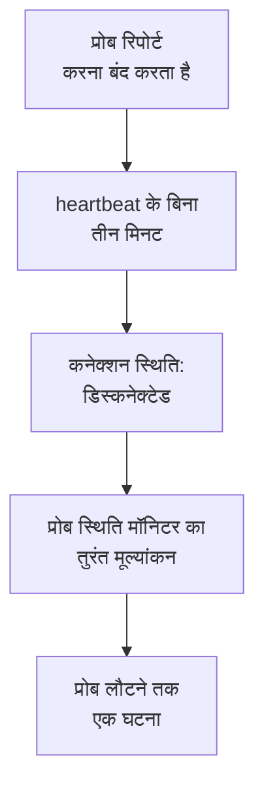

# प्रोब स्थिति मॉनिटर

प्रोब स्थिति मॉनिटर आपको बताता है कि कोई प्रोब कब रिपोर्ट करना बंद कर देता है: प्रोब डिस्कनेक्ट होने पर एक घटना, जो प्रोब के लौटने पर अपने आप हल हो जाती है। इसे अपने कस्टम प्रोब पर लगाएँ या, स्वयं होस्ट किए गए OneUptime पर, उस वैश्विक प्रोब पर जिस पर हर मॉनिटर चलता है, ताकि चुप हो गया प्रोब कभी भी किसी के जाने बिना अपने मॉनिटर बिना जाँच के न छोड़े।

:::cards
- [एक बनाएँ](#प्रोब-स्थिति-मॉनिटर-बनाएँ): प्रोब चुनें और डिफ़ॉल्ट मानदंड रहने दें।
- [मानदंड](#मानदंड): कनेक्टेड या डिस्कनेक्टेड प्रोब गिनें, अभी या किसी समयावधि में।
- [मेट्रिक्स](#मेट्रिक्स): हर मिनट कितने प्रोब कनेक्टेड थे।
:::

## यह कैसे काम करता है

OneUptime हर प्रोब स्थिति मॉनिटर का हर मिनट एक बार मूल्यांकन करता है, और उसी पल फिर से, जब उसका कोई प्रोब कनेक्ट या डिस्कनेक्ट होता है। यह हर प्रोब की कनेक्शन स्थिति पढ़ता है, वही जो प्रोब के पेज पर दिखती है: जब किसी प्रोब से तीन मिनट तक कुछ सुनाई न दे, तो उसे डिस्कनेक्टेड माना जाता है। जब OneUptime खुद बंद रहा हो या डेटा न पा रहा हो, तो किसी प्रोब को डिस्कनेक्टेड कहने से पहले यह पूरे तीन मिनट इंतज़ार करता है, इसलिए OneUptime को अपग्रेड करने से कभी कोई घटना नहीं खुलती।

जो प्रोब बंद ही रहता है, वह एक घटना है, हर मिनट एक नहीं। मॉनिटर अपनी घटना खुली रखते हुए तब तक ऑफ़लाइन रहता है, जब तक वह जिन प्रोब पर नज़र रखता है वे सभी फिर से कनेक्ट न हो जाएँ; फिर घटना अपने आप हल हो जाती है।

एक मॉनिटर अपने प्रोजेक्ट के प्रोब और वैश्विक प्रोब पर नज़र रख सकता है। हटाया गया प्रोब किसी भी ओर नहीं गिना जाता। जब मॉनिटर जिन प्रोब पर नज़र रखता है उनमें से कोई नहीं बचता, तो वह अपनी मौजूदा स्थिति बनाए रखता है, और एक दिन बाद उसका अवलोकन यह बताता है।

## प्रोब स्थिति मॉनिटर बनाएँ

:::steps
### नया मॉनिटर शुरू करें

**मॉनिटर** पर जाएँ और **मॉनिटर बनाएं** पर क्लिक करें।

### प्रोब स्थिति चुनें

**मॉनिटर प्रकार** के नीचे **और मॉनिटर प्रकार** पर क्लिक करें और **अन्य** के नीचे **प्रोब स्थिति** चुनें। **नाम** भरें और **अगला** पर क्लिक करें।

### प्रोब चुनें

**नज़र रखने के लिए प्रोब** के नीचे प्रोब चुनें। नया मॉनिटर आपके प्रोजेक्ट के अपने प्रोब से शुरू होता है। जिस स्वयं होस्ट किए गए OneUptime का अपना कोई प्रोब नहीं है, वह अपने वैश्विक प्रोब से शुरू होता है; OneUptime Cloud पर वैश्विक प्रोब OneUptime चलाता है, इसलिए कोई प्रोजेक्ट उन पर नज़र रखना चाहे तो उन्हें खुद चुनता है।

### मॉनिटर बनाएँ

नीचे बताए गए डिफ़ॉल्ट मानदंड रहने दें और **मॉनिटर बनाएं** पर क्लिक करें। मॉनिटर का तुरंत मूल्यांकन होता है, और उसका अवलोकन हर प्रोब को दिखाता है कि उससे आख़िरी बार कब संपर्क हुआ।
:::

> [!TIP]
> किसी प्रोब के पेज पर और **मॉनिटर → सेटिंग्स → प्रोब** में उस प्रोब की पंक्ति के मेनू में **इस प्रोब की निगरानी करें**, **मॉनिटर बनाएं** को ऐसे प्रोब स्थिति मॉनिटर के साथ खोलता है जो उस प्रोब पर नज़र रखता है और उसी के नाम पर है।

## मानदंड

प्रोब स्थिति मॉनिटर के फ़िल्टर प्रोब गिनते हैं:

| फ़िल्टर | यह क्या गिनता है |
| --- | --- |
| **Disconnected Probes** | नज़र में रखे गए वे प्रोब जो डिस्कनेक्टेड हैं। |
| **Connected Probes** | नज़र में रखे गए वे प्रोब जो कनेक्टेड हैं। |

दोनों पूर्ण संख्याएँ हैं, जिनकी तुलना **से बड़ा**, **से छोटा**, **बराबर है** और बाकी तुलनाओं से होती है। नया मॉनिटर दो मानदंडों से शुरू होता है:

| मानदंड | फ़िल्टर | यह क्या करता है |
| --- | --- | --- |
| Check if a probe is disconnected | **Disconnected Probes** `0` से बड़ा | मॉनिटर को ऑफ़लाइन करता है और `Probe disconnected: {{disconnectedProbeNames}}` शीर्षक वाली घटना घोषित करता है, जो अपने आप हल हो जाती है। |
| Check if every probe is connected | **Disconnected Probes** `0` के बराबर | मॉनिटर को चालू स्थिति में करता है। |

**Connected Probes** ऐसे मॉनिटर के लिए ठीक है जो कई प्रोब पर नज़र रखता है और एक खो सकता है: **Connected Probes** `2` से छोटा तभी घटना घोषित करता है जब दो से कम बचें।

### घटना से पहले ज़्यादा इंतज़ार करें

कोई प्रोब तीन मिनट की चुप्पी के बाद ही डिस्कनेक्टेड होता है, इसलिए जल्दी रीस्टार्ट होने से कुछ नहीं खुलता। ज़्यादा इंतज़ार के लिए, फ़िल्टर के नीचे **इस मानदंड का एक समयावधि के दौरान मूल्यांकन करें** चुनें, **मूल्यांकन करें** में **All Values** चुनें और **पिछले (मिनटों में) के लिए** में अवधि चुनें। पाँच मिनट रखने पर, घटना घोषित होने से पहले प्रोब को पाँच मिनट और डिस्कनेक्टेड रहना होगा।

## मेट्रिक्स

हर मूल्यांकन मॉनिटर पर दो सीरीज़ दर्ज करता है: `oneuptime.monitor.probes.connected` और `oneuptime.monitor.probes.disconnected`, यानी नज़र में रखे गए कितने प्रोब कनेक्टेड और कितने डिस्कनेक्टेड थे। ये मॉनिटर के **मेट्रिक्स** पेज पर चार्ट में दिखती हैं, और कोई डैशबोर्ड या मेट्रिक्स मॉनिटर इन्हें किसी भी दूसरी सीरीज़ की तरह पढ़ता है।

## टेम्पलेट वेरिएबल

प्रोब स्थिति मॉनिटर के घटना और अलर्ट टेम्पलेट हर मॉनिटर के वेरिएबल के अलावा ये वेरिएबल भी इस्तेमाल कर सकते हैं:

| वेरिएबल | मान |
| --- | --- |
| `{{disconnectedProbeNames}}` | डिस्कनेक्टेड प्रोब के नाम, अल्पविराम से अलग। |
| `{{disconnectedProbeCount}}` | कितने प्रोब डिस्कनेक्टेड हैं। |
| `{{connectedProbeNames}}` | कनेक्टेड प्रोब के नाम, अल्पविराम से अलग। |
| `{{connectedProbeCount}}` | कितने प्रोब कनेक्टेड हैं। |
| `{{probeStatusSummary}}` | एक वाक्य जो डिस्कनेक्टेड प्रोब के नाम बताता है, जैसे `1 of 3 probes is disconnected: EU Probe.`, या बताता है कि सभी प्रोब कनेक्टेड हैं। |
| `{{probes}}` | हर प्रोब, उसके `probeName`, `isConnected`, `isGlobalProbe` और `lastAliveAt` के साथ। |

## समस्या निवारण

:::details मॉनिटर कहता है कि वह डेटा का इंतज़ार कर रहा है
नया मॉनिटर एक-दो मिनट में अपना पहला मूल्यांकन दिखाता है। अगर वह किसी प्रोब पर नज़र नहीं रखता, तो इसके बजाय **Not set up** दिखाता है: **मानदंड** में प्रोब चुनें।
:::

:::details प्रोब बंद हुआ, पर कोई घटना घोषित नहीं हुई
कोई प्रोब heartbeat के बिना तीन मिनट बाद डिस्कनेक्टेड होता है, और OneUptime खुद बंद रहा हो तो और भी बाद में। जाँचें कि मॉनिटर बंद नहीं है या रखरखाव अवधि में नहीं है, और उसके मानदंड अब भी घटना घोषित करते हैं।
:::

## आगे के कदम

:::cards
- [कस्टम प्रोब](/docs/probe/custom-probe): अपने नेटवर्क में प्रोब चलाएँ।
- [मॉनिटर मानदंड और स्थितियाँ](/docs/monitor/criteria-and-statuses): मानदंड मॉनिटर की स्थिति कैसे तय करते हैं।
- [घटना और अलर्ट टेम्पलेट](/docs/monitor/incident-alert-templating): मॉनिटर जो घटना घोषित करता है, उसकी भाषा तय करें।
:::
