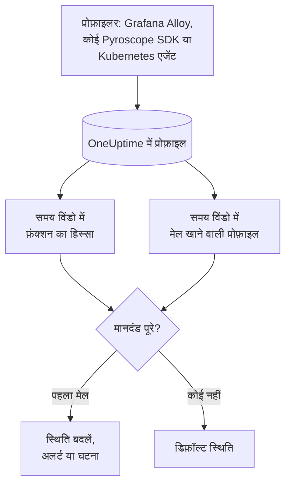

# प्रोफ़ाइल मॉनिटर

प्रोफ़ाइल मॉनिटर उन लगातार प्रोफ़ाइल को पढ़ता है जो आपकी सेवाएं OneUptime को भेजती हैं, और दो बातों पर अलर्ट करता है: कोई फ़ंक्शन समय का जितना हिस्सा लेना चाहिए उससे ज़्यादा लेने लगे, जैसे डिप्लॉय के बाद भारी हुआ कोई पार्सर, और किसी सेवा से प्रोफ़ाइल आना बंद हो जाएं। हर मिनट यह मापता है कि इसकी समय विंडो का कितना हिस्सा आपके बताए फ़ंक्शन से होकर गुज़रा, इसके फ़िल्टर से मेल खाने वाली प्रोफ़ाइल गिनता है, और आपके मानदंड पूरे होने पर मॉनिटर की स्थिति बदलता है, अलर्ट बनाता है या घटना घोषित करता है।

:::cards
- [मॉनिटर बनाएं](#प्रोफ़ाइल-मॉनिटर-बनाएं): प्रोफ़ाइलर में किसी फ़ंक्शन से, या मॉनिटर बनाएं से।
- [यह क्या क्वेरी करता है](#यह-क्या-क्वेरी-करता-है): फ़ंक्शन, प्रोफ़ाइल का प्रकार, सेवाएं और विंडो।
- [मानदंड](#मानदंड): विंडो में किसी फ़ंक्शन का हिस्सा, या प्रोफ़ाइल की संख्या।
- [फ़ंक्शन भारी हो जाता है](#उदाहरण-फ़ंक्शन-भारी-हो-जाता-है): जब किसी फ़ंक्शन का हिस्सा उछले तो अलर्ट पाएं।
:::

## यह कैसे काम करता है



हर मिनट OneUptime उन प्रोफ़ाइल को पढ़ता है जो मॉनिटर के फ़िल्टर से मेल खाती हैं और उसकी समय विंडो के भीतर शुरू हुईं। वह उन्हें गिनता है और, जब मॉनिटर कोई फ़ंक्शन बताता है, तो उस विंडो के समय का वह हिस्सा मापता है जो फ़ंक्शन से होकर गुज़रा। वह इन संख्याओं की तुलना ऊपर से नीचे मॉनिटर के मानदंडों से करता है, और जो मानदंड सबसे पहले मेल खाता है वही तय करता है कि क्या होगा। कोई मेल न खाए तो मॉनिटर अपनी डिफ़ॉल्ट स्थिति पर लौट आता है।

## शुरू करने से पहले

- आपकी सेवाएं Grafana Alloy (eBPF), किसी Pyroscope SDK या OneUptime Kubernetes एजेंट के ज़रिए लगातार प्रोफ़ाइलिंग डेटा OneUptime को भेजती हैं। [निरंतर प्रोफ़ाइलिंग](/docs/telemetry/profiles) देखें।
- किसी फ़ंक्शन पर नज़र रखने के लिए आप उसका नाम, या उसकी फ़ाइल या पैकेज पाथ का कोई हिस्सा जानते हैं, जैसा प्रोफ़ाइलर उसे दिखाता है।

## प्रोफ़ाइल मॉनिटर बनाएं

:::steps
### प्रोफ़ाइलर से, या मॉनिटर बनाएं से शुरू करें

सबसे तेज़ तरीका फ़ंक्शन से ही शुरू करना है: **प्रदर्शन प्रोफ़ाइल** में फ़ंक्शन खोलें और उस लिंक पर क्लिक करें जो उसके हिस्से पर अलर्ट देता है। **मॉनिटर बनाएं** उस फ़ंक्शन और उसकी सेवा के लिए भरे हुए मॉनिटर के साथ खुलता है, जिसकी सीमा फ़ंक्शन के आज के हिस्से से ऊपर होती है, जैसा [उदाहरण: फ़ंक्शन भारी हो जाता है](#उदाहरण-फ़ंक्शन-भारी-हो-जाता-है) में बताया गया है। नहीं तो **मॉनिटर** पर जाएं और **मॉनिटर बनाएं** पर क्लिक करें।

### Profiles चुनें

**मॉनिटर प्रकार** में **और मॉनिटर प्रकार** पर क्लिक करें और **टेलीमेट्री** के नीचे **प्रोफ़ाइल** चुनें, या खोज बॉक्स में `profiles` टाइप करें। **नाम** डालें, फिर **अगला** पर क्लिक करें।

### चुनें कि यह क्या पढ़ता है

**प्रोफ़ाइल मॉनिटर कॉन्फ़िगरेशन** में **फ़ंक्शन** को उस फ़ंक्शन पर सेट करें जिस पर नज़र रखनी है, **क्या विश्लेषण करें** को प्रोफ़ाइल के प्रकार पर, और **प्रोफ़ाइल की निगरानी की अवधि (समय)** को विंडो पर। नया मॉनिटर **पिछले 5 मिनट** का **CPU समय** पढ़ता है। फ़ील्ड के नीचे **यह मॉनिटर अभी क्या पढ़ता है** दिखाता है कि कितनी प्रोफ़ाइल मेल खाती हैं और फ़ंक्शन आज विंडो का कितना हिस्सा लेता है, ताकि आप सीमा उससे ऊपर रख सकें। टेलीमेट्री सेवा या इन्फ्रास्ट्रक्चर एंटिटी से फ़िल्टर करने के लिए **और फ़ील्ड** खोलें।

### मानदंड सेट करें

**मॉनिटर बनाएं** से शुरू हुए मॉनिटर में दो मानदंड होते हैं: **प्रोफ़ाइल की संख्या** 0 होने पर घटना के साथ ऑफ़लाइन, और 0 से ज़्यादा होने पर ऑनलाइन। फ़ंक्शन पर अलर्ट पाने के लिए **फ़ंक्शन का हिस्सा (% में)** फ़िल्टर जोड़ें, [मानदंड](#मानदंड) देखें।

### मॉनिटर बनाएं

**मॉनिटर बनाएं** पर क्लिक करें। मॉनिटर अपने **अवलोकन** पृष्ठ पर खुलता है, और उसका पहला मूल्यांकन एक मिनट के भीतर चलता है।
:::

### इसे API या Terraform से बनाएं

मॉनिटर के चरण में वही सेटिंग होती हैं जो उसके `profileMonitor` कॉन्फ़िगरेशन में होती हैं। यह कॉन्फ़िगरेशन एक सेवा की CPU प्रोफ़ाइल में पिछले पांच मिनट के `parseOrder` पर नज़र रखता है:

```json
{
  "profileMonitor": {
    "telemetryServiceIds": [],
    "profileTypes": ["cpu"],
    "profileType": "",
    "functionName": "parseOrder",
    "attributes": {},
    "lastXSecondsOfProfiles": 300
  }
}
```

सेवा की ID `telemetryServiceIds` में डालें, या हर सेवा की प्रोफ़ाइल पढ़ने के लिए सूची खाली छोड़ें, और केवल प्रोफ़ाइल गिनने के लिए `functionName` खाली छोड़ें। [API](/docs/api-reference/api-reference) या [Terraform](/docs/terraform/monitor-steps) से मॉनिटर प्रकार `Profiles` वाला एक मॉनिटर बनाएं, जिसके चरण में यह कॉन्फ़िगरेशन और कम से कम एक मानदंड हो। Terraform में कॉन्फ़िगरेशन को चरण के `profile_monitor` एट्रिब्यूट के रूप में पास करें, जो `jsonencode()` से लिखा गया हो।

## यह क्या क्वेरी करता है

| फ़ील्ड | किससे मेल खाता है | डिफ़ॉल्ट |
| --- | --- | --- |
| `profileTypes` | इनमें से किसी भी प्रकार की प्रोफ़ाइल, सटीक मिलान से, जैसे `cpu`। | खाली: हर प्रकार |
| `profileType` | वे प्रोफ़ाइल जिनके प्रकार में यह टेक्स्ट है, बड़े-छोटे अक्षरों पर ध्यान दिए बिना। सेट होने पर `profileTypes` को अनदेखा किया जाता है। | खाली |
| `functionName` | वह कोड जिसका हिस्सा **फ़ंक्शन का हिस्सा (% में)** मापता है: वे स्टैक फ़्रेम जिनके फ़ंक्शन नाम या फ़ाइल पाथ में यह टेक्स्ट है, बड़े-छोटे अक्षरों पर ध्यान दिए बिना। | खाली: कोई हिस्सा नहीं मापा जाता |
| `telemetryServiceIds` | इनमें से किसी भी टेलीमेट्री सेवा की प्रोफ़ाइल। | खाली: हर सेवा |
| `entityKeys` | इनमें से किसी भी होस्ट, पॉड, कंटेनर और दूसरी इन्फ्रास्ट्रक्चर एंटिटी की प्रोफ़ाइल। | खाली: हर एंटिटी |
| `attributes` | वे प्रोफ़ाइल जिनके एट्रिब्यूट में ये मान हैं। | खाली: कोई शर्त नहीं |
| `lastXSecondsOfProfiles` | वे प्रोफ़ाइल जो मूल्यांकन से इतने सेकंड पहले के भीतर शुरू हुईं। | कोई नहीं: इसे हमेशा सेट करें, वरना हर सहेजी गई प्रोफ़ाइल गिनी जाती है और गिनती कभी 0 पर नहीं गिरती |

किसी प्रोफ़ाइल को पढ़े जाने के लिए आपके सेट किए सभी फ़िल्टर से मेल खाना ज़रूरी है। फ़ॉर्म में **फ़ंक्शन** `functionName` सेट करता है, **क्या विश्लेषण करें** `profileTypes` सेट करता है (**हर तरह की प्रोफ़ाइल** इसे खाली छोड़ता है), **प्रोफ़ाइल की निगरानी की अवधि (समय)** `lastXSecondsOfProfiles` सेट करता है, और **टेलीमेट्री सेवा द्वारा फ़िल्टर करें** और **इन्फ्रास्ट्रक्चर एंटिटी द्वारा फ़िल्टर करें** `telemetryServiceIds` और `entityKeys` सेट करते हैं।

## इसका मूल्यांकन कैसे होता है

- **हर मिनट।** प्रोफ़ाइल मॉनिटर की जांच प्रोब नहीं करते, इसलिए इसमें सेट करने के लिए कोई अंतराल नहीं है और न ही **प्रोब और अंतराल** पृष्ठ।
- **हर मूल्यांकन में दो संख्याएं।** मॉनिटर उन प्रोफ़ाइल को गिनता है जो हर फ़िल्टर से मेल खाती हैं और `lastXSecondsOfProfiles` के भीतर शुरू हुईं, और उन्हीं प्रोफ़ाइल में फ़ंक्शन का हिस्सा मापता है। प्रोफ़ाइलर नियमित अंतराल पर अपलोड करता है, इसलिए विंडो में कई अपलोड की जगह रखें।
- **एक बार में एक इकाई।** हिस्सा एक ही इकाई के सैंपल जोड़ता है: जब पढ़े जाने वाले प्रकारों में इकाइयां मिली हों, जैसे SDK से नैनोसेकंड में CPU समय और eBPF से सैंपल की गिनती, तो यह विंडो में सबसे ज़्यादा सैंपल वाली इकाई पढ़ता है।
- **कोई प्रोफ़ाइल नहीं, यानी गिनती 0 और कोई हिस्सा नहीं।** जिस सेवा का प्रोफ़ाइलर अपलोड करना बंद कर देता है उसकी गिनती 0 होती है, और **फ़ंक्शन का हिस्सा (% में)** मानदंड खाली विंडो से मेल नहीं खाता: प्रोफ़ाइलिंग रुकने का पता लगाने के लिए **प्रोफ़ाइल की संख्या** पर अलर्ट करें।
- **OneUptime का अपना डाउनटाइम खामोशी नहीं है।** जब तक समय विंडो में वह समय शामिल है जब OneUptime खुद डेटा प्राप्त नहीं कर रहा था (वह रीस्टार्ट हो रहा था, अपग्रेड हो रहा था या बैकलॉग निपटा रहा था), जांच इंतज़ार करती है: स्थिति नहीं बदलती, और कोई घटना या अलर्ट न खुलता है न सुलझता है। [जब OneUptime डेटा प्राप्त नहीं कर रहा हो](/docs/monitor/when-oneuptime-is-not-receiving) देखें।
- **मानदंड ऊपर से नीचे।** जो मानदंड सबसे पहले मेल खाता है वही तय करता है, इसलिए सबसे गंभीर को सबसे ऊपर रखें।

हर स्थिति परिवर्तन, उसके कारण के साथ, मॉनिटर की **स्थिति टाइमलाइन** पर दर्ज होता है।

## मानदंड

प्रोफ़ाइल मॉनिटर के मानदंड दो में से एक संख्या की तुलना किसी मान से करते हैं।

**फ़ंक्शन का हिस्सा (% में)** विंडो के समय का वह हिस्सा है, 0 से 100 तक, जो मॉनिटर के फ़ंक्शन से होकर गुज़रा: `functionName` से मेल खाने वाले फ़्रेम वाला हर स्टैक एक बार गिना जाता है, चाहे वह कितनी भी गहराई पर हो, इसलिए फ़ंक्शन का अपना कोड और जो कुछ वह कॉल करता है, दोनों इसमें शामिल हैं।

| फ़िल्टर शर्त | तब मेल खाती है जब फ़ंक्शन का हिस्सा… |
| --- | --- |
| **से बड़ा** | मान से ऊपर हो |
| **से बड़ा या बराबर** | मान के बराबर या उससे ऊपर हो |
| **से छोटा** | मान से नीचे हो |
| **से छोटा या बराबर** | मान के बराबर या उससे नीचे हो |

**प्रोफ़ाइल की संख्या** विंडो में मेल खाने वाली प्रोफ़ाइल की संख्या है:

| फ़िल्टर शर्त | तब मेल खाती है जब प्रोफ़ाइल की गिनती… |
| --- | --- |
| **से बड़ा** | मान से ऊपर हो |
| **से बड़ा या बराबर** | मान के बराबर या उससे ऊपर हो |
| **से छोटा** | मान से नीचे हो |
| **से छोटा या बराबर** | मान के बराबर या उससे नीचे हो |
| **बराबर है** | ठीक मान के बराबर हो |
| **बराबर नहीं है** | मान के अलावा कुछ भी हो |

प्रोफ़ाइल की गिनती के लिए कोई विसंगति शर्त नहीं है: तुलना के लिए कोई बेसलाइन नहीं है।

## उदाहरण: फ़ंक्शन भारी हो जाता है

checkout सेवा में `parseOrder` उसके CPU समय का 18% लेता है। बड़ा पेलोड पार्स करने वाला डिप्लॉय बिना ध्यान दिए नहीं जाना चाहिए:

1. **प्रदर्शन प्रोफ़ाइल** में checkout सेवा चुनें और `parseOrder` खोलें।
2. उस लिंक पर क्लिक करें जो उसके हिस्से पर अलर्ट देता है। प्रोफ़ाइलर 30% सुझाता है: आज के हिस्से से डेढ़ गुना, कम से कम 10 अंक ज़्यादा, 5 के गुणज तक ऊपर पूर्णांकित।
3. **मॉनिटर बनाएं** checkout सेवा के एक प्रोफ़ाइल मॉनिटर के साथ खुलता है जो **पिछले 5 मिनट** का **CPU समय** पढ़ता है, और जिसमें दो मानदंड हैं: **फ़ंक्शन का हिस्सा (% में)** **से बड़ा** `30` एक अलर्ट बनाता है जो अपने आप सुलझ जाता है, और मॉनिटर को डिग्रेडेड चिह्नित करता है; **से छोटा या बराबर** `30` उसे चालू चिह्नित करता है। घटना भरी हुई है लेकिन बंद है: किसी को बुलाने के लिए उसे चालू करें।
4. **मॉनिटर बनाएं** पर क्लिक करें।

जब डिप्लॉय के कारण `parseOrder` CPU समय का 45% लेने लगता है, तो अगला मूल्यांकन अलर्ट बनाता है। जब कोई सुधार उसे फिर 30% से नीचे ले आता है, तो अलर्ट अपने आप सुलझ जाता है।

## उदाहरण: प्रोफ़ाइल आना बंद हो जाती हैं

checkout सेवा एक Pyroscope SDK चलाती है जो CPU प्रोफ़ाइल अपलोड करता है। आप चाहते हैं कि जब वे पांच मिनट तक न आएं तो घटना बने:

- `profileTypes`: `["cpu"]`, `telemetryServiceIds`: checkout सेवा, `lastXSecondsOfProfiles`: `300`
- मानदंड 1: **प्रोफ़ाइल की संख्या** **बराबर है** `0`: मॉनिटर को ऑफ़लाइन चिह्नित करें और घटना घोषित करें
- मानदंड 2: **प्रोफ़ाइल की संख्या** **से बड़ा** `0`: मॉनिटर को ऑनलाइन चिह्नित करें

जब तक SDK अपलोड करता है, हर मूल्यांकन कुछ प्रोफ़ाइल गिनता है और मानदंड 2 मॉनिटर को ऑनलाइन रखता है। जब सेवा बिना SDK के डिप्लॉय होती है, तो आखिरी अपलोड के पांच मिनट बाद गिनती 0 पर गिर जाती है, मानदंड 1 मेल खाता है और घटना घोषित होती है। सुधार के बाद का पहला अपलोड गिनती को फिर 0 से ऊपर ले आता है, और अगर उस घटना के लिए **घटना स्वतः सुलझाएं** चालू है, तो घटना अपने आप सुलझ जाती है।

## समस्या निवारण

:::details मॉनिटर 0 गिनता है, लेकिन OneUptime में प्रोफ़ाइल दिखती हैं
फ़िल्टर की तुलना उन प्रोफ़ाइल से करें जो आप देख रहे हैं: `profileTypes` का प्रकार से सटीक मेल होना चाहिए, और `telemetryServiceIds` में सही सेवा ID होनी चाहिए। छोटा `lastXSecondsOfProfiles` दो अपलोड के बीच भी पड़ सकता है।
:::

:::details फ़ंक्शन का हिस्सा 0% पर ही रहता है
विंडो के किसी भी फ़्रेम में फ़ंक्शन का टेक्स्ट नहीं है। प्रोफ़ाइलर में फ़ंक्शन खोलें और उसका नाम वैसे ही कॉपी करें जैसा वहां दिखता है; नाम का कोई हिस्सा भी चलेगा, और बड़े-छोटे अक्षरों से फ़र्क नहीं पड़ता। फिर जांचें कि सेवा वही प्रोफ़ाइल प्रकार भेजती है जो **क्या विश्लेषण करें** पढ़ता है।
:::

## अगले कदम

:::cards
- [निरंतर प्रोफ़ाइलिंग](/docs/telemetry/profiles): प्रोफ़ाइल भेजें और उन्हें प्रोफ़ाइलर में पढ़ें।
- [मॉनिटर चरण](/docs/terraform/monitor-steps): Terraform से चरण का कॉन्फ़िगरेशन पास करें।
- [ट्रेस मॉनिटर](/docs/monitor/traces-monitor): विफल स्पैन पर अलर्ट करें।
- [मेट्रिक्स मॉनिटर](/docs/monitor/metrics-monitor): CPU, मेमोरी और दूसरी मेट्रिक्स पर अलर्ट करें।
:::
