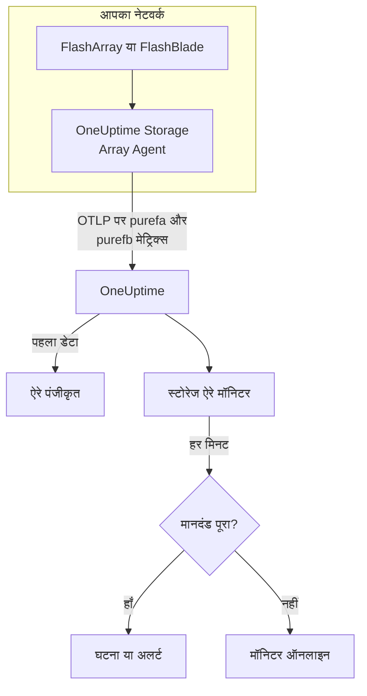

# स्टोरेज ऐरे मॉनिटर

स्टोरेज ऐरे मॉनिटर एक स्टोरेज ऐरे पर नज़र रखता है और आपको तब बताता है जब ऐरे खुद अलर्ट उठाता है, उसकी जगह खत्म होती है, वह धीमा होता है, हार्डवेयर या होस्ट पाथ खोता है, या रेप्लिकेशन में पीछे रह जाता है। यह Pure Storage FlashArray और Pure Storage FlashBlade के साथ काम करता है, और वे मेट्रिक्स पढ़ता है जो ऐरे खुद एक्सपोर्ट करता है - Pure की `purefa_*` और `purefb_*` सीरीज़ - जिन्हें OneUptime Storage Array Agent इकट्ठा करता है।

:::cards
- [मॉनिटर बनाएँ](#स्टोरेज-ऐरे-मॉनिटर-बनाएँ): डैशबोर्ड में छह चरण।
- [टेम्पलेट](#पहले-से-बने-अलर्ट-टेम्पलेट): अठारह तैयार अलर्ट, हर वॉल्यूम, होस्ट या कंपोनेंट के लिए एक घटना।
- [Pure की सीरीज़ कैसे काम करती हैं](#pure-की-सीरीज़-का-ढाँचा): एक मेट्रिक नाम, कई आँकड़े।
- [मेट्रिक्स](#इकट्ठा-किए-गए-मेट्रिक्स): हर सीरीज़ जिस पर मॉनिटर अलर्ट कर सकता है।
:::

## यह कैसे काम करता है

OneUptime Storage Array Agent ऐसी मशीन पर चलता है जो ऐरे के मैनेजमेंट इंटरफ़ेस तक पहुँच सकती है। यह केवल-पढ़ने वाले API टोकन से ऐरे के मेट्रिक्स पढ़ता है, उन पर ऐरे का नाम `storage.array.name` और उसका प्लेटफ़ॉर्म `storage.system` लेबल करता है, और उन्हें OTLP पर OneUptime को भेजता है। पहला डेटा ऐरे को पंजीकृत करता है।

स्टोरेज ऐरे मॉनिटर एक ऐरे से जुड़ा होता है। हर मिनट वह उस ऐरे के मेट्रिक्स पर अपनी क्वेरी चलाता है और परिणाम की तुलना अपने मानदंड से करता है।



## शुरू करने से पहले

- **Storage Array Agent इंस्टॉल करें**, ऐसी जगह जहाँ से वह HTTPS पर ऐरे तक पहुँच सके, ऐसे उपयोगकर्ता के API टोकन के साथ जिसके पास ऐरे की **readonly** भूमिका हो। [Storage Array Agent गाइड](/docs/telemetry/storage-arrays) उपयोगकर्ता, टोकन और इंस्टॉल को कवर करती है, `ONEUPTIME_URL`, `ONEUPTIME_TELEMETRY_INGESTION_KEY`, `STORAGE_ARRAY_NAME`, और ऐरे के पते और टोकन (`PURE_FA_ENDPOINT` और `PURE_FA_API_TOKEN`, या `PURE_FB_ENDPOINT` और `PURE_FB_API_TOKEN`) के ज़रिए।
- **जाँचें कि ऐरे पंजीकृत है।** पहली स्क्रेप के लगभग एक मिनट बाद यह एजेंट के `STORAGE_ARRAY_NAME` के नाम से **उत्पाद → बुनियादी ढांचा → Storage Arrays → All Storage Arrays** के अंतर्गत दिखता है।

## स्टोरेज ऐरे मॉनिटर बनाएँ

:::steps
### नया मॉनिटर शुरू करें

**मॉनिटर** पर जाएँ और **मॉनिटर बनाएं** पर क्लिक करें।

### स्टोरेज ऐरे चुनें

**मॉनिटर प्रकार** में **और मॉनिटर प्रकार** पर क्लिक करें और **बुनियादी ढांचा** के अंतर्गत **स्टोरेज ऐरे** चुनें, या खोज बॉक्स में `storage` टाइप करें। एक **नाम** दर्ज करें - यह घटना और अलर्ट के शीर्षकों में उपयोग होता है - और **अगला** पर क्लिक करें।

### ऐरे चुनें

**Storage Array Monitor Configuration** के अंतर्गत, **स्टोरेज ऐरे** से ऐरे चुनें। हर वह ऐरे जिसने डेटा भेजा है, सूची में है। उसका प्लेटफ़ॉर्म तय करता है कि फ़ॉर्म कौन से मेट्रिक्स और टेम्पलेट देता है।

### क्या देखना है चुनें

तीन टैब में से एक चुनें:

- **Quick Setup** - एक [टेम्पलेट](#पहले-से-बने-अलर्ट-टेम्पलेट) पर क्लिक करें। यह मेट्रिक, लेबल फ़िल्टर, एकत्रीकरण, समय सीमा और थ्रेशोल्ड सेट करता है, और नीचे के मानदंड को अपने मानदंड से बदल देता है। आप फिर भी **समय सीमा** बदल सकते हैं।
- **Custom Metric** - **Storage Array Metric** से एक मेट्रिक चुनें, फिर **एकत्रीकरण** और **समय सीमा** सेट करें। [फ़िल्टर](#मॉनिटर-सेटिंग्स) इसे एक वॉल्यूम, होस्ट, पॉड, कंपोनेंट, फ़ाइल सिस्टम या बकेट तक सीमित करते हैं।
- **उन्नत** - **मेट्रिक्स चुनें** के अंतर्गत खुद क्वेरी और सूत्र बनाएँ, उदाहरण के लिए उपयोग की गई क्षमता को `purefa_array_space_bytes` को `space=capacity` पर फ़िल्टर करके, उसी मेट्रिक को `space=empty` पर फ़िल्टर करके घटाकर। हर ऑब्जेक्ट को अलग से आँकने के लिए किसी ऑब्जेक्ट के लेबल से **Group by** करें।

### मानदंड जाँचें

**मॉनिटर मानदंड** के अंतर्गत हर मानदंड खोलें और उसके **मीट्रिक**, **एकत्रीकरण**, **शर्त** और **Threshold** जाँचें। टेम्पलेट इन्हें भरता है। **Custom Metric** या **उन्नत** के साथ, मॉनिटर [डिफ़ॉल्ट मानदंड](#डिफ़ॉल्ट-मानदंड) से शुरू होता है, जो केवल मेट्रिक के शून्य पर गिरने को देखता है, इसलिए अपना थ्रेशोल्ड सेट करें।

### मॉनिटर बनाएँ

**मॉनिटर बनाएं** पर क्लिक करें। OneUptime मॉनिटर का पेज खोलता है और हर मिनट उसका मूल्यांकन करता है। उसके उठाए घटनाएँ और अलर्ट ऐरे के **घटनाएं** और **अलर्ट** पेज पर भी सूचीबद्ध होते हैं।
:::

> [!TIP]
> एक साथ कई टेम्पलेट सेट करने के लिए, **उत्पाद → बुनियादी ढांचा → Storage Arrays** से ऐरे खोलें और **Recommendations** पर जाएँ। जो टेम्पलेट चाहिए वे चुनें, चुनें कि किसे पेज किया जाए, और OneUptime हर टेम्पलेट के लिए एक मॉनिटर बनाता है।

## मॉनिटर सेटिंग्स

| फ़ील्ड | टैब | यह क्या करता है |
| --- | --- | --- |
| **स्टोरेज ऐरे** | सभी | ज़रूरी। हर क्वेरी को `resource.storage.array.name` तक सीमित करता है, इसलिए दो ऐरे जिनमें दोनों में `vol-01` नाम का वॉल्यूम है, कभी आपस में नहीं मिलते। |
| **वॉल्यूम** | Custom Metric, उन्नत | केवल FlashArray। एक वॉल्यूम, `name` लेबल से, जैसे `vol-db-01`। पॉड या वॉल्यूम समूह में वॉल्यूम का नाम `pod::volume` या `group/volume` होता है। |
| **होस्ट** | Custom Metric, उन्नत | केवल FlashArray। एक होस्ट जैसा ऐरे उसे जानता है, `host` लेबल से, जैसे `esxi-01`। |
| **Pod** | Custom Metric, उन्नत | केवल FlashArray। एक ActiveCluster या ActiveDR पॉड, `name` लेबल से, या रेप्लिका लिंक सीरीज़ पर `local_pod` से। |
| **Hardware Component** | Custom Metric, उन्नत | एक हार्डवेयर कंपोनेंट, जैसे `CH0.BAY1` या `CT0`: FlashArray पर `component_name` लेबल, FlashBlade पर `name`। |
| **File System** | Custom Metric, उन्नत | केवल FlashBlade। एक फ़ाइल सिस्टम, `name` लेबल से। |
| **Bucket** | Custom Metric, उन्नत | केवल FlashBlade। एक ऑब्जेक्ट स्टोर बकेट, `name` लेबल से। |
| **Storage Array Metric** | Custom Metric | [कैटलॉग](#इकट्ठा-किए-गए-मेट्रिक्स) से एक मेट्रिक। फ़ॉर्म वह लेबल फ़िल्टर जोड़ता है जो उसे उसका अर्थ देता है, और उसे उस ऑब्जेक्ट से समूहित करता है जिसका वह वर्णन करता है, इसलिए हर वॉल्यूम, होस्ट या कंपोनेंट को अलग से आँका जाता है। |
| **एकत्रीकरण** | Custom Metric | सैंपल कैसे मिलाए जाते हैं: **औसत**, **अधिकतम**, **न्यूनतम**, **योग** या **गणना**। मेट्रिक के सामान्य एकत्रीकरण से शुरू होता है। |
| **समय सीमा** | सभी | क्वेरी जो रोलिंग विंडो पढ़ती है, **Past 1 Minute** से **Past 365 Days** तक। नया मॉनिटर **Past 5 Minutes** से शुरू होता है; किसी फ़ाइल सिस्टम या बकेट का कस्टम मेट्रिक **Past 15 Minutes** से; टेम्पलेट अपना मान सेट करते हैं। |
| **मेट्रिक्स चुनें** | उन्नत | क्वेरी बिल्डर: **मीट्रिक**, **Aggregate by**, **Filter by attributes**, **Group by**, साथ ही क्वेरी मिलाने के लिए **मीट्रिक जोड़ें** और **सूत्र जोड़ें**। |

एजेंट ऐरे एंडपॉइंट को हर 60 सेकंड में, और वॉल्यूम, होस्ट और पॉड को हर 2 मिनट में पढ़ता है, इसलिए 5 मिनट की विंडो में हमेशा एक सैंपल होता है। FlashBlade के फ़ाइल सिस्टम और बकेट वह हर 5 मिनट में पढ़ता है, इसलिए 15, और FlashArray डायरेक्टरी हर 30 मिनट में: डायरेक्टरी मॉनिटर को 60 मिनट की विंडो दें।

## Pure की सीरीज़ का ढाँचा

Pure **एक** मेट्रिक नाम पर कई आँकड़े रखता है और उन्हें एक लेबल से अलग करता है:

- **`dimension`** प्रदर्शन सीरीज़ पर। `purefa_array_performance_latency_usec` रीड लेटेंसी (`usec_per_read_op`), राइट लेटेंसी (`usec_per_write_op`), मिरर्ड राइट लेटेंसी, और हर एक का SAN, कतार, QoS और सर्विस समय रखता है। हमेशा एक `dimension` पर फ़िल्टर करें: उनके पार औसत 200 µs की रीड लेटेंसी को कतार के आँकड़े के साथ मिला देता है।
- **`space`** क्षमता सीरीज़ पर: `capacity`, `empty`, `snapshots`, `total_provisioned`, `total_physical`, `available_ratio` और अन्य।

कई सीरीज़ अपनी स्थिति एक **लेबल** में रखती हैं, ऐसे मान के साथ जो हमेशा 1 होता है:

| सीरीज़ | स्थिति लेबल | हर एक के लिए एक सीरीज़ |
| --- | --- | --- |
| `purefa_alerts_open` | `severity`, `summary`, `code` और `component_type` के साथ | खुला अलर्ट |
| `purefa_hw_component_status` | `component_status` | हार्डवेयर कंपोनेंट |
| `purefa_host_connectivity_info` | `status`, `details` के साथ | होस्ट |
| `purefa_drive_capacity_bytes` | `component_status` (मान ड्राइव की क्षमता है) | ड्राइव |

किसी खराब स्थिति पर फ़िल्टर की गई सीरीज़ तभी तक मौजूद रहती है जब तक कुछ उस स्थिति में है, इसलिए कोई सीरीज़ न होने का मतलब स्वस्थ है। इसीलिए **0 से ऊपर Max पर ट्रिगर और 0 पर रिकवर** उनके लिए सही रूप है, और टेम्पलेट इसी तरह बने हैं: उनके रिकवर मानदंड गायब सीरीज़ को शून्य मानते हैं।

मॉनिटर फ़िल्टर और ग्रुप-बाय कुंजियों में, एजेंट के एट्रिब्यूट `resource.` से शुरू होते हैं (`resource.storage.array.name`, `resource.storage.system`), जबकि Pure के अपने लेबल नहीं (`name`, `host`, `component_name`, `dimension`, `space`, `severity`)।

## पहले से बने अलर्ट टेम्पलेट

OneUptime 18 टेम्पलेट देता है — 11 FlashArray के लिए और 7 FlashBlade के लिए — और **Quick Setup** ऐरे के प्लेटफ़ॉर्म वाले टेम्पलेट देता है। हर एक पूरा मॉनिटर बनाता है: मेट्रिक क्वेरी, उसके लेबल फ़िल्टर, ऑब्जेक्ट के अपने लेबल पर ग्रुप-बाय, एक मानदंड जो ट्रिगर करता है और एक जो रिकवर करता है। थ्रेशोल्ड शुरुआती बिंदु हैं जिन्हें आप संपादित कर सकते हैं।

मानदंड तभी ट्रिगर होता है जब शर्त विंडो के **हर** मान के लिए सही हो। जो मॉनिटर क्षमता, लेटेंसी, लैग या अनुपात के थ्रेशोल्ड पर ट्रिगर हुआ, वह उससे 10% आगे जाने पर ही रिकवर होता है, इसलिए थ्रेशोल्ड के आसपास मँडराता मान बार-बार बदलाव नहीं करता; अलर्ट और हार्डवेयर टेम्पलेट स्थिति हटते ही रिकवर होते हैं।

### FlashArray

| टेम्पलेट | श्रेणी | गंभीरता | किस पर नज़र | कब ट्रिगर होता है |
| --- | --- | --- | --- | --- |
| Critical Array Alert | Array Health | गंभीर | `purefa_alerts_open` को `severity=critical` पर फ़िल्टर, `summary` के अनुसार Max, पिछले 5 मिनट | > 0 — ऐरे पर एक खुला गंभीर अलर्ट है (विफल कंपोनेंट, क्षमता आपात स्थिति, रेप्लिकेशन विफलता)। हर अलर्ट के लिए एक घटना; अलर्ट बंद होने पर रिकवर |
| Warning Array Alert | Array Health | Warning | `purefa_alerts_open` को `severity=warning` पर फ़िल्टर, `summary` के अनुसार Max, पिछले 5 मिनट | > 0 — ऐरे पर एक खुला चेतावनी अलर्ट है। हर अलर्ट के लिए एक घटना; अलर्ट बंद होने पर रिकवर |
| Capacity Above 80% | क्षमता | Warning | `purefa_array_space_utilization`, Max, पिछले 15 मिनट | > 80 — Pure का अपना पहला क्षमता थ्रेशोल्ड; ≤ 72 पर रिकवर |
| Capacity Above 90% | क्षमता | गंभीर | `purefa_array_space_utilization`, Max, पिछले 5 मिनट | > 90 — ऐरे राइट अस्वीकार करने के करीब है; ≤ 81 पर रिकवर |
| High Read Latency | Performance | Warning | `purefa_array_performance_latency_usec` को `dimension=usec_per_read_op` पर फ़िल्टर, Avg, पिछले 10 मिनट | > 5000 µs (5 ms) — FlashArray रीड सामान्यतः 1 ms से काफ़ी कम में पूरी होती है; ≤ 4500 पर रिकवर |
| High Write Latency | Performance | Warning | `purefa_array_performance_latency_usec` को `dimension=usec_per_write_op` पर फ़िल्टर, Avg, पिछले 10 मिनट | > 5000 µs (5 ms); ≤ 4500 पर रिकवर |
| Hardware Component Failed | Hardware | गंभीर | `purefa_hw_component_status` को `component_status=critical` पर फ़िल्टर, `component_name` के अनुसार Max, पिछले 5 मिनट | > 0 — कोई कंट्रोलर, पावर सप्लाई, पंखा, बे या पोर्ट गंभीर स्थिति में है और रिडंडेंसी खत्म हो गई है। हर कंपोनेंट के लिए एक घटना; ok रिपोर्ट करने पर रिकवर |
| Hardware Component Degraded | Hardware | Warning | `purefa_hw_component_status` को `component_status=degraded` पर फ़िल्टर, `component_name` के अनुसार Max, पिछले 5 मिनट | > 0 — कोई कंपोनेंट डिग्रेड हो गया है। हर कंपोनेंट के लिए एक घटना; ok रिपोर्ट करने पर रिकवर |
| Drive Failed | Hardware | गंभीर | `purefa_drive_capacity_bytes` को `component_status=failed` पर फ़िल्टर, `component_name` के अनुसार Max, पिछले 5 मिनट | > 0 — कोई DirectFlash मॉड्यूल या SSD विफल हुआ और ऐरे बाकी पर फिर से बना रहा है। हर ड्राइव के लिए एक घटना; बदले जाने पर रिकवर |
| Host Lost Redundant Paths | होस्ट | Warning | `purefa_host_connectivity_info` को `status=critical` पर फ़िल्टर, `host` के अनुसार Max, पिछले 5 मिनट | > 0 — होस्ट ऐरे तक एक कंट्रोलर से पहुँचता है या किसी से नहीं; कंट्रोलर फ़ेलओवर उसके स्टोरेज को ऑफ़लाइन कर देगा। हर होस्ट के लिए एक घटना; उसके पाथ लौटने पर रिकवर |
| Replication Lag Above 1 Minute | Replication | Warning | `purefa_pod_replica_links_lag_max_msec`, `local_pod` के अनुसार Max, पिछले 10 मिनट | > 60000 ms (60 s) — अभी फ़ेलओवर योजना से ज़्यादा हाल की राइट खो देगा। हर पॉड के लिए एक घटना; ≤ 54000 पर रिकवर |

### FlashBlade

| टेम्पलेट | श्रेणी | गंभीरता | किस पर नज़र | कब ट्रिगर होता है |
| --- | --- | --- | --- | --- |
| Critical Array Alert | Array Health | गंभीर | `purefb_alerts_open` को `severity=critical` पर फ़िल्टर, `summary` के अनुसार Max, पिछले 5 मिनट | > 0 — FlashBlade पर एक खुला गंभीर अलर्ट है। हर अलर्ट के लिए एक घटना; अलर्ट बंद होने पर रिकवर |
| Warning Array Alert | Array Health | Warning | `purefb_alerts_open` को `severity=warning` पर फ़िल्टर, `summary` के अनुसार Max, पिछले 5 मिनट | > 0 — FlashBlade पर एक खुला चेतावनी अलर्ट है। हर अलर्ट के लिए एक घटना; अलर्ट बंद होने पर रिकवर |
| Capacity Above 80% | क्षमता | Warning | `purefb_array_space_utilization` को `type=array` पर फ़िल्टर, Max, पिछले 15 मिनट | > 80; ≤ 72 पर रिकवर |
| Capacity Above 90% | क्षमता | गंभीर | `purefb_array_space_utilization` को `type=array` पर फ़िल्टर, Max, पिछले 5 मिनट | > 90 — भरने पर हर क्लाइंट के लिए राइट विफल होती हैं; ≤ 81 पर रिकवर |
| Hardware Component Unhealthy | Hardware | गंभीर | `purefb_hardware_health`, `name` के अनुसार Min, पिछले 5 मिनट | < 1 — कोई ब्लेड, फ़ैब्रिक मॉड्यूल, पावर सप्लाई या पंखा स्वस्थ नहीं है (अप्रयुक्त स्लॉट 2 रिपोर्ट करता है)। हर कंपोनेंट के लिए एक घटना; ≥ 1 पर रिकवर |
| High Read Latency | Performance | Warning | `purefb_array_performance_latency_usec` को `dimension=usec_per_read_op` और `protocol=all` पर फ़िल्टर, Avg, पिछले 10 मिनट | > 10000 µs (10 ms) सभी प्रोटोकॉल में; ≤ 9000 पर रिकवर |
| File System Near Full | File Systems | Warning | `purefb_file_systems_space_bytes` को `space=available_ratio` पर फ़िल्टर, `name` के अनुसार Min, पिछले 15 मिनट | < 0.1 — फ़ाइल सिस्टम के प्रोविज़न किए गए आकार का 10% से कम बचा है। हर फ़ाइल सिस्टम के लिए एक घटना; ≥ 0.11 पर रिकवर |

**गंभीरता** वह लेबल है जो पिकर दिखाता है। टेम्पलेट जो घटना और अलर्ट बनाता है, वे आपके प्रोजेक्ट की सबसे गंभीर घटना और अलर्ट गंभीरता से शुरू होते हैं; उन्हें मानदंड में बदलें।

- **खुले अलर्ट और हार्डवेयर स्थितियाँ Max का उपयोग करती हैं**, ऐसी सीरीज़ का जो तभी तक मौजूद रहती है जब तक अलर्ट खुला है या कंपोनेंट उस स्थिति में है, इसलिए उसे दिखाने वाली एक स्क्रेप थ्रेशोल्ड पार कर देती है।
- **हर प्रति-ऑब्जेक्ट टेम्पलेट ऑब्जेक्ट के अपने लेबल से समूहित करता है** (`summary`, `component_name`, `host`, `local_pod`, `name`), इसलिए हर प्रभावित ऑब्जेक्ट के लिए एक घटना ट्रिगर होती है, और घटना उसका नाम बताती है।
- **लेटेंसी टेम्पलेट Avg का उपयोग करते हैं**, ऐरे के अपने प्रति-ऑपरेशन औसत का, और क्षमता टेम्पलेट उसके अपने उपयोग प्रतिशत का **Max**। लेटेंसी माइक्रोसेकंड में और क्षमता प्रतिशत में पिन है।
- **Hardware Component Unhealthy हर कंपोनेंट के लिए Min का उपयोग करता है**: स्वस्थ होने पर उसकी हेल्थ 1 होती है और न होने पर 0 पर गिर जाती है।

हर वॉल्यूम की लेटेंसी के लिए कोई टेम्पलेट नहीं है, क्योंकि सही थ्रेशोल्ड वर्कलोड पर निर्भर करता है: इसे कैटलॉग से `name` पर ग्रुप-बाय के साथ बनाएँ। क्षमता के पूर्वानुमान को थ्रेशोल्ड के बजाय वृद्धि के रुझान की ज़रूरत होती है, और ड्राइव के घिसाव के लिए अलर्ट करने लायक कोई सीरीज़ नहीं है।

## इकट्ठा किए गए मेट्रिक्स

एजेंट वह सब भेजता है जो ऐरे एक्सपोर्ट करता है; नीचे की सीरीज़ वह कैटलॉग हैं जो मॉनिटर फ़ॉर्म देता है। हर मान एक गेज है जिसे ऐरे खुद गिनता है - लेटेंसी प्रति ऑपरेशन माइक्रोसेकंड हैं और थ्रूपुट प्रति सेकंड है - इसलिए किसी रेट गणना की ज़रूरत नहीं। **फ़िल्टर** वह लेबल फ़िल्टर है जो सीरीज़ को वह अर्थ देता है जो उसकी पंक्ति बताती है; फ़ॉर्म इसे आपके लिए लागू करता है।

### Array Health

| मेट्रिक | फ़िल्टर | प्लेटफ़ॉर्म | इकाई | विवरण |
| --- | --- | --- | --- | --- |
| `purefa_alerts_open` | — | FlashArray | `count` | ऐरे पर हर खुले अलर्ट के लिए एक सीरीज़ (मान 1), लेबल `severity` (`critical`, `warning`, `info`, `hidden`), `category`, `code`, `component_type` और `summary` के साथ |
| `purefb_alerts_open` | — | FlashBlade | `count` | FlashBlade पर हर खुले अलर्ट के लिए एक सीरीज़ (मान 1), लेबल `severity` (`info`, `warning`, `critical`), `code`, `component_name`, `component_type`, `summary` और `kburl` (Pure का नॉलेज-बेस लेख) के साथ |

### Capacity

| मेट्रिक | फ़िल्टर | प्लेटफ़ॉर्म | इकाई | विवरण |
| --- | --- | --- | --- | --- |
| `purefa_array_space_utilization` | — | FlashArray | `%` | ऐरे की उपयोग योग्य क्षमता का उपयोग में हिस्सा। Pure खुद 80%, 90% और 100% पर क्षमता अलर्ट उठाता है |
| `purefa_array_space_bytes` | `space=capacity` | FlashArray | `bytes` | ऐरे की उपयोग योग्य क्षमता |
| `purefa_array_space_bytes` | `space=empty` | FlashArray | `bytes` | अप्रयुक्त क्षमता — ऐरे कब भरेगा, इसका अनुमान लगाने के लिए इसका रुझान देखें |
| `purefa_array_space_bytes` | `space=snapshots` | FlashArray | `bytes` | केवल स्नैपशॉट से घिरी भौतिक जगह; तेज़ वृद्धि का मतलब आमतौर पर है कि कोई प्रोटेक्शन ग्रुप योजना से ज़्यादा स्नैपशॉट रख रहा है |
| `purefa_array_space_data_reduction_ratio` | — | FlashArray | `ratio` | पूरे ऐरे में डीडुप्लिकेशन और कम्प्रेशन, जैसे 4.2:1 के लिए 4.2। लगातार गिरावट का मतलब है कि नया डेटा ठीक से कम नहीं हो रहा |
| `purefb_array_space_utilization` | `type=array` | FlashBlade | `%` | FlashBlade की उपयोग योग्य क्षमता का उपयोग में हिस्सा |
| `purefb_array_space_bytes` | `type=array`, `space=empty` | FlashBlade | `bytes` | FlashBlade की अप्रयुक्त क्षमता |
| `purefb_array_space_data_reduction_ratio` | `type=array` | FlashBlade | `ratio` | पूरे FlashBlade में डेटा रिडक्शन |

### Performance

| मेट्रिक | फ़िल्टर | प्लेटफ़ॉर्म | इकाई | विवरण |
| --- | --- | --- | --- | --- |
| `purefa_array_performance_latency_usec` | `dimension=usec_per_read_op` | FlashArray | `µs` | होस्ट को दिखने वाली औसत रीड लेटेंसी; FlashArray रीड आमतौर पर 1 ms से काफ़ी कम में पूरी होती है |
| `purefa_array_performance_latency_usec` | `dimension=usec_per_write_op` | FlashArray | `µs` | होस्ट को दिखने वाली औसत राइट लेटेंसी |
| `purefa_array_performance_latency_usec` | `dimension=usec_per_mirrored_write_op` | FlashArray | `µs` | स्ट्रेच्ड ActiveCluster पॉड पर औसत राइट लेटेंसी, पार्टनर ऐरे तक राउंड ट्रिप समेत |
| `purefa_array_performance_latency_usec` | `dimension=san_usec_per_read_op` | FlashArray | `µs` | रीड SAN में कितना समय बिताती है; ऊँची SAN लेटेंसी और कम सर्विस लेटेंसी फ़ैब्रिक या होस्ट की ओर इशारा करती है |
| `purefa_array_performance_throughput_iops` | `dimension=reads_per_sec` | FlashArray | `ops/s` | प्रति सेकंड रीड ऑपरेशन |
| `purefa_array_performance_throughput_iops` | `dimension=writes_per_sec` | FlashArray | `ops/s` | प्रति सेकंड राइट ऑपरेशन |
| `purefa_array_performance_bandwidth_bytes` | `dimension=read_bytes_per_sec` | FlashArray | `bytes/s` | प्रति सेकंड पढ़े गए बाइट |
| `purefa_array_performance_bandwidth_bytes` | `dimension=write_bytes_per_sec` | FlashArray | `bytes/s` | प्रति सेकंड लिखे गए बाइट |
| `purefa_array_performance_queue_depth_ops` | — | FlashArray | `ops` | ऐरे पर कतार में ऑपरेशन; बढ़ती लेटेंसी के साथ बढ़ती कतार का मतलब है कि होस्ट उससे ज़्यादा भेज रहे हैं जितना ऐरे संभाल सकता है |
| `purefa_array_performance_average_bytes` | `dimension=bytes_per_op` | FlashArray | `bytes` | एक ऑपरेशन का औसत आकार — बड़ा I/O बिना कुछ गलत हुए लेटेंसी बढ़ाता है |
| `purefb_array_performance_latency_usec` | `dimension=usec_per_read_op`, `protocol=all` | FlashBlade | `µs` | सभी प्रोटोकॉल में औसत रीड लेटेंसी |
| `purefb_array_performance_latency_usec` | `dimension=usec_per_write_op`, `protocol=all` | FlashBlade | `µs` | सभी प्रोटोकॉल में औसत राइट लेटेंसी |
| `purefb_array_performance_throughput_iops` | `dimension=reads_per_sec`, `protocol=all` | FlashBlade | `ops/s` | सभी प्रोटोकॉल में प्रति सेकंड रीड ऑपरेशन |
| `purefb_array_performance_throughput_iops` | `dimension=writes_per_sec`, `protocol=all` | FlashBlade | `ops/s` | सभी प्रोटोकॉल में प्रति सेकंड राइट ऑपरेशन |
| `purefb_array_performance_bandwidth_bytes` | `dimension=read_bytes_per_sec`, `protocol=all` | FlashBlade | `bytes/s` | सभी प्रोटोकॉल में प्रति सेकंड पढ़े गए बाइट |
| `purefb_array_performance_bandwidth_bytes` | `dimension=write_bytes_per_sec`, `protocol=all` | FlashBlade | `bytes/s` | सभी प्रोटोकॉल में प्रति सेकंड लिखे गए बाइट |

### Volumes

| मेट्रिक | फ़िल्टर | प्लेटफ़ॉर्म | इकाई | विवरण |
| --- | --- | --- | --- | --- |
| `purefa_volume_performance_latency_usec` | `dimension=usec_per_read_op` | FlashArray | `µs` | हर वॉल्यूम की औसत रीड लेटेंसी — `name` से समूहित करें |
| `purefa_volume_performance_latency_usec` | `dimension=usec_per_write_op` | FlashArray | `µs` | हर वॉल्यूम की औसत राइट लेटेंसी |
| `purefa_volume_performance_throughput_iops` | `dimension=reads_per_sec` | FlashArray | `ops/s` | हर वॉल्यूम के प्रति सेकंड रीड ऑपरेशन |
| `purefa_volume_performance_throughput_iops` | `dimension=writes_per_sec` | FlashArray | `ops/s` | हर वॉल्यूम के प्रति सेकंड राइट ऑपरेशन |
| `purefa_volume_performance_bandwidth_bytes` | `dimension=read_bytes_per_sec` | FlashArray | `bytes/s` | हर वॉल्यूम से प्रति सेकंड पढ़े गए बाइट |
| `purefa_volume_performance_bandwidth_bytes` | `dimension=write_bytes_per_sec` | FlashArray | `bytes/s` | हर वॉल्यूम में प्रति सेकंड लिखे गए बाइट |
| `purefa_volume_space_bytes` | `space=total_provisioned` | FlashArray | `bytes` | हर वॉल्यूम का आकार जैसा होस्ट उसे देखते हैं |
| `purefa_volume_space_bytes` | `space=total_physical` | FlashArray | `bytes` | डेटा रिडक्शन के बाद हर वॉल्यूम की उपयोग की गई भौतिक जगह |
| `purefa_volume_space_data_reduction_ratio` | — | FlashArray | `ratio` | हर वॉल्यूम का डेटा रिडक्शन अनुपात |

### Hosts

| मेट्रिक | फ़िल्टर | प्लेटफ़ॉर्म | इकाई | विवरण |
| --- | --- | --- | --- | --- |
| `purefa_host_connectivity_info` | — | FlashArray | `count` | हर होस्ट के लिए एक सीरीज़ (मान 1), कनेक्टिविटी लेबल `status` (`healthy`, `critical`, `unused`) और `details` (`Redundant`, `Single Controller`, `None`, ...) के साथ |
| `purefa_host_performance_latency_usec` | `dimension=usec_per_read_op` | FlashArray | `µs` | हर होस्ट को दिखने वाली औसत रीड लेटेंसी — `host` से समूहित करें |
| `purefa_host_performance_latency_usec` | `dimension=usec_per_write_op` | FlashArray | `µs` | हर होस्ट को दिखने वाली औसत राइट लेटेंसी |
| `purefa_host_performance_throughput_iops` | `dimension=reads_per_sec` | FlashArray | `ops/s` | हर होस्ट के प्रति सेकंड रीड ऑपरेशन |
| `purefa_host_performance_throughput_iops` | `dimension=writes_per_sec` | FlashArray | `ops/s` | हर होस्ट के प्रति सेकंड राइट ऑपरेशन |

### Replication

| मेट्रिक | फ़िल्टर | प्लेटफ़ॉर्म | इकाई | विवरण |
| --- | --- | --- | --- | --- |
| `purefa_pod_replica_links_lag_max_msec` | — | FlashArray | `ms` | हर पॉड रेप्लिका लिंक (ActiveDR / एसिंक्रोनस) का सबसे बड़ा रेप्लिकेशन लैग, लेबल `local_pod`, `remote_pod`, `remote`, `direction` और `status` के साथ — `local_pod` से समूहित करें |
| `purefa_pod_replica_links_lag_average_msec` | — | FlashArray | `ms` | हर पॉड रेप्लिका लिंक का औसत रेप्लिकेशन लैग |
| `purefa_pod_performance_replication_bandwidth_bytes` | — | FlashArray | `bytes/s` | हर पॉड का रेप्लिकेशन ट्रैफ़िक, लेबल `direction` और `dimension` के साथ |
| `purefa_pod_performance_latency_usec` | `dimension=usec_per_mirrored_write_op` | FlashArray | `µs` | हर ActiveCluster पॉड की औसत मिरर्ड राइट लेटेंसी |

### Hardware

| मेट्रिक | फ़िल्टर | प्लेटफ़ॉर्म | इकाई | विवरण |
| --- | --- | --- | --- | --- |
| `purefa_hw_component_status` | — | FlashArray | `count` | हर हार्डवेयर कंपोनेंट के लिए एक सीरीज़ (मान 1) — चेसिस, कंट्रोलर, ड्राइव और NVRAM बे, पावर सप्लाई, पंखे, तापमान सेंसर, Ethernet और Fibre Channel पोर्ट — लेबल `component_status` (`ok`, `critical`, `degraded`, `device_off`, `identifying`, `not_installed`, `unknown`) के साथ |
| `purefa_hw_component_temperature_celsius` | — | FlashArray | `°C` | हर सेंसर का तापमान — `component_name` से समूहित करें |
| `purefa_drive_capacity_bytes` | — | FlashArray | `bytes` | हर ड्राइव की कच्ची क्षमता, उसके `component_status` (`healthy`, `failed`, `missing`, `recovering`, `unhealthy`, `empty`, ...) और प्रकार के लेबल के साथ |
| `purefa_network_interface_performance_errors` | `dimension=total_errors_per_sec` | FlashArray | `errors/s` | हर Ethernet और Fibre Channel इंटरफ़ेस पर प्रति सेकंड त्रुटियाँ — लगातार त्रुटियों का मतलब आमतौर पर खराब केबल, ऑप्टिक या स्विच पोर्ट है |
| `purefb_hardware_health` | — | FlashBlade | — | हर हार्डवेयर कंपोनेंट (ब्लेड, फ़ैब्रिक मॉड्यूल, पावर सप्लाई, पंखे, ...) की हेल्थ: 1 = स्वस्थ, 2 = अप्रयुक्त, 0 = अस्वस्थ। `name` के अनुसार न्यूनतम लें |

### File Systems

| मेट्रिक | फ़िल्टर | प्लेटफ़ॉर्म | इकाई | विवरण |
| --- | --- | --- | --- | --- |
| `purefb_file_systems_performance_latency_usec` | `dimension=usec_per_read_op` | FlashBlade | `µs` | हर फ़ाइल सिस्टम की औसत रीड लेटेंसी — `name` से समूहित करें |
| `purefb_file_systems_performance_latency_usec` | `dimension=usec_per_write_op` | FlashBlade | `µs` | हर फ़ाइल सिस्टम की औसत राइट लेटेंसी |
| `purefb_file_systems_space_bytes` | `space=total_physical` | FlashBlade | `bytes` | हर फ़ाइल सिस्टम की उपयोग की गई भौतिक जगह |
| `purefb_file_systems_space_bytes` | `space=available_ratio` | FlashBlade | `ratio` | हर फ़ाइल सिस्टम के प्रोविज़न किए गए आकार का अभी भी खाली हिस्सा, 0 से 1 — 0 के पास वह अपना कोटा भरने वाला है |

### Buckets

| मेट्रिक | फ़िल्टर | प्लेटफ़ॉर्म | इकाई | विवरण |
| --- | --- | --- | --- | --- |
| `purefb_buckets_performance_latency_usec` | `dimension=usec_per_read_op` | FlashBlade | `µs` | हर बकेट की औसत रीड लेटेंसी — `name` से समूहित करें |
| `purefb_buckets_space_bytes` | `space=total_physical` | FlashBlade | `bytes` | हर बकेट की उपयोग की गई भौतिक जगह |
| `purefb_buckets_object_count` | — | FlashBlade | `count` | हर बकेट में ऑब्जेक्ट की संख्या |

## निगरानी मानदंड

मानदंड मॉनिटर की किसी क्वेरी या सूत्र की तुलना एक थ्रेशोल्ड से करता है। स्टोरेज ऐरे मॉनिटर के मानदंड में कोई **फ़िल्टर प्रकार** नहीं होता: हर नियम इन फ़ील्ड के साथ मेट्रिक मान जाँचता है।

| फ़ील्ड | यह क्या करता है |
| --- | --- |
| **मीट्रिक** | जाँचने वाली क्वेरी या सूत्र, उसके वेरिएबल नाम से। |
| **एकत्रीकरण** | विंडो के मान एक उत्तर कैसे बनते हैं: **औसत**, **योग**, **Maximum Value**, **Minimum Value**, **All Values** (हर मान को मेल खाना चाहिए) या **Any Value** (एक काफ़ी है)। |
| **शर्त** | **Greater Than**, **Less Than**, **Greater Than Or Equal To**, **Less Than Or Equal To** या **Equal To** — या कोई विसंगति शर्त: **Anomalously High**, **Anomalously Low** या **Anomalous**। |
| **Threshold** | तुलना के लिए मान। मेट्रिक की इकाई होने पर उसके बगल में इकाई सूची होती है। विसंगति शर्तों के लिए नहीं दिखता। |
| **संवेदनशीलता** | केवल विसंगति शर्तें। **निम्न** (4σ), **मध्यम** (3σ, डिफ़ॉल्ट) या **उच्च** (2σ)। |
| **बेसलाइन विंडो** | केवल विसंगति शर्तें। 14 दिन (डिफ़ॉल्ट), 28, 60 या 90 दिन का इतिहास। |
| **यदि कोई डेटा नहीं** | **और फ़ील्ड** के अंतर्गत। जब विंडो में कोई सैंपल न हो तो क्या होता है: **Ignore** (डिफ़ॉल्ट), **Treat As Zero** या **ट्रिगर**। |

विसंगति शर्तें हर मान की तुलना बेसलाइन में सप्ताह के उसी घंटे से करती हैं। जब तक बेसलाइन विंडो में पर्याप्त इतिहास न हो, वे "Learning" स्थिति में रहती हैं, और कुछ नहीं उठातीं।

शुरुआत के लिए कुछ मानदंड:

- **कोई वॉल्यूम धीमा है:** `purefa_volume_performance_latency_usec` को `dimension=usec_per_read_op` पर फ़िल्टर, औसत, `name` से समूहित, **Greater Than** `2000`, पिछले 10 मिनट में।
- **ऐरे भर रहा है:** `purefa_array_space_utilization`, अधिकतम, **Greater Than** `85`, पिछले 15 मिनट में।
- **कोई होस्ट एक कंट्रोलर पर चल रहा है:** `purefa_host_connectivity_info` को `status=critical` पर फ़िल्टर, अधिकतम, `host` से समूहित, **Greater Than** `0`।
- **कोई FlashBlade फ़ाइल सिस्टम लगभग भरा है:** `purefb_file_systems_space_bytes` को `space=available_ratio` पर फ़िल्टर, न्यूनतम, `name` से समूहित, **Less Than** `0.05`।

### डिफ़ॉल्ट मानदंड

जो मॉनिटर आप टेम्पलेट से नहीं बनाते, वह दो मानदंडों से शुरू होता है:

| क्रम | मानदंड | कब मेल खाता है | फिर |
| --- | --- | --- | --- |
| 1 | Check if _monitor name_ is offline | पहली क्वेरी का कोई भी मान `0` है | मॉनिटर को **ऑफ़लाइन** चिह्नित करता है और घटना "_monitor name_ is offline" घोषित करता है, जो मॉनिटर के ठीक होने पर खुद सुलझ जाती है। |
| 2 | Check if _monitor name_ is online | कोई भी मान `0` से ऊपर है | मॉनिटर को **कार्यरत** चिह्नित करता है। |

> [!IMPORTANT]
> चुप्पी किसी भी मानदंड से मेल नहीं खाती: डेटा भेजना बंद करने वाला ऐरे मॉनिटर को वैसे ही छोड़ देता है जैसा वह था। डेटा रुकने पर सूचना पाने के लिए, किसी मानदंड पर **यदि कोई डेटा नहीं** को **ट्रिगर** पर सेट करें। जिस समय OneUptime खुद डेटा प्राप्त नहीं कर रहा था, वह कभी डेटा न होना नहीं माना जाता: जिस जाँच की विंडो में वह समय है, वह इसके बजाय प्रतीक्षा करती है, जैसा [जब OneUptime डेटा प्राप्त नहीं कर रहा हो](/docs/monitor/when-oneuptime-is-not-receiving) समझाता है।

## Terraform

[OneUptime Terraform प्रोवाइडर](/docs/terraform/monitor-steps) स्टोरेज ऐरे मॉनिटर चरण के कॉन्फ़िगरेशन को `storage_array_monitor` एट्रिब्यूट में रखता है: `storageArrayMonitor` कॉन्फ़िगरेशन (`arrayIdentifier`, `storageSystem`, `resourceFilters`, `metricViewConfig`, `rollingTime`) का कच्चा JSON, `jsonencode()` से लिखा गया:

```hcl title="main.tf"
monitor_steps = [{
  storage_array_monitor = jsonencode({
    arrayIdentifier = "my-storage-array"
    storageSystem   = "purestorage.flasharray"
    resourceFilters = {}
    rollingTime     = "Past 15 Minutes"
    metricViewConfig = {
      queryConfigs = [{
        metricAliasData = { metricVariable = "capacity_used_percent", title = "Capacity Used", description = "", legend = "" }
        metricQueryData = {
          filterData = {
            metricName     = "purefa_array_space_utilization"
            attributes     = {}
            aggegationType = "Max"
            aggregateBy    = {}
          }
        }
      }]
      formulaConfigs = []
    }
  })
  criteria = [ /* ... */ ]
}]
```

`arrayIdentifier` ऐरे का `storage.array.name` है - वह `STORAGE_ARRAY_NAME` जिसके साथ एजेंट शुरू किया गया था - न कि उसकी OneUptime ID। `storageSystem` `purestorage.flasharray` या `purestorage.flashblade` है। यह तय करता है कि फ़ॉर्म कौन सा कैटलॉग और टेम्पलेट दिखाता है, और हार्डवेयर फ़िल्टर `component_name` पढ़ता है या `name`।

## समस्या निवारण

:::details ऐरे स्टोरेज ऐरे सूची में नहीं है
ऐरे एजेंट के डेटा से खुद पंजीकृत होते हैं। जाँचें कि एजेंट चल रहा है और डेटा भेज रहा है ([Storage Array Agent गाइड](/docs/telemetry/storage-arrays) देखें), और कि `STORAGE_ARRAY_NAME` सेट है।
:::

:::details कोई अलर्ट या हार्डवेयर टेम्पलेट कभी ट्रिगर नहीं होता
यह स्वस्थ स्थिति है। `purefa_alerts_open`, `purefa_hw_component_status`, `purefa_drive_capacity_bytes` और `purefa_host_connectivity_info` अपनी स्थिति एक लेबल में रखते हैं, और किसी खराब स्थिति पर फ़िल्टर की गई सीरीज़ (`severity=critical`, `component_status=failed`) तभी तक मौजूद रहती है जब तक कुछ उस स्थिति में है। किसी टेम्पलेट के पीछे की सीरीज़ देखने के लिए, **मेट्रिक्स** पेज पर उसकी क्वेरी बिना फ़िल्टर के चलाएँ।
:::

:::details लेटेंसी मॉनिटर गलत पढ़ता है
Pure रीड, राइट, मिरर्ड-राइट, SAN, कतार और QoS आँकड़े एक ही मेट्रिक नाम पर रखता है, जिन्हें केवल `dimension` लेबल अलग करता है, और `dimension` फ़िल्टर के बिना क्वेरी उन सभी का औसत निकालती है। एक डाइमेंशन पर फ़िल्टर करें, जैसे टेम्पलेट और फ़ॉर्म का कैटलॉग करते हैं। प्रति-वॉल्यूम और प्रति-होस्ट सीरीज़ केवल `usec_per_read_op`, `usec_per_write_op` और `usec_per_mirrored_write_op` रखती हैं: एजेंट सीरीज़ बचाने के लिए बाकी हटा देता है, और केवल ऐरे-स्तर का `purefa_array_performance_latency_usec` सभी रखता है।
:::

:::details 1 मिनट की विंडो कोई डेटा नहीं दिखाती
एजेंट वॉल्यूम, होस्ट और पॉड को हर 2 मिनट में, FlashBlade के फ़ाइल सिस्टम और बकेट को हर 5 में, और FlashArray डायरेक्टरी को हर 30 में पढ़ता है, इसलिए 1 मिनट की विंडो में कोई सैंपल न हो, ऐसा हो सकता है। 5 मिनट या ज़्यादा का उपयोग करें: फ़ाइल सिस्टम और बकेट के लिए 15, डायरेक्टरी के लिए 60।
:::

:::details हर वॉल्यूम के बजाय पूरे ऐरे के लिए एक बार घटना ट्रिगर होती है
क्वेरी को ऑब्जेक्ट के लेबल से समूहित करें: वॉल्यूम, पॉड, डायरेक्टरी, फ़ाइल सिस्टम और बकेट के लिए `name`, होस्ट के लिए `host`, और FlashArray हार्डवेयर के लिए `component_name`। Pure के लेबल में कोई प्रीफ़िक्स नहीं होता, इसलिए `resource.name` किसी से मेल नहीं खाता।
:::

## अगले कदम

:::cards
- [स्टोरेज ऐरे एजेंट](/docs/telemetry/storage-arrays): मेट्रिक्स भेजने वाला एजेंट इंस्टॉल करें।
- [Ceph मॉनिटर](/docs/monitor/ceph-monitor): Ceph स्टोरेज क्लस्टर के लिए उसी तरह का मॉनिटर।
- [मेट्रिक्स मॉनिटर](/docs/monitor/metrics-monitor): किसी भी स्रोत के किसी भी मेट्रिक पर अलर्ट करें।
- [घटनाओं का अवलोकन](/docs/incidents/index): मानदंड के घटना घोषित करने के बाद क्या होता है।
:::
