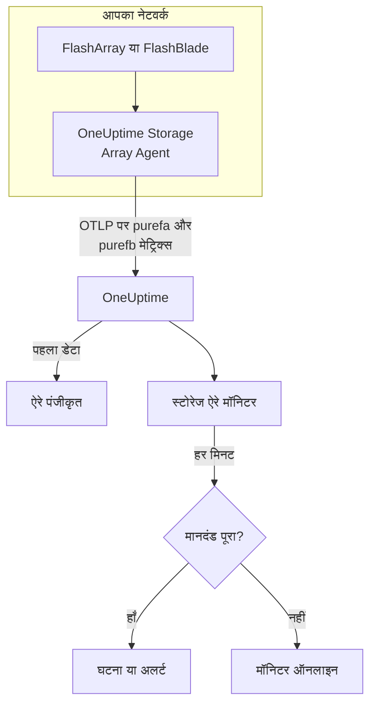

# स्टोरेज ऐरे मॉनिटर

स्टोरेज ऐरे मॉनिटर एक स्टोरेज ऐरे पर नज़र रखता है और आपको तब बताता है जब ऐरे खुद अलर्ट उठाता है, उसकी जगह खत्म होती है, वह धीमा होता है, हार्डवेयर या होस्ट पाथ खोता है, या रेप्लिकेशन में पीछे रह जाता है। यह Pure Storage FlashArray, Pure Storage FlashBlade और NetApp ONTAP (Amazon FSx for NetApp ONTAP समेत) के साथ काम करता है, और वे मेट्रिक्स पढ़ता है जो OneUptime Storage Array Agent इकट्ठा करता है: Pure की `purefa_*` और `purefb_*` सीरीज़, और वे `netapp_*` सीरीज़ जो NetApp Harvest किसी ONTAP क्लस्टर से पढ़ता है।

:::cards
- [मॉनिटर बनाएँ](#स्टोरेज-ऐरे-मॉनिटर-बनाएँ): डैशबोर्ड में छह चरण।
- [टेम्पलेट](#पहले-से-बने-अलर्ट-टेम्पलेट): इक्यावन तैयार अलर्ट, हर वॉल्यूम, होस्ट या कंपोनेंट के लिए एक घटना।
- [Pure की सीरीज़ कैसे काम करती हैं](#pure-की-सीरीज़-का-ढाँचा): एक मेट्रिक नाम, कई आँकड़े। ONTAP की सीरीज़ का [अपना अलग सेक्शन है](#ontap-की-सीरीज़-का-ढाँचा)।
- [मेट्रिक्स](#इकट्ठा-किए-गए-मेट्रिक्स): हर सीरीज़ जिस पर मॉनिटर अलर्ट कर सकता है।
:::

## यह कैसे काम करता है

OneUptime Storage Array Agent ऐसी मशीन पर चलता है जो ऐरे के मैनेजमेंट इंटरफ़ेस तक पहुँच सकती है। यह केवल-पढ़ने वाले API टोकन से ऐरे के मेट्रिक्स पढ़ता है, उन पर ऐरे का नाम `storage.array.name` और उसका प्लेटफ़ॉर्म `storage.system` लेबल करता है, और उन्हें OTLP पर OneUptime को भेजता है। पहला डेटा ऐरे को पंजीकृत करता है।

स्टोरेज ऐरे मॉनिटर एक ऐरे से जुड़ा होता है। हर मिनट वह उस ऐरे के मेट्रिक्स पर अपनी क्वेरी चलाता है और परिणाम की तुलना अपने मानदंड से करता है।



## शुरू करने से पहले

- **Storage Array Agent इंस्टॉल करें**, ऐसी जगह जहाँ से वह HTTPS पर ऐरे तक पहुँच सके, ऐसे उपयोगकर्ता के API टोकन के साथ जिसके पास ऐरे की **readonly** भूमिका हो। [Storage Array Agent गाइड](/docs/telemetry/storage-arrays) उपयोगकर्ता, टोकन और इंस्टॉल को कवर करती है, `ONEUPTIME_URL`, `ONEUPTIME_TELEMETRY_INGESTION_KEY`, `STORAGE_ARRAY_NAME`, और ऐरे के पते और टोकन (`PURE_FA_ENDPOINT` और `PURE_FA_API_TOKEN`, या `PURE_FB_ENDPOINT` और `PURE_FB_API_TOKEN`) के ज़रिए, या ONTAP के लिए क्लस्टर के पते और एक केवल-पढ़ने वाले REST उपयोगकर्ता (`NETAPP_ONTAP_ENDPOINT`, `NETAPP_ONTAP_USERNAME` और `NETAPP_ONTAP_PASSWORD`) के ज़रिए।
- **जाँचें कि ऐरे पंजीकृत है।** पहली स्क्रेप के लगभग एक मिनट बाद यह एजेंट के `STORAGE_ARRAY_NAME` के नाम से **उत्पाद → बुनियादी ढांचा → स्टोरेज ऐरे → सभी स्टोरेज ऐरे** के अंतर्गत दिखता है।

## स्टोरेज ऐरे मॉनिटर बनाएँ

:::steps
### नया मॉनिटर शुरू करें

**मॉनिटर** पर जाएँ और **मॉनिटर बनाएं** पर क्लिक करें।

### स्टोरेज ऐरे चुनें

**मॉनिटर प्रकार** में **और मॉनिटर प्रकार** पर क्लिक करें और **बुनियादी ढांचा** के अंतर्गत **स्टोरेज ऐरे** चुनें, या खोज बॉक्स में `storage` टाइप करें। एक **नाम** दर्ज करें - यह घटना और अलर्ट के शीर्षकों में उपयोग होता है - और **अगला** पर क्लिक करें।

### ऐरे चुनें

**Storage Array Monitor Configuration** के अंतर्गत, **स्टोरेज ऐरे** से ऐरे चुनें। हर वह ऐरे जिसने डेटा भेजा है, सूची में है। उसका प्लेटफ़ॉर्म तय करता है कि फ़ॉर्म कौन से मेट्रिक्स और टेम्पलेट देता है। चुनने के बाद, फ़ील्ड के नीचे एक पंक्ति बताती है कि डेटा आ रहा है या नहीं। **स्टोरेज ऐरे जोड़ें** आपकी कुंजियों से भरे सेटअप चरण खोलता है, जो पहले डेटा की प्रतीक्षा करते हैं।

### क्या देखना है चुनें

नया मॉनिटर **किस पर अलर्ट करना है** के अंतर्गत **Array Stopped Reporting** से शुरू होता है। कुछ और देखने के लिए:

- **बदलें** - कोई दूसरा [टेम्पलेट](#पहले-से-बने-अलर्ट-टेम्पलेट) चुनें। यह मेट्रिक, लेबल फ़िल्टर, एकत्रीकरण, समय सीमा और थ्रेशोल्ड सेट करता है, और नीचे के मानदंड को अपने मानदंड से बदल देता है। आप फिर भी **समय सीमा** बदल सकते हैं।
- **Custom Metric** (**और फ़ील्ड** के अंतर्गत) - **Storage Array Metric** से एक मेट्रिक चुनें, फिर **एकत्रीकरण** और **समय सीमा** सेट करें। [फ़िल्टर](#मॉनिटर-सेटिंग्स) इसे एक वॉल्यूम, होस्ट, पॉड, कंपोनेंट, फ़ाइल सिस्टम या बकेट तक सीमित करते हैं।
- **उन्नत** (**और फ़ील्ड** के अंतर्गत) - **मेट्रिक्स चुनें** के अंतर्गत खुद क्वेरी और सूत्र बनाएँ, उदाहरण के लिए उपयोग की गई क्षमता को `purefa_array_space_bytes` को `space=capacity` पर फ़िल्टर करके, उसी मेट्रिक को `space=empty` पर फ़िल्टर करके घटाकर। हर ऑब्जेक्ट को अलग से आँकने के लिए किसी ऑब्जेक्ट के लेबल से **इसके अनुसार समूहित करें** करें।

### मानदंड जाँचें

**मानदंड** के अंतर्गत हर मानदंड खोलें और उसके **मेट्रिक**, **एकत्रीकरण**, **शर्त** और **सीमा** जाँचें। टेम्पलेट इन्हें भरता है। **Custom Metric** या **उन्नत** के साथ, मॉनिटर [डिफ़ॉल्ट मानदंड](#डिफ़ॉल्ट-मानदंड) से शुरू होता है, जो केवल मेट्रिक के डेटा न भेजने को देखता है, इसलिए अपना थ्रेशोल्ड सेट करें।

### मॉनिटर बनाएँ

**मॉनिटर बनाएं** पर क्लिक करें। OneUptime मॉनिटर का पेज खोलता है और हर मिनट उसका मूल्यांकन करता है। उसके उठाए घटनाएँ और अलर्ट ऐरे के **घटनाएं** और **अलर्ट** पेज पर भी सूचीबद्ध होते हैं।
:::

> [!TIP]
> एक साथ कई टेम्पलेट सेट करने के लिए, **उत्पाद → बुनियादी ढांचा → स्टोरेज ऐरे** से ऐरे खोलें और **सुझाव** पर जाएँ। जो टेम्पलेट चाहिए वे चुनें, चुनें कि किसे पेज किया जाए, और OneUptime हर टेम्पलेट के लिए एक मॉनिटर बनाता है।

## मॉनिटर सेटिंग्स

| फ़ील्ड | टैब | यह क्या करता है |
| --- | --- | --- |
| **स्टोरेज ऐरे** | सभी | ज़रूरी। हर क्वेरी को `resource.storage.array.name` तक सीमित करता है, इसलिए दो ऐरे जिनमें दोनों में `vol-01` नाम का वॉल्यूम है, कभी आपस में नहीं मिलते। |
| **वॉल्यूम** | Custom Metric, उन्नत | एक वॉल्यूम: FlashArray पर `name` लेबल से, जैसे `vol-db-01` (पॉड या वॉल्यूम समूह में वॉल्यूम का नाम `pod::volume` या `group/volume` होता है); ONTAP पर `volume` लेबल से, जो दो SVM में एक जैसा हो सकता है। |
| **होस्ट** | Custom Metric, उन्नत | केवल FlashArray। एक होस्ट जैसा ऐरे उसे जानता है, `host` लेबल से, जैसे `esxi-01`। |
| **पॉड** | Custom Metric, उन्नत | केवल FlashArray। एक ActiveCluster या ActiveDR पॉड, `name` लेबल से, या रेप्लिका लिंक सीरीज़ पर `local_pod` से। |
| **हार्डवेयर कंपोनेंट** | Custom Metric, उन्नत | एक हार्डवेयर कंपोनेंट, जैसे `CH0.BAY1` या `CT0`: FlashArray पर `component_name` लेबल, FlashBlade पर `name`, और ONTAP पर वह लेबल जिससे उसकी सीरीज़ उसे नाम देती है (`node`, `disk`, `shelf` या `port`)। |
| **फ़ाइल सिस्टम** | Custom Metric, उन्नत | केवल FlashBlade। एक फ़ाइल सिस्टम, `name` लेबल से। |
| **बकेट** | Custom Metric, उन्नत | केवल FlashBlade। एक ऑब्जेक्ट स्टोर बकेट, `name` लेबल से। |
| **Storage Array Metric** | Custom Metric | [कैटलॉग](#इकट्ठा-किए-गए-मेट्रिक्स) से एक मेट्रिक। फ़ॉर्म वह लेबल फ़िल्टर जोड़ता है जो उसे उसका अर्थ देता है, और उसे उस ऑब्जेक्ट से समूहित करता है जिसका वह वर्णन करता है, इसलिए हर वॉल्यूम, होस्ट या कंपोनेंट को अलग से आँका जाता है। |
| **एकत्रीकरण** | Custom Metric | सैंपल कैसे मिलाए जाते हैं: **औसत**, **अधिकतम**, **न्यूनतम**, **योग** या **गणना**। मेट्रिक के सामान्य एकत्रीकरण से शुरू होता है। |
| **समय सीमा** | सभी | क्वेरी जो रोलिंग विंडो पढ़ती है, **Past 1 Minute** से **Past 365 Days** तक। नया मॉनिटर **पिछले 5 मिनट** से शुरू होता है; किसी फ़ाइल सिस्टम या बकेट का कस्टम मेट्रिक **पिछले 15 मिनट** से; टेम्पलेट अपना मान सेट करते हैं। |
| **मेट्रिक्स चुनें** | उन्नत | क्वेरी बिल्डर: **मेट्रिक**, **इसके अनुसार एकत्र करें**, **एट्रिब्यूट से फ़िल्टर करें**, **इसके अनुसार समूहित करें**, साथ ही क्वेरी मिलाने के लिए **मेट्रिक जोड़ें** और **सूत्र जोड़ें**। |

एजेंट ऐरे एंडपॉइंट को हर 60 सेकंड में, और वॉल्यूम, होस्ट और पॉड को हर 2 मिनट में पढ़ता है, इसलिए 5 मिनट की विंडो में हमेशा एक सैंपल होता है। FlashBlade के फ़ाइल सिस्टम और बकेट वह हर 5 मिनट में पढ़ता है, इसलिए 15, और FlashArray डायरेक्टरी हर 30 मिनट में: डायरेक्टरी मॉनिटर को 60 मिनट की विंडो दें। ONTAP पर Harvest क्लस्टर का प्रदर्शन हर मिनट और उसका कॉन्फ़िगरेशन, स्थिति और EMS इवेंट हर 3 मिनट में पढ़ता है, इसलिए 5 मिनट की विंडो में हमेशा एक सैंपल होता है।

## Pure की सीरीज़ का ढाँचा

Pure **एक** मेट्रिक नाम पर कई आँकड़े रखता है और उन्हें एक लेबल से अलग करता है:

- **`dimension`** प्रदर्शन सीरीज़ पर। `purefa_array_performance_latency_usec` रीड लेटेंसी (`usec_per_read_op`), राइट लेटेंसी (`usec_per_write_op`), मिरर्ड राइट लेटेंसी, और हर एक का SAN, क्यू, QoS और सर्विस समय रखता है। हमेशा एक `dimension` पर फ़िल्टर करें: उनके पार औसत 200 µs की रीड लेटेंसी को क्यू के आँकड़े के साथ मिला देता है।
- **`space`** क्षमता सीरीज़ पर: `capacity`, `empty`, `snapshots`, `total_provisioned`, `total_physical`, `available_ratio` और अन्य।

कई सीरीज़ अपनी स्थिति एक **लेबल** में रखती हैं, ऐसे मान के साथ जो हमेशा 1 होता है:

| सीरीज़ | स्थिति लेबल | हर एक के लिए एक सीरीज़ |
| --- | --- | --- |
| `purefa_alerts_open` | `severity`, `summary`, `code` और `component_type` के साथ | खुला अलर्ट |
| `purefa_hw_component_status` | `component_status` | हार्डवेयर कंपोनेंट |
| `purefa_host_connectivity_info` | `status`, `details` के साथ | होस्ट |
| `purefa_drive_capacity_bytes` | `component_status` (मान ड्राइव की क्षमता है) | ड्राइव |

किसी खराब स्थिति पर फ़िल्टर की गई सीरीज़ तभी तक मौजूद रहती है जब तक कुछ उस स्थिति में है, इसलिए कोई सीरीज़ न होने का मतलब स्वस्थ है। इसीलिए **0 से ऊपर Max पर ट्रिगर और 0 पर रिकवर** उनके लिए सही रूप है, और टेम्पलेट इसी तरह बने हैं: उनके रिकवर मानदंड गायब सीरीज़ को शून्य मानते हैं। जब कोई भी सीरीज़ नहीं बचती, तो ऐसा टेम्पलेट तभी रिकवर होता है जब उसी विंडो में `purefa_info` या `purefb_info` आया हो, इसलिए रिपोर्ट करना बंद कर चुका ऐरे कुछ भी बंद नहीं करता।

मॉनिटर फ़िल्टर और ग्रुप-बाय कुंजियों में, एजेंट के एट्रिब्यूट `resource.` से शुरू होते हैं (`resource.storage.array.name`, `resource.storage.system`), जबकि Pure के अपने लेबल नहीं (`name`, `host`, `component_name`, `dimension`, `space`, `severity`)।

## ONTAP की सीरीज़ का ढाँचा

NetApp Harvest हर सीरीज़ को `netapp_<object>_<counter>` नाम देता है और ऑब्जेक्ट को उसके लेबल से पहचानता है: वॉल्यूम को `volume` से (अपने `svm` के भीतर), एग्रीगेट को `aggr` से, LUN को `lun` से (अपने `volume` और `svm` के भीतर), नोड को `node` से, डिस्क को `disk` से, शेल्फ़ को `shelf` से, SnapMirror संबंध को `destination_location` से। लेटेंसी प्रति ऑपरेशन माइक्रोसेकंड में होती है, `_ops` प्रति सेकंड ऑपरेशन और `_data` प्रति सेकंड बाइट।

ONTAP की स्थितियाँ तीन तरह से आती हैं:

| सीरीज़ | स्थिति | हर एक के लिए एक सीरीज़ |
| --- | --- | --- |
| `netapp_*_new_status` | 1 स्वस्थ, ऑनलाइन, चालू या चल रहा, 0 नहीं | ऑब्जेक्ट, हर पोल पर |
| `netapp_health_*_alerts` | मान 1, लेबल में `severity` (`error` या `warning`) और कारण के साथ | खुली समस्या: ख़राब डिस्क, शेल्फ़ की ख़राबी, अपने पार्टनर का काम न संभाल सकने वाला नोड, बंद पोर्ट, सिस्टम हेल्थ अलर्ट |
| `netapp_ems_events` | मान 1, `message`, `severity` और इवेंट के पैरामीटर के साथ | EMS इवेंट, सिर्फ़ उस एक पोल के लिए जिसने उसे इकट्ठा किया; जोड़ी वाले इवेंट के क्लियर होने पर उसे एक बार फिर 0 के रूप में एक्सपोर्ट किया जाता है |

संख्या के रूप में स्थिति तब ट्रिगर होती है जब विंडो की हर रीडिंग 1 से कम हो, और कोई रीडिंग फिर से 1 होते ही रिकवर होती है। खुली समस्या तब तक ट्रिगर रहती है जब तक उसकी सीरीज़ मौजूद है, और उसके गायब होते ही रिकवर होती है, बशर्ते `netapp_cluster_new_status` अब भी आ रहा हो, इसलिए रुका हुआ एजेंट कुछ भी बंद नहीं करता। EMS इवेंट अपनी एक रीडिंग पर ट्रिगर होता है और जब तक वह टेम्पलेट के घंटे के भीतर है, खुला रहता है; बिना किसी और इवेंट के एक घंटा बीतने पर वह रिकवर होता है।

## पहले से बने अलर्ट टेम्पलेट

OneUptime 51 टेम्पलेट देता है — 12 FlashArray के लिए, 8 FlashBlade के लिए और 31 ONTAP के लिए — और **किस पर अलर्ट करना है** सेक्शन ऐरे के प्लेटफ़ॉर्म वाले टेम्पलेट देता है। हर एक पूरा मॉनिटर बनाता है: मेट्रिक क्वेरी, उसके लेबल फ़िल्टर, ऑब्जेक्ट के अपने लेबल पर ग्रुप-बाय, एक मानदंड जो ट्रिगर करता है और एक जो रिकवर करता है। थ्रेशोल्ड शुरुआती बिंदु हैं जिन्हें आप संपादित कर सकते हैं।

मानदंड तभी ट्रिगर होता है जब शर्त विंडो के **हर** मान के लिए सही हो, सिवाय ONTAP के EMS टेम्पलेट के: Harvest किसी इवेंट को एक ही पोल के लिए एक्सपोर्ट करता है, इसलिए एक रीडिंग काफ़ी है। जो मॉनिटर क्षमता, लेटेंसी, लैग या अनुपात के थ्रेशोल्ड पर ट्रिगर हुआ, वह उससे 10% आगे जाने पर ही रिकवर होता है, इसलिए थ्रेशोल्ड के आसपास मँडराता मान बार-बार बदलाव नहीं करता। अलर्ट, हार्डवेयर और कनेक्टिविटी टेम्पलेट तब ट्रिगर होते हैं जब कोई स्थिति उनकी पूरी 5 मिनट की विंडो में दिखी हो, और उसके हटने के लगभग 5 मिनट बाद रिकवर होते हैं।

### FlashArray

| टेम्पलेट | श्रेणी | गंभीरता | किस पर नज़र | कब ट्रिगर होता है |
| --- | --- | --- | --- | --- |
| Array Stopped Reporting | उपलब्धता | गंभीर | `purefa_info`, Count, पिछले 10 मिनट | पूरी विंडो में कोई डेटा नहीं — Storage Array Agent रुक गया, उसने OneUptime तक का अपना रास्ता खो दिया या उसका टोकन रद्द कर दिया गया, या ऐरे ने उसे जवाब देना बंद कर दिया; डेटा फिर से आने पर रिकवर |
| Critical Array Alert | ऐरे स्वास्थ्य | गंभीर | `purefa_alerts_open` को `severity=critical` पर फ़िल्टर, `summary` के अनुसार Max, पिछले 5 मिनट | > 0 — ऐरे पर एक खुला गंभीर अलर्ट है (विफल कंपोनेंट, क्षमता आपात स्थिति, रेप्लिकेशन विफलता)। हर अलर्ट के लिए एक घटना; अलर्ट बंद होने पर रिकवर |
| Warning Array Alert | ऐरे स्वास्थ्य | चेतावनी | `purefa_alerts_open` को `severity=warning` पर फ़िल्टर, `summary` के अनुसार Max, पिछले 5 मिनट | > 0 — ऐरे पर एक खुला चेतावनी अलर्ट है। हर अलर्ट के लिए एक घटना; अलर्ट बंद होने पर रिकवर |
| Capacity Above 80% | क्षमता | चेतावनी | `purefa_array_space_utilization`, Max, पिछले 15 मिनट | > 80 — Pure का अपना पहला क्षमता थ्रेशोल्ड; ≤ 72 पर रिकवर |
| Capacity Above 90% | क्षमता | गंभीर | `purefa_array_space_utilization`, Max, पिछले 5 मिनट | > 90 — ऐरे राइट अस्वीकार करने के करीब है; ≤ 81 पर रिकवर |
| High Read Latency | प्रदर्शन | चेतावनी | `purefa_array_performance_latency_usec` को `dimension=usec_per_read_op` पर फ़िल्टर, Avg, पिछले 10 मिनट | > 5000 µs (5 ms) — FlashArray रीड सामान्यतः 1 ms से काफ़ी कम में पूरी होती है; ≤ 4500 पर रिकवर |
| High Write Latency | प्रदर्शन | चेतावनी | `purefa_array_performance_latency_usec` को `dimension=usec_per_write_op` पर फ़िल्टर, Avg, पिछले 10 मिनट | > 5000 µs (5 ms); ≤ 4500 पर रिकवर |
| Hardware Component Failed | हार्डवेयर | गंभीर | `purefa_hw_component_status` को `component_status=critical` पर फ़िल्टर, `component_name` के अनुसार Max, पिछले 5 मिनट | > 0 — कोई कंट्रोलर, पावर सप्लाई, पंखा, बे या पोर्ट गंभीर स्थिति में है और रिडंडेंसी खत्म हो गई है। हर कंपोनेंट के लिए एक घटना; ok रिपोर्ट करने पर रिकवर |
| Hardware Component Degraded | हार्डवेयर | चेतावनी | `purefa_hw_component_status` को `component_status=degraded` पर फ़िल्टर, `component_name` के अनुसार Max, पिछले 5 मिनट | > 0 — कोई कंपोनेंट डिग्रेड हो गया है। हर कंपोनेंट के लिए एक घटना; ok रिपोर्ट करने पर रिकवर |
| Drive Failed | हार्डवेयर | गंभीर | `purefa_drive_capacity_bytes` को `component_status=failed` पर फ़िल्टर, `component_name` के अनुसार Max, पिछले 5 मिनट | > 0 — कोई DirectFlash मॉड्यूल या SSD विफल हुआ और ऐरे बाकी पर फिर से बना रहा है। हर ड्राइव के लिए एक घटना; बदले जाने पर रिकवर |
| Host Lost Redundant Paths | होस्ट | चेतावनी | `purefa_host_connectivity_info` को `status=critical` पर फ़िल्टर, `host` के अनुसार Max, पिछले 5 मिनट | > 0 — होस्ट ऐरे तक एक कंट्रोलर से पहुँचता है या किसी से नहीं; कंट्रोलर फ़ेलओवर उसके स्टोरेज को ऑफ़लाइन कर देगा। हर होस्ट के लिए एक घटना; उसके पाथ लौटने पर रिकवर |
| Replication Lag Above 1 Minute | रेप्लिकेशन | चेतावनी | `purefa_pod_replica_links_lag_max_msec`, `local_pod` के अनुसार Max, पिछले 10 मिनट | > 60000 ms (60 s) — अभी फ़ेलओवर योजना से ज़्यादा हाल की राइट खो देगा। हर पॉड के लिए एक घटना; ≤ 54000 पर रिकवर |

### FlashBlade

| टेम्पलेट | श्रेणी | गंभीरता | किस पर नज़र | कब ट्रिगर होता है |
| --- | --- | --- | --- | --- |
| Array Stopped Reporting | उपलब्धता | गंभीर | `purefb_info`, Count, पिछले 10 मिनट | पूरी विंडो में कोई डेटा नहीं — एजेंट, उसके एक्सपोर्टर या FlashBlade ने जवाब देना बंद कर दिया; डेटा फिर से आने पर रिकवर |
| Critical Array Alert | ऐरे स्वास्थ्य | गंभीर | `purefb_alerts_open` को `severity=critical` पर फ़िल्टर, `summary` के अनुसार Max, पिछले 5 मिनट | > 0 — FlashBlade पर एक खुला गंभीर अलर्ट है। हर अलर्ट के लिए एक घटना; अलर्ट बंद होने पर रिकवर |
| Warning Array Alert | ऐरे स्वास्थ्य | चेतावनी | `purefb_alerts_open` को `severity=warning` पर फ़िल्टर, `summary` के अनुसार Max, पिछले 5 मिनट | > 0 — FlashBlade पर एक खुला चेतावनी अलर्ट है। हर अलर्ट के लिए एक घटना; अलर्ट बंद होने पर रिकवर |
| Capacity Above 80% | क्षमता | चेतावनी | `purefb_array_space_utilization` को `type=array` पर फ़िल्टर, Max, पिछले 15 मिनट | > 80; ≤ 72 पर रिकवर |
| Capacity Above 90% | क्षमता | गंभीर | `purefb_array_space_utilization` को `type=array` पर फ़िल्टर, Max, पिछले 5 मिनट | > 90 — भरने पर हर क्लाइंट के लिए राइट विफल होती हैं; ≤ 81 पर रिकवर |
| Hardware Component Unhealthy | हार्डवेयर | गंभीर | `purefb_hardware_health`, `name` के अनुसार Min, पिछले 5 मिनट | < 1 — कोई ब्लेड, फ़ैब्रिक मॉड्यूल, पावर सप्लाई या पंखा स्वस्थ नहीं है (अप्रयुक्त स्लॉट 2 रिपोर्ट करता है)। हर कंपोनेंट के लिए एक घटना; ≥ 1 पर रिकवर |
| High Read Latency | प्रदर्शन | चेतावनी | `purefb_array_performance_latency_usec` को `dimension=usec_per_read_op` और `protocol=all` पर फ़िल्टर, Avg, पिछले 10 मिनट | > 10000 µs (10 ms) सभी प्रोटोकॉल में; ≤ 9000 पर रिकवर |
| File System Near Full | फ़ाइल सिस्टम | चेतावनी | `purefb_file_systems_space_bytes` को `space=available_ratio` पर फ़िल्टर, `name` के अनुसार Min, पिछले 15 मिनट | < 0.1 — फ़ाइल सिस्टम के प्रोविज़न किए गए आकार का 10% से कम बचा है। हर फ़ाइल सिस्टम के लिए एक घटना; ≥ 0.11 पर रिकवर |

### ONTAP

| टेम्पलेट | श्रेणी | गंभीरता | किस पर नज़र | कब ट्रिगर होता है |
| --- | --- | --- | --- | --- |
| Array Stopped Reporting | उपलब्धता | गंभीर | `netapp_cluster_new_status`, Count, पिछले 10 मिनट | पूरी विंडो में कोई डेटा नहीं — एजेंट या Harvest रुक गया, या क्लस्टर ने Harvest को जवाब देना बंद कर दिया; डेटा फिर से आने पर रिकवर |
| Cluster Not Healthy | ऐरे स्वास्थ्य | चेतावनी | `netapp_cluster_new_status`, Max, पिछले 10 मिनट | < 1 — ONTAP क्लस्टर को स्वस्थ नहीं बताता; ≥ 1 पर रिकवर |
| System Health Alert | ऐरे स्वास्थ्य | चेतावनी | `netapp_health_support_alerts`, `name` के अनुसार Max, पिछले 5 मिनट | > 0 — ONTAP के सिस्टम हेल्थ मॉनिटर ने एक अलर्ट उठाया (किसी शेल्फ़ तक का गायब पाथ, नोड की कनेक्टिविटी समस्या)। हर अलर्ट के लिए एक घटना; ONTAP के उसे क्लियर करने पर रिकवर |
| Emergency EMS Event | ऐरे स्वास्थ्य | गंभीर | `netapp_ems_events` को `severity=emergency` पर फ़िल्टर, `message` के अनुसार Max, पिछले 1 घंटे, कोई भी रीडिंग | > 0 — ONTAP ने emergency स्तर का इवेंट लॉग किया। हर इवेंट के लिए एक घटना; बिना किसी और इवेंट के एक घंटा बीतने पर रिकवर |
| Alert EMS Event | ऐरे स्वास्थ्य | गंभीर | `netapp_ems_events` को `severity=alert` पर फ़िल्टर, `message` के अनुसार Max, पिछले 1 घंटे, कोई भी रीडिंग | > 0 — ONTAP ने alert स्तर का इवेंट लॉग किया (कोई पंखा ख़राब हुआ); बिना किसी और इवेंट के एक घंटा बीतने पर रिकवर |
| Disk Out of Service | हार्डवेयर | चेतावनी | `netapp_ems_events` को `message=disk.outOfService` पर फ़िल्टर, `disk` के अनुसार Max, पिछले 1 घंटे, कोई भी रीडिंग | > 0 — ONTAP ने एक डिस्क को सेवा से बाहर किया; बिना किसी और इवेंट के एक घंटा बीतने पर रिकवर |
| Node Panic | हार्डवेयर | गंभीर | `netapp_ems_events` को `message=sk.panic` पर फ़िल्टर, `node` के अनुसार Max, पिछले 1 घंटे, कोई भी रीडिंग | > 0 — एक नोड पैनिक होकर रीबूट हुआ, और उसके पार्टनर ने उसका स्टोरेज संभाल लिया; बिना किसी और इवेंट के एक घंटा बीतने पर रिकवर |
| Aggregate Above 80% | क्षमता | चेतावनी | `netapp_aggr_space_used_percent`, `aggr` के अनुसार Max, पिछले 15 मिनट | > 80; ≤ 72 पर रिकवर |
| Aggregate Above 90% | क्षमता | गंभीर | `netapp_aggr_space_used_percent`, `aggr` के अनुसार Max, पिछले 5 मिनट | > 90 — उस पर के वॉल्यूम अब बढ़ नहीं सकते; ≤ 81 पर रिकवर |
| Volume Above 90% | क्षमता | चेतावनी | `netapp_volume_size_used_percent`, `volume` और `svm` के अनुसार Max, पिछले 15 मिनट | > 90; ≤ 81 पर रिकवर |
| Volume Above 98% | क्षमता | गंभीर | `netapp_volume_size_used_percent`, `volume` और `svm` के अनुसार Max, पिछले 5 मिनट | > 98 — क्लाइंट को जगह खत्म होने की त्रुटियाँ मिलती हैं, और उसमें रखा LUN ऑफ़लाइन हो सकता है; ≤ 88.2 पर रिकवर |
| High Read Latency | प्रदर्शन | चेतावनी | `netapp_cluster_read_latency`, Avg, पिछले 15 मिनट | > 10000 µs (10 ms); ≤ 9000 पर रिकवर |
| High Write Latency | प्रदर्शन | चेतावनी | `netapp_cluster_write_latency`, Avg, पिछले 15 मिनट | > 10000 µs (10 ms); ≤ 9000 पर रिकवर |
| Volume Latency Above 20 ms | प्रदर्शन | चेतावनी | `netapp_volume_read_latency`, `volume` और `svm` के अनुसार Avg, पिछले 15 मिनट | > 20000 µs; ≤ 18000 पर रिकवर |
| Node Not Healthy | हार्डवेयर | गंभीर | `netapp_node_new_status`, `node` के अनुसार Max, पिछले 10 मिनट | < 1 — ONTAP नोड को स्वस्थ नहीं बताता; ≥ 1 पर रिकवर |
| Takeover Not Possible | हार्डवेयर | गंभीर | `netapp_health_ha_alerts`, `node` के अनुसार Max, पिछले 5 मिनट | > 0 — एक नोड अपने HA पार्टनर का काम नहीं संभाल सकता, इसलिए किसी विफलता से उस पार्टनर का स्टोरेज ऑफ़लाइन हो जाएगा; फिर से संभाल सकने पर रिकवर |
| Disk Failed | हार्डवेयर | गंभीर | `netapp_health_disk_alerts` को `container_type=broken` पर फ़िल्टर, `disk` के अनुसार Max, पिछले 5 मिनट | > 0 — एक डिस्क ख़राब है; बदले जाने पर रिकवर |
| Shelf Fault | हार्डवेयर | गंभीर | `netapp_health_shelf_alerts` को `severity=error` पर फ़िल्टर, `shelf` के अनुसार Max, पिछले 5 मिनट | > 0 — ONTAP किसी डिस्क शेल्फ़ पर त्रुटि बताता है (पावर सप्लाई, मॉड्यूल, पाथ); ONTAP के उसे क्लियर करने पर रिकवर |
| Node Fan Failed | हार्डवेयर | चेतावनी | `netapp_node_failed_fan`, `node` के अनुसार Max, पिछले 10 मिनट | > 0 ख़राब पंखे; ≤ 0 पर रिकवर |
| Node Power Supply Failed | हार्डवेयर | गंभीर | `netapp_node_failed_power`, `node` के अनुसार Max, पिछले 10 मिनट | > 0 ख़राब पावर सप्लाई; ≤ 0 पर रिकवर |
| Shelf Power Supply Failed | हार्डवेयर | गंभीर | `netapp_shelf_psu_status`, `shelf` के अनुसार Max, पिछले 10 मिनट | < 1 — किसी शेल्फ़ की पावर सप्लाई सामान्य नहीं है; ≥ 1 पर रिकवर |
| Shelf Fan Failed | हार्डवेयर | चेतावनी | `netapp_shelf_fan_status`, `shelf` के अनुसार Max, पिछले 10 मिनट | < 1 — किसी शेल्फ़ का पंखा सामान्य नहीं है; ≥ 1 पर रिकवर |
| Ethernet Port Down | हार्डवेयर | चेतावनी | `netapp_health_network_ethernet_port_alerts`, `port` और `node` के अनुसार Max, पिछले 5 मिनट | > 0 — एक सक्षम Ethernet पोर्ट बंद है; उसका लिंक फिर से चालू होने पर रिकवर |
| FC Port Link Failures | हार्डवेयर | चेतावनी | `netapp_fcp_link_failure`, `port` और `node` के अनुसार Max, पिछले 15 मिनट | > 0 — विंडो के दौरान किसी Fibre Channel पोर्ट का लिंक विफल हुआ; ≤ 0 पर रिकवर |
| SnapMirror Behind Schedule | रेप्लिकेशन | चेतावनी | `netapp_snapmirror_lag_time` को `netapp_snapmirror_schedule_seconds` से भाग देकर, `destination_location` के अनुसार Max, पिछले 15 मिनट | > 1.5 — कोई संबंध अपने शेड्यूल के डेढ़ अंतराल से ज़्यादा पीछे है (घंटे भर वाले शेड्यूल पर 90 मिनट); ≤ 1.35 पर रिकवर |
| SnapMirror Relationship Unhealthy | रेप्लिकेशन | गंभीर | `netapp_snapmirror_labels` को `healthy=false` पर फ़िल्टर, `destination_location` के अनुसार Max, पिछले 5 मिनट | > 0 — ONTAP संबंध को अस्वस्थ बताता है, कारण उसके `unhealthy_reason` लेबल में; ONTAP के उसे स्वस्थ बताने पर रिकवर |
| SnapMirror Lag Above 1 Day | रेप्लिकेशन | चेतावनी | `netapp_snapmirror_lag_time`, `destination_location` के अनुसार Max, पिछले 15 मिनट | > 86400 s, उसका शेड्यूल जो भी हो; ≤ 77760 पर रिकवर |
| Aggregate Offline | उपलब्धता | गंभीर | `netapp_aggr_new_status`, `aggr` के अनुसार Max, पिछले 10 मिनट | < 1 — कोई एग्रीगेट ऑनलाइन नहीं है, इसलिए उसके किसी भी वॉल्यूम तक नहीं पहुँचा जा सकता; ≥ 1 पर रिकवर |
| Volume Offline | उपलब्धता | चेतावनी | `netapp_volume_new_status`, `volume` और `svm` के अनुसार Max, पिछले 10 मिनट | < 1 — कोई वॉल्यूम ऑनलाइन नहीं है; ≥ 1 पर रिकवर |
| LUN Offline | उपलब्धता | गंभीर | `netapp_lun_new_status`, `lun`, `volume` और `svm` के अनुसार Max, पिछले 10 मिनट | < 1 — कोई LUN ऑनलाइन नहीं है, और उसके होस्ट वह डिस्क खो चुके हैं; ≥ 1 पर रिकवर |
| SVM Stopped | उपलब्धता | चेतावनी | `netapp_svm_labels` को `state=stopped` और `type=data` पर फ़िल्टर, `svm` के अनुसार Max, पिछले 10 मिनट | > 0 — कोई डेटा SVM रुका हुआ है; फिर से चलने पर रिकवर। ONTAP जिन SVM को अपने लिए रखता है, उन पर कभी नज़र नहीं रखी जाती |

**गंभीरता** वह लेबल है जो पिकर दिखाता है। टेम्पलेट जो घटना और अलर्ट बनाता है, वे आपके प्रोजेक्ट की सबसे गंभीर घटना और अलर्ट गंभीरता से शुरू होते हैं; उन्हें मानदंड में बदलें।

- **Array Stopped Reporting** प्लेटफ़ॉर्म की पहचान सीरीज़ (`purefa_info` या `purefb_info`) गिनता है, जिसे एजेंट द्वारा स्क्रेप किया जाने वाला हर एंडपॉइंट हर स्क्रेप पर एक्सपोर्ट करता है। जब डेटा रुक जाता है, तो बाकी टेम्पलेट के पास तुलना करने के लिए कुछ नहीं होता और वे अपनी आखिरी स्थिति बनाए रखते हैं, इसलिए यही टेम्पलेट आपको बताता है।
- **खुले अलर्ट और हार्डवेयर स्थितियाँ Max का उपयोग करती हैं**, ऐसी सीरीज़ का जो तभी तक मौजूद रहती है जब तक अलर्ट खुला है या कंपोनेंट उस स्थिति में है, इसलिए स्थिति पूरी 5 मिनट की विंडो में दिखने के बाद थ्रेशोल्ड पार करती है।
- **हर प्रति-ऑब्जेक्ट टेम्पलेट ऑब्जेक्ट के अपने लेबल से समूहित करता है** (`summary`, `component_name`, `host`, `local_pod`, `name`), इसलिए हर प्रभावित ऑब्जेक्ट के लिए एक घटना ट्रिगर होती है, और घटना उसका नाम बताती है।
- **लेटेंसी टेम्पलेट Avg का उपयोग करते हैं**, ऐरे के अपने प्रति-ऑपरेशन औसत का, और क्षमता टेम्पलेट उसके अपने उपयोग प्रतिशत का **अधिकतम**। लेटेंसी माइक्रोसेकंड में और क्षमता प्रतिशत में पिन है।
- **Hardware Component Unhealthy हर कंपोनेंट के लिए Min का उपयोग करता है**: स्वस्थ होने पर उसका स्वास्थ्य 1 होता है और न होने पर 0 पर गिर जाता है।

हर वॉल्यूम की लेटेंसी के लिए कोई FlashArray टेम्पलेट नहीं है, क्योंकि सही थ्रेशोल्ड वर्कलोड पर निर्भर करता है: इसे कैटलॉग से `name` पर ग्रुप-बाय के साथ बनाएँ। क्षमता के पूर्वानुमान को थ्रेशोल्ड के बजाय वृद्धि के रुझान की ज़रूरत होती है, और ड्राइव के घिसाव के लिए अलर्ट करने लायक कोई सीरीज़ नहीं है।

## इकट्ठा किए गए मेट्रिक्स

एजेंट वह सब भेजता है जो ऐरे एक्सपोर्ट करता है; नीचे की सीरीज़ वह कैटलॉग हैं जो मॉनिटर फ़ॉर्म देता है। हर मान एक गेज है जिसे ऐरे खुद गिनता है - लेटेंसी प्रति ऑपरेशन माइक्रोसेकंड हैं और थ्रूपुट प्रति सेकंड है - इसलिए किसी रेट गणना की ज़रूरत नहीं। **फ़िल्टर** वह लेबल फ़िल्टर है जो सीरीज़ को वह अर्थ देता है जो उसकी पंक्ति बताती है; फ़ॉर्म इसे आपके लिए लागू करता है।

### ऐरे स्वास्थ्य

| मेट्रिक | फ़िल्टर | प्लेटफ़ॉर्म | इकाई | विवरण |
| --- | --- | --- | --- | --- |
| `purefa_alerts_open` | — | FlashArray | `count` | ऐरे पर हर खुले अलर्ट के लिए एक सीरीज़ (मान 1), लेबल `severity` (`critical`, `warning`, `info`, `hidden`), `category`, `code`, `component_type` और `summary` के साथ |
| `purefb_alerts_open` | — | FlashBlade | `count` | FlashBlade पर हर खुले अलर्ट के लिए एक सीरीज़ (मान 1), लेबल `severity` (`info`, `warning`, `critical`), `code`, `component_name`, `component_type`, `summary` और `kburl` (Pure का नॉलेज-बेस लेख) के साथ |
| `netapp_cluster_new_status` | — | ONTAP | — | जब तक ONTAP क्लस्टर को स्वस्थ बताता है तब तक 1; यही यह भी बताता है कि एजेंट अब भी उसे पढ़ रहा है |
| `netapp_cluster_subsystem_outstanding_alerts` | — | ONTAP | `count` | ONTAP के हर हेल्थ सबसिस्टम में खुले अलर्ट, `subsystem` के अनुसार |
| `netapp_health_support_alerts` | — | ONTAP | `count` | ONTAP के सिस्टम हेल्थ मॉनिटर के हर खुले अलर्ट के लिए एक सीरीज़, जब तक वह खुला है |
| `netapp_ems_events` | — | ONTAP | `count` | हर EMS इवेंट के लिए एक सीरीज़, उस पोल के लिए जिसने उसे इकट्ठा किया; जोड़ी वाले इवेंट के क्लियर होने पर उसे एक बार फिर 0 के रूप में एक्सपोर्ट किया जाता है |

### क्षमता

| मेट्रिक | फ़िल्टर | प्लेटफ़ॉर्म | इकाई | विवरण |
| --- | --- | --- | --- | --- |
| `purefa_array_space_utilization` | — | FlashArray | `%` | ऐरे की उपयोग योग्य क्षमता का उपयोग में हिस्सा। Pure खुद 80%, 90% और 100% पर क्षमता अलर्ट उठाता है |
| `purefa_array_space_bytes` | `space=capacity` | FlashArray | `bytes` | ऐरे की उपयोग योग्य क्षमता |
| `purefa_array_space_bytes` | `space=empty` | FlashArray | `bytes` | अप्रयुक्त क्षमता — ऐरे कब भरेगा, इसका अनुमान लगाने के लिए इसका रुझान देखें |
| `purefa_array_space_bytes` | `space=snapshots` | FlashArray | `bytes` | केवल स्नैपशॉट से घिरी भौतिक जगह; तेज़ वृद्धि का मतलब आमतौर पर है कि कोई प्रोटेक्शन ग्रुप योजना से ज़्यादा स्नैपशॉट रख रहा है |
| `purefa_array_space_data_reduction_ratio` | — | FlashArray | `ratio` | पूरे ऐरे में डीडुप्लिकेशन और कम्प्रेशन, जैसे 4.2:1 के लिए 4.2। लगातार गिरावट का मतलब है कि नया डेटा ठीक से कम नहीं हो रहा |
| `purefb_array_space_utilization` | `type=array` | FlashBlade | `%` | FlashBlade की उपयोग योग्य क्षमता का उपयोग में हिस्सा |
| `purefb_array_space_bytes` | `type=array`, `space=empty` | FlashBlade | `bytes` | FlashBlade की अप्रयुक्त क्षमता |
| `purefb_array_space_data_reduction_ratio` | `type=array` | FlashBlade | `ratio` | पूरे FlashBlade में डेटा रिडक्शन |
| `netapp_aggr_space_used_percent` | — | ONTAP | `%` | हर एग्रीगेट की उपयोग योग्य जगह का उपयोग में हिस्सा — `aggr` से समूहित करें |
| `netapp_aggr_space_total` | — | ONTAP | `bytes` | हर एग्रीगेट की उपयोग योग्य जगह; क्लस्टर की क्षमता इनका योग है |
| `netapp_aggr_space_used` | — | ONTAP | `bytes` | हर एग्रीगेट की उपयोग में या आरक्षित जगह |
| `netapp_aggr_space_available` | — | ONTAP | `bytes` | हर एग्रीगेट पर बची जगह — वह कब भरेगा, इसका अनुमान लगाने के लिए इसका रुझान देखें |
| `netapp_aggr_inode_used_percent` | — | ONTAP | `%` | हर एग्रीगेट की फ़ाइलों (inode) का उपयोग में हिस्सा |
| `netapp_aggr_new_status` | — | ONTAP | — | जब तक एग्रीगेट ऑनलाइन है तब तक 1 |
| `netapp_aggr_logical_used_wo_snapshots_flexclones` | — | ONTAP | `bytes` | स्टोरेज एफ़िशिएंसी के बिना हर एग्रीगेट का डेटा कितनी जगह लेता, स्नैपशॉट और FlexClone को छोड़कर |
| `netapp_aggr_physical_used_wo_snapshots_flexclones` | — | ONTAP | `bytes` | स्टोरेज एफ़िशिएंसी के बाद हर एग्रीगेट का डेटा डिस्क पर कितनी जगह लेता है |

### प्रदर्शन

| मेट्रिक | फ़िल्टर | प्लेटफ़ॉर्म | इकाई | विवरण |
| --- | --- | --- | --- | --- |
| `purefa_array_performance_latency_usec` | `dimension=usec_per_read_op` | FlashArray | `µs` | होस्ट को दिखने वाली औसत रीड लेटेंसी; FlashArray रीड आमतौर पर 1 ms से काफ़ी कम में पूरी होती है |
| `purefa_array_performance_latency_usec` | `dimension=usec_per_write_op` | FlashArray | `µs` | होस्ट को दिखने वाली औसत राइट लेटेंसी |
| `purefa_array_performance_latency_usec` | `dimension=usec_per_mirrored_write_op` | FlashArray | `µs` | स्ट्रेच्ड ActiveCluster पॉड पर औसत राइट लेटेंसी, पार्टनर ऐरे तक राउंड ट्रिप समेत |
| `purefa_array_performance_latency_usec` | `dimension=san_usec_per_read_op` | FlashArray | `µs` | रीड SAN में कितना समय बिताती है; ऊँची SAN लेटेंसी और कम सर्विस लेटेंसी फ़ैब्रिक या होस्ट की ओर इशारा करती है |
| `purefa_array_performance_throughput_iops` | `dimension=reads_per_sec` | FlashArray | `ops/s` | प्रति सेकंड रीड ऑपरेशन |
| `purefa_array_performance_throughput_iops` | `dimension=writes_per_sec` | FlashArray | `ops/s` | प्रति सेकंड राइट ऑपरेशन |
| `purefa_array_performance_bandwidth_bytes` | `dimension=read_bytes_per_sec` | FlashArray | `bytes/s` | प्रति सेकंड पढ़े गए बाइट |
| `purefa_array_performance_bandwidth_bytes` | `dimension=write_bytes_per_sec` | FlashArray | `bytes/s` | प्रति सेकंड लिखे गए बाइट |
| `purefa_array_performance_queue_depth_ops` | — | FlashArray | `ops` | ऐरे पर क्यू में ऑपरेशन; बढ़ती लेटेंसी के साथ बढ़ती क्यू का मतलब है कि होस्ट उससे ज़्यादा भेज रहे हैं जितना ऐरे संभाल सकता है |
| `purefa_array_performance_average_bytes` | `dimension=bytes_per_op` | FlashArray | `bytes` | एक ऑपरेशन का औसत आकार — बड़ा I/O बिना कुछ गलत हुए लेटेंसी बढ़ाता है |
| `purefb_array_performance_latency_usec` | `dimension=usec_per_read_op`, `protocol=all` | FlashBlade | `µs` | सभी प्रोटोकॉल में औसत रीड लेटेंसी |
| `purefb_array_performance_latency_usec` | `dimension=usec_per_write_op`, `protocol=all` | FlashBlade | `µs` | सभी प्रोटोकॉल में औसत राइट लेटेंसी |
| `purefb_array_performance_throughput_iops` | `dimension=reads_per_sec`, `protocol=all` | FlashBlade | `ops/s` | सभी प्रोटोकॉल में प्रति सेकंड रीड ऑपरेशन |
| `purefb_array_performance_throughput_iops` | `dimension=writes_per_sec`, `protocol=all` | FlashBlade | `ops/s` | सभी प्रोटोकॉल में प्रति सेकंड राइट ऑपरेशन |
| `purefb_array_performance_bandwidth_bytes` | `dimension=read_bytes_per_sec`, `protocol=all` | FlashBlade | `bytes/s` | सभी प्रोटोकॉल में प्रति सेकंड पढ़े गए बाइट |
| `purefb_array_performance_bandwidth_bytes` | `dimension=write_bytes_per_sec`, `protocol=all` | FlashBlade | `bytes/s` | सभी प्रोटोकॉल में प्रति सेकंड लिखे गए बाइट |
| `netapp_cluster_read_latency` | — | ONTAP | `µs` | पूरे क्लस्टर में औसत रीड लेटेंसी |
| `netapp_cluster_write_latency` | — | ONTAP | `µs` | पूरे क्लस्टर में औसत राइट लेटेंसी |
| `netapp_cluster_read_ops` | — | ONTAP | `ops/s` | पूरे क्लस्टर में प्रति सेकंड रीड ऑपरेशन |
| `netapp_cluster_write_ops` | — | ONTAP | `ops/s` | पूरे क्लस्टर में प्रति सेकंड राइट ऑपरेशन |
| `netapp_cluster_total_ops` | — | ONTAP | `ops/s` | पूरे क्लस्टर में प्रति सेकंड हर तरह के ऑपरेशन, मेटाडेटा समेत |
| `netapp_cluster_read_data` | — | ONTAP | `bytes/s` | पूरे क्लस्टर में प्रति सेकंड पढ़े गए बाइट |
| `netapp_cluster_write_data` | — | ONTAP | `bytes/s` | पूरे क्लस्टर में प्रति सेकंड लिखे गए बाइट |
| `netapp_aggr_read_latency` | — | ONTAP | `µs` | हर एग्रीगेट पर औसत रीड लेटेंसी |
| `netapp_aggr_write_latency` | — | ONTAP | `µs` | हर एग्रीगेट पर औसत राइट लेटेंसी |
| `netapp_aggr_read_ops` | — | ONTAP | `ops/s` | हर एग्रीगेट पर प्रति सेकंड रीड ऑपरेशन |
| `netapp_aggr_write_ops` | — | ONTAP | `ops/s` | हर एग्रीगेट पर प्रति सेकंड राइट ऑपरेशन |
| `netapp_svm_vol_read_latency` | — | ONTAP | `µs` | हर SVM के वॉल्यूम पर औसत रीड लेटेंसी |
| `netapp_svm_vol_write_latency` | — | ONTAP | `µs` | हर SVM के वॉल्यूम पर औसत राइट लेटेंसी |
| `netapp_svm_vol_read_ops` | — | ONTAP | `ops/s` | हर SVM के वॉल्यूम पर प्रति सेकंड रीड ऑपरेशन |
| `netapp_svm_vol_write_ops` | — | ONTAP | `ops/s` | हर SVM के वॉल्यूम पर प्रति सेकंड राइट ऑपरेशन |
| `netapp_svm_vol_read_data` | — | ONTAP | `bytes/s` | हर SVM के वॉल्यूम से प्रति सेकंड पढ़े गए बाइट |
| `netapp_svm_vol_write_data` | — | ONTAP | `bytes/s` | हर SVM के वॉल्यूम में प्रति सेकंड लिखे गए बाइट |

### वॉल्यूम

| मेट्रिक | फ़िल्टर | प्लेटफ़ॉर्म | इकाई | विवरण |
| --- | --- | --- | --- | --- |
| `purefa_volume_performance_latency_usec` | `dimension=usec_per_read_op` | FlashArray | `µs` | हर वॉल्यूम की औसत रीड लेटेंसी — `name` से समूहित करें |
| `purefa_volume_performance_latency_usec` | `dimension=usec_per_write_op` | FlashArray | `µs` | हर वॉल्यूम की औसत राइट लेटेंसी |
| `purefa_volume_performance_throughput_iops` | `dimension=reads_per_sec` | FlashArray | `ops/s` | हर वॉल्यूम के प्रति सेकंड रीड ऑपरेशन |
| `purefa_volume_performance_throughput_iops` | `dimension=writes_per_sec` | FlashArray | `ops/s` | हर वॉल्यूम के प्रति सेकंड राइट ऑपरेशन |
| `purefa_volume_performance_bandwidth_bytes` | `dimension=read_bytes_per_sec` | FlashArray | `bytes/s` | हर वॉल्यूम से प्रति सेकंड पढ़े गए बाइट |
| `purefa_volume_performance_bandwidth_bytes` | `dimension=write_bytes_per_sec` | FlashArray | `bytes/s` | हर वॉल्यूम में प्रति सेकंड लिखे गए बाइट |
| `purefa_volume_space_bytes` | `space=total_provisioned` | FlashArray | `bytes` | हर वॉल्यूम का आकार जैसा होस्ट उसे देखते हैं |
| `purefa_volume_space_bytes` | `space=total_physical` | FlashArray | `bytes` | डेटा रिडक्शन के बाद हर वॉल्यूम की उपयोग की गई भौतिक जगह |
| `purefa_volume_space_data_reduction_ratio` | — | FlashArray | `ratio` | हर वॉल्यूम का डेटा रिडक्शन अनुपात |
| `netapp_svm_new_status` | — | ONTAP | — | जब तक SVM चल रहा है तब तक 1 — `svm` से समूहित करें |
| `netapp_svm_labels` | `state=stopped`, `type=data` | ONTAP | — | हर रुके हुए डेटा SVM के लिए एक सीरीज़ |
| `netapp_volume_size_used_percent` | — | ONTAP | `%` | हर वॉल्यूम की जगह का उपयोग में हिस्सा, जैसा `volume show` बताता है — `volume` और `svm` से समूहित करें |
| `netapp_volume_size_total` | — | ONTAP | `bytes` | हर वॉल्यूम का उपयोग योग्य आकार, उसके स्नैपशॉट रिज़र्व को छोड़कर |
| `netapp_volume_size_used` | — | ONTAP | `bytes` | हर वॉल्यूम की उपयोग में जगह |
| `netapp_volume_size_available` | — | ONTAP | `bytes` | हर वॉल्यूम में बची जगह |
| `netapp_volume_snapshots_size_used` | — | ONTAP | `bytes` | हर वॉल्यूम के स्नैपशॉट जितनी जगह लेते हैं |
| `netapp_volume_inode_used_percent` | — | ONTAP | `%` | हर वॉल्यूम की फ़ाइलों (inode) का उपयोग में हिस्सा |
| `netapp_volume_sis_total_saved_percent` | — | ONTAP | `%` | हर वॉल्यूम के डेटा का वह हिस्सा जो डीडुप्लिकेशन और कम्प्रेशन बचाते हैं |
| `netapp_volume_new_status` | — | ONTAP | — | जब तक वॉल्यूम ऑनलाइन है तब तक 1 |
| `netapp_volume_read_latency` | — | ONTAP | `µs` | हर वॉल्यूम पर औसत रीड लेटेंसी |
| `netapp_volume_write_latency` | — | ONTAP | `µs` | हर वॉल्यूम पर औसत राइट लेटेंसी |
| `netapp_volume_read_ops` | — | ONTAP | `ops/s` | हर वॉल्यूम पर प्रति सेकंड रीड ऑपरेशन |
| `netapp_volume_write_ops` | — | ONTAP | `ops/s` | हर वॉल्यूम पर प्रति सेकंड राइट ऑपरेशन |
| `netapp_volume_read_data` | — | ONTAP | `bytes/s` | हर वॉल्यूम से प्रति सेकंड पढ़े गए बाइट |
| `netapp_volume_write_data` | — | ONTAP | `bytes/s` | हर वॉल्यूम में प्रति सेकंड लिखे गए बाइट |
| `netapp_lun_size_used_percent` | — | ONTAP | `%` | हर LUN के आकार का वह हिस्सा जो उसके होस्ट ने लिखा है |
| `netapp_lun_size` | — | ONTAP | `bytes` | वह आकार जो हर LUN अपने होस्ट को दिखाता है |
| `netapp_lun_size_used` | — | ONTAP | `bytes` | हर LUN अपने वॉल्यूम में जितनी जगह उपयोग करता है |
| `netapp_lun_new_status` | — | ONTAP | — | जब तक LUN ऑनलाइन है तब तक 1 |
| `netapp_lun_avg_read_latency` | — | ONTAP | `µs` | हर LUN पर औसत रीड लेटेंसी |
| `netapp_lun_avg_write_latency` | — | ONTAP | `µs` | हर LUN पर औसत राइट लेटेंसी |
| `netapp_lun_read_ops` | — | ONTAP | `ops/s` | हर LUN पर प्रति सेकंड रीड ऑपरेशन |
| `netapp_lun_write_ops` | — | ONTAP | `ops/s` | हर LUN पर प्रति सेकंड राइट ऑपरेशन |
| `netapp_lun_read_data` | — | ONTAP | `bytes/s` | हर LUN से प्रति सेकंड पढ़े गए बाइट |
| `netapp_lun_write_data` | — | ONTAP | `bytes/s` | हर LUN में प्रति सेकंड लिखे गए बाइट |

### होस्ट

| मेट्रिक | फ़िल्टर | प्लेटफ़ॉर्म | इकाई | विवरण |
| --- | --- | --- | --- | --- |
| `purefa_host_connectivity_info` | — | FlashArray | `count` | हर होस्ट के लिए एक सीरीज़ (मान 1), कनेक्टिविटी लेबल `status` (`healthy`, `critical`, `unused`) और `details` (`Redundant`, `Single Controller`, `None`, ...) के साथ |
| `purefa_host_performance_latency_usec` | `dimension=usec_per_read_op` | FlashArray | `µs` | हर होस्ट को दिखने वाली औसत रीड लेटेंसी — `host` से समूहित करें |
| `purefa_host_performance_latency_usec` | `dimension=usec_per_write_op` | FlashArray | `µs` | हर होस्ट को दिखने वाली औसत राइट लेटेंसी |
| `purefa_host_performance_throughput_iops` | `dimension=reads_per_sec` | FlashArray | `ops/s` | हर होस्ट के प्रति सेकंड रीड ऑपरेशन |
| `purefa_host_performance_throughput_iops` | `dimension=writes_per_sec` | FlashArray | `ops/s` | हर होस्ट के प्रति सेकंड राइट ऑपरेशन |

### रेप्लिकेशन

| मेट्रिक | फ़िल्टर | प्लेटफ़ॉर्म | इकाई | विवरण |
| --- | --- | --- | --- | --- |
| `purefa_pod_replica_links_lag_max_msec` | — | FlashArray | `ms` | हर पॉड रेप्लिका लिंक (ActiveDR / एसिंक्रोनस) का सबसे बड़ा रेप्लिकेशन लैग, लेबल `local_pod`, `remote_pod`, `remote`, `direction` और `status` के साथ — `local_pod` से समूहित करें |
| `purefa_pod_replica_links_lag_average_msec` | — | FlashArray | `ms` | हर पॉड रेप्लिका लिंक का औसत रेप्लिकेशन लैग |
| `purefa_pod_performance_replication_bandwidth_bytes` | `direction=total` | FlashArray | `bytes/s` | हर पॉड का रेप्लिकेशन ट्रैफ़िक, लेबल `direction` और `dimension` के साथ |
| `purefa_pod_performance_latency_usec` | `dimension=usec_per_mirrored_write_op` | FlashArray | `µs` | हर ActiveCluster पॉड की औसत मिरर्ड राइट लेटेंसी |
| `netapp_snapmirror_lag_time` | — | ONTAP | `s` | हर SnapMirror संबंध का गंतव्य अपने स्रोत से कितना पीछे है |
| `netapp_snapmirror_schedule_seconds` | — | ONTAP | `s` | हर संबंध का शेड्यूल कितनी-कितनी देर में ट्रांसफ़र करता है; एजेंट इसे शेड्यूल के नाम से लिखता है |
| `netapp_snapmirror_last_transfer_duration` | — | ONTAP | `s` | हर संबंध के आख़िरी ट्रांसफ़र में कितना समय लगा |
| `netapp_snapmirror_last_transfer_size` | — | ONTAP | `bytes` | हर संबंध के आख़िरी ट्रांसफ़र ने कितना भेजा |
| `netapp_snapmirror_update_failed_count` | — | ONTAP | `count` | हर संबंध के कितने अपडेट विफल हुए हैं; यह सिर्फ़ बढ़ता है |
| `netapp_snapmirror_labels` | `healthy=false` | ONTAP | — | हर उस संबंध के लिए एक सीरीज़ जिसे ONTAP अस्वस्थ बताता है, कारण `unhealthy_reason` में |

### हार्डवेयर

| मेट्रिक | फ़िल्टर | प्लेटफ़ॉर्म | इकाई | विवरण |
| --- | --- | --- | --- | --- |
| `purefa_hw_component_status` | — | FlashArray | `count` | हर हार्डवेयर कंपोनेंट के लिए एक सीरीज़ (मान 1) — चेसिस, कंट्रोलर, ड्राइव और NVRAM बे, पावर सप्लाई, पंखे, तापमान सेंसर, Ethernet और Fibre Channel पोर्ट — लेबल `component_status` (`ok`, `critical`, `degraded`, `device_off`, `identifying`, `not_installed`, `unknown`) के साथ |
| `purefa_hw_component_temperature_celsius` | — | FlashArray | `°C` | हर सेंसर का तापमान — `component_name` से समूहित करें |
| `purefa_drive_capacity_bytes` | — | FlashArray | `bytes` | हर ड्राइव की कच्ची क्षमता, उसके `component_status` (`healthy`, `failed`, `missing`, `recovering`, `unhealthy`, `empty`, ...) और प्रकार के लेबल के साथ |
| `purefa_network_interface_performance_errors` | `dimension=total_errors_per_sec` | FlashArray | `errors/s` | हर Ethernet और Fibre Channel इंटरफ़ेस पर प्रति सेकंड त्रुटियाँ — लगातार त्रुटियों का मतलब आमतौर पर खराब केबल, ऑप्टिक या स्विच पोर्ट है |
| `purefb_hardware_health` | — | FlashBlade | — | हर हार्डवेयर कंपोनेंट (ब्लेड, फ़ैब्रिक मॉड्यूल, पावर सप्लाई, पंखे, ...) का स्वास्थ्य: 1 = स्वस्थ, 2 = अप्रयुक्त, 0 = अस्वस्थ। `name` के अनुसार न्यूनतम लें |
| `netapp_node_new_status` | — | ONTAP | — | जब तक ONTAP नोड को स्वस्थ बताता है तब तक 1 — `node` से समूहित करें |
| `netapp_node_avg_processor_busy` | — | ONTAP | `%` | हर नोड के प्रोसेसर कितने व्यस्त हैं |
| `netapp_node_failed_fan` | — | ONTAP | `count` | हर नोड के ख़राब पंखे |
| `netapp_node_failed_power` | — | ONTAP | `count` | हर नोड की ख़राब पावर सप्लाई |
| `netapp_node_uptime` | — | ONTAP | `s` | हर नोड कितनी देर से चल रहा है; गिरावट का मतलब रीबूट या गिवबैक है |
| `netapp_disk_new_status` | — | ONTAP | — | जब तक डिस्क कोई आउटेज नहीं बताती तब तक 1 — `disk` से समूहित करें |
| `netapp_health_disk_alerts` | — | ONTAP | `count` | हर उस डिस्क के लिए एक सीरीज़ जिसे ONTAP ख़राब या अनअसाइन्ड बताता है, जब तक ऐसा है |
| `netapp_shelf_new_status` | — | ONTAP | — | जब तक डिस्क शेल्फ़ ऑनलाइन है तब तक 1 |
| `netapp_health_shelf_alerts` | — | ONTAP | `count` | किसी डिस्क शेल्फ़ पर ONTAP की बताई हर ख़राबी के लिए एक सीरीज़, जब तक वह बनी रहती है |
| `netapp_shelf_psu_status` | — | ONTAP | — | जब तक शेल्फ़ की पावर सप्लाई सामान्य है तब तक 1 |
| `netapp_shelf_fan_status` | — | ONTAP | — | जब तक शेल्फ़ का पंखा सामान्य है तब तक 1 |
| `netapp_shelf_temperature_status` | — | ONTAP | — | जब तक शेल्फ़ का तापमान सेंसर अपनी सीमाओं के भीतर है तब तक 1 |
| `netapp_shelf_temperature_reading` | — | ONTAP | `°C` | हर शेल्फ़ तापमान सेंसर की रीडिंग |
| `netapp_environment_sensor_status` | — | ONTAP | — | जब तक नोड का एनवायरनमेंट सेंसर अपनी सीमाओं के भीतर है तब तक 1 |
| `netapp_health_node_alerts` | — | ONTAP | `count` | हर उस नोड के लिए एक सीरीज़ जिसे ONTAP अस्वस्थ बताता है, जब तक ऐसा है |
| `netapp_health_ha_alerts` | — | ONTAP | `count` | हर उस नोड के लिए एक सीरीज़ जो अपने HA पार्टनर का काम नहीं संभाल सकता, जब तक नहीं संभाल सकता |
| `netapp_net_port_status` | — | ONTAP | — | जब तक Ethernet पोर्ट का लिंक चालू है तब तक 1 |
| `netapp_health_network_ethernet_port_alerts` | — | ONTAP | `count` | हर उस सक्षम Ethernet पोर्ट के लिए एक सीरीज़ जो बंद है, जब तक ऐसा है |
| `netapp_nic_rx_bytes` | — | ONTAP | `bytes/s` | हर Ethernet पोर्ट प्रति सेकंड जितने बाइट प्राप्त करता है |
| `netapp_nic_tx_bytes` | — | ONTAP | `bytes/s` | हर Ethernet पोर्ट प्रति सेकंड जितने बाइट भेजता है |
| `netapp_nic_util_percent` | — | ONTAP | `%` | हर Ethernet पोर्ट की गति का कितना हिस्सा उपयोग में है |
| `netapp_nic_rx_total_errors` | — | ONTAP | `count` | हर Ethernet पोर्ट ने पिछले एक मिनट में जितनी प्राप्ति त्रुटियाँ गिनीं |
| `netapp_fcp_read_data` | — | ONTAP | `bytes/s` | हर Fibre Channel पोर्ट से प्रति सेकंड पढ़े गए बाइट |
| `netapp_fcp_write_data` | — | ONTAP | `bytes/s` | हर Fibre Channel पोर्ट से प्रति सेकंड लिखे गए बाइट |
| `netapp_fcp_util_percent` | — | ONTAP | `%` | हर Fibre Channel पोर्ट की गति का कितना हिस्सा उपयोग में है |
| `netapp_fcp_link_failure` | — | ONTAP | `count` | हर Fibre Channel पोर्ट ने पिछले एक मिनट में जितनी लिंक विफलताएँ गिनीं |

### फ़ाइल सिस्टम

| मेट्रिक | फ़िल्टर | प्लेटफ़ॉर्म | इकाई | विवरण |
| --- | --- | --- | --- | --- |
| `purefb_file_systems_performance_latency_usec` | `dimension=usec_per_read_op` | FlashBlade | `µs` | हर फ़ाइल सिस्टम की औसत रीड लेटेंसी — `name` से समूहित करें |
| `purefb_file_systems_performance_latency_usec` | `dimension=usec_per_write_op` | FlashBlade | `µs` | हर फ़ाइल सिस्टम की औसत राइट लेटेंसी |
| `purefb_file_systems_space_bytes` | `space=total_physical` | FlashBlade | `bytes` | हर फ़ाइल सिस्टम की उपयोग की गई भौतिक जगह |
| `purefb_file_systems_space_bytes` | `space=available_ratio` | FlashBlade | `ratio` | हर फ़ाइल सिस्टम के प्रोविज़न किए गए आकार का अभी भी खाली हिस्सा, 0 से 1 — 0 के पास वह अपना कोटा भरने वाला है |

### बकेट

| मेट्रिक | फ़िल्टर | प्लेटफ़ॉर्म | इकाई | विवरण |
| --- | --- | --- | --- | --- |
| `purefb_buckets_performance_latency_usec` | `dimension=usec_per_read_op` | FlashBlade | `µs` | हर बकेट की औसत रीड लेटेंसी — `name` से समूहित करें |
| `purefb_buckets_space_bytes` | `space=total_physical` | FlashBlade | `bytes` | हर बकेट की उपयोग की गई भौतिक जगह |
| `purefb_buckets_object_count` | — | FlashBlade | `count` | हर बकेट में ऑब्जेक्ट की संख्या |

## निगरानी मानदंड

मानदंड मॉनिटर की किसी क्वेरी या सूत्र की तुलना एक थ्रेशोल्ड से करता है। स्टोरेज ऐरे मॉनिटर के मानदंड में कोई **फ़िल्टर प्रकार** नहीं होता: हर नियम इन फ़ील्ड के साथ मेट्रिक मान जाँचता है।

| फ़ील्ड | यह क्या करता है |
| --- | --- |
| **मेट्रिक** | जाँचने वाली क्वेरी या सूत्र, उसके वेरिएबल नाम से। |
| **एकत्रीकरण** | विंडो के मान एक उत्तर कैसे बनते हैं: **औसत**, **योग**, **अधिकतम मान**, **न्यूनतम मान**, **सभी मान** (पूरी विंडो में हर मान को मेल खाना चाहिए) या **कोई भी मान** (एक काफ़ी है)। |
| **शर्त** | **से बड़ा**, **से छोटा**, **से बड़ा या बराबर**, **से छोटा या बराबर**, **बराबर है** या **बराबर नहीं है** — या कोई विसंगति शर्त: **असामान्य रूप से अधिक**, **असामान्य रूप से कम** या **असामान्य**। **कोई डेटा नहीं** तब मेल खाता है जब क्वेरी ने विंडो में कुछ नहीं भेजा, और **डेटा है** तब जब उसने कुछ भेजा। **ऊपर जाने का अनुमान** और **नीचे जाने का अनुमान** तब मेल खाती हैं जब विंडो में मेट्रिक का रुझान **अनुमान अवधि** के अंत तक सीमा के पार हो। |
| **सीमा** | तुलना के लिए मान। मेट्रिक की इकाई होने पर उसके बगल में इकाई सूची होती है। विसंगति शर्तों के लिए नहीं दिखता। |
| **संवेदनशीलता** | केवल विसंगति शर्तें। **निम्न** (4σ), **मध्यम** (3σ, डिफ़ॉल्ट) या **उच्च** (2σ)। |
| **बेसलाइन विंडो** | केवल विसंगति शर्तें। 14 दिन (डिफ़ॉल्ट), 28, 60 या 90 दिन का इतिहास। |
| **यदि कोई डेटा नहीं** | **और फ़ील्ड** के अंतर्गत। जब विंडो में कोई सैंपल न हो तो क्या होता है: **Ignore** (डिफ़ॉल्ट), **Treat As Zero** या **ट्रिगर**। |

विसंगति शर्तें हर मान की तुलना बेसलाइन में सप्ताह के उसी घंटे से करती हैं। जब तक बेसलाइन विंडो में पर्याप्त इतिहास न हो, वे "Learning" स्थिति में रहती हैं, और कुछ नहीं उठातीं। यह मॉनिटर अपनी क्वेरी को एट्रिब्यूट से फ़िल्टर करता है, इसलिए हर क्वेरी, और समूहित क्वेरी की हर सीरीज़, की तुलना उसके अपने इतिहास से होती है, उतना पीछे तक जितने समय तक आपके मेट्रिक रखे जाते हैं। अगर वह दो सप्ताह से कम है, तो योग, गिनती या हिस्टोग्राम पर क्वेरी हमेशा उसी स्थिति में रहती है, और बाकी सब की तुलना मेट्रिक की हर सीरीज़ से होती है। हिस्टोग्राम का परसेंटाइल हमेशा उसी स्थिति में रहता है।

शुरुआत के लिए कुछ मानदंड:

- **कोई वॉल्यूम धीमा है:** `purefa_volume_performance_latency_usec` को `dimension=usec_per_read_op` पर फ़िल्टर, औसत, `name` से समूहित, **से बड़ा** `2000`, पिछले 10 मिनट में।
- **ऐरे भर रहा है:** `purefa_array_space_utilization`, अधिकतम, **से बड़ा** `85`, पिछले 15 मिनट में।
- **कोई होस्ट एक कंट्रोलर पर चल रहा है:** `purefa_host_connectivity_info` को `status=critical` पर फ़िल्टर, अधिकतम, `host` से समूहित, **से बड़ा** `0`।
- **कोई FlashBlade फ़ाइल सिस्टम लगभग भरा है:** `purefb_file_systems_space_bytes` को `space=available_ratio` पर फ़िल्टर, न्यूनतम, `name` से समूहित, **से छोटा** `0.05`।

### डिफ़ॉल्ट मानदंड

जो मॉनिटर आप टेम्पलेट से नहीं बनाते, वह दो मानदंडों से शुरू होता है:

| क्रम | मानदंड | कब मेल खाता है | फिर |
| --- | --- | --- | --- |
| 1 | जाँचें कि _मॉनिटर का नाम_ ऑफ़लाइन है या नहीं | पहली क्वेरी में पूरी विंडो में कोई डेटा नहीं है | मॉनिटर को **ऑफ़लाइन** चिह्नित करता है और घटना "_मॉनिटर का नाम_ ऑफ़लाइन है" घोषित करता है, जो मॉनिटर के ठीक होने पर खुद सुलझ जाती है। |
| 2 | जाँचें कि _मॉनिटर का नाम_ ऑनलाइन है या नहीं | पहली क्वेरी में डेटा है | मॉनिटर को **कार्यरत** चिह्नित करता है। |

> [!IMPORTANT]
> `0` का मान भी डेटा है, इसलिए जो मेट्रिक अक्सर शून्य रहता है, जैसे रीस्टार्ट या त्रुटियाँ, वह मॉनिटर को ऑफ़लाइन नहीं करता। किसी मान पर अलर्ट के लिए किसी टेम्पलेट से शुरू करें या थ्रेशोल्ड वाला मानदंड जोड़ें। जब कोई डेटा आता ही नहीं और कोई मानदंड मेल नहीं खाता, तो मॉनिटर अपनी स्थिति बनाए रखता है और खुली घटनाएँ खुली रहती हैं: चुप्पी सुधार नहीं है। वह समय जब OneUptime स्वयं डेटा प्राप्त नहीं कर रहा था, कभी भी डेटा की कमी नहीं माना जाता: जिस जाँच की विंडो में वह समय हो, वह प्रतीक्षा करती है, जैसा कि [जब OneUptime डेटा प्राप्त नहीं कर रहा हो](/docs/monitor/when-oneuptime-is-not-receiving) बताता है।

## Terraform

[OneUptime Terraform प्रोवाइडर](/docs/terraform/monitor-steps) स्टोरेज ऐरे मॉनिटर चरण के कॉन्फ़िगरेशन को `storage_array_monitor` एट्रिब्यूट में रखता है: `storageArrayMonitor` कॉन्फ़िगरेशन (`arrayIdentifier`, `storageSystem`, `resourceFilters`, `metricViewConfig`, `rollingTime`) का कच्चा JSON, `jsonencode()` से लिखा गया:

```hcl title="main.tf"
monitor_steps = [{
  storage_array_monitor = jsonencode({
    arrayIdentifier = "my-storage-array"
    storageSystem   = "purestorage.flasharray"
    resourceFilters = {}
    rollingTime     = "Past 15 Minutes"
    metricViewConfig = {
      queryConfigs = [{
        metricAliasData = { metricVariable = "capacity_used_percent", title = "Capacity Used", description = "", legend = "" }
        metricQueryData = {
          filterData = {
            metricName     = "purefa_array_space_utilization"
            attributes     = {}
            aggegationType = "Max"
            aggregateBy    = {}
          }
        }
      }]
      formulaConfigs = []
    }
  })
  criteria = [ /* ... */ ]
}]
```

`arrayIdentifier` ऐरे का `storage.array.name` है - वह `STORAGE_ARRAY_NAME` जिसके साथ एजेंट शुरू किया गया था - न कि उसकी OneUptime ID। `storageSystem` `purestorage.flasharray`, `purestorage.flashblade` या `netapp.ontap` है। यह तय करता है कि फ़ॉर्म कौन सा कैटलॉग और टेम्पलेट दिखाता है, और वॉल्यूम या हार्डवेयर फ़िल्टर कौन सा लेबल पढ़ता है।

## समस्या निवारण

:::details ऐरे स्टोरेज ऐरे सूची में नहीं है
ऐरे एजेंट के डेटा से खुद पंजीकृत होते हैं। जाँचें कि एजेंट चल रहा है और डेटा भेज रहा है ([Storage Array Agent गाइड](/docs/telemetry/storage-arrays) देखें), और कि `STORAGE_ARRAY_NAME` सेट है।
:::

:::details कोई अलर्ट या हार्डवेयर टेम्पलेट कभी ट्रिगर नहीं होता
यह स्वस्थ स्थिति है। `purefa_alerts_open`, `purefa_hw_component_status`, `purefa_drive_capacity_bytes` और `purefa_host_connectivity_info` अपनी स्थिति एक लेबल में रखते हैं, और किसी खराब स्थिति पर फ़िल्टर की गई सीरीज़ (`severity=critical`, `component_status=failed`) तभी तक मौजूद रहती है जब तक कुछ उस स्थिति में है। किसी टेम्पलेट के पीछे की सीरीज़ देखने के लिए, **मेट्रिक्स** पेज पर उसकी क्वेरी बिना फ़िल्टर के चलाएँ।
:::

:::details लेटेंसी मॉनिटर गलत पढ़ता है
Pure रीड, राइट, मिरर्ड-राइट, SAN, क्यू और QoS आँकड़े एक ही मेट्रिक नाम पर रखता है, जिन्हें केवल `dimension` लेबल अलग करता है, और `dimension` फ़िल्टर के बिना क्वेरी उन सभी का औसत निकालती है। एक डाइमेंशन पर फ़िल्टर करें, जैसे टेम्पलेट और फ़ॉर्म का कैटलॉग करते हैं। प्रति-वॉल्यूम और प्रति-होस्ट सीरीज़ केवल `usec_per_read_op`, `usec_per_write_op` और `usec_per_mirrored_write_op` रखती हैं: एजेंट सीरीज़ बचाने के लिए बाकी हटा देता है, और केवल ऐरे-स्तर का `purefa_array_performance_latency_usec` सभी रखता है।
:::

:::details EMS इवेंट वाला ONTAP टेम्पलेट कभी ट्रिगर नहीं होता
EMS टेम्पलेट तभी ट्रिगर होता है जब उसकी तरह का कोई इवेंट उसकी विंडो में हो: Harvest किसी इवेंट को एक ही बार एक्सपोर्ट करता है, उस पोल के लिए जिसने उसे इकट्ठा किया। जाँचें कि एजेंट का Harvest `Ems` कलेक्टर चलाता है (साथ आने वाली फ़ाइलों में चलाता है), और कि इवेंट Harvest की डिफ़ॉल्ट सूची में है: `sk.panic`, `disk.outOfService` और alert और emergency इवेंट उसमें हैं। ONTAP की जो ख़राबी बनी रहती है (ख़राब डिस्क, शेल्फ़ की त्रुटि, अपने पार्टनर का काम न संभाल सकने वाला नोड), उस पर उसका खुली-समस्या वाला टेम्पलेट भी नज़र रखता है, जो ONTAP के उसे क्लियर करने तक खुला रहता है।
:::

:::details 1 मिनट की विंडो कोई डेटा नहीं दिखाती
एजेंट वॉल्यूम, होस्ट और पॉड को हर 2 मिनट में, FlashBlade के फ़ाइल सिस्टम और बकेट को हर 5 में, और FlashArray डायरेक्टरी को हर 30 में पढ़ता है, इसलिए 1 मिनट की विंडो में कोई सैंपल न हो, ऐसा हो सकता है। 5 मिनट या ज़्यादा का उपयोग करें: फ़ाइल सिस्टम और बकेट के लिए 15, डायरेक्टरी के लिए 60।
:::

:::details हर वॉल्यूम के बजाय पूरे ऐरे के लिए एक बार घटना ट्रिगर होती है
क्वेरी को ऑब्जेक्ट के लेबल से समूहित करें: वॉल्यूम, पॉड, डायरेक्टरी, फ़ाइल सिस्टम और बकेट के लिए `name`, होस्ट के लिए `host`, और FlashArray हार्डवेयर के लिए `component_name`। Pure के लेबल में कोई प्रीफ़िक्स नहीं होता, इसलिए `resource.name` किसी से मेल नहीं खाता।
:::

## अगले कदम

:::cards
- [स्टोरेज ऐरे एजेंट](/docs/telemetry/storage-arrays): मेट्रिक्स भेजने वाला एजेंट इंस्टॉल करें।
- [Ceph मॉनिटर](/docs/monitor/ceph-monitor): Ceph स्टोरेज क्लस्टर के लिए उसी तरह का मॉनिटर।
- [मेट्रिक्स मॉनिटर](/docs/monitor/metrics-monitor): किसी भी स्रोत के किसी भी मेट्रिक पर अलर्ट करें।
- [घटनाओं का अवलोकन](/docs/incidents/index): मानदंड के घटना घोषित करने के बाद क्या होता है।
:::
