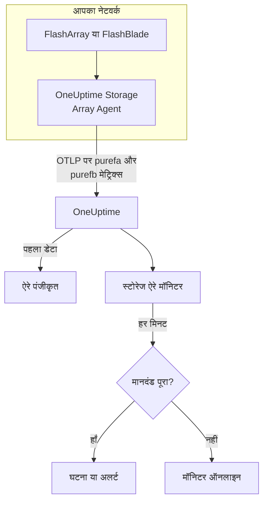

# स्टोरेज ऐरे मॉनिटर

स्टोरेज ऐरे मॉनिटर एक स्टोरेज ऐरे पर नज़र रखता है और आपको तब बताता है जब ऐरे खुद अलर्ट उठाता है, उसकी जगह खत्म होती है, वह धीमा होता है, हार्डवेयर या होस्ट पाथ खोता है, या रेप्लिकेशन में पीछे रह जाता है। यह Pure Storage FlashArray और Pure Storage FlashBlade के साथ काम करता है, जिनकी अपनी `purefa_*` और `purefb_*` सीरीज़ OneUptime Storage Array Agent इकट्ठा करता है, और Dell PowerMax के साथ, जिसकी `powermax_*` सीरीज़ एक OneUptime प्रोब Unisphere for PowerMax से पढ़ता है।

यह Dell PowerStore (`dell.powerstore`) के साथ भी काम करता है, Dell की `powerstore_*` सीरीज़ से।

:::cards
- [मॉनिटर बनाएँ](#स्टोरेज-ऐरे-मॉनिटर-बनाएँ): डैशबोर्ड में छह चरण।
- [टेम्पलेट](#पहले-से-बने-अलर्ट-टेम्पलेट): तैयार अलर्ट, हर वॉल्यूम, होस्ट, अप्लायंस या कंपोनेंट के लिए एक घटना।
- [Pure की सीरीज़ कैसे काम करती हैं](#pure-की-सीरीज़-का-ढाँचा): एक मेट्रिक नाम, कई आँकड़े।
- [मेट्रिक्स](#इकट्ठा-किए-गए-मेट्रिक्स): हर सीरीज़ जिस पर मॉनिटर अलर्ट कर सकता है।
:::

## यह कैसे काम करता है

OneUptime Storage Array Agent ऐसी मशीन पर चलता है जो ऐरे के मैनेजमेंट इंटरफ़ेस तक पहुँच सकती है। यह केवल-पढ़ने वाले API टोकन से ऐरे के मेट्रिक्स पढ़ता है, उन पर ऐरे का नाम `storage.array.name` और उसका प्लेटफ़ॉर्म `storage.system` लेबल करता है, और उन्हें OTLP पर OneUptime को भेजता है। पहला डेटा ऐरे को पंजीकृत करता है।

Dell PowerMax को किसी एजेंट की ज़रूरत नहीं है: एक OneUptime प्रोब हर 5 मिनट में केवल-पढ़ने वाले खाते से Unisphere for PowerMax में लॉग इन करता है और उसके प्रबंधित हर ऐरे को उसी तरह भेजता है, जिसका नाम तब तक उसका Symmetrix ID रहता है जब तक आप उसे बदल नहीं देते ([Dell PowerMax](/docs/telemetry/storage-arrays#dell-powermax))।

स्टोरेज ऐरे मॉनिटर एक ऐरे से जुड़ा होता है। हर मिनट वह उस ऐरे के मेट्रिक्स पर अपनी क्वेरी चलाता है और परिणाम की तुलना अपने मानदंड से करता है।



## शुरू करने से पहले

- **Storage Array Agent इंस्टॉल करें**, ऐसी जगह जहाँ से वह HTTPS पर ऐरे तक पहुँच सके, ऐसे उपयोगकर्ता के API टोकन के साथ जिसके पास ऐरे की **readonly** भूमिका हो। [Storage Array Agent गाइड](/docs/telemetry/storage-arrays) उपयोगकर्ता, टोकन और इंस्टॉल को कवर करती है, `ONEUPTIME_URL`, `ONEUPTIME_TELEMETRY_INGESTION_KEY`, `STORAGE_ARRAY_NAME`, और ऐरे के पते और टोकन (`PURE_FA_ENDPOINT` और `PURE_FA_API_TOKEN`, या `PURE_FB_ENDPOINT` और `PURE_FB_API_TOKEN`) के ज़रिए।
- **जाँचें कि ऐरे पंजीकृत है।** पहली स्क्रेप के लगभग एक मिनट बाद यह एजेंट के `STORAGE_ARRAY_NAME` के नाम से **उत्पाद → बुनियादी ढांचा → स्टोरेज ऐरे → सभी स्टोरेज ऐरे** के अंतर्गत दिखता है।
- **Dell PowerMax के लिए**, इसके बजाय उसे प्रबंधित करने वाले Unisphere for PowerMax को **उत्पाद → बुनियादी ढांचा → स्टोरेज ऐरे → कनेक्शन** के अंतर्गत कनेक्ट करें, जैसा [Dell PowerMax](/docs/telemetry/storage-arrays#dell-powermax) समझाता है।

## स्टोरेज ऐरे मॉनिटर बनाएँ

:::steps
### नया मॉनिटर शुरू करें

**मॉनिटर** पर जाएँ और **मॉनिटर बनाएं** पर क्लिक करें।

### स्टोरेज ऐरे चुनें

**मॉनिटर प्रकार** में **और मॉनिटर प्रकार** पर क्लिक करें और **बुनियादी ढांचा** के अंतर्गत **स्टोरेज ऐरे** चुनें, या खोज बॉक्स में `storage` टाइप करें। एक **नाम** दर्ज करें - यह घटना और अलर्ट के शीर्षकों में उपयोग होता है - और **अगला** पर क्लिक करें।

### ऐरे चुनें

**Storage Array Monitor Configuration** के अंतर्गत, **स्टोरेज ऐरे** से ऐरे चुनें। हर वह ऐरे जिसने डेटा भेजा है, सूची में है। उसका प्लेटफ़ॉर्म तय करता है कि फ़ॉर्म कौन से मेट्रिक्स और टेम्पलेट देता है। चुनने के बाद, फ़ील्ड के नीचे एक पंक्ति बताती है कि डेटा आ रहा है या नहीं। **स्टोरेज ऐरे जोड़ें** आपकी कुंजियों से भरे सेटअप चरण खोलता है, जो पहले डेटा की प्रतीक्षा करते हैं।

### क्या देखना है चुनें

नया मॉनिटर **किस पर अलर्ट करना है** के अंतर्गत **Array Stopped Reporting** से शुरू होता है। कुछ और देखने के लिए:

- **बदलें** - कोई दूसरा [टेम्पलेट](#पहले-से-बने-अलर्ट-टेम्पलेट) चुनें। यह मेट्रिक, लेबल फ़िल्टर, एकत्रीकरण, समय सीमा और थ्रेशोल्ड सेट करता है, और नीचे के मानदंड को अपने मानदंड से बदल देता है। आप फिर भी **समय सीमा** बदल सकते हैं।
- **Custom Metric** (**और फ़ील्ड** के अंतर्गत) - **Storage Array Metric** से एक मेट्रिक चुनें, फिर **एकत्रीकरण** और **समय सीमा** सेट करें। [फ़िल्टर](#मॉनिटर-सेटिंग्स) इसे एक वॉल्यूम, होस्ट, पॉड, कंपोनेंट, फ़ाइल सिस्टम या बकेट तक सीमित करते हैं।
- **उन्नत** (**और फ़ील्ड** के अंतर्गत) - **मेट्रिक्स चुनें** के अंतर्गत खुद क्वेरी और सूत्र बनाएँ, उदाहरण के लिए उपयोग की गई क्षमता को `purefa_array_space_bytes` को `space=capacity` पर फ़िल्टर करके, उसी मेट्रिक को `space=empty` पर फ़िल्टर करके घटाकर। हर ऑब्जेक्ट को अलग से आँकने के लिए किसी ऑब्जेक्ट के लेबल से **इसके अनुसार समूहित करें** करें।

### मानदंड जाँचें

**मानदंड** के अंतर्गत हर मानदंड खोलें और उसके **मेट्रिक**, **एकत्रीकरण**, **शर्त** और **सीमा** जाँचें। टेम्पलेट इन्हें भरता है। **Custom Metric** या **उन्नत** के साथ, मॉनिटर [डिफ़ॉल्ट मानदंड](#डिफ़ॉल्ट-मानदंड) से शुरू होता है, जो केवल मेट्रिक के डेटा न भेजने को देखता है, इसलिए अपना थ्रेशोल्ड सेट करें।

### मॉनिटर बनाएँ

**मॉनिटर बनाएं** पर क्लिक करें। OneUptime मॉनिटर का पेज खोलता है और हर मिनट उसका मूल्यांकन करता है। उसके उठाए घटनाएँ और अलर्ट ऐरे के **घटनाएं** और **अलर्ट** पेज पर भी सूचीबद्ध होते हैं।
:::

> [!TIP]
> एक साथ कई टेम्पलेट सेट करने के लिए, **उत्पाद → बुनियादी ढांचा → स्टोरेज ऐरे** से ऐरे खोलें और **सुझाव** पर जाएँ। जो टेम्पलेट चाहिए वे चुनें, चुनें कि किसे पेज किया जाए, और OneUptime हर टेम्पलेट के लिए एक मॉनिटर बनाता है।

## मॉनिटर सेटिंग्स

| फ़ील्ड | टैब | यह क्या करता है |
| --- | --- | --- |
| **स्टोरेज ऐरे** | सभी | ज़रूरी। हर क्वेरी को `resource.storage.array.name` तक सीमित करता है, इसलिए दो ऐरे जिनमें दोनों में `vol-01` नाम का वॉल्यूम है, कभी आपस में नहीं मिलते। |
| **वॉल्यूम** | Custom Metric, उन्नत | केवल FlashArray और PowerMax। एक वॉल्यूम: FlashArray पर `name` लेबल से, जैसे `vol-db-01` (पॉड या वॉल्यूम समूह में वॉल्यूम का नाम `pod::volume` या `group/volume` होता है), और PowerMax पर `volume` लेबल से, यानी उसकी डिवाइस ID, जैसे `00847`। |
| **होस्ट** | Custom Metric, उन्नत | केवल FlashArray। एक होस्ट जैसा ऐरे उसे जानता है, `host` लेबल से, जैसे `esxi-01`। |
| **पॉड** | Custom Metric, उन्नत | केवल FlashArray। एक ActiveCluster या ActiveDR पॉड, `name` लेबल से, या रेप्लिका लिंक सीरीज़ पर `local_pod` से। |
| **हार्डवेयर कंपोनेंट** | Custom Metric, उन्नत | एक हार्डवेयर कंपोनेंट, जैसे `CH0.BAY1` या `CT0`: FlashArray पर `component_name` लेबल, FlashBlade पर `name`, और PowerMax पर `component`, यानी कोई डायरेक्टर जैसे `FA-1D` या कोई पोर्ट जैसे `FA-1D:4`। |
| **फ़ाइल सिस्टम** | Custom Metric, उन्नत | केवल FlashBlade। एक फ़ाइल सिस्टम, `name` लेबल से। |
| **बकेट** | Custom Metric, उन्नत | केवल FlashBlade। एक ऑब्जेक्ट स्टोर बकेट, `name` लेबल से। |
| **Storage Array Metric** | Custom Metric | [कैटलॉग](#इकट्ठा-किए-गए-मेट्रिक्स) से एक मेट्रिक। फ़ॉर्म वह लेबल फ़िल्टर जोड़ता है जो उसे उसका अर्थ देता है, और उसे उस ऑब्जेक्ट से समूहित करता है जिसका वह वर्णन करता है, इसलिए हर वॉल्यूम, होस्ट या कंपोनेंट को अलग से आँका जाता है। |
| **एकत्रीकरण** | Custom Metric | सैंपल कैसे मिलाए जाते हैं: **औसत**, **अधिकतम**, **न्यूनतम**, **योग** या **गणना**। मेट्रिक के सामान्य एकत्रीकरण से शुरू होता है। |
| **समय सीमा** | सभी | क्वेरी जो रोलिंग विंडो पढ़ती है, **Past 1 Minute** से **Past 365 Days** तक। नया मॉनिटर **पिछले 5 मिनट** से शुरू होता है; किसी फ़ाइल सिस्टम या बकेट का कस्टम मेट्रिक **पिछले 15 मिनट** से; टेम्पलेट अपना मान सेट करते हैं। |
| **मेट्रिक्स चुनें** | उन्नत | क्वेरी बिल्डर: **मेट्रिक**, **इसके अनुसार एकत्र करें**, **एट्रिब्यूट से फ़िल्टर करें**, **इसके अनुसार समूहित करें**, साथ ही क्वेरी मिलाने के लिए **मेट्रिक जोड़ें** और **सूत्र जोड़ें**। |

एजेंट ऐरे एंडपॉइंट को हर 60 सेकंड में, और वॉल्यूम, होस्ट और पॉड को हर 2 मिनट में पढ़ता है, इसलिए 5 मिनट की विंडो में हमेशा एक सैंपल होता है। FlashBlade के फ़ाइल सिस्टम और बकेट वह हर 5 मिनट में पढ़ता है, इसलिए 15, और FlashArray डायरेक्टरी हर 30 मिनट में: डायरेक्टरी मॉनिटर को 60 मिनट की विंडो दें। एक प्रोब PowerMax को हर 5 मिनट में पढ़ता है, उतनी ही बार जितनी बार Unisphere उसका परफ़ॉर्मेंस निकालता है: PowerMax मॉनिटर को 10 मिनट या उससे ज़्यादा की विंडो दें।

यह PowerStore को हर 5 मिनट और उसके क्लस्टर की स्थिति को हर 60 सेकंड पढ़ता है: PowerStore मॉनिटर को 15 मिनट की विंडो दें।

## Pure की सीरीज़ का ढाँचा

Pure **एक** मेट्रिक नाम पर कई आँकड़े रखता है और उन्हें एक लेबल से अलग करता है:

- **`dimension`** प्रदर्शन सीरीज़ पर। `purefa_array_performance_latency_usec` रीड लेटेंसी (`usec_per_read_op`), राइट लेटेंसी (`usec_per_write_op`), मिरर्ड राइट लेटेंसी, और हर एक का SAN, क्यू, QoS और सर्विस समय रखता है। हमेशा एक `dimension` पर फ़िल्टर करें: उनके पार औसत 200 µs की रीड लेटेंसी को क्यू के आँकड़े के साथ मिला देता है।
- **`space`** क्षमता सीरीज़ पर: `capacity`, `empty`, `snapshots`, `total_provisioned`, `total_physical`, `available_ratio` और अन्य।

कई सीरीज़ अपनी स्थिति एक **लेबल** में रखती हैं, ऐसे मान के साथ जो हमेशा 1 होता है:

| सीरीज़ | स्थिति लेबल | हर एक के लिए एक सीरीज़ |
| --- | --- | --- |
| `purefa_alerts_open` | `severity`, `summary`, `code` और `component_type` के साथ | खुला अलर्ट |
| `purefa_hw_component_status` | `component_status` | हार्डवेयर कंपोनेंट |
| `purefa_host_connectivity_info` | `status`, `details` के साथ | होस्ट |
| `purefa_drive_capacity_bytes` | `component_status` (मान ड्राइव की क्षमता है) | ड्राइव |

किसी खराब स्थिति पर फ़िल्टर की गई सीरीज़ तभी तक मौजूद रहती है जब तक कुछ उस स्थिति में है, इसलिए कोई सीरीज़ न होने का मतलब स्वस्थ है। इसीलिए **0 से ऊपर Max पर ट्रिगर और 0 पर रिकवर** उनके लिए सही रूप है, और टेम्पलेट इसी तरह बने हैं: उनके रिकवर मानदंड गायब सीरीज़ को शून्य मानते हैं। जब कोई भी सीरीज़ नहीं बचती, तो ऐसा टेम्पलेट तभी रिकवर होता है जब उसी विंडो में `purefa_info`, `purefb_info` या `powermax_array_info` आया हो, इसलिए रिपोर्ट करना बंद कर चुका ऐरे कुछ भी बंद नहीं करता।

PowerMax की हर सीरीज़ में एक ही आँकड़ा होता है, और उसका नाम उसी पर रखा गया है: `powermax_array_response_time_usec` रीड और राइट को `operation` से अलग करता है। उसकी स्थिति वाली सीरीज़ भी इसी तरह तभी तक मौजूद रहती हैं जब तक कुछ गड़बड़ है: `powermax_alert_open` तब तक जब तक Unisphere में कोई अलर्ट खुला है, `powermax_director_offline` तब तक जब तक कोई डायरेक्टर ऑनलाइन नहीं है, `powermax_port_offline` तब तक जब तक कोई ऐसा पोर्ट डाउन है जिस पर कोई निर्भर है, और `powermax_srdf_group_not_healthy` तब तक जब तक कोई SRDF समूह सस्पेंड या ऑफ़लाइन है।

मॉनिटर फ़िल्टर और ग्रुप-बाय कुंजियों में, एजेंट के एट्रिब्यूट `resource.` से शुरू होते हैं (`resource.storage.array.name`, `resource.storage.system`), जबकि Pure के अपने लेबल नहीं (`name`, `host`, `component_name`, `dimension`, `space`, `severity`), और न ही PowerMax के (`storage_group`, `volume`, `director`, `port_id`, `srdf_group`)।

## PowerStore की सीरीज़ कैसी बनी हैं

Dell का एक्सपोर्टर हर मेट्रिक नाम के लिए एक मान लिखता है, इसलिए PowerStore सीरीज़ को किसी लेबल फ़िल्टर की ज़रूरत नहीं होती। उसके लेबल ऑब्जेक्ट का नाम बताते हैं: `appliance_id` एक अप्लायंस, `name` एक हिस्सा, वॉल्यूम या फ़ाइल सिस्टम, और `volume_id`, `fc_port_id`, `eth_port_id`, `nas_id` या `volume_group_id` किसी प्रदर्शन सीरीज़ का ऑब्जेक्ट। उसकी स्थिति सीरीज़ स्वस्थ रहने तक 1 और वरना 0 होती हैं, इसलिए टेम्पलेट 1 से नीचे ट्रिगर होते हैं। उसके अपने अलर्ट syslog से आते हैं, और उनके टेम्पलेट, लॉग मॉनिटर, नीचे उसकी तालिका के बाद दिए गए हैं।

## पहले से बने अलर्ट टेम्पलेट

OneUptime 49 टेम्पलेट देता है — 12 FlashArray के लिए, 8 FlashBlade के लिए, 16 PowerStore के लिए और 13 PowerMax के लिए — और **किस पर अलर्ट करना है** सेक्शन ऐरे के प्लेटफ़ॉर्म वाले टेम्पलेट देता है। हर एक पूरा मॉनिटर बनाता है: मेट्रिक क्वेरी, उसके लेबल फ़िल्टर, ऑब्जेक्ट के अपने लेबल पर ग्रुप-बाय, एक मानदंड जो ट्रिगर करता है और एक जो रिकवर करता है। थ्रेशोल्ड शुरुआती बिंदु हैं जिन्हें आप संपादित कर सकते हैं।

मानदंड तभी ट्रिगर होता है जब शर्त विंडो के **हर** मान के लिए सही हो। जो मॉनिटर क्षमता, लेटेंसी, लैग या अनुपात के थ्रेशोल्ड पर ट्रिगर हुआ, वह उससे 10% आगे जाने पर ही रिकवर होता है, इसलिए थ्रेशोल्ड के आसपास मँडराता मान बार-बार बदलाव नहीं करता। अलर्ट, हार्डवेयर और कनेक्टिविटी टेम्पलेट तब ट्रिगर होते हैं जब कोई स्थिति उनकी पूरी 5 मिनट की विंडो में दिखी हो, और उसके हटने के लगभग 5 मिनट बाद रिकवर होते हैं। PowerMax के टेम्पलेट 10 और 15 मिनट की विंडो का उपयोग करते हैं: उसके 5-मिनट वाले दो और तीन संग्रह।

### FlashArray

| टेम्पलेट | श्रेणी | गंभीरता | किस पर नज़र | कब ट्रिगर होता है |
| --- | --- | --- | --- | --- |
| Array Stopped Reporting | उपलब्धता | गंभीर | `purefa_info`, Count, पिछले 10 मिनट | पूरी विंडो में कोई डेटा नहीं — Storage Array Agent रुक गया, उसने OneUptime तक का अपना रास्ता खो दिया या उसका टोकन रद्द कर दिया गया, या ऐरे ने उसे जवाब देना बंद कर दिया; डेटा फिर से आने पर रिकवर |
| Critical Array Alert | ऐरे स्वास्थ्य | गंभीर | `purefa_alerts_open` को `severity=critical` पर फ़िल्टर, `summary` के अनुसार Max, पिछले 5 मिनट | > 0 — ऐरे पर एक खुला गंभीर अलर्ट है (विफल कंपोनेंट, क्षमता आपात स्थिति, रेप्लिकेशन विफलता)। हर अलर्ट के लिए एक घटना; अलर्ट बंद होने पर रिकवर |
| Warning Array Alert | ऐरे स्वास्थ्य | चेतावनी | `purefa_alerts_open` को `severity=warning` पर फ़िल्टर, `summary` के अनुसार Max, पिछले 5 मिनट | > 0 — ऐरे पर एक खुला चेतावनी अलर्ट है। हर अलर्ट के लिए एक घटना; अलर्ट बंद होने पर रिकवर |
| Capacity Above 80% | क्षमता | चेतावनी | `purefa_array_space_utilization`, Max, पिछले 15 मिनट | > 80 — Pure का अपना पहला क्षमता थ्रेशोल्ड; ≤ 72 पर रिकवर |
| Capacity Above 90% | क्षमता | गंभीर | `purefa_array_space_utilization`, Max, पिछले 5 मिनट | > 90 — ऐरे राइट अस्वीकार करने के करीब है; ≤ 81 पर रिकवर |
| High Read Latency | प्रदर्शन | चेतावनी | `purefa_array_performance_latency_usec` को `dimension=usec_per_read_op` पर फ़िल्टर, Avg, पिछले 10 मिनट | > 5000 µs (5 ms) — FlashArray रीड सामान्यतः 1 ms से काफ़ी कम में पूरी होती है; ≤ 4500 पर रिकवर |
| High Write Latency | प्रदर्शन | चेतावनी | `purefa_array_performance_latency_usec` को `dimension=usec_per_write_op` पर फ़िल्टर, Avg, पिछले 10 मिनट | > 5000 µs (5 ms); ≤ 4500 पर रिकवर |
| Hardware Component Failed | हार्डवेयर | गंभीर | `purefa_hw_component_status` को `component_status=critical` पर फ़िल्टर, `component_name` के अनुसार Max, पिछले 5 मिनट | > 0 — कोई कंट्रोलर, पावर सप्लाई, पंखा, बे या पोर्ट गंभीर स्थिति में है और रिडंडेंसी खत्म हो गई है। हर कंपोनेंट के लिए एक घटना; ok रिपोर्ट करने पर रिकवर |
| Hardware Component Degraded | हार्डवेयर | चेतावनी | `purefa_hw_component_status` को `component_status=degraded` पर फ़िल्टर, `component_name` के अनुसार Max, पिछले 5 मिनट | > 0 — कोई कंपोनेंट डिग्रेड हो गया है। हर कंपोनेंट के लिए एक घटना; ok रिपोर्ट करने पर रिकवर |
| Drive Failed | हार्डवेयर | गंभीर | `purefa_drive_capacity_bytes` को `component_status=failed` पर फ़िल्टर, `component_name` के अनुसार Max, पिछले 5 मिनट | > 0 — कोई DirectFlash मॉड्यूल या SSD विफल हुआ और ऐरे बाकी पर फिर से बना रहा है। हर ड्राइव के लिए एक घटना; बदले जाने पर रिकवर |
| Host Lost Redundant Paths | होस्ट | चेतावनी | `purefa_host_connectivity_info` को `status=critical` पर फ़िल्टर, `host` के अनुसार Max, पिछले 5 मिनट | > 0 — होस्ट ऐरे तक एक कंट्रोलर से पहुँचता है या किसी से नहीं; कंट्रोलर फ़ेलओवर उसके स्टोरेज को ऑफ़लाइन कर देगा। हर होस्ट के लिए एक घटना; उसके पाथ लौटने पर रिकवर |
| Replication Lag Above 1 Minute | रेप्लिकेशन | चेतावनी | `purefa_pod_replica_links_lag_max_msec`, `local_pod` के अनुसार Max, पिछले 10 मिनट | > 60000 ms (60 s) — अभी फ़ेलओवर योजना से ज़्यादा हाल की राइट खो देगा। हर पॉड के लिए एक घटना; ≤ 54000 पर रिकवर |

### FlashBlade

| टेम्पलेट | श्रेणी | गंभीरता | किस पर नज़र | कब ट्रिगर होता है |
| --- | --- | --- | --- | --- |
| Array Stopped Reporting | उपलब्धता | गंभीर | `purefb_info`, Count, पिछले 10 मिनट | पूरी विंडो में कोई डेटा नहीं — एजेंट, उसके एक्सपोर्टर या FlashBlade ने जवाब देना बंद कर दिया; डेटा फिर से आने पर रिकवर |
| Critical Array Alert | ऐरे स्वास्थ्य | गंभीर | `purefb_alerts_open` को `severity=critical` पर फ़िल्टर, `summary` के अनुसार Max, पिछले 5 मिनट | > 0 — FlashBlade पर एक खुला गंभीर अलर्ट है। हर अलर्ट के लिए एक घटना; अलर्ट बंद होने पर रिकवर |
| Warning Array Alert | ऐरे स्वास्थ्य | चेतावनी | `purefb_alerts_open` को `severity=warning` पर फ़िल्टर, `summary` के अनुसार Max, पिछले 5 मिनट | > 0 — FlashBlade पर एक खुला चेतावनी अलर्ट है। हर अलर्ट के लिए एक घटना; अलर्ट बंद होने पर रिकवर |
| Capacity Above 80% | क्षमता | चेतावनी | `purefb_array_space_utilization` को `type=array` पर फ़िल्टर, Max, पिछले 15 मिनट | > 80; ≤ 72 पर रिकवर |
| Capacity Above 90% | क्षमता | गंभीर | `purefb_array_space_utilization` को `type=array` पर फ़िल्टर, Max, पिछले 5 मिनट | > 90 — भरने पर हर क्लाइंट के लिए राइट विफल होती हैं; ≤ 81 पर रिकवर |
| Hardware Component Unhealthy | हार्डवेयर | गंभीर | `purefb_hardware_health`, `name` के अनुसार Min, पिछले 5 मिनट | < 1 — कोई ब्लेड, फ़ैब्रिक मॉड्यूल, पावर सप्लाई या पंखा स्वस्थ नहीं है (अप्रयुक्त स्लॉट 2 रिपोर्ट करता है)। हर कंपोनेंट के लिए एक घटना; ≥ 1 पर रिकवर |
| High Read Latency | प्रदर्शन | चेतावनी | `purefb_array_performance_latency_usec` को `dimension=usec_per_read_op` और `protocol=all` पर फ़िल्टर, Avg, पिछले 10 मिनट | > 10000 µs (10 ms) सभी प्रोटोकॉल में; ≤ 9000 पर रिकवर |
| File System Near Full | फ़ाइल सिस्टम | चेतावनी | `purefb_file_systems_space_bytes` को `space=available_ratio` पर फ़िल्टर, `name` के अनुसार Min, पिछले 15 मिनट | < 0.1 — फ़ाइल सिस्टम के प्रोविज़न किए गए आकार का 10% से कम बचा है। हर फ़ाइल सिस्टम के लिए एक घटना; ≥ 0.11 पर रिकवर |

### PowerStore

| टेम्पलेट | श्रेणी | गंभीरता | किस पर नज़र | कब ट्रिगर होता है |
| --- | --- | --- | --- | --- |
| Array Stopped Reporting | उपलब्धता | गंभीर | `powerstore_cluster`, Count, पिछले 10 मिनट | पूरी विंडो में कोई डेटा नहीं — एजेंट, Dell के एक्सपोर्टर या क्लस्टर ने जवाब देना बंद कर दिया; डेटा फिर से आने पर रिकवर |
| Capacity Above 80% | क्षमता | चेतावनी | `powerstore_cap_physical_used_percent`, `appliance_id` के अनुसार Max, पिछले 15 मिनट | > 80 — किसी अप्लायंस की क्षमता भर रही है; ≤ 72 पर रिकवर |
| Capacity Above 90% | क्षमता | गंभीर | `powerstore_cap_physical_used_percent`, `appliance_id` के अनुसार Max, पिछले 15 मिनट | > 90 — कोई अप्लायंस राइट ठुकराने के करीब है; ≤ 81 पर रिकवर |
| High Read Latency | प्रदर्शन | चेतावनी | `powerstore_perf_avg_read_latency`, `appliance_id` के अनुसार Avg, पिछले 15 मिनट | > 5000 µs (5 ms); ≤ 4500 पर रिकवर |
| High Write Latency | प्रदर्शन | चेतावनी | `powerstore_perf_avg_write_latency`, `appliance_id` के अनुसार Avg, पिछले 15 मिनट | > 5000 µs (5 ms); ≤ 4500 पर रिकवर |
| Drive Failed | हार्डवेयर | गंभीर | `powerstore_hardware_Drive_state`, `name` के अनुसार Min, पिछले 10 मिनट | < 1 — कोई ड्राइव खराब हो गई या निकाल दी गई; ≥ 1 पर रिकवर |
| Node Unhealthy | हार्डवेयर | गंभीर | `powerstore_hardware_node_state`, `name` के अनुसार Min, पिछले 10 मिनट | < 1 — कोई नोड Healthy नहीं है; ≥ 1 पर रिकवर |
| Power Supply Unhealthy | हार्डवेयर | चेतावनी | `powerstore_hardware_Power_Supply_state`, `name` के अनुसार Min, पिछले 10 मिनट | < 1 — कोई पावर सप्लाई खराब हो गई या उसकी पावर चली गई; ≥ 1 पर रिकवर |
| Fan Unhealthy | हार्डवेयर | चेतावनी | `powerstore_hardware_Fan_state`, `name` के अनुसार Min, पिछले 10 मिनट | < 1 — कोई फ़ैन खराब हो गया; ≥ 1 पर रिकवर |
| Battery Unhealthy | हार्डवेयर | चेतावनी | `powerstore_hardware_Battery_state`, `name` के अनुसार Min, पिछले 10 मिनट | < 1 — किसी बैटरी बैकअप मॉड्यूल में खराबी आ गई; ≥ 1 पर रिकवर |
| Drive Wearing Out | हार्डवेयर | चेतावनी | `powerstore_wear_metrics_by_drive`, `name` के अनुसार Min, पिछले 15 मिनट | < 10 — किसी ड्राइव का 10% से कम एंड्योरेंस बचा है; ≥ 11 पर रिकवर |
| NAS Server Not Started | फ़ाइल सिस्टम | चेतावनी | `powerstore_nas_server_operational_status`, `name` के अनुसार Max, पिछले 10 मिनट | < 1 — कोई NAS सर्वर रुका हुआ है या डिग्रेड है; ≥ 1 पर रिकवर |
| Volume Not Ready | ऐरे स्वास्थ्य | चेतावनी | `powerstore_volume_state`, `name` के अनुसार Max, पिछले 15 मिनट | < 1 — कोई वॉल्यूम ऑफ़लाइन है; ≥ 1 पर रिकवर |
| File System Near Full | फ़ाइल सिस्टम | चेतावनी | `powerstore_filesystem_logical_used_percent`, `name` के अनुसार Max, पिछले 15 मिनट | > 90 — कोई फ़ाइल सिस्टम लगभग भर गया है; ≤ 81 पर रिकवर |
| Cluster Not Configured | ऐरे स्वास्थ्य | चेतावनी | `powerstore_cluster`, Max, पिछले 10 मिनट | < 1 — क्लस्टर Configured नहीं है; ≥ 1 पर रिकवर |
| Metro Witness Not Connected | रेप्लिकेशन | चेतावनी | `powerstore_metro_witness_status`, `name` के अनुसार Min, पिछले 10 मिनट | > 0 — कोई Metro Witness कनेक्टेड नहीं है; फिर से OK होने पर रिकवर |

### syslog से PowerStore अलर्ट

PowerStore के अपने अलर्ट लॉग के रूप में आते हैं, इसलिए उनके टेम्पलेट **लॉग** मॉनिटर हैं, जो ऐरे के **सुझाव** पेज पर **ऐरे अलर्ट** के अंतर्गत दिए जाते हैं। हर एक PowerStore अलर्ट के लिए एक अलर्ट खोलता है, `powerstore.resource.name` और `powerstore.alert.id` के अनुसार समूहित, और PowerStore के उस अलर्ट को हटाने पर उसे हल करता है:

| टेम्पलेट | गंभीरता | इस वाली लाइन पर खुलता है | इस पर हल होता है |
| --- | --- | --- | --- |
| Critical Array Alert | गंभीर | `powerstore.alert.severity=Critical` | `powerstore.alert.state=Cleared` |
| Major Array Alert | चेतावनी | `powerstore.alert.severity=Major` | `powerstore.alert.state=Cleared` |
| Port Link Down | चेतावनी | `powerstore.event.code=0x00307404` | `powerstore.alert.state=Cleared` |

### PowerMax

| टेम्पलेट | श्रेणी | गंभीरता | किस पर नज़र | कब ट्रिगर होता है |
| --- | --- | --- | --- | --- |
| Array Stopped Reporting | उपलब्धता | गंभीर | `powermax_array_info`, Count, पिछले 10 मिनट | पूरी विंडो में कोई डेटा नहीं — प्रोब ने ऐरे का संग्रह बंद कर दिया: उसका कनेक्शन विफल हो रहा है (**कनेक्शन** के अंतर्गत उसका पेज कारण बताता है), प्रोब डिस्कनेक्ट है, या Unisphere अब ऐरे को प्रबंधित नहीं करता; डेटा फिर से आने पर रिकवर |
| Critical Unisphere Alert | ऐरे स्वास्थ्य | गंभीर | `powermax_alert_open` को `severity=critical` पर फ़िल्टर, `description` के अनुसार Max, पिछले 10 मिनट | > 0 — Unisphere में ऐरे के लिए Critical या Fatal गंभीरता का एक खुला अलर्ट है। हर अलर्ट के लिए एक घटना; Unisphere में अलर्ट स्वीकार या क्लियर होने पर रिकवर |
| Warning Unisphere Alert | ऐरे स्वास्थ्य | चेतावनी | `powermax_alert_open` को `severity=warning` पर फ़िल्टर, `description` के अनुसार Max, पिछले 10 मिनट | > 0 — Unisphere में Warning या Minor गंभीरता का एक खुला अलर्ट है। हर अलर्ट के लिए एक घटना; अलर्ट स्वीकार या क्लियर होने पर रिकवर |
| Performance Collection Off | ऐरे स्वास्थ्य | चेतावनी | `powermax_array_performance_collection`, Min, पिछले 15 मिनट | < 1 — Unisphere ऐरे का 5-मिनट वाला परफ़ॉर्मेंस इकट्ठा नहीं करता, इसलिए किसी प्रतिक्रिया समय, IOPS या थ्रूपुट का न चार्ट बनता है, न उस पर अलर्ट होता है; ≥ 1 पर रिकवर |
| Storage Resource Pool Above 80% | क्षमता | चेतावनी | `powermax_srp_capacity_used_percent`, `srp` के अनुसार Max, पिछले 15 मिनट | > 80 — पूल भर जाने पर उसके स्टोरेज समूह नए राइट लेना बंद कर देते हैं। हर पूल के लिए एक घटना; ≤ 72 पर रिकवर |
| Storage Resource Pool Above 90% | क्षमता | गंभीर | `powermax_srp_capacity_used_percent`, `srp` के अनुसार Max, पिछले 15 मिनट | > 90 — भरते ही उसके स्टोरेज समूहों में राइट विफल हो जाते हैं। हर पूल के लिए एक घटना; ≤ 81 पर रिकवर |
| Storage Group Response Time Above 5 ms | प्रदर्शन | चेतावनी | `powermax_storage_group_response_time_usec`, `storage_group` के अनुसार Avg, पिछले 15 मिनट | > 5000 µs (5 ms) — PowerMax सामान्यतः एक मिलीसेकंड से काफ़ी कम में जवाब देता है। हर स्टोरेज समूह के लिए एक घटना; ≤ 4500 पर रिकवर |
| High Read Response Time | प्रदर्शन | चेतावनी | `powermax_array_response_time_usec` को `operation=read` पर फ़िल्टर, Avg, पिछले 15 मिनट | > 3000 µs (3 ms); ≤ 2700 पर रिकवर |
| High Write Response Time | प्रदर्शन | चेतावनी | `powermax_array_response_time_usec` को `operation=write` पर फ़िल्टर, Avg, पिछले 15 मिनट | > 3000 µs (3 ms) — सिंक्रोनस SRDF हर राइट में रिमोट ऐरे तक का राउंड ट्रिप जोड़ता है; ≤ 2700 पर रिकवर |
| Director Not Online | हार्डवेयर | गंभीर | `powermax_director_offline`, `component` के अनुसार Max, पिछले 10 मिनट | > 0 — कोई डायरेक्टर ऑनलाइन नहीं है, और ऐरे बाकी डायरेक्टर पर चलता है। हर डायरेक्टर के लिए एक घटना; फिर से ऑनलाइन होने पर रिकवर |
| Port Down | हार्डवेयर | चेतावनी | `powermax_port_offline`, `component` के अनुसार Max, पिछले 10 मिनट | > 0 — किसी port group, masking view या SRDF समूह का कोई पोर्ट चालू नहीं है। हर पोर्ट के लिए एक घटना; फिर से चालू होने पर रिकवर |
| SRDF Group Suspended or Offline | रेप्लिकेशन | गंभीर | `powermax_srdf_group_not_healthy`, `srdf_group` के अनुसार Max, पिछले 10 मिनट | > 0 — समूह का लिंक ऑफ़लाइन है या उसके पेयर सस्पेंड, स्प्लिट या फ़ेलओवर हो चुके हैं, इसलिए रिमोट कॉपी अद्यतन नहीं रहती। हर समूह के लिए एक घटना; फिर से सिंक होने पर रिकवर |
| SRDF/A Lag Above 2 Minutes | रेप्लिकेशन | चेतावनी | `powermax_srdf_group_lag_seconds`, `srdf_group` के अनुसार Avg, पिछले 15 मिनट | > 120 (2 मिनट) — अभी फ़ेलओवर योजना से ज़्यादा हाल की राइट खो देगा। हर समूह के लिए एक घटना; ≤ 108 पर रिकवर |

**गंभीरता** वह लेबल है जो पिकर दिखाता है। टेम्पलेट जो घटना और अलर्ट बनाता है, वे आपके प्रोजेक्ट की सबसे गंभीर घटना और अलर्ट गंभीरता से शुरू होते हैं; उन्हें मानदंड में बदलें।

- **Array Stopped Reporting** प्लेटफ़ॉर्म की पहचान सीरीज़ गिनता है (`purefa_info` या `purefb_info`, जिसे एजेंट द्वारा स्क्रेप किया जाने वाला हर एंडपॉइंट हर स्क्रेप पर एक्सपोर्ट करता है, या `powermax_array_info`, जिसे हर PowerMax संग्रह लिखता है)। जब डेटा रुक जाता है, तो बाकी टेम्पलेट के पास तुलना करने के लिए कुछ नहीं होता और वे अपनी आखिरी स्थिति बनाए रखते हैं, इसलिए यही टेम्पलेट आपको बताता है।
- **खुले अलर्ट और हार्डवेयर स्थितियाँ Max का उपयोग करती हैं**, ऐसी सीरीज़ का जो तभी तक मौजूद रहती है जब तक अलर्ट खुला है या कंपोनेंट उस स्थिति में है, इसलिए स्थिति पूरी 5 मिनट की विंडो में दिखने के बाद थ्रेशोल्ड पार करती है।
- **हर प्रति-ऑब्जेक्ट टेम्पलेट ऑब्जेक्ट के अपने लेबल से समूहित करता है** (`summary`, `component_name`, `host`, `local_pod`, `name`, और PowerMax पर `description`, `component`, `srp`, `srdf_group` और `storage_group`), इसलिए हर प्रभावित ऑब्जेक्ट के लिए एक घटना ट्रिगर होती है, और घटना उसका नाम बताती है।
- **लेटेंसी टेम्पलेट Avg का उपयोग करते हैं**, ऐरे के अपने प्रति-ऑपरेशन औसत का, और क्षमता टेम्पलेट उसके अपने उपयोग प्रतिशत का **अधिकतम**। लेटेंसी माइक्रोसेकंड में और क्षमता प्रतिशत में पिन है।
- **Hardware Component Unhealthy हर कंपोनेंट के लिए Min का उपयोग करता है**: स्वस्थ होने पर उसका स्वास्थ्य 1 होता है और न होने पर 0 पर गिर जाता है।

हर वॉल्यूम की लेटेंसी के लिए कोई टेम्पलेट नहीं है, क्योंकि सही थ्रेशोल्ड वर्कलोड पर निर्भर करता है: इसे कैटलॉग से `name` पर ग्रुप-बाय के साथ बनाएँ। क्षमता के पूर्वानुमान को थ्रेशोल्ड के बजाय वृद्धि के रुझान की ज़रूरत होती है, और ड्राइव के घिसाव के लिए अलर्ट करने लायक कोई सीरीज़ नहीं है।

## इकट्ठा किए गए मेट्रिक्स

एजेंट वह सब भेजता है जो ऐरे एक्सपोर्ट करता है, और प्रोब वह सब जो वह PowerMax से पढ़ता है, एक ही इकाइयों में (Unisphere के मिलीसेकंड माइक्रोसेकंड के रूप में, उसके MB प्रति सेकंड बाइट प्रति सेकंड के रूप में); नीचे की सीरीज़ वह कैटलॉग हैं जो मॉनिटर फ़ॉर्म देता है। हर मान एक गेज है जिसे ऐरे खुद गिनता है - लेटेंसी प्रति ऑपरेशन माइक्रोसेकंड हैं और थ्रूपुट प्रति सेकंड है - इसलिए किसी रेट गणना की ज़रूरत नहीं। **फ़िल्टर** वह लेबल फ़िल्टर है जो सीरीज़ को वह अर्थ देता है जो उसकी पंक्ति बताती है; फ़ॉर्म इसे आपके लिए लागू करता है।

### ऐरे स्वास्थ्य

| मेट्रिक | फ़िल्टर | प्लेटफ़ॉर्म | इकाई | विवरण |
| --- | --- | --- | --- | --- |
| `purefa_alerts_open` | — | FlashArray | `count` | ऐरे पर हर खुले अलर्ट के लिए एक सीरीज़ (मान 1), लेबल `severity` (`critical`, `warning`, `info`, `hidden`), `category`, `code`, `component_type` और `summary` के साथ |
| `purefb_alerts_open` | — | FlashBlade | `count` | FlashBlade पर हर खुले अलर्ट के लिए एक सीरीज़ (मान 1), लेबल `severity` (`info`, `warning`, `critical`), `code`, `component_name`, `component_type`, `summary` और `kburl` (Pure का नॉलेज-बेस लेख) के साथ |
| `powerstore_cluster` | — | PowerStore | `count` | जब तक PowerStore क्लस्टर Configured (बना हुआ और सेवा दे रहा) है तब तक 1, किसी भी दूसरी स्थिति में 0: Configuring, Expanding, Removing, Clustering_Failed या Unconfigured। |
| `powermax_alert_open` | — | PowerMax | `count` | Unisphere में ऐरे के लिए खुले हर अलर्ट के लिए एक सीरीज़ (मान 1): स्वीकार नहीं किया गया, क्लियर नहीं हुआ, और Minor या उससे गंभीर। इसका severity लेबल critical (Critical और Fatal) या warning (Warning और Minor) होता है; इसके alert_type, object और description लेबल बताते हैं कि यह किस बारे में है। Unisphere में अलर्ट स्वीकार करें और सीरीज़ हट जाएगी |
| `powermax_array_health_score` | — | PowerMax | `score` | Unisphere के अनुसार ऐरे का स्वास्थ्य स्कोर, 0 से 100 तक, हर health_metric के लिए: कुल, और हर वह क्षेत्र जिसे यह स्कोर करता है (क्षमता, कॉन्फ़िगरेशन, परफ़ॉर्मेंस, सेवा स्तर अनुपालन) |
| `powermax_array_performance_collection` | — | PowerMax | `count` | जब Unisphere ऐरे का 5-मिनट वाला परफ़ॉर्मेंस डेटा इकट्ठा करता है तब 1, और जब नहीं करता तब 0। इसके बंद होने पर भी OneUptime ऐरे की इन्वेंटरी और अलर्ट दिखाता है, लेकिन परफ़ॉर्मेंस का कोई चार्ट नहीं बनाता। इसे Unisphere में Settings > Performance > System Registrations पर चालू करें |

### क्षमता

| मेट्रिक | फ़िल्टर | प्लेटफ़ॉर्म | इकाई | विवरण |
| --- | --- | --- | --- | --- |
| `purefa_array_space_utilization` | — | FlashArray | `%` | ऐरे की उपयोग योग्य क्षमता का उपयोग में हिस्सा। Pure खुद 80%, 90% और 100% पर क्षमता अलर्ट उठाता है |
| `purefa_array_space_bytes` | `space=capacity` | FlashArray | `bytes` | ऐरे की उपयोग योग्य क्षमता |
| `purefa_array_space_bytes` | `space=empty` | FlashArray | `bytes` | अप्रयुक्त क्षमता — ऐरे कब भरेगा, इसका अनुमान लगाने के लिए इसका रुझान देखें |
| `purefa_array_space_bytes` | `space=snapshots` | FlashArray | `bytes` | केवल स्नैपशॉट से घिरी भौतिक जगह; तेज़ वृद्धि का मतलब आमतौर पर है कि कोई प्रोटेक्शन ग्रुप योजना से ज़्यादा स्नैपशॉट रख रहा है |
| `purefa_array_space_data_reduction_ratio` | — | FlashArray | `ratio` | पूरे ऐरे में डीडुप्लिकेशन और कम्प्रेशन, जैसे 4.2:1 के लिए 4.2। लगातार गिरावट का मतलब है कि नया डेटा ठीक से कम नहीं हो रहा |
| `purefb_array_space_utilization` | `type=array` | FlashBlade | `%` | FlashBlade की उपयोग योग्य क्षमता का उपयोग में हिस्सा |
| `purefb_array_space_bytes` | `type=array`, `space=empty` | FlashBlade | `bytes` | FlashBlade की अप्रयुक्त क्षमता |
| `purefb_array_space_data_reduction_ratio` | `type=array` | FlashBlade | `ratio` | पूरे FlashBlade में डेटा रिडक्शन |
| `powerstore_cap_physical_used_percent` | — | PowerStore | `%` | हर अप्लायंस की फ़िज़िकल क्षमता का उपयोग में हिस्सा, प्रतिशत में: उसका फ़िज़िकल उपयोग भाग उसकी कुल फ़िज़िकल क्षमता, PowerStore के दैनिक स्पेस रोलअप से। PowerStore 70% से अपने क्षमता अलर्ट उठाता है। appliance_id के अनुसार समूहित करें। |
| `powerstore_cap_last_physical_total` | — | PowerStore | `bytes` | हर अप्लायंस की उपयोग योग्य फ़िज़िकल क्षमता बाइट में। |
| `powerstore_cap_last_physical_used` | — | PowerStore | `bytes` | हर अप्लायंस द्वारा इस्तेमाल की गई फ़िज़िकल क्षमता बाइट में, डीडुप्लिकेशन और कम्प्रेशन के बाद। अप्लायंस कब भरेगा, इसका अनुमान लगाने के लिए इसका ट्रेंड देखें। |
| `powerstore_cap_last_logical_provisioned` | — | PowerStore | `bytes` | हर अप्लायंस पर प्रावधानित लॉजिकल क्षमता बाइट में: उसमें मौजूद हर वॉल्यूम, फ़ाइल सिस्टम और vVol का आकार, जो उसकी फ़िज़िकल क्षमता से काफ़ी ज़्यादा हो सकता है। |
| `powerstore_cap_last_logical_used` | — | PowerStore | `bytes` | होस्ट द्वारा हर अप्लायंस में लिखा गया डेटा बाइट में, डीडुप्लिकेशन और कम्प्रेशन से पहले। |
| `powerstore_cap_last_data_reduction` | — | PowerStore | `ratio` | हर अप्लायंस पर डीडुप्लिकेशन और कम्प्रेशन, उदाहरण के लिए 3.4:1 के लिए 3.4। लगातार गिरावट का मतलब है कि नया लिखा गया डेटा ठीक से कम नहीं हो रहा: एन्क्रिप्टेड या पहले से कम्प्रेस किया गया डेटा। |
| `powerstore_cap_last_efficiency_ratio` | — | PowerStore | `ratio` | हर अप्लायंस की कुल दक्षता: डेटा रिडक्शन के साथ स्नैपशॉट और थिन प्रोविज़निंग से हुई बचत। |
| `powermax_array_capacity_used_percent` | — | PowerMax | `%` | ऐरे की उपयोग योग्य क्षमता का उपयोग में हिस्सा, प्रतिशत में, उसके सभी स्टोरेज रिसोर्स पूल में |
| `powermax_array_capacity_usable_bytes` | — | PowerMax | `bytes` | ऐरे की उपयोग योग्य क्षमता, बाइट में, जैसा Unisphere रिपोर्ट करता है |
| `powermax_array_capacity_used_bytes` | — | PowerMax | `bytes` | ऐरे की उपयोग में आ रही उपयोग योग्य क्षमता, बाइट में |
| `powermax_array_capacity_subscribed_bytes` | — | PowerMax | `bytes` | ऐरे पर हर थिन वॉल्यूम की क्षमता, बाइट में: होस्ट से जितना वादा किया गया, जो उपयोग योग्य क्षमता से ज़्यादा हो सकता है |
| `powermax_array_data_reduction_ratio` | — | PowerMax | `ratio` | होस्ट द्वारा लिखा गया डेटा कम्प्रेशन और डीडुप्लिकेशन के बाद घेरी जाने वाली जगह से कितने गुना बड़ा है, जैसा Unisphere रिपोर्ट करता है |
| `powermax_srp_capacity_used_percent` | — | PowerMax | `%` | हर स्टोरेज रिसोर्स पूल की उपयोग योग्य क्षमता का उपयोग में हिस्सा, प्रतिशत में, उसके srp लेबल के अनुसार। भर जाने वाला पूल अपने हर स्टोरेज समूह के लिए नए राइट लेना बंद कर देता है |
| `powermax_srp_capacity_used_bytes` | — | PowerMax | `bytes` | हर स्टोरेज रिसोर्स पूल की उपयोग में आ रही उपयोग योग्य क्षमता, बाइट में, उसके srp लेबल के अनुसार |

### प्रदर्शन

| मेट्रिक | फ़िल्टर | प्लेटफ़ॉर्म | इकाई | विवरण |
| --- | --- | --- | --- | --- |
| `purefa_array_performance_latency_usec` | `dimension=usec_per_read_op` | FlashArray | `µs` | होस्ट को दिखने वाली औसत रीड लेटेंसी; FlashArray रीड आमतौर पर 1 ms से काफ़ी कम में पूरी होती है |
| `purefa_array_performance_latency_usec` | `dimension=usec_per_write_op` | FlashArray | `µs` | होस्ट को दिखने वाली औसत राइट लेटेंसी |
| `purefa_array_performance_latency_usec` | `dimension=usec_per_mirrored_write_op` | FlashArray | `µs` | स्ट्रेच्ड ActiveCluster पॉड पर औसत राइट लेटेंसी, पार्टनर ऐरे तक राउंड ट्रिप समेत |
| `purefa_array_performance_latency_usec` | `dimension=san_usec_per_read_op` | FlashArray | `µs` | रीड SAN में कितना समय बिताती है; ऊँची SAN लेटेंसी और कम सर्विस लेटेंसी फ़ैब्रिक या होस्ट की ओर इशारा करती है |
| `purefa_array_performance_throughput_iops` | `dimension=reads_per_sec` | FlashArray | `ops/s` | प्रति सेकंड रीड ऑपरेशन |
| `purefa_array_performance_throughput_iops` | `dimension=writes_per_sec` | FlashArray | `ops/s` | प्रति सेकंड राइट ऑपरेशन |
| `purefa_array_performance_bandwidth_bytes` | `dimension=read_bytes_per_sec` | FlashArray | `bytes/s` | प्रति सेकंड पढ़े गए बाइट |
| `purefa_array_performance_bandwidth_bytes` | `dimension=write_bytes_per_sec` | FlashArray | `bytes/s` | प्रति सेकंड लिखे गए बाइट |
| `purefa_array_performance_queue_depth_ops` | — | FlashArray | `ops` | ऐरे पर क्यू में ऑपरेशन; बढ़ती लेटेंसी के साथ बढ़ती क्यू का मतलब है कि होस्ट उससे ज़्यादा भेज रहे हैं जितना ऐरे संभाल सकता है |
| `purefa_array_performance_average_bytes` | `dimension=bytes_per_op` | FlashArray | `bytes` | एक ऑपरेशन का औसत आकार — बड़ा I/O बिना कुछ गलत हुए लेटेंसी बढ़ाता है |
| `purefb_array_performance_latency_usec` | `dimension=usec_per_read_op`, `protocol=all` | FlashBlade | `µs` | सभी प्रोटोकॉल में औसत रीड लेटेंसी |
| `purefb_array_performance_latency_usec` | `dimension=usec_per_write_op`, `protocol=all` | FlashBlade | `µs` | सभी प्रोटोकॉल में औसत राइट लेटेंसी |
| `purefb_array_performance_throughput_iops` | `dimension=reads_per_sec`, `protocol=all` | FlashBlade | `ops/s` | सभी प्रोटोकॉल में प्रति सेकंड रीड ऑपरेशन |
| `purefb_array_performance_throughput_iops` | `dimension=writes_per_sec`, `protocol=all` | FlashBlade | `ops/s` | सभी प्रोटोकॉल में प्रति सेकंड राइट ऑपरेशन |
| `purefb_array_performance_bandwidth_bytes` | `dimension=read_bytes_per_sec`, `protocol=all` | FlashBlade | `bytes/s` | सभी प्रोटोकॉल में प्रति सेकंड पढ़े गए बाइट |
| `purefb_array_performance_bandwidth_bytes` | `dimension=write_bytes_per_sec`, `protocol=all` | FlashBlade | `bytes/s` | सभी प्रोटोकॉल में प्रति सेकंड लिखे गए बाइट |
| `powerstore_perf_avg_read_latency` | — | PowerStore | `µs` | हर अप्लायंस पर रीड की औसत लेटेंसी, माइक्रोसेकंड में, PowerStore के नवीनतम पाँच मिनट के सैंपल पर। PowerStore के रीड आमतौर पर 1 ms से काफ़ी कम में पूरे होते हैं। |
| `powerstore_perf_avg_write_latency` | — | PowerStore | `µs` | हर अप्लायंस पर राइट की औसत लेटेंसी, माइक्रोसेकंड में। |
| `powerstore_perf_avg_read_iops` | — | PowerStore | `ops/s` | हर अप्लायंस पर प्रति सेकंड रीड ऑपरेशन। |
| `powerstore_perf_avg_write_iops` | — | PowerStore | `ops/s` | हर अप्लायंस पर प्रति सेकंड राइट ऑपरेशन। |
| `powerstore_perf_avg_read_bandwidth` | — | PowerStore | `bytes/s` | हर अप्लायंस पर प्रति सेकंड पढ़े गए बाइट। |
| `powerstore_perf_avg_write_bandwidth` | — | PowerStore | `bytes/s` | हर अप्लायंस पर प्रति सेकंड लिखे गए बाइट। |
| `powerstore_perf_avg_io_workload_cpu_utilization` | — | PowerStore | `%` | हर अप्लायंस द्वारा स्टोरेज I/O के लिए रखे गए CPU कोर में से व्यस्त हिस्सा, प्रतिशत में। लगातार ऊँचे मान का मतलब है कि अप्लायंस उस लोड के करीब है जिसे वह संभाल सकता है। |
| `powermax_array_response_time_usec` | `operation=read` | PowerMax | `µs` | ऐरे पर होस्ट के एक रीड में लगने वाला औसत समय, माइक्रोसेकंड में, Unisphere के पिछले 5-मिनट अंतराल के दौरान (operation read) |
| `powermax_array_response_time_usec` | `operation=write` | PowerMax | `µs` | ऐरे पर होस्ट के एक राइट में लगने वाला औसत समय, माइक्रोसेकंड में, Unisphere के पिछले 5-मिनट अंतराल के दौरान (operation write) |
| `powermax_array_read_iops` | — | PowerMax | `ops/s` | ऐरे पर प्रति सेकंड होस्ट रीड: Unisphere के होस्ट IO गुणा उनमें रीड का हिस्सा |
| `powermax_array_write_iops` | — | PowerMax | `ops/s` | ऐरे पर प्रति सेकंड होस्ट राइट: Unisphere के होस्ट IO गुणा उनमें राइट का हिस्सा |
| `powermax_array_read_throughput_bytes` | — | PowerMax | `bytes/s` | होस्ट ऐरे से प्रति सेकंड जितने बाइट पढ़ते हैं |
| `powermax_array_write_throughput_bytes` | — | PowerMax | `bytes/s` | होस्ट ऐरे पर प्रति सेकंड जितने बाइट लिखते हैं |
| `powermax_array_cache_hit_percent` | — | PowerMax | `%` | होस्ट I/O का वह हिस्सा जिसका जवाब ऐरे ने कैश से दिया, प्रतिशत में |
| `powermax_array_write_pending_percent` | — | PowerMax | `%` | ऐरे के कैश का वह हिस्सा जिसमें ऐसे राइट हैं जो अभी उसकी ड्राइव पर डीस्टेज नहीं हुए, प्रतिशत में। ऐरे की सीमा के पास यह होस्ट राइट को धीमा कर देता है |
| `powermax_array_frontend_busy_percent` | — | PowerMax | `%` | होस्ट को सेवा देने वाले डायरेक्टर कितने व्यस्त हैं, प्रतिशत में |
| `powermax_array_backend_busy_percent` | — | PowerMax | `%` | ड्राइव को सेवा देने वाले डायरेक्टर कितने व्यस्त हैं, प्रतिशत में |
| `powermax_array_srdf_busy_percent` | — | PowerMax | `%` | दूसरे ऐरे पर रेप्लिकेट करने वाले डायरेक्टर कितने व्यस्त हैं, प्रतिशत में |
| `powermax_srp_response_time_usec` | — | PowerMax | `µs` | हर स्टोरेज रिसोर्स पूल में एक I/O में लगने वाला औसत समय, माइक्रोसेकंड में, उसके srp लेबल के अनुसार |

### वॉल्यूम

| मेट्रिक | फ़िल्टर | प्लेटफ़ॉर्म | इकाई | विवरण |
| --- | --- | --- | --- | --- |
| `purefa_volume_performance_latency_usec` | `dimension=usec_per_read_op` | FlashArray | `µs` | हर वॉल्यूम की औसत रीड लेटेंसी — `name` से समूहित करें |
| `purefa_volume_performance_latency_usec` | `dimension=usec_per_write_op` | FlashArray | `µs` | हर वॉल्यूम की औसत राइट लेटेंसी |
| `purefa_volume_performance_throughput_iops` | `dimension=reads_per_sec` | FlashArray | `ops/s` | हर वॉल्यूम के प्रति सेकंड रीड ऑपरेशन |
| `purefa_volume_performance_throughput_iops` | `dimension=writes_per_sec` | FlashArray | `ops/s` | हर वॉल्यूम के प्रति सेकंड राइट ऑपरेशन |
| `purefa_volume_performance_bandwidth_bytes` | `dimension=read_bytes_per_sec` | FlashArray | `bytes/s` | हर वॉल्यूम से प्रति सेकंड पढ़े गए बाइट |
| `purefa_volume_performance_bandwidth_bytes` | `dimension=write_bytes_per_sec` | FlashArray | `bytes/s` | हर वॉल्यूम में प्रति सेकंड लिखे गए बाइट |
| `purefa_volume_space_bytes` | `space=total_provisioned` | FlashArray | `bytes` | हर वॉल्यूम का आकार जैसा होस्ट उसे देखते हैं |
| `purefa_volume_space_bytes` | `space=total_physical` | FlashArray | `bytes` | डेटा रिडक्शन के बाद हर वॉल्यूम की उपयोग की गई भौतिक जगह |
| `purefa_volume_space_data_reduction_ratio` | — | FlashArray | `ratio` | हर वॉल्यूम का डेटा रिडक्शन अनुपात |
| `powerstore_volume_state` | — | PowerStore | `count` | जब तक वॉल्यूम Ready है तब तक 1, जब तक वह Initializing, Offline है या नष्ट किया जा रहा है तब तक 0। जिस वॉल्यूम तक होस्ट नहीं पहुँच पा रहे, उसे ढूँढ़ने के लिए name के अनुसार समूहित करें। |
| `powerstore_volume_size` | — | PowerStore | `bytes` | होस्ट को दिखने वाला हर वॉल्यूम का आकार, बाइट में। |
| `powerstore_volume_logical_used` | — | PowerStore | `bytes` | होस्ट द्वारा हर वॉल्यूम में लिखा गया डेटा बाइट में, डीडुप्लिकेशन और कम्प्रेशन से पहले। |
| `powerstore_metricVolume_avg_read_latency` | — | PowerStore | `µs` | हर वॉल्यूम की औसत रीड लेटेंसी माइक्रोसेकंड में। धीमा वॉल्यूम ढूँढ़ने के लिए volume_id के अनुसार समूहित करें, जिसमें वॉल्यूम का नाम होता है। |
| `powerstore_metricVolume_avg_write_latency` | — | PowerStore | `µs` | हर वॉल्यूम की औसत राइट लेटेंसी माइक्रोसेकंड में। |
| `powerstore_metricVolume_avg_read_iops` | — | PowerStore | `ops/s` | हर वॉल्यूम के प्रति सेकंड रीड ऑपरेशन। |
| `powerstore_metricVolume_avg_write_iops` | — | PowerStore | `ops/s` | हर वॉल्यूम के प्रति सेकंड राइट ऑपरेशन। |
| `powerstore_metricVolume_avg_read_bandwidth` | — | PowerStore | `bytes/s` | हर वॉल्यूम से प्रति सेकंड पढ़े गए बाइट। |
| `powerstore_metricVolume_avg_write_bandwidth` | — | PowerStore | `bytes/s` | हर वॉल्यूम में प्रति सेकंड लिखे गए बाइट। |
| `powerstore_volumegroup_logical_provisioned` | — | PowerStore | `bytes` | हर वॉल्यूम समूह के वॉल्यूम को प्रावधानित क्षमता, बाइट में। name के अनुसार समूहित करें। |
| `powerstore_volumegroup_logical_used` | — | PowerStore | `bytes` | होस्ट द्वारा हर वॉल्यूम समूह के वॉल्यूम में लिखा गया डेटा बाइट में, डीडुप्लिकेशन और कम्प्रेशन से पहले। |
| `powerstore_metricVg_avg_read_latency` | — | PowerStore | `µs` | हर वॉल्यूम समूह के वॉल्यूम पर औसत रीड लेटेंसी, माइक्रोसेकंड में। volume_group_id के अनुसार समूहित करें, जिसमें समूह का नाम होता है। |
| `powerstore_metricVg_avg_write_latency` | — | PowerStore | `µs` | हर वॉल्यूम समूह के वॉल्यूम पर औसत राइट लेटेंसी, माइक्रोसेकंड में। |
| `powerstore_metricVg_avg_total_iops` | — | PowerStore | `ops/s` | हर वॉल्यूम समूह के वॉल्यूम पर प्रति सेकंड रीड और राइट ऑपरेशन। |
| `powermax_storage_group_response_time_usec` | — | PowerMax | `µs` | हर स्टोरेज समूह के लिए एक I/O में लगने वाला औसत समय, माइक्रोसेकंड में, उसके storage_group लेबल के अनुसार, Unisphere के पिछले 5-मिनट अंतराल के दौरान |
| `powermax_storage_group_read_response_time_usec` | — | PowerMax | `µs` | हर स्टोरेज समूह के लिए एक रीड में लगने वाला औसत समय, माइक्रोसेकंड में, उसके storage_group लेबल के अनुसार |
| `powermax_storage_group_write_response_time_usec` | — | PowerMax | `µs` | हर स्टोरेज समूह के लिए एक राइट में लगने वाला औसत समय, माइक्रोसेकंड में, उसके storage_group लेबल के अनुसार |
| `powermax_storage_group_iops` | — | PowerMax | `ops/s` | हर स्टोरेज समूह के लिए प्रति सेकंड होस्ट I/O, उसके storage_group लेबल के अनुसार |
| `powermax_storage_group_throughput_bytes` | — | PowerMax | `bytes/s` | हर स्टोरेज समूह के लिए होस्ट प्रति सेकंड जितने बाइट पढ़ते और लिखते हैं, उसके storage_group लेबल के अनुसार |
| `powermax_storage_group_used_bytes` | — | PowerMax | `bytes` | हर स्टोरेज समूह के वॉल्यूम जितनी क्षमता उपयोग करते हैं, बाइट में, उसके storage_group लेबल के अनुसार |
| `powermax_storage_group_host_io_limit_exceeded_percent` | — | PowerMax | `%` | अंतराल का वह हिस्सा जिसमें हर स्टोरेज समूह अपनी होस्ट I/O सीमा से रुका रहा, प्रतिशत में। केवल सीमा सेट वाले स्टोरेज समूह इसे रिपोर्ट करते हैं |
| `powermax_storage_group_realtime_read_response_time_usec` | — | PowerMax | `µs` | Unisphere में रीयल-टाइम संग्रह के लिए पंजीकृत स्टोरेज समूहों का रीड प्रतिक्रिया समय, माइक्रोसेकंड में, हर 5 सेकंड में। हर ऐरे पर अधिकतम 100 स्टोरेज समूह पंजीकृत किए जा सकते हैं |
| `powermax_storage_group_realtime_write_response_time_usec` | — | PowerMax | `µs` | Unisphere में रीयल-टाइम संग्रह के लिए पंजीकृत स्टोरेज समूहों का राइट प्रतिक्रिया समय, माइक्रोसेकंड में, हर 5 सेकंड में |
| `powermax_storage_group_realtime_iops` | — | PowerMax | `ops/s` | रीयल-टाइम संग्रह के लिए पंजीकृत स्टोरेज समूहों के प्रति सेकंड होस्ट I/O, हर 5 सेकंड में |
| `powermax_storage_group_realtime_throughput_bytes` | — | PowerMax | `bytes/s` | रीयल-टाइम संग्रह के लिए पंजीकृत स्टोरेज समूहों के प्रति सेकंड बाइट, हर 5 सेकंड में |
| `powermax_volume_response_time_usec` | — | PowerMax | `µs` | हर वॉल्यूम के लिए एक I/O में लगने वाला औसत समय, माइक्रोसेकंड में, उसके volume लेबल के अनुसार। Unisphere इसे केवल रीयल-टाइम संग्रह के लिए पंजीकृत स्टोरेज समूहों के वॉल्यूम के लिए रिपोर्ट करता है |
| `powermax_volume_iops` | — | PowerMax | `ops/s` | हर वॉल्यूम के लिए प्रति सेकंड होस्ट I/O, उसके volume लेबल के अनुसार, रीयल-टाइम संग्रह के लिए पंजीकृत स्टोरेज समूहों के वॉल्यूम के लिए |
| `powermax_volume_used_bytes` | — | PowerMax | `bytes` | हर वॉल्यूम जितनी क्षमता उपयोग करता है, बाइट में, उसके volume लेबल के अनुसार |

### होस्ट

| मेट्रिक | फ़िल्टर | प्लेटफ़ॉर्म | इकाई | विवरण |
| --- | --- | --- | --- | --- |
| `purefa_host_connectivity_info` | — | FlashArray | `count` | हर होस्ट के लिए एक सीरीज़ (मान 1), कनेक्टिविटी लेबल `status` (`healthy`, `critical`, `unused`) और `details` (`Redundant`, `Single Controller`, `None`, ...) के साथ |
| `purefa_host_performance_latency_usec` | `dimension=usec_per_read_op` | FlashArray | `µs` | हर होस्ट को दिखने वाली औसत रीड लेटेंसी — `host` से समूहित करें |
| `purefa_host_performance_latency_usec` | `dimension=usec_per_write_op` | FlashArray | `µs` | हर होस्ट को दिखने वाली औसत राइट लेटेंसी |
| `purefa_host_performance_throughput_iops` | `dimension=reads_per_sec` | FlashArray | `ops/s` | हर होस्ट के प्रति सेकंड रीड ऑपरेशन |
| `purefa_host_performance_throughput_iops` | `dimension=writes_per_sec` | FlashArray | `ops/s` | हर होस्ट के प्रति सेकंड राइट ऑपरेशन |

### रेप्लिकेशन

| मेट्रिक | फ़िल्टर | प्लेटफ़ॉर्म | इकाई | विवरण |
| --- | --- | --- | --- | --- |
| `purefa_pod_replica_links_lag_max_msec` | — | FlashArray | `ms` | हर पॉड रेप्लिका लिंक (ActiveDR / एसिंक्रोनस) का सबसे बड़ा रेप्लिकेशन लैग, लेबल `local_pod`, `remote_pod`, `remote`, `direction` और `status` के साथ — `local_pod` से समूहित करें |
| `purefa_pod_replica_links_lag_average_msec` | — | FlashArray | `ms` | हर पॉड रेप्लिका लिंक का औसत रेप्लिकेशन लैग |
| `purefa_pod_performance_replication_bandwidth_bytes` | `direction=total` | FlashArray | `bytes/s` | हर पॉड का रेप्लिकेशन ट्रैफ़िक, लेबल `direction` और `dimension` के साथ |
| `purefa_pod_performance_latency_usec` | `dimension=usec_per_mirrored_write_op` | FlashArray | `µs` | हर ActiveCluster पॉड की औसत मिरर्ड राइट लेटेंसी |
| `powerstore_metro_witness_status` | — | PowerStore | `count` | हर Metro Witness की स्थिति: 0 OK, 1 आंशिक रूप से कनेक्टेड, 2 डिस्कनेक्टेड, 3 हटाया जा रहा, 4 इनिशियलाइज़ हो रहा। 0 से ऊपर होने पर Metro सेशन शायद अपने आप फ़ेलओवर न करे। |
| `powermax_srdf_group_not_healthy` | — | PowerMax | `count` | हर उस SRDF समूह के लिए एक सीरीज़ जिसका लिंक ऑफ़लाइन है या जिसके पेयर सस्पेंड, पार्टिशन, स्प्लिट, फ़ेलओवर या अमान्य हैं (मान 1), उसके srdf_group, state और remote_symmetrix_id लेबल के साथ। जब तक समूह रेप्लिकेट करता है, यह सीरीज़ नहीं होती |
| `powermax_srdf_group_lag_seconds` | — | PowerMax | `s` | हर एसिंक्रोनस SRDF समूह की रिमोट कॉपी कितनी पीछे है, सेकंड में, उसके srdf_group लेबल के अनुसार। अभी फ़ेलओवर होने पर उतने समय के राइट खो जाएँगे |
| `powermax_srdf_group_throughput_bytes` | — | PowerMax | `bytes/s` | हर SRDF समूह अपने रिमोट ऐरे को प्रति सेकंड जितने बाइट भेजता है, उसके srdf_group लेबल के अनुसार |
| `powermax_srdf_group_response_time_usec` | — | PowerMax | `µs` | हर SRDF समूह के लिए एक रेप्लिकेट किए गए राइट को रिमोट ऐरे तक पहुँचने में लगने वाला औसत समय, माइक्रोसेकंड में, उसके srdf_group लेबल के अनुसार |

### हार्डवेयर

| मेट्रिक | फ़िल्टर | प्लेटफ़ॉर्म | इकाई | विवरण |
| --- | --- | --- | --- | --- |
| `purefa_hw_component_status` | — | FlashArray | `count` | हर हार्डवेयर कंपोनेंट के लिए एक सीरीज़ (मान 1) — चेसिस, कंट्रोलर, ड्राइव और NVRAM बे, पावर सप्लाई, पंखे, तापमान सेंसर, Ethernet और Fibre Channel पोर्ट — लेबल `component_status` (`ok`, `critical`, `degraded`, `device_off`, `identifying`, `not_installed`, `unknown`) के साथ |
| `purefa_hw_component_temperature_celsius` | — | FlashArray | `°C` | हर सेंसर का तापमान — `component_name` से समूहित करें |
| `purefa_drive_capacity_bytes` | — | FlashArray | `bytes` | हर ड्राइव की कच्ची क्षमता, उसके `component_status` (`healthy`, `failed`, `missing`, `recovering`, `unhealthy`, `empty`, ...) और प्रकार के लेबल के साथ |
| `purefa_network_interface_performance_errors` | `dimension=total_errors_per_sec` | FlashArray | `errors/s` | हर Ethernet और Fibre Channel इंटरफ़ेस पर प्रति सेकंड त्रुटियाँ — लगातार त्रुटियों का मतलब आमतौर पर खराब केबल, ऑप्टिक या स्विच पोर्ट है |
| `purefb_hardware_health` | — | FlashBlade | — | हर हार्डवेयर कंपोनेंट (ब्लेड, फ़ैब्रिक मॉड्यूल, पावर सप्लाई, पंखे, ...) का स्वास्थ्य: 1 = स्वस्थ, 2 = अप्रयुक्त, 0 = अस्वस्थ। `name` के अनुसार न्यूनतम लें |
| `powerstore_hardware_node_state` | — | PowerStore | `count` | जब तक किसी अप्लायंस का नोड Healthy है तब तक 1, किसी भी दूसरी स्थिति में 0, जिसका नाम उसका state लेबल बताता है (Failed, Disconnected, Initializing...)। name और appliance_id के अनुसार समूहित करें। |
| `powerstore_hardware_Drive_state` | — | PowerStore | `count` | जब तक ड्राइव Healthy है तब तक 1, जब वह खराब हो गई हो, निकाल दी गई हो या तैयार न हो तब 0। हर ड्राइव के लिए एक घटना शुरू करने के लिए name के अनुसार समूहित करें। |
| `powerstore_wear_metrics_by_drive` | — | PowerStore | `%` | हर ड्राइव के राइट एंड्योरेंस का बचा हिस्सा, प्रतिशत में। 0 के पास की ड्राइव अपने जीवनकाल के अंत के करीब है: उसे बदलने की योजना बनाएँ। |
| `powerstore_hardware_Fan_state` | — | PowerStore | `count` | जब तक नोड का फ़ैन मॉड्यूल Healthy है तब तक 1, जब वह खराब हो गया हो या निकाल दिया गया हो तब 0। |
| `powerstore_hardware_Power_Supply_state` | — | PowerStore | `count` | जब तक नोड की पावर सप्लाई Healthy है तब तक 1, जब वह खराब हो गई हो, इनपुट पावर खो चुकी हो या डिस्कनेक्ट हो गई हो तब 0। |
| `powerstore_hardware_Battery_state` | — | PowerStore | `count` | जब तक नोड का बैटरी बैकअप मॉड्यूल Healthy है तब तक 1, जब उसमें खराबी आ गई हो या वह डिस्कनेक्ट हो गया हो तब 0। |
| `powerstore_fc_port_is_link_up` | — | PowerStore | `count` | जब तक Fibre Channel पोर्ट का लिंक अप है तब तक 1, जब तक वह डाउन है तब तक 0; जिस पोर्ट में कोई केबल नहीं लगी, वह हमेशा डाउन रहता है। fc_port_id के अनुसार समूहित करें, जिसमें पोर्ट का नाम होता है। |
| `powerstore_eth_port_is_link_up` | — | PowerStore | `count` | जब तक Ethernet पोर्ट का लिंक अप है तब तक 1, जब तक वह डाउन है तब तक 0। eth_port_id के अनुसार समूहित करें, जिसमें पोर्ट का नाम होता है। |
| `powerstore_metricFcPort_avg_read_latency` | — | PowerStore | `µs` | हर Fibre Channel पोर्ट से होकर रीड की औसत लेटेंसी, माइक्रोसेकंड में। |
| `powerstore_metricFcPort_avg_write_latency` | — | PowerStore | `µs` | हर Fibre Channel पोर्ट से होकर राइट की औसत लेटेंसी, माइक्रोसेकंड में। |
| `powerstore_metricFcPort_avg_total_iops` | — | PowerStore | `ops/s` | हर Fibre Channel पोर्ट से होकर प्रति सेकंड रीड और राइट ऑपरेशन। |
| `powerstore_metricFcPort_avg_total_bandwidth` | — | PowerStore | `bytes/s` | हर Fibre Channel पोर्ट से होकर प्रति सेकंड पढ़े और लिखे गए बाइट। |
| `powerstore_metricFcPort_avg_invalid_crc_count_ps` | — | PowerStore | `errors/s` | हर Fibre Channel पोर्ट पर प्रति सेकंड प्राप्त अमान्य CRC वाले फ़्रेम। लगातार त्रुटियों का मतलब आमतौर पर खराब केबल, ऑप्टिक या स्विच पोर्ट होता है। |
| `powerstore_metricFcPort_avg_link_failure_count_ps` | — | PowerStore | `errors/s` | हर Fibre Channel पोर्ट पर प्रति सेकंड लिंक विफलताएँ। कोई भी हो तो पोर्ट की केबल, ऑप्टिक और स्विच देखना उचित है। |
| `powerstore_metricEthPort_avg_bytes_rx_ps` | — | PowerStore | `bytes/s` | हर Ethernet पोर्ट पर प्रति सेकंड प्राप्त बाइट। |
| `powerstore_metricEthPort_avg_bytes_tx_ps` | — | PowerStore | `bytes/s` | हर Ethernet पोर्ट पर प्रति सेकंड भेजे गए बाइट। |
| `powerstore_metricEthPort_avg_pkt_rx_crc_error_ps` | — | PowerStore | `errors/s` | हर Ethernet पोर्ट पर प्रति सेकंड CRC त्रुटि के साथ प्राप्त पैकेट। लगातार त्रुटियों का मतलब आमतौर पर खराब केबल, ऑप्टिक या स्विच पोर्ट होता है। |
| `powermax_director_offline` | — | PowerMax | `count` | हर उस डायरेक्टर के लिए एक सीरीज़ जो ऑनलाइन नहीं है (मान 1), उसके director, role और status लेबल के साथ। जब तक हर डायरेक्टर ऑनलाइन है, यह सीरीज़ नहीं होती |
| `powermax_director_busy_percent` | — | PowerMax | `%` | हर डायरेक्टर कितना व्यस्त है, प्रतिशत में, उसके component लेबल के अनुसार (जैसे FA-1D) |
| `powermax_port_offline` | — | PowerMax | `count` | हर उस पोर्ट के लिए एक सीरीज़ जो होस्ट या SRDF को सेवा देता है (किसी port group, masking view या SRDF समूह में) लेकिन चालू नहीं है (मान 1), उसके component, protocol और status लेबल के साथ। जिन पोर्ट का कोई उपयोग नहीं करता, वे छोड़ दिए जाते हैं: हो सकता है वे जान-बूझकर बंद हों |
| `powermax_port_busy_percent` | — | PowerMax | `%` | हर पोर्ट कितना व्यस्त है, प्रतिशत में, उसके component लेबल के अनुसार (जैसे FA-1D:4) |
| `powermax_port_read_throughput_bytes` | — | PowerMax | `bytes/s` | हर पोर्ट से प्रति सेकंड पढ़े गए बाइट, उसके component लेबल के अनुसार |
| `powermax_port_rx_power_milliwatts` | — | PowerMax | `mW` | हर ऑप्टिकल पोर्ट को मिलने वाली रोशनी की पावर, मिलीवाट में, उसके component लेबल के अनुसार। घटता मान किसी ऑप्टिक या केबल के खराब होने का संकेत है। Unisphere 10.3 या बाद का संस्करण चाहिए |

### फ़ाइल सिस्टम

| मेट्रिक | फ़िल्टर | प्लेटफ़ॉर्म | इकाई | विवरण |
| --- | --- | --- | --- | --- |
| `purefb_file_systems_performance_latency_usec` | `dimension=usec_per_read_op` | FlashBlade | `µs` | हर फ़ाइल सिस्टम की औसत रीड लेटेंसी — `name` से समूहित करें |
| `purefb_file_systems_performance_latency_usec` | `dimension=usec_per_write_op` | FlashBlade | `µs` | हर फ़ाइल सिस्टम की औसत राइट लेटेंसी |
| `purefb_file_systems_space_bytes` | `space=total_physical` | FlashBlade | `bytes` | हर फ़ाइल सिस्टम की उपयोग की गई भौतिक जगह |
| `purefb_file_systems_space_bytes` | `space=available_ratio` | FlashBlade | `ratio` | हर फ़ाइल सिस्टम के प्रोविज़न किए गए आकार का अभी भी खाली हिस्सा, 0 से 1 — 0 के पास वह अपना कोटा भरने वाला है |
| `powerstore_nas_server_operational_status` | — | PowerStore | `count` | जब तक NAS सर्वर Started है तब तक 1, जब तक वह Stopped, Starting, Stopping, फ़ेलओवर हो चुका या Degraded (अपने बैकअप नोड के बिना चल रहा) है तब तक 0। name के अनुसार समूहित करें। |
| `powerstore_metricNas_avg_read_latency` | — | PowerStore | `µs` | हर NAS सर्वर द्वारा दिए गए रीड की औसत लेटेंसी, माइक्रोसेकंड में। nas_id के अनुसार समूहित करें, जिसमें सर्वर का नाम होता है। |
| `powerstore_metricNas_avg_write_latency` | — | PowerStore | `µs` | हर NAS सर्वर द्वारा दिए गए राइट की औसत लेटेंसी, माइक्रोसेकंड में। |
| `powerstore_metricNas_avg_total_iops` | — | PowerStore | `ops/s` | हर NAS सर्वर द्वारा दिए गए प्रति सेकंड रीड और राइट ऑपरेशन। |
| `powerstore_filesystem_logical_used_percent` | — | PowerStore | `%` | हर फ़ाइल सिस्टम के आकार का उपयोग में हिस्सा, प्रतिशत में: उसका लॉजिकल उपयोग भाग उसका प्रावधानित आकार। name के अनुसार समूहित करें। |
| `powerstore_filesystem_logical_provisioned` | — | PowerStore | `bytes` | क्लाइंट को दिखने वाला हर फ़ाइल सिस्टम का आकार, बाइट में। |
| `powerstore_filesystem_logical_used` | — | PowerStore | `bytes` | क्लाइंट द्वारा हर फ़ाइल सिस्टम में लिखा गया डेटा, बाइट में। |
| `powerstore_metricFilesystem_avg_read_latency` | — | PowerStore | `µs` | हर फ़ाइल सिस्टम से रीड की औसत लेटेंसी, माइक्रोसेकंड में। name के अनुसार समूहित करें। |
| `powerstore_metricFilesystem_avg_write_latency` | — | PowerStore | `µs` | हर फ़ाइल सिस्टम पर राइट की औसत लेटेंसी, माइक्रोसेकंड में। |
| `powerstore_metricFilesystem_avg_read_iops` | — | PowerStore | `ops/s` | हर फ़ाइल सिस्टम के प्रति सेकंड रीड ऑपरेशन। |
| `powerstore_metricFilesystem_avg_write_iops` | — | PowerStore | `ops/s` | हर फ़ाइल सिस्टम के प्रति सेकंड राइट ऑपरेशन। |

### बकेट

| मेट्रिक | फ़िल्टर | प्लेटफ़ॉर्म | इकाई | विवरण |
| --- | --- | --- | --- | --- |
| `purefb_buckets_performance_latency_usec` | `dimension=usec_per_read_op` | FlashBlade | `µs` | हर बकेट की औसत रीड लेटेंसी — `name` से समूहित करें |
| `purefb_buckets_space_bytes` | `space=total_physical` | FlashBlade | `bytes` | हर बकेट की उपयोग की गई भौतिक जगह |
| `purefb_buckets_object_count` | — | FlashBlade | `count` | हर बकेट में ऑब्जेक्ट की संख्या |

## निगरानी मानदंड

मानदंड मॉनिटर की किसी क्वेरी या सूत्र की तुलना एक थ्रेशोल्ड से करता है। स्टोरेज ऐरे मॉनिटर के मानदंड में कोई **फ़िल्टर प्रकार** नहीं होता: हर नियम इन फ़ील्ड के साथ मेट्रिक मान जाँचता है।

| फ़ील्ड | यह क्या करता है |
| --- | --- |
| **मेट्रिक** | जाँचने वाली क्वेरी या सूत्र, उसके वेरिएबल नाम से। |
| **एकत्रीकरण** | विंडो के मान एक उत्तर कैसे बनते हैं: **औसत**, **योग**, **अधिकतम मान**, **न्यूनतम मान**, **सभी मान** (पूरी विंडो में हर मान को मेल खाना चाहिए) या **कोई भी मान** (एक काफ़ी है)। |
| **शर्त** | **से बड़ा**, **से छोटा**, **से बड़ा या बराबर**, **से छोटा या बराबर**, **बराबर है** या **बराबर नहीं है** — या कोई विसंगति शर्त: **असामान्य रूप से अधिक**, **असामान्य रूप से कम** या **असामान्य**। **कोई डेटा नहीं** तब मेल खाता है जब क्वेरी ने विंडो में कुछ नहीं भेजा, और **डेटा है** तब जब उसने कुछ भेजा। **ऊपर जाने का अनुमान** और **नीचे जाने का अनुमान** तब मेल खाती हैं जब विंडो में मेट्रिक का रुझान **अनुमान अवधि** के अंत तक सीमा के पार हो। |
| **सीमा** | तुलना के लिए मान। मेट्रिक की इकाई होने पर उसके बगल में इकाई सूची होती है। विसंगति शर्तों के लिए नहीं दिखता। |
| **संवेदनशीलता** | केवल विसंगति शर्तें। **निम्न** (4σ), **मध्यम** (3σ, डिफ़ॉल्ट) या **उच्च** (2σ)। |
| **बेसलाइन विंडो** | केवल विसंगति शर्तें। 14 दिन (डिफ़ॉल्ट), 28, 60 या 90 दिन का इतिहास। |
| **यदि कोई डेटा नहीं** | **और फ़ील्ड** के अंतर्गत। जब विंडो में कोई सैंपल न हो तो क्या होता है: **Ignore** (डिफ़ॉल्ट), **Treat As Zero** या **ट्रिगर**। |

विसंगति शर्तें हर मान की तुलना बेसलाइन में सप्ताह के उसी घंटे से करती हैं। जब तक बेसलाइन विंडो में पर्याप्त इतिहास न हो, वे "Learning" स्थिति में रहती हैं, और कुछ नहीं उठातीं। यह मॉनिटर अपनी क्वेरी को एट्रिब्यूट से फ़िल्टर करता है, इसलिए हर क्वेरी, और समूहित क्वेरी की हर सीरीज़, की तुलना उसके अपने इतिहास से होती है, उतना पीछे तक जितने समय तक आपके मेट्रिक रखे जाते हैं। अगर वह दो सप्ताह से कम है, तो योग, गिनती या हिस्टोग्राम पर क्वेरी हमेशा उसी स्थिति में रहती है, और बाकी सब की तुलना मेट्रिक की हर सीरीज़ से होती है। हिस्टोग्राम का परसेंटाइल हमेशा उसी स्थिति में रहता है।

शुरुआत के लिए कुछ मानदंड:

- **कोई वॉल्यूम धीमा है:** `purefa_volume_performance_latency_usec` को `dimension=usec_per_read_op` पर फ़िल्टर, औसत, `name` से समूहित, **से बड़ा** `2000`, पिछले 10 मिनट में।
- **ऐरे भर रहा है:** `purefa_array_space_utilization`, अधिकतम, **से बड़ा** `85`, पिछले 15 मिनट में।
- **कोई होस्ट एक कंट्रोलर पर चल रहा है:** `purefa_host_connectivity_info` को `status=critical` पर फ़िल्टर, अधिकतम, `host` से समूहित, **से बड़ा** `0`।
- **कोई FlashBlade फ़ाइल सिस्टम लगभग भरा है:** `purefb_file_systems_space_bytes` को `space=available_ratio` पर फ़िल्टर, न्यूनतम, `name` से समूहित, **से छोटा** `0.05`।

### डिफ़ॉल्ट मानदंड

जो मॉनिटर आप टेम्पलेट से नहीं बनाते, वह दो मानदंडों से शुरू होता है:

| क्रम | मानदंड | कब मेल खाता है | फिर |
| --- | --- | --- | --- |
| 1 | जाँचें कि _मॉनिटर का नाम_ ऑफ़लाइन है या नहीं | पहली क्वेरी में पूरी विंडो में कोई डेटा नहीं है | मॉनिटर को **ऑफ़लाइन** चिह्नित करता है और घटना "_मॉनिटर का नाम_ ऑफ़लाइन है" घोषित करता है, जो मॉनिटर के ठीक होने पर खुद सुलझ जाती है। |
| 2 | जाँचें कि _मॉनिटर का नाम_ ऑनलाइन है या नहीं | पहली क्वेरी में डेटा है | मॉनिटर को **कार्यरत** चिह्नित करता है। |

> [!IMPORTANT]
> `0` का मान भी डेटा है, इसलिए जो मेट्रिक अक्सर शून्य रहता है, जैसे रीस्टार्ट या त्रुटियाँ, वह मॉनिटर को ऑफ़लाइन नहीं करता। किसी मान पर अलर्ट के लिए किसी टेम्पलेट से शुरू करें या थ्रेशोल्ड वाला मानदंड जोड़ें। जब कोई डेटा आता ही नहीं और कोई मानदंड मेल नहीं खाता, तो मॉनिटर अपनी स्थिति बनाए रखता है और खुली घटनाएँ खुली रहती हैं: चुप्पी सुधार नहीं है। वह समय जब OneUptime स्वयं डेटा प्राप्त नहीं कर रहा था, कभी भी डेटा की कमी नहीं माना जाता: जिस जाँच की विंडो में वह समय हो, वह प्रतीक्षा करती है, जैसा कि [जब OneUptime डेटा प्राप्त नहीं कर रहा हो](/docs/monitor/when-oneuptime-is-not-receiving) बताता है।

## Terraform

[OneUptime Terraform प्रोवाइडर](/docs/terraform/monitor-steps) स्टोरेज ऐरे मॉनिटर चरण के कॉन्फ़िगरेशन को `storage_array_monitor` एट्रिब्यूट में रखता है: `storageArrayMonitor` कॉन्फ़िगरेशन (`arrayIdentifier`, `storageSystem`, `resourceFilters`, `metricViewConfig`, `rollingTime`) का कच्चा JSON, `jsonencode()` से लिखा गया:

```hcl title="main.tf"
monitor_steps = [{
  storage_array_monitor = jsonencode({
    arrayIdentifier = "my-storage-array"
    storageSystem   = "purestorage.flasharray"
    resourceFilters = {}
    rollingTime     = "Past 15 Minutes"
    metricViewConfig = {
      queryConfigs = [{
        metricAliasData = { metricVariable = "capacity_used_percent", title = "Capacity Used", description = "", legend = "" }
        metricQueryData = {
          filterData = {
            metricName     = "purefa_array_space_utilization"
            attributes     = {}
            aggegationType = "Max"
            aggregateBy    = {}
          }
        }
      }]
      formulaConfigs = []
    }
  })
  criteria = [ /* ... */ ]
}]
```

`arrayIdentifier` ऐरे का `storage.array.name` है - वह `STORAGE_ARRAY_NAME` जिसके साथ एजेंट शुरू किया गया था, या OneUptime में किसी PowerMax का नाम, जो उसे बदलने तक उसका Symmetrix ID होता है - न कि उसकी OneUptime ID। `storageSystem` `purestorage.flasharray`, `purestorage.flashblade` या `dell.powermax` है। यह तय करता है कि फ़ॉर्म कौन सा कैटलॉग और टेम्पलेट दिखाता है, और हार्डवेयर फ़िल्टर `component_name`, `name` या `component` में से कौन सा पढ़ता है।

## समस्या निवारण

:::details ऐरे स्टोरेज ऐरे सूची में नहीं है
ऐरे एजेंट के डेटा से खुद पंजीकृत होते हैं। जाँचें कि एजेंट चल रहा है और डेटा भेज रहा है ([Storage Array Agent गाइड](/docs/telemetry/storage-arrays) देखें), और कि `STORAGE_ARRAY_NAME` सेट है।
:::

:::details कोई अलर्ट या हार्डवेयर टेम्पलेट कभी ट्रिगर नहीं होता
यह स्वस्थ स्थिति है। `purefa_alerts_open`, `purefa_hw_component_status`, `purefa_drive_capacity_bytes` और `purefa_host_connectivity_info` अपनी स्थिति एक लेबल में रखते हैं, और किसी खराब स्थिति पर फ़िल्टर की गई सीरीज़ (`severity=critical`, `component_status=failed`) तभी तक मौजूद रहती है जब तक कुछ उस स्थिति में है। किसी टेम्पलेट के पीछे की सीरीज़ देखने के लिए, **मेट्रिक्स** पेज पर उसकी क्वेरी बिना फ़िल्टर के चलाएँ।
:::

:::details लेटेंसी मॉनिटर गलत पढ़ता है
Pure रीड, राइट, मिरर्ड-राइट, SAN, क्यू और QoS आँकड़े एक ही मेट्रिक नाम पर रखता है, जिन्हें केवल `dimension` लेबल अलग करता है, और `dimension` फ़िल्टर के बिना क्वेरी उन सभी का औसत निकालती है। एक डाइमेंशन पर फ़िल्टर करें, जैसे टेम्पलेट और फ़ॉर्म का कैटलॉग करते हैं। प्रति-वॉल्यूम और प्रति-होस्ट सीरीज़ केवल `usec_per_read_op`, `usec_per_write_op` और `usec_per_mirrored_write_op` रखती हैं: एजेंट सीरीज़ बचाने के लिए बाकी हटा देता है, और केवल ऐरे-स्तर का `purefa_array_performance_latency_usec` सभी रखता है।
:::

:::details 1 मिनट की विंडो कोई डेटा नहीं दिखाती
एजेंट वॉल्यूम, होस्ट और पॉड को हर 2 मिनट में, FlashBlade के फ़ाइल सिस्टम और बकेट को हर 5 में, और FlashArray डायरेक्टरी को हर 30 में पढ़ता है, इसलिए 1 मिनट की विंडो में कोई सैंपल न हो, ऐसा हो सकता है। 5 मिनट या ज़्यादा का उपयोग करें: फ़ाइल सिस्टम और बकेट के लिए 15, डायरेक्टरी के लिए 60।
:::

:::details PowerMax मॉनिटर कोई डेटा नहीं दिखाता
एक प्रोब PowerMax को हर 5 मिनट में पढ़ता है, इसलिए 10 मिनट या उससे ज़्यादा की विंडो का उपयोग करें। प्रतिक्रिया समय, IOPS और थ्रूपुट के लिए Unisphere का परफ़ॉर्मेंस संग्रह ज़रूरी है, जिस पर **Performance Collection Off** टेम्पलेट नज़र रखता है, और किसी वॉल्यूम के आँकड़ों के लिए ज़रूरी है कि उसका स्टोरेज समूह Unisphere में रीयल-टाइम के लिए पंजीकृत हो। **उत्पाद → बुनियादी ढांचा → स्टोरेज ऐरे → कनेक्शन** के अंतर्गत कनेक्शन का पेज बताता है कि उसका पिछला संग्रह क्या नहीं पढ़ सका।
:::

:::details हर वॉल्यूम के बजाय पूरे ऐरे के लिए एक बार घटना ट्रिगर होती है
क्वेरी को ऑब्जेक्ट के लेबल से समूहित करें: वॉल्यूम, पॉड, डायरेक्टरी, फ़ाइल सिस्टम और बकेट के लिए `name`, होस्ट के लिए `host`, और FlashArray हार्डवेयर के लिए `component_name`; PowerMax पर `storage_group`, `volume`, `component` या `srdf_group`। Pure और PowerMax के लेबल में कोई प्रीफ़िक्स नहीं होता, इसलिए `resource.name` किसी से मेल नहीं खाता।
:::

## अगले कदम

:::cards
- [स्टोरेज ऐरे एजेंट](/docs/telemetry/storage-arrays): मेट्रिक्स भेजने वाला एजेंट इंस्टॉल करें।
- [Ceph मॉनिटर](/docs/monitor/ceph-monitor): Ceph स्टोरेज क्लस्टर के लिए उसी तरह का मॉनिटर।
- [मेट्रिक्स मॉनिटर](/docs/monitor/metrics-monitor): किसी भी स्रोत के किसी भी मेट्रिक पर अलर्ट करें।
- [घटनाओं का अवलोकन](/docs/incidents/index): मानदंड के घटना घोषित करने के बाद क्या होता है।
:::
