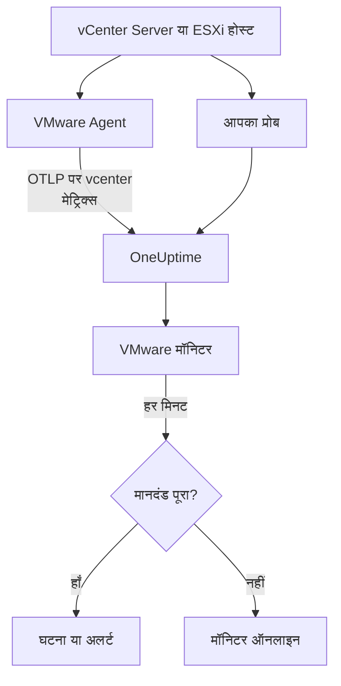

# VMware मॉनिटर

VMware मॉनिटर एक vCenter पर नज़र रखता है - उसके डेटासेंटर, क्लस्टर, ESXi होस्ट, वर्चुअल मशीन, डेटास्टोर, रिसोर्स पूल और vSAN - और आपको तब बताता है जब कोई होस्ट संतृप्त होता है, किसी VM को CPU या मेमोरी नहीं मिलती, कोई डेटास्टोर भर जाता है, या vSphere कोई अलार्म उठाता है। यह वे `vcenter.*` मेट्रिक्स पढ़ता है जिन्हें OneUptime VMware Agent इकट्ठा करता है, या जिन्हें आपका कोई प्रोब एजेंट के बिना इकट्ठा करता है।

:::cards
- [मॉनिटर बनाएँ](#vmware-मॉनिटर-बनाएँ): डैशबोर्ड में छह चरण।
- [टेम्पलेट](#पहले-से-बने-अलर्ट-टेम्पलेट): तेईस तैयार अलर्ट, हर होस्ट, VM या डेटास्टोर के लिए एक घटना।
- [पहचान एट्रिब्यूट](#पहचान-एट्रिब्यूट): एक होस्ट, VM या डेटास्टोर को लक्ष्य कैसे बनाएँ।
- [मेट्रिक्स](#इकट्ठा-किए-गए-मेट्रिक्स): हर `vcenter.*` सीरीज़ जिस पर मॉनिटर अलर्ट कर सकता है।
:::

## यह कैसे काम करता है

मेट्रिक्स vCenter के API से आते हैं, जिन्हें एक केवल-पढ़ने वाले खाते से दो में से किसी एक तरीके से पढ़ा जाता है:

- **VMware Agent**, अपने `vcenter` रिसीवर वाला एक OpenTelemetry Collector, जिसे आप ऐसी मशीन पर चलाते हैं जो vCenter तक पहुँच सकती है। देखें [VMware एजेंट](/docs/telemetry/vmware)।
- **एक प्रोब**, जिसमें कुछ भी इंस्टॉल नहीं करना होता: आप OneUptime में vCenter जोड़ते हैं और वह प्रोब चुनते हैं जो उस तक पहुँचता है। देखें [एजेंट के बिना VMware](/docs/telemetry/vmware-agentless)।

दोनों हर संग्रह अंतराल (डिफ़ॉल्ट रूप से 2 मिनट) में वही सीरीज़ भेजते हैं, जिन पर vCenter का नाम `vmware.vcenter.name` लगा होता है। vCenter एक vSphere एंडपॉइंट है: एक vCenter Server या एक स्टैंडअलोन ESXi होस्ट। VMware मॉनिटर एक vCenter से जुड़ा होता है। हर मिनट वह उस vCenter के मेट्रिक्स पर अपनी क्वेरी चलाता है और परिणाम की तुलना अपने मानदंड से करता है।



## शुरू करने से पहले

- **vCenter के मेट्रिक्स इकट्ठा करें**, [VMware Agent](/docs/telemetry/vmware) से या [एजेंट के बिना](/docs/telemetry/vmware-agentless)। दोनों ऐसे vSphere उपयोगकर्ता का उपयोग करते हैं जिसके पास शीर्ष-स्तर के vCenter ऑब्जेक्ट पर **Read-Only** भूमिका हो, और **Propagate to children** पर टिक लगा हो। एजेंट `ONEUPTIME_URL`, `ONEUPTIME_TELEMETRY_INGESTION_KEY`, `VMWARE_VCENTER_NAME`, `VCENTER_ENDPOINT`, `VCENTER_USERNAME` और `VCENTER_PASSWORD` पढ़ता है।
- **जाँचें कि vCenter पंजीकृत है।** यह **उत्पाद → बुनियादी ढांचा → VMware → सभी vCenter** के अंतर्गत दिखता है: एजेंट के ज़रिए, उसके `VMWARE_VCENTER_NAME` के नाम से, उसके पहले पूरे संग्रह के बाद; एजेंट के बिना, उसे जोड़ने के क्षण से।

## VMware मॉनिटर बनाएँ

:::steps
### नया मॉनिटर शुरू करें

**मॉनिटर** पर जाएँ और **मॉनिटर बनाएं** पर क्लिक करें।

### VMware चुनें

**मॉनिटर प्रकार** में **और मॉनिटर प्रकार** पर क्लिक करें और **बुनियादी ढांचा** के अंतर्गत **VMware** चुनें, या खोज बॉक्स में `vmware` टाइप करें। एक **नाम** दर्ज करें - यह घटना और अलर्ट के शीर्षकों में उपयोग होता है - और **अगला** पर क्लिक करें।

### vCenter चुनें

**VMware Monitor Configuration** के अंतर्गत, **vCenter** से vCenter चुनें। हर वह vCenter जिसने डेटा भेजा है, या जिसे आपने एजेंट के बिना जोड़ा है, सूची में है।

### क्या देखना है चुनें

तीन टैब में से एक चुनें:

- **Quick Setup** - एक [टेम्पलेट](#पहले-से-बने-अलर्ट-टेम्पलेट) पर क्लिक करें। यह मेट्रिक, एट्रिब्यूट फ़िल्टर, एकत्रीकरण, समय सीमा, ग्रुप-बाय और थ्रेशोल्ड सेट करता है, और नीचे के मानदंड को अपने मानदंड से बदल देता है। आप फिर भी **समय सीमा** बदल सकते हैं।
- **Custom Metric** - **VMware Metric** से एक मेट्रिक चुनें, फिर **एकत्रीकरण** और **समय सीमा** सेट करें। फ़ॉर्म उसे उस ऑब्जेक्ट से समूहित करता है जिसका वह वर्णन करता है, इसलिए हर होस्ट, VM या डेटास्टोर को अलग से आँका जाता है, और [फ़िल्टर](#मॉनिटर-सेटिंग्स) उसे एक डेटासेंटर, क्लस्टर, होस्ट, VM, डेटास्टोर या रिसोर्स पूल तक सीमित करते हैं।
- **उन्नत** - **मेट्रिक्स चुनें** के अंतर्गत खुद क्वेरी और सूत्र बनाएँ, `disk_state`, `power_state` या `status` जैसे एट्रिब्यूट पर फ़िल्टर के साथ। हर ऑब्जेक्ट को अलग से आँकने के लिए किसी [पहचान एट्रिब्यूट](#पहचान-एट्रिब्यूट) से **Group by** करें।

### मानदंड जाँचें

**मॉनिटर मानदंड** के अंतर्गत हर मानदंड खोलें और उसके **मीट्रिक**, **एकत्रीकरण**, **शर्त** और **Threshold** जाँचें। टेम्पलेट इन्हें भरता है। **Custom Metric** या **उन्नत** के साथ, मॉनिटर [डिफ़ॉल्ट मानदंड](#डिफ़ॉल्ट-मानदंड) से शुरू होता है, जो केवल मेट्रिक के शून्य पर गिरने को देखता है, इसलिए अपना थ्रेशोल्ड सेट करें।

### मॉनिटर बनाएँ

**मॉनिटर बनाएं** पर क्लिक करें। OneUptime मॉनिटर का पेज खोलता है और हर मिनट उसका मूल्यांकन करता है। उसके उठाए घटनाएँ और अलर्ट vCenter के **घटनाएं** और **अलर्ट** पेज पर भी सूचीबद्ध होते हैं।
:::

> [!TIP]
> एक साथ कई टेम्पलेट सेट करने के लिए, **उत्पाद → बुनियादी ढांचा → VMware** से vCenter खोलें और **Recommendations** पर जाएँ। जो टेम्पलेट चाहिए वे चुनें, चुनें कि किसे पेज किया जाए, और OneUptime हर टेम्पलेट के लिए एक मॉनिटर बनाता है।

## मॉनिटर सेटिंग्स

| फ़ील्ड | टैब | यह क्या करता है |
| --- | --- | --- |
| **vCenter** | सभी | ज़रूरी। हर क्वेरी को `resource.vmware.vcenter.name` तक सीमित करता है। |
| **Datacenter** | Custom Metric, उन्नत | वैकल्पिक। एक डेटासेंटर: `resource.vcenter.datacenter.name`। हर सीरीज़ में यह होता है। |
| **क्लस्टर** | Custom Metric, उन्नत | वैकल्पिक। एक क्लस्टर: `resource.vcenter.cluster.name`। क्लस्टर की अपनी सीरीज़ से और उसमें मौजूद होस्ट, VM और रिसोर्स पूल की सीरीज़ से मेल खाता है; स्टैंडअलोन ESXi होस्ट में यह नहीं होता। |
| **ESXi Host** | Custom Metric, उन्नत | वैकल्पिक। एक ESXi होस्ट: `resource.vcenter.host.name`। होस्ट की अपनी सीरीज़ **और** उस पर चलने वाले हर VM की सीरीज़ से मेल खाता है, क्योंकि VM में उसके होस्ट का नाम होता है। |
| **Virtual Machine** | Custom Metric, उन्नत | वैकल्पिक। एक VM: `resource.vcenter.vm.name`। VM के नाम अनोखे होना ज़रूरी नहीं: जब दो VM का नाम एक हो, तो एक होस्ट या क्लस्टर जोड़ें। |
| **Datastore** | Custom Metric, उन्नत | वैकल्पिक। एक डेटास्टोर: `resource.vcenter.datastore.name`। |
| **Resource Pool Path** | Custom Metric, उन्नत | वैकल्पिक। एक रिसोर्स पूल, उसके इन्वेंट्री पाथ से (`/DC/host/Cluster/Resources/pool`): `resource.vcenter.resource_pool.inventory_path`। पाथ इसलिए, क्योंकि पूल के नाम केवल अपने पैरेंट के भीतर अनोखे होते हैं। |
| **VMware Metric** | Custom Metric | [कैटलॉग](#इकट्ठा-किए-गए-मेट्रिक्स) से एक मेट्रिक। |
| **एकत्रीकरण** | Custom Metric | सैंपल कैसे मिलाए जाते हैं: **औसत**, **अधिकतम**, **न्यूनतम**, **योग** या **गणना**। मेट्रिक के सामान्य एकत्रीकरण से शुरू होता है। |
| **समय सीमा** | सभी | क्वेरी जो रोलिंग विंडो पढ़ती है, **Past 1 Minute** से **Past 365 Days** तक। नया मॉनिटर **Past 5 Minutes** से शुरू होता है; टेम्पलेट अपना मान सेट करते हैं। |
| **मेट्रिक्स चुनें** | उन्नत | क्वेरी बिल्डर: **मीट्रिक**, **Aggregate by**, **Filter by attributes**, **Group by**, साथ ही क्वेरी मिलाने के लिए **मीट्रिक जोड़ें** और **सूत्र जोड़ें**। |

vCenter हर संग्रह अंतराल में एक बार पढ़ा जाता है, डिफ़ॉल्ट रूप से 2 मिनट, इसलिए 1 मिनट की विंडो में शायद कोई सैंपल ही न हो। विंडो 5 मिनट या उससे ज़्यादा रखें, और अगर आपने बड़ी इन्वेंट्री के लिए संग्रह अंतराल बढ़ाया है तो और लंबी।

## पहचान एट्रिब्यूट

`vcenter` रिसीवर हर vSphere ऑब्जेक्ट के लिए एक OpenTelemetry रिसोर्स भेजता है, और उसे **रिसोर्स एट्रिब्यूट** से नाम देता है। किसी सीरीज़ में कौन से एट्रिब्यूट हैं, इससे पता चलता है कि वह किस तरह के ऑब्जेक्ट का वर्णन करती है:

| vSphere ऑब्जेक्ट | पहचान रिसोर्स एट्रिब्यूट |
| --- | --- |
| डेटासेंटर | `vcenter.datacenter.name` |
| क्लस्टर | `vcenter.datacenter.name`, `vcenter.cluster.name` |
| ESXi होस्ट | `vcenter.datacenter.name`, `vcenter.host.name` (+ क्लस्टर में होने पर `vcenter.cluster.name`) |
| वर्चुअल मशीन | `vcenter.datacenter.name`, `vcenter.host.name`, `vcenter.vm.name`, `vcenter.vm.id` (+ `vcenter.cluster.name`; `vcenter.resource_pool.*` या `vcenter.virtual_app.*`) |
| VM टेम्पलेट | `vcenter.datacenter.name`, `vcenter.host.name`, `vcenter.vm_template.name`, `vcenter.vm_template.id` |
| डेटास्टोर | `vcenter.datacenter.name`, `vcenter.datastore.name` |
| रिसोर्स पूल | `vcenter.datacenter.name`, `vcenter.resource_pool.name`, `vcenter.resource_pool.inventory_path` (+ `vcenter.cluster.name` या `vcenter.host.name`) |

मॉनिटर फ़िल्टर और ग्रुप-बाय कुंजियों में, रिसोर्स एट्रिब्यूट `resource.` से शुरू होते हैं (`resource.vcenter.host.name`), जबकि डेटापॉइंट एट्रिब्यूट नहीं (`disk_state`, `power_state`, `status`, `effective`, `direction`, `object`, `type`)। बूलियन `effective` एट्रिब्यूट टेक्स्ट `"true"` या `"false"` के रूप में सहेजा जाता है, इसलिए उसे टेक्स्ट से फ़िल्टर करें। एक ऑब्जेक्ट को लक्ष्य बनाने के लिए किसी पहचान एट्रिब्यूट पर फ़िल्टर करें, और हर ऑब्जेक्ट को अलग से आँकने के लिए उससे समूहित करें।

## पहले से बने अलर्ट टेम्पलेट

OneUptime आम VMware समस्याओं के लिए 23 टेम्पलेट देता है, और **Quick Setup** वे सभी देता है। हर एक पूरा मॉनिटर बनाता है: मेट्रिक क्वेरी, उसके एट्रिब्यूट फ़िल्टर, ऑब्जेक्ट के अपने पहचान एट्रिब्यूट पर ग्रुप-बाय, एक मानदंड जो ट्रिगर करता है और एक जो रिकवर करता है। थ्रेशोल्ड शुरुआती बिंदु हैं जिन्हें आप संपादित कर सकते हैं।

टेम्पलेट पिछले 5 मिनट पढ़ते हैं, जब तक तालिका कुछ और न कहे। मानदंड तभी ट्रिगर होता है जब शर्त उसकी विंडो के हर मिनट के लिए सही हो, और थ्रेशोल्ड मानदंड अपने थ्रेशोल्ड से 10% आगे जाने पर रिकवर होता है, इसलिए रेखा के आसपास मँडराता मान बार-बार बदलाव नहीं करता।

| टेम्पलेट | श्रेणी | गंभीरता | किस पर नज़र | कब ट्रिगर होता है | कब रिकवर होता है |
| --- | --- | --- | --- | --- | --- |
| Host CPU Saturation | होस्ट | Warning | `vcenter.host.cpu.utilization`, `resource.vcenter.host.name` के अनुसार Avg | 90% से ऊपर: होस्ट पर हर VM कोर के लिए होड़ करता है, और CPU ready समय दिखाता है | 81% या नीचे |
| Host Memory Saturation | होस्ट | Warning | `vcenter.host.memory.utilization`, होस्ट के अनुसार Avg | 90% से ऊपर: होस्ट बैलूनिंग, कम्प्रेशन और स्वैपिंग से मेमोरी वापस लेने लगता है | 81% या नीचे |
| Host Disk Latency High | होस्ट | Warning | `vcenter.host.disk.latency.max`, होस्ट के अनुसार Max | 50 ms से ऊपर: जिन VM की डिस्क उस पाथ पर हैं, वे सभी स्टोरेज का इंतज़ार करते हैं। परफ़ॉर्मेंस काउंटर स्तर 3 चाहिए | 45 ms या नीचे |
| Host Network Packet Errors | होस्ट | Warning | `vcenter.host.network.packet.error.rate`, होस्ट के अनुसार Max | 0 से ऊपर: लगभग हमेशा केबल, SFP या स्विच-पोर्ट की खराबी | 0 पर |
| Host Network Packet Drops | होस्ट | Warning | `vcenter.host.network.packet.drop.rate`, होस्ट के अनुसार Max | 0 से ऊपर: ओवरसब्सक्राइब्ड अपलिंक, या NIC रिंग बफ़र जो भर जाते हैं | 0 पर |
| VM CPU Saturation | Virtual Machine | Warning | `vcenter.vm.cpu.utilization`, `resource.vcenter.vm.name` के अनुसार Avg, **पिछले 15 मिनट** | पूरे 15 मिनट VM के vCPU के 90% से ऊपर: VM को जो दिया गया है, वह उसका उपयोग कर सकता है, इसलिए केवल वही VM पेज करता है जो कभी नीचे नहीं आता | 81% या नीचे |
| VM CPU Ready Contention | Virtual Machine | Warning | `vcenter.vm.cpu.readiness`, VM के अनुसार Avg | 10% से ऊपर: VM चलने के लिए तैयार था, पर होस्ट के पास उसके लिए कोई भौतिक कोर नहीं था। गेस्ट के अंदर से दिखता नहीं | 9% या नीचे |
| VM Memory Saturation | Virtual Machine | Warning | `vcenter.vm.memory.utilization`, VM के अनुसार Avg | उसकी मेमोरी के 90% से ऊपर: गेस्ट पेजिंग शुरू करने वाला है | 81% या नीचे |
| VM Memory Ballooning | Virtual Machine | Warning | `vcenter.vm.memory.ballooned`, VM के अनुसार Max | 0 से ऊपर: होस्ट के पास मेमोरी कम है और वह इस गेस्ट से मेमोरी वापस लेता है | 0 पर |
| VM Memory Swapping | Virtual Machine | गंभीर | `vcenter.vm.memory.swapped`, VM के अनुसार Max | 0 से ऊपर: होस्ट VM की मेमोरी स्वैप करता है, जो बैलूनिंग और कम्प्रेशन के बाद आखिरी उपाय है | 0 पर |
| VM Disk Latency High | Virtual Machine | Warning | `vcenter.vm.disk.latency.max`, VM के अनुसार Max | 50 ms से ऊपर: गेस्ट के ऐप्लिकेशन I/O पर टाइम आउट होते हैं | 45 ms या नीचे |
| VM Disk Usage High | Virtual Machine | Warning | `vcenter.vm.disk.utilization`, VM के अनुसार Avg | उसके प्रोविज़न किए गए स्टोरेज का 90% से ज़्यादा कमिट: थिन-प्रोविज़न VM अपना पूरा आकार लेने वाला है | 81% या नीचे |
| Datastore Capacity Warning | Datastore | Warning | `vcenter.datastore.disk.utilization`, `resource.vcenter.datastore.name` के अनुसार Avg | 80% से ऊपर: एक शुरुआती चेतावनी, क्योंकि थिन डिस्क और स्नैपशॉट बाकी जगह जल्दी भर देते हैं | 72% या नीचे |
| Datastore Capacity Critical | Datastore | गंभीर | `vcenter.datastore.disk.utilization`, डेटास्टोर के अनुसार Avg | 90% से ऊपर: भरा हुआ डेटास्टोर उस पर डिस्क वाले हर VM को रोक देता है | 81% या नीचे |
| Cluster Host Not Effective | क्लस्टर | गंभीर | `vcenter.cluster.host.count` को `effective = false` पर फ़िल्टर, `resource.vcenter.cluster.name` के अनुसार Max | 0 से ऊपर: कोई होस्ट मेंटेनेंस मोड में है, डिस्कनेक्ट है या जवाब नहीं दे रहा, इसलिए क्लस्टर उस क्षमता से कम पर चलता है जिसके लिए उसे बनाया गया था | 0 पर |
| Datacenter Hosts Unhealthy | Datacenter | गंभीर | `vcenter.datacenter.host.count` को `status = red` पर फ़िल्टर, `resource.vcenter.datacenter.name` के अनुसार Max | 0 से ऊपर: किसी होस्ट पर गंभीर अलार्म है, जैसे हार्डवेयर सेंसर, खोया हुआ स्टोरेज पाथ या HA एजेंट त्रुटि | 0 पर |
| Datacenter Hosts Degraded | Datacenter | Warning | `vcenter.datacenter.host.count` को `status = yellow` पर फ़िल्टर, डेटासेंटर के अनुसार Max | 0 से ऊपर: किसी होस्ट पर चेतावनी अलार्म है | 0 पर |
| Datacenter Hosts Powered Off | Datacenter | Warning | `vcenter.datacenter.host.count` को `power_state = off` पर फ़िल्टर, डेटासेंटर के अनुसार Max | 0 से ऊपर: कोई होस्ट बंद है - वह क्रैश हुआ, उसकी बिजली गई, या DPM ने उसे स्टैंडबाय पर रखा | 0 पर |
| Datacenter VMs Unhealthy | Datacenter | Warning | `vcenter.datacenter.vm.count` को `status = red` पर फ़िल्टर, डेटासेंटर के अनुसार Max | 0 से ऊपर: किसी VM पर गंभीर अलार्म है, जैसे विफल HA रीस्टार्ट, खोया हुआ डेटास्टोर या खोई हुई Tools हार्टबीट | 0 पर |
| Datacenter Clusters Unhealthy | Datacenter | गंभीर | `vcenter.datacenter.cluster.count` को `status = red` पर फ़िल्टर, डेटासेंटर के अनुसार Max | 0 से ऊपर: किसी क्लस्टर पर गंभीर अलार्म है, जैसे बहुत कम HA फ़ेलओवर संसाधन, विफल HA चुनाव या गंभीर vSAN हेल्थ चेक | 0 पर |
| vSAN Latency High | vSAN | Warning | `vcenter.cluster.vsan.latency.avg`, क्लस्टर के अनुसार Avg | 20 000 µs (20 ms) से ऊपर: vSAN डेटास्टोर पर हर VM के लिए स्टोरेज धीमा हो जाता है। बिना vSAN वाले क्लस्टर पर चुप रहता है | 18 000 µs या नीचे |
| vSAN Congestion | vSAN | Warning | `vcenter.cluster.vsan.congestions`, क्लस्टर के अनुसार Max | 0 से ऊपर: कोई डिस्क ग्रुप साथ नहीं दे पाता, और vSAN अपने क्लाइंट का I/O धीमा कर देता है | 0 पर |
| Resource Pool Memory Swapped | क्लस्टर | Warning | `vcenter.resource_pool.memory.swapped`, `resource.vcenter.resource_pool.inventory_path` के अनुसार Max | 0 से ऊपर: पूल के VM होस्ट स्वैप से मेमोरी लेते हैं, आमतौर पर इसलिए कि पूल की मेमोरी सीमा या शेयर बहुत कम हैं | 0 पर |

**गंभीरता** वह लेबल है जो पिकर दिखाता है। टेम्पलेट जो घटना और अलर्ट बनाता है, वे आपके प्रोजेक्ट की सबसे गंभीर घटना और अलर्ट गंभीरता से शुरू होते हैं; उन्हें मानदंड में बदलें।

- **उपयोग टेम्पलेट Avg का उपयोग करते हैं:** रिसीवर हर ऑब्जेक्ट के लिए 0 से 100 तक का वास्तविक प्रतिशत रिपोर्ट करता है, इसलिए एक मिनट का औसत ही लगातार बना रहने वाला उपयोग है।
- **लेटेंसी टेम्पलेट Max का उपयोग करते हैं:** मेट्रिक पहले से ही ऑब्जेक्ट की सभी डिस्क में सबसे खराब लेटेंसी है, इसलिए उसका सबसे ऊँचा सैंपल ही सही तस्वीर है।
- **गिनती और स्थिति टेम्पलेट Max का उपयोग करते हैं**, ताकि स्थिति दिखाने वाला एक ही संग्रह उन्हें ट्रिगर कर दे: पैकेट त्रुटियाँ, बैलूनिंग, स्वैपिंग, लाल और पीली स्थिति, वे होस्ट जो प्रभावी नहीं हैं, कंजेशन।
- **हर टेम्पलेट ऑब्जेक्ट के अपने पहचान एट्रिब्यूट से समूहित करता है**, इसलिए हर प्रभावित ऑब्जेक्ट के लिए एक घटना ट्रिगर होती है, और घटना उसका नाम बताती है।
- **थ्रेशोल्ड अपनी इकाई से बंधे हैं** (`%`, `ms`, `us`), इसलिए चार्ट चाहे कोई भी इकाई दिखाए, उनका अर्थ वही रहता है।

## इकट्ठा किए गए मेट्रिक्स

नीचे दिए गए मेट्रिक्स वह कैटलॉग हैं जो मॉनिटर फ़ॉर्म देता है। इकाइयाँ रिसीवर की अपनी हैं: `MHz`, `%`, `MiBy` (मेबीबाइट), `By` (बाइट), `KiBy`, `ms`, `us` (माइक्रोसेकंड), `{KiBy/s}`, `By/s` और गिनतियाँ। जिस मेट्रिक पर _डिफ़ॉल्ट रूप से बंद_ लिखा है, वह तब तक इकट्ठा नहीं होता जब तक आप उसे एजेंट की `otel-collector-config.yaml` में चालू न करें; एजेंट के साथ आने वाला कॉन्फ़िगरेशन पहले से `vcenter.host.memory.capacity` चालू करता है।

### डेटासेंटर

| मेट्रिक | इकाई | विवरण |
| --- | --- | --- |
| `vcenter.datacenter.cluster.count` | `{clusters}` | डेटासेंटर के क्लस्टर, `status` (`red` / `yellow` / `green` / `gray`) के अनुसार बँटे हुए। कुल के लिए योग करें; गंभीर अलार्म वाले क्लस्टर के लिए `status = red` फ़िल्टर करें |
| `vcenter.datacenter.cpu.limit` | `MHz` | हर ESXi होस्ट को मिलाकर डेटासेंटर को उपलब्ध कुल CPU |
| `vcenter.datacenter.datastore.count` | `{datastores}` | डेटासेंटर के डेटास्टोर |
| `vcenter.datacenter.disk.space` | `By` | पूरे डेटासेंटर में डेटास्टोर की जगह, `disk_state` (`used` / `available`) के अनुसार बँटी हुई। used ÷ (used + available) पूरे डेटासेंटर का स्टोरेज उपयोग है |
| `vcenter.datacenter.host.count` | `{hosts}` | डेटासेंटर के ESXi होस्ट, `status` और `power_state` (`on` / `off` / `standby` / `unknown`) के अनुसार बँटे हुए। `status = red` या `power_state = off` फ़िल्टर करें |
| `vcenter.datacenter.memory.limit` | `By` | हर ESXi होस्ट को मिलाकर डेटासेंटर को उपलब्ध कुल भौतिक मेमोरी |
| `vcenter.datacenter.vm.count` | `{virtual_machines}` | डेटासेंटर की वर्चुअल मशीनें, `status` और `power_state` (`on` / `off` / `suspended` / `unknown`) के अनुसार बँटी हुई। चल रहे VM के लिए `power_state = on` फ़िल्टर करें |

### क्लस्टर

| मेट्रिक | इकाई | विवरण |
| --- | --- | --- |
| `vcenter.cluster.cpu.effective` | `MHz` | वह CPU जिसे क्लस्टर वास्तव में शेड्यूल कर सकता है — मेंटेनेंस मोड वाले या जवाब न देने वाले होस्ट को छोड़कर। सेवा से बाहर क्षमता के लिए `vcenter.cluster.cpu.limit` से तुलना करें |
| `vcenter.cluster.cpu.limit` | `MHz` | होस्ट की स्थिति चाहे जो हो, क्लस्टर के हर ESXi होस्ट का कुल CPU |
| `vcenter.cluster.host.count` | `{hosts}` | क्लस्टर के ESXi होस्ट, `effective` (`"true"` / `"false"`) के अनुसार बँटे हुए। मेंटेनेंस मोड में, डिस्कनेक्ट या जवाब न देने पर होस्ट प्रभावी नहीं होता |
| `vcenter.cluster.memory.effective` | `By` | वह मेमोरी जिसे क्लस्टर वास्तव में VM को दे सकता है — मेंटेनेंस मोड / जवाब न देने वाले होस्ट और ESXi की अपनी आरक्षित मेमोरी को छोड़कर |
| `vcenter.cluster.memory.limit` | `By` | क्लस्टर के हर ESXi होस्ट की कुल भौतिक मेमोरी |
| `vcenter.cluster.vm.count` | `{virtual_machines}` | क्लस्टर की वर्चुअल मशीनें, `power_state` के अनुसार बँटी हुई। कुल के लिए योग करें; चल रहे VM के लिए `power_state = on` फ़िल्टर करें |
| `vcenter.cluster.vm_template.count` | `{virtual_machine_templates}` | क्लस्टर के वर्चुअल मशीन टेम्पलेट |

### होस्ट (ESXi)

| मेट्रिक | इकाई | विवरण |
| --- | --- | --- |
| `vcenter.host.cpu.capacity` | `MHz` | ESXi होस्ट की कुल CPU क्षमता (कोर × क्लॉक) — `vcenter.host.cpu.usage` का प्रतिशत निकालने के लिए इसी से भाग दें |
| `vcenter.host.cpu.reserved` | `MHz` | वर्चुअल मशीनों के लिए आरक्षित CPU, `cpu_reservation_type` (`total` / `used`) के अनुसार बँटा हुआ। `used` के `total` के करीब पहुँचने का मतलब है कि नए आरक्षण एडमिशन कंट्रोल में विफल होंगे |
| `vcenter.host.cpu.usage` | `MHz` | हर VM और खुद हाइपरवाइज़र द्वारा होस्ट पर अभी इस्तेमाल हो रहा CPU |
| `vcenter.host.cpu.utilization` | `%` | होस्ट का CPU उपयोग, उसकी क्षमता के प्रतिशत (0–100) के रूप में |
| `vcenter.host.disk.latency.avg` | `ms` | औसत डिस्क लेटेंसी (डिवाइस + कर्नेल समय), `direction` (`read` / `write`) और `object` (डिस्क डिवाइस) के अनुसार बँटी हुई। परफ़ॉर्मेंस काउंटर स्तर 2 चाहिए |
| `vcenter.host.disk.latency.max` | `ms` | होस्ट जिन डिस्क का उपयोग करता है उन सब में देखी गई सबसे ऊँची लेटेंसी, हर `object` के लिए, नवीनतम 20 s अंतराल में। परफ़ॉर्मेंस काउंटर स्तर 3 चाहिए |
| `vcenter.host.disk.throughput` | `{KiBy/s}` | होस्ट की डिस्क से पढ़े या उन पर लिखे गए किलोबाइट प्रति सेकंड, `direction` और `object` के अनुसार। परफ़ॉर्मेंस काउंटर स्तर 4 चाहिए |
| `vcenter.host.memory.active` | `MiBy` | वह मेमोरी जिसे होस्ट के चालू VM सक्रिय रूप से छू रहे हैं। _डिफ़ॉल्ट रूप से बंद_ — एजेंट कॉन्फ़िगरेशन में `vcenter.host.memory.active` चालू करें |
| `vcenter.host.memory.ballooned` | `MiBy` | बैलून ड्राइवर द्वारा होस्ट के VM से वापस ली गई गेस्ट मेमोरी; 0 से ऊपर का मतलब होस्ट पर मेमोरी का दबाव है। _डिफ़ॉल्ट रूप से बंद_ |
| `vcenter.host.memory.capacity` | `MiBy` | होस्ट की कुल भौतिक मेमोरी — `vcenter.host.memory.usage` का प्रतिशत निकालने के लिए इसी से भाग दें। अपस्ट्रीम में डिफ़ॉल्ट रूप से बंद; एजेंट के साथ आने वाला कॉन्फ़िगरेशन इसे चालू करता है |
| `vcenter.host.memory.granted` | `MiBy` | होस्ट पर चालू VM को दी गई मशीन मेमोरी। _डिफ़ॉल्ट रूप से बंद_ |
| `vcenter.host.memory.usage` | `MiBy` | होस्ट पर अभी इस्तेमाल हो रही मेमोरी, हाइपरवाइज़र के अपने ओवरहेड सहित |
| `vcenter.host.memory.utilization` | `%` | होस्ट का मेमोरी उपयोग, उसकी भौतिक क्षमता के प्रतिशत (0–100) के रूप में |
| `vcenter.host.network.packet.drop.rate` | `{packets/s}` | हर भौतिक NIC पर प्रति सेकंड गिराए गए पैकेट, `direction` (`transmitted` / `received`) और `object` (जैसे `vmnic0`) के अनुसार — ओवरसब्सक्राइब्ड अपलिंक या खराब होता NIC |
| `vcenter.host.network.packet.error.rate` | `{errors/s}` | होस्ट के भौतिक NIC पर प्रति सेकंड पैकेट त्रुटियाँ, `direction` और `object` के अनुसार — लगभग हमेशा केबल, SFP या स्विच-पोर्ट की खराबी |
| `vcenter.host.network.packet.rate` | `{packets/s}` | हर भौतिक NIC पर प्रति सेकंड भेजे या प्राप्त पैकेट, `direction` और `object` के अनुसार |
| `vcenter.host.network.throughput` | `{KiBy/s}` | होस्ट द्वारा प्रति सेकंड भेजे या प्राप्त किलोबाइट, `direction` और `object` के अनुसार |
| `vcenter.host.network.usage` | `{KiBy/s}` | होस्ट के सभी NIC पर भेजने + प्राप्त करने की मिली-जुली दर, हर `object` के लिए |

### वर्चुअल मशीन

| मेट्रिक | इकाई | विवरण |
| --- | --- | --- |
| `vcenter.vm.cpu.readiness` | `%` | उस समय का प्रतिशत जब VM चलने के लिए तैयार था पर किसी भौतिक CPU पर शेड्यूल नहीं हो सका (CPU ready)। 5% से ऊपर गेस्ट सुस्त लगता है; 10% से ऊपर होस्ट ओवरसब्सक्राइब्ड है। केवल चालू VM |
| `vcenter.vm.cpu.time` | `%` | VM के vCPU ने हर स्थिति में कितना समय बिताया, `cpu_state` (`idle` / `ready` / `wait`) और `object` (vCPU) के अनुसार। _डिफ़ॉल्ट रूप से बंद_ — `vcenter.vm.cpu.time` चालू करें |
| `vcenter.vm.cpu.usage` | `MHz` | VM द्वारा इस्तेमाल किया गया CPU। केवल चालू VM — इसकी मौजूदगी से ही OneUptime किसी VM की पावर स्थिति का अनुमान लगाता है |
| `vcenter.vm.cpu.utilization` | `%` | VM का CPU उपयोग, उसके कॉन्फ़िगर किए गए vCPU के प्रतिशत (0–100) के रूप में। केवल चालू VM |
| `vcenter.vm.disk.latency.avg` | `ms` | औसत डिस्क लेटेंसी, `direction` (`read` / `write`), `disk_type` (`virtual` / `physical`) और `object` (वर्चुअल डिस्क) के अनुसार। परफ़ॉर्मेंस काउंटर स्तर 2 चाहिए |
| `vcenter.vm.disk.latency.max` | `ms` | 20 s के अंतराल में VM ने किसी भी डिस्क पर देखी सबसे ऊँची कुल लेटेंसी (डिवाइस + कर्नेल समय), हर `object` के लिए |
| `vcenter.vm.disk.throughput` | `{KiBy/s}` | VM की डिस्क से पढ़े या उन पर लिखे गए किलोबाइट प्रति सेकंड, `direction` और `object` के अनुसार। परफ़ॉर्मेंस काउंटर स्तर 2 चाहिए |
| `vcenter.vm.disk.usage` | `By` | VM की फ़ाइलों द्वारा इस्तेमाल की गई डेटास्टोर जगह, `disk_state` (`used` / `available`) के अनुसार बँटी हुई। VM टेम्पलेट के लिए भी भेजी जाती है। कमिट किए गए आकार के लिए `disk_state = used` फ़िल्टर करें |
| `vcenter.vm.disk.utilization` | `%` | VM के प्रोविज़न किए गए स्टोरेज का वह प्रतिशत (0–100) जो डेटास्टोर पर कमिट है — 100% के करीब पहुँचता थिन-प्रोविज़न VM अपना पूरा आकार लेने वाला है |
| `vcenter.vm.memory.ballooned` | `MiBy` | बैलून ड्राइवर (VMware Tools) द्वारा VM से वापस ली गई गेस्ट मेमोरी। 0 से ऊपर का मतलब है कि ESXi होस्ट के पास मेमोरी कम है |
| `vcenter.vm.memory.granted` | `MiBy` | होस्ट द्वारा VM को दी गई मशीन मेमोरी। _डिफ़ॉल्ट रूप से बंद_ — `vcenter.vm.memory.granted` चालू करें |
| `vcenter.vm.memory.swapped` | `MiBy` | होस्ट की स्वैप फ़ाइल से VM को दी गई मेमोरी — बैलूनिंग और कम्प्रेशन के बाद आखिरी उपाय; 0 से ऊपर के किसी भी मान का मतलब है कि VM RAM के बदले डिस्क लेटेंसी चुका रहा है |
| `vcenter.vm.memory.swapped_ssd` | `KiBy` | होस्ट के फ़्लैश स्वैप कैश में स्वैप की गई VM की मेमोरी — स्वैप फ़ाइल से कम तकलीफ़देह, पर फिर भी मेमोरी का दबाव |
| `vcenter.vm.memory.usage` | `MiBy` | VM के गेस्ट द्वारा सक्रिय रूप से इस्तेमाल की गई मेमोरी। चालू और बंद दोनों तरह के VM के लिए भेजी जाती है (बंद होने पर 0) |
| `vcenter.vm.memory.utilization` | `%` | VM का मेमोरी उपयोग, उसकी कॉन्फ़िगर की गई मेमोरी के प्रतिशत (0–100) के रूप में |
| `vcenter.vm.network.broadcast.packet.rate` | `{packets/s}` | हर vNIC पर प्रति सेकंड ब्रॉडकास्ट पैकेट, `direction` और `object` के अनुसार। _डिफ़ॉल्ट रूप से बंद_ |
| `vcenter.vm.network.multicast.packet.rate` | `{packets/s}` | हर vNIC पर प्रति सेकंड मल्टीकास्ट पैकेट, `direction` और `object` के अनुसार। _डिफ़ॉल्ट रूप से बंद_ |
| `vcenter.vm.network.packet.drop.rate` | `{packets/s}` | हर vNIC द्वारा प्रति सेकंड गिराए गए पैकेट, `direction` और `object` के अनुसार। प्राप्त करने वाली तरफ़ के ड्रॉप का आमतौर पर मतलब है कि गेस्ट अपना रिंग बफ़र पर्याप्त तेज़ी से खाली नहीं कर रहा |
| `vcenter.vm.network.packet.rate` | `{packets/s}` | हर vNIC द्वारा प्रति सेकंड भेजे या प्राप्त पैकेट, `direction` और `object` के अनुसार |
| `vcenter.vm.network.throughput` | `By/s` | VM के नेटवर्क पर प्रति सेकंड भेजे या प्राप्त बाइट, `direction` और `object` के अनुसार |
| `vcenter.vm.network.usage` | `{KiBy/s}` | VM की भेजने + प्राप्त करने की मिली-जुली दर, हर `object` के लिए |

### डेटास्टोर

| मेट्रिक | इकाई | विवरण |
| --- | --- | --- |
| `vcenter.datastore.disk.usage` | `By` | डेटास्टोर पर जगह, `disk_state` (`used` / `available`) के अनुसार बँटी हुई। used + available डेटास्टोर की क्षमता है |
| `vcenter.datastore.disk.utilization` | `%` | डेटास्टोर की क्षमता का उपयोग में प्रतिशत (0–100)। भरा हुआ डेटास्टोर उस पर लिखने वाले हर VM को रोक देता है, इसलिए 100% से काफ़ी पहले अलर्ट करें |

### रिसोर्स पूल

| मेट्रिक | इकाई | विवरण |
| --- | --- | --- |
| `vcenter.resource_pool.cpu.shares` | `{shares}` | पूल पर कॉन्फ़िगर किए गए CPU शेयर — पैरेंट पर होड़ होने पर साथी पूलों की तुलना में उसकी सापेक्ष प्राथमिकता |
| `vcenter.resource_pool.cpu.usage` | `MHz` | पूल (और उसके चाइल्ड पूलों) के हर VM द्वारा इस्तेमाल किया गया CPU |
| `vcenter.resource_pool.memory.ballooned` | `MiBy` | पूल के हर VM से बैलून ड्राइवर द्वारा वापस ली गई मेमोरी |
| `vcenter.resource_pool.memory.granted` | `MiBy` | पूल के VM को दी गई होस्ट मेमोरी, `type` (`private` / `shared` — साझा पेज ट्रांसपेरेंट पेज शेयरिंग से डीडुप्लिकेट होते हैं) के अनुसार बँटी हुई |
| `vcenter.resource_pool.memory.shares` | `{shares}` | पूल पर कॉन्फ़िगर किए गए मेमोरी शेयर |
| `vcenter.resource_pool.memory.swapped` | `MiBy` | ESXi होस्ट के स्वैप स्पेस से पूल के VM को दी गई मेमोरी — 0 से ऊपर के किसी भी मान का मतलब है कि पूल का कम से कम एक VM होस्ट-स्वैप हो रहा है |
| `vcenter.resource_pool.memory.usage` | `MiBy` | पूल द्वारा इस्तेमाल की गई मेमोरी, हाल के कलेक्टर बिल्ड पर `type` (`guest` / `host` / `overhead`) के अनुसार बँटी हुई; पुराने बिल्ड बिना प्रकार की एक सीरीज़ भेजते हैं। `type = guest` फ़िल्टर करें |

### vSAN

केवल vSAN वाले क्लस्टर, उनके होस्ट, और vSAN डेटास्टोर पर मौजूद VM के लिए भेजे जाते हैं। लेटेंसी **माइक्रोसेकंड** (`us`) में हैं, होस्ट और VM की मिलीसेकंड लेटेंसी के विपरीत:

| मेट्रिक | इकाई | विवरण |
| --- | --- | --- |
| `vcenter.cluster.vsan.congestions` | `{congestions/s}` | क्लस्टर के हर vSAN क्लाइंट के I/O पर प्रति सेकंड उठे कंजेशन इवेंट — vSAN का अपना बैक-प्रेशर संकेत |
| `vcenter.cluster.vsan.latency.avg` | `us` | vSAN स्टोरेज तक पहुँचते समय क्लस्टर को दिखने वाली औसत लेटेंसी, `type` (`read` / `write`) के अनुसार। 20 000 µs = 20 ms |
| `vcenter.cluster.vsan.operations` | `{operations/s}` | पूरे क्लस्टर में प्रति सेकंड vSAN I/O ऑपरेशन, `type` (`read` / `write` / `unmap`) के अनुसार |
| `vcenter.cluster.vsan.throughput` | `By/s` | क्लस्टर का vSAN थ्रूपुट, `direction` (`read` / `write`) के अनुसार |
| `vcenter.host.vsan.cache.hit_rate` | `%` | नवीनतम 5 min अंतराल में होस्ट के vSAN रीड I/O का वह प्रतिशत जो उसके स्थानीय क्लाइंट कैश से पूरा हुआ — गिरती दर का मतलब है कि रीड कैपेसिटी टियर तक पहुँच रहे हैं |
| `vcenter.host.vsan.congestions` | `{congestions/s}` | होस्ट के vSAN I/O पर प्रति सेकंड उठे कंजेशन इवेंट |
| `vcenter.host.vsan.latency.avg` | `us` | vSAN स्टोरेज तक पहुँचते समय होस्ट को दिखने वाली औसत लेटेंसी, `type` के अनुसार |
| `vcenter.host.vsan.operations` | `{operations/s}` | होस्ट द्वारा जारी प्रति सेकंड vSAN I/O ऑपरेशन, `type` के अनुसार |
| `vcenter.host.vsan.throughput` | `By/s` | होस्ट का vSAN थ्रूपुट, `direction` के अनुसार |
| `vcenter.vm.vsan.latency.avg` | `us` | vSAN स्टोरेज तक पहुँचते समय VM को दिखने वाली औसत लेटेंसी, `type` के अनुसार |
| `vcenter.vm.vsan.operations` | `{operations/s}` | VM द्वारा जारी प्रति सेकंड vSAN I/O ऑपरेशन, `type` के अनुसार |
| `vcenter.vm.vsan.throughput` | `By/s` | VM का vSAN थ्रूपुट, `direction` के अनुसार |

> [!NOTE]
> VM की पावर स्थिति कोई मेट्रिक नहीं है। रिसीवर `vcenter.vm.cpu.*` केवल चालू VM के लिए भेजता है, इसलिए OneUptime **Powered on** और **Powered off** में फ़र्क इस बात से करता है कि CPU डेटा उसी संग्रह में आया या नहीं जिसमें VM का मेमोरी और डिस्क डेटा आया; vCenter का **Virtual Machines** पेज परिणाम दिखाता है। बंद होस्ट पर या कितने VM चल रहे हैं इस पर अलर्ट करने के लिए, `power_state` एट्रिब्यूट का उपयोग करें, जो इन पर होता है: `vcenter.datacenter.host.count`, `vcenter.datacenter.vm.count` या `vcenter.cluster.vm.count`।

## निगरानी मानदंड

मानदंड मॉनिटर की किसी क्वेरी या सूत्र की तुलना एक थ्रेशोल्ड से करता है। VMware मॉनिटर के मानदंड में कोई **फ़िल्टर प्रकार** नहीं होता: हर नियम इन फ़ील्ड के साथ मेट्रिक मान जाँचता है।

| फ़ील्ड | यह क्या करता है |
| --- | --- |
| **मीट्रिक** | जाँचने वाली क्वेरी या सूत्र, उसके वेरिएबल नाम से। |
| **एकत्रीकरण** | विंडो के मान एक उत्तर कैसे बनते हैं: **औसत**, **योग**, **Maximum Value**, **Minimum Value**, **All Values** (हर मान को मेल खाना चाहिए) या **Any Value** (एक काफ़ी है)। |
| **शर्त** | **Greater Than**, **Less Than**, **Greater Than Or Equal To**, **Less Than Or Equal To** या **Equal To** — या कोई विसंगति शर्त: **Anomalously High**, **Anomalously Low** या **Anomalous**। |
| **Threshold** | तुलना के लिए मान। मेट्रिक की इकाई होने पर उसके बगल में इकाई सूची होती है। विसंगति शर्तों के लिए नहीं दिखता। |
| **संवेदनशीलता** | केवल विसंगति शर्तें। **निम्न** (4σ), **मध्यम** (3σ, डिफ़ॉल्ट) या **उच्च** (2σ)। |
| **बेसलाइन विंडो** | केवल विसंगति शर्तें। 14 दिन (डिफ़ॉल्ट), 28, 60 या 90 दिन का इतिहास। |
| **यदि कोई डेटा नहीं** | **और फ़ील्ड** के अंतर्गत। जब विंडो में कोई सैंपल न हो तो क्या होता है: **Ignore** (डिफ़ॉल्ट), **Treat As Zero** या **ट्रिगर**। |

विसंगति शर्तें हर मान की तुलना बेसलाइन में सप्ताह के उसी घंटे से करती हैं। जब तक बेसलाइन विंडो में पर्याप्त इतिहास न हो, वे "Learning" स्थिति में रहती हैं, और कुछ नहीं उठातीं।

शुरुआत के लिए कुछ मानदंड:

- **कोई होस्ट संतृप्त है:** `vcenter.host.cpu.utilization`, औसत, `resource.vcenter.host.name` से समूहित, **Greater Than** `90`, पिछले 5 मिनट में।
- **कोई डेटास्टोर भर रहा है:** `vcenter.datastore.disk.utilization`, औसत, `resource.vcenter.datastore.name` से समूहित, **Greater Than** `80`।
- **किसी क्लस्टर ने एक होस्ट खोया:** `vcenter.cluster.host.count` को `effective = false` पर फ़िल्टर, अधिकतम, `resource.vcenter.cluster.name` से समूहित, **Greater Than** `0`।
- **अपेक्षा से कम VM चल रहे हैं:** `vcenter.cluster.vm.count` को `power_state = on` और `resource.vcenter.cluster.name = Production` पर फ़िल्टर, योग, **Less Than** वह संख्या जिसकी आप अपेक्षा करते हैं।
- **किसी VM की मेमोरी होस्ट-स्वैप हो रही है:** `vcenter.vm.memory.swapped`, अधिकतम, `resource.vcenter.vm.name` से समूहित, **Greater Than** `0`।

### डिफ़ॉल्ट मानदंड

जो मॉनिटर आप टेम्पलेट से नहीं बनाते, वह दो मानदंडों से शुरू होता है:

| क्रम | मानदंड | कब मेल खाता है | फिर |
| --- | --- | --- | --- |
| 1 | Check if _monitor name_ is offline | पहली क्वेरी का कोई भी मान `0` है | मॉनिटर को **ऑफ़लाइन** चिह्नित करता है और घटना "_monitor name_ is offline" घोषित करता है, जो मॉनिटर के ठीक होने पर खुद सुलझ जाती है। |
| 2 | Check if _monitor name_ is online | कोई भी मान `0` से ऊपर है | मॉनिटर को **कार्यरत** चिह्नित करता है। |

> [!IMPORTANT]
> चुप्पी किसी भी मानदंड से मेल नहीं खाती: डेटा भेजना बंद करने वाला vCenter मॉनिटर को वैसे ही छोड़ देता है जैसा वह था। डेटा रुकने पर सूचना पाने के लिए, किसी मानदंड पर **यदि कोई डेटा नहीं** को **ट्रिगर** पर सेट करें। जिस समय OneUptime खुद डेटा प्राप्त नहीं कर रहा था, वह कभी डेटा न होना नहीं माना जाता: जिस जाँच की विंडो में वह समय है, वह इसके बजाय प्रतीक्षा करती है, जैसा [जब OneUptime डेटा प्राप्त नहीं कर रहा हो](/docs/monitor/when-oneuptime-is-not-receiving) समझाता है।

## Terraform

[OneUptime Terraform प्रोवाइडर](/docs/terraform/monitor-steps) VMware मॉनिटर चरण के कॉन्फ़िगरेशन को `vmware_monitor` एट्रिब्यूट में रखता है: `vmwareMonitor` कॉन्फ़िगरेशन (`vcenterIdentifier`, `resourceFilters`, `metricViewConfig`, `rollingTime`) का कच्चा JSON, `jsonencode()` से लिखा गया:

```hcl title="main.tf"
monitor_steps = [{
  vmware_monitor = jsonencode({
    vcenterIdentifier = "prod-vcenter"
    resourceFilters   = { clusterName = "Production" }
    rollingTime       = "Past 5 Minutes"
    metricViewConfig = {
      queryConfigs = [{
        metricAliasData = { metricVariable = "host_cpu", title = "Host CPU", description = "", legend = "" }
        metricQueryData = {
          filterData = {
            metricName     = "vcenter.host.cpu.utilization"
            attributes     = {}
            aggegationType = "Avg"
            aggregateBy    = {}
          }
          groupByAttributeKeys = ["resource.vcenter.host.name"]
        }
      }]
      formulaConfigs = []
    }
  })
  criteria = [ /* ... */ ]
}]
```

`vcenterIdentifier` vCenter का `vmware.vcenter.name` है - वह `VMWARE_VCENTER_NAME` जिसके साथ एजेंट शुरू किया गया था - न कि उसकी OneUptime ID।

## समस्या निवारण

:::details vCenter सूची में vCenter नहीं दिखता
एजेंट जिस vCenter से इकट्ठा करता है, वह एजेंट के डेटा से खुद पंजीकृत होता है। जाँचें कि एजेंट चल रहा है और डेटा भेज रहा है ([इंस्टॉलेशन सत्यापित करें](/docs/telemetry/vmware#इंस्टॉलेशन-सत्यापित-करें) देखें), कि `VMWARE_VCENTER_NAME` सेट है, और कि एक संग्रह अंतराल बीत चुका है: इन्वेंट्री की पहली पूरी जाँच खत्म होने तक कुछ नहीं भेजा जाता।
:::

:::details होस्ट के मेट्रिक्स हैं, पर VM, डेटास्टोर या क्लस्टर के नहीं
केवल-पढ़ने वाले vSphere उपयोगकर्ता को उसकी भूमिका **Propagate to children** के बिना दी गई थी, या vCenter रूट से नीचे के किसी ऑब्जेक्ट पर। जो ऑब्जेक्ट उपयोगकर्ता नहीं देख सकता, वे मेट्रिक्स से बस गायब रहते हैं। शीर्ष-स्तर के vCenter ऑब्जेक्ट पर अनुमति सेट करें, प्रोपेगेशन पर टिक लगाकर।
:::

:::details Host CPU Saturation कभी ट्रिगर नहीं होता
टेम्पलेट `vcenter.host.cpu.utilization` का औसत `resource.vcenter.host.name` के अनुसार निकालता है, इसलिए हर होस्ट को अलग से जाँचा जाता है। अगर आपने अपनी क्वेरी खुद बनाई है, तो उसे पहचान एट्रिब्यूट से उसके `resource.` उपसर्ग के साथ समूहित करें: बिना उपसर्ग का `vcenter.host.name` किसी से मेल नहीं खाता, और सभी होस्ट का एक साथ निकला औसत निष्क्रिय होस्ट की वजह से नीचे खिंच जाता है।
:::

:::details vSAN टेम्पलेट कभी ट्रिगर नहीं होते
`vcenter.cluster.vsan.*`, `vcenter.host.vsan.*` और `vcenter.vm.vsan.*` केवल vSAN वाले क्लस्टर, उनके होस्ट, और vSAN डेटास्टोर पर मौजूद VM के लिए भेजे जाते हैं। vSAN के बिना ये सीरीज़ मौजूद नहीं होतीं, और टेम्पलेट चुप रहते हैं।
:::

:::details effective पर फ़िल्टर किया गया मानदंड किसी से मेल नहीं खाता
रिसीवर का बूलियन `effective` एट्रिब्यूट टेक्स्ट `"true"` या `"false"` के रूप में सहेजा जाता है। उसे टेक्स्ट से फ़िल्टर करें, बूलियन से नहीं।
:::

:::details डिस्क लेटेंसी या थ्रूपुट मेट्रिक्स गायब हैं
`vcenter.host.disk.latency.avg` और `vcenter.vm.disk.*` को vCenter का सांख्यिकी स्तर 2 चाहिए, `vcenter.host.disk.latency.max` को स्तर 3, और `vcenter.host.disk.throughput` को स्तर 4। _vCenter → Configure → General → Statistics_ के अंतर्गत 5 मिनट के अंतराल का सांख्यिकी स्तर बढ़ाएँ।
:::

:::details 1 मिनट की विंडो कोई डेटा नहीं दिखाती
vCenter हर संग्रह अंतराल में एक बार पढ़ा जाता है, डिफ़ॉल्ट रूप से 2 मिनट और बड़ी इन्वेंट्री के लिए अक्सर ज़्यादा, इसलिए 1 मिनट की विंडो में शायद कोई सैंपल न हो। 5 मिनट या उससे ज़्यादा का उपयोग करें।
:::

## अगले कदम

:::cards
- [VMware एजेंट](/docs/telemetry/vmware): वह एजेंट इंस्टॉल करें जो vCenter से इकट्ठा करता है।
- [एजेंट के बिना VMware](/docs/telemetry/vmware-agentless): इसके बजाय किसी प्रोब को इकट्ठा करने दें।
- [Proxmox मॉनिटर](/docs/monitor/proxmox-monitor): Proxmox VE के लिए उसी तरह का मॉनिटर।
- [घटनाओं का अवलोकन](/docs/incidents/index): मानदंड के घटना घोषित करने के बाद क्या होता है।
:::
