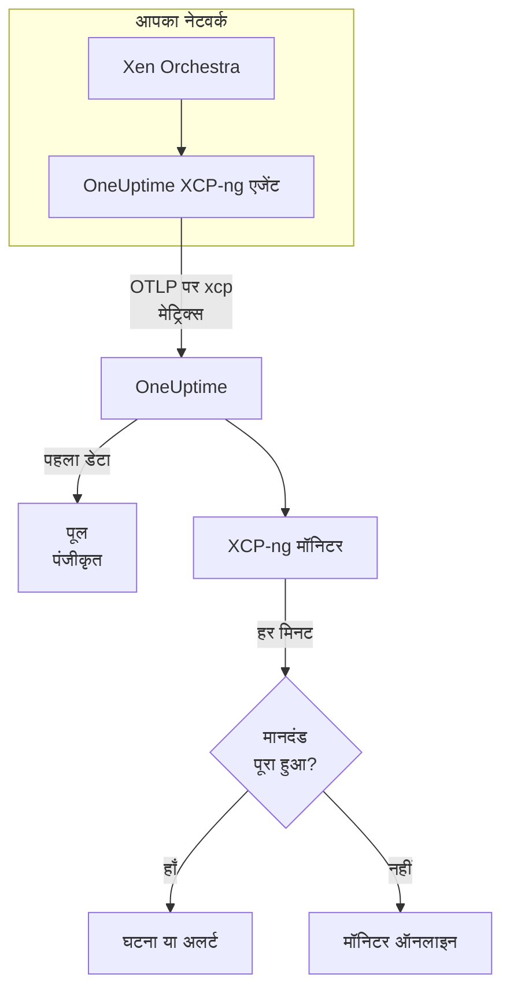

# XCP-ng मॉनिटर

XCP-ng मॉनिटर एक XCP-ng पूल – उसके होस्ट, VM, स्टोरेज रिपॉजिटरी और वर्चुअल डिस्क – की निगरानी करता है और आपको बताता है जब Xen Orchestra पूल खो देता है, कोई होस्ट ऑफ़लाइन हो जाता है या अक्षम बना रहता है, चल रहा कोई VM रुक जाता है या उसे CPU कम मिलता है, या कोई स्टोरेज रिपॉजिटरी भर जाती है या धीमी हो जाती है। यह Xen Orchestra के OpenMetrics प्लगइन की `xcp_*` सीरीज़ पढ़ता है, जिन्हें OneUptime XCP-ng एजेंट इकट्ठा करता है, और वे स्वास्थ्य सीरीज़ जो OneUptime उनसे निकालता है, इसलिए बाहर से कुछ भी नहीं जाँचा जाता।

:::cards
- [मॉनिटर बनाएं](#xcp-ng-मॉनिटर-बनाएं): डैशबोर्ड में छह चरण।
- [टेम्पलेट](#तैयार-अलर्ट-टेम्पलेट): दस तैयार अलर्ट, हर होस्ट, VM या स्टोरेज रिपॉजिटरी के लिए एक घटना।
- [संसाधन पहचान](#संसाधन-पहचान): किसी एक होस्ट, VM या स्टोरेज रिपॉजिटरी को कैसे लक्षित करें।
- [मेट्रिक्स](#इकट्ठा-किए-गए-मेट्रिक्स): हर सीरीज़ जिस पर मॉनिटर अलर्ट कर सकता है।
:::

## यह कैसे काम करता है

OneUptime XCP-ng एजेंट ऐसी मशीन पर चलता है जो Xen Orchestra तक पहुँच सकती है। हर 60 सेकंड में यह Xen Orchestra का OpenMetrics प्लगइन पढ़ता है, जो Xen Orchestra द्वारा प्रबंधित हर पूल के हर होस्ट को पढ़ता है, और सीरीज़ को OTLP पर OneUptime को भेजता है, हर पूल के लिए एक संसाधन, पूल के UUID `xcp_ng.pool.id` के साथ। पहला डेटा हर पूल को पंजीकृत करता है।

XCP-ng मॉनिटर एक पूल से बंधा होता है। हर मिनट यह उस पूल के मेट्रिक्स पर अपनी क्वेरी चलाता है और परिणाम की तुलना अपने मानदंडों से करता है।



## शुरू करने से पहले

- **XCP-ng एजेंट इंस्टॉल करें**, ऐसी जगह जहाँ से यह Xen Orchestra तक पहुँच सके, Xen Orchestra के OpenMetrics प्लगइन के सीक्रेट के साथ। [XCP-ng एजेंट गाइड](/docs/telemetry/xcp-ng) प्लगइन, Xen Orchestra के सर्टिफ़िकेट और इंस्टॉलेशन को कवर करती है।
- **जाँचें कि पूल पंजीकृत है।** पहले स्क्रेप के लगभग एक मिनट बाद यह उसी नाम से **उत्पाद → बुनियादी ढांचा → XCP-ng → सभी पूल** के अंतर्गत दिखता है जो Xen Orchestra उसे देता है।

## XCP-ng मॉनिटर बनाएं

:::steps
### नया मॉनिटर शुरू करें

**मॉनिटर** पर जाएं और **मॉनिटर बनाएं** पर क्लिक करें।

### XCP-ng चुनें

**मॉनिटर प्रकार** के अंतर्गत **और मॉनिटर प्रकार** पर क्लिक करें और **बुनियादी ढांचा** के अंतर्गत **XCP-ng** चुनें, या खोज बॉक्स में `xcp` टाइप करें। एक **नाम** दर्ज करें – यह घटना और अलर्ट के शीर्षकों में इस्तेमाल होता है – और **अगला** पर क्लिक करें।

### पूल चुनें

**XCP-ng Monitor Configuration** के अंतर्गत **XCP-ng पूल** से पूल चुनें। हर वह पूल जिसने डेटा भेजा है, सूची में है। चुनने के बाद, फ़ील्ड के नीचे एक पंक्ति बताती है कि डेटा आ रहा है या नहीं। **XCP-ng पूल जोड़ें** आपकी कुंजियों के साथ भरे सेटअप चरण खोलता है, जो पहले डेटा की प्रतीक्षा करते हैं।

### तय करें कि किस पर नज़र रखनी है

नया मॉनिटर **किस पर अलर्ट करना है** के अंतर्गत **Pool Disconnected** से शुरू होता है। कुछ और देखने के लिए:

- **बदलें** – कोई दूसरा [टेम्पलेट](#तैयार-अलर्ट-टेम्पलेट) चुनें। यह मेट्रिक्स, फ़िल्टर, एकत्रीकरण, समय सीमा और थ्रेशोल्ड सेट करता है, और नीचे के मानदंडों को अपने मानदंडों से बदल देता है। आप अब भी **समय सीमा** बदल सकते हैं।
- **Custom Metric** (**और फ़ील्ड** के अंतर्गत) – **XCP-ng Metric** से एक मेट्रिक चुनें, फिर **एकत्रीकरण** और **समय सीमा** सेट करें। [फ़िल्टर](#मॉनिटर-सेटिंग्स) इसे किसी तरह के ऑब्जेक्ट या एक ऑब्जेक्ट तक सीमित करते हैं।
- **उन्नत** (**और फ़ील्ड** के अंतर्गत) – **मेट्रिक्स चुनें** के अंतर्गत खुद क्वेरी और सूत्र बनाएं, उदाहरण के लिए `xcp_sr_physical_usage_bytes / xcp_sr_physical_size_bytes` से किसी स्टोरेज रिपॉजिटरी का भरा हिस्सा। हर ऑब्जेक्ट को अलग से आँकने के लिए **इसके अनुसार समूहित करें** `xcp_ng.id` का उपयोग करें।

### मानदंड जाँचें

**मानदंड** के अंतर्गत हर मानदंड खोलें और उसका **मेट्रिक**, **एकत्रीकरण**, **शर्त** और **सीमा** जाँचें। टेम्पलेट इन्हें भर देता है। **Custom Metric** या **उन्नत** के साथ मॉनिटर [डिफ़ॉल्ट मानदंडों](#डिफ़ॉल्ट-मानदंड) से शुरू होता है, जो सिर्फ़ मेट्रिक के डेटा न भेजने को पकड़ते हैं, इसलिए अपना थ्रेशोल्ड सेट करें।

### मॉनिटर बनाएं

**मॉनिटर बनाएं** पर क्लिक करें। OneUptime मॉनिटर का पेज खोलता है और हर मिनट उसका मूल्यांकन करता है। यह जो घटनाएं और अलर्ट खोलता है, वे पूल के **घटनाएं** और **अलर्ट** पेज पर भी दिखते हैं।
:::

> [!TIP]
> एक साथ कई टेम्पलेट सेट करने के लिए **उत्पाद → बुनियादी ढांचा → XCP-ng** से पूल खोलें और **सुझाव** पर जाएं। अपने चाहे टेम्पलेट और जिसे बुलाना है उसे चुनें, और OneUptime हर टेम्पलेट के लिए एक मॉनिटर बनाता है।

## मॉनिटर सेटिंग्स

| फ़ील्ड | टैब | यह क्या करता है |
| --- | --- | --- |
| **XCP-ng पूल** | सभी | आवश्यक। हर क्वेरी को `resource.xcp_ng.pool.id`, यानी पूल के UUID, तक सीमित करता है, ताकि एक ही नाम वाले दो पूल कभी न मिलें। |
| **संसाधन क्षेत्र** | Custom Metric, उन्नत | वैकल्पिक। **होस्ट**, **VM**, **स्टोरेज रिपॉजिटरी**, **वर्चुअल डिस्क**, **XOSTOR** या **XCP-ng पूल** – `xcp_ng.scope` से सटीक मिलान। |
| **UUID** | Custom Metric, उन्नत | वैकल्पिक। `xcp_ng.id` से सटीक मिलान: किसी एक होस्ट, VM, स्टोरेज रिपॉजिटरी या वर्चुअल डिस्क का UUID, जैसा Xen Orchestra उसे दिखाता है। किसी एक ऑब्जेक्ट को लक्षित करने के लिए इसे किसी क्षेत्र के साथ जोड़ें। |
| **होस्ट नाम** | Custom Metric, उन्नत | वैकल्पिक। Xen Orchestra के `host_name` लेबल से सटीक मिलान: होस्ट की अपनी सीरीज़ और उस पर चल रहे VM की सीरीज़। |
| **XCP-ng Metric** | Custom Metric | [कैटलॉग](#इकट्ठा-किए-गए-मेट्रिक्स) से एक मेट्रिक। |
| **एकत्रीकरण** | Custom Metric | नमूनों को कैसे जोड़ा जाए: **औसत**, **अधिकतम**, **न्यूनतम**, **योग** या **गणना**। मेट्रिक के सामान्य एकत्रीकरण से शुरू होता है। |
| **समय सीमा** | सभी | वह चलती विंडो जिसे क्वेरी पढ़ती है, **Past 1 Minute** से **Past 365 Days** तक। नया मॉनिटर **Past 1 Minute** से शुरू होता है; टेम्पलेट अपनी विंडो सेट करते हैं। |
| **मेट्रिक्स चुनें** | उन्नत | क्वेरी बिल्डर: **मेट्रिक**, **इसके अनुसार एकत्र करें**, **एट्रिब्यूट से फ़िल्टर करें**, **इसके अनुसार समूहित करें**, साथ में क्वेरी जोड़ने के लिए **मेट्रिक जोड़ें** और **सूत्र जोड़ें**। |

एजेंट हर 60 सेकंड में Xen Orchestra को पढ़ता है, और Xen Orchestra अपने होस्ट को 60 सेकंड के रिज़ॉल्यूशन पर पढ़ता है, इसलिए 1 मिनट की विंडो में लगभग एक नमूना होता है; टेम्पलेट 5 मिनट या उससे ज़्यादा पढ़ते हैं।

## संसाधन पहचान

Xen Orchestra किसी होस्ट या VM को उसके `uuid` लेबल से, किसी स्टोरेज रिपॉजिटरी को `sr_uuid` से और किसी वर्चुअल डिस्क को `vdi_uuid` से पहचानता है। OneUptime हर डेटा पॉइंट के आते ही उस पर दो एट्रिब्यूट लगाता है, ताकि एक फ़िल्टर किसी ऑब्जेक्ट की हर सीरीज़ पढ़ ले, चाहे उसे किसी भी लेबल ने नाम दिया हो। टेम्पलेट इन्हीं पर निर्भर हैं:

| एट्रिब्यूट | मान | किसी VM के लिए |
| --- | --- | --- |
| `xcp_ng.scope` | `pool`, `host`, `vm`, `sr` (स्टोरेज रिपॉजिटरी), `vdi` (वर्चुअल डिस्क), `xostor` | `vm` |
| `xcp_ng.id` | ऑब्जेक्ट का UUID, छोटे अक्षरों में: होस्ट या VM का `uuid`, स्टोरेज रिपॉजिटरी या XOSTOR क्लस्टर का `sr_uuid`, वर्चुअल डिस्क का `vdi_uuid`, और पूल की सीरीज़ पर पूल का अपना UUID | `5c6d7e8f-1a2b-4c3d-9e8f-0a1b2c3d4e5f` |

एक तरह के ऑब्जेक्ट के लिए `xcp_ng.scope` पर, एक ऑब्जेक्ट के लिए `xcp_ng.id` पर फ़िल्टर करें, और हर ऑब्जेक्ट को अलग से आँकने के लिए `xcp_ng.id` के अनुसार समूहित करें। Xen Orchestra के अपने लेबल वैसे ही रहते हैं जैसे वह भेजता है: `host_name` होस्ट की सीरीज़ पर होस्ट का और VM की सीरीज़ पर VM के होस्ट का नाम देता है, `vm_name`, `sr_name` और `vdi_name` बाकी का नाम देते हैं, `power_state` और `enabled` स्थिति सीरीज़ पर होस्ट या VM की स्थिति रखते हैं, और `is_control_domain` कंट्रोल डोमेन की VM सीरीज़ पर `true` होता है।

पूल खुद वह संसाधन है जिस पर सीरीज़ आती हैं, इसलिए फ़िल्टर और समूहीकरण कुंजियों में उसके एट्रिब्यूट पर `resource.` उपसर्ग लगता है: `resource.xcp_ng.pool.id` (उसका UUID), `resource.xcp_ng.pool.name` (Xen Orchestra में उसका नाम) और `resource.xen_orchestra.name` (वह Xen Orchestra जिससे उसे पढ़ा जाता है)।

## तैयार अलर्ट टेम्पलेट

**किस पर अलर्ट करना है** सूची 10 टेम्पलेट देती है। हर एक पूरा मॉनिटर बनाता है – क्वेरी, एट्रिब्यूट फ़िल्टर, एक समूहीकरण, एक मानदंड जो ट्रिगर होता है और एक जो ठीक होता है। ज़्यादातर `xcp_ng.id` के अनुसार समूहित करते हैं, इसलिए हर होस्ट, VM या स्टोरेज रिपॉजिटरी को अपनी घटना और अपना अलर्ट मिलता है। सीमाएँ शुरुआती बिंदु हैं जिन्हें आप बदल सकते हैं।

मानदंड तभी ट्रिगर होता है जब शर्त उसकी विंडो के हर मिनट में सही हो, और सीमा वाला मानदंड अपनी सीमा से 10% आगे ठीक होता है ताकि सीमा पर मंडराता मान बार-बार न बदले। 0/1 सीरीज़ दूसरे मान पर ठीक होती है।

| टेम्पलेट | श्रेणी | गंभीरता | किस पर नज़र रखता है | कब ट्रिगर होता है | कब ठीक होता है |
| --- | --- | --- | --- | --- | --- |
| Pool Disconnected | उपलब्धता | गंभीर | `xcp_pool_connected`, पूरे पूल पर Count, पिछले 10 मिनट | पूरी विंडो में कोई डेटा नहीं | डेटा फिर से आता है |
| Host Offline | उपलब्धता | गंभीर | `xcp_ng.host.running` (`xcp_ng.scope = host` के लिए), प्रति `xcp_ng.id` Min, पिछले 5 मिनट | 1 से कम | 1 पर |
| VM Stopped | VM | चेतावनी | `xcp_ng.vm.stopped_after_running` (`xcp_ng.scope = vm` के लिए), प्रति `xcp_ng.id` Min, पिछले 5 मिनट | 0 से ऊपर | 0 पर |
| Storage Repository Near Full | स्टोरेज | गंभीर | `xcp_sr_physical_usage_bytes` ÷ `xcp_sr_physical_size_bytes` × 100 (`xcp_ng.scope = sr` के लिए, दोनों योग), प्रति `xcp_ng.id`, पिछले 5 मिनट | 90% से ऊपर | 81% या उससे कम |
| Host Disabled | होस्ट | चेतावनी | `xcp_ng.host.enabled` (`xcp_ng.scope = host` के लिए), प्रति `xcp_ng.id` Max, पिछले 30 मिनट | 1 से कम | 1 पर |
| Host Restarted | होस्ट | चेतावनी | `xcp_host_uptime_seconds` और `xcp_ng.host.running` (`xcp_ng.scope = host` के लिए), प्रति `xcp_ng.id` Min, पिछले 5 मिनट | `xcp_host_uptime_seconds` 900 (15 मिनट) से कम है जबकि `xcp_ng.host.running` 1 है | `xcp_host_uptime_seconds` 990 या उससे ज़्यादा है, या `xcp_ng.host.running` 0 है |
| High Host CPU Usage | होस्ट | चेतावनी | `xcp_host_cpu_average` (`xcp_ng.scope = host` के लिए), प्रति `xcp_ng.id` Avg, पिछले 10 मिनट | 0.9 से ऊपर (होस्ट के CPU का 90%) | 0.81 या उससे कम |
| High Host Memory Usage | होस्ट | चेतावनी | (`xcp_host_memory_total_bytes` − `xcp_host_memory_free_bytes`) ÷ `xcp_host_memory_total_bytes` × 100 (`xcp_ng.scope = host` के लिए, दोनों योग), प्रति `xcp_ng.id`, पिछले 10 मिनट | 95% से ऊपर | 85.5% या उससे कम |
| VM Starved of CPU | VM | चेतावनी | `xcp_vm_runstate_full_contention` (`xcp_ng.scope = vm` के लिए), प्रति `xcp_ng.id` Avg, पिछले 15 मिनट | 0.1 से ऊपर (समय का 10%) | 0.09 या उससे कम |
| Storage Repository Slow | स्टोरेज | चेतावनी | `xcp_host_disk_latency_seconds` (`xcp_ng.scope = host` के लिए), प्रति `sr` Avg, पिछले 15 मिनट | 0.05 से ऊपर (50 ms) | 0.045 या उससे कम |

**गंभीरता** वह लेबल है जो चयन सूची दिखाती है। टेम्पलेट जो घटना और अलर्ट बनाता है, वे आपके प्रोजेक्ट की सबसे गंभीर घटना और अलर्ट गंभीरता से शुरू होते हैं; इन्हें मानदंडों में बदलें।

- **Pool Disconnected** तब ट्रिगर होता है जब `xcp_pool_connected` दस मिनट तक आना बंद कर देता है। Xen Orchestra पूल से जुड़े रहने तक हर स्क्रेप पर इसे भेजता है, और पूल का मास्टर खोने पर 0 भेजने के बजाय इसे भेजना बंद कर देता है; यह तब भी रुकता है जब Xen Orchestra, उसका प्लगइन या XCP-ng एजेंट रुक जाता है, या एजेंट OneUptime तक अपना रास्ता खो देता है। सीरीज़ लौटने पर यह हल हो जाता है। जब डेटा रुक जाता है, तो दूसरे टेम्पलेट के पास तुलना के लिए कुछ नहीं होता और वे अपनी आख़िरी स्थिति रखते हैं, इसलिए यही टेम्पलेट आपको बताता है।
- **Host Offline** `xcp_ng.host.running` पढ़ता है, जिसे OneUptime `xcp_host_status` से निकालता है: जब Xen Orchestra होस्ट को Halted रिपोर्ट करता है, या पूल मास्टर का उससे संपर्क टूटने के कारण उसकी स्थिति Unknown होती है, तब 0। होस्ट पर चल रहे VM भी डाउन हैं, जब तक HA ने उन्हें कहीं और फिर से शुरू न किया हो।
- **VM Stopped** `xcp_ng.vm.stopped_after_running` पढ़ता है: जब पिछले 24 घंटों में चला कोई VM Halted या Paused हो, तब 1। एक दिन से ज़्यादा बंद VM जानबूझकर बंद माना जाता है और अलर्ट करना बंद कर देता है, सस्पेंड किया गया VM कभी अलर्ट नहीं करता, और कंट्रोल डोमेन और VM टेम्पलेट शामिल नहीं होते।
- **Host Disabled** उस होस्ट के लिए ट्रिगर होता है जो 30 मिनट तक अक्षम रहता है: मेंटेनेंस मोड में, या इवैक्युएशन के बाद अक्षम छोड़ा गया। XAPI उस पर कोई VM शुरू नहीं करता और HA उस पर फ़ेलओवर नहीं कर सकता। तीस मिनट से नियोजित रीबूट या अपडेट बिना किसी को बुलाए निकल जाता है।
- **Host Restarted** उस होस्ट के लिए ट्रिगर होता है जो चालू है पर 15 मिनट से कम समय से चल रहा है: वह रीबूट हुआ, या क्रैश होकर वापस आया। होस्ट के 16.5 मिनट चलने पर, यानी सीमा से 10% आगे, यह हल हो जाता है; डाउन होस्ट इसके बजाय **Host Offline** ट्रिगर करता है।
- **अनुपात सूत्र** दोनों तरफ़ का **योग** लेते हैं। दोनों एक ही स्क्रेप से आते हैं, इसलिए परिणाम असली प्रतिशत होता है। जो स्टोरेज रिपॉजिटरी 0 आकार रिपोर्ट करती है, जैसा कुछ ISO लाइब्रेरी और हटाने योग्य मीडिया करते हैं, वह कभी ट्रिगर नहीं होती।
- **VM Starved of CPU** पूर्ण प्रतिस्पर्धा पढ़ता है: समय का वह हिस्सा जब किसी VM के सभी vCPU चलने को तैयार थे पर किसी फ़िज़िकल CPU की प्रतीक्षा कर रहे थे। उसके होस्ट पर CPU थ्रेड से ज़्यादा चलने योग्य vCPU हैं, इसलिए VM अपने CPU उपयोग से लगने वाली गति से धीमा चलता है।
- **Storage Repository Slow** `sr` के अनुसार समूहित करता है, जो हर होस्ट डिस्क सीरीज़ पर स्टोरेज रिपॉजिटरी का Xen Orchestra का छोटा id है, इसलिए हर स्टोरेज रिपॉजिटरी को एक घटना मिलती है, और उसकी लेटेंसी उसे पढ़ने और लिखने वाले होस्ट पर औसत की जाती है।

प्लगइन XOSTOR के अलावा कोई अलार्म, कोई HA स्थिति, कोई पूल मास्टर, कोई छूटा पैच और कोई बैकअप रिपोर्ट नहीं करता, इसलिए अभी कोई टेम्पलेट उन पर नज़र नहीं रखता: देखें [प्लगइन अभी क्या कवर नहीं करता](/docs/telemetry/xcp-ng#प्लगइन-अभी-क्या-कवर-नहीं-करता)।

## इकट्ठा किए गए मेट्रिक्स

एजेंट Xen Orchestra के OpenMetrics प्लगइन की हर सीरीज़ हर 60 सेकंड में पढ़ता है; नीचे की सीरीज़ वह कैटलॉग हैं जो मॉनिटर फ़ॉर्म देता है। Xen Orchestra पहले ही XAPI के KiB, MiB/s और माइक्रोसेकंड को बाइट, बाइट प्रति सेकंड और सेकंड में बदल देता है। आठ सीरीज़ जिन्हें वह `_total` नाम देता है और काउंटर के रूप में टाइप करता है, प्रति सेकंड दरें रखती हैं, और OneUptime उन्हें उन दरों के रूप में रखता है जो वे हैं, जैसा [XCP-ng एजेंट गाइड](/docs/telemetry/xcp-ng#एजेंट-क्या-इकट्ठा-करता-है) बताती है। चार `xcp_ng.*` सीरीज़ OneUptime की अपनी हैं, जो Xen Orchestra की स्थिति सीरीज़ के आते ही उनसे निकाली जाती हैं।

### उपलब्धता

| मेट्रिक | इकाई | विवरण |
| --- | --- | --- |
| `xcp_pool_connected` | — | जब तक Xen Orchestra पूल से जुड़ा है, 1। पूल खोने पर Xen Orchestra 0 भेजने के बजाय इसे भेजना बंद कर देता है: इसके रुकने पर नज़र रखें। |
| `xcp_ng.host.running` | — | जब तक Xen Orchestra होस्ट को Running रिपोर्ट करता है, 1; Halted होने या स्थिति Unknown होने पर 0। OneUptime होस्ट की स्थिति से निकालता है। |
| `xcp_ng.host.enabled` | — | जब तक होस्ट सक्षम है, 1; मेंटेनेंस मोड में या इवैक्युएशन के दौरान 0, जब XAPI उस पर कोई VM शुरू नहीं करता। OneUptime होस्ट की स्थिति से निकालता है। |
| `xcp_ng.vm.running` | — | जब तक VM Running है, 1; Halted, Paused या Suspended होने पर 0। कंट्रोल डोमेन शामिल नहीं होते। OneUptime VM की स्थिति से निकालता है। |
| `xcp_ng.vm.stopped_after_running` | — | जब पिछले 24 घंटों में चला कोई VM Halted या Paused हो, तब 1, नहीं तो 0। जिस VM को किसी ने एक दिन से चलते नहीं देखा वह जानबूझकर बंद माना जाता है, और सस्पेंड किया गया VM कभी नहीं गिना जाता। OneUptime द्वारा निकाला गया। |
| `xcp_host_status` | count | हर होस्ट के लिए हमेशा 1, चल रहा हो या नहीं; होस्ट की स्थिति `power_state` (Running, Halted, Unknown) और `enabled` लेबल में होती है। |
| `xcp_vm_status` | count | कंट्रोल डोमेन और VM टेम्पलेट को छोड़कर हर VM के लिए हमेशा 1; VM की स्थिति `power_state` लेबल (Running, Halted, Paused, Suspended) में होती है। |
| `xcp_host_uptime_seconds` | seconds | होस्ट बूट होने के बाद से कितनी देर से चालू है। |
| `xcp_vm_uptime_seconds` | seconds | चल रहा VM शुरू होने के बाद से कितनी देर से चालू है। केवल VM चलने के दौरान रिपोर्ट होता है। |

### होस्ट

| मेट्रिक | इकाई | विवरण |
| --- | --- | --- |
| `xcp_host_cpu_average` | ratio | होस्ट का CPU उपयोग, उसके कोर पर औसत, 0 से 1 के अनुपात के रूप में। |
| `xcp_host_cpu_core_usage` | ratio | होस्ट पर एक CPU थ्रेड का उपयोग, 0 से 1 के अनुपात के रूप में; `core` लेबल बताता है कौन-सा। |
| `xcp_host_load` | — | होस्ट पर चल रहे या चलने की प्रतीक्षा कर रहे vCPU, प्रति फ़िज़िकल CPU। 1 से ऊपर होने पर VM CPU की प्रतीक्षा करते हैं। |
| `xcp_host_load_average` | — | होस्ट के कंट्रोल डोमेन (dom0) का लोड एवरेज। |
| `xcp_host_memory_total_bytes` | bytes | होस्ट की फ़िज़िकल मेमोरी। |
| `xcp_host_memory_free_bytes` | bytes | होस्ट की वह मेमोरी जो किसी VM को नहीं दी गई। होस्ट कितना भरा है, यह देखने के लिए इसकी तुलना `xcp_host_memory_total_bytes` से करें। |
| `xcp_host_memory_reclaimed_bytes` | bytes | डायनेमिक मेमोरी कंट्रोल द्वारा होस्ट के VM से वापस ली गई मेमोरी। |
| `xcp_host_memory_reclaimed_max_bytes` | bytes | डायनेमिक मेमोरी कंट्रोल होस्ट के VM से सबसे ज़्यादा जितनी मेमोरी वापस ले सकता था। |
| `xcp_host_running_vcpus` | count | होस्ट पर चल रहे VM के vCPU, जोड़कर। |
| `xcp_host_power_consumption_watts` | W | होस्ट की बिजली खपत, उसके DCMI सेंसर से पढ़ी गई। जहाँ Xen Orchestra इसे इसके बजाय IPMI पर पढ़ता है, वहाँ वह रीडिंग उसके पूल के बिना भेजता है, इसलिए एजेंट उसे नहीं रखता; उसमें हर VM का अनुमानित हिस्सा रखा जाता है। |

### VM

| मेट्रिक | इकाई | विवरण |
| --- | --- | --- |
| `xcp_vm_cpu_usage` | ratio | VM का CPU उपयोग, उसके vCPU पर औसत, 0 से 1 के अनुपात के रूप में। |
| `xcp_vm_cpu_core_usage` | ratio | एक vCPU का उपयोग, 0 से 1 के अनुपात के रूप में; `core` लेबल बताता है कौन-सा। |
| `xcp_vm_runstate_full_contention` | ratio | समय का वह हिस्सा जब किसी VM के सभी vCPU चलने को तैयार थे पर किसी फ़िज़िकल CPU की प्रतीक्षा कर रहे थे, 0 से 1। ऊँचे मान का मतलब है कि पड़ोसी VM को CPU से वंचित कर रहे हैं। |
| `xcp_vm_runstate_partial_contention` | ratio | समय का वह हिस्सा जब किसी VM के कुछ vCPU फ़िज़िकल CPU की प्रतीक्षा कर रहे थे और बाकी ब्लॉक थे, 0 से 1। |
| `xcp_vm_runstate_concurrency_hazard` | ratio | समय का वह हिस्सा जब किसी VM के कुछ vCPU चल रहे थे जबकि दूसरे फ़िज़िकल CPU की प्रतीक्षा कर रहे थे, 0 से 1। |
| `xcp_vm_runstate_fullrun` | ratio | समय का वह हिस्सा जब किसी VM के सभी vCPU चल रहे थे, 0 से 1। |
| `xcp_vm_runstate_partial_run` | ratio | समय का वह हिस्सा जब किसी VM के कुछ vCPU चल रहे थे और बाकी ब्लॉक थे, 0 से 1। |
| `xcp_vm_runstate_blocked` | ratio | समय का वह हिस्सा जब किसी VM के सभी vCPU ब्लॉक थे, बिना काम के या I/O की प्रतीक्षा में, 0 से 1। |
| `xcp_vm_memory_bytes` | bytes | VM को दी गई मेमोरी। |
| `xcp_vm_memory_target_bytes` | bytes | वह मेमोरी जो डायनेमिक मेमोरी कंट्रोल VM को देना चाहता है। |
| `xcp_vm_memory_internal_free_bytes` | bytes | वह मेमोरी जिसे गेस्ट खाली बताता है। इसके लिए VM में गेस्ट टूल्स चाहिए। |
| `xcp_vm_power_consumption_watts` | W | Xen Orchestra का अनुमान कि किसी VM का उसके होस्ट की बिजली में कितना हिस्सा है, CPU लोड के अनुसार बाँटा गया। जब VM की CPU रीडिंग नहीं थी, तो उसका `data_complete` लेबल `false` होता है। |

### स्टोरेज

| मेट्रिक | इकाई | विवरण |
| --- | --- | --- |
| `xcp_sr_physical_size_bytes` | bytes | किसी स्टोरेज रिपॉजिटरी का फ़िज़िकल आकार। कुछ ISO लाइब्रेरी और हटाने योग्य मीडिया 0 रिपोर्ट करते हैं। |
| `xcp_sr_physical_usage_bytes` | bytes | किसी स्टोरेज रिपॉजिटरी पर इस्तेमाल की गई जगह। यह कितनी भरी है, यह देखने के लिए इसे आकार से भाग दें। |
| `xcp_sr_virtual_size_bytes` | bytes | किसी स्टोरेज रिपॉजिटरी पर हर डिस्क का वर्चुअल आकार, जोड़कर। आकार से ऊपर होने पर, रिपॉजिटरी थिन प्रोविज़निंग से अपनी क्षमता से ज़्यादा आवंटित है। |
| `xcp_vdi_virtual_size_bytes` | bytes | वर्चुअल डिस्क का आकार, जैसा उसका VM उसे देखता है। |
| `xcp_vdi_physical_usage_bytes` | bytes | वर्चुअल डिस्क अपनी स्टोरेज रिपॉजिटरी पर जितनी जगह लेती है। |
| `xcp_host_disk_iops_read` | ops/s | होस्ट से किसी स्टोरेज रिपॉजिटरी तक प्रति सेकंड रीड ऑपरेशन; `sr_name` लेबल बताता है कौन-सी। |
| `xcp_host_disk_iops_write` | ops/s | होस्ट से किसी स्टोरेज रिपॉजिटरी तक प्रति सेकंड राइट ऑपरेशन। |
| `xcp_host_disk_iops_total` | ops/s | होस्ट से किसी स्टोरेज रिपॉजिटरी तक प्रति सेकंड रीड और राइट ऑपरेशन। |
| `xcp_host_disk_throughput_read_bytes` | bytes/s | प्रति सेकंड बाइट जो होस्ट किसी स्टोरेज रिपॉजिटरी से पढ़ता है। |
| `xcp_host_disk_throughput_write_bytes` | bytes/s | प्रति सेकंड बाइट जो होस्ट किसी स्टोरेज रिपॉजिटरी पर लिखता है। |
| `xcp_host_disk_throughput_total_bytes` | bytes/s | प्रति सेकंड बाइट जो होस्ट किसी स्टोरेज रिपॉजिटरी से पढ़ता और उस पर लिखता है। |
| `xcp_host_disk_read_latency_seconds` | seconds | किसी स्टोरेज रिपॉजिटरी से होस्ट की रीड में कितना समय लगता है। |
| `xcp_host_disk_write_latency_seconds` | seconds | किसी स्टोरेज रिपॉजिटरी पर होस्ट की राइट में कितना समय लगता है। |
| `xcp_host_disk_latency_seconds` | seconds | किसी स्टोरेज रिपॉजिटरी पर होस्ट की रीड और राइट में कितना समय लगता है। |
| `xcp_host_disk_iowait` | ratio | समय का वह हिस्सा जब होस्ट किसी स्टोरेज रिपॉजिटरी की प्रतीक्षा कर रहा था, 0 से 1। |
| `xcp_vm_disk_read_bytes_total` | bytes/s | प्रति सेकंड बाइट जो कोई VM अपनी किसी डिस्क से पढ़ता है; `device` लेबल बताता है कौन-सी। यह दर है, भले ही Xen Orchestra इसे `_total` नाम देता है और काउंटर के रूप में टाइप करता है। |
| `xcp_vm_disk_write_bytes_total` | bytes/s | प्रति सेकंड बाइट जो कोई VM अपनी किसी डिस्क पर लिखता है। यह दर है, भले ही Xen Orchestra इसे `_total` नाम देता है और काउंटर के रूप में टाइप करता है। |
| `xcp_vm_disk_iops_read` | ops/s | VM की डिस्क पर प्रति सेकंड रीड ऑपरेशन। |
| `xcp_vm_disk_iops_write` | ops/s | VM की डिस्क पर प्रति सेकंड राइट ऑपरेशन। |
| `xcp_vm_disk_iops_total` | ops/s | VM की डिस्क पर प्रति सेकंड रीड और राइट ऑपरेशन। |
| `xcp_vm_disk_throughput_read_bytes` | bytes/s | VM की डिस्क से प्रति सेकंड पढ़े गए बाइट। |
| `xcp_vm_disk_throughput_write_bytes` | bytes/s | VM की डिस्क पर प्रति सेकंड लिखे गए बाइट। |
| `xcp_vm_disk_throughput_total_bytes` | bytes/s | VM की डिस्क से प्रति सेकंड पढ़े और उस पर लिखे गए बाइट। |
| `xcp_vm_disk_read_latency_seconds` | seconds | VM की डिस्क से रीड में कितना समय लगता है। |
| `xcp_vm_disk_write_latency_seconds` | seconds | VM की डिस्क पर राइट में कितना समय लगता है। |
| `xcp_vm_disk_latency_seconds` | seconds | VM की डिस्क पर रीड और राइट में औसतन कितना समय लगता है। |
| `xcp_vm_disk_iowait` | ratio | समय का वह हिस्सा जब कोई VM अपनी किसी डिस्क की प्रतीक्षा कर रहा था, 0 से 1। |
| `xcp_vm_disk_inflight` | count | VM की डिस्क पर वे अनुरोध जिनका अभी तक जवाब नहीं आया। |
| `xcp_vm_disk_queue_size` | count | VM की डिस्क पर अनुरोधों की औसत कतार। |

### नेटवर्क

| मेट्रिक | इकाई | विवरण |
| --- | --- | --- |
| `xcp_host_network_receive_bytes_total` | bytes/s | प्रति सेकंड बाइट जो होस्ट किसी एक फ़िज़िकल इंटरफ़ेस पर प्राप्त करता है; `interface` लेबल बताता है कौन-सा। यह दर है, भले ही Xen Orchestra इसे `_total` नाम देता है और काउंटर के रूप में टाइप करता है। |
| `xcp_host_network_transmit_bytes_total` | bytes/s | प्रति सेकंड बाइट जो होस्ट किसी एक फ़िज़िकल इंटरफ़ेस पर भेजता है। यह दर है, भले ही Xen Orchestra इसे `_total` नाम देता है और काउंटर के रूप में टाइप करता है। |
| `xcp_host_network_aggregated_receive_bytes` | bytes/s | प्रति सेकंड बाइट जो होस्ट अपने सभी फ़िज़िकल इंटरफ़ेस पर प्राप्त करता है। |
| `xcp_host_network_aggregated_transmit_bytes` | bytes/s | प्रति सेकंड बाइट जो होस्ट अपने सभी फ़िज़िकल इंटरफ़ेस पर भेजता है। |
| `xcp_vm_network_receive_bytes_total` | bytes/s | प्रति सेकंड बाइट जो कोई VM अपने किसी नेटवर्क इंटरफ़ेस पर प्राप्त करता है; `vif` लेबल बताता है कौन-सा। यह दर है, भले ही Xen Orchestra इसे `_total` नाम देता है और काउंटर के रूप में टाइप करता है। |
| `xcp_vm_network_transmit_bytes_total` | bytes/s | प्रति सेकंड बाइट जो कोई VM अपने किसी नेटवर्क इंटरफ़ेस पर भेजता है। यह दर है, भले ही Xen Orchestra इसे `_total` नाम देता है और काउंटर के रूप में टाइप करता है। |
| `xcp_vm_network_receive_errors_total` | errors/s | किसी VM के किसी नेटवर्क इंटरफ़ेस पर प्रति सेकंड प्राप्ति त्रुटियाँ। यह दर है, भले ही Xen Orchestra इसे काउंटर के रूप में टाइप करता है। |
| `xcp_vm_network_transmit_errors_total` | errors/s | किसी VM के किसी नेटवर्क इंटरफ़ेस पर प्रति सेकंड भेजने की त्रुटियाँ। यह दर है, भले ही Xen Orchestra इसे काउंटर के रूप में टाइप करता है। |

### XOSTOR

केवल उन पूल के लिए भेजा जाता है जो XOSTOR चलाते हैं, LINSTOR पर बना Vates का रेप्लिकेटेड स्टोरेज।

| मेट्रिक | इकाई | विवरण |
| --- | --- | --- |
| `xcp_xostor_up` | — | 1 जब Xen Orchestra किसी XOSTOR क्लस्टर का स्वास्थ्य पढ़ सका, 0 जब नहीं पढ़ सका। |
| `xcp_xostor_node_status` | count | किसी XOSTOR क्लस्टर के हर नोड के लिए हमेशा 1; उसकी भूमिका और स्थिति `role` और `state` लेबल में होती है। |
| `xcp_xostor_resource_total` | count | वे LINSTOR संसाधन जिन्हें कोई XOSTOR क्लस्टर परिभाषित करता है। |
| `xcp_xostor_resource_state_count` | count | हर डिस्क स्थिति में किसी XOSTOR क्लस्टर की संसाधन प्रतिकृतियाँ; `state` लेबल बताता है कौन-सी। |
| `xcp_xostor_alarms_up` | — | 1 जब Xen Orchestra किसी XOSTOR क्लस्टर के अलार्म पढ़ सका, 0 जब नहीं पढ़ सका। |
| `xcp_xostor_alarms_count` | count | किसी XOSTOR स्टोरेज रिपॉजिटरी या उसके होस्ट पर सक्रिय XAPI अलार्म, `alarm_name` और `target_type` के अनुसार। कोई अलार्म न होने पर अनुपस्थित। |
| `xcp_xostor_smart_up` | — | 1 जब Xen Orchestra XOSTOR के लिए किसी होस्ट का SMART डेटा पढ़ सका, 0 जब नहीं पढ़ सका। |
| `xcp_xostor_disk_smart_status` | count | किसी XOSTOR होस्ट की हर डिस्क के लिए हमेशा 1; उसका SMART स्वास्थ्य `status` लेबल में होता है। |
| `xcp_xostor_updates_up` | — | 1 जब किसी होस्ट की XOSTOR अपडेट जाँच ने जवाब दिया, 0 जब वह विफल रही। |
| `xcp_xostor_package_update_available` | count | हर उस XOSTOR पैकेज के लिए 1 जिसका अपडेट किसी होस्ट पर प्रतीक्षा कर रहा है; `package` लेबल बताता है कौन-सा। |

## मॉनिटरिंग मानदंड

मानदंड मॉनिटर की किसी क्वेरी या सूत्र की तुलना एक थ्रेशोल्ड से करता है। XCP-ng मॉनिटर के मानदंडों में **फ़िल्टर प्रकार** नहीं होता: हर नियम इन फ़ील्ड के साथ मेट्रिक का मान जाँचता है।

| फ़ील्ड | यह क्या करता है |
| --- | --- |
| **मेट्रिक** | जाँचने के लिए क्वेरी या सूत्र, उसके वेरिएबल नाम से। |
| **एकत्रीकरण** | विंडो के मान एक उत्तर कैसे बनते हैं: **औसत**, **योग**, **अधिकतम मान**, **न्यूनतम मान**, **सभी मान** (पूरी विंडो में हर मान को मेल खाना चाहिए) या **कोई भी मान** (एक काफ़ी है)। |
| **शर्त** | **से बड़ा**, **से छोटा**, **से बड़ा या बराबर**, **से छोटा या बराबर**, **बराबर है** या **बराबर नहीं है** – या कोई विसंगति शर्त: **असामान्य रूप से अधिक**, **असामान्य रूप से कम** या **असामान्य**। **कोई डेटा नहीं** तब मेल खाता है जब क्वेरी ने विंडो में कुछ नहीं भेजा, और **डेटा है** तब जब उसने कुछ भेजा। **ऊपर जाने का अनुमान** और **नीचे जाने का अनुमान** तब मेल खाती हैं जब विंडो में मेट्रिक का रुझान **अनुमान अवधि** के अंत तक सीमा के पार हो। |
| **सीमा** | तुलना के लिए मान। मेट्रिक की कोई इकाई होने पर इसके बगल में इकाइयों की सूची होती है। विसंगति शर्तों के लिए नहीं दिखता। |
| **संवेदनशीलता** | सिर्फ़ विसंगति शर्तें। **निम्न** (4σ), **मध्यम** (3σ, डिफ़ॉल्ट) या **उच्च** (2σ)। |
| **बेसलाइन विंडो** | सिर्फ़ विसंगति शर्तें। 14 दिन (डिफ़ॉल्ट), 28, 60 या 90 दिन का इतिहास। |
| **यदि कोई डेटा नहीं** | **और फ़ील्ड** के अंतर्गत। जब विंडो में कोई नमूना न हो तब क्या हो: **Ignore** (डिफ़ॉल्ट), **Treat As Zero** या **ट्रिगर**। |

विसंगति शर्तें हर मान की तुलना बेसलाइन में सप्ताह के उसी घंटे से करती हैं। जब तक बेसलाइन विंडो में पर्याप्त इतिहास न हो, वे "Learning" स्थिति में रहती हैं और कुछ नहीं बनातीं। यह मॉनिटर अपनी क्वेरी को एट्रिब्यूट से फ़िल्टर करता है, इसलिए हर क्वेरी, और समूहित क्वेरी की हर सीरीज़, की तुलना उसके अपने इतिहास से होती है, उतना पीछे तक जितने समय तक आपके मेट्रिक रखे जाते हैं। अगर वह दो सप्ताह से कम है, तो योग, गिनती या हिस्टोग्राम पर क्वेरी हमेशा उसी स्थिति में रहती है, और बाकी सब की तुलना मेट्रिक की हर सीरीज़ से होती है। हिस्टोग्राम का परसेंटाइल हमेशा उसी स्थिति में रहता है।

हर मानदंड यह भी बताता है कि मेल खाने पर क्या करना है: मॉनिटर की स्थिति बदलना, अलर्ट बनाना या घटना घोषित करना। मानदंड ऊपर से नीचे जाँचे जाते हैं, और जो पहले मेल खाता है वही तय करता है।

### डिफ़ॉल्ट मानदंड

जो मॉनिटर आप टेम्पलेट से नहीं बनाते, वह दो मानदंडों से शुरू होता है:

| क्रम | मानदंड | कब मेल खाता है | फिर |
| --- | --- | --- | --- |
| 1 | जाँचें कि _मॉनिटर का नाम_ ऑफ़लाइन है या नहीं | पहली क्वेरी में पूरी विंडो में कोई डेटा नहीं है | मॉनिटर को **ऑफ़लाइन** चिह्नित करता है और घटना "_मॉनिटर का नाम_ ऑफ़लाइन है" घोषित करता है, जो मॉनिटर ठीक होने पर अपने आप सुलझ जाती है। |
| 2 | जाँचें कि _मॉनिटर का नाम_ ऑनलाइन है या नहीं | पहली क्वेरी में डेटा है | मॉनिटर को **कार्यरत** चिह्नित करता है। |

> [!IMPORTANT]
> `0` का मान भी डेटा है, इसलिए जो मेट्रिक अक्सर शून्य रहता है, जैसे किसी VM की नेटवर्क त्रुटियाँ, वह मॉनिटर को ऑफ़लाइन नहीं करता। किसी मान पर अलर्ट के लिए किसी टेम्पलेट से शुरू करें या थ्रेशोल्ड वाला मानदंड जोड़ें। जब कोई डेटा आता ही नहीं और कोई मानदंड मेल नहीं खाता, तो मॉनिटर अपनी स्थिति बनाए रखता है और खुली घटनाएँ खुली रहती हैं: चुप्पी सुधार नहीं है। वह समय जब OneUptime स्वयं डेटा प्राप्त नहीं कर रहा था, कभी भी डेटा की कमी नहीं माना जाता: जिस जाँच की विंडो में वह समय हो, वह प्रतीक्षा करती है, जैसा कि [जब OneUptime डेटा प्राप्त नहीं कर रहा हो](/docs/monitor/when-oneuptime-is-not-receiving) बताता है।

## Terraform

[OneUptime Terraform प्रोवाइडर](/docs/terraform/monitor-steps) XCP-ng मॉनिटर चरण के कॉन्फ़िगरेशन को `xcp_ng_monitor` एट्रिब्यूट में रखता है: `xcpNgMonitor` कॉन्फ़िगरेशन (`poolIdentifier`, `resourceFilters`, `metricViewConfig`, `rollingTime`) का कच्चा JSON, `jsonencode()` से लिखा हुआ:

```hcl title="main.tf"
monitor_steps = [{
  xcp_ng_monitor = jsonencode({
    poolIdentifier  = "b7569d99-30f8-178a-7d94-801de3e29b5b"
    resourceFilters = { scope = "host" }
    rollingTime     = "Past 10 Minutes"
    metricViewConfig = {
      queryConfigs = [{
        metricAliasData = { metricVariable = "host_cpu", title = "Host CPU", description = "", legend = "" }
        metricQueryData = {
          filterData = {
            metricName     = "xcp_host_cpu_average"
            attributes     = {}
            aggegationType = "Avg"
            aggregateBy    = {}
          }
          groupByAttributeKeys = ["xcp_ng.id"]
        }
      }]
      formulaConfigs = []
    }
  })
  criteria = [ /* ... */ ]
}]
```

`poolIdentifier` पूल का UUID है, उसका `xcp_ng.pool.id` जैसा पूल की **सेटिंग्स** उसे दिखाती हैं, उसका OneUptime ID नहीं। `resourceFilters` में वे [फ़िल्टर](#मॉनिटर-सेटिंग्स) होते हैं जिन्हें फ़ॉर्म **संसाधन क्षेत्र**, **UUID** और **होस्ट नाम** कहता है: `scope` (`host`, `vm`, `sr`, `vdi`, `xostor` या `pool`), `xcpNgId` और `hostName`।

## समस्या निवारण

:::details पूल XCP-ng पूल सूची में नहीं है
पूल एजेंट के डेटा से खुद को पंजीकृत करते हैं। जाँचें कि एजेंट चल रहा है और डेटा भेज रहा है ([XCP-ng एजेंट गाइड](/docs/telemetry/xcp-ng) देखें), और कि Xen Orchestra पूल से जुड़ा है: जिस पूल की Xen Orchestra रिपोर्ट नहीं करता वह कभी OneUptime तक नहीं पहुँचता।
:::

:::details Host Offline या VM Stopped कभी ट्रिगर नहीं होता
वे `xcp_ng.host.running` और `xcp_ng.vm.stopped_after_running` पढ़ते हैं, जिन्हें OneUptime `xcp_host_status` और `xcp_vm_status` से निकालता है। दोनों स्थिति सीरीज़ Xen Orchestra 6.9 या बाद के OpenMetrics प्लगइन से आती हैं: पुराने Xen Orchestra को अपग्रेड करें। **VM Stopped** उस VM के लिए भी चुप रहता है जिसे किसी ने पिछले 24 घंटों में चलते नहीं देखा, और सस्पेंड किए गए VM के लिए भी।
:::

:::details घटनाएं हर होस्ट के लिए एक बार के बजाय पूरे पूल के लिए एक बार ट्रिगर होती हैं
टेम्पलेट की तरह क्वेरी को `xcp_ng.id` के अनुसार समूहित करें। समूहीकरण के बिना, क्वेरी पूल के हर होस्ट, VM या स्टोरेज रिपॉजिटरी को एक सीरीज़ के रूप में पढ़ती है, और उन पर औसत मुश्किल में पड़े एक को छिपा देता है।
:::

:::details कोई थ्रूपुट चार्ट बहुत ज़्यादा दिखाता है, या शून्य से नीचे चला जाता है
दरें रखने वाली आठ `_total` सीरीज़ गेज के रूप में बाइट या त्रुटियाँ प्रति सेकंड में रखी जाती हैं, वही मान जो Xen Orchestra देता है। उन्हें जैसी हैं वैसे पढ़ें, **औसत** या **अधिकतम** के साथ: क्वेरी बिल्डर में **प्रति सेकंड दर में बदलें** दर की दर लेगा। आपके खुद कॉन्फ़िगर किए कलेक्टर को भी उन्हें गेज बनाना होगा, जैसा एजेंट का `transform/xcp-ng-rates` प्रोसेसर करता है; OneUptime भी उन्हें बदलता है जो अब भी काउंटर के रूप में आती हैं।
:::

:::details किसी Xen Orchestra के हर पूल के लिए एक साथ Pool Disconnected ट्रिगर होता है
एजेंट, Xen Orchestra या उसका OpenMetrics प्लगइन रुक गया, या एजेंट ने OneUptime तक अपना रास्ता खो दिया: उस Xen Orchestra के सभी पूल एक साथ चुप हो गए। एजेंट का `troubleshoot.sh` विफल होने वाला चरण बताता है, जैसा [XCP-ng एजेंट गाइड](/docs/telemetry/xcp-ng#समस्या-निवारण) बताती है।
:::

## अगले चरण

:::cards
- [XCP-ng एजेंट](/docs/telemetry/xcp-ng): वह एजेंट इंस्टॉल करें जो मेट्रिक्स भेजता है।
- [Proxmox मॉनिटर](/docs/monitor/proxmox-monitor): Proxmox VE के लिए उसी तरह का मॉनिटर।
- [VMware मॉनिटर](/docs/monitor/vmware-monitor): vSphere के लिए उसी तरह का मॉनिटर।
- [घटनाओं का अवलोकन](/docs/incidents/index): किसी मानदंड के घटना घोषित करने के बाद क्या होता है।
:::
