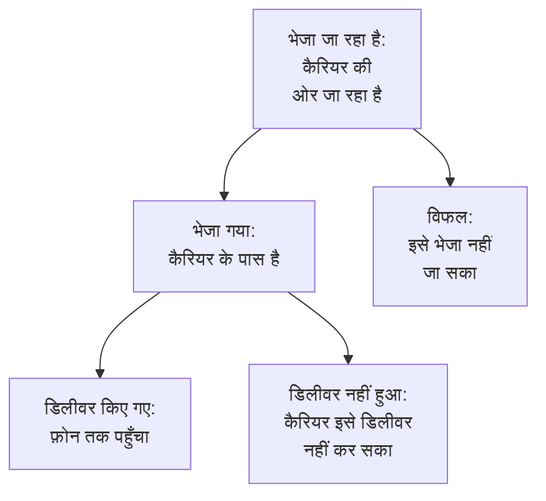

# सूचना लॉग

सूचना लॉग में वह हर संदेश दिखता है जो OneUptime ने आपके प्रोजेक्ट के लिए भेजा, हर चैनल के लिए एक टैब में, और यह भी कि हर संदेश का क्या हुआ: वह गया या नहीं, पहुँचा या नहीं, और अगर नहीं, तो क्यों। इन्हें **प्रोजेक्ट सेटिंग्स → सूचनाएं → सूचना लॉग** में खोलें, या किसी घटना, अलर्ट, रखरखाव इवेंट, स्थिति पृष्ठ या ऑन-कॉल नीति के **सूचना लॉग** में, यह देखने के लिए कि उसके बारे में क्या भेजा गया।

:::cards
- [स्थिति कैसे पढ़ें](#स्थिति-कैसे-पढ़ें): उसका रंग बताता है कि संदेश कहाँ है, और उस पर पॉइंट करने से पता चलता है कि उसका मतलब क्या है।
- [SMS](#sms): भेजा जा रहा है, फिर भेजा गया, फिर डिलीवर किए गए, जैसा कैरियर बताता है।
- [कॉल](#कॉल): कॉल जारी है, और फिर यह कि कॉल कैसे खत्म हुई।
- [WhatsApp और Telegram](#whatsapp-और-telegram): संदेश लेने के बाद हर ऐप क्या बताता है।
- [ईमेल, पुश, वेबहुक और वर्कस्पेस](#ईमेल-पुश-वेबहुक-और-वर्कस्पेस): सफलता, या त्रुटि और उसका कारण।
- [जब SMS भेजा गया पर ही रुका रहे](#जब-sms-भेजा-गया-पर-ही-रुका-रहे): कैरियर जो कभी जवाब नहीं देते, और रिपोर्टें जो कभी नहीं पहुँचतीं।
:::

## स्थिति कैसे पढ़ें

हर स्थिति एक रंगीन लेबल है, जिसका रंग बताता है कि संदेश कहाँ है:

| रंग | संदेश कहाँ है |
| --- | --- |
| धूसर | सौंप दिया गया, और अभी तक कुछ वापस नहीं आया, जैसे **भेजा जा रहा है**। |
| नीला | प्रदाता के पास है, और उसे अभी बताना है कि क्या हुआ, जैसे SMS का **भेजा गया** या कॉल का **कॉल जारी है**। |
| हरा | यह उन तक पहुँच गया, जैसे **डिलीवर किए गए**, या यही इसकी आख़िरी स्थिति है। |
| पीला | यह फ़ोन तक पहुँचा पर किसी ने जवाब नहीं दिया, जैसे **छूटी हुई कॉल**, या यह चेतावनी के साथ गया। |
| लाल | यह उन तक नहीं पहुँचा, जैसे **डिलीवर नहीं हुआ**, **विफल**, **त्रुटि** या **बैलेंस कम है**। |

किसी स्थिति पर पॉइंट करें, उसे टैप करें, या Tab कुंजी से उस तक जाएँ, और वह बताती है कि उसका मतलब क्या है और आगे क्या होगा। पंक्ति के मेनू में **स्थिति संदेश देखें** दिखाता है कि प्रदाता ने क्या कहा, जैसे संदेश की ID या वह क्यों विफल हुआ। हर टैब का **स्थिति** फ़िल्टर वे सभी स्थितियाँ दिखाता है जो वह टैब दिखा सकता है, उसी क्रम में जिसमें कोई संदेश उनसे गुज़रता है।

## SMS

| स्थिति | इसका मतलब |
| --- | --- |
| **भेजा जा रहा है** | OneUptime ने SMS Twilio को सौंप दिया है, जो इसे कैरियर तक पहुँचा रहा है। |
| **भेजा गया** | कैरियर ने SMS स्वीकार कर लिया है। कैरियर के जवाब देते ही यह **डिलीवर किए गए** या **डिलीवर नहीं हुआ** में बदल जाता है। |
| **डिलीवर किए गए** | कैरियर ने पुष्टि की कि SMS फ़ोन तक पहुँच गया। पहुँचे हुए SMS की यही आख़िरी स्थिति है। |
| **डिलीवर नहीं हुआ** | कैरियर इसे डिलीवर नहीं कर सका। **त्रुटि कोड** कारण बताता है: `30003` यानी फ़ोन बंद है या पहुँच से बाहर है, `30005` ऐसा नंबर जो मौजूद नहीं है, `30006` लैंडलाइन, और `30007` ऐसा संदेश जिसे कैरियर ने फ़िल्टर कर दिया। |
| **विफल** | Twilio इसे भेज नहीं सका। **त्रुटि कोड** कारण बताता है। |
| **त्रुटि** | इसे भेजा नहीं गया, उदाहरण के लिए क्योंकि प्रोजेक्ट के लिए SMS बंद हैं, या Twilio ने नंबर अस्वीकार कर दिया। **स्थिति संदेश देखें** कारण बताता है। |
| **बैलेंस कम है** | इसे भेजा नहीं गया: इसका भुगतान करने के लिए प्रोजेक्ट का बैलेंस बहुत कम था। |
| **सफलता** | इसे OneUptime के डिलीवरी ट्रैक करने से पहले भेजा गया था, और Twilio ने इसे स्वीकार किया। |

जिस SMS को सर्वर के अपने SMS और कॉल गेटवे ने लिया, वह हरे रंग में **भेजा गया** पर ही रहता है: गेटवे डिलीवरी की जानकारी नहीं देता, इसलिए यही उसकी आख़िरी स्थिति है।

Twilio हर बदलाव होते ही OneUptime को बताता है, उस खाते के ऑथ टोकन से हस्ताक्षर करके जिससे SMS भेजा गया था, और OneUptime ऐसी हर रिपोर्ट अस्वीकार कर देता है जो Twilio की न हो। इसके लिए Twilio को आपके सर्वर तक पहुँच पाना चाहिए: देखें [Twilio इंटीग्रेशन](/docs/self-hosted/twilio-integration)।

## कॉल

| स्थिति | इसका मतलब |
| --- | --- |
| **कॉल जारी है** | Twilio ने कॉल लगाई। Twilio के यह बताते ही कि कॉल कैसे खत्म हुई, यह बदल जाती है। |
| **सफलता** | कॉल का जवाब दिया गया, और **स्थिति संदेश देखें** बताता है कि वह कितनी देर चली। जिस कॉल को सर्वर के अपने SMS और कॉल गेटवे ने लिया, वह गेटवे के स्वीकार करते ही **सफलता** हो जाती है। |
| **छूटी हुई कॉल** | घंटी बजती रही: किसी ने जवाब नहीं दिया। |
| **व्यस्त** | लाइन व्यस्त थी, या कॉल अस्वीकार कर दी गई। |
| **वॉइसमेल** | ऑन-कॉल कॉल का जवाब वॉइसमेल ने दिया। **स्थिति संदेश देखें** बताता है कि संदेश छोड़ा गया या नहीं। |
| **त्रुटि** | कॉल न लगाई जा सकी, न जोड़ी जा सकी। |
| **बैलेंस कम है** | यह नहीं लगाई गई: इसका भुगतान करने के लिए प्रोजेक्ट का बैलेंस बहुत कम था। |

## WhatsApp और Telegram

WhatsApp संदेश तब तक **कतार में** रहता है जब तक OneUptime उसे सौंप रहा होता है, WhatsApp के स्वीकार करते ही **भेजा गया**, फ़ोन तक पहुँचते ही **डिलीवर किए गए**, और खोले जाते ही **पढ़ा गया**, अगर वह व्यक्ति रीड रसीदें साझा करता है। **विफल** ऐसा संदेश है जिसे WhatsApp डिलीवर नहीं कर सका, और **चेतावनी** ऐसा जिसे उसने चेतावनी के साथ भेजा: **स्थिति संदेश देखें** बताता है कि WhatsApp ने क्या बताया। **त्रुटि** और **बैलेंस कम है** का मतलब है कि वह भेजा नहीं गया, जैसे SMS के लिए।

Telegram संदेश लेने के बाद कुछ नहीं बताता, इसलिए Telegram संदेश का **भेजा गया** हरा होता है: Telegram ने उसे चैट में पोस्ट कर दिया, और यही उसकी आख़िरी स्थिति है।

## ईमेल, पुश, वेबहुक और वर्कस्पेस

ये टैब **सफलता** या **त्रुटि** दिखाते हैं। **सफलता** आख़िरी स्थिति है: मेल सर्वर ने ईमेल स्वीकार किया, पुश सेवा ने सूचना स्वीकार की, वेबहुक के पते ने जवाब दिया कि उसने अनुरोध ले लिया, या वर्कस्पेस ने वह किया जो कहा गया था। मेल सर्वर के स्वीकार करने के बाद OneUptime ईमेल को ट्रैक नहीं करता, और अगर पुश सेवा बाद में बताती है कि पुश सूचना डिलीवर नहीं हुई, तो वह **त्रुटि** में बदल जाती है। **स्थिति संदेश देखें** बताता है कि कोई संदेश **त्रुटि** क्यों है, जैसे **वर्कस्पेस** टैब पर **कारण** बताता है।

## जब SMS भेजा गया पर ही रुका रहे

**भेजा गया** का मतलब है कि SMS कैरियर के पास है और उसने अभी तक जवाब नहीं दिया। ज़्यादातर कैरियर कुछ सेकंड या मिनटों में जवाब दे देते हैं, लेकिन कुछ कभी नहीं देते: तब Twilio भी SMS को `sent` पर ही रखता है, जैसा उसके संदेश लॉग दिखाते हैं, और OneUptime यह नहीं जान सकता कि वह पहुँचा या नहीं।

जो SMS **भेजा जा रहा है** पर ही रुका रहे, वह अलग मामला है: Twilio की रिपोर्टें OneUptime तक नहीं पहुँच रहीं। जाँचें कि Twilio आपके सर्वर तक पहुँच सकता है, और सर्वर के लॉग में `Twilio callback refused` से शुरू होने वाली पंक्तियाँ खोजें: देखें [Twilio इंटीग्रेशन](/docs/self-hosted/twilio-integration)।

## आगे के कदम

:::cards
- [Twilio इंटीग्रेशन](/docs/self-hosted/twilio-integration): Twilio को जोड़ें, और उसकी डिलीवरी रिपोर्टों को OneUptime तक पहुँचने दें।
- [SMS और कॉल गेटवे](/docs/self-hosted/sms-and-call-gateway): अपने खुद के गेटवे से SMS और कॉल भेजें।
- [सूचना डिलीवरी मेट्रिक्स](/docs/self-hosted/notification-delivery-metrics): पूरे इंस्टॉलेशन में जो डिलीवर हुआ, उसे गिनें।
:::
