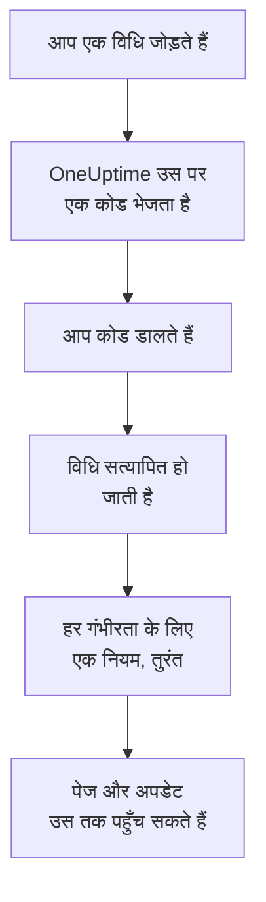

# सूचना विधियां

सूचना विधि वह पता है जिस पर OneUptime किसी एक प्रोजेक्ट में आप तक पहुँच सकता है: एक ईमेल पता, SMS या कॉल के लिए फ़ोन नंबर, WhatsApp नंबर, Telegram खाता, आपका Slack या Microsoft Teams खाता, पुश सूचनाओं के लिए फ़ोन या ब्राउज़र, या एक वेबहुक। आप इन्हें **उपयोगकर्ता सेटिंग्स → सूचना विधियां** में जोड़ते हैं, सत्यापित करते हैं, और OneUptime तुरंत इन्हें आपके पेज के लिए इस्तेमाल करना शुरू कर देता है।

:::cards
- [विधि चुनें](#विधि-चुनें): हर विधि को क्या चाहिए, और वह कैसे सत्यापित होती है।
- [विधि जोड़ें और सत्यापित करें](#विधि-जोड़ें-और-सत्यापित-करें): ईमेल, SMS, कॉल और WhatsApp, 6 अंकों के कोड के साथ।
- [वेबहुक](#वेबहुक): पेज अपने ही endpoint पर भेजें, चाहें तो साइन करके।
- [अपने प्रोजेक्ट के लिए चैनल चालू करें](#अपने-प्रोजेक्ट-के-लिए-चैनल-चालू-करें): SMS, कॉल, WhatsApp या Telegram क्यों गायब हो सकते हैं।
:::

## कोई विधि कैसे चालू होती है



जो विधि आपने सत्यापित नहीं की है, वह कभी इस्तेमाल नहीं होती। पुश डिवाइस, Slack, Microsoft Teams और वेबहुक कोड नहीं माँगते: डिवाइस पंजीकृत करना या अपना खाता जोड़ना साबित करता है कि वह आपका है, और वेबहुक को किसी प्रमाण की ज़रूरत नहीं होती। किसी विधि को सत्यापित करते ही उसके लिए आपके [डिफ़ॉल्ट नियम](/docs/notifications/on-call-rules#शुरुआत-में-मिलने-वाले-नियम) जुड़ जाते हैं, इसलिए नया फ़ोन नंबर हर गंभीरता के लिए आपको पेज करता है, जब तक आप उसके नियम न बदलें।

## विधि चुनें

**सूचना विधियां** के हर टैब में एक या अधिक कार्ड होते हैं, हर तरह की विधि के लिए एक:

| कार्ड | टैब | आप क्या जोड़ते हैं | यह कैसे सत्यापित होती है |
| --- | --- | --- | --- |
| **ईमेल सूचनाओं के लिए** | **Direct Contact** | एक ईमेल पता | ईमेल से भेजा गया कोड |
| **फोन नंबर SMS सूचनाओं के लिए** | **Direct Contact** | एक फ़ोन नंबर | SMS से भेजा गया कोड |
| **कॉल सूचनाओं के लिए फ़ोन नंबर** | **Direct Contact** | एक फ़ोन नंबर | कॉल में पढ़कर सुनाया गया कोड, या SMS के लिए सत्यापित नंबर के लिए कोई कोड नहीं |
| **सूचनाओं के लिए WhatsApp नंबर** | **Direct Contact** | एक WhatsApp नंबर | WhatsApp पर भेजा गया कोड |
| **सूचनाओं के लिए Telegram खाते** | **Direct Contact** | आपका Telegram खाता | OneUptime बॉट को एक संदेश |
| **Slack Account for Notifications** | **Workspace Apps** | आपका Slack खाता | अपने खाते को प्रोजेक्ट के वर्कस्पेस से जोड़ना |
| **Microsoft Teams Account for Notifications** | **Workspace Apps** | आपका Microsoft Teams खाता | अपने खाते को प्रोजेक्ट के वर्कस्पेस से जोड़ना |
| **Push सूचना डिवाइस** | **Push Notifications** | OneUptime On-Call ऐप वाला फ़ोन, या एक ब्राउज़र | डिवाइस को पंजीकृत करना |
| **सूचनाओं के लिए Webhooks** | **Webhooks** | आपका अपना HTTPS endpoint | कुछ नहीं |

**Workspace Apps** तभी दिखता है जब प्रोजेक्ट ने Slack या Microsoft Teams जोड़ा हो, और उसमें केवल वही होते हैं जो जोड़े गए हैं। SMS, कॉल, WhatsApp और Telegram पूरे प्रोजेक्ट के लिए बंद किए जा सकते हैं; देखें [अपने प्रोजेक्ट के लिए चैनल चालू करें](#अपने-प्रोजेक्ट-के-लिए-चैनल-चालू-करें)।

## विधि जोड़ें और सत्यापित करें

ईमेल पते, SMS नंबर, कॉल नंबर और WhatsApp नंबर 6 अंकों के कोड से सत्यापित होते हैं।

:::steps
### अपनी विधियाँ खोलें

**उपयोगकर्ता सेटिंग्स → सूचना विधियां** पर जाएँ। **Direct Contact** पहला टैब है।

### पता जोड़ें

विधि के कार्ड में उसका जोड़ने वाला बटन क्लिक करें, जैसे **फोन नंबर SMS सूचनाओं के लिए जोड़ें**। **ईमेल** डालें, या अंतरराष्ट्रीय प्रारूप में **फ़ोन नंबर**, जैसे `+11234567890`, और सेव करें।

### कोड डालें

सत्यापन डायलॉग अपने आप खुलता है, और बताता है कि कोड कहाँ गया और कब तक काम करेगा। कोड **सत्यापन कोड** में टाइप करें और **सत्यापित करें** क्लिक करें।

### पंक्ति जाँचें

अब पंक्ति पर **सत्यापित** लिखा होता है। डायलॉग जल्दी बंद कर दिया? उसे फिर से खोलने के लिए पंक्ति पर **सत्यापित करें** क्लिक करें।
:::

- कोड 15 मिनट तक काम करता है। पाँच गलत प्रयास उसे रद्द कर देते हैं, और आपको नया कोड चाहिए होता है।
- **Send a new code**, या कॉल नंबर के लिए **Call me with a new code**, डायलॉग में है। आप पिछले कोड के एक मिनट बाद नया माँग सकते हैं।
- SMS के लिए सत्यापित नंबर कॉल के लिए भी सत्यापित होता है। उसे **कॉल सूचनाओं के लिए फ़ोन नंबर** में जोड़ने के लिए कोड नहीं चाहिए, और SMS नंबर सत्यापित करने से उसके लिए जोड़ा गया कॉल नंबर भी सत्यापित हो जाता है।
- आपका साइन-इन ईमेल प्रोजेक्ट में शामिल होने के दिन से ही वहाँ है, सत्यापित।

## Telegram जोड़ें

:::steps
### खाता जोड़ें

**सूचनाओं के लिए Telegram खाते** में **टेलीग्राम खाता जोड़ें** क्लिक करें। **Telegram हैंडल (वैकल्पिक)** केवल आपके लिए एक लेबल है, और खाली रह सकता है।

### बॉट को संदेश भेजें

नई पंक्ति पर **सत्यापित करें** क्लिक करें। **Telegram खाता सत्यापित करें** डायलॉग OneUptime बॉट तक पहुँचने के तीन तरीके देता है: अपने फ़ोन से QR कोड स्कैन करें, **Open in Telegram** क्लिक करें, या Telegram में बॉट खोजकर उसे डायलॉग में दिखाया गया `/start` कमांड भेजें।

### पुष्टि करें

OneUptime में वापस आकर **I've sent the message — check** क्लिक करें। जैसे ही बॉट को आपका संदेश मिलता है, खाता सत्यापित हो जाता है।
:::

**कोड रोटेट करें** उस खाते के लिए नया कोड बनाता है जो अभी सत्यापित नहीं हुआ है। पहले का QR कोड और आपके द्वारा खोला गया लिंक काम करना बंद कर देते हैं। सेल्फ-होस्टेड OneUptime पर, किसी के खाता जोड़ने से पहले सर्वर का एडमिन एक Telegram बॉट जोड़ता है।

## Slack और Microsoft Teams

1. अपना खाता प्रोजेक्ट के वर्कस्पेस से जोड़ें: **उपयोगकर्ता सेटिंग्स → वर्कस्पेस → Slack**, या **Microsoft Teams**। देखें [Slack](/docs/workspace-connections/slack) और [Microsoft Teams](/docs/workspace-connections/microsoft-teams)।
2. **Workspace Apps** टैब पर **Add Slack Account** या **Add Microsoft Teams Account** क्लिक करें। खाता जुड़ते ही सत्यापित हो जाता है।
3. उसकी पंक्ति पर **Send Test Message** क्लिक करें। पेज OneUptime ऐप से डायरेक्ट मैसेज के रूप में आते हैं।

## पुश सूचनाएँ

**Push Notifications** टैब आपके **Push सूचना डिवाइस** की सूची दिखाता है।

- **एक फ़ोन।** OneUptime On-Call ऐप इंस्टॉल करें, उसे अपने OneUptime से जोड़ें, साइन इन करें और सूचनाओं की अनुमति दें: फ़ोन खुद को इस सूची में जोड़ लेता है। देखें [ऐप्स का अवलोकन](/docs/mobile-desktop-apps/index)।
- **यह ब्राउज़र।** **डिवाइस पंजीकृत करें** क्लिक करें, उसे **डिवाइस नाम** दें, और ब्राउज़र के पूछने पर सूचनाओं की अनुमति दें।
- किसी डिवाइस की पंक्ति पर **परीक्षण सूचना** उसे अभी एक पुश भेजता है।
- **महत्वपूर्ण अलर्ट** बताता है कि क्या फ़ोन के पेज साइलेंट मोड और डू नॉट डिस्टर्ब को पार करके बजते हैं। यह ऐप में चालू होता है, यहाँ कभी नहीं, और ब्राउज़र ऐसा नहीं कर सकता। देखें [गंभीर ऑन-कॉल अलर्ट](/docs/self-hosted/push-notifications#गंभीर-ऑन-कॉल-अलर्ट-साइलेंट-मोड-को-ओवरराइड-करना)।
- **सूचनाएँ नहीं मिल रहीं** चिह्नित डिवाइस को कुछ नहीं भेजा जाता। उस फ़ोन पर ऐप खोलें, या ब्राउज़र को फिर से पंजीकृत करें, और वह वापस आ जाता है।

## वेबहुक

वेबहुक हर पेज को JSON के रूप में आपके किसी HTTPS endpoint पर भेजता है, ताकि आपका अपना टूल उस पर काम कर सके।

:::steps
### वेबहुक जोड़ना

**Webhooks** टैब पर **वेबहुक जोड़ें** क्लिक करें। एक **नाम** भरें जिसे आप पहचान सकें, **वेबहुक URL**, और एक **साइनिंग सीक्रेट (वैकल्पिक)**।

### एक परीक्षण भेजें

उसकी पंक्ति पर **परीक्षण भेजें** क्लिक करें। आपके endpoint को एक इवेंट मिलता है जिसका `eventType` `test` है।

### देखें कि क्या आता है

पेज नीचे दिए गए जैसा एक JSON `POST` है। 10 सेकंड के भीतर किसी भी `2xx` स्थिति के साथ जवाब दें; रीडायरेक्ट का पालन नहीं किया जाता।
:::

```json title="A page, as your endpoint receives it"
{
  "eventType": "on-call.incident.created",
  "timestamp": "2026-10-15T09:30:00.000Z",
  "projectId": "6a3f0d2e-1c4b-4e8a-9b7d-2f5c8e1a0b3c",
  "userId": "0c9e8d7f-6b5a-4c3d-8e2f-1a0b9c8d7e6f",
  "incident": {
    "id": "5b4a3c2d-1e0f-4a9b-8c7d-6e5f4a3b2c1d",
    "title": "Checkout API is down",
    "description": "Health check failed from 3 probes.",
    "incidentNumber": 42,
    "incidentNumberWithPrefix": "INC-42",
    "severity": "Critical Incident",
    "state": "Identified"
  },
  "onCallPolicyId": "7d6c5b4a-3e2f-4d1c-9b8a-7f6e5d4c3b2a",
  "onCallPolicyEscalationRuleId": "8e7d6c5b-4a3f-4e2d-8c1b-9a8f7e6d5c4b"
}
```

| `eventType` | किसके लिए भेजा जाता है | रिकॉर्ड की कुंजी |
| --- | --- | --- |
| `on-call.incident.created` | एक घटना | `incident` |
| `on-call.alert.created` | एक अलर्ट | `alert` |
| `on-call.incidentEpisode.created` | एक घटना एपिसोड | `incidentEpisode` |
| `on-call.alertEpisode.created` | एक अलर्ट एपिसोड | `alertEpisode` |

**सूचना सेटिंग्स** में Webhook के लिए आप जो अपडेट चालू करते हैं, वे भी उसी endpoint पर आते हैं, `eventType` में सेटिंग के इवेंट और `subject` व `message` में एक छोटे सारांश के साथ।

हर अनुरोध में `X-OneUptime-Event`, यानी इवेंट का प्रकार, होता है। साइनिंग सीक्रेट होने पर उसमें `X-OneUptime-Signature` भी होता है: `sha256=` के बाद कच्चे बॉडी का HMAC-SHA256, hex में। अनुरोध पर भरोसा करने से पहले इसे जाँचें:

```javascript title="verify-signature.js"
const crypto = require("crypto");

// rawBody: the request body exactly as it arrived, before any JSON parsing.
function isFromOneUptime(rawBody, signatureHeader, secret) {
  const expected =
    "sha256=" + crypto.createHmac("sha256", secret).update(rawBody).digest("hex");
  const received = Buffer.from(signatureHeader || "");
  const wanted = Buffer.from(expected);
  return received.length === wanted.length && crypto.timingSafeEqual(received, wanted);
}
```

वेबहुक को सत्यापन की ज़रूरत नहीं होती, इसलिए उसे जोड़ते ही उसके नियम जुड़ जाते हैं। निजी और आंतरिक पते अस्वीकार कर दिए जाते हैं, जब तक कि सेल्फ-होस्टेड सर्वर का एडमिन उन्हें अनुमति न दे: देखें [निजी नेटवर्क पहुँच](/docs/self-hosted/private-network-access#वेबहुक-और-वर्कफ़्लो)।

## अपने प्रोजेक्ट के लिए चैनल चालू करें

**SMS**, **फ़ोन कॉल**, **WhatsApp** और **Telegram** हर नए प्रोजेक्ट में बंद रहकर शुरू होते हैं, क्योंकि हर संदेश पर पैसा लगता है: OneUptime Cloud पर इसका भुगतान प्रोजेक्ट के बैलेंस से होता है, और अगर प्रोजेक्ट का अपना डिफ़ॉल्ट Twilio खाता उन्हें भेजता है तो SMS और कॉल उसके ज़रिए जाते हैं। ईमेल, पुश, Slack, Microsoft Teams और वेबहुक हमेशा चालू रहते हैं।

जब तक कोई चैनल बंद है, प्रोजेक्ट में कोई भी उस पर विधि नहीं जोड़ सकता: उसके कार्ड पर जोड़ने का बटन नहीं होता, और कार्ड बताता है कि उसे कौन चालू कर सकता है। प्रोजेक्ट का मालिक, कोई **बिलिंग एडमिन** या **Manage Billing** वाला कोई व्यक्ति इसे **प्रोजेक्ट सेटिंग्स → सूचनाएं → सूचना सेटिंग्स** पर **सूचना चैनल** कार्ड में चालू करता है। प्रोजेक्ट एडमिन ऐसा नहीं कर सकता। सेल्फ-होस्टेड OneUptime पर SMS और कॉल को एक Twilio खाता भी चाहिए, और Telegram को एक बॉट जिसे सर्वर का एडमिन जोड़ता है; देखें [Twilio इंटीग्रेशन](/docs/self-hosted/twilio-integration)।

## विधि हटाएँ

विधि की पंक्ति पर **हटाएं** क्लिक करें। विधि हटाने से उसे इस्तेमाल करने वाला हर ऑन-कॉल नियम भी हट जाता है, इसलिए डायलॉग पहले उन नियमों को गिनता है, और हर उस गंभीरता का नाम बताता है जो हटाने के बाद बिना किसी नियम के रह जाएगी।

## समस्या निवारण

:::details किसी कार्ड पर जोड़ने का बटन नहीं है
वह चैनल इस प्रोजेक्ट में बंद है। कार्ड बताता है कि उसे कौन चालू कर सकता है; देखें [अपने प्रोजेक्ट के लिए चैनल चालू करें](#अपने-प्रोजेक्ट-के-लिए-चैनल-चालू-करें)।
:::

:::details कोड कभी नहीं आया
ईमेल में कुछ मिनट लग सकते हैं, और कभी-कभी वे स्पैम में चले जाते हैं; SMS में एक मिनट लग सकता है। एक मिनट रुकें, फिर डायलॉग में **Send a new code** क्लिक करें। **प्रोजेक्ट सेटिंग्स → सूचनाएं → सूचना लॉग** दिखाता है कि संदेश के साथ क्या हुआ।
:::

:::details मेरा Slack खाता जोड़ना विफल हो जाता है
पहले **उपयोगकर्ता सेटिंग्स → वर्कस्पेस → Slack** में अपना खाता जोड़ें, फिर **Add Slack Account** दोबारा क्लिक करें। त्रुटि डायलॉग में एक बटन है जो आपको वहाँ ले जाता है।
:::

:::details मेरे फ़ोन पर पुश सूचनाएँ नहीं आतीं
जाँचें कि फ़ोन **Push सूचना डिवाइस** में सूचीबद्ध है, और उसे एक **परीक्षण सूचना** भेजें। देखें [अक्सर पूछे जाने वाले प्रश्न और समस्या निवारण](/docs/mobile-desktop-apps/faq-troubleshooting#सूचनाएँ)।
:::

## आगे के कदम

:::cards
- [व्यक्तिगत ऑन-कॉल नियम](/docs/notifications/on-call-rules): तय करें कि हर पेज कौन-सी विधि आज़माए, और कब।
- [सूचना सेटिंग्स](/docs/notifications/notification-settings): चुनें कि आपको किन अपडेट के बारे में, किन चैनलों पर पता चले।
- [ऐप्स का अवलोकन](/docs/mobile-desktop-apps/index): अपने फ़ोन या डेस्कटॉप पर पेज पाएँ।
- [OneUptime आप तक कैसे पहुँचता है](/docs/notifications/index): विधियाँ, नियम और सेटिंग्स कैसे एक साथ काम करते हैं।
:::
